# 15回合999大肥猪！马可养猪全局精讲

来源：https://www.bilibili.com/video/BV1cYac6pEn8/?p=1

分析状态：completed

完整文字稿：../../../raw/BV1cYac6pEn8_p1.md

## 00:26–01:26 四张低费牌得宝藏，复制手牌宝藏能直接推进成长。

- 事件 ID：BV1cYac6pEn8:p1:e001
- 场景：实战
- 时机：开局说明马可技能时
- 背景（分析推断）：早期先打能赢的嫦娥单人局，再解释资源路线。
- 学习目标（分析推断）：理解低费出牌与宝藏反馈。
- 模板：mechanic-model
- ASR 段落：[2, 3]

> 能复制一张手牌

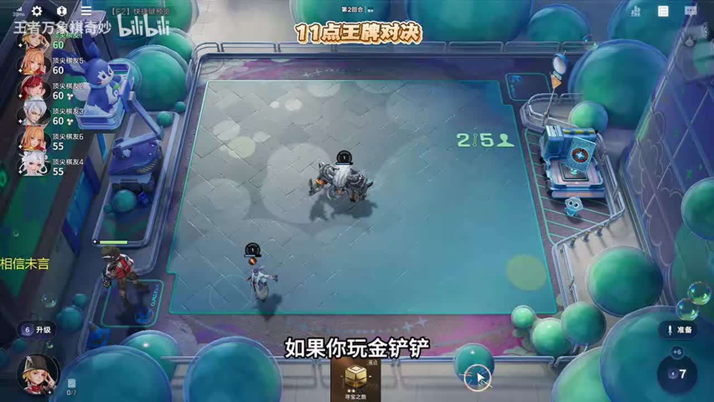

## 01:26–02:33 按随机三选一与小明来牌摇摆，必要时拍卖补猪。

- 事件 ID：BV1cYac6pEn8:p1:e002
- 场景：实战
- 时机：猪与镜尚未确定时
- 背景（分析推断）：不能在主核没到前锁死路线。
- 学习目标（分析推断）：让关键配件决定主核。
- 模板：fallback-plan
- ASR 段落：[4, 5]

> 来个猪就直接是猪,来个镜就是镜

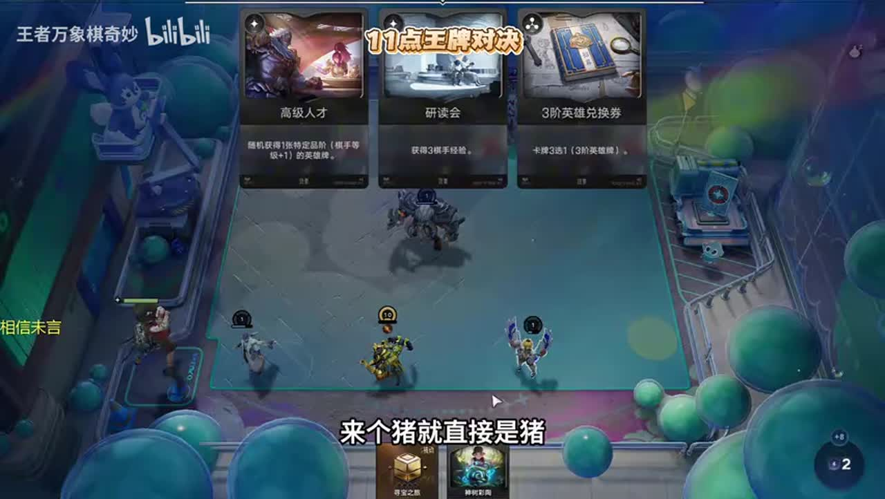

## 02:33–03:38 增益交了仍打不过则保留，尽量换后排减少损血。

- 事件 ID：BV1cYac6pEn8:p1:e003
- 场景：实战
- 时机：对手过强时
- 背景（分析推断）：当前临时投入不能改变战斗结果。
- 学习目标（分析推断）：评估能否改变结果再花资源。
- 模板：economy-budget
- ASR 段落：[6, 7]

> 交了好像也打不过,不交了。

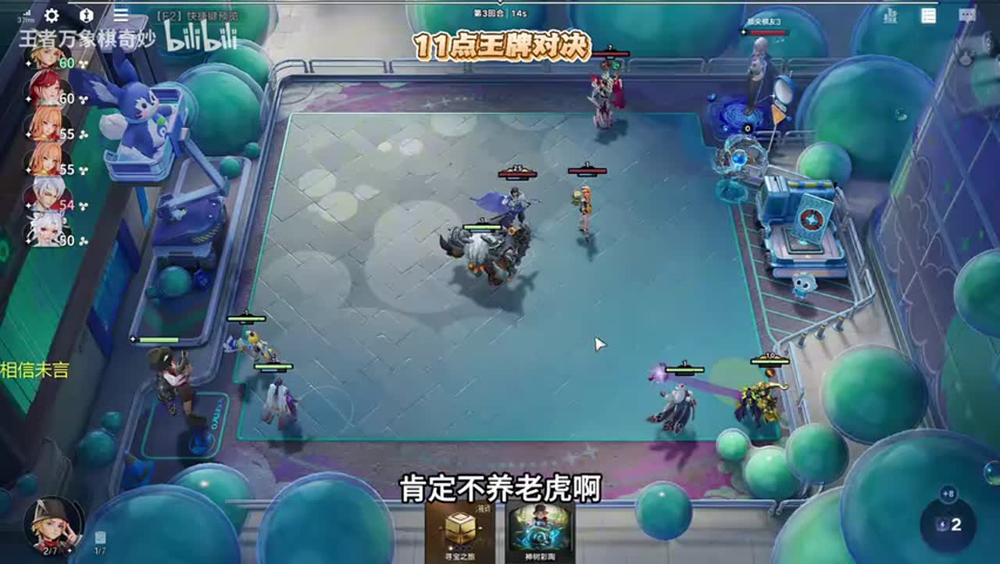

## 03:38–05:19 观察装备奖励的排名条件；匹配更强对手导致奖励落空。

- 事件 ID：BV1cYac6pEn8:p1:e004
- 场景：实战
- 时机：等赢律全体决策后
- 背景（分析推断）：事前想拿第一第二，但实际输而对方赢。
- 学习目标（分析推断）：将奖励预期与随机对局压力区分。
- 模板：combat-review
- ASR 段落：[8, 9, 10]

> 吃不到了装备了

## 05:19–05:54 关注整套阵容以降低漏牌，蛇灵吸引波与猪成长结合。

- 事件 ID：BV1cYac6pEn8:p1:e005
- 场景：实战
- 时机：确定养猪路线时
- 背景（分析推断）：功能配件多，识牌负担影响循环。
- 学习目标（分析推断）：借界面工具减少记忆错误。
- 模板：mechanic-model
- ASR 段落：[11]

> 直接关注,省得漏牌

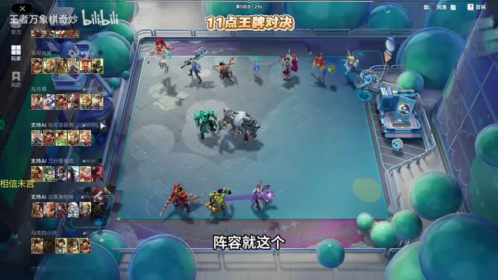

## 06:31–07:30 换新单位再合成，已兑现的工具卖出再上新。

- 事件 ID：BV1cYac6pEn8:p1:e006
- 场景：实战
- 时机：重复使用老夫子与孙尚香时
- 背景（分析推断）：不是只报操作，解释新工具重置资源获取。
- 学习目标（分析推断）：组织可循环触发顺序。
- 模板：resource-order
- ASR 段落：[13, 14]

> 先上个新孙尚香,再打一次合成

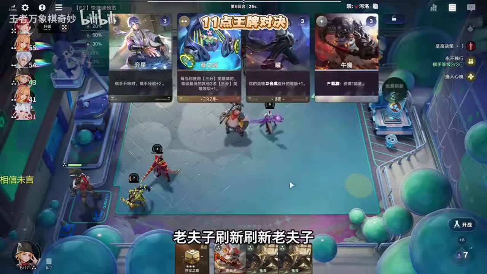

## 07:31–08:33 一般猪可升级，但本局有永不独行应延后，经验先存。

- 事件 ID：BV1cYac6pEn8:p1:e007
- 场景：实战
- 时机：建议升四级后发现永不独行时
- 背景（分析推断）：讲者主动承认此前升级建议忽略天赋。
- 学习目标（分析推断）：用已选天赋修正通用升级建议。
- 模板：combat-review
- ASR 段落：[15, 16]

> 我是永不独行的话我得晚点升级

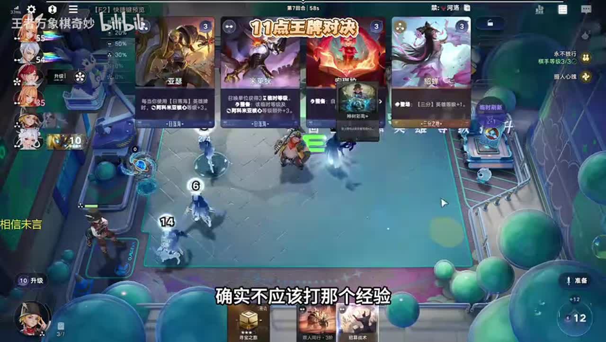

## 09:03–10:20 估算每轮经验后能停留多久，拍卖三块卡赚但四块放弃。

- 事件 ID：BV1cYac6pEn8:p1:e008
- 场景：实战
- 时机：等待经验奖励时
- 背景（分析推断）：低等级停留服务既有奖励窗口，价格影响净收益。
- 学习目标（分析推断）：用资源窗口约束搜索和拍卖。
- 模板：economy-budget
- ASR 段落：[18, 19]

> 三块钱拿,四块钱就不要了。

## 10:21–11:29 先上瑶等受益工具，再兑现；猪牌可暂不打等组合。

- 事件 ID：BV1cYac6pEn8:p1:e009
- 场景：实战
- 时机：准备合成和吸取前
- 背景（分析推断）：已有目标池需要控制，避免资源落给未准备对象。
- 学习目标（分析推断）：执行前确认成长对象。
- 模板：resource-order
- ASR 段落：[20, 21]

> 先上个瑶妹

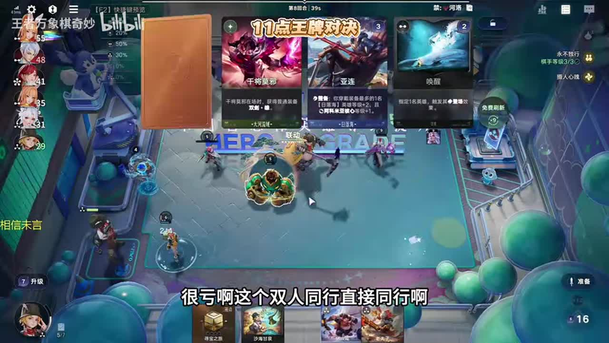

## 11:29–12:40 太乙是终局保命，但此时上会占掉成长出牌位置。

- 事件 ID：BV1cYac6pEn8:p1:e010
- 场景：实战
- 时机：太乙过早上场时
- 背景（分析推断）：讲者明确前局没太乙输过，本局先保留成长位。
- 学习目标（分析推断）：区分手中储备和立即占场。
- 模板：late-transition
- ASR 段落：[22, 23]

> 上了这个太一我就没有打足位了。

## 12:41–13:43 给太乙就存金太乙，给猪则继续成长，用随机结果两用。

- 事件 ID：BV1cYac6pEn8:p1:e011
- 场景：实战
- 时机：宝石镜随机给猪或太乙时
- 背景（分析推断）：为未来保命提前储备而不影响当前循环。
- 学习目标（分析推断）：按随机结果设计可接受分支。
- 模板：resource-order
- ASR 段落：[24, 25]

> 太乙觉醒就回手。

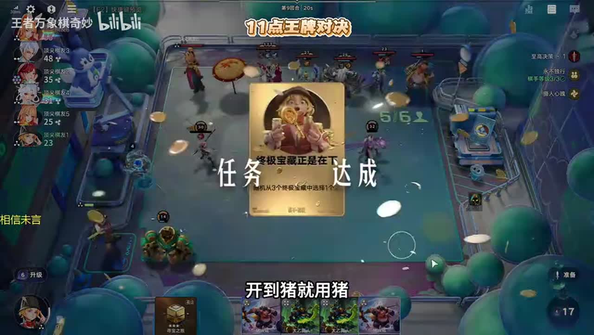

## 13:43–15:21 补孙尚香免费刷新，并重新决定太乙必须储备。

- 事件 ID：BV1cYac6pEn8:p1:e012
- 场景：实战
- 时机：猪无装备且刷新不足时
- 背景（分析推断）：讲者回想此前关键牌不放导致失利。
- 学习目标（分析推断）：从资源短缺与失败经验调优购买。
- 模板：combat-review
- ASR 段落：[26, 27, 28]

> 这个太乙还真得拿

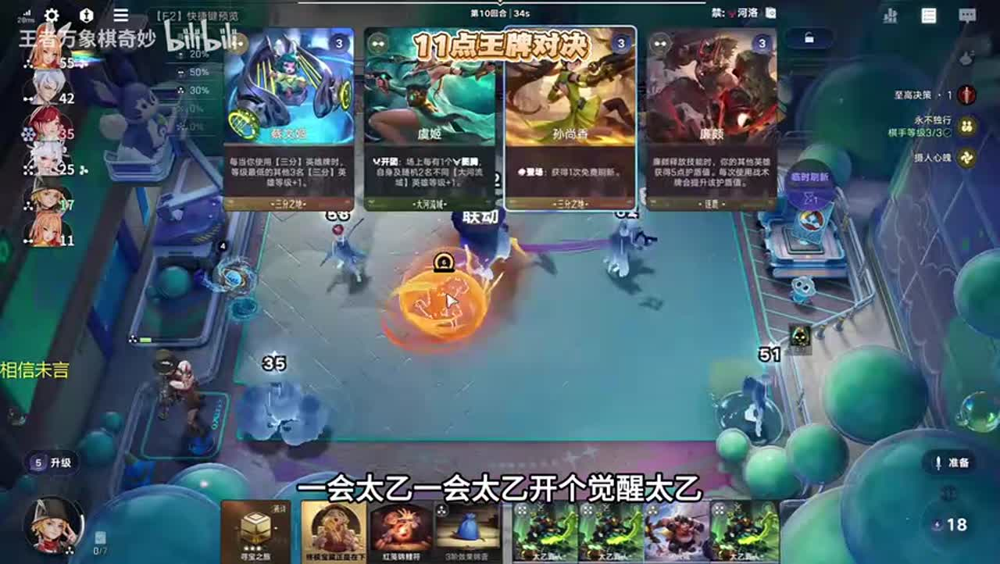

## 15:21–16:29 优先厂商或给两张牌的单位，以持续触发马可宝藏。

- 事件 ID：BV1cYac6pEn8:p1:e013
- 场景：实战
- 时机：选择循环购买时
- 背景（分析推断）：钱花完仍可由资源返还维持出牌。
- 学习目标（分析推断）：以净返还能力筛牌。
- 模板：growth-combo
- ASR 段落：[29, 30]

> 比如老夫子他都给两张

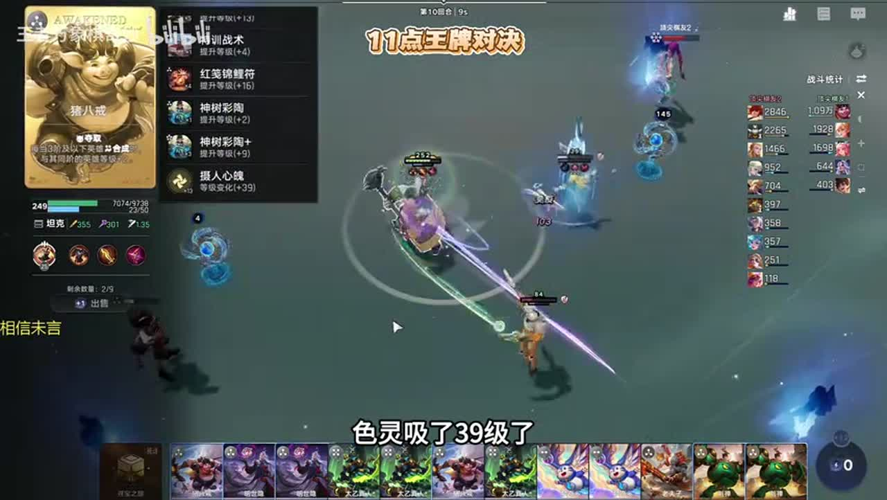

## 16:29–17:32 双卡返还配合多猪同时吸取，扩大成长效率。

- 事件 ID：BV1cYac6pEn8:p1:e014
- 场景：实战
- 时机：强化宝石镜到来时
- 背景（分析推断）：核心资源发动机到位后循环加速。
- 学习目标（分析推断）：识别组合启动前后收益差。
- 模板：growth-combo
- ASR 段落：[31, 32]

> 强化宝石镜舒服终于来了

## 17:32–18:06 及时换人吸，避免在已经枯竭的目标上继续投入。

- 事件 ID：BV1cYac6pEn8:p1:e015
- 场景：实战
- 时机：吸取对象快耗尽时
- 背景（分析推断）：已有对象快走；高阶卡产出规则还有版本差异。
- 学习目标（分析推断）：检查每次操作是否仍有收益。
- 模板：resource-order
- ASR 段落：[33]

> 这个人快没了。换个人袭。

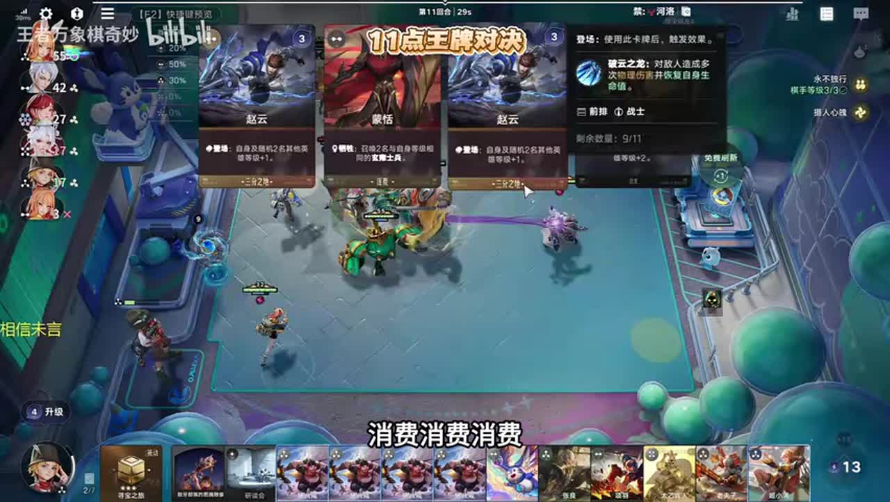

## 17:32–18:06 讲者指出狼牙图腾与过去不同，升四五级会给高阶，影响低费循环。

- 事件 ID：BV1cYac6pEn8:p1:e016
- 场景：实战
- 时机：升级后产出高阶牌时
- 背景（分析推断）：这是版本差异说法，发布日期不能确定版本。
- 学习目标（分析推断）：不要照搬旧视频资源规则。
- 模板：version-change
- ASR 段落：[33]

> 现在你要是升到四级五级以后他会给高阶了

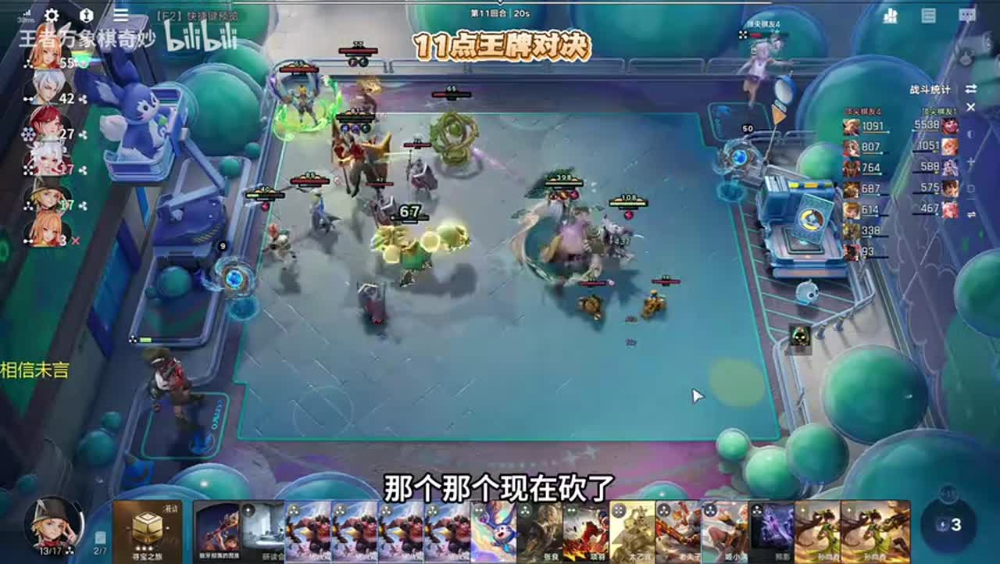

## 18:06–19:46 把升级资源或超新星纳入预算，连续跨级前先兑现剩余奖励。

- 事件 ID：BV1cYac6pEn8:p1:e017
- 场景：实战
- 时机：准备结束永不独行停留时
- 背景（分析推断）：本局停三级后计划跨四五六级。
- 学习目标（分析推断）：协调奖励结束与升级转段。
- 模板：level-transition
- ASR 段落：[34, 35, 36]

> 从四级升到五级,然后再从五级直接拉到六级

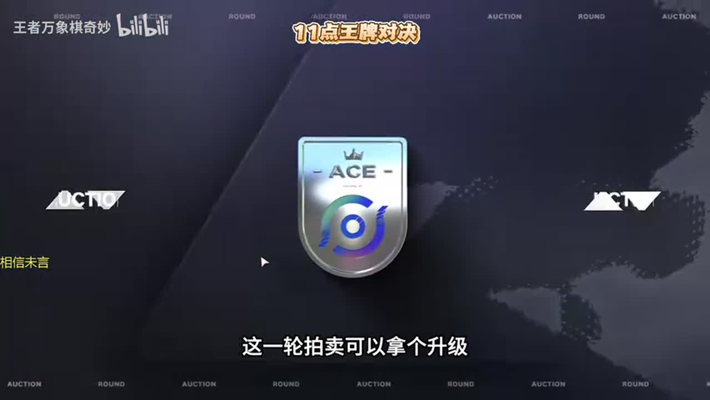

## 18:42–19:17 四级后马可效果宝藏可能提供敲装备，不必拍特定装备库。

- 事件 ID：BV1cYac6pEn8:p1:e018
- 场景：实战
- 时机：猪装备很差时
- 背景（分析推断）：成长路线自己有补装备渠道。
- 学习目标（分析推断）：比较已有技能渠道与外部竞价。
- 模板：equipment-role
- ASR 段落：[35]

> 很大概率能开到乔装备的

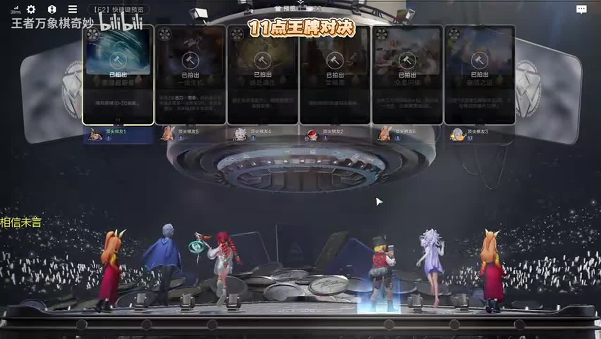

## 19:46–20:17 优先两个宝藏，把返还倍数与资源选择连接；目标吸干后换人。

- 事件 ID：BV1cYac6pEn8:p1:e019
- 场景：实战
- 时机：宝石镜能给两张卡时
- 背景（分析推断）：当前资源循环已经成立。
- 学习目标（分析推断）：用实际返还条件选资源。
- 模板：resource-order
- ASR 段落：[37]

> 只要能给两张卡

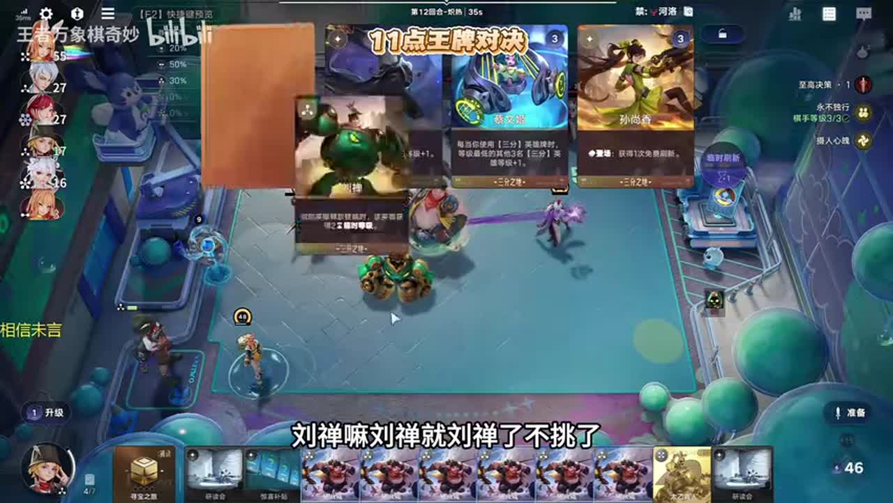

## 20:46–22:13 装备重构补反甲免控等战斗功能，不再只追成长卡。

- 事件 ID：BV1cYac6pEn8:p1:e020
- 场景：实战
- 时机：持续刷牌后整装时
- 背景（分析推断）：高等级猪仍曾因装备差失利。
- 学习目标（分析推断）：将成长兑现为战斗属性。
- 模板：equipment-cause
- ASR 段落：[39, 40, 41]

> 装备太臭了重购一下

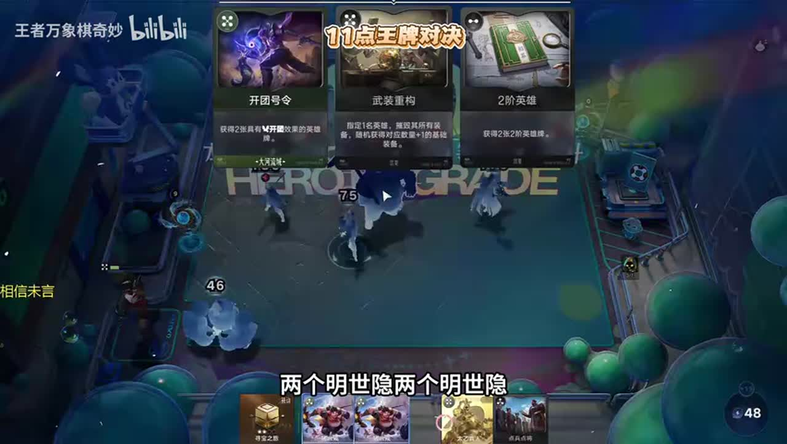

## 22:13–22:45 明确缺免控才输，本轮补免控并上太乙。

- 事件 ID：BV1cYac6pEn8:p1:e021
- 场景：实战
- 时机：回顾上一轮被控死时
- 背景（分析推断）：针对实际失败原因，而非高等级不足。
- 学习目标（分析推断）：按战斗反馈调整装备和辅助。
- 模板：combat-review
- ASR 段落：[42]

> 没有免控被控死了

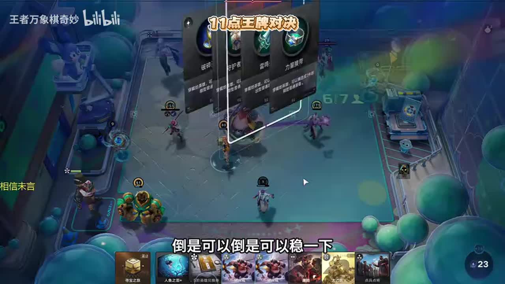

## 22:45–23:25 对手血量高给更多循环回合，达上限依赖可用时间。

- 事件 ID：BV1cYac6pEn8:p1:e022
- 场景：实战
- 时机：考虑能否养到999时
- 背景（分析推断）：讲者认为此局有机会，不作为固定15回合保证。
- 学习目标（分析推断）：估算剩余成长窗口。
- 模板：economy-budget
- ASR 段落：[43]

> 因为他们血量很高

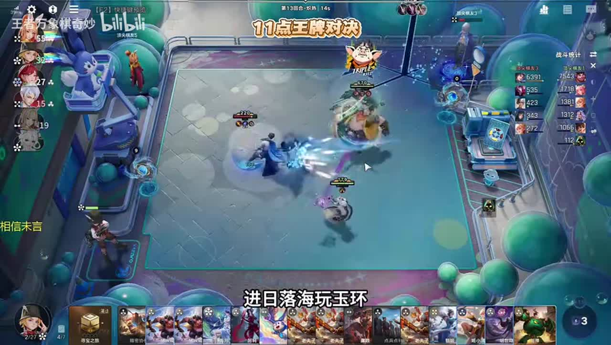

## 23:55–25:25 先用完本轮钱和刷新，返回资源不是所需时可延迟升级。

- 事件 ID：BV1cYac6pEn8:p1:e023
- 场景：实战
- 时机：是否立刻升六级时
- 背景（分析推断）：有经验与人鱼资源不等于现在必须升级。
- 学习目标（分析推断）：先兑现本轮资源再换阶段。
- 模板：resource-order
- ASR 段落：[45, 46, 47]

> 先把手里的钱花完

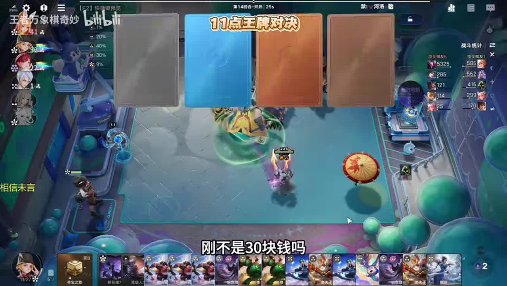

## 26:28–27:59 停止继续吸成长，改给辅助升级，使用传承移花转战斗功能。

- 事件 ID：BV1cYac6pEn8:p1:e024
- 场景：实战
- 时机：猪达到999时
- 背景（分析推断）：满级后原成长投入边际收益为零。
- 学习目标（分析推断）：识别上限并改变资源目标。
- 模板：late-transition
- ASR 段落：[50, 51, 52]

> 这猪999了,还吸谁呀?

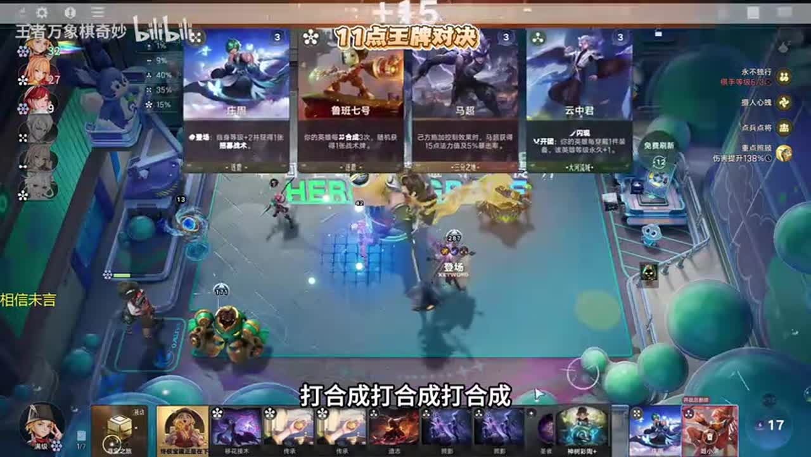

## 27:59–28:57 比较明刀与磐石之心对单次高伤的保护，读取海月词条。

- 事件 ID：BV1cYac6pEn8:p1:e025
- 场景：实战
- 时机：面对海月换命时
- 背景（分析推断）：讲者按伤害上限解释换命难以带走猪，具体数值待核。
- 学习目标（分析推断）：按敌方伤害机制选择保命。
- 模板：counter-target
- ASR 段落：[53, 54]

> 受到伤害不会超过15

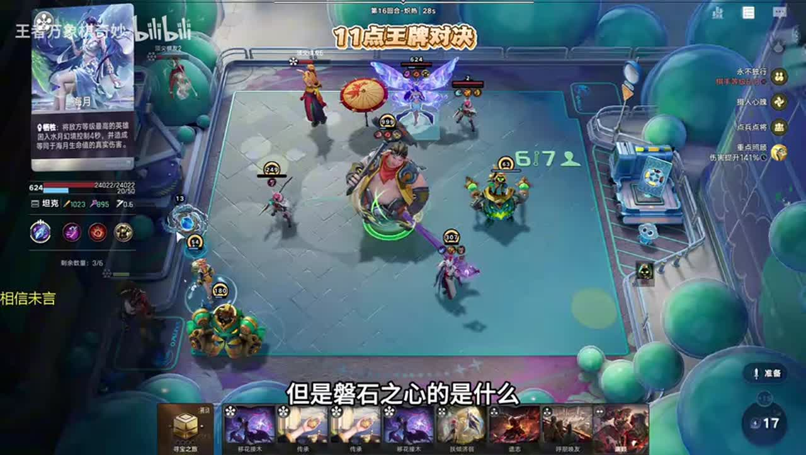

## 29:25–30:24 检查实际受伤与回复，再停止给满级猪投成长。

- 事件 ID：BV1cYac6pEn8:p1:e026
- 场景：实战
- 时机：观察海月多条命仍换不掉猪时
- 背景（分析推断）：机制已在战斗中兑现，但小明死亡也被讲者及时指出。
- 学习目标（分析推断）：用实时效果校准防护判断。
- 模板：combat-review
- ASR 段落：[56, 57]

> 他两条命甚至换不掉我一条命

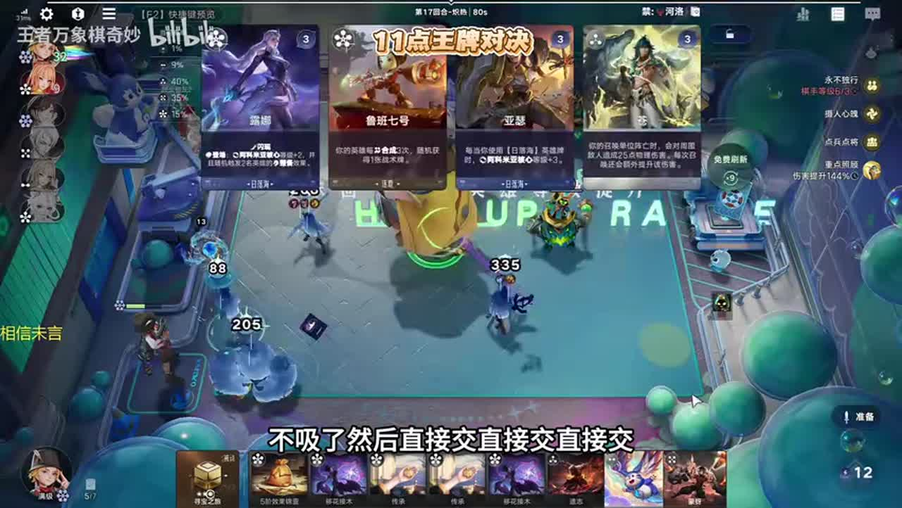

## 30:24–31:25 镜配蒙犽可双触发，猪路线触发结构不同，不能按同一数值目标评价。

- 事件 ID：BV1cYac6pEn8:p1:e027
- 场景：实战
- 时机：解释重点照顾为什么少于镜时
- 背景（分析推断）：重点照顾150是当局说法，核心上限已达。
- 学习目标（分析推断）：按触发结构比较阵容成长速度。
- 模板：mechanic-model
- ASR 段落：[58, 59]

> 因为晶是要打梦奇的

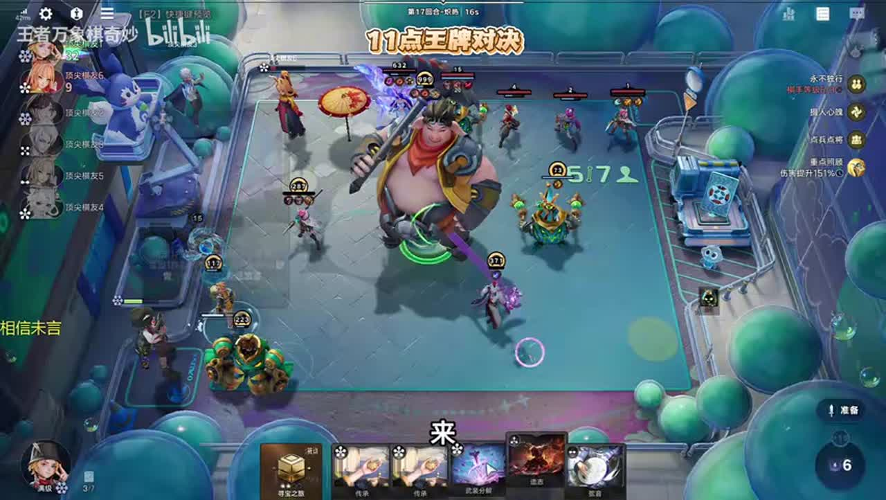

## 31:25–32:23 百分比伤害与伤害上限防护共同处理海月，不是仅靠999。

- 事件 ID：BV1cYac6pEn8:p1:e028
- 场景：实战
- 时机：终局有驱雷时
- 背景（分析推断）：最终获胜依赖攻防机制组合。
- 学习目标（分析推断）：解释等级之外的胜负原因。
- 模板：counter-target
- ASR 段落：[60, 61]

> 猪头劈一下劈30%的血

## 待核实与局限

- 原始ASR术语和数值可能有误；未经画面确认者不作为精确机制结论。
