# 5000分段嫦娥天赋细节选择，升6级还有50血，全局思路

来源：https://www.bilibili.com/video/BV12DeX6mE61/?p=1

分析状态：completed

完整文字稿：../../../raw/BV12DeX6mE61_p1.md

## 01:50–02:22 空放损失目标等级及后续触发收益

- 事件 ID：BV12DeX6mE61:p1:e001
- 场景：实战
- 时机：空丢兔子
- 背景（分析推断）：开局苏烈能接收益
- 学习目标（分析推断）：计算连带成本
- 模板：economy-budget
- ASR 段落：[4]

> 这一来一回少四级

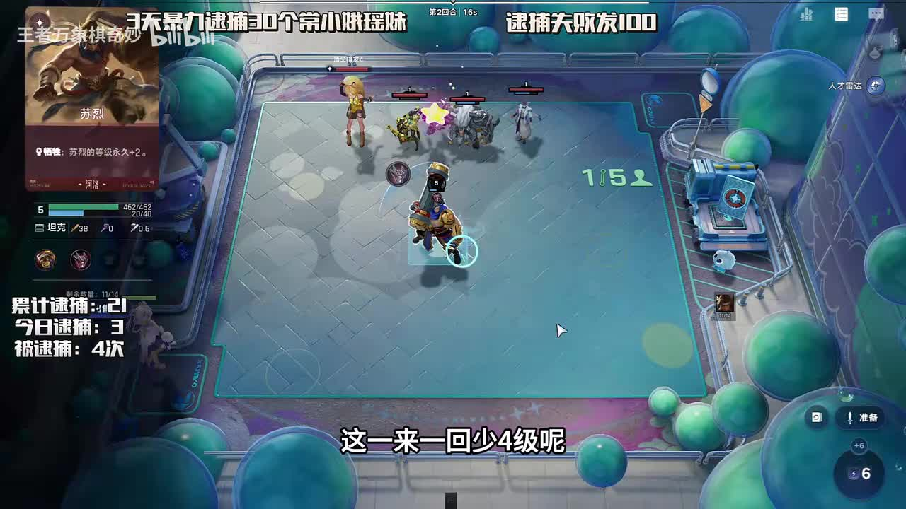

## 02:28–03:43 低等级苏烈多一命可多牺牲，与嫦娥成长适配

- 事件 ID：BV12DeX6mE61:p1:e002
- 场景：实战
- 时机：选战前校正
- 背景（分析推断）：其他棋手收益未必相同
- 学习目标（分析推断）：解释天赋与技能相乘
- 模板：talent-fit
- ASR 段落：[5, 6]

> 多一次复活能多吃一次牺牲

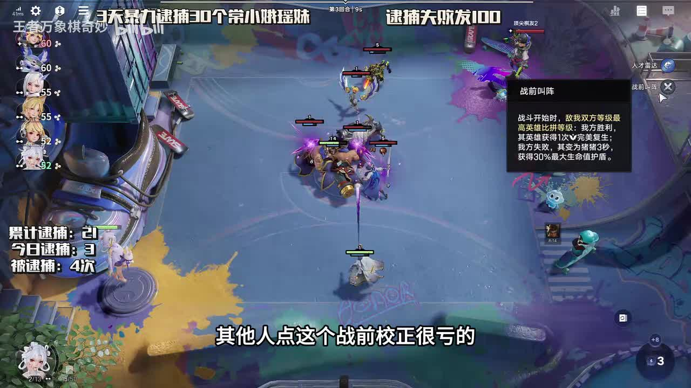

## 03:44–04:17 有人追价可放，没人则死后古币白赚等级

- 事件 ID：BV12DeX6mE61:p1:e003
- 场景：实战
- 时机：盾山拍卖
- 背景（分析推断）：工具不值得无限追价
- 学习目标（分析推断）：预算与备用收益
- 模板：auction-choice
- ASR 段落：[7]

> 只要有人顶我就给

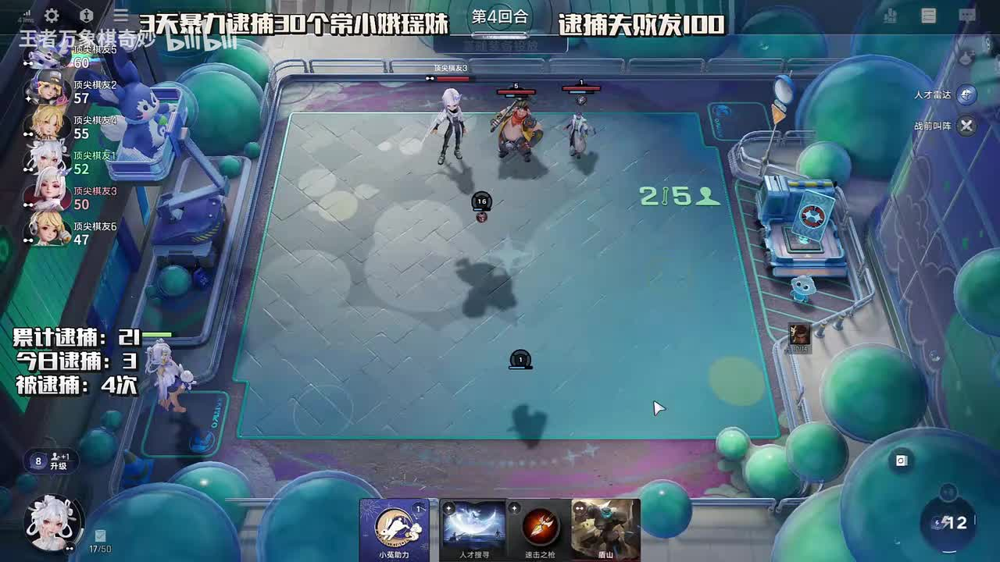

## 04:17–05:25 先卖盾山弈星，兔子准确给苏烈

- 事件 ID：BV12DeX6mE61:p1:e004
- 场景：实战
- 时机：盾山牺牲后丢兔
- 背景（分析推断）：低级工具可能吃技能
- 学习目标（分析推断）：移除随机干扰目标
- 模板：resource-order
- ASR 段落：[8, 9]

> 盾山卖掉再丢兔子

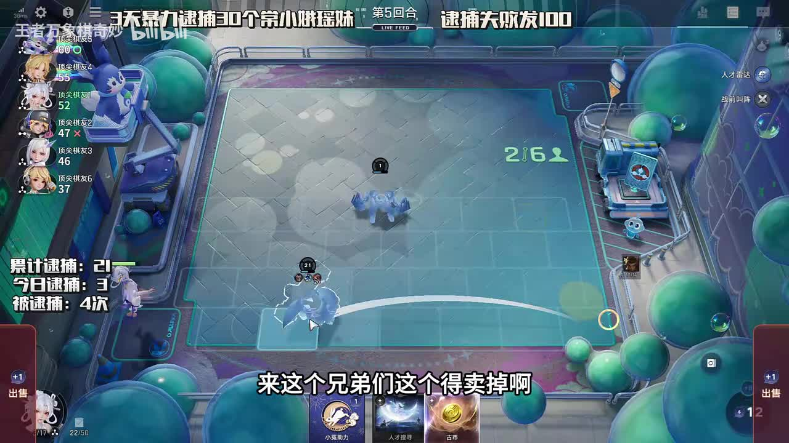

## 04:47–05:54 驱雷弥补输出，多命撑持续百分比伤害

- 事件 ID：BV12DeX6mE61:p1:e005
- 场景：实战
- 时机：单苏烈保血
- 背景（分析推断）：不觉醒省九元加快六级需能保血
- 学习目标（分析推断）：解释装备与过渡预算关系
- 模板：equipment-role
- ASR 段落：[9, 10]

> 我们省了9块钱拿来升级

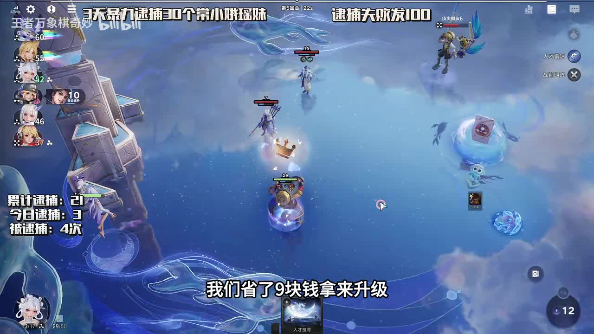

## 05:55–07:03 跨两级更赚，当前不够五就不早上；高阶开牌留五

- 事件 ID：BV12DeX6mE61:p1:e006
- 场景：实战
- 时机：考虑弈星跳级
- 背景（分析推断）：经验收益与可跳级数量有关
- 学习目标（分析推断）：算总收益和窗口
- 模板：level-transition
- ASR 段落：[11, 12]

> 现在只能开个三费卡

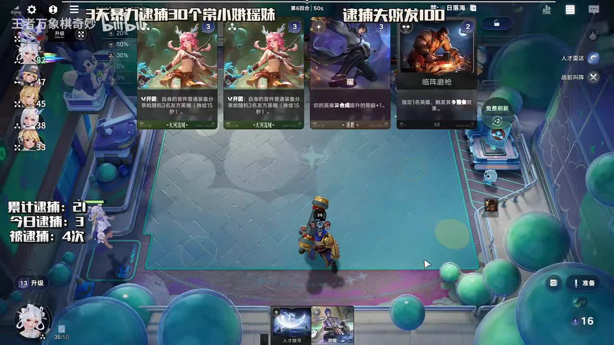

## 06:24–08:08 花两元增加保血保障，多命配驱雷

- 事件 ID：BV12DeX6mE61:p1:e007
- 场景：实战
- 时机：保血对战
- 背景（分析推断）：面对较高质量大河
- 学习目标（分析推断）：比较预算与生存价值
- 模板：combat-review
- ASR 段落：[12, 13, 14]

> 我们用两块钱保了一波

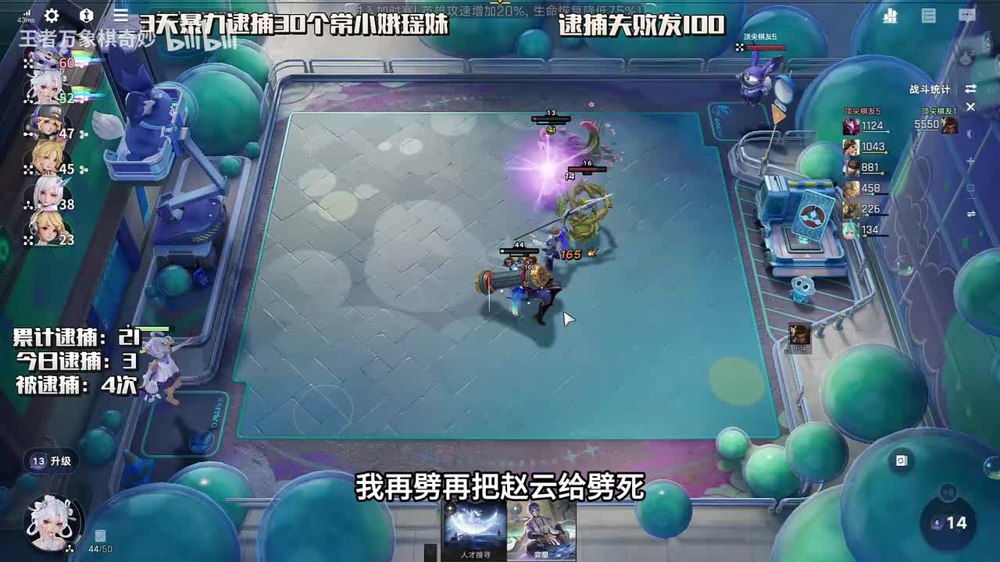

## 07:37–09:17 先兔后上弈星，下轮升五后卖再丢

- 事件 ID：BV12DeX6mE61:p1:e008
- 场景：实战
- 时机：兔子弈星顺序
- 背景（分析推断）：技能目标与经验收益需分步
- 学习目标（分析推断）：跨回合保留工具到兑现
- 模板：resource-order
- ASR 段落：[14, 16]

> 这个异星先别卖

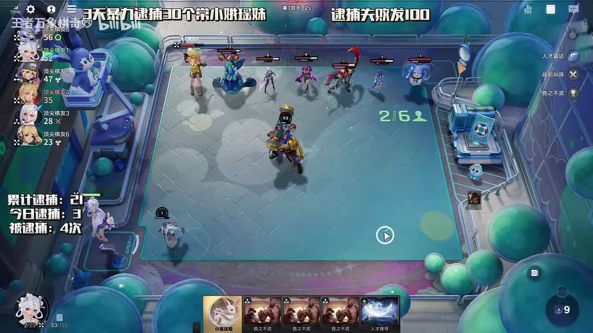

## 08:39–09:17 只求自己不掉血到后期，不要求本轮入人

- 事件 ID：BV12DeX6mE61:p1:e009
- 场景：实战
- 时机：圣之不武使用
- 背景（分析推断）：生存优先的成长路线
- 学习目标（分析推断）：按阶段目标评价效果卡
- 模板：equipment-role
- ASR 段落：[16]

> 我只需要我不掉血就行了

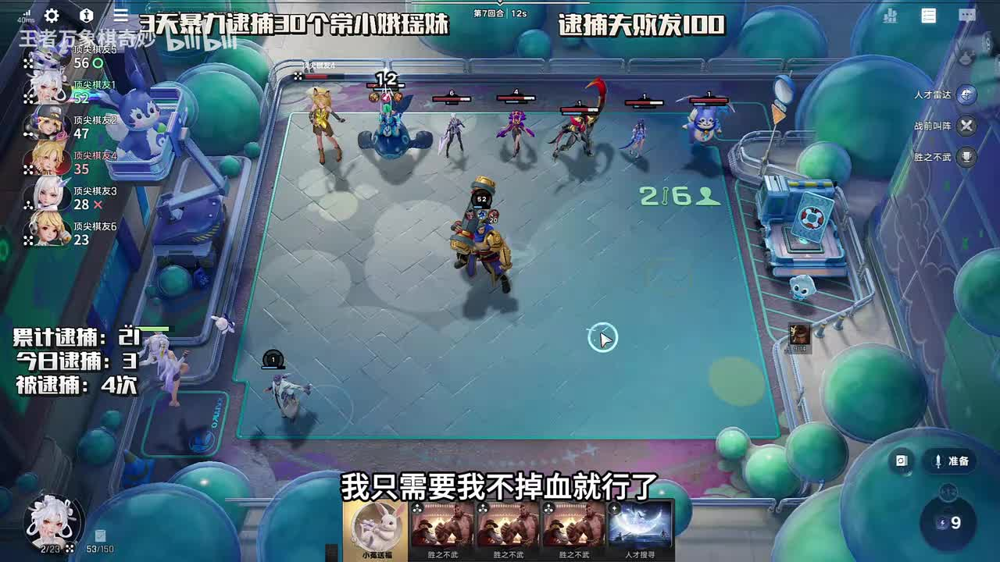

## 09:52–11:02 先保人才搜寻，六级仍无更好就玉环东皇吕布替代

- 事件 ID：BV12DeX6mE61:p1:e010
- 场景：实战
- 时机：未到六级缺好核心
- 背景（分析推断）：不能无限等最优五阶卡
- 学习目标（分析推断）：建立核心选择优先与备用
- 模板：fallback-plan
- ASR 段落：[18, 19]

> 那只能被迫上了

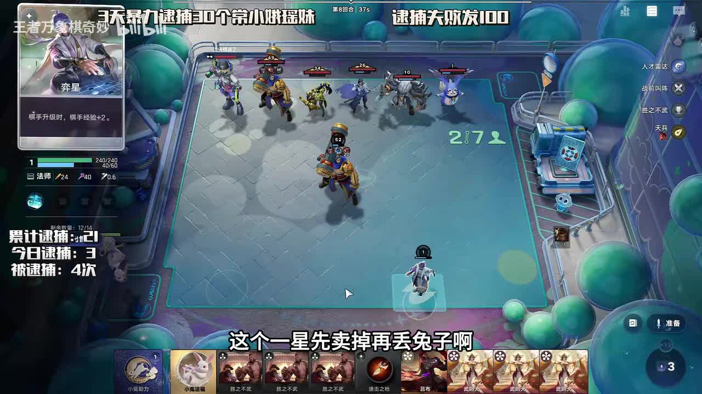

## 10:27–11:02 搏命能量可让本轮六级，未拿到就接受晚一轮

- 事件 ID：BV12DeX6mE61:p1:e011
- 场景：实战
- 时机：希望搏命但没来
- 背景（分析推断）：缺经济天赋不能照搬他人节奏
- 学习目标（分析推断）：识别天赋改变升级窗口
- 模板：talent-fit
- ASR 段落：[19]

> 这个回合直接6级

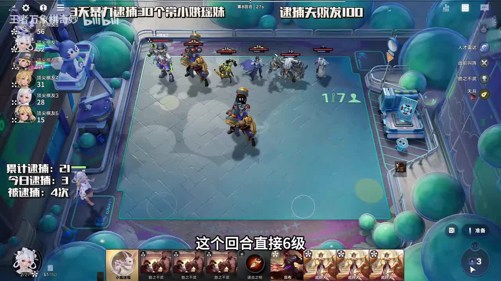

## 11:36–12:52 五级买会挤掉升级钱，六级后才买

- 事件 ID：BV12DeX6mE61:p1:e012
- 场景：实战
- 时机：五级考虑古币多多
- 背景（分析推断）：当前资金刚够关键升六
- 学习目标（分析推断）：保护升级预算
- 模板：economy-budget
- ASR 段落：[21, 22]

> 5级是买不了的

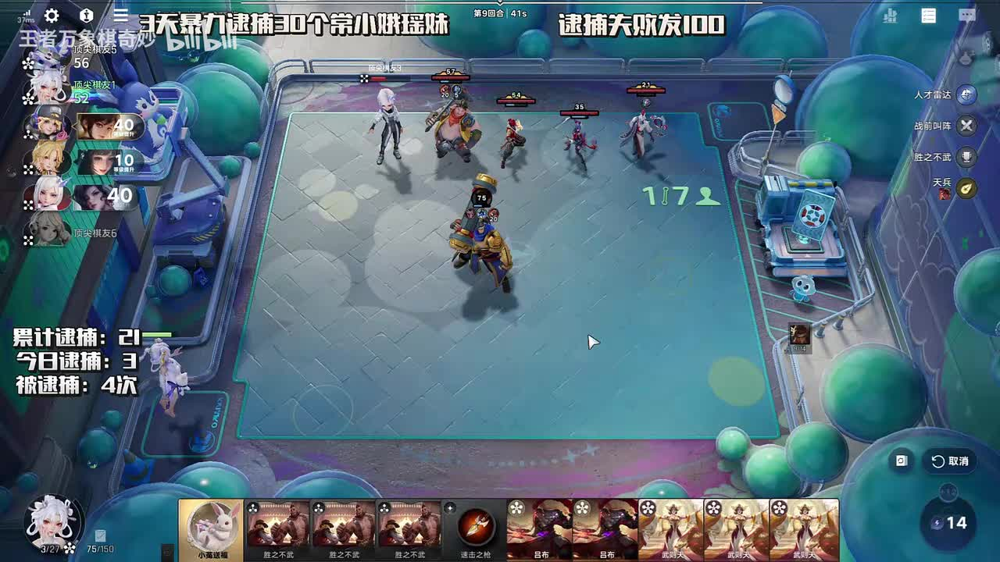

## 12:52–13:33 敌等级高于苏烈导致不能触发并可能变猪

- 事件 ID：BV12DeX6mE61:p1:e013
- 场景：实战
- 时机：战前校正失效
- 背景（分析推断）：早期成立的天赋条件后期改变
- 学习目标（分析推断）：每轮检查条件失效
- 模板：combat-review
- ASR 段落：[23]

> 他等级比我高我这战前交针交不出来了

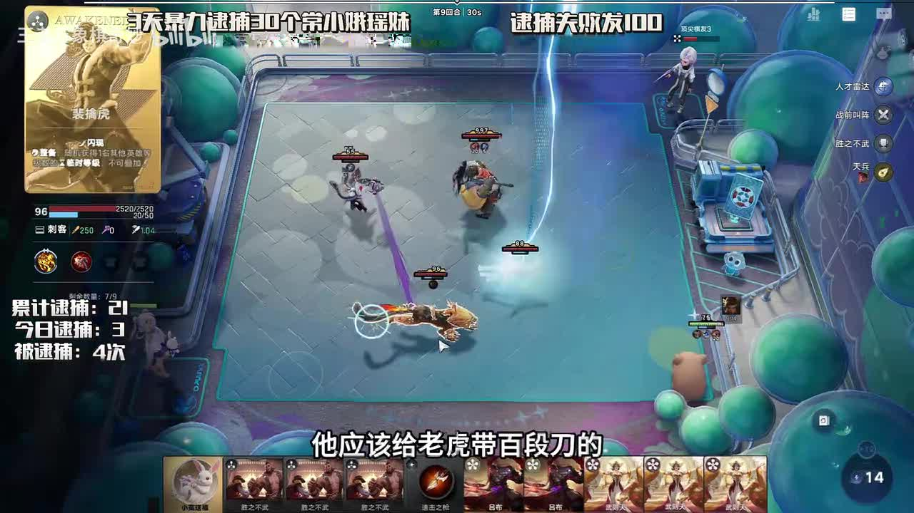

## 13:33–14:39 先大后小不是总等级差，而是月之特调叠层再获大兔

- 事件 ID：BV12DeX6mE61:p1:e014
- 场景：实战
- 时机：六级兔子连用
- 背景（分析推断）：层数达到65带来追加兔
- 学习目标（分析推断）：理解顺序影响触发次数
- 模板：resource-order
- ASR 段落：[24, 25]

> 他加的这个月之特调层数不一样

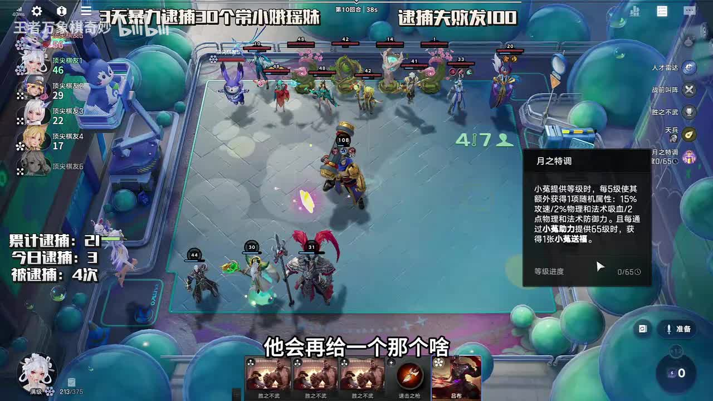

## 14:39–15:47 老虎提供临时等级但可等转移后再上

- 事件 ID：BV12DeX6mE61:p1:e015
- 场景：实战
- 时机：司空震开始成型
- 背景（分析推断）：早上会占目标与操作顺序
- 学习目标（分析推断）：区分必要组件与上场时机
- 模板：growth-combo
- ASR 段落：[26, 27]

> 司空正没有临时等级

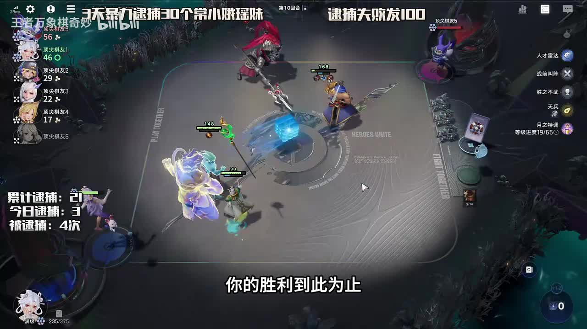

## 15:49–16:53 两级先买干将三级再合成，但三级卡少抵消概率

- 事件 ID：BV12DeX6mE61:p1:e016
- 场景：实战
- 时机：求遗址概率
- 背景（分析推断）：要稳住血才考虑这种方法
- 学习目标（分析推断）：比较单次概率与尝试数量
- 模板：mechanic-model
- ASR 段落：[28, 29]

> 三级是概率大,但是合成少

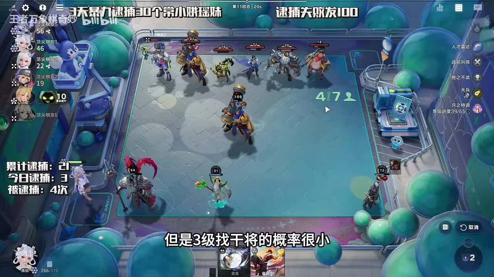

## 16:53–17:26 给别人电司空震才触发其攻速，不给核心自己

- 事件 ID：BV12DeX6mE61:p1:e017
- 场景：实战
- 时机：驱雷佩戴者
- 背景（分析推断）：友伤是成长触发条件
- 学习目标（分析推断）：把装备目标与技能条件匹配
- 模板：equipment-cause
- ASR 段落：[30]

> P司空镇才能加攻速

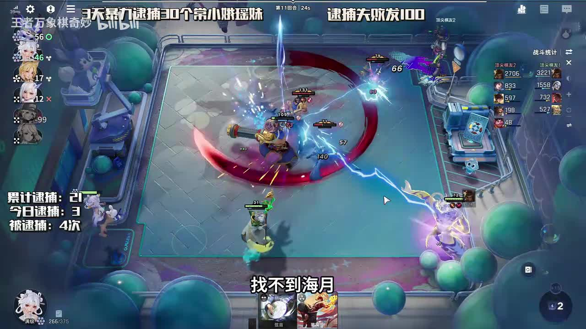

## 16:53–18:09 拍卖、五级无限刷新可找；姜子牙吕布也可用

- 事件 ID：BV12DeX6mE61:p1:e018
- 场景：实战
- 时机：海月不来
- 背景（分析推断）：不要求唯一核心
- 学习目标（分析推断）：结合渠道与功能替代
- 模板：fallback-plan
- ASR 段落：[30, 31]

> 姜子牙吕布都可以的

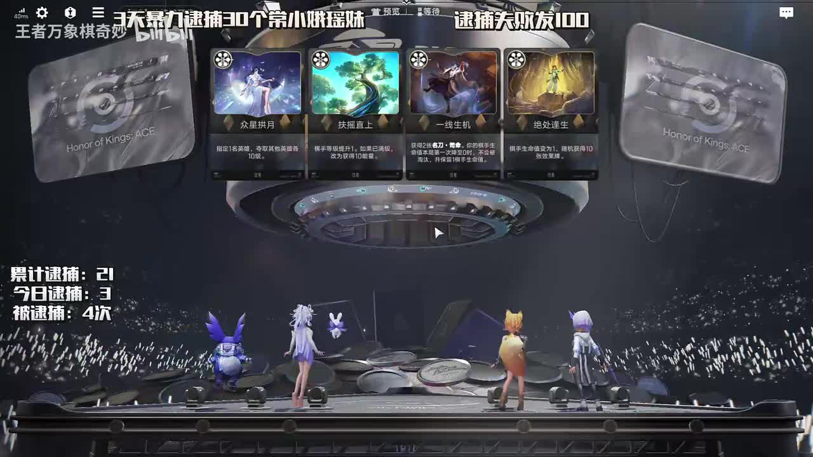

## 18:11–19:23 先给最低三人传承，丢小兔再上老虎

- 事件 ID：BV12DeX6mE61:p1:e019
- 场景：实战
- 时机：传承与老虎上场
- 背景（分析推断）：避免老虎占传承或技能目标
- 学习目标（分析推断）：核查随机分配的排序
- 模板：resource-order
- ASR 段落：[32, 33]

> 分配为等级最低的三个人

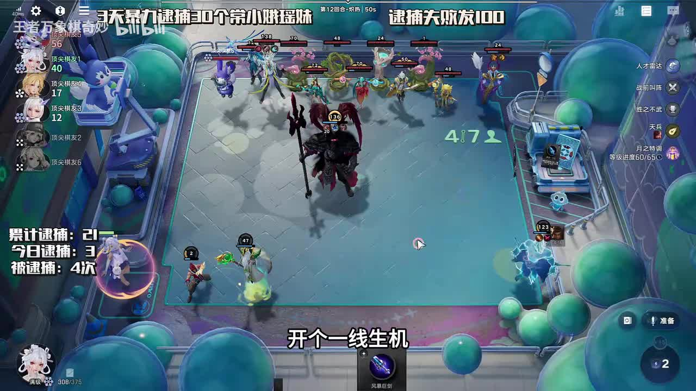

## 18:48–19:23 看敌方无控制才选重伤

- 事件 ID：BV12DeX6mE61:p1:e020
- 场景：实战
- 时机：终局造免控或重伤
- 背景（分析推断）：并非固定必带免控
- 学习目标（分析推断）：按已观察威胁选装
- 模板：equipment-role
- ASR 段落：[33]

> 也没啥控制

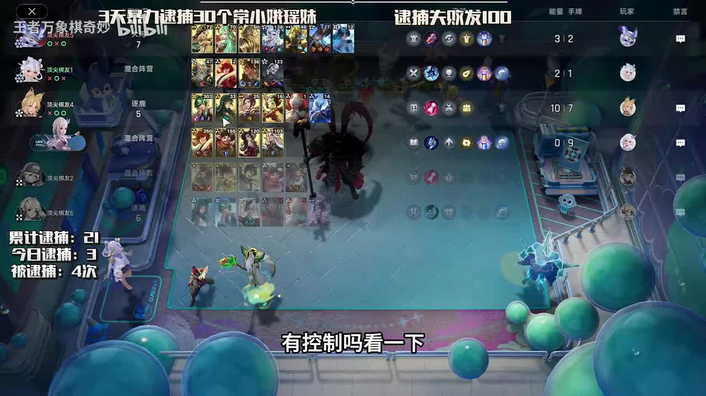

## 20:01–21:04 接近时尽量凑，不够钱则接受本轮少收益

- 事件 ID：BV12DeX6mE61:p1:e021
- 场景：实战
- 时机：月之特调差375阈值
- 背景（分析推断）：拍卖缺群体加级，强凑无资源
- 学习目标（分析推断）：识别阈值及预算边界
- 模板：economy-budget
- ASR 段落：[35, 36]

> 他如果差一点的话尽量凑一凑

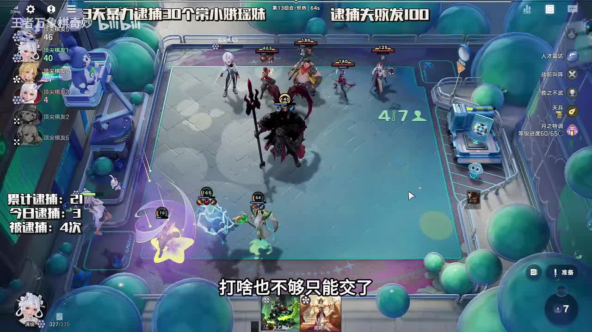

## 20:31–21:35 用无阵营或不在场阵营牌给现有目标加级

- 事件 ID：BV12DeX6mE61:p1:e022
- 场景：实战
- 时机：姜子牙在场
- 背景（分析推断）：不能所有阵营无条件触发
- 学习目标（分析推断）：辨认在场条件
- 模板：growth-combo
- ASR 段落：[36, 37]

> 除了三分合落的都可以

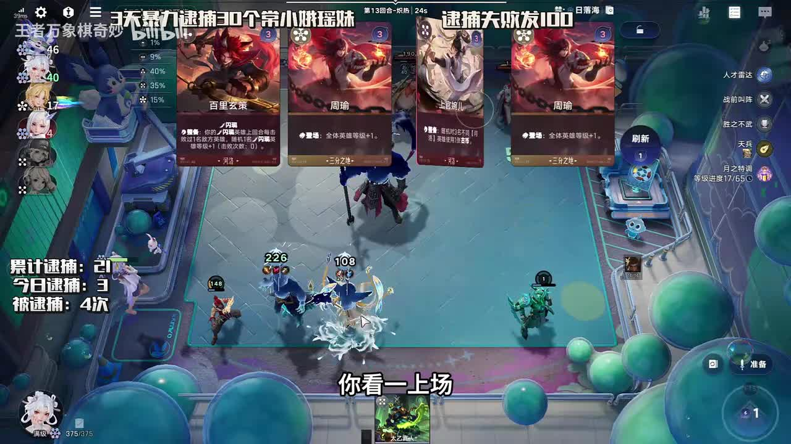

## 21:36–22:55 摆最显眼处并一秒卖，避免老虎偷一级连带核心

- 事件 ID：BV12DeX6mE61:p1:e023
- 场景：实战
- 时机：回合结束太乙卖出
- 背景（分析推断）：操作速度关系自动触发顺序
- 学习目标（分析推断）：用空间提示防错序
- 模板：resource-order
- ASR 段落：[38, 39]

> 一定要站到最显眼的位置

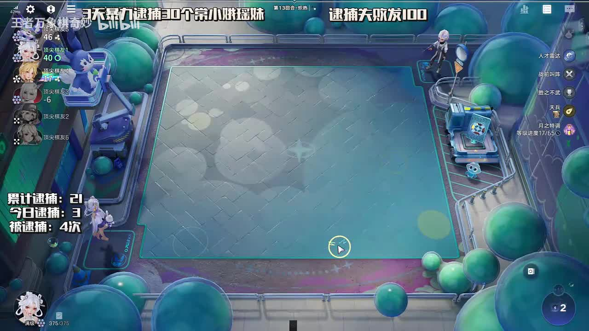

## 22:14–22:55 保留一元丢兔子

- 事件 ID：BV12DeX6mE61:p1:e024
- 场景：实战
- 时机：连续刷新
- 背景（分析推断）：刷光会断技能
- 学习目标（分析推断）：留关键操作预算
- 模板：economy-budget
- ASR 段落：[39]

> 得留一块钱丢兔子

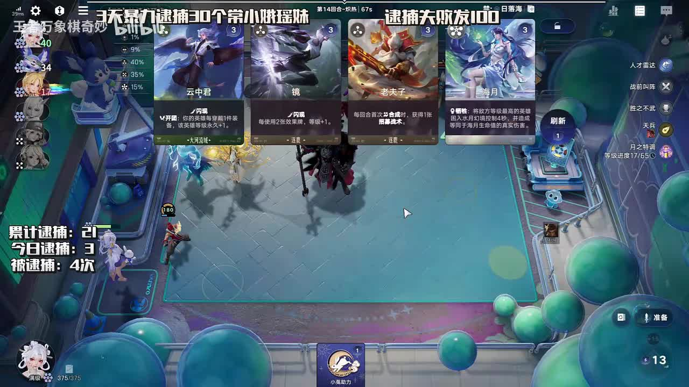

## 23:36–25:18 分心讲敌方鲸吞忘卖，老虎和司空震都降一级

- 事件 ID：BV12DeX6mE61:p1:e025
- 场景：实战
- 时机：太乙卖慢真实失误
- 背景（分析推断）：此前提醒的风险确实出现
- 学习目标（分析推断）：从错误验证时点重要性
- 模板：combat-review
- ASR 段落：[41, 42, 43]

> 我忘了还有个太一呢

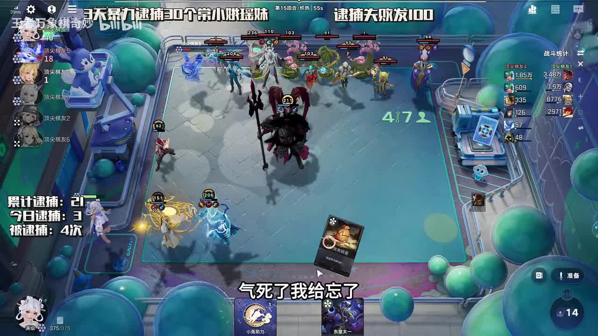

## 24:12–24:43 驱雷百分比伤害应对高血量

- 事件 ID：BV12DeX6mE61:p1:e026
- 场景：实战
- 时机：面对高血鲸吞
- 背景（分析推断）：常规伤害打不动
- 学习目标（分析推断）：按伤害类型找克制
- 模板：counter-target
- ASR 段落：[42]

> 得亏是百分比伤害

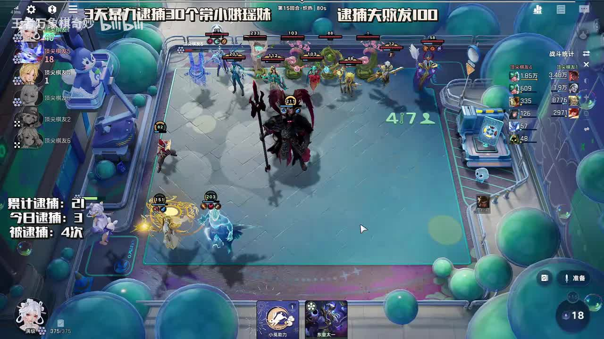

## 27:18–28:27 司空震带面具处理当前大河

- 事件 ID：BV12DeX6mE61:p1:e027
- 场景：实战
- 时机：终局面对大河
- 背景（分析推断）：装备需要与敌方承伤结构匹配
- 学习目标（分析推断）：按对手选择伤害装
- 模板：equipment-role
- ASR 段落：[47, 48]

> 面具打对面这种东西老厉害了

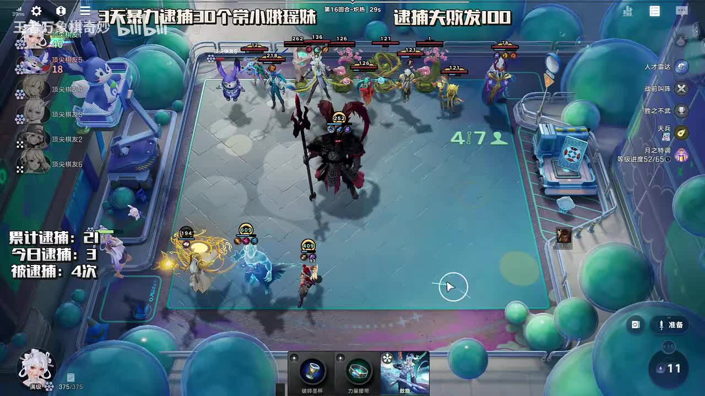

## 27:55–28:27 双倍也能带，但需要回蓝连续上天

- 事件 ID：BV12DeX6mE61:p1:e028
- 场景：实战
- 时机：吕布双倍刀或回蓝
- 背景（分析推断）：已有较快技能频率
- 学习目标（分析推断）：比较施法续航与单次输出
- 模板：equipment-cause
- ASR 段落：[48]

> 但是吕布要回篮吧

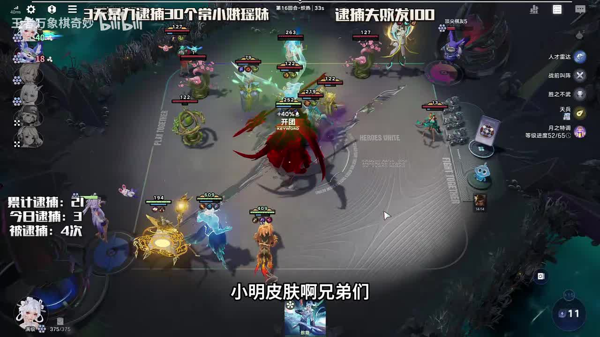

## 27:55–28:32 百级后前排收益更大但当前前排可能被雷劈死

- 事件 ID：BV12DeX6mE61:p1:e029
- 场景：实战
- 时机：姜子牙前后排
- 背景（分析推断）：位置收益与生存风险需共同考虑
- 学习目标（分析推断）：给有条件的站位建议
- 模板：position-cause
- ASR 段落：[48, 49]

> 他只要100级以后

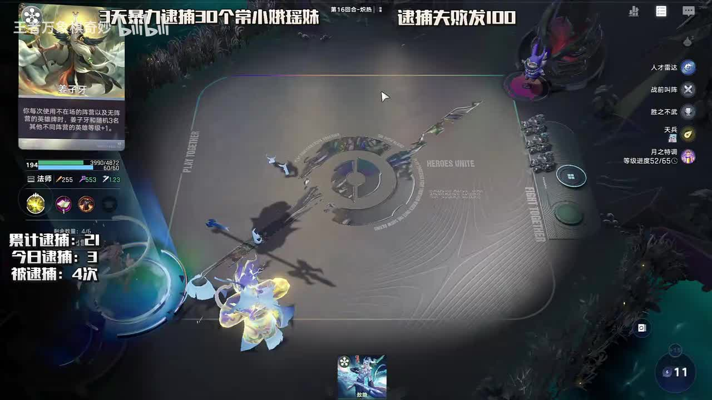

## 待核实与局限

- 不做ASR修正；鲸吞等听写术语按画面另核。
- 第15、34、45段重复口号或未明确学习目标排除。
- 太乙卖慢的实际失误保留，不能用早期条件推出永久必胜。
- 遗址概率数值属讲者经验，未量化验证。
