# 【王者万象棋】嫦娥海陆空四人组（司空震）详解+实战，活下去就赢了

来源：https://www.bilibili.com/video/BV1xaY169EM3/?p=1

分析状态：completed

完整文字稿：../../../raw/BV1xaY169EM3_p1.md

## 00:00–00:57 低压力局较适合新人，高水平对手前期上质量会压缩速六容错

- 事件 ID：BV1xaY169EM3:p1:e001
- 场景：前置讲解
- 时机：选择是否用嫦娥时
- 背景（分析推断）：讲者先指出后期强与前中期风险，适用性受对手打法影响。
- 学习目标（分析推断）：结合对局环境判断路线风险。
- 模板：opening-plan
- ASR 段落：[1, 2]

> 前中期会疯狂的上质量

## 00:58–01:46 单挂让等级集中到一人，强化早期稳血

- 事件 ID：BV1xaY169EM3:p1:e002
- 场景：前置讲解
- 时机：认识小兔随机目标时
- 背景（分析推断）：小兔随机选英雄，人数控制影响收益分布。
- 学习目标（分析推断）：用机制预测养成对象。
- 模板：mechanic-model
- ASR 段落：[3, 4]

> 场上只站一个人呢

## 01:47–02:42 总等级门槛获得大兔子，六级后还能增加无法仅升级获得的属性

- 事件 ID：BV1xaY169EM3:p1:e003
- 场景：前置讲解
- 时机：规划大兔子使用阶段时
- 背景（分析推断）：讲者区分等级与额外攻速、吸血、抗性。
- 学习目标（分析推断）：区分等级成长与特殊属性收益。
- 模板：mechanic-model
- ASR 段落：[5, 6]

> 这些东西是不能通过升等级得到的

## 02:43–03:38 先大兔后小兔，促进后续大兔循环

- 事件 ID：BV1xaY169EM3:p1:e004
- 场景：前置讲解
- 时机：六级后同回合有大小兔时
- 背景（分析推断）：大兔和小兔都进入技能成长链，操作顺序影响循环。
- 学习目标（分析推断）：按收益链安排技能顺序。
- 模板：resource-order
- ASR 段落：[7, 8]

> 先扔大兔子

## 03:37–04:14 优先棋手保命与经济，以便活到六级并留搜成型预算

- 事件 ID：BV1xaY169EM3:p1:e005
- 场景：前置讲解
- 时机：前中期天赋选择时
- 背景（分析推断）：后期阵容尚未生效，早期收益应服务启动条件。
- 学习目标（分析推断）：按阶段瓶颈评价天赋。
- 模板：talent-fit
- ASR 段落：[9, 10]

> 更快的上六呢,咱们就有更高的容错率

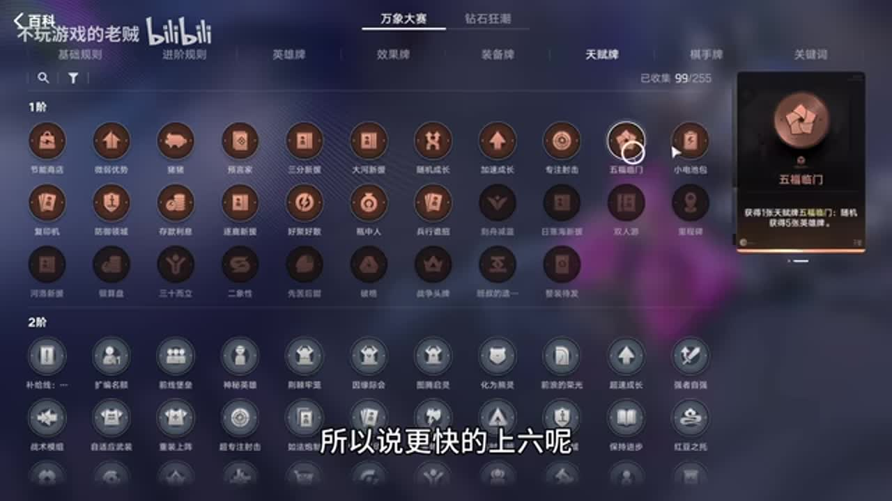

## 03:54–04:38 可持续存款复利，钱够后一次升六，避免中途花钱停留

- 事件 ID：BV1xaY169EM3:p1:e006
- 场景：前置讲解
- 时机：二级拿到存款利息时
- 背景（分析推断）：这是特定经济天赋的替代升级路径，仍受血量与当局压力约束。
- 学习目标（分析推断）：识别经济机制改变升级节奏的情况。
- 模板：level-transition
- ASR 段落：[10, 11]

> 不在中间停

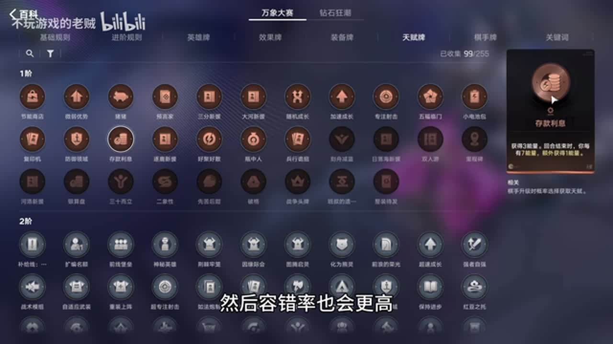

## 04:15–05:09 可以购牌但不打出英雄，满足每轮能量奖励条件

- 事件 ID：BV1xaY169EM3:p1:e007
- 场景：前置讲解
- 时机：拿到整装待发时
- 背景（分析推断）：购买与打出是两种不同操作，规则约束不可混淆。
- 学习目标（分析推断）：读清天赋生效条件。
- 模板：talent-fit
- ASR 段落：[11, 12]

> 只要你别往场上扔就行

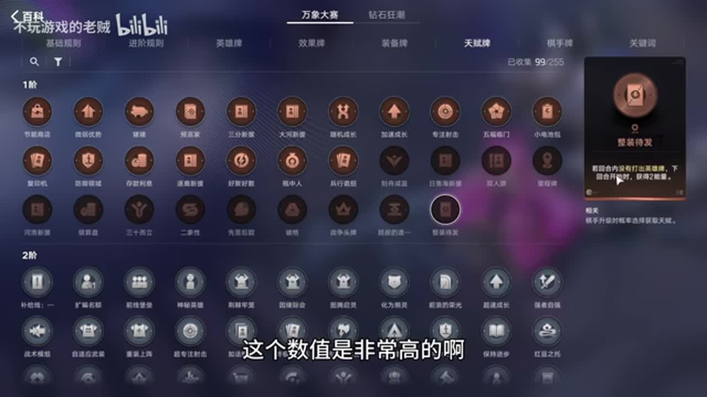

## 05:10–07:00 顺风可用血换钱；低血须算升六后剩余搜牌数与可能成型再决定

- 事件 ID：BV1xaY169EM3:p1:e008
- 场景：前置讲解
- 时机：搏命或血换钱出现时
- 背景（分析推断）：失去血量可能只剩一次容错，名义二十五金币不能单独衡量。
- 学习目标（分析推断）：把即时经济与生存风险一起计算。
- 模板：talent-fit
- ASR 段落：[13, 14, 15, 16]

> 算好这个钱数

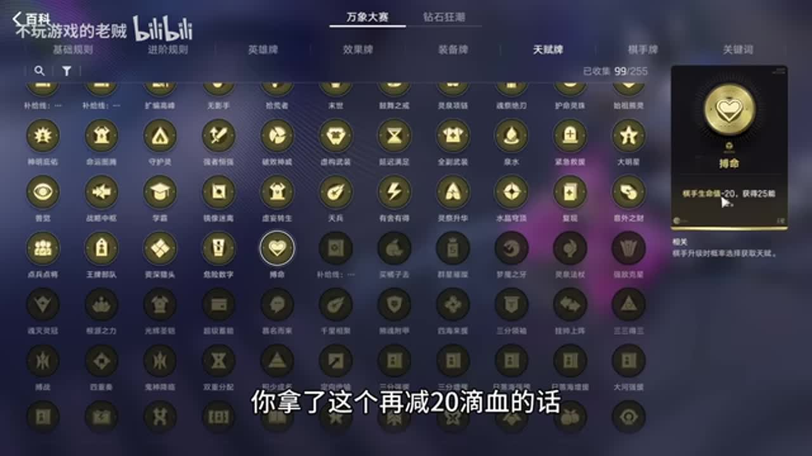

## 06:35–07:54 前期单苏烈和后期四人组使随机等级少落到无用单位

- 事件 ID：BV1xaY169EM3:p1:e009
- 场景：前置讲解
- 时机：随机成长天赋出现时
- 背景（分析推断）：小人数配置集中收益，苏烈自带成长也能帮助前期换敌人。
- 学习目标（分析推断）：用阵容人数评价随机成长价值。
- 模板：growth-combo
- ASR 段落：[16, 17, 18]

> 场上只有这些有用的棋子

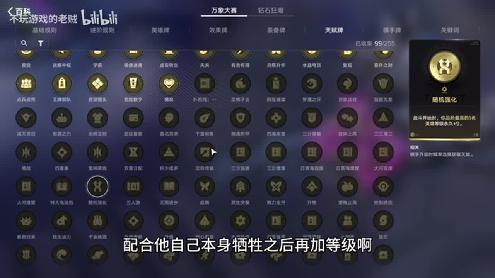

## 07:56–10:18 大明星可赌核心，也可让替代五阶自动觉醒，节约找海月的预算

- 事件 ID：BV1xaY169EM3:p1:e010
- 场景：前置讲解
- 时机：选择五阶招募天赋时
- 背景（分析推断）：第四位有摇摆空间；省下的钱用于加速关键主输出到场。
- 学习目标（分析推断）：按成型所需功能评价随机招募。
- 模板：talent-fit
- ASR 段落：[19, 20, 21, 22, 23]

> 能帮咱省去一个找海月的钱

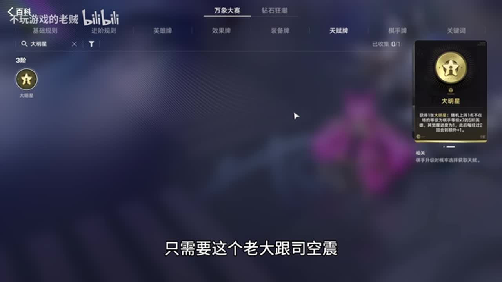

## 09:52–10:44 升六前各留一张必要核心，其他支出暂缓；成型锁血后再买成长

- 事件 ID：BV1xaY169EM3:p1:e011
- 场景：前置讲解
- 时机：升六前后考虑效果牌时
- 背景（分析推断）：预算先保证启动，再投入后期成长，不能因牌有用就提前买。
- 学习目标（分析推断）：按阶段安排购物与搜牌。
- 模板：resource-order
- ASR 段落：[23, 24]

> 第二张都不要拿

## 10:19–11:12 把等级集中主输出，真实等级影响继承临时等级的上限

- 事件 ID：BV1xaY169EM3:p1:e012
- 场景：前置讲解
- 时机：需要把司空震等级推高时
- 背景（分析推断）：讲者用三百三十三到九百九十九举例；是视频版本的机制解释。
- 学习目标（分析推断）：理解成长转化与集中收益对象。
- 模板：growth-combo
- ASR 段落：[24, 25]

> 所有的等级都要集中到老大身上

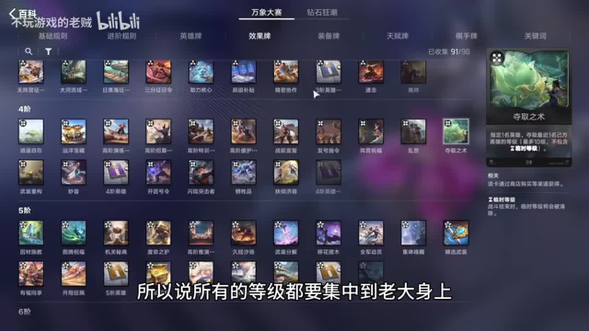

## 10:45–12:04 将裴擒虎等级分给其他人，使其整备再获取更高等级并传给司空震

- 事件 ID：BV1xaY169EM3:p1:e013
- 场景：前置讲解
- 时机：获得传承及整备资源时
- 背景（分析推断）：核心组合利用双方等级关系，整备卡主要留给决战。
- 学习目标（分析推断）：理解降低工具人等级为何可能提升后续收益。
- 模板：growth-combo
- ASR 段落：[25, 26, 27]

> 其他的人等级高

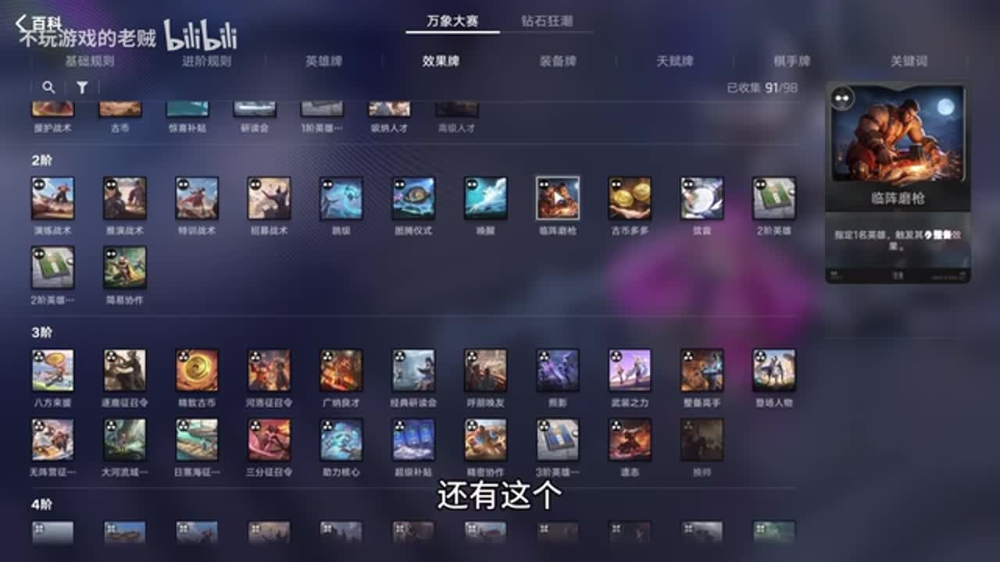

## 12:12–13:07 一线生机同时提供保命、下一回合经济和额外兔子机会

- 事件 ID：BV1xaY169EM3:p1:e014
- 场景：前置讲解
- 时机：低容错第三轮拍卖时
- 背景（分析推断）：一回合拖延可能是拿到下一发大兔并锁血的窗口。
- 学习目标（分析推断）：计算救命牌的多层后续收益。
- 模板：auction-choice
- ASR 段落：[28, 29]

> 能扔一个小兔子

## 13:08–14:05 依据真正缺口选择招募、复制、觉醒或军械库

- 事件 ID：BV1xaY169EM3:p1:e015
- 场景：前置讲解
- 时机：拍卖需要补成型、觉醒或装备时
- 背景（分析推断）：不同拍卖资源对应不同瓶颈，复制苏烈收益被讲者认为较低。
- 学习目标（分析推断）：让竞拍用途匹配当前需求。
- 模板：auction-choice
- ASR 段落：[30, 31]

> 也可以拿军械库

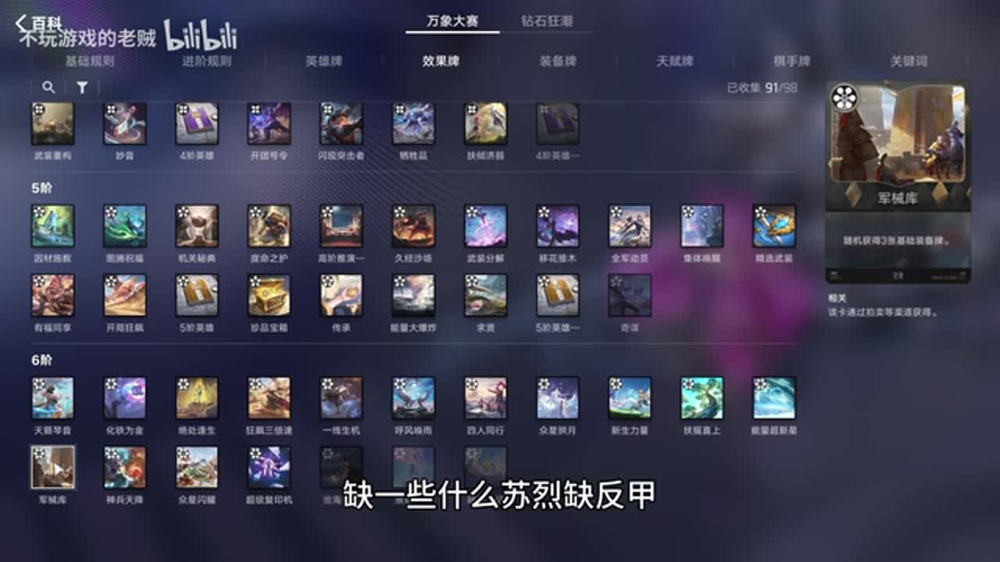

## 13:40–14:33 限制搜牌成本，即使无人上场也先扔兔子累积技能层数

- 事件 ID：BV1xaY169EM3:p1:e016
- 场景：前置讲解
- 时机：开局苏烈未找到时
- 背景（分析推断）：早期每次助力影响六级后的循环，不能因为当前收益小就停用。
- 学习目标（分析推断）：识别有长期累积价值的操作。
- 模板：resource-order
- ASR 段落：[31, 32]

> 场上没有坎儿,咱们也要扔

## 14:35–16:28 先给单苏烈扔兔子，再上弈星升级；次回合先升阶再撤弈星

- 事件 ID：BV1xaY169EM3:p1:e017
- 场景：前置讲解
- 时机：开局拍卖后使用弈星升级时
- 背景（分析推断）：顺序同时照顾技能目标和升级收益，不够钱时可让弈星打工一回合。
- 学习目标（分析推断）：用明确步骤保护预算与成长对象。
- 模板：resource-order
- ASR 段落：[33, 34, 35, 36]

> 先升级,然后再卖一星

## 16:29–16:58 只留核心单张，存钱升六；拍卖优先目标主输出或可用替代

- 事件 ID：BV1xaY169EM3:p1:e018
- 场景：前置讲解
- 时机：升六途中自然刷新及拍卖时
- 背景（分析推断）：不为重复牌和非必要效果花钱，给启动留预算。
- 学习目标（分析推断）：区分必要配置与可延后的完善。
- 模板：resource-order
- ASR 段落：[37]

> 其他的一概不拿

## 16:59–19:09 裴擒虎和司空震强绑定，第四位可用提供战力、属性或成长的替代

- 事件 ID：BV1xaY169EM3:p1:e019
- 场景：前置讲解
- 时机：六级仍没凑到最优四人组时
- 背景（分析推断）：海月最优但不是所有位置都同样不可替代。
- 学习目标（分析推断）：识别不可替代核心与可换的功能位。
- 模板：fallback-plan
- ASR 段落：[38, 39, 40, 41, 42]

> 他们俩是一个强绑定关系

## 19:16–19:42 海月换敌主输出一条命，司空震闪电链可补残血

- 事件 ID：BV1xaY169EM3:p1:e020
- 场景：前置讲解
- 时机：解释海月为何作为优选第四人时
- 背景（分析推断）：讲者判断依赖敌方复活配置；其必赢说法未独立验证。
- 学习目标（分析推断）：理解辅助与主输出的收割配合。
- 模板：counter-target
- ASR 段落：[43]

> 闪电链效果可以去补刀

## 19:43–20:58 先用成长牌补门槛取得大兔，再大后小，追求循环效率

- 事件 ID：BV1xaY169EM3:p1:e021
- 场景：前置讲解
- 时机：秘技只差少量等级可拿大兔时
- 背景（分析推断）：左下角进度提供可见触发信号，而非每轮盲目同序点击。
- 学习目标（分析推断）：根据临界进度调整资源顺序。
- 模板：resource-order
- ASR 段落：[44, 45, 46]

> 看一下自己还差多少级

## 20:30–21:29 太乙按单张临时保命使用；扔兔前卸下，防成长落到工具人

- 事件 ID：BV1xaY169EM3:p1:e022
- 场景：前置讲解
- 时机：每轮补太乙与扔兔子时
- 背景（分析推断）：满血与半血复活价值判断依赖本套恢复能力，不推广为所有阵容。
- 学习目标（分析推断）：避免辅助分散核心技能收益。
- 模板：resource-order
- ASR 段落：[46, 47]

> 别扔到这个太乙真人身上

## 21:30–21:56 传承配合整备把临时等级顶满，额外上钟馗换即时战力

- 事件 ID：BV1xaY169EM3:p1:e023
- 场景：前置讲解
- 时机：最后一回合时
- 背景（分析推断）：没有下一回合，可把长期辅助价值转为当场战力。
- 学习目标（分析推断）：识别终局操作与常规成长操作的差异。
- 模板：late-transition
- ASR 段落：[48]

> 没有下回合了

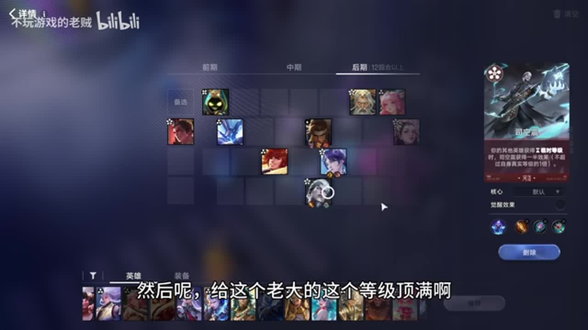

## 21:58–23:15 圣剑、面具服务开场爆发；免控重点保护短时完整输出窗口

- 事件 ID：BV1xaY169EM3:p1:e024
- 场景：前置讲解
- 时机：给司空震选输出与解控装备时
- 背景（分析推断）：讲者比较周期解控和持续保护，目的不是长期叠法强。
- 学习目标（分析推断）：从伤害时间分布推导装备。
- 模板：equipment-role
- ASR 段落：[49, 50, 51]

> 他就是打一个爆发

## 22:48–24:36 前期灼烧与反伤处理近战群体，后期血量和恢复让反伤持续更久

- 事件 ID：BV1xaY169EM3:p1:e025
- 场景：前置讲解
- 时机：为苏烈选择前中后期防具时
- 背景（分析推断）：装备价值来自前排反击定位，阶段变更可将灼烧换恢复。
- 学习目标（分析推断）：围绕单位角色和阶段调整装备。
- 模板：equipment-role
- ASR 段落：[51, 52, 53, 54]

> 让他能撑得更久反更多的伤

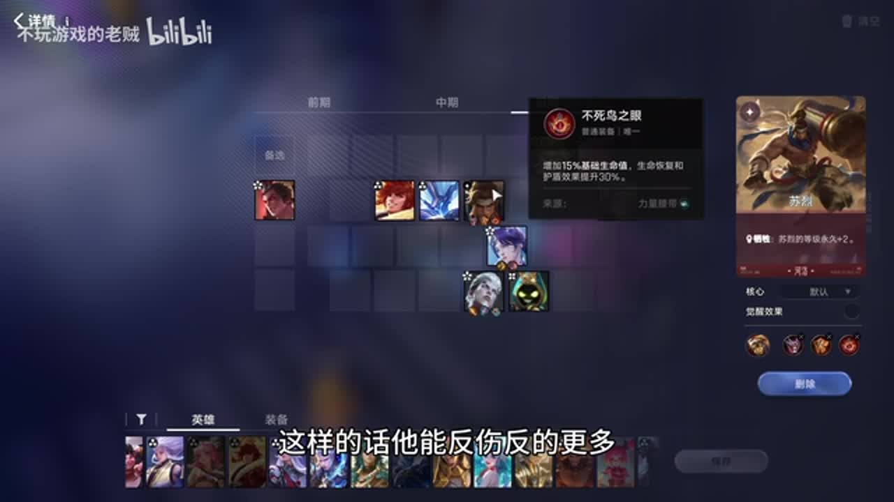

## 24:36–25:29 早期宝石养司空震，后期换战力装；缺圣剑可用攻速来源补缺口

- 事件 ID：BV1xaY169EM3:p1:e026
- 场景：前置讲解
- 时机：神器与学识宝石分配时
- 背景（分析推断）：成长装备和战力装备服务不同阶段，神器不能只看稀有度。
- 学习目标（分析推断）：按阶段和实际缺口分配装备。
- 模板：equipment-role
- ASR 段落：[55, 56]

> 把这个战利装挂给司空镇

## 25:06–25:58 给海月更适配，可同时承担生存与输出，非默认给主输出

- 事件 ID：BV1xaY169EM3:p1:e027
- 场景：前置讲解
- 时机：拿到护命灵珠时
- 背景（分析推断）：讲者解释海月越打越肉的功能配合；强度限于视频语境。
- 学习目标（分析推断）：从功能相容性决定神器使用者。
- 模板：equipment-role
- ASR 段落：[56, 57]

> 有更好的给海月用

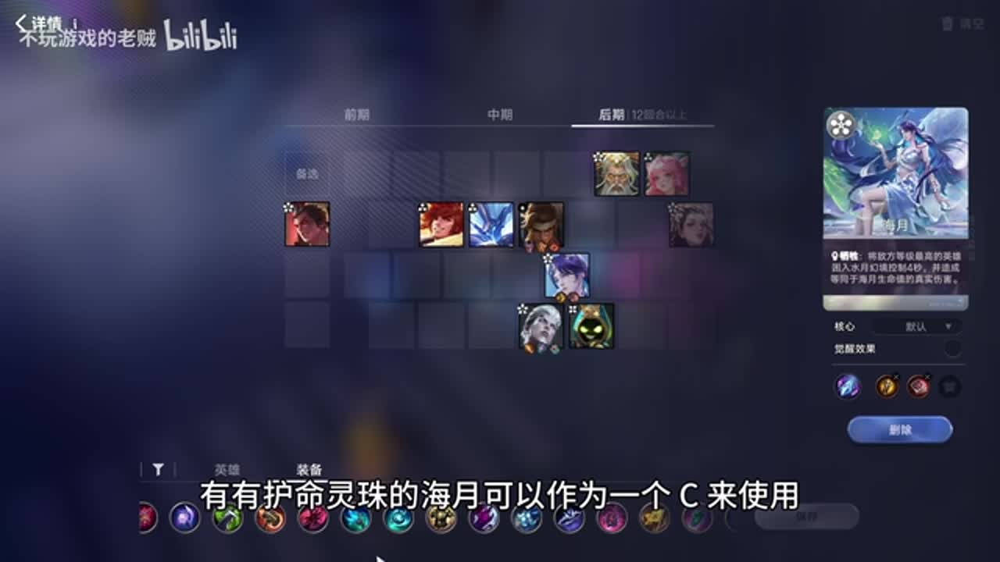

## 25:58–27:36 优先苏烈肉装撑过前期，司空震尚未到场不能兑现装备收益

- 事件 ID：BV1xaY169EM3:p1:e028
- 场景：实战
- 时机：开局装备选择时
- 背景（分析推断）：缺圣剑的替代可暂记，但早期最急的是稳血前排。
- 学习目标（分析推断）：优先购买当前能发挥作用的装备。
- 模板：equipment-role
- ASR 段落：[58, 59]

> 先渡过前棋再说

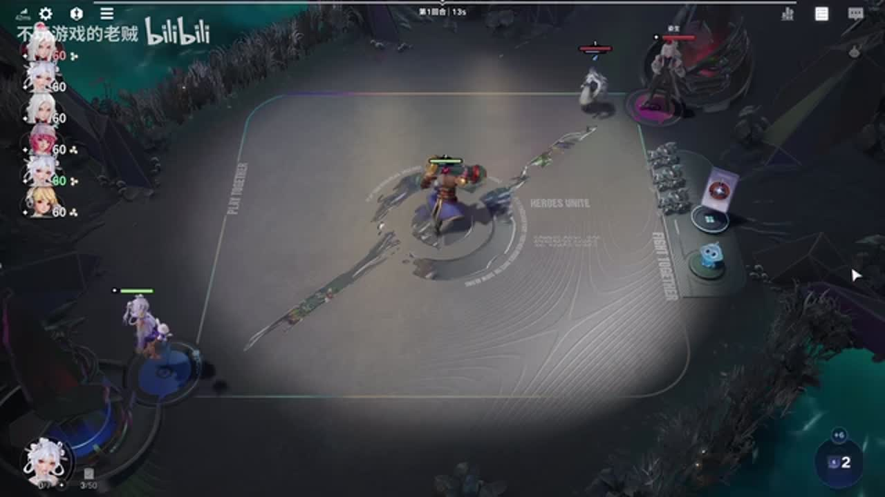

## 28:08–30:27 当前用不上的后期成长不急拿，先经济、升阶与生存

- 事件 ID：BV1xaY169EM3:p1:e029
- 场景：实战
- 时机：开局资源与天赋选项出现时
- 背景（分析推断）：讲者明确加速成长暂时用不出去；眼前路线仍未启动。
- 学习目标（分析推断）：区别名义收益与当前可执行收益。
- 模板：talent-fit
- ASR 段落：[61, 62, 63]

> 一切以生本跟前期为主

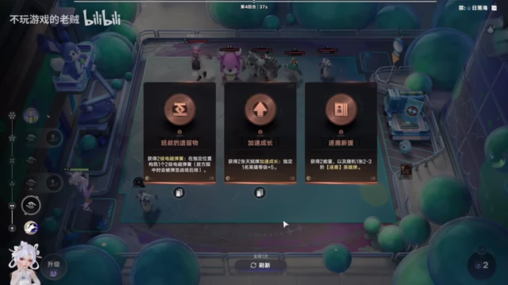

## 31:06–32:05 王维可先编入四人组提供等级，但输出战力较差

- 事件 ID：BV1xaY169EM3:p1:e030
- 场景：实战
- 时机：获得王维且第四位未到时
- 背景（分析推断）：裴擒虎与司空震是核心，海月位可以暂换成长工具人。
- 学习目标（分析推断）：按阶段使用功能替代并保留限制。
- 模板：fallback-plan
- ASR 段落：[65, 66]

> 他是个等级工具人

## 32:06–32:59 凡影响升六的牌都先不买；明世隐等工具等临时等级形成后再兑现

- 事件 ID：BV1xaY169EM3:p1:e031
- 场景：实战
- 时机：升级前商店出现有用效果牌时
- 背景（分析推断）：古币也有用，但前期预算不足时先保证启动。
- 学习目标（分析推断）：把资源收益放到正确时机。
- 模板：resource-order
- ASR 段落：[67]

> 只要影响上六的都一律不考虑

## 33:24–34:05 王牌部队条件可能不满足；选择可给同阵营多单位加属性的选项

- 事件 ID：BV1xaY169EM3:p1:e032
- 场景：实战
- 时机：阵容变化后选择战力天赋时
- 背景（分析推断）：王维加入改变配置，原本看似不错的天赋并不必然生效。
- 学习目标（分析推断）：根据当前阵容重验天赋条件。
- 模板：talent-fit
- ASR 段落：[68]

> 咱这套阵容要是用王维的话,触发不了啊

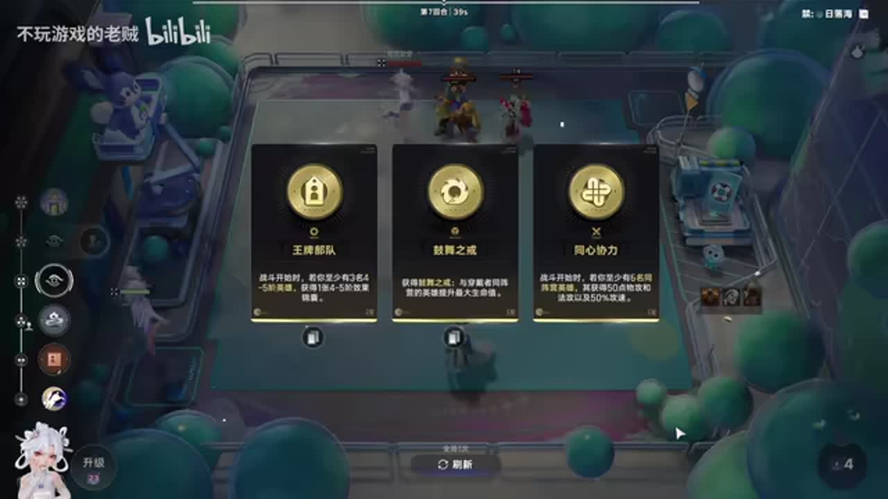

## 34:40–35:22 优先司空震，再海月；缺时姜子牙能提供成长与战力替代

- 事件 ID：BV1xaY169EM3:p1:e033
- 场景：实战
- 时机：第二轮拍卖关键主输出没到时
- 背景（分析推断）：需要先拼出可启动四人组，不是盲抢最贵五阶牌。
- 学习目标（分析推断）：按成型功能排序竞拍。
- 模板：auction-choice
- ASR 段落：[69]

> 咱就上江子牙也是一个替代

## 35:23–37:33 反伤灼烧与被围抗性可换掉脆皮，用战斗反馈判断过渡质量

- 事件 ID：BV1xaY169EM3:p1:e034
- 场景：实战
- 时机：苏烈面对较多近战时观察战斗时
- 背景（分析推断）：讲者数围住苏烈的敌人并观察抗性变化，此为当局反馈。
- 学习目标（分析推断）：把具体战斗现象连回机制。
- 模板：combat-review
- ASR 段落：[70, 71]

> 进站够多的话,我这个抗性能叠的很高

## 37:35–38:15 先选帮助成型的天兵，装备补强无法代替核心到场

- 事件 ID：BV1xaY169EM3:p1:e035
- 场景：实战
- 时机：主输出没来但装备也缺时
- 背景（分析推断）：讲者比较护命灵珠和装备方案，强调当前瓶颈是关键牌。
- 学习目标（分析推断）：识别先成型与再补强的优先级。
- 模板：talent-fit
- ASR 段落：[72]

> 先以成型为主

## 38:51–40:19 苏烈需要反甲才有处理该对手的角度

- 事件 ID：BV1xaY169EM3:p1:e036
- 场景：实战
- 时机：下一家高阶逐鹿较强时
- 背景（分析推断）：讲者将装备缺口直接连到将要遭遇的敌方输出。
- 学习目标（分析推断）：提前针对明确的敌方伤害来源。
- 模板：counter-target
- ASR 段落：[73, 74]

> 必须得要反甲啊

## 39:50–40:19 计算六级刷新费用，留一金币扔兔子

- 事件 ID：BV1xaY169EM3:p1:e037
- 场景：实战
- 时机：只剩一波容错并升到六级时
- 背景（分析推断）：搜成型与技能费用同时挤压最后预算。
- 学习目标（分析推断）：在关键搜索前核对必要费用。
- 模板：resource-order
- ASR 段落：[74]

> 留一块钱打兔子啊

## 40:29–41:51 王维成长价值不能代替海月后期战力，敌方解控还降低其控制价值

- 事件 ID：BV1xaY169EM3:p1:e038
- 场景：实战
- 时机：海月到来且准备替换王维时
- 背景（分析推断）：继续有王维来源可补等级，但常驻位置交给更合适的战斗单位。
- 学习目标（分析推断）：区分长期成长工具与终局战力。
- 模板：late-transition
- ASR 段落：[75, 76]

> 完全没法跟这个海月比的

## 41:51–43:30 竞拍优先生机、找牌或经济入口，争取额外启动窗口

- 事件 ID：BV1xaY169EM3:p1:e039
- 场景：实战
- 时机：最后一次容错仍缺主输出时
- 背景（分析推断）：一线生机多一回合和兔子，其他招募或经济牌是条件替代。
- 学习目标（分析推断）：围绕最急瓶颈评价拍卖。
- 模板：auction-choice
- ASR 段落：[77, 78]

> 现在咱关键是找牌

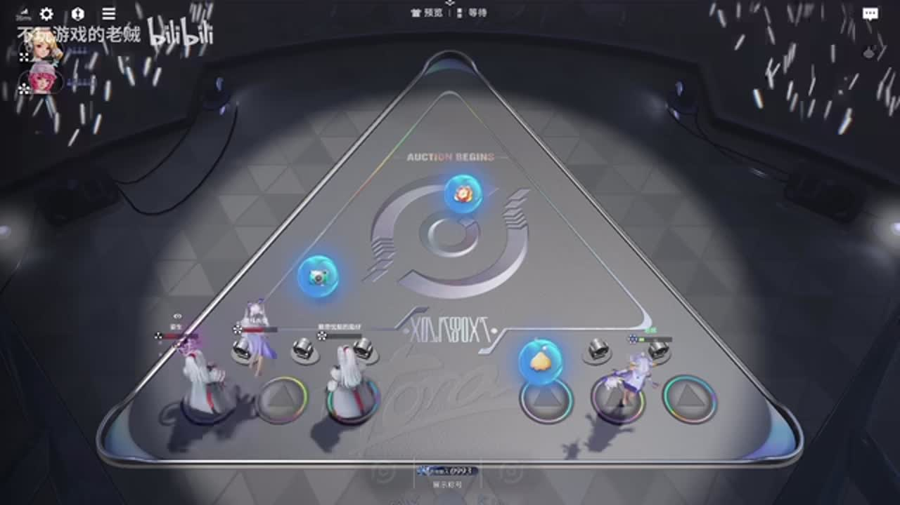

## 43:31–44:59 先找完整四人组，暂缓太乙等非必要支出，核心到位即扔大兔

- 事件 ID：BV1xaY169EM3:p1:e040
- 场景：实战
- 时机：启动前最后一次搜牌时
- 背景（分析推断）：血量已逼近失败窗口，完善辅助不能挤占成型预算。
- 学习目标（分析推断）：在生死窗口集中资源处理主要瓶颈。
- 模板：resource-order
- ASR 段落：[79, 80]

> 先找四人组

## 45:01–45:33 装备先补反甲给苏烈，当前威胁比通用攻速更迫切

- 事件 ID：BV1xaY169EM3:p1:e041
- 场景：实战
- 时机：终于成型但面对嬴政射手时
- 背景（分析推断）：讲者在装备选择中直接指出嬴政、射手、大河的存在。
- 学习目标（分析推断）：用具体对手调整同类装备优先级。
- 模板：counter-target
- ASR 段落：[81]

> 先给这个苏烈做个反常甲

## 45:39–46:29 别的主输出也可借大兔稳血，但可能打不过同行内战

- 事件 ID：BV1xaY169EM3:p1:e042
- 场景：实战
- 时机：核心不来考虑改其他输出时
- 背景（分析推断）：替代方案有明确保命收益与上限限制。
- 学习目标（分析推断）：分清能暂时活下来与最终获胜的目标。
- 模板：fallback-plan
- ASR 段落：[82]

> 同行内战的话打不过

## 46:30–48:28 用实际战斗说明反伤与换命配合，但不证明所有对局必胜

- 事件 ID：BV1xaY169EM3:p1:e043
- 场景：实战
- 时机：反甲与海月成功处理嬴政时
- 背景（分析推断）：讲者观察苏烈能扛住工具人并靠反伤处理剩余输出。
- 学习目标（分析推断）：用可见战斗结果校验针对方案。
- 模板：combat-review
- ASR 段落：[83, 84]

> 反甲配合那个海月

## 47:43–48:28 撤额外工具，避免裴擒虎获取错误的临时等级

- 事件 ID：BV1xaY169EM3:p1:e044
- 场景：实战
- 时机：临时挂工具后准备结束回合时
- 背景（分析推断）：短暂贪成长后要恢复核心组合的等级关系。
- 学习目标（分析推断）：识别工具人对成长链的干扰。
- 模板：resource-order
- ASR 段落：[84]

> 不能太贪等级

## 48:30–49:59 再挂王维补等级；绑定偏到苏烈也须按反甲收益评估

- 事件 ID：BV1xaY169EM3:p1:e045
- 场景：实战
- 时机：继续叠属性及补等级时
- 背景（分析推断）：不是任何误绑定都等价，苏烈反伤使部分收益仍有价值。
- 学习目标（分析推断）：按实际收益对象判断操作后果。
- 模板：growth-combo
- ASR 段落：[85, 86]

> 苏烈有反甲,也可以

## 50:38–52:42 把当前回合视为决战，集中交资源换活到下一发大兔

- 事件 ID：BV1xaY169EM3:p1:e046
- 场景：实战
- 时机：再撑一回合即可获得关键后续收益时
- 背景（分析推断）：讲者认为下回合属性能建立胜势；其必赢判断未独立证实。
- 学习目标（分析推断）：根据胜利窗口而非固定回合标签决定集中投入。
- 模板：late-transition
- ASR 段落：[88, 89]

> 把这一回合当最后一回合打就行

## 52:48–53:21 优先卸辅助避免兔子分散，也说明可接受随机命中风险的例外

- 事件 ID：BV1xaY169EM3:p1:e047
- 场景：实战
- 时机：最后回合卸太乙会牺牲费用时
- 背景（分析推断）：讲者提出五分之四概率；未独立重算，不能作为通用数字。
- 学习目标（分析推断）：比较确定收益与保留辅助的风险。
- 模板：resource-order
- ASR 段落：[90]

> 你可以不下太真人扔也行

## 53:24–54:45 重构寻找替代爆发，观察怒神项链后的实际输出反馈

- 事件 ID：BV1xaY169EM3:p1:e048
- 场景：实战
- 时机：无圣剑且攻速不足的终局时
- 背景（分析推断）：讲者区分等级面板与嫦娥额外属性，不用等级差单独判断输赢。
- 学习目标（分析推断）：根据实际输出瓶颈补装备并复核效果。
- 模板：combat-review
- ASR 段落：[91, 92]

> 这个输出感觉比刚才好多了

## 54:46–56:23 以瑶替代收益较低的额外单位，给苏烈增加盾服务前排存活

- 事件 ID：BV1xaY169EM3:p1:e049
- 场景：实战
- 时机：最终需要补盾与输出时
- 背景（分析推断）：装备仍有缺口，最后辅助补强按实际输出与防护需求选择。
- 学习目标（分析推断）：终局使用当前最有价值的辅助功能。
- 模板：counter-target
- ASR 段落：[93, 94]

> 稍微补点输出,补点盾啊

## 56:23–56:36 将整局归纳为前期活下来、后期持续成长

- 事件 ID：BV1xaY169EM3:p1:e050
- 场景：实战
- 时机：对局结束总结路线时
- 背景（分析推断）：总结来自这局结果及前述机制，不声称新人掌握效果已被验证。
- 学习目标（分析推断）：把局部选择连到全局阶段目标。
- 模板：combat-review
- ASR 段落：[95]

> 核心奥义就是拖到后期

## 待核实与局限

- 原始ASR有同音卡名与偶发指代混淆，未据此改写原文或猜未说明英雄。
- 一线生机、等级门槛和随机概率仅引用视频版本；未独立重算五分之四。
- 讲者数次使用必赢措辞，只作为当局主观判断，不作为统计验证。
