# 【王者万象棋】安琪拉养刘邦阵容详解+实战，天胡关中王吃鸡已经不需要炸盾了

来源：https://www.bilibili.com/video/BV1Jjao66ELh/?p=1

分析状态：completed

完整文字稿：../../../raw/BV1Jjao66ELh_p1.md

## 00:00–01:26 建立神秘力量、飞行器伤害和连接英雄临时等级的关系

- 事件 ID：BV1Jjao66ELh:p1:e001
- 场景：模拟演示
- 时机：首次介绍安琪拉技能并演示飞行器时
- 背景（明确说明）：讲者用对战模拟演示新棋手，解释飞行器能够持续输出且附加等级。
- 学习目标（分析推断）：能理解资源成长如何同时影响输出与连接英雄，而非只记技能名称。
- 模板：mechanic-model
- ASR 段落：[1, 2, 3]

> 等级的支撑这样的话呢既强化了这个飞行器的伤害也能强化这个棋子

## 00:28–00:57 利用重合站位避免飞行器连接错单位

- 事件 ID：BV1Jjao66ELh:p1:e002
- 场景：模拟演示
- 时机：演示飞行器连接目标时
- 背景（明确说明）：飞行器连接距离最近的棋子，需要把效果稳定给指定单位。
- 学习目标（分析推断）：学会用位置关系排查技能作用对象错误。
- 模板：position-binding
- ASR 段落：[2]

> 为了防止连接错的话,你可以把这两个重合站,这样的话肯定就绑定在他身上。

## 01:28–04:19 按阵容触发条件与成型速度比较成长方式

- 事件 ID：BV1Jjao66ELh:p1:e003
- 场景：前置讲解
- 时机：介绍顿悟时刻及各成长方式时
- 背景（明确说明）：同类成长选项存在英雄数量、品阶、阵营、胜负和出牌等不同条件，高阶条件前期不能兑现。
- 学习目标（分析推断）：能比较触发难度与兑现时间，不只选择面板收益最高的选项。
- 模板：talent-fit
- ASR 段落：[4, 5, 6, 7, 8, 9]

> 这个获得比较多,但是他条件也相对苛刻一点,前期你是出发不了的,会丢几回合的这个力量。

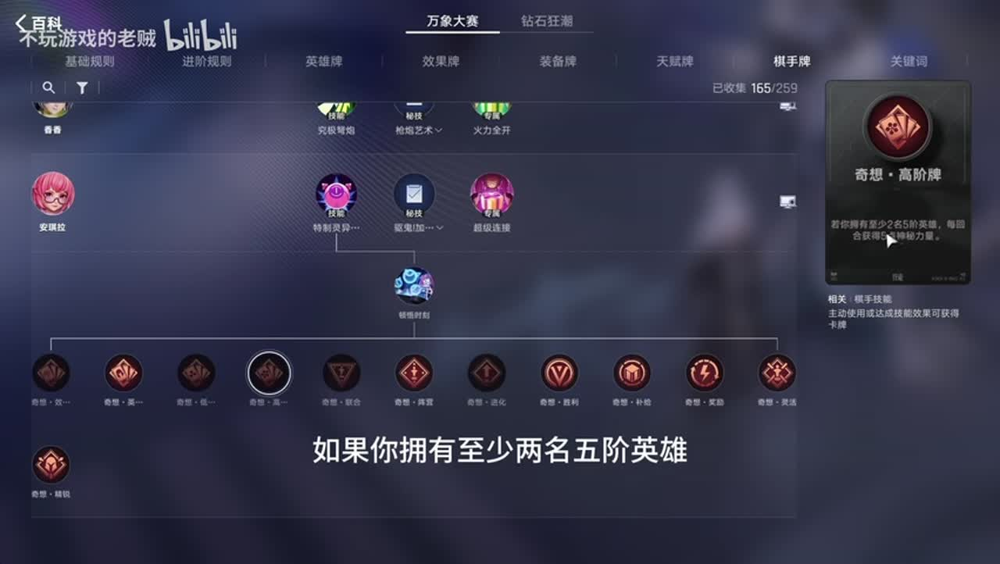

## 03:50–05:15 根据阵容预计出牌和掉血方式选择成长路径

- 事件 ID：BV1Jjao66ELh:p1:e004
- 场景：前置讲解
- 时机：把各成长选项应用到刘邦阵容时
- 背景（明确说明）：讲者预期前期可能承受速攻压力，效果牌使用少，英雄牌与消耗能量更容易触发。
- 学习目标（分析推断）：用阵容实际行为评估成长收益，理解顺风与逆风选择差异。
- 模板：talent-fit
- ASR 段落：[9, 10, 11]

> 因为咱们这套阵容在前期是需要掉血的啊

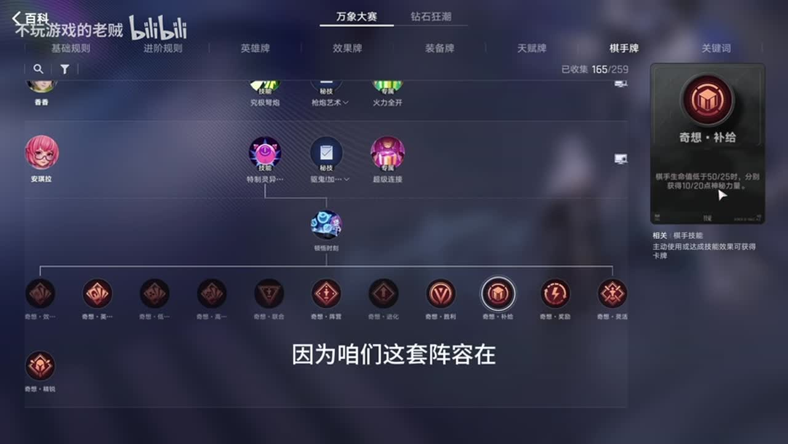

## 05:15–06:11 解释多飞行器与瑶的配合及临时等级代价

- 事件 ID：BV1Jjao66ELh:p1:e005
- 场景：前置讲解
- 时机：解释秘技获得大改装并介绍二号机时
- 背景（明确说明）：本阵容带瑶，讲者说明多个飞行器能配合连接英雄持续输出，但也有等级转换的代价。
- 学习目标（分析推断）：认识组合成立条件及取舍，而非把新增数量当成无代价收益。
- 模板：growth-combo
- ASR 段落：[12, 13]

> 这个东西主要是给这个瑶妹来使用的

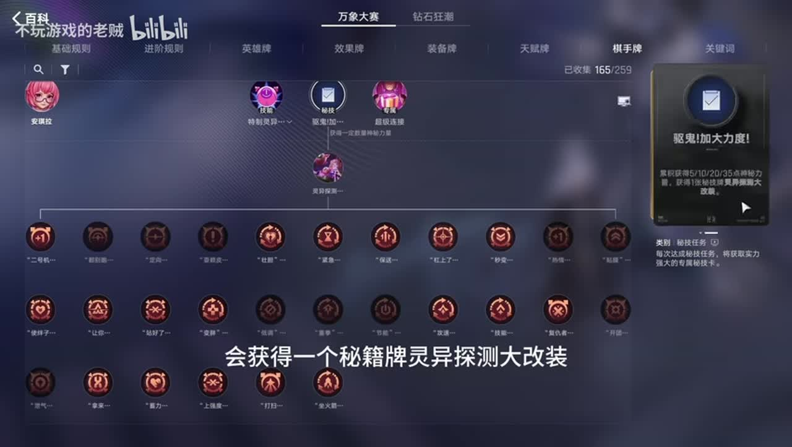

## 06:25–07:34 区分范围攻击、自爆和持续输出，解释为何刘邦不选自爆路线

- 事件 ID：BV1Jjao66ELh:p1:e006
- 场景：前置讲解
- 时机：介绍飞行器攻击模式模块时
- 背景（明确说明）：讲者介绍模块效果，同时强调刘邦这套阵容需要持续输出，自爆后飞行器本回合不再持续攻击。
- 学习目标（分析推断）：学会判断改装是否破坏原阵容的输出方式。
- 模板：module-fit
- ASR 段落：[14, 15, 16]

> 但是一旦炸了之后,这个飞行器在本回合就没有了,它就不会再进行持续性的输出了

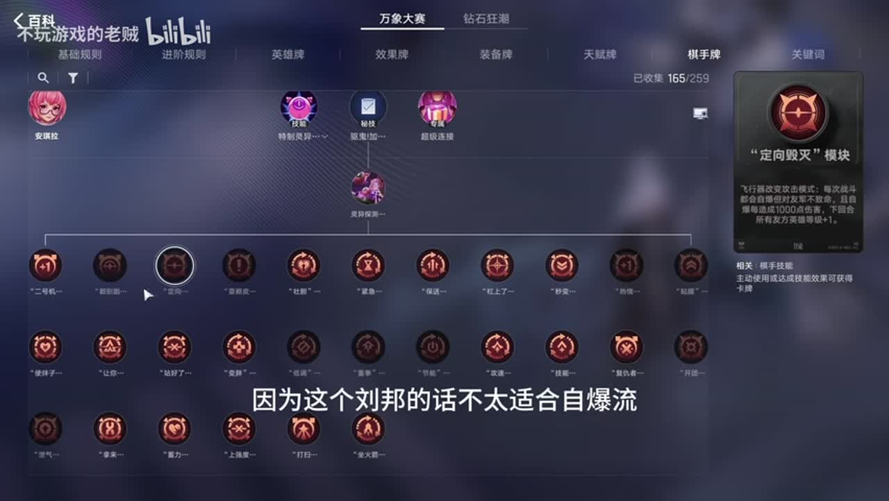

## 07:35–08:33 将双抗、致命伤保护和等级模块对应到核心生存及质变需求

- 事件 ID：BV1Jjao66ELh:p1:e007
- 场景：前置讲解
- 时机：介绍防御、保命与等级模块时
- 背景（明确说明）：核心能存活才有持续输出，某些英雄还需要达到等级节点。
- 学习目标（分析推断）：区分抗性、紧急保命和等级提升分别解决的问题。
- 模板：module-fit
- ASR 段落：[17, 18]

> 所以说点这个保送升级的话能让这个主C等级更高,是一个比较普适的模块。

## 08:34–09:24 把持续增伤和降低法防与肉盾内战、风筝目标联系

- 事件 ID：BV1Jjao66ELh:p1:e008
- 场景：前置讲解
- 时机：介绍持续打同一目标的增伤时
- 背景（明确说明）：敌方目标可能很肉或持续拉扯，需要长时间保持输出。
- 学习目标（分析推断）：按具体威胁判断增伤模块价值。
- 模板：counter-target
- ASR 段落：[19, 20]

> 尤其在大肉进行内战的时候,这个杠上的效果比较明显

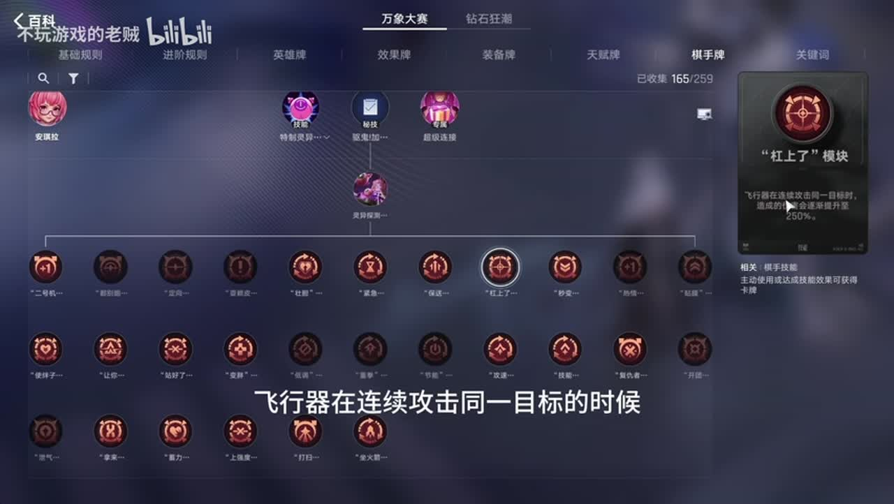

## 09:25–10:24 面对回血多的单位时选择针对治疗的模块

- 事件 ID：BV1Jjao66ELh:p1:e009
- 场景：前置讲解
- 时机：介绍减治疗模块时
- 背景（明确说明）：讲者举出回血英雄和内战作为减治疗效果更有价值的场景。
- 学习目标（分析推断）：学会从对手恢复能力识别针对性选择。
- 模板：counter-target
- ASR 段落：[21, 22]

> 打内战的时候啊,比较好用。

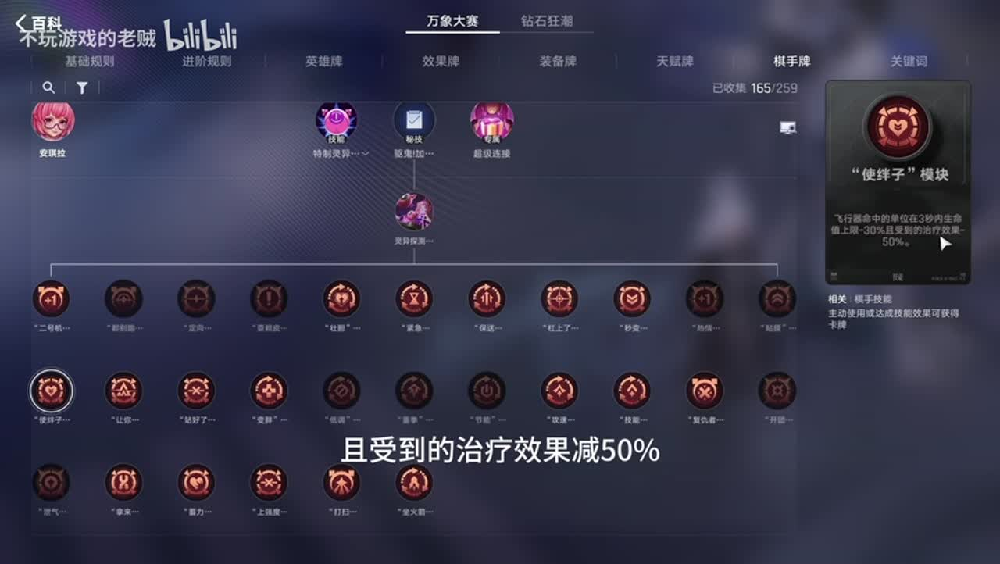

## 10:25–14:19 解释偷等级从双向变化变为单方获得后收益降低

- 事件 ID：BV1Jjao66ELh:p1:e010
- 场景：前置讲解
- 时机：模块枚举中指出拿来吧你被削弱时
- 背景（明确说明）：旧机制同时降低对方并提高己方；视频所述机制仅提高己方，因此旧经验需要调整。
- 学习目标（分析推断）：理解机制变化怎样改变选择价值。
- 模板：version-change
- ASR 段落：[23, 24, 25, 26, 27, 28, 29, 30]

> 现在只是单纯的你获得别人不减少,所以说就不如原来那么好用了

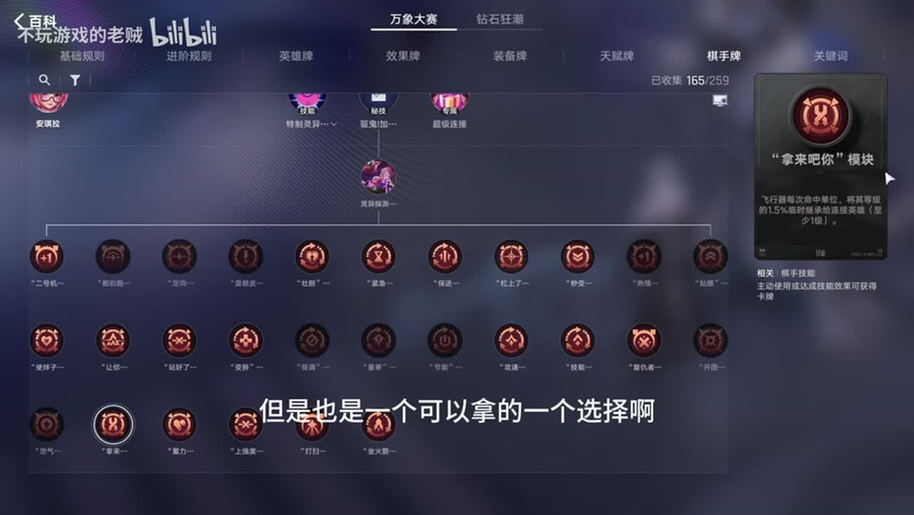

## 14:19–15:07 区分法术伤害来源与英雄自身法术攻击面板

- 事件 ID：BV1Jjao66ELh:p1:e011
- 场景：前置讲解
- 时机：说明继承法术攻击面板的模块适配时
- 背景（明确说明）：讲者对比刘邦、芈月和廉颇，指出伤害类型不等于可以继承的面板属性。
- 学习目标（分析推断）：避免用法术伤害这一标签错误推导装备或模块适配。
- 模板：equipment-role
- ASR 段落：[31, 32]

> 他虽然说炸盾伤害是法术伤害,但那是扁鹊给他的

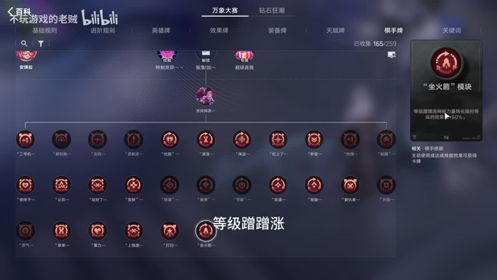

## 15:08–17:58 按刘邦生存、等级、伤害和工具人特征建立模块优先级

- 事件 ID：BV1Jjao66ELh:p1:e012
- 场景：前置讲解
- 时机：完成模块介绍后汇总本阵容可选项时
- 背景（明确说明）：讲者不再逐项读效果，而是回到刘邦与瑶及脆皮工具人的阵容构筑，排除自爆并比较优先级。
- 学习目标（分析推断）：学会把机制资料转换成阵容内的选择规则。
- 模板：module-fit
- ASR 段落：[33, 34, 35, 36, 37, 38]

> 壮胆的话优先要考虑拿给这个刘邦提供一个抗击让他更肉

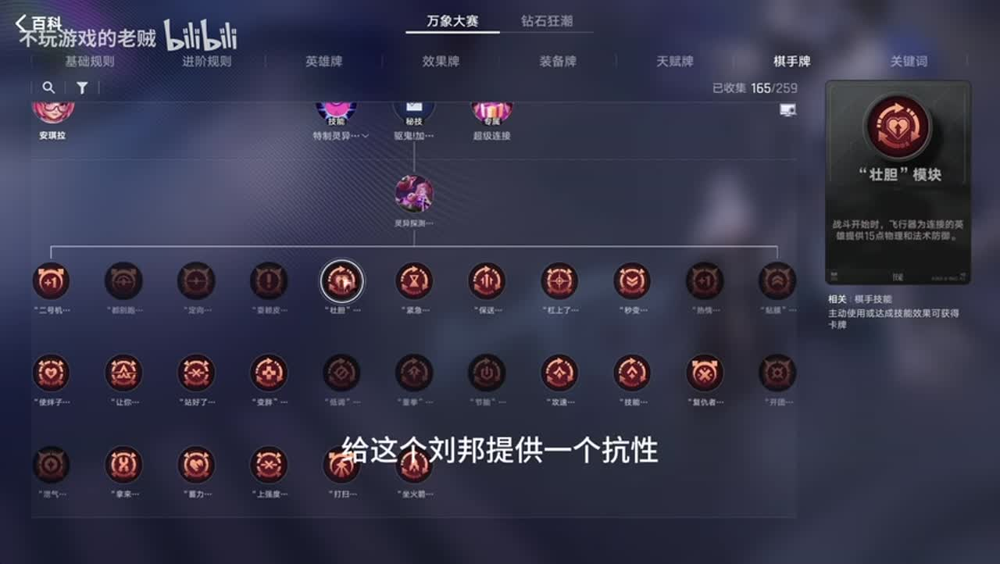

## 17:34–18:35 解释速六能同时获得改装和核心临时等级

- 事件 ID：BV1Jjao66ELh:p1:e013
- 场景：前置讲解
- 时机：说明六级大招并转入基本流程时
- 背景（明确说明）：大招带来额外模块，并随真实等级提供临时等级，升级能够直接增强核心战力。
- 学习目标（分析推断）：理解升阶的战力理由，不把速六当成无条件口令。
- 模板：level-transition
- ASR 段落：[38, 39]

> 加一个大改装,你的战斗力会更强一些。

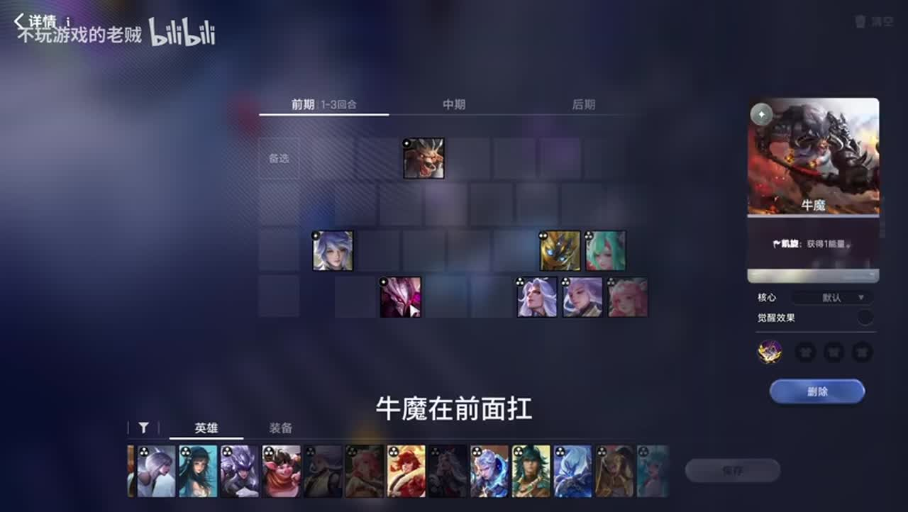

## 18:25–18:52 用牛魔承伤、干将和飞行器输出解释开局分工

- 事件 ID：BV1Jjao66ELh:p1:e014
- 场景：前置讲解
- 时机：介绍开局与前几回合过渡时
- 背景（明确说明）：初期需要稳定战力，再补过渡英雄并向下一阶段升级。
- 学习目标（分析推断）：按承伤与输出职责理解开局结构。
- 模板：opening-plan
- ASR 段落：[40]

> 牛魔在前面扛,然后把这个飞行器挂给干将

## 18:53–19:22 按关键英雄获取难度安排第一轮拍卖优先级

- 事件 ID：BV1Jjao66ELh:p1:e015
- 场景：前置讲解
- 时机：规划第一轮拍卖时
- 背景（明确说明）：讲者认为升到高等级后鬼谷子更难刷新获得，因此拍卖要提前解决关键构筑。
- 学习目标（分析推断）：把拍卖资源用于后续最难补齐的瓶颈。
- 模板：resource-order
- ASR 段落：[41]

> 鬼谷子的优先级更高一点,因为咱们升到高级的话,地这个鬼谷子不太好地。

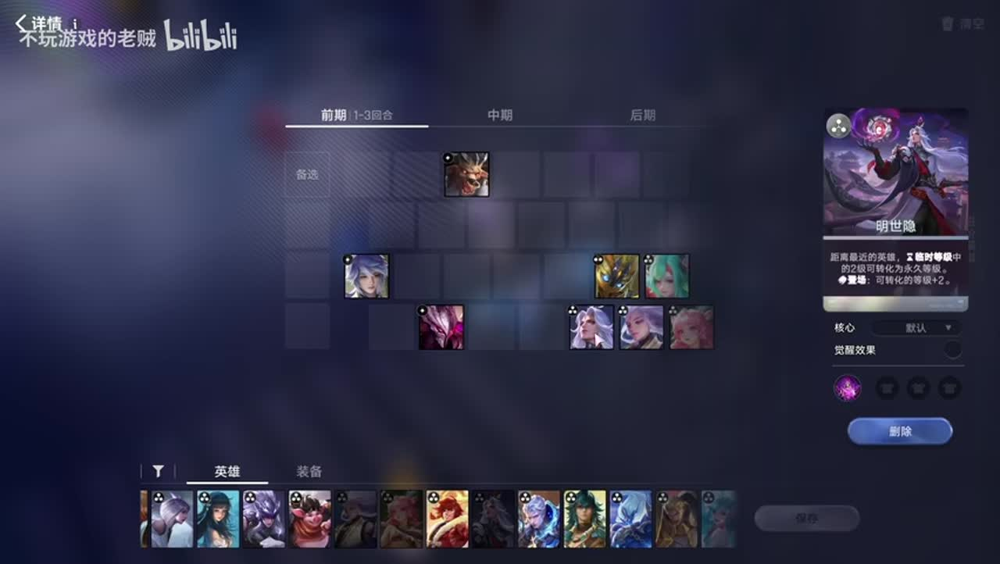

## 19:24–20:20 按核心到手和觉醒节点控制辅助牌投入

- 事件 ID：BV1Jjao66ELh:p1:e016
- 场景：前置讲解
- 时机：介绍首张刘邦与觉醒前后的买牌顺序时
- 背景（明确说明）：没有核心时辅助成长未能有效兑现，讲者要求保留钱，不在辅助重复买牌上乱花。
- 学习目标（分析推断）：学会依核心成型节点调整资源优先级。
- 模板：resource-order
- ASR 段落：[42, 43]

> 在他觉醒之前尽量不要乱花钱除了这个明世隐以外,不要乱拿

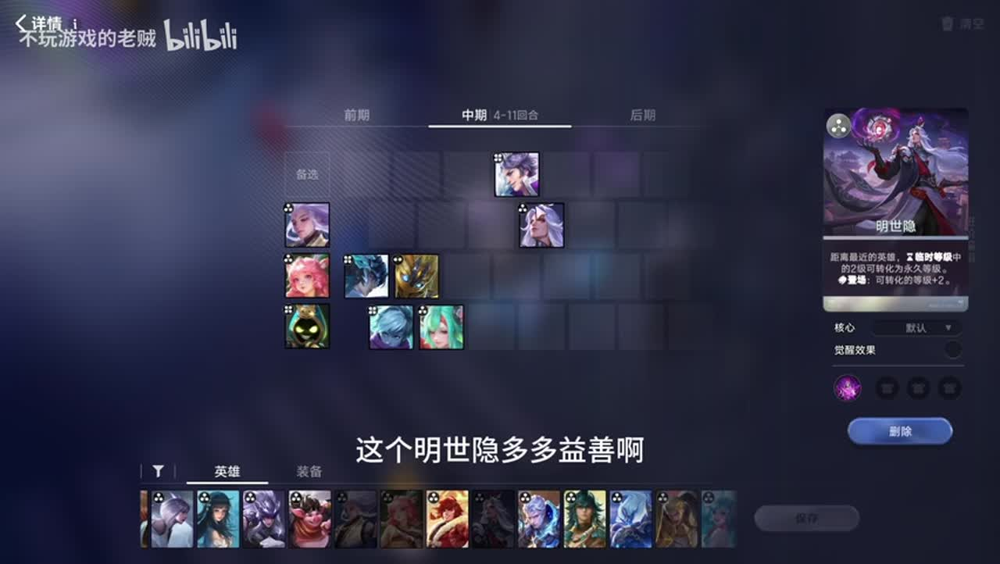

## 19:53–20:48 核心开始吃图腾等级且场面可稳时升级获取额外人口与找牌条件

- 事件 ID：BV1Jjao66ELh:p1:e017
- 场景：前置讲解
- 时机：四级获得首张刘邦后判断升五时
- 背景（明确说明）：刘邦到手使图腾和等级转化开始兑现；升五还可增加辅助与改善找牌。
- 学习目标（分析推断）：用战力和新增收益判断升级窗口。
- 模板：level-transition
- ASR 段落：[43, 44]

> 咱们升到五级之后,首先能多一个人口挂上扁鹊

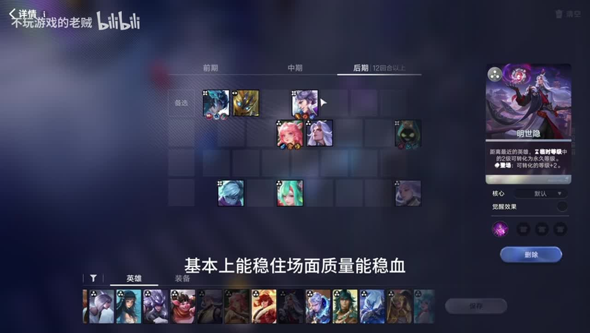

## 20:49–21:13 明世隐不足时用云中君补稳定等级成长

- 事件 ID：BV1Jjao66ELh:p1:e018
- 场景：前置讲解
- 时机：核心辅助来得晚或少时
- 背景（明确说明）：原定转化辅助可能不足，需要替代成长来源。
- 学习目标（分析推断）：按缺失的功能找替代，而非只记英雄名单。
- 模板：fallback-plan
- ASR 段落：[45]

> 明世隐这个地方如果来的晚来的少,咱们用云中君代替他。

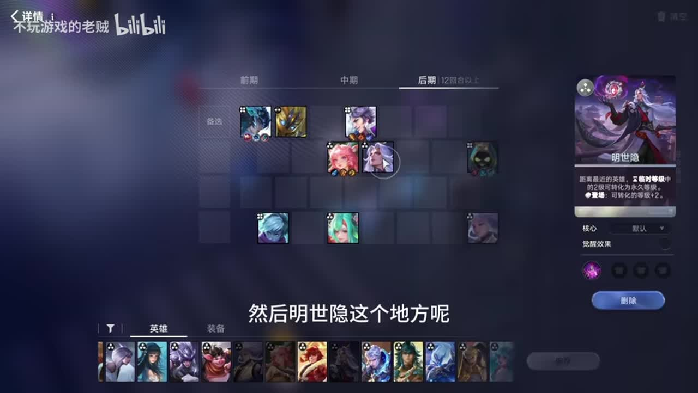

## 20:49–21:44 后期把成长位置换成太乙真人以应对决战

- 事件 ID：BV1Jjao66ELh:p1:e019
- 场景：前置讲解
- 时机：刷等级接近完成、准备终局时
- 背景（明确说明）：人口有限时，持续成长辅助与终局复活单位存在位置竞争。
- 学习目标（分析推断）：识别从发育目标切换到即时战力的阶段。
- 模板：late-transition
- ASR 段落：[45, 46]

> 已经开始进入决赛圈了,准备打决战的时候,换成太乙真人。

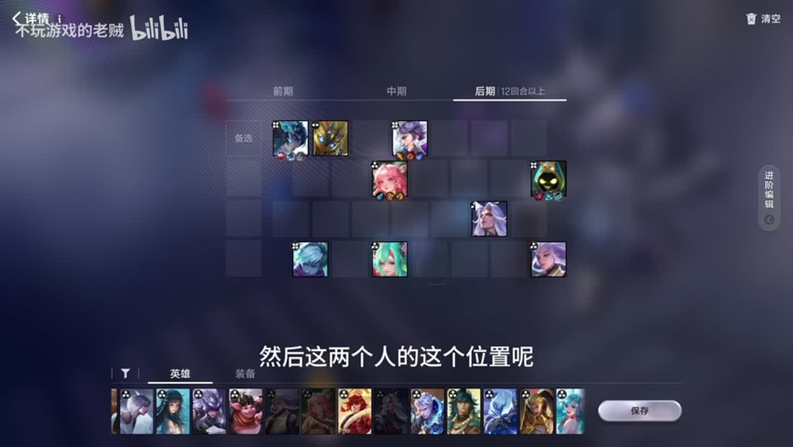

## 21:05–22:12 停止低收益死刷，存钱升六再找牌

- 事件 ID：BV1Jjao66ELh:p1:e020
- 场景：前置讲解
- 时机：五级刷新几次仍不来刘邦时
- 背景（明确说明）：升六同时提供大招战力与更好的找牌条件，能够缓解当前阶段不来核心的问题。
- 学习目标（分析推断）：学会在找牌受阻时比较刷新和升级的机会成本。
- 模板：level-transition
- ASR 段落：[46, 47]

> 不要在5级的时候玩命死递,如果实在递不出来的话,咱们就存两拨钱直接拉6啊

## 21:45–22:42 将输出、免控、法术成长和盾爆需求对应到装备

- 事件 ID：BV1Jjao66ELh:p1:e021
- 场景：前置讲解
- 时机：解释刘邦常规装备组合时
- 背景（明确说明）：讲者先说明刘邦有普攻与盾爆等伤害来源，再解释不同装备的作用。
- 学习目标（分析推断）：理解装备如何解决不同需求。
- 模板：equipment-role
- ASR 段落：[47, 48]

> 纯净苍穹给他提供一个免控,同时每两秒能获得法术攻击力。

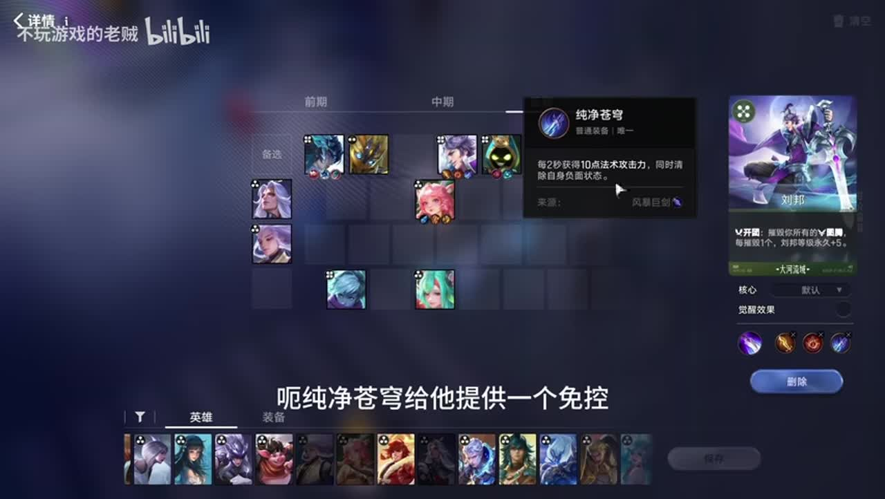

## 22:12–23:13 辅助等级不足以分享属性时，优先提供保命和团队作用

- 事件 ID：BV1Jjao66ELh:p1:e022
- 场景：前置讲解
- 时机：给瑶等辅助分配装备时
- 背景（明确说明）：讲者认为本构筑瑶的等级上限不易提高，不应按照高等级属性分享思路配装。
- 学习目标（分析推断）：按辅助实际能发挥的作用分配装备。
- 模板：equipment-role
- ASR 段落：[48, 49, 50]

> 所以说咱们不考虑她分香属性的问题给她做装备的时候

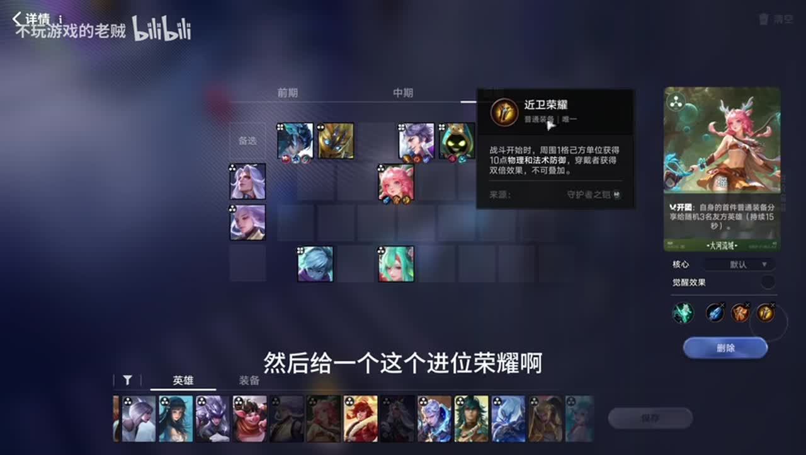

## 23:41–24:40 优先考虑能覆盖多张必需卡或在合适等级找核心的奖励

- 事件 ID：BV1Jjao66ELh:p1:e023
- 场景：前置讲解
- 时机：说明铜色天赋与阵容构筑关系时
- 背景（明确说明）：大河新援能对应多个构筑英雄，定向资源要在适合找刘邦的阶段使用。
- 学习目标（分析推断）：以有效覆盖和使用时机评估经济奖励。
- 模板：talent-fit
- ASR 段落：[51, 52]

> 因为咱们有四张卡啊,就是鬼谷子、少司缘、瑶妹、云中君啊,都是咱们的购注卡

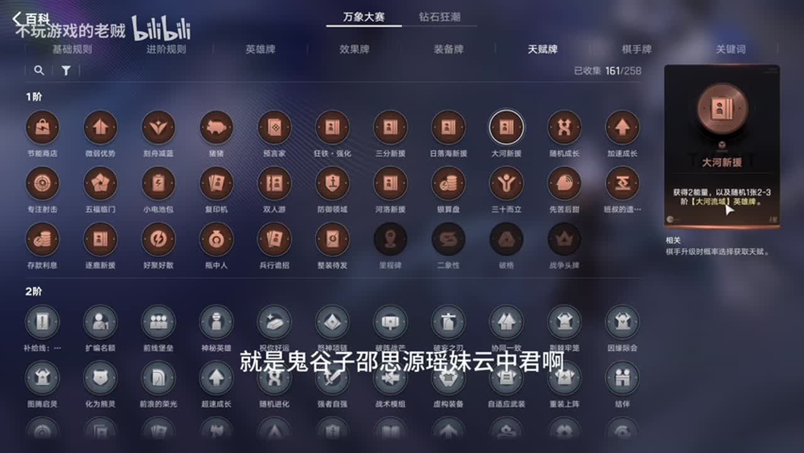

## 24:11–25:07 复制云中君或明世隐以重复兑现等级成长

- 事件 ID：BV1Jjao66ELh:p1:e024
- 场景：前置讲解
- 时机：解释复印机配合等级辅助时
- 背景（明确说明）：飞行器提供临时等级，明世隐可转化；云中君也能提供稳定成长。
- 学习目标（分析推断）：理解复制资源为什么要投向成长链的关键节点。
- 模板：growth-combo
- ASR 段落：[52, 53]

> 咱们可以用复印机去复印小明,然后多次打出。

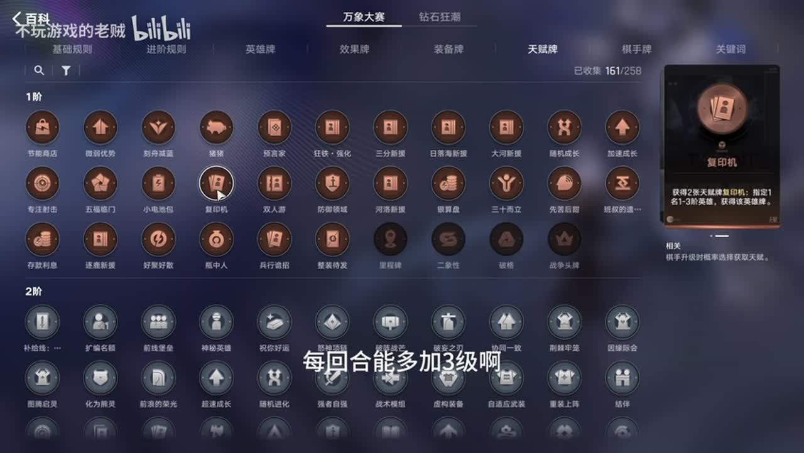

## 24:40–25:36 把暂不上辅助牌的运营顺序与经济天赋收益结合

- 事件 ID：BV1Jjao66ELh:p1:e025
- 场景：前置讲解
- 时机：评估整装待发经济天赋时
- 背景（明确说明）：刘邦到手前辅助可以留在手里，契合若干回合不上牌的条件。
- 学习目标（分析推断）：从实际行动计划判断天赋收益是否可兑现。
- 模板：talent-fit
- ASR 段落：[53, 54]

> 所以说整装待发能吃很多回合啊

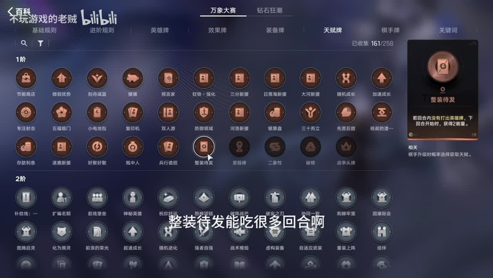

## 25:36–26:02 选择能接近后排的效果解决近战被风筝问题

- 事件 ID：BV1Jjao66ELh:p1:e026
- 场景：前置讲解
- 时机：识别刘邦难接近后排的缺点时
- 背景（明确说明）：刘邦输出距离短，难威胁后排射手和法师。
- 学习目标（分析推断）：按核心的攻击距离瓶颈寻找针对手段。
- 模板：counter-target
- ASR 段落：[55]

> 他是很难威胁到对方后排的,容易被射手、法师封整。

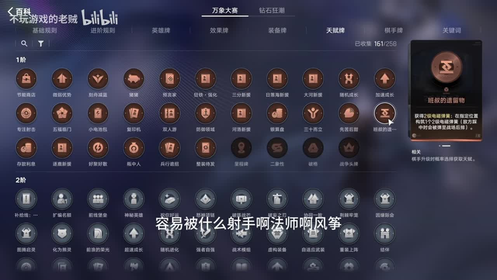

## 26:03–27:01 区分人口是否增加核心成长与是否提供功能位置

- 事件 ID：BV1Jjao66ELh:p1:e027
- 场景：前置讲解
- 时机：判断额外人口的价值时
- 背景（明确说明）：核心主要依靠已有图腾成长，额外人口不一定显著增加等级，但可容纳辅助和打出位。
- 学习目标（分析推断）：用功能而非人口数量本身评估收益。
- 模板：talent-fit
- ASR 段落：[56, 57]

> 你额外的人口也给他加不了太多的等级

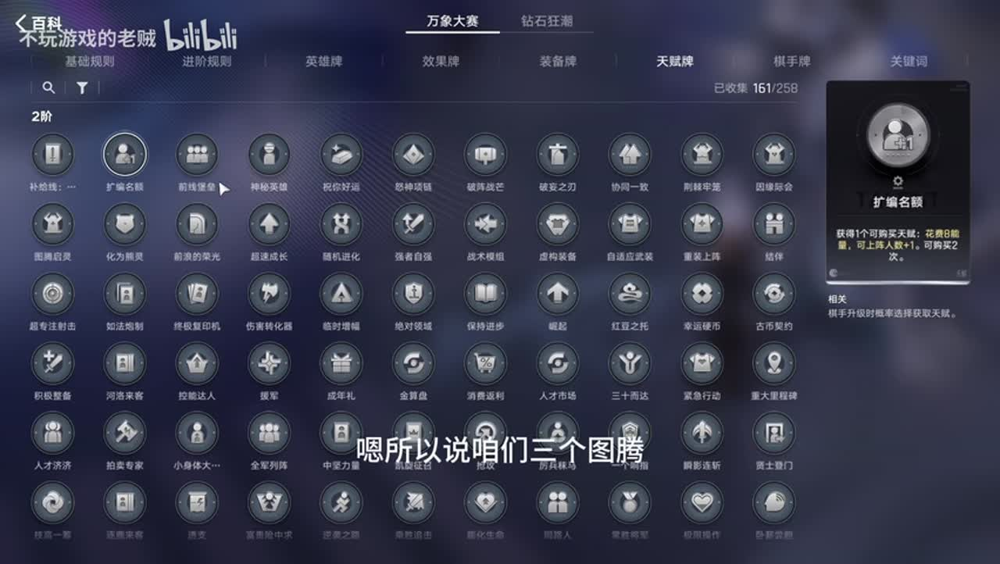

## 26:33–27:29 针对风筝目标考虑追击能力，并按对手阵容选择

- 事件 ID：BV1Jjao66ELh:p1:e028
- 场景：前置讲解
- 时机：根据敌方风筝射手选天赋时
- 背景（明确说明）：敌方射手可能让近战核心无法持续攻击。
- 学习目标（分析推断）：学习把对手阵容转化为具体反制需求。
- 模板：counter-target
- ASR 段落：[57, 58]

> 首先根据这个对方阵容来进行一个选择

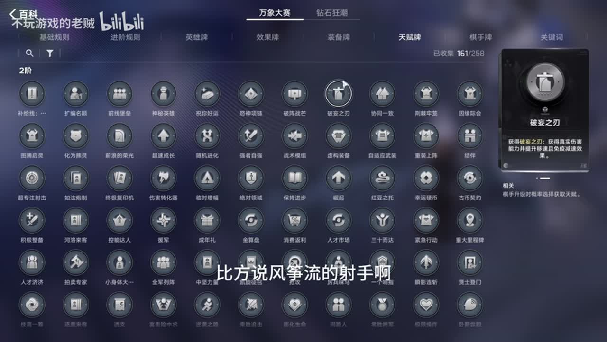

## 27:02–27:56 增加图腾个数能够放大刘邦的等级成长来源

- 事件 ID：BV1Jjao66ELh:p1:e029
- 场景：前置讲解
- 时机：解释图腾相关天赋时
- 背景（明确说明）：刘邦主要通过摧毁图腾获得等级，多一个有效图腾意味着增加可兑现成长。
- 学习目标（分析推断）：学会识别能增强核心成长引擎的资源。
- 模板：growth-combo
- ASR 段落：[58, 59]

> 刘邦这个加等级的主要方式就是来摧毁图腾

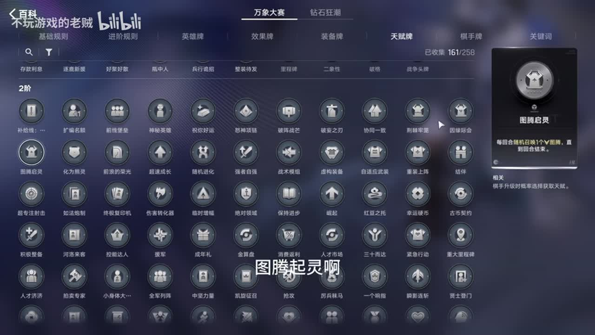

## 27:57–28:51 根据普攻频率与伤害构成选择能实际回血的效果

- 事件 ID：BV1Jjao66ELh:p1:e030
- 场景：前置讲解
- 时机：比较末世、征服之剑等回复来源时
- 背景（明确说明）：刘邦有频繁普攻，但讲者指出主要伤害构成与某些物理吸血装备并不匹配。
- 学习目标（分析推断）：区分攻击行为、伤害类型和吸血触发条件。
- 模板：equipment-role
- ASR 段落：[60, 61]

> 他普攻的次数比较多,能很好触发他的吸血效果。

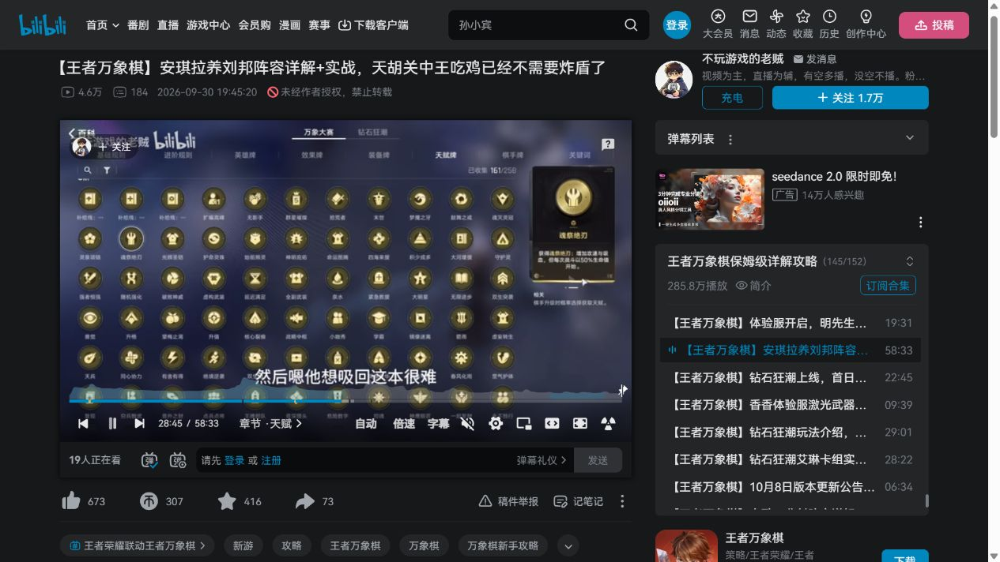

## 28:56–29:56 将额外图腾成长和高等级核心复制联系起来

- 事件 ID：BV1Jjao66ELh:p1:e031
- 场景：前置讲解
- 时机：解释虚妄转生为何适配单核心刘邦时
- 背景（明确说明）：图腾可被核心开场摧毁并提供等级，召唤出的单位又能复制已有核心优势。
- 学习目标（分析推断）：理解一项资源为什么能同时加强成长与战场数量。
- 模板：growth-combo
- ASR 段落：[62, 63]

> 相当于你有一个双倍的刘邦

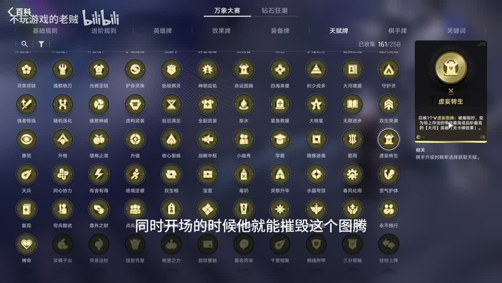

## 29:27–29:56 结合唤醒和临时等级转化判断成长辅助价值

- 事件 ID：BV1Jjao66ELh:p1:e032
- 场景：前置讲解
- 时机：效果牌讲解中比较明世隐与云中君时
- 背景（明确说明）：明世隐多且唤醒多时转化效率更好，来牌不足时仍可使用稳定替代。
- 学习目标（分析推断）：理解辅助强度取决于组合资源，而非固定排名。
- 模板：growth-combo
- ASR 段落：[63]

> 如果来的多,然后唤醒也多,这个时候呢,小明的效果是完爆云中君的。

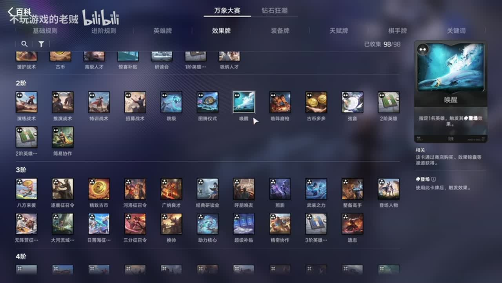

## 29:58–31:15 优先解决核心觉醒瓶颈，再考虑其他成长资源

- 事件 ID：BV1Jjao66ELh:p1:e033
- 场景：前置讲解
- 时机：规划第三轮拍卖且刘邦尚未觉醒时
- 背景（明确说明）：讲者认为觉醒早晚决定成长启动，若已觉醒则拍卖优先级不同。
- 学习目标（分析推断）：学会根据成型状态动态排序拍卖奖励。
- 模板：resource-order
- ASR 段落：[64, 65, 66]

> 除非你在第三轮拍卖前已经觉醒了,否则看见这个天籁琴音一定要拿。

## 30:49–31:51 必要时集中资源觉醒核心，再补回功能辅助

- 事件 ID：BV1Jjao66ELh:p1:e034
- 场景：前置讲解
- 时机：缺核心觉醒进度但有复制资源时
- 背景（明确说明）：核心不觉醒时成长无法跟上，讲者提出卖辅助再复制核心的有条件备选。
- 学习目标（分析推断）：理解关键瓶颈优先于维持完整辅助阵容的情况。
- 模板：resource-order
- ASR 段落：[66, 67]

> 然后用这个超级复印机去觉醒刘邦,再把那些图腾子递回来也是可以考虑的啊。

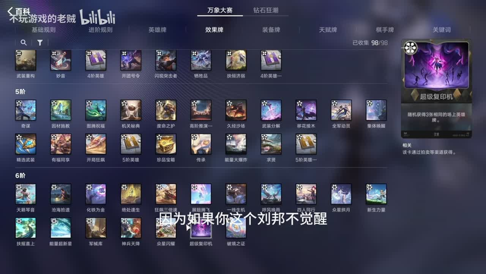

## 31:54–34:47 说明被削弱的等级模块仍可在接近等级质变时使用

- 事件 ID：BV1Jjao66ELh:p1:e035
- 场景：实战
- 时机：实战模块决策后补充解释旧机制时
- 背景（明确说明）：讲者把模块变化关联到廉颇等需要跨等级节点的英雄，指出削弱不等于完全无效。
- 学习目标（分析推断）：按当前需求重估旧强势选项。
- 模板：version-change
- ASR 段落：[68, 69]

> 他有可能在战斗中吸着吸着就已经过100级了这样的话就形成一个质变

## 34:49–37:58 优先确定的组合收益，比较赌核心来牌的替代奖励

- 事件 ID：BV1Jjao66ELh:p1:e036
- 场景：实战
- 时机：拍卖奖励与构筑选择出现时
- 背景（明确说明）：虚妄转生适配当前阵容，讲者只在没有该选项时考虑猎头赌刘邦。
- 学习目标（分析推断）：比较确定收益与概率收益，并保留替代条件。
- 模板：talent-fit
- ASR 段落：[70, 71]

> 如果没有这个虚妄转生的话,我还真想拿那个。

## 35:35–38:33 利用觉醒进度奖励减少需要找到的核心数量

- 事件 ID：BV1Jjao66ELh:p1:e037
- 场景：实战
- 时机：实战获得缩短刘邦觉醒进度的奖励时
- 背景（明确说明）：讲者明确说明奖励能减少所需刘邦张数，随后集中找核心与构筑成员。
- 学习目标（分析推断）：学会把奖励效果转换为当前找牌目标。
- 模板：resource-order
- ASR 段落：[71, 72]

> 这样咱们找三张刘邦就够了。

## 39:20–42:17 核心已到手时可考虑升五，继续刷新需有明确补牌目标

- 事件 ID：BV1Jjao66ELh:p1:e038
- 场景：实战
- 时机：已有首张刘邦但还在补关键辅助时
- 背景（明确说明）：讲者说明刷新主要为了少司缘，刘邦只顺手找，不将所有资源耗在同一等级。
- 学习目标（分析推断）：区分核心已达升级条件与仍需解决的辅助瓶颈。
- 模板：level-transition
- ASR 段落：[73, 74]

> 有一张的话咱们其实已经可以考虑拉五了,主要是想递一个少司缘

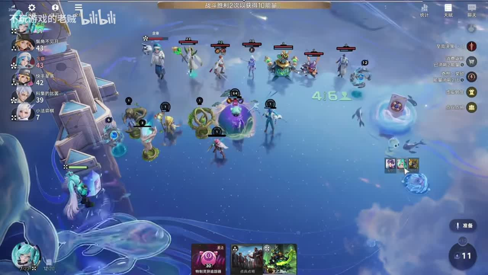

## 41:21–42:58 确认缺少炸盾，并改用等级成长与普攻承接伤害

- 事件 ID：BV1Jjao66ELh:p1:e039
- 场景：实战
- 时机：发现逐鹿被禁、找不到扁鹊后
- 背景（明确说明）：原构筑需要扁鹊提供炸盾，但讲者在实战发现禁逐鹿。
- 学习目标（分析推断）：理解失去的功能和仍成立的替代伤害来源。
- 模板：fallback-plan
- ASR 段落：[74, 75]

> 禁逐鹿就是没有炸盾了嘛,对吧,也行咱依靠咱那个高等级加上一个普攻伤害

## 43:01–44:51 原用途受影响时，按保命与补伤重新评估装备价值

- 事件 ID：BV1Jjao66ELh:p1:e040
- 场景：实战
- 时机：缺少炸盾后重新评估护命灵珠时
- 背景（明确说明）：没有炸盾降低部分配合收益，但保命效果和其他伤害补充仍可发挥作用。
- 学习目标（分析推断）：掌握条件变化后重新审视装备的办法。
- 模板：equipment-role
- ASR 段落：[76, 77]

> 但是现在的话也可以考虑拿啊,提升一个容错

## 43:38–45:59 增加成长辅助并利用飞行器弥补缺少炸盾

- 事件 ID：BV1Jjao66ELh:p1:e041
- 场景：实战
- 时机：调整禁逐鹿条件下的后续发育时
- 背景（明确说明）：失去扁鹊后释放辅助位置，核心来牌较顺，仍可提高等级并补输出。
- 学习目标（分析推断）：把缺失功能拆成可补偿的资源需求。
- 模板：fallback-plan
- ASR 段落：[77, 78]

> 我们现在依靠这个飞行器补充一点伤害

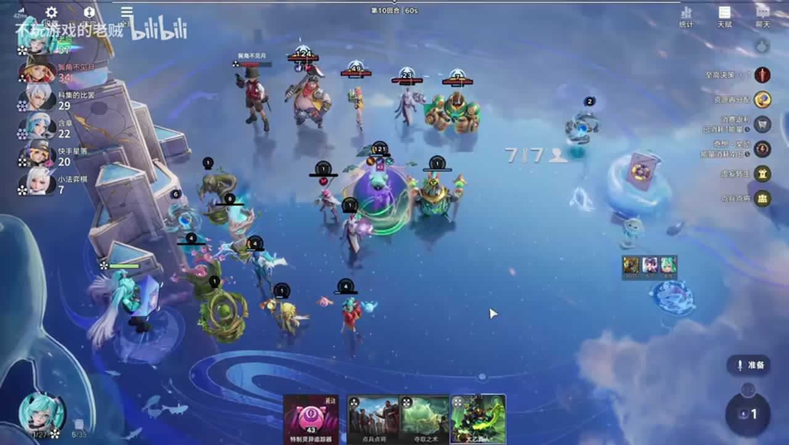

## 45:59–49:17 由找觉醒核心切换到存钱升六，解释启动快的战力价值

- 事件 ID：BV1Jjao66ELh:p1:e042
- 场景：实战
- 时机：核心觉醒启动后准备存钱升级时
- 背景（明确说明）：刘邦已经觉醒，讲者回顾早觉醒为何能更快形成等级优势。
- 学习目标（分析推断）：识别瓶颈解除后的目标切换。
- 模板：level-transition
- ASR 段落：[79, 80]

> 咱直接可以存钱了,准备上溜了

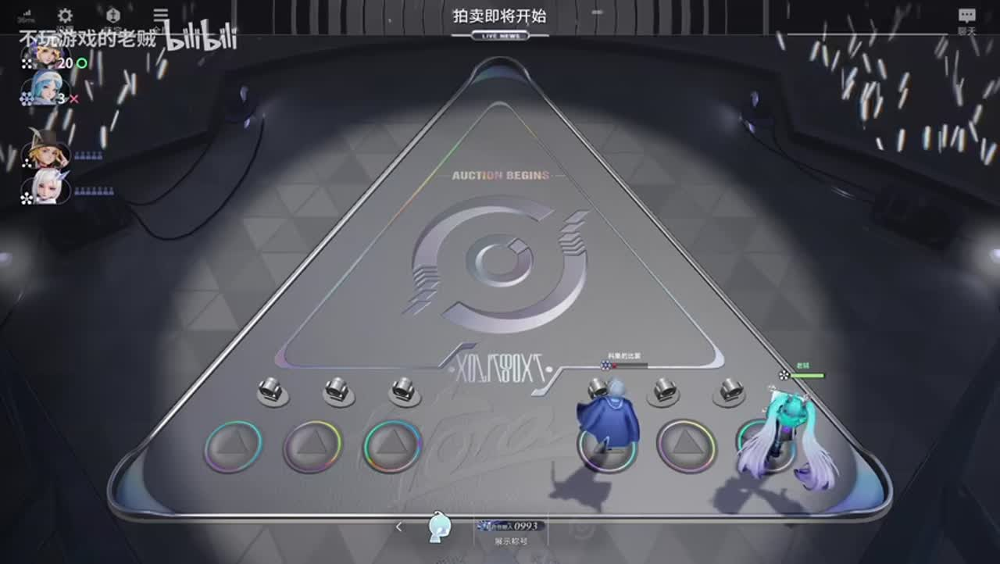

## 49:18–50:06 即使没有炸盾，也按现有技能伤害选择降低法防的模块

- 事件 ID：BV1Jjao66ELh:p1:e043
- 场景：实战
- 时机：技能加持与秒变脆皮二选一时
- 背景（明确说明）：实际对局缺炸盾，但核心仍有技能法术伤害，不能因此把降法防认定为无效。
- 学习目标（分析推断）：按当前真实伤害构成判断模块适配。
- 模板：module-fit
- ASR 段落：[81]

> 但是咱那个技能是有一定法伤的啊。

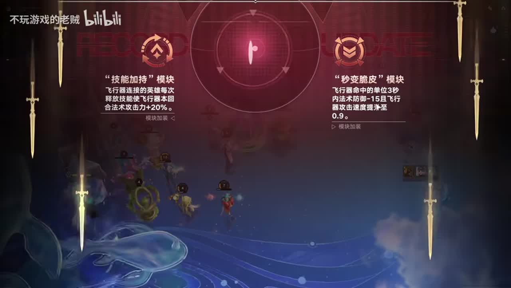

## 50:13–51:38 用战斗反馈复核缺少炸盾造成的伤害差距

- 事件 ID：BV1Jjao66ELh:p1:e044
- 场景：实战
- 时机：一场战斗伤害差一点未能结束时
- 背景（明确说明）：讲者判断缺少炸盾使收尾伤害不足，同时看到飞行器争取到更多输出时间。
- 学习目标（分析推断）：把战斗结果连回伤害结构，而非只归因运气。
- 模板：combat-review
- ASR 段落：[82]

> 差两刀吧没有那个炸盾啊,有炸盾的话早赢了

## 51:44–54:16 成长阶段保留成长配置，最后几回合再换复活辅助

- 事件 ID：BV1Jjao66ELh:p1:e045
- 场景：实战
- 时机：追太乙真人并说明刷等级与终局切换时
- 背景（明确说明）：人口有限，早上终局单位可能占用成长位置；是否有扁鹊也影响配置。
- 学习目标（分析推断）：理解阶段目标对辅助取舍的影响。
- 模板：late-transition
- ASR 段落：[83, 84]

> 就是差不多最后几回合的时候就可以换了

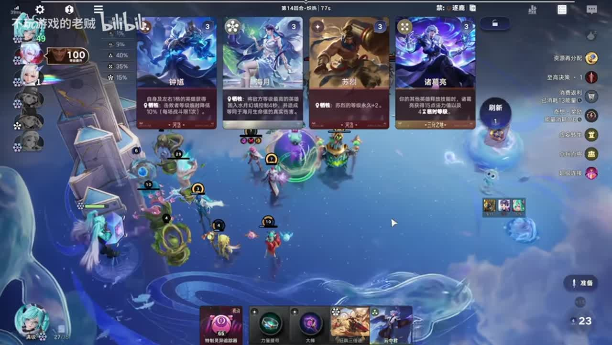

## 54:43–56:13 无炸盾时降低不死鸟之眼需求，把剩余资源投入等级成长

- 事件 ID：BV1Jjao66ELh:p1:e046
- 场景：实战
- 时机：后期再次复核装备需求时
- 背景（明确说明）：原盾爆配装理由已变化，现有保命装备能工作，讲者认为继续找成长更有价值。
- 学习目标（分析推断）：按实际瓶颈调整后期装备和资源优先级。
- 模板：equipment-role
- ASR 段落：[85]

> 感觉咱们如果没有炸盾的话不太需要那个不死鸟之眼了

## 56:20–58:08 观察对手关键输出变化，考虑用钟馗降低等级

- 事件 ID：BV1Jjao66ELh:p1:e047
- 场景：实战
- 时机：对手转出吕布后安排应对时
- 背景（明确说明）：讲者指出对手转成吕布，随后明确提出钟馗作为针对对象的手段。
- 学习目标（分析推断）：学会在对手调整后重新确定针对目标。
- 模板：counter-target
- ASR 段落：[86, 87]

> 我来个钟馗。我降你吕布等级。

## 57:19–58:27 结合护盾、复活和加时解释这局生存优势，同时保留来牌条件

- 事件 ID：BV1Jjao66ELh:p1:e048
- 场景：实战
- 时机：终局战斗结束并总结时
- 背景（明确说明）：讲者认为对方难破护盾，而己方仍有复活，最终获胜后强调拍卖奖励和来牌需要给力。
- 学习目标（分析推断）：把获胜原因与适用条件一起记住，不泛化为固定必胜阵容。
- 模板：combat-review
- ASR 段落：[87, 88]

> 但是前提是发拍员得给力点。

## 待核实与局限

- 部分口语卡名仍有误识别候选，事件避用不能确认的卡名；学习目标为分析推断。
- 视频所述禁逐鹿应变依赖这局刘邦来牌顺利，不推导为所有禁逐鹿情况下都适合该完整阵容。
- 1393.65–1421.74等转写间隔保留在全文，未确认其中是否存在漏语音。
