# 【王者万象棋】常小娥（嫦娥）艾琳风筝流详解+实战，最会走位的棋子

来源：https://www.bilibili.com/video/BV1AJen6SEP6/?p=1

分析状态：completed

完整文字稿：../../../raw/BV1AJen6SEP6_p1.md

## 00:00–02:05 把先稳血与追上限分成两个目标；优先选有协同机制的组合

- 事件 ID：BV1AJen6SEP6:p1:e001
- 场景：前置讲解
- 时机：规划四人组时
- 背景（分析推断）：讲者比较散搭五阶卡、海陆空与艾琳组合，强度判断限于视频版本。
- 学习目标（分析推断）：依局势选择保命组合或高上限协同组合。
- 模板：fallback-plan
- ASR 段落：[1, 2, 3, 4, 5]

> 先把这个血稳住锁住

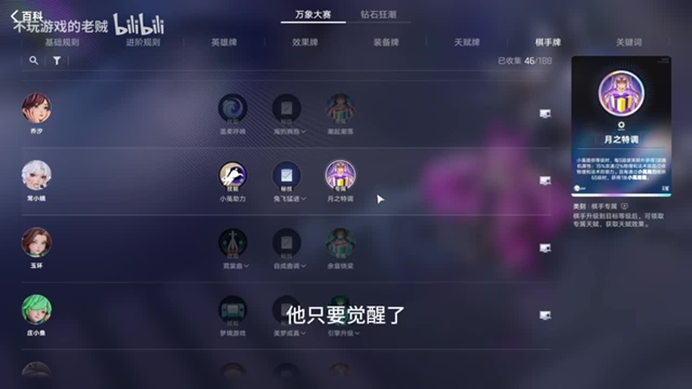

## 02:07–03:50 比较瑶妹、闹闹与嫦娥提供等级或属性的路径

- 事件 ID：BV1AJen6SEP6:p1:e002
- 场景：前置讲解
- 时机：认识同一主输出的不同养成路径时
- 背景（分析推断）：展示多种艾琳玩法；本套靠嫦娥属性、瑶妹分发及吸血而非仅看等级。
- 学习目标（分析推断）：理解同一英雄怎样借不同棋手形成不同成长引擎。
- 模板：mechanic-model
- ASR 段落：[6, 7, 8, 9]

> 她的属性会非常的高

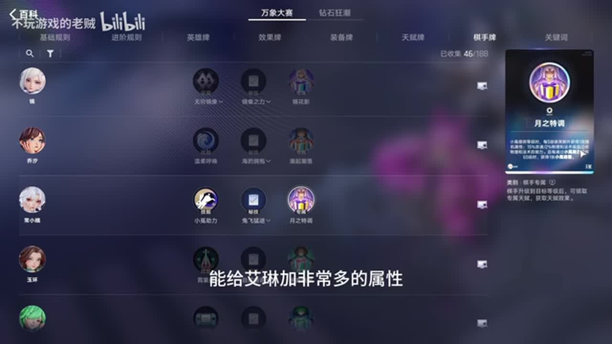

## 03:29–04:17 优先保护棋手血量，再用经济天赋帮助升级

- 事件 ID：BV1AJen6SEP6:p1:e003
- 场景：前置讲解
- 时机：升六前选择天赋时
- 背景（分析推断）：路线需要活到启动阶段；减伤和经济服务于阶段目标。
- 学习目标（分析推断）：按阶段目标评价天赋收益。
- 模板：talent-fit
- ASR 段落：[9, 10]

> 主要咱们就是考虑给棋手减伤

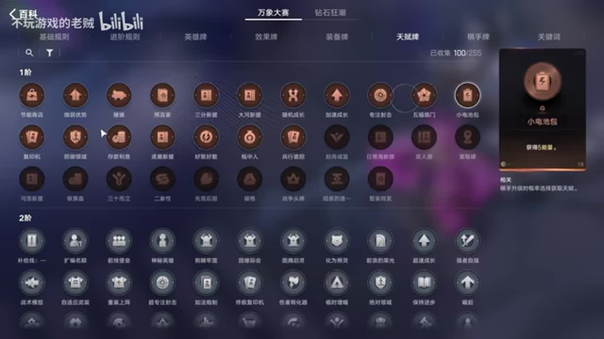

## 04:17–05:14 额外吸血用来对冲对射和反伤；嫦娥基础吸血可能不够

- 事件 ID：BV1AJen6SEP6:p1:e004
- 场景：前置讲解
- 时机：预判远程对射或反伤坦克时
- 背景（分析推断）：讲者举远程主输出对射、花木兰等反伤坦克两类威胁。
- 学习目标（分析推断）：按敌方伤害来源识别生存缺口。
- 模板：counter-target
- ASR 段落：[11, 12]

> 咱们需要靠吸血能力去对冲他的这个反伤

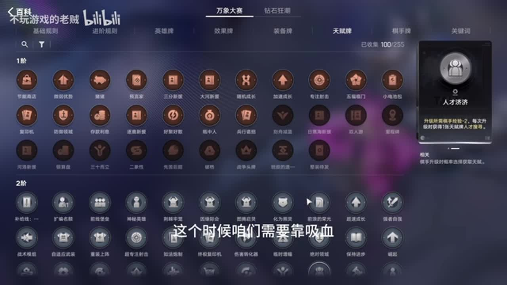

## 04:44–06:11 按普攻收割、觉醒难度和替代位置评价天赋；护命灵珠给海月

- 事件 ID：BV1AJen6SEP6:p1:e005
- 场景：前置讲解
- 时机：选择战力与找牌天赋时
- 背景（分析推断）：艾琳负责收割，四人组较易追全觉醒；缺海月可用其他强力卡替代。
- 学习目标（分析推断）：把天赋效果连到阵容实际需求，而非照抄名单。
- 模板：talent-fit
- ASR 段落：[12, 13, 14]

> 主要靠艾琳来进行一个收割

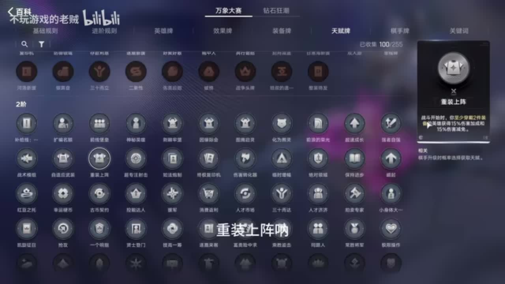

## 05:45–06:42 随机成长集中给单挂狂铁，帮助前期过渡

- 事件 ID：BV1AJen6SEP6:p1:e006
- 场景：前置讲解
- 时机：前期仅有一个棋子时
- 背景（分析推断）：场上仅狂铁时，随机强化不会分散给多单位。
- 学习目标（分析推断）：理解随机收益可用人数控制集中。
- 模板：growth-combo
- ASR 段落：[14, 15]

> 他的这个等级会提得更快一些

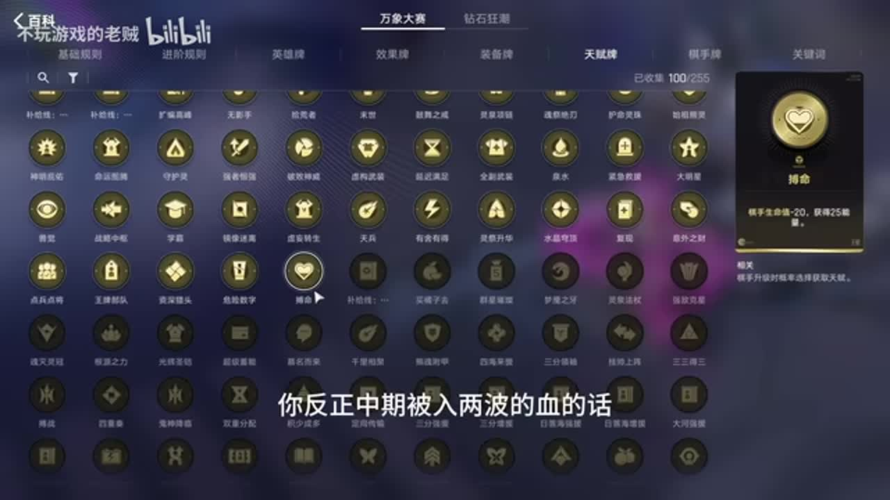

## 06:12–07:06 升六前只留四人组必要卡，升六后再购等级卡并分解非核心装备

- 事件 ID：BV1AJen6SEP6:p1:e007
- 场景：前置讲解
- 时机：升六前后购买效果牌时
- 背景（分析推断）：前期省钱升级；成型后才把闲置装备转为吸血或保命神器。
- 学习目标（分析推断）：避免过早购物拖慢启动，并转换闲置资源。
- 模板：resource-order
- ASR 段落：[15, 16]

> 六级前我们不拿任何的效果卡

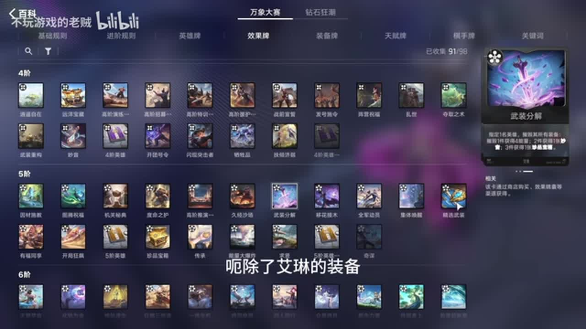

## 07:08–09:26 根据吸血、斩杀、等级分配与坦度区分装备价值

- 事件 ID：BV1AJen6SEP6:p1:e008
- 场景：前置讲解
- 时机：选择日落海专属装备时
- 背景（分析推断）：场上日落海人数影响核心等级分配；某装备可让狂铁退出分配。
- 学习目标（分析推断）：按装备解决的问题判断价值。
- 模板：equipment-role
- ASR 段落：[17, 18, 19, 20, 21]

> 等级就能更集中在主C身上

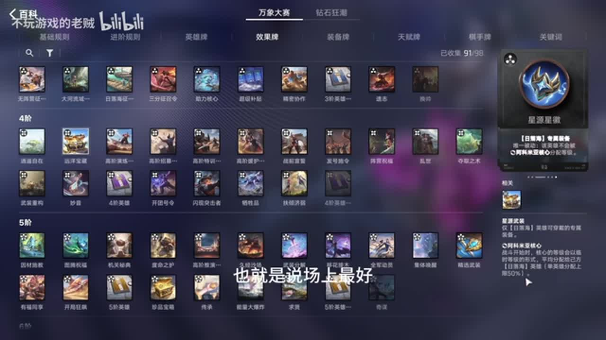

## 09:27–10:44 保留决赛成长牌与传承入口；不为非必要五阶招募付高价

- 事件 ID：BV1AJen6SEP6:p1:e009
- 场景：前置讲解
- 时机：筹备后期拍卖资源时
- 背景（分析推断）：主输出艾琳为四阶，海月位置可替代，找五阶卡的迫切性低于海陆空。
- 学习目标（分析推断）：从阵容缺口推导拍卖优先级。
- 模板：auction-choice
- ASR 段落：[22, 23, 24]

> 咱们主C是四阶的艾琳

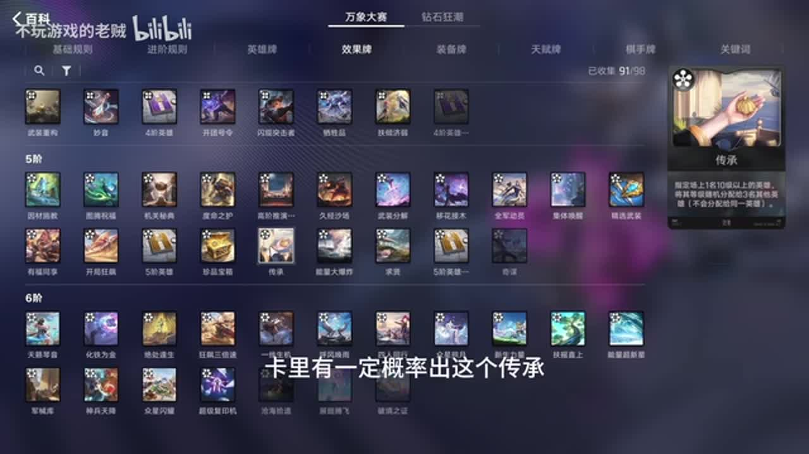

## 10:45–12:34 每轮留兔子费用；按所缺功能选择拍卖棋子，并注意弈星与兔子的先后

- 事件 ID：BV1AJen6SEP6:p1:e010
- 场景：前置讲解
- 时机：开局、首次拍卖与升级顺序时
- 背景（分析推断）：狂铁过渡、瑶妹优先，其他选择兼顾卖牌收益；升级顺序影响兔子收益对象。
- 学习目标（分析推断）：执行开局步骤时保留资源和收益对象意识。
- 模板：resource-order
- ASR 段落：[25, 26, 27, 28]

> 记得留一个兔子的钱

## 12:35–13:54 艾琳机制可允许五级启动，牺牲部分属性换即时稳血

- 事件 ID：BV1AJen6SEP6:p1:e011
- 场景：前置讲解
- 时机：艾琳阵容考虑是否一定等六级时
- 背景（分析推断）：一百级绕场和穿透提供机制优势；讲者对比必须追高等级的海陆空。
- 学习目标（分析推断）：根据阵容机制决定启动点。
- 模板：level-transition
- ASR 段落：[29, 30, 31]

> 尽早的去扔这个大兔子

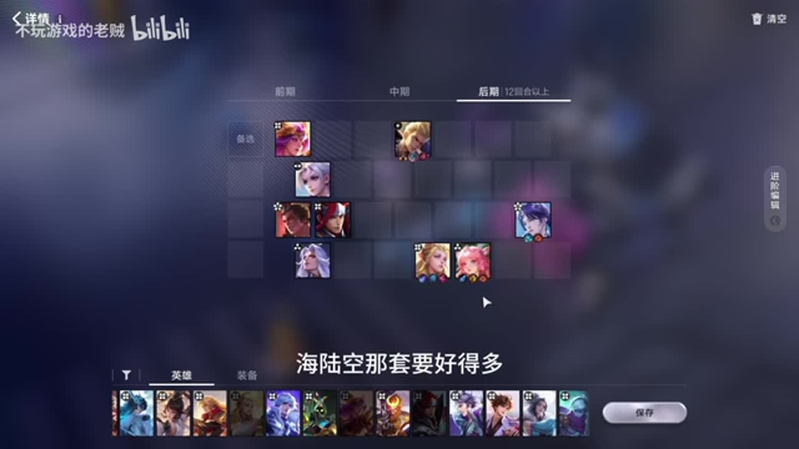

## 13:26–14:22 先用免费刷新找艾琳瑶妹，不齐四人时先扔小兔子

- 事件 ID：BV1AJen6SEP6:p1:e012
- 场景：前置讲解
- 时机：用积累的免费刷新凑四人组时
- 背景（分析推断）：五级已积累免费刷新；大兔子需要完整四人组。
- 学习目标（分析推断）：识别启动条件，避免把关键技能过早使用。
- 模板：resource-order
- ASR 段落：[31, 32]

> 大兔子必须得到四个人

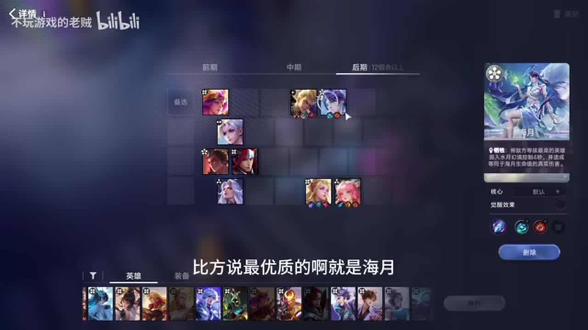

## 13:55–18:07 按扛伤、控制和争取输出时间选择替代，不执着英雄名

- 事件 ID：BV1AJen6SEP6:p1:e013
- 场景：前置讲解
- 时机：海月等最优第四人缺失时
- 背景（分析推断）：海月最好，雅典娜、亚连、韩信、吕布或明世隐可承担不同辅助功能。
- 学习目标（分析推断）：围绕艾琳输出环境寻找功能替代。
- 模板：fallback-plan
- ASR 段落：[32, 33, 34, 35, 36, 37, 38, 39, 40]

> 其他人都是为她创造输出环境

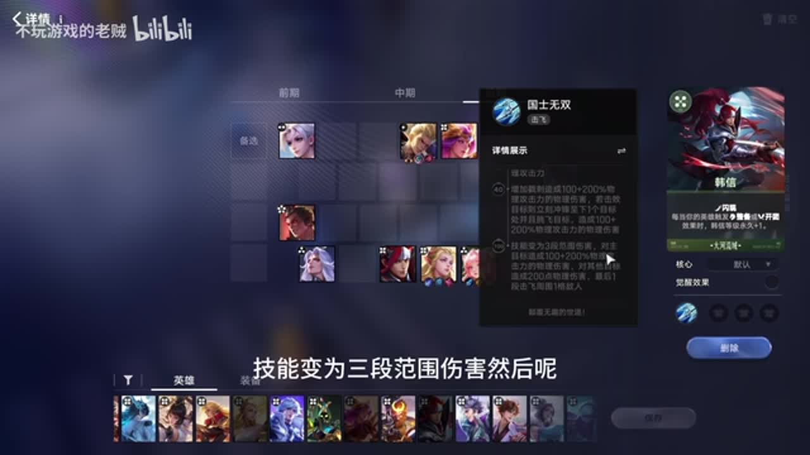

## 17:39–18:36 压力小可先升六再搜；压力大优先已有四人组启动

- 事件 ID：BV1AJen6SEP6:p1:e014
- 场景：前置讲解
- 时机：四人组凑不齐但血量仍允许时
- 背景（分析推断）：讲者先强调免费刷新，不建议无条件花钱强搜；健康血量允许追海月上限。
- 学习目标（分析推断）：用血量与质量决定升级和启动的取舍。
- 模板：level-transition
- ASR 段落：[40, 41]

> 压力不太大的情况下,也可以考虑速六

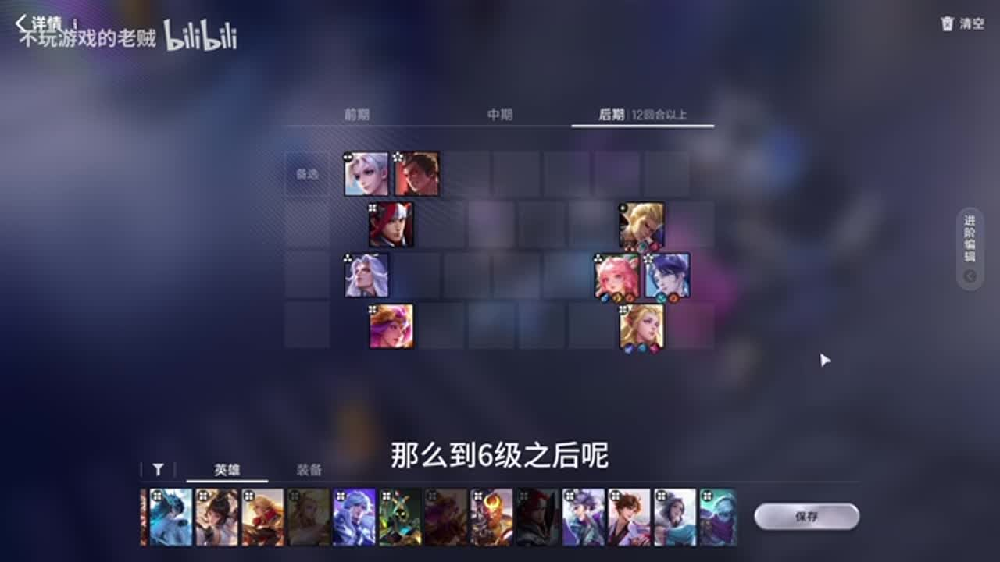

## 18:37–20:00 大兔子前可分等级换更强单位；已叠大量属性后不要轻易换

- 事件 ID：BV1AJen6SEP6:p1:e015
- 场景：前置讲解
- 时机：传承出现且准备更换狂铁时
- 背景（分析推断）：属性投入留在既定四人组，换人会损失已投入的收益。
- 学习目标（分析推断）：将沉淀属性与替换收益一起评价。
- 模板：late-transition
- ASR 段落：[42, 43, 44]

> 不建议再换人了

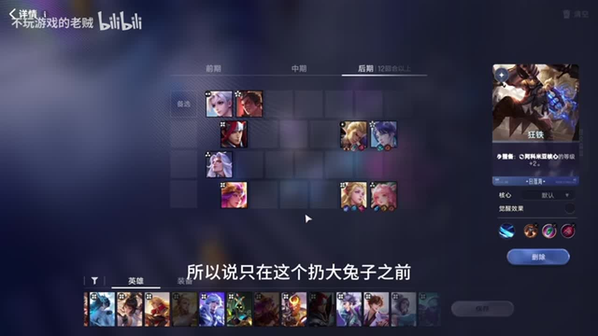

## 20:01–20:51 重点补海月艾琳觉醒；两件装备单位可留位接受瑶妹明刀

- 事件 ID：BV1AJen6SEP6:p1:e016
- 场景：前置讲解
- 时机：分配装备及追觉醒时
- 背景（分析推断）：瑶妹觉醒收益被讲者认为较小；装备空位影响分发。
- 学习目标（分析推断）：按关键收益分配觉醒与装备资源。
- 模板：equipment-role
- ASR 段落：[45, 46]

> 狂铁跟海月每人给两件

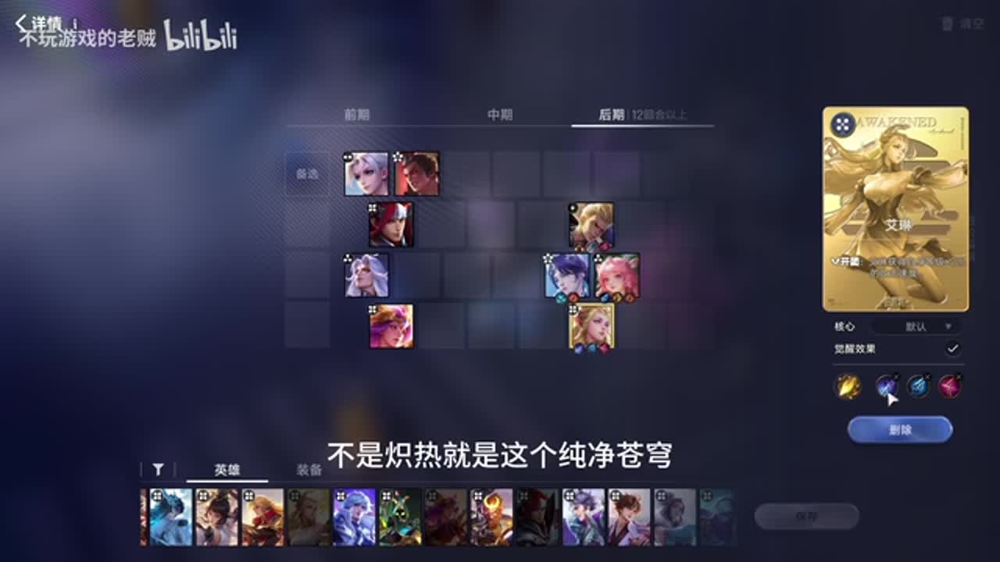

## 20:22–21:47 解控防被黏住，冰杖风筝、破晓处理物防；自身等级和瑶妹可补攻速

- 事件 ID：BV1AJen6SEP6:p1:e017
- 场景：前置讲解
- 时机：确定艾琳核心装备时
- 背景（分析推断）：艾琳需要持续走位普攻，自身开团效果提供攻速。
- 学习目标（分析推断）：从输出方式推导装备，减少重复投入。
- 模板：equipment-role
- ASR 段落：[46, 47, 48]

> 否则她一旦被控住了,就会被别人粘住追上

## 21:22–23:06 前排延长扛伤、瑶妹增加属性；决赛可将宝石从艾琳换给辅助

- 事件 ID：BV1AJen6SEP6:p1:e018
- 场景：前置讲解
- 时机：分配辅助装备与前期学识宝石时
- 背景（分析推断）：神器重点补吸血，学识宝石前期用于艾琳成长，后期重分配。
- 学习目标（分析推断）：随阶段改变装备使用者。
- 模板：equipment-role
- ASR 段落：[48, 49, 50, 51]

> 后期等到决赛圈的时候可以把这学生宝石扣回来

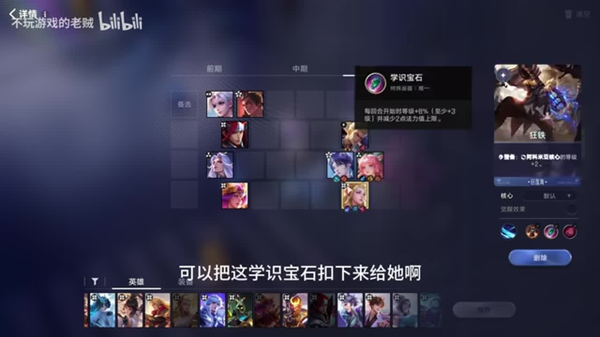

## 22:37–24:25 将狂铁等级传承给关键三人，因为强敌面前其拖延作用下降

- 事件 ID：BV1AJen6SEP6:p1:e019
- 场景：前置讲解
- 时机：决赛最后一回合时
- 背景（分析推断）：中后期仍有双前排价值，但决赛更依赖海月换主输出与艾琳收割。
- 学习目标（分析推断）：解释阶段目标变化为何改变保留单位的价值。
- 模板：late-transition
- ASR 段落：[51, 52, 53, 54]

> 到了最后一回合,决赛圈最后一回合

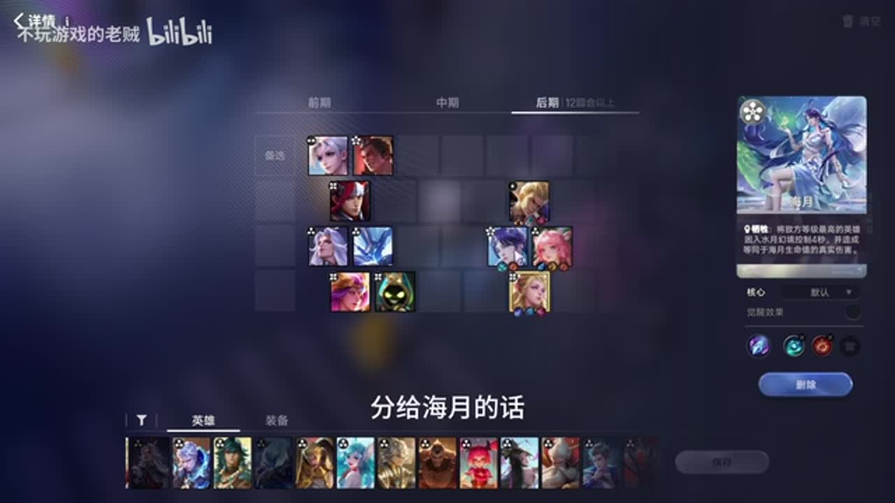

## 24:01–25:33 按对手强度补太乙真人，战后卸下等兔子完成再挂回；配合连线站位

- 事件 ID：BV1AJen6SEP6:p1:e020
- 场景：前置讲解
- 时机：遇强敌或最后决战时
- 背景（分析推断）：弱对手可省资源；决战将复活资源和连线给关键输出。
- 学习目标（分析推断）：有目标地使用临时保命资源。
- 模板：counter-target
- ASR 段落：[54, 55, 56]

> 如果对面还是过强你还需要再补的话你再买一个

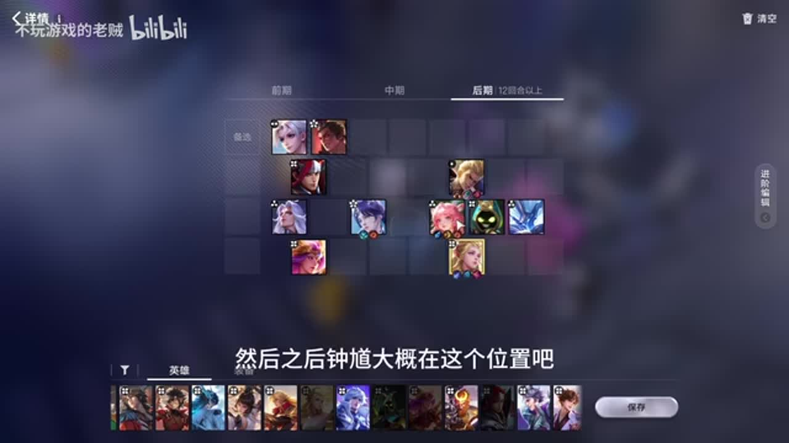

## 24:55–26:25 破晓对当前狂铁作用小，先做适合过渡的装备

- 事件 ID：BV1AJen6SEP6:p1:e021
- 场景：实战
- 时机：狂铁开局拿到装备时
- 背景（分析推断）：装备不是看见就给未来主输出做；当前单位收益影响稳血。
- 学习目标（分析推断）：比较立即稳血与未来成装价值。
- 模板：equipment-role
- ASR 段落：[56, 57]

> 破晓对于这个狂铁来讲没什么用

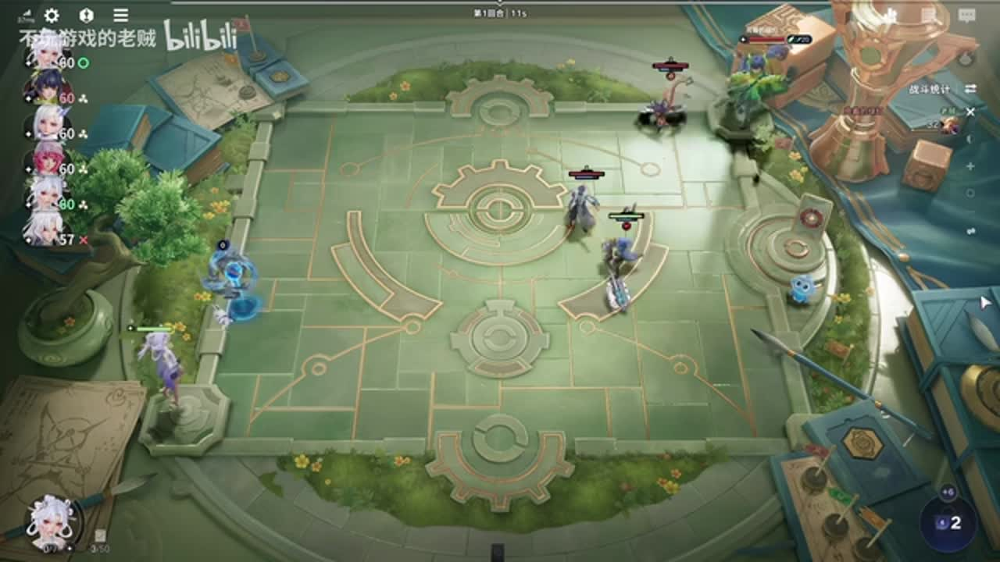

## 25:34–28:37 狂铁前期更强，苏烈四十级发生质变

- 事件 ID：BV1AJen6SEP6:p1:e022
- 场景：实战
- 时机：比较狂铁苏烈开局时
- 背景（分析推断）：结合开局战斗讲解前排不同成长门槛。
- 学习目标（分析推断）：按关键等级评价过渡英雄。
- 模板：opening-plan
- ASR 段落：[57, 58]

> 40级的话苏烈是质变

## 26:25–29:24 找弈星入口，过渡卡兼顾成长；三十而达优先提供经济

- 事件 ID：BV1AJen6SEP6:p1:e023
- 场景：实战
- 时机：拍卖与天赋选项出现时
- 背景（分析推断）：讲者比较拍卖开出弈星的概率及过渡单位成长功能。
- 学习目标（分析推断）：按缺失资源和升级计划选择。
- 模板：talent-fit
- ASR 段落：[58, 59]

> 咱们优先拿经济

## 29:31–33:04 观察对手棋手构成；慢启动对手多较舒服，前期高质量对手多风险高

- 事件 ID：BV1AJen6SEP6:p1:e024
- 场景：实战
- 时机：讨论怎样提高嫦娥前期容错时
- 背景（分析推断）：比较明先生、镜、孙膑与瑶妹孙尚香的前期质量；不把单局连胜当普遍结论。
- 学习目标（分析推断）：在选棋手阶段预判对局压力。
- 模板：opening-plan
- ASR 段落：[60, 61, 62, 63]

> 尽量别在这个瑶妹跟这个孙尚香多的这个局玩

## 29:31–30:18 右下角显示开战说明对方已准备，可直接进入战斗

- 事件 ID：BV1AJen6SEP6:p1:e025
- 场景：实战
- 时机：等待对手准备时
- 背景（分析推断）：讲者在等待界面解释可见状态信号。
- 学习目标（分析推断）：识别界面信号并减少无效等待。
- 模板：mechanic-model
- ASR 段落：[60]

> 右下角只要变成开战了就证明对面点准备了

## 30:19–32:11 暂不提前买重构，继续优先升级；现有装备过多可后续处理

- 事件 ID：BV1AJen6SEP6:p1:e026
- 场景：实战
- 时机：提前看到武装重构时
- 背景（分析推断）：装备红叉重复，但尚未到资源宽裕的处理阶段。
- 学习目标（分析推断）：避免让后期需求挤占启动预算。
- 模板：resource-order
- ASR 段落：[61, 62]

> 但是现在肯定不能拿啊

## 33:07–37:10 尽快补解控；发现大棒选择不合适后用重构补救

- 事件 ID：BV1AJen6SEP6:p1:e027
- 场景：实战
- 时机：已有控制或高威胁对手但缺解控时
- 背景（分析推断）：讲者指出刚打过孙尚香，短期再次遇到概率较低，允许暂时补救。
- 学习目标（分析推断）：从对手威胁调整装备优先级，并为失误寻找补救。
- 模板：counter-target
- ASR 段落：[64, 65, 66, 67]

> 拿解控好一点

## 34:03–36:21 区分局外钻石和局内金币收益；学识宝石转给艾琳成长

- 事件 ID：BV1AJen6SEP6:p1:e028
- 场景：实战
- 时机：地图掉落及艾琳到来时
- 背景（分析推断）：讲者说明钻石非局内道具，金色掉落能带来当局经济。
- 学习目标（分析推断）：区分局内外资源，给成长装备合适对象。
- 模板：mechanic-model
- ASR 段落：[65, 66]

> 它不是一个局内道具

## 37:15–38:40 可贪海月或下一回合更多属性，也可现在启动稳血

- 事件 ID：BV1AJen6SEP6:p1:e029
- 场景：实战
- 时机：雅典娜瑶妹到齐但海月尚未来时
- 背景（分析推断）：本局压力不大，讲者明确模拟困难局选择，提前扔大兔子。
- 学习目标（分析推断）：比较上限与稳血，不把顺风演示当唯一流程。
- 模板：level-transition
- ASR 段落：[68, 69]

> 每局不见得都是那么顺的

## 38:02–40:22 指出不该提前买，卖出虽亏钱仍恢复升级计划

- 事件 ID：BV1AJen6SEP6:p1:e030
- 场景：实战
- 时机：误买太乙真人造成升级差一金币时
- 背景（分析推断）：购牌前未核对预算导致缺一金币，讲者主动复盘错误。
- 学习目标（分析推断）：操作前计算关键费用，失误后按优先级修复。
- 模板：resource-order
- ASR 段落：[69, 70]

> 没看好那钱

## 40:48–41:32 用属性解释对射优势，等级效果牌可买；兔子先扔以免预算被花掉

- 事件 ID：BV1AJen6SEP6:p1:e031
- 场景：实战
- 时机：对射获胜及开始成长时
- 背景（分析推断）：战斗获胜是当局反馈，资源顺序用于避免忘记技能费用。
- 学习目标（分析推断）：把反馈连回属性优势并保留技能预算。
- 模板：combat-review
- ASR 段落：[71]

> 防止花着花着又忘了

## 41:42–43:28 冰杖与解控处理不同敌人，按下一对手决定优先级

- 事件 ID：BV1AJen6SEP6:p1:e032
- 场景：实战
- 时机：面对李信和另一威胁时
- 背景（分析推断）：当前缺解控，慢入一波仍有容错，可寻找重构修正。
- 学习目标（分析推断）：用具体敌人决定装备取舍。
- 模板：counter-target
- ASR 段落：[72]

> 打这家的话就得做解控好一点

## 41:42–44:19 放弃不回本的竞拍，低价拿同样有用的能量超新星

- 事件 ID：BV1AJen6SEP6:p1:e033
- 场景：实战
- 时机：别人争抢高价道具时
- 背景（分析推断）：其他玩家争破镜之证到十多金币，讲者以一金币获得替代成长牌。
- 学习目标（分析推断）：按净收益而非争抢情绪竞拍。
- 模板：auction-choice
- ASR 段落：[72, 73]

> 完全已经不回本了

## 44:22–45:15 一百级开场飞行令刺客难黏住，不必机械缩阵

- 事件 ID：BV1AJen6SEP6:p1:e034
- 场景：实战
- 时机：艾琳达到一百级后判断刺客威胁时
- 背景（分析推断）：讲者回看站位收缩是否有必要，依据艾琳已启动的机制。
- 学习目标（分析推断）：让站位服务当前机制而非固定习惯。
- 模板：position-binding
- ASR 段落：[74, 75]

> 咱开场的话咱是会走位的

## 46:28–47:25 弱对手省太乙，孙尚香对手补复活；两侧站位规避钩子

- 事件 ID：BV1AJen6SEP6:p1:e035
- 场景：实战
- 时机：面对不同强度敌人及钟馗时
- 背景（分析推断）：尚无解控，仍通过站位降低开局被钩风险。
- 学习目标（分析推断）：按敌方威胁同时调整资源和站位。
- 模板：counter-target
- ASR 段落：[76]

> 左右两边各站一个

## 47:56–51:00 李信较易处理，主要防孙尚香；觉醒未到但攻速够用无需盲追

- 事件 ID：BV1AJen6SEP6:p1:e036
- 场景：实战
- 时机：复盘李信与孙尚香差异时
- 背景（分析推断）：讲者指出缺解控仍可提升装备，并根据现有攻速判断觉醒迫切性。
- 学习目标（分析推断）：分清真正瓶颈与可接受缺口。
- 模板：counter-target
- ASR 段落：[77, 78]

> 但是攻速还行啊,攻速还够用

## 51:34–53:58 用传承分等级、改装备并补复活；每轮先兔子再挂太乙

- 事件 ID：BV1AJen6SEP6:p1:e037
- 场景：实战
- 时机：进入决赛圈且对方有等级转移能力时
- 背景（分析推断）：已明显属性领先，讲者仍执行决战资源转化；不据此推导免控永远无用。
- 学习目标（分析推断）：把已积累成长转为决战战力。
- 模板：late-transition
- ASR 段落：[79, 80]

> 应该是决赛圈了已经啊

## 待核实与局限

- 原始ASR有英雄、装备及效果牌同音误识别，疑词不用于确定名称和数值。
- 机制数值与优先级仅按讲者历史版本和当局条件；未验证玩家学习效果。
