# 【王者万象棋】明先生高阶河洛花木兰详解+实战，相信神秘复活女大人

来源：https://www.bilibili.com/video/BV1p7Yv6WEt2/?p=1

分析状态：completed

完整文字稿：../../../raw/BV1p7Yv6WEt2_p1.md

## 00:00–01:18 解释弈星复制牌库为何压制明先生，以及削弱后环境怎样变化

- 事件 ID：BV1p7Yv6WEt2:p1:e001
- 场景：前置讲解
- 时机：旧克制经验与当前版本冲突时
- 背景（分析推断）：先升本抢卡无法直接抵消弈星复制；视频版本改变了出场环境。
- 学习目标（分析推断）：用具体机制判断旧经验还能否使用。
- 模板：version-change
- ASR 段落：[1, 2, 3]

> 需要花8点能量

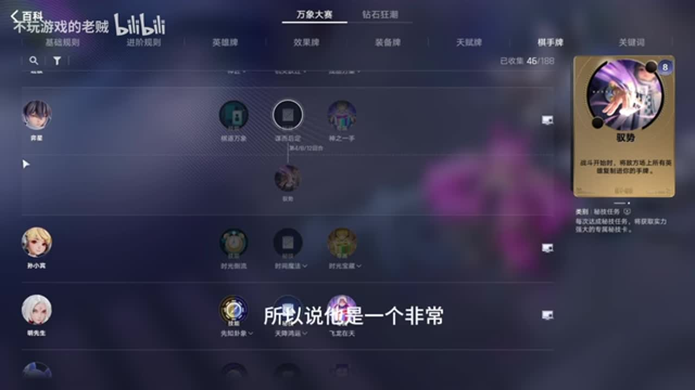

## 01:19–02:05 比较赢律削弱与明先生经济、启动和复活资源优势

- 事件 ID：BV1p7Yv6WEt2:p1:e002
- 场景：前置讲解
- 时机：选择花木兰棋手路线时
- 背景（分析推断）：讲者说明推荐来自当时版本及个人判断，不是所有棋手的绝对排序。
- 学习目标（分析推断）：按启动与后期资源来源选择路线。
- 模板：opening-plan
- ASR 段落：[4, 5]

> 后期的资源量

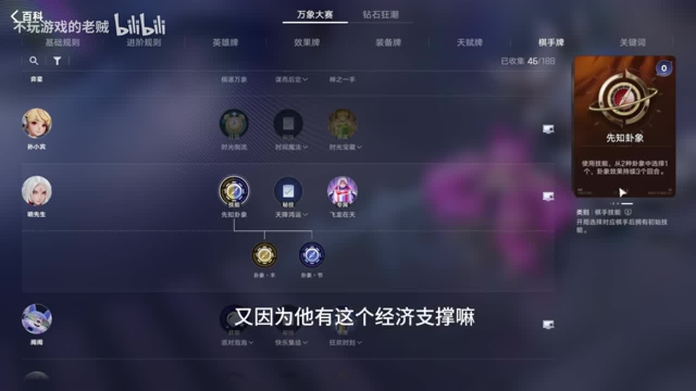

## 02:05–03:03 五张卡还能提供过渡战力和所需英雄，价值不只五金币

- 事件 ID：BV1p7Yv6WEt2:p1:e003
- 场景：前置讲解
- 时机：比较同金币收益的经济天赋时
- 背景（分析推断）：五福临门与小电池包名义经济相同；卡片可先打工再出售。
- 学习目标（分析推断）：计入卡牌附带功能，比较可兑现收益。
- 模板：talent-fit
- ASR 段落：[6, 7]

> 他也是五个打工卡

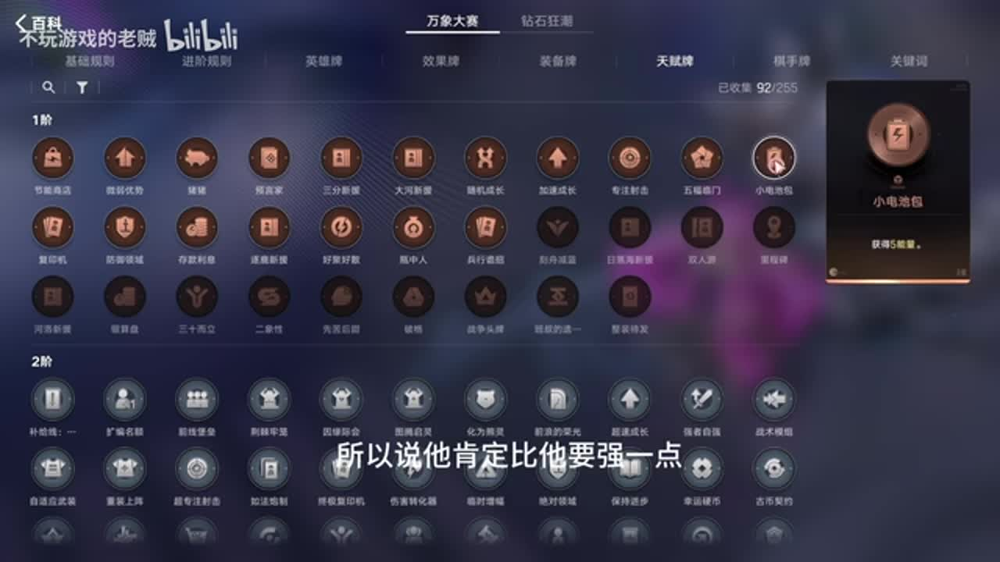

## 02:35–04:25 一个额外人口能避免被迫卖辅助，但不需要过多人口

- 事件 ID：BV1p7Yv6WEt2:p1:e004
- 场景：前置讲解
- 时机：需要预留露娜打出位置时
- 背景（分析推断）：露娜登场触发整备；全员觉醒无法回手时尤其需要空位。
- 学习目标（分析推断）：把人口看成操作空间，按实际缺口投入。
- 模板：resource-order
- ASR 段落：[7, 8, 9, 10]

> 时刻要保持有一个打出位

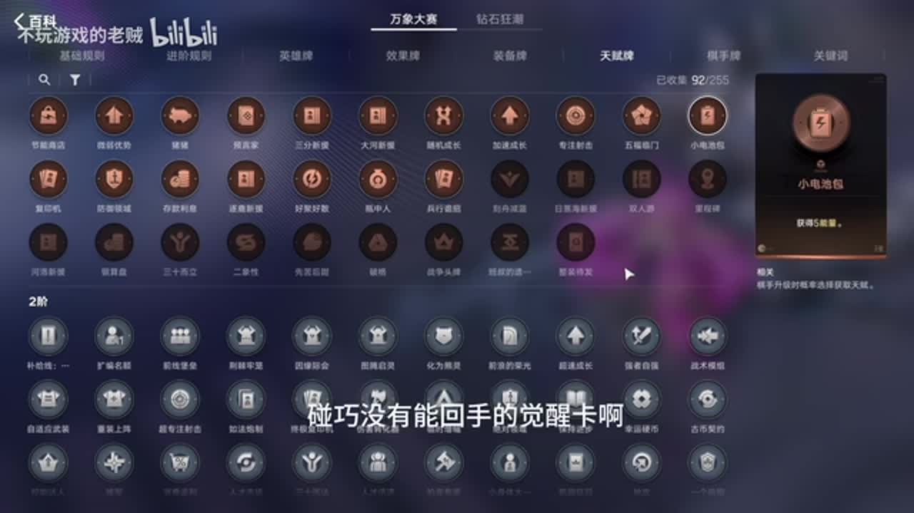

## 04:29–05:20 给花木兰提升每条命的质量，吸血减少残血复活后快速倒下

- 事件 ID：BV1p7Yv6WEt2:p1:e005
- 场景：前置讲解
- 时机：单核选择属性与吸血天赋时
- 背景（分析推断）：复活不满血，额外属性和吸血都服务单核持续输出。
- 学习目标（分析推断）：区分复活次数与每次复活后的有效输出。
- 模板：talent-fit
- ASR 段落：[11, 12]

> 他每条命的质量就会提高一些

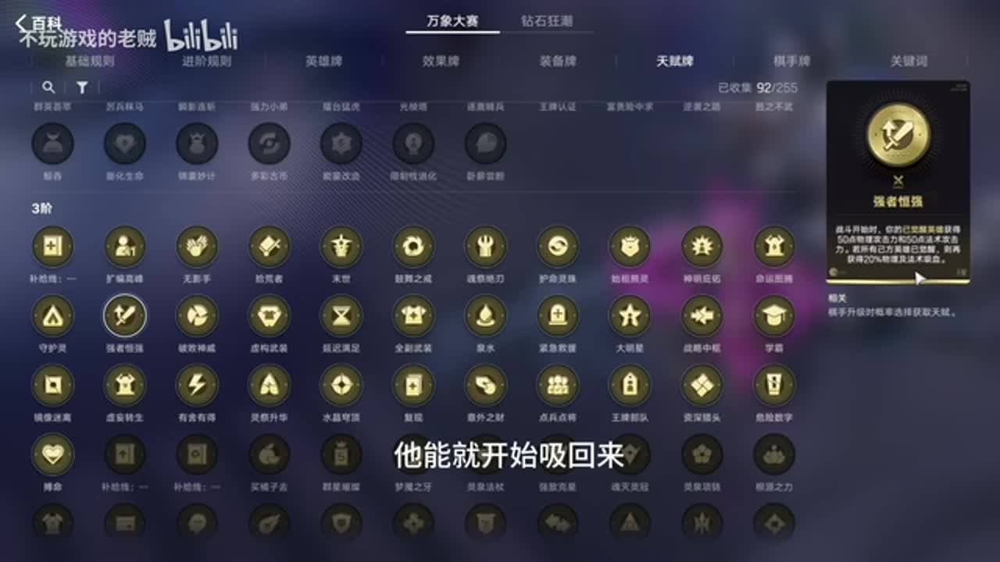

## 05:21–06:17 死亡伤害神器需复活次数支撑，用于常规输出难清场的对手

- 事件 ID：BV1p7Yv6WEt2:p1:e006
- 场景：前置讲解
- 时机：面对高坦度近战且常规输出不够时
- 背景（分析推断）：讲者举大成三分和肥猪；效果依赖敌人靠近及足够复活次数。
- 学习目标（分析推断）：按敌人形态识别有条件的针对装备。
- 模板：counter-target
- ASR 段落：[13, 14]

> 只要复活次数足够用

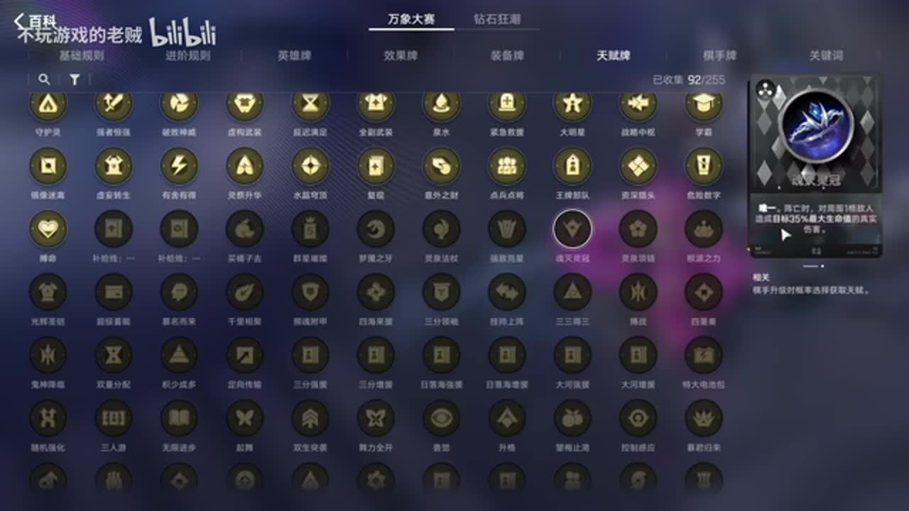

## 06:18–07:43 优先保证复活后短暂无敌，让爆发与连续追击有时间打出

- 事件 ID：BV1p7Yv6WEt2:p1:e007
- 场景：前置讲解
- 时机：暴君归来与死亡伤害选项同时出现时
- 背景（分析推断）：花木兰担心刚站起又倒下；死亡伤害方案还有邻近和复活次数限制。
- 学习目标（分析推断）：从输出瓶颈推导优先级。
- 模板：talent-fit
- ASR 段落：[15, 16, 17]

> 这1.5秒的无敌时间非常关键

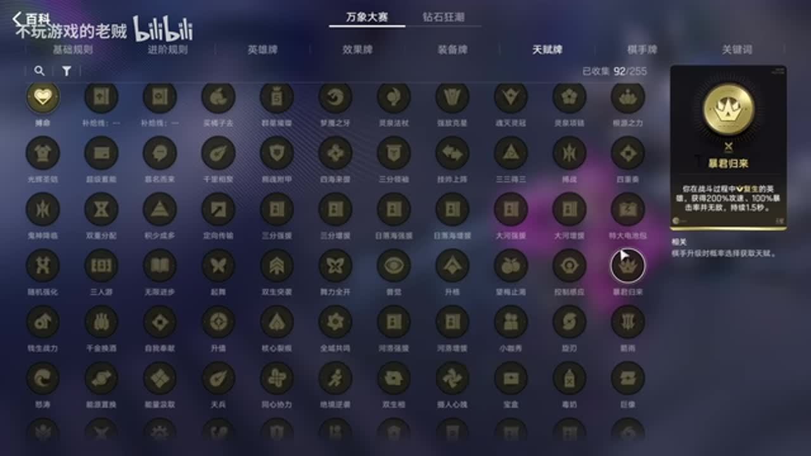

## 07:43–08:47 露娜登场或唤醒触发婉儿程咬金，再发古币形成复活；临阵磨枪给婉儿

- 事件 ID：BV1p7Yv6WEt2:p1:e008
- 场景：前置讲解
- 时机：建立复活资源链时
- 背景（分析推断）：婉儿与程咬金单次发币收益不同；露娜先囤手，交资源时再用。
- 学习目标（分析推断）：理解资源来源、触发步骤和收益对象。
- 模板：growth-combo
- ASR 段落：[18, 19, 20]

> 林郑摩枪呢,只给这个婉儿用

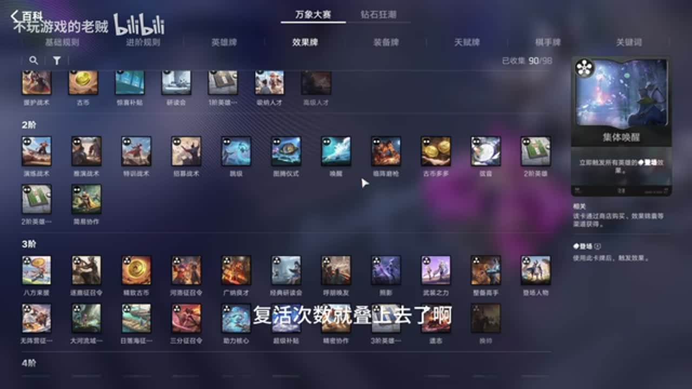

## 09:11–10:05 分解辅助闲置装备找关键神器，保留可能有用的钟馗军团盾

- 事件 ID：BV1p7Yv6WEt2:p1:e009
- 场景：前置讲解
- 时机：非核心装备富余时
- 背景（分析推断）：其他装备对本套单核作用较小，关键神器补花木兰瓶颈。
- 学习目标（分析推断）：将闲置资源转换为核心需求。
- 模板：equipment-role
- ASR 段落：[21, 22]

> 除了花木兰以外

## 10:06–10:57 按人口、刷新资源、觉醒及容错选择，升六只在低价与收益条件下考虑

- 事件 ID：BV1p7Yv6WEt2:p1:e010
- 场景：前置讲解
- 时机：第三轮拍卖补缺口时
- 背景（分析推断）：讲者逐项解释拍卖用途，不把某牌视为无条件必抢。
- 学习目标（分析推断）：根据当前缺口与价格竞拍。
- 模板：auction-choice
- ASR 段落：[23, 24]

> 如果容错率比较低了一线生机也可以

## 10:58–11:50 本套用两次卦象节速五，再转卦象丰搜牌

- 事件 ID：BV1p7Yv6WEt2:p1:e011
- 场景：前置讲解
- 时机：制定开局升阶流程时
- 背景（分析推断）：讲者比较嬴政需要四五级分支，本套按其版本采用速五流程。
- 学习目标（分析推断）：理解固定流程适用的阵容条件。
- 模板：level-transition
- ASR 段落：[25, 26]

> 两发卦象节

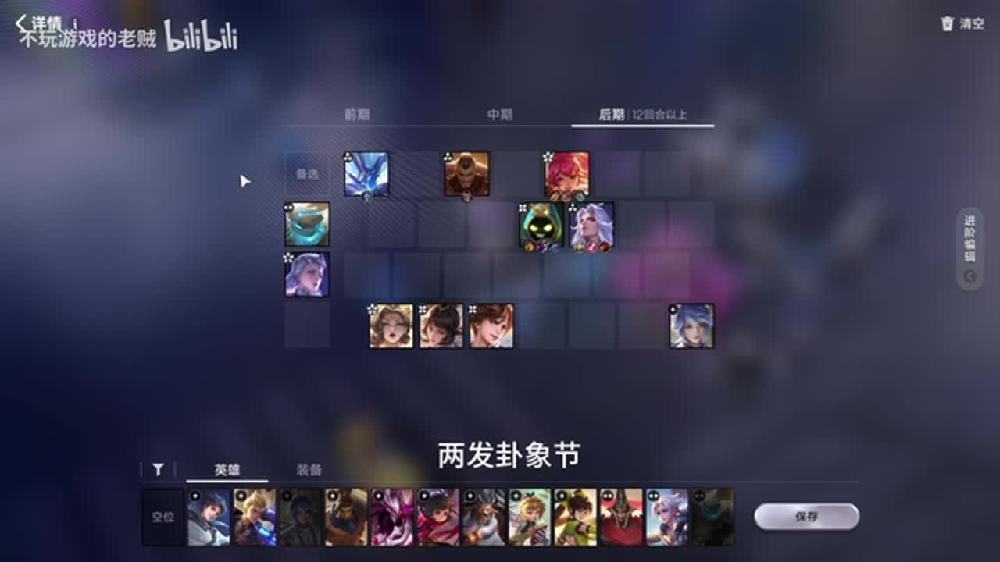

## 11:50–12:22 程咬金先留一张，明世隐可多拿；盾山是前排未到时替代

- 事件 ID：BV1p7Yv6WEt2:p1:e012
- 场景：前置讲解
- 时机：升级途中免费刷新出现体系卡时
- 背景（分析推断）：不同牌的重复登场收益不同，不能全部同样囤积。
- 学习目标（分析推断）：按功能设置购牌数量。
- 模板：resource-order
- ASR 段落：[27, 28]

> 常小金最多拿一张

## 12:45–13:42 暂不上钟馗，减少古币分散；复活门槛改变后注意净收益

- 事件 ID：BV1p7Yv6WEt2:p1:e013
- 场景：前置讲解
- 时机：花木兰等级尚低时
- 背景（分析推断）：婉儿尚未觉醒，少上一个子可让古币更多给花木兰。
- 学习目标（分析推断）：把场上人数与核心成长联系起来。
- 模板：growth-combo
- ASR 段落：[29, 30]

> 确保花木兰能多吃点古币

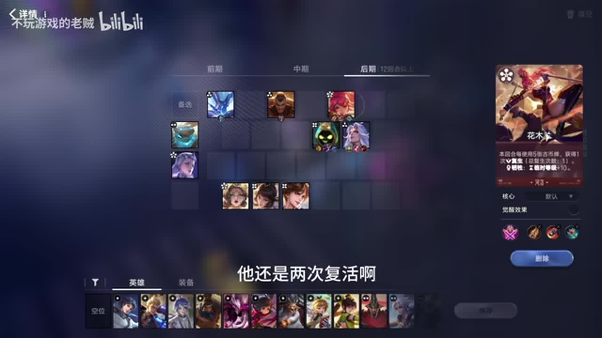

## 13:42–14:10 可将复活给过渡盾山获取两次死亡古币收益

- 事件 ID：BV1p7Yv6WEt2:p1:e014
- 场景：前置讲解
- 时机：质量足够且对手较弱时
- 背景（分析推断）：此为有质量余量时的贪收益选择，不能牺牲核心稳血。
- 学习目标（分析推断）：在安全条件下利用过渡卡触发资源。
- 模板：growth-combo
- ASR 段落：[31]

> 他死两次能给咱两发鼓逼

## 14:10–16:33 用临时等级与可转换额度举例，说明回合间永久成长及上限

- 事件 ID：BV1p7Yv6WEt2:p1:e015
- 场景：前置讲解
- 时机：观众不理解明世隐临时等级转换时
- 背景（分析推断）：卡面难理解，讲者展示连线、登场和唤醒怎样影响额度。
- 学习目标（分析推断）：预测实际能转多少等级，避免把额度当无条件收益。
- 模板：mechanic-model
- ASR 段落：[32, 33, 34, 35, 36]

> 不能超过他那身上挂的临时等级上限

## 16:04–17:01 卦象丰冷却好就用，先追关键觉醒；继续合成可开战略资源

- 事件 ID：BV1p7Yv6WEt2:p1:e016
- 场景：前置讲解
- 时机：五级搜牌与觉醒之后时
- 背景（分析推断）：觉醒到齐不意味着搜牌完全停止，后续合成服务复活资源储备。
- 学习目标（分析推断）：让刷牌目标随阵容阶段变化。
- 模板：resource-order
- ASR 段落：[36, 37]

> 每打三次合成旁边会给你一个锦囊

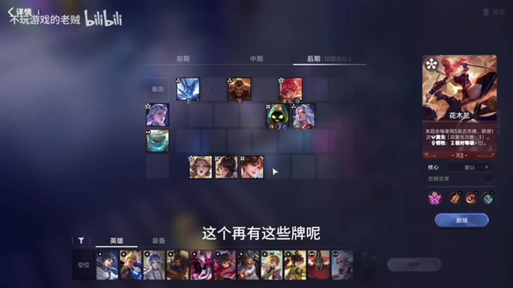

## 17:01–17:52 至少囤一张露娜，否则大量唤醒资源无法有效兑现

- 事件 ID：BV1p7Yv6WEt2:p1:e017
- 场景：前置讲解
- 时机：露娜可能被同行卡牌时
- 背景（分析推断）：明先生升本快可先抢；核心触发者缺失会令资源链失效。
- 学习目标（分析推断）：识别必须提前保留的关键入口。
- 模板：resource-order
- ASR 段落：[38, 39]

> 至少得保证有一张

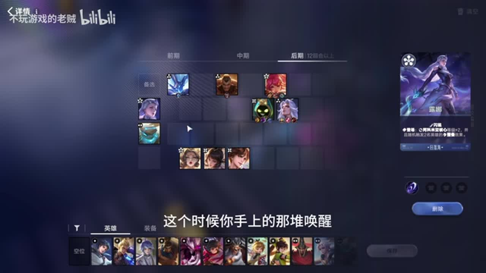

## 17:52–18:19 先用整备资源，唤醒留给露娜；终局再腾打出位集中用

- 事件 ID：BV1p7Yv6WEt2:p1:e018
- 场景：前置讲解
- 时机：尚无额外人口但需要交战力时
- 背景（分析推断）：不同资源所需前置条件不同，避免把高协同牌过早低效使用。
- 学习目标（分析推断）：按可执行条件安排资源顺序。
- 模板：resource-order
- ASR 段落：[40]

> 先用整备的

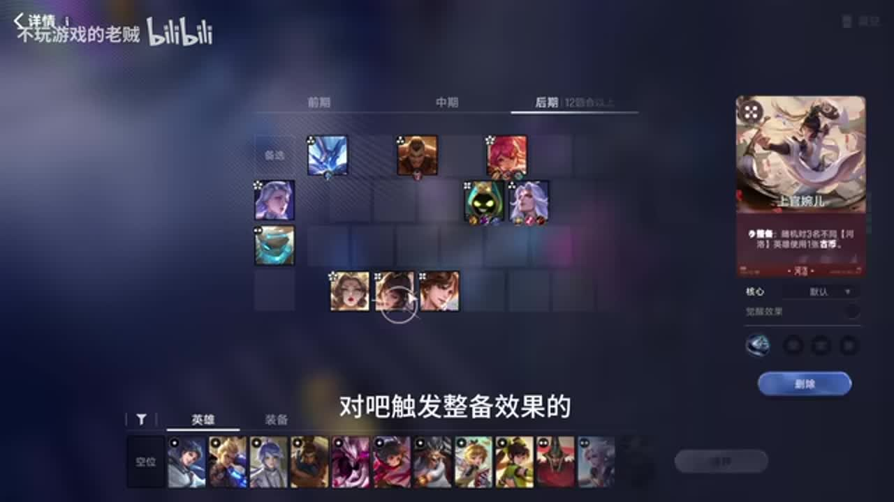

## 18:19–18:43 先撤成长辅助明世隐，上觉醒钟馗；缺牌可用杨玉环补觉醒

- 事件 ID：BV1p7Yv6WEt2:p1:e019
- 场景：前置讲解
- 时机：等级已足够且准备终局阵容时
- 背景（分析推断）：成长价值下降，针对敌方主输出的价值上升。
- 学习目标（分析推断）：识别从成长转向针对战力的窗口。
- 模板：late-transition
- ASR 段落：[41]

> 先走明士寅

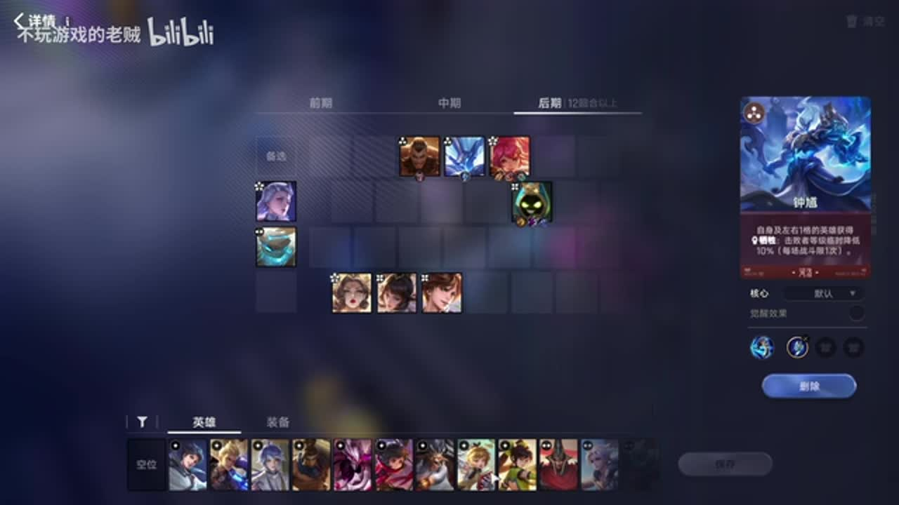

## 18:46–19:42 比较把牺牲挂花木兰可锁主输出，和避免她先被集火的取舍

- 事件 ID：BV1p7Yv6WEt2:p1:e020
- 场景：前置讲解
- 时机：复活次数收紧后安排牺牲与站位时
- 背景（分析推断）：挂脆皮可能被敌方工具人击杀，无法降低真正主输出等级。
- 学习目标（分析推断）：按目标选择与生存需求调整绑定。
- 模板：position-binding
- ASR 段落：[42, 43]

> 确保这个花木兰不被第一时间集火

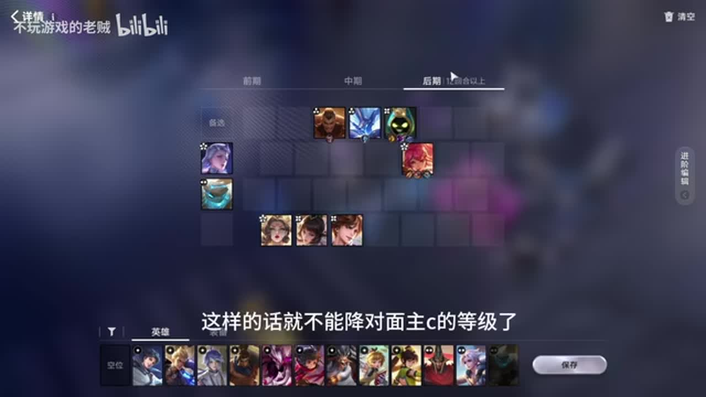

## 19:44–21:05 通过多局练习估计装备等级与复活次数，初学失误应被复盘

- 事件 ID：BV1p7Yv6WEt2:p1:e021
- 场景：前置讲解
- 时机：估计多少资源能打赢时
- 背景（分析推断）：讲者明确这一步难用统一公式讲清，不声称操作简单就无需判断。
- 学习目标（分析推断）：积累对局反馈来校准资源投入判断。
- 模板：combat-review
- ASR 段落：[44, 45, 46]

> 需要反复大量的练习

## 20:43–21:33 暴击之外注意移动速度，以便技能不触发飞行时追近艾琳等目标

- 事件 ID：BV1p7Yv6WEt2:p1:e022
- 场景：前置讲解
- 时机：确定常规装备时
- 背景（分析推断）：技能击杀后并非总能直接飞到目标，步行追击仍影响输出。
- 学习目标（分析推断）：从实际输出流程理解装备属性。
- 模板：equipment-role
- ASR 段落：[46, 47]

> 需要走过去啊

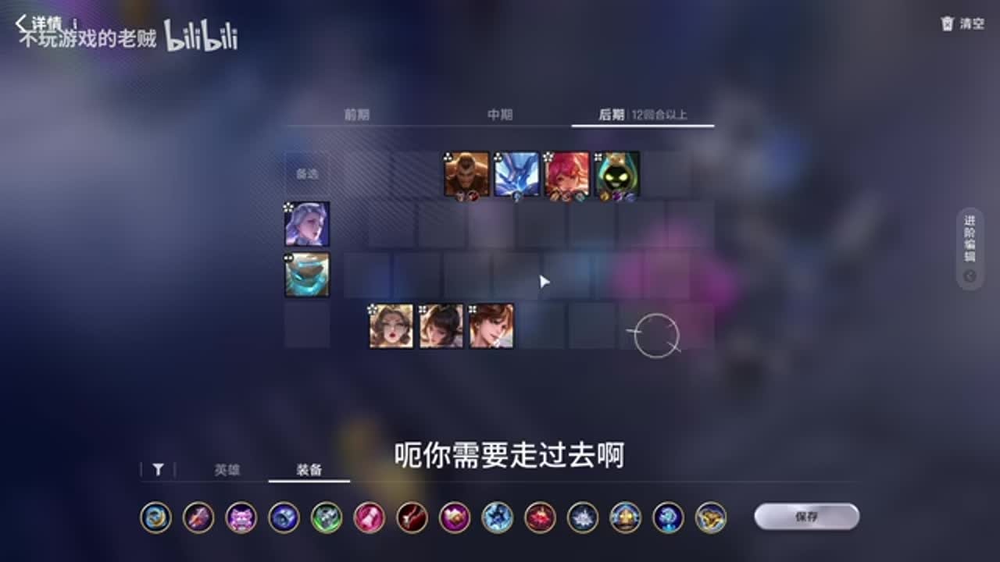

## 21:34–22:31 解控与神器按局势选择；技能吸血合适，普攻触发装备价值较低

- 事件 ID：BV1p7Yv6WEt2:p1:e023
- 场景：前置讲解
- 时机：第三装备位需要摇摆时
- 背景（分析推断）：强敌下每条命可能很短，讲者将第三位置保留为灵活槽。
- 学习目标（分析推断）：匹配伤害方式与生存瓶颈。
- 模板：equipment-role
- ASR 段落：[48, 49]

> 他的普攻很少

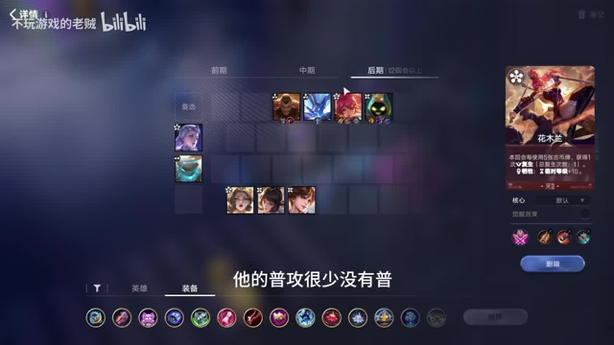

## 22:31–22:58 提供有条件的神器替代；特定对手可考虑磐石之心

- 事件 ID：BV1p7Yv6WEt2:p1:e024
- 场景：前置讲解
- 时机：关键神器缺失或面对三分猴时
- 背景（分析推断）：讲者给优先和次选名单，但不等同所有对局统一排名。
- 学习目标（分析推断）：在缺装备时找功能相近的替代。
- 模板：counter-target
- ASR 段落：[50]

> 打三分猴的话可能出这个盘石之心更好一点

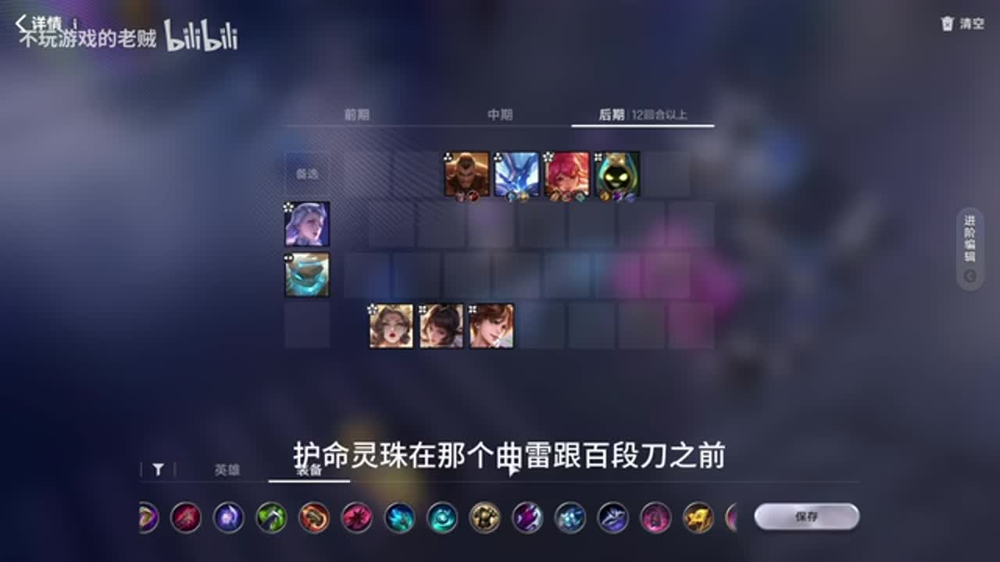

## 23:00–23:27 卸下太乙真人腾位，上露娜集中打唤醒增加复活次数

- 事件 ID：BV1p7Yv6WEt2:p1:e025
- 场景：前置讲解
- 时机：最后一回合全员觉醒又无打出位时
- 背景（分析推断）：不能靠觉醒回手腾位置，必须比较一次复活与整个资源链收益。
- 学习目标（分析推断）：终局根据净战力主动调整场上单位。
- 模板：late-transition
- ASR 段落：[51]

> 下派一真人

## 23:29–24:57 对质量已起的对手不勉强贪，对慢启动嫦娥利用窗口上打工卡压血

- 事件 ID：BV1p7Yv6WEt2:p1:e026
- 场景：实战
- 时机：观察对手是否上子及准备状态时
- 背景（分析推断）：趁对手已准备且未继续购卡进入战斗；属于当局有条件的进攻。
- 学习目标（分析推断）：把对手行为转为开局决策信号。
- 模板：opening-plan
- ASR 段落：[52, 53]

> 趁她不买卡直接开

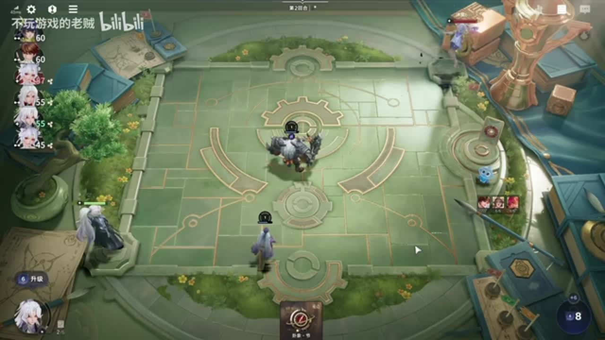

## 25:09–25:57 胜利奖励不易兑现，比较直接经济与人口兑换券的价值

- 事件 ID：BV1p7Yv6WEt2:p1:e027
- 场景：实战
- 时机：开局天赋三选一时
- 背景（分析推断）：路线前期难取胜，天赋不能只看名义奖励；兑换券可找成长辅助。
- 学习目标（分析推断）：判断天赋条件是否能实现。
- 模板：talent-fit
- ASR 段落：[54]

> 胜利的那个拿不着

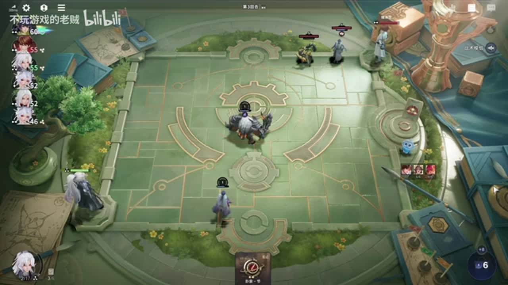

## 26:20–27:06 用低价盾山替代过渡，不强求完整阵容

- 事件 ID：BV1p7Yv6WEt2:p1:e028
- 场景：实战
- 时机：拍卖找不到程咬金时
- 背景（分析推断）：实际拍卖缺目标，盾山提供前排及退场资源功能。
- 学习目标（分析推断）：按缺失功能选择可用过渡。
- 模板：fallback-plan
- ASR 段落：[55]

> 顿山是个替代品

## 26:20–27:06 提醒吸血条件要很后期才触发，不能当作当前保命

- 事件 ID：BV1p7Yv6WEt2:p1:e029
- 场景：实战
- 时机：拿到强者横强时
- 背景（分析推断）：觉醒目标尚未达成，纸面吸血不等于眼前有效。
- 学习目标（分析推断）：区分未来收益与即时战力。
- 模板：talent-fit
- ASR 段落：[55]

> 靠后才能触发

## 27:09–27:47 先给当前法师使用圣剑，提高过渡输出

- 事件 ID：BV1p7Yv6WEt2:p1:e030
- 场景：实战
- 时机：前期分配攻速装备时
- 背景（分析推断）：后续可转给花木兰，眼前装备先服务有收益的打工单位。
- 学习目标（分析推断）：兼顾当前稳血与未来装备转移。
- 模板：equipment-role
- ASR 段落：[56]

> 还能那个多加点那个输出

## 27:51–28:24 先算升级缺口；若本来就升不了可先抢稀缺辅助，否则不买

- 事件 ID：BV1p7Yv6WEt2:p1:e031
- 场景：实战
- 时机：买太乙是否会拖延升五时
- 背景（分析推断）：其他棋手会争抢太乙，但争抢价值不能越过可执行的升本窗口。
- 学习目标（分析推断）：用关键预算约束机会性购牌。
- 模板：resource-order
- ASR 段落：[57]

> 如果够生五的话就不拿了

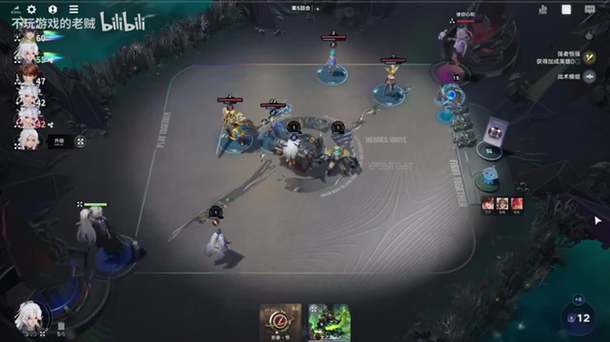

## 28:27–30:27 给盾山复活产古币，说明主输出未到会浪费部分成长收益

- 事件 ID：BV1p7Yv6WEt2:p1:e032
- 场景：实战
- 时机：花木兰未到但过渡可产古币时
- 背景（分析推断）：讲者希望下一回合花木兰到来，明确指出给婉儿的收益低。
- 学习目标（分析推断）：认识过渡资源链的机会成本。
- 模板：growth-combo
- ASR 段落：[58, 59]

> 扔给碗儿基本等于没用

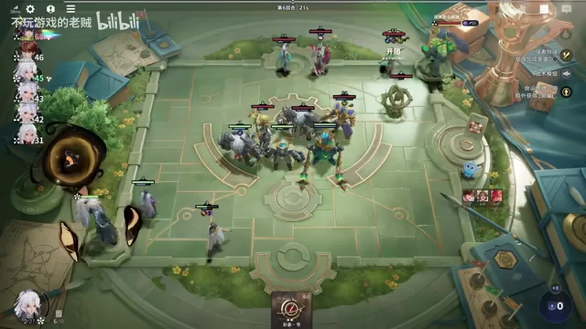

## 29:46–30:27 暂不买七金币非核心牌，优先保持搜牌预算

- 事件 ID：BV1p7Yv6WEt2:p1:e033
- 场景：实战
- 时机：升五开始搜主输出时
- 背景（分析推断）：花木兰还没来，昂贵的额外牌会挤占核心搜索。
- 学习目标（分析推断）：将稀缺经济先投向启动瓶颈。
- 模板：resource-order
- ASR 段落：[59]

> 七块钱太耽误那个经济了

## 30:27–32:27 让战斗力较强的李白先打工

- 事件 ID：BV1p7Yv6WEt2:p1:e034
- 场景：实战
- 时机：花木兰迟迟不来时
- 背景（分析推断）：其他体系已开始成形，仍需要一个临时输出稳血。
- 学习目标（分析推断）：关键卡缺失时维持功能而非空等。
- 模板：fallback-plan
- ASR 段落：[60]

> 就让李白先打这工

## 32:30–34:32 将辅助连线与复活挂给她，其他人拉远防误绑定

- 事件 ID：BV1p7Yv6WEt2:p1:e035
- 场景：实战
- 时机：花木兰终于到来时
- 背景（分析推断）：此前已凑到多张辅助，主输出到场后必须重新确认收益对象。
- 学习目标（分析推断）：保证成长和保命资源作用于预定核心。
- 模板：position-binding
- ASR 段落：[61, 62]

> 这两个离远点别挂歪了就行

## 34:40–35:27 不确定何时觉醒，普通形态也可先用唤醒获得早期成长

- 事件 ID：BV1p7Yv6WEt2:p1:e036
- 场景：实战
- 时机：纠结唤醒要不要等觉醒时
- 背景（分析推断）：等待可多加额度，但当前收益和到牌时间不确定性需同时考虑。
- 学习目标（分析推断）：比较立即收益与未知未来提升。
- 模板：resource-order
- ASR 段落：[63]

> 早用早受益

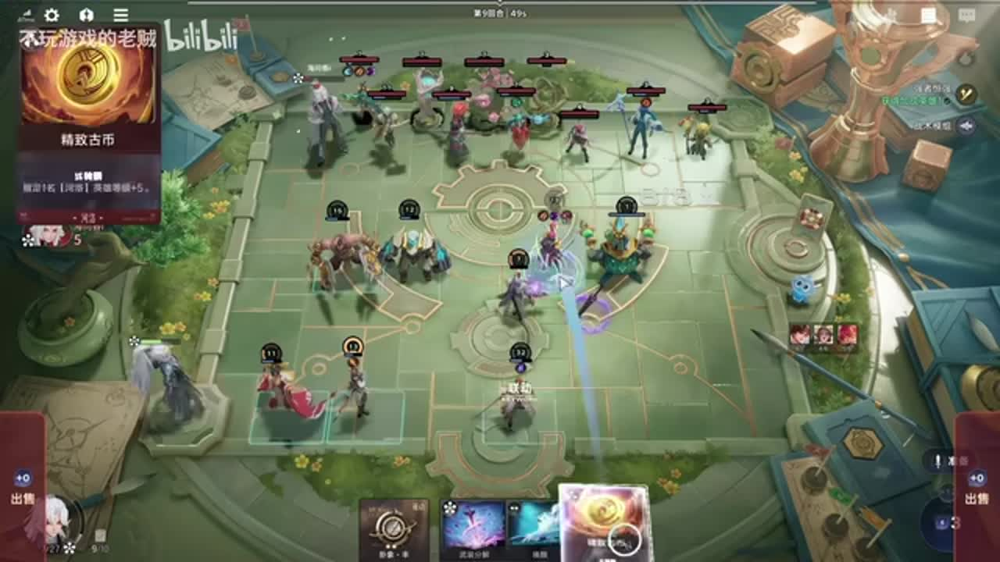

## 34:40–36:31 等被吸对象有足够等级再使用，保证吸满

- 事件 ID：BV1p7Yv6WEt2:p1:e037
- 场景：实战
- 时机：夺取之术尚未达到收益门槛时
- 背景（分析推断）：与提前唤醒不同，这张牌有明确当前收益不足的问题。
- 学习目标（分析推断）：区分确定门槛与不确定到牌等待。
- 模板：growth-combo
- ASR 段落：[63, 64]

> 必须得吃满十级

## 35:28–36:31 强调一百级飞行为重要质变，四十级不等同启动

- 事件 ID：BV1p7Yv6WEt2:p1:e038
- 场景：实战
- 时机：判断花木兰能否锁血时
- 背景（分析推断）：实际阵容正在成形，能否打赢还取决于关键机制门槛。
- 学习目标（分析推断）：判断核心是否达到有效战斗阶段。
- 模板：mechanic-model
- ASR 段落：[64]

> 100级是质变

## 36:39–38:11 保留杨玉环补觉醒，使回手后再次登场获得成长

- 事件 ID：BV1p7Yv6WEt2:p1:e039
- 场景：实战
- 时机：缺明世隐觉醒时
- 背景（分析推断）：利用退场效果及再次登场，而非仅追四张同名卡。
- 学习目标（分析推断）：识别间接觉醒途径与额外成长。
- 模板：growth-combo
- ASR 段落：[65]

> 还能再打一次啊

## 38:15–41:20 停止继续争人口，重点用合成找资源牌

- 事件 ID：BV1p7Yv6WEt2:p1:e040
- 场景：实战
- 时机：后期拍卖人口已富余时
- 背景（分析推断）：阵容觉醒接近完成，瓶颈已转为复活资源而非人口。
- 学习目标（分析推断）：识别资源边际价值下降。
- 模板：auction-choice
- ASR 段落：[66, 67]

> 我人口有点太多了

## 41:23–42:16 指出末世需普攻触发，不符合花木兰主要放技能的模式

- 事件 ID：BV1p7Yv6WEt2:p1:e041
- 场景：实战
- 时机：选择神器时再次遇到末世时
- 背景（分析推断）：实际选择里出现看似吸血的装备，触发条件决定其价值。
- 学习目标（分析推断）：读取触发条件，避免类别相同就认为等价。
- 模板：equipment-role
- ASR 段落：[68]

> 他不是普攻啊

## 41:23–43:46 对较易处理的对手省资源，对开始成长的三分适量交

- 事件 ID：BV1p7Yv6WEt2:p1:e042
- 场景：实战
- 时机：面对狙击、机枪与已成长三分时
- 背景（分析推断）：手里只剩一张露娜，必须为后续唤醒保留触发入口。
- 学习目标（分析推断）：按具体敌人强度分配有限资源。
- 模板：counter-target
- ASR 段落：[68, 69]

> 打狙击跟这个机枪的时候都不用交资源

## 43:46–47:09 用吸血带来的存活时间解释每条命的质量，弱对手可少交

- 事件 ID：BV1p7Yv6WEt2:p1:e043
- 场景：实战
- 时机：投入少量资源后观察战斗时
- 背景（分析推断）：讲者在实战观察到一条命持续作战；只是当局机制反馈，不是学习成效验证。
- 学习目标（分析推断）：从战斗反馈校准资源投入。
- 模板：combat-review
- ASR 段落：[70, 71, 72]

> 每条命的这个质量就会高一点

## 47:10–48:49 指出梭哈耗尽资源的错误，胜利并未达到预期淘汰目的

- 事件 ID：BV1p7Yv6WEt2:p1:e044
- 场景：实战
- 时机：误把镜像战斗当成能抬走真身时
- 背景（分析推断）：讲者本想赶快淘汰三分，打完才发现是镜像，露娜和储备已用光。
- 学习目标（分析推断）：关键投入前核对是否真实对手以及投入目的。
- 模板：combat-review
- ASR 段落：[73, 74]

> 我没注意他是个镜像啊

## 48:53–49:32 继续合成开资源并寻找移花接木入口

- 事件 ID：BV1p7Yv6WEt2:p1:e045
- 场景：实战
- 时机：资源耗尽仍有容错时
- 背景（分析推断）：错误已发生，讲者在剩余经济有限的情况下寻找有证据的补救。
- 学习目标（分析推断）：失误后重新识别可用资源和胜利路径。
- 模板：fallback-plan
- ASR 段落：[75]

> 现在打合成找资源

## 49:33–50:55 卖单位集中资源，用移花接木单挂花木兰作最后尝试

- 事件 ID：BV1p7Yv6WEt2:p1:e046
- 场景：实战
- 时机：只剩最终补救路线时
- 背景（分析推断）：此操作来自此前重大失误后的困境，不作为常规推荐流程。
- 学习目标（分析推断）：区分应急手段与正常运营。
- 模板：late-transition
- ASR 段落：[76, 77]

> 我现在想赢只有

## 50:16–51:17 本来有十九血容错，不必过度交资源；梭哈前检查镜像与一线生机

- 事件 ID：BV1p7Yv6WEt2:p1:e047
- 场景：实战
- 时机：最终获胜后复盘重大失误时
- 背景（分析推断）：讲者明确把这局作为反面教材，获胜不消除决策问题。
- 学习目标（分析推断）：用复盘改进判断，避免以结果掩盖过程错误。
- 模板：combat-review
- ASR 段落：[77, 78]

> 给大家做个反面教材

## 待核实与局限

- ASR存在同音卡名，未依据当前官网改写视频历史数值。
- 镜像失误及最终补救只描述当局条件，不将单挂或梭哈泛化为常规策略。
- 讲者表示资源估计依赖大量练习；未提供玩家学习成效实验。
