# 【王者万象棋】明先生高阶逐鹿嬴政详解+实战，雷霆战机解压清场

来源：https://www.bilibili.com/video/BV1tvYS6MEHf/?p=1

分析状态：completed

完整文字稿：../../../raw/BV1tvYS6MEHf_p1.md

## 00:00–00:50 将经济优势连到高阶阵容更早启动、较高容错，并说明上限取舍

- 事件 ID：BV1tvYS6MEHf:p1:e001
- 场景：前置讲解
- 时机：选择棋手及阵容路线前
- 背景（分析推断）：介绍明先生时，先解释钱多和升本快怎样影响阵容启动；与李白的上限比较只代表讲者的版本判断。
- 学习目标（分析推断）：按启动速度、容错和上限选择适合自己的路线。
- 模板：opening-plan
- ASR 段落：[1, 2]

> 所以他玩一些高阶阵容,启动就会快,成型快,然后容错率高

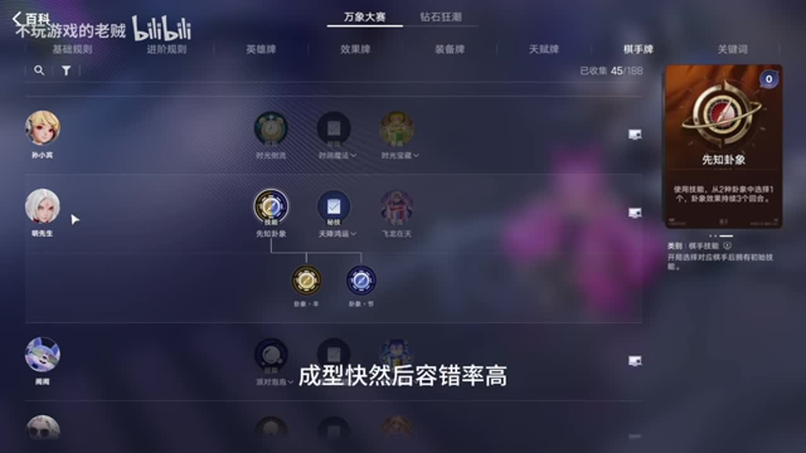

## 00:53–01:20 提醒持续三个回合的技能需要周期性重新使用

- 事件 ID：BV1tvYS6MEHf:p1:e002
- 场景：前置讲解
- 时机：首次学习主动技能及刷新提示时
- 背景（分析推断）：画面展开先知卦象，讲者将技能到期与新加入的提示相连，帮助玩家注意可用状态。
- 学习目标（分析推断）：形成检查技能刷新提示的习惯。
- 模板：mechanic-model
- ASR 段落：[3]

> 这个东西你记得每三个回合用一下

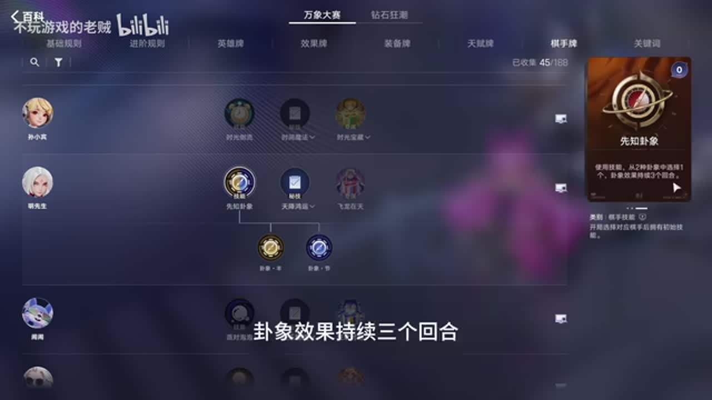

## 01:21–02:19 用钱不够买牌、锁店导致刷新浪费的例子解释实际收益小于次数面值

- 事件 ID：BV1tvYS6MEHf:p1:e003
- 场景：前置讲解
- 时机：比较临时刷新与金币的名义收益时
- 背景（分析推断）：百科展示卦象·丰；讲者先说明临时刷新会过期，再用买不完所需牌的情况解释兑现约束。
- 学习目标（分析推断）：把名义资源换成可兑现收益，识别钱、牌和刷新间的瓶颈。
- 模板：resource-order
- ASR 段落：[4, 5]

> 你又可能买两张之后还有一张你锁上了那剩下的那三次刷新呢其实就浪费了

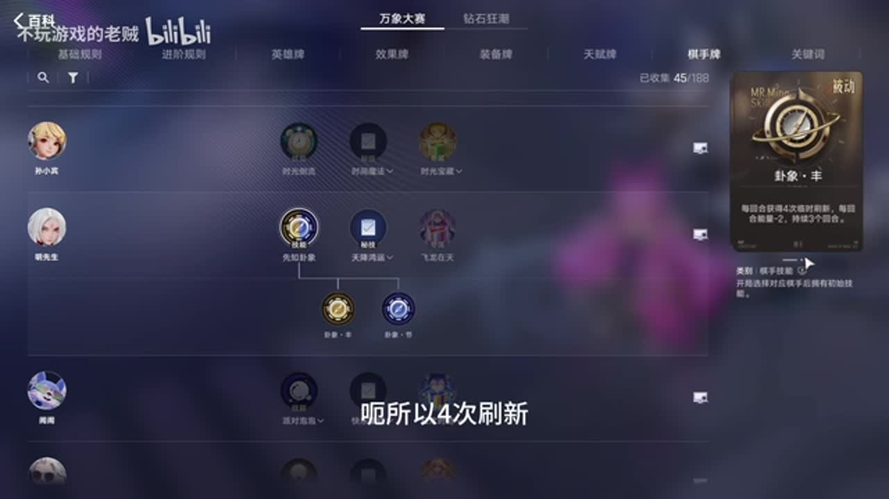

## 02:20–02:48 区分真钱刷新和绿色免费刷新，提醒付费刷新成本上升

- 事件 ID：BV1tvYS6MEHf:p1:e004
- 场景：前置讲解
- 时机：卦象·节持续期间准备刷店时
- 背景（分析推断）：画面展开卦象·节；这个模式增加能量也增加付费刷新成本，免费刷新仍可使用。
- 学习目标（分析推断）：在选择技能模式后同步调整花钱方式。
- 模板：resource-order
- ASR 段落：[6]

> 但是那个绿色的免费刷新是可以用的,不会扣你的钱

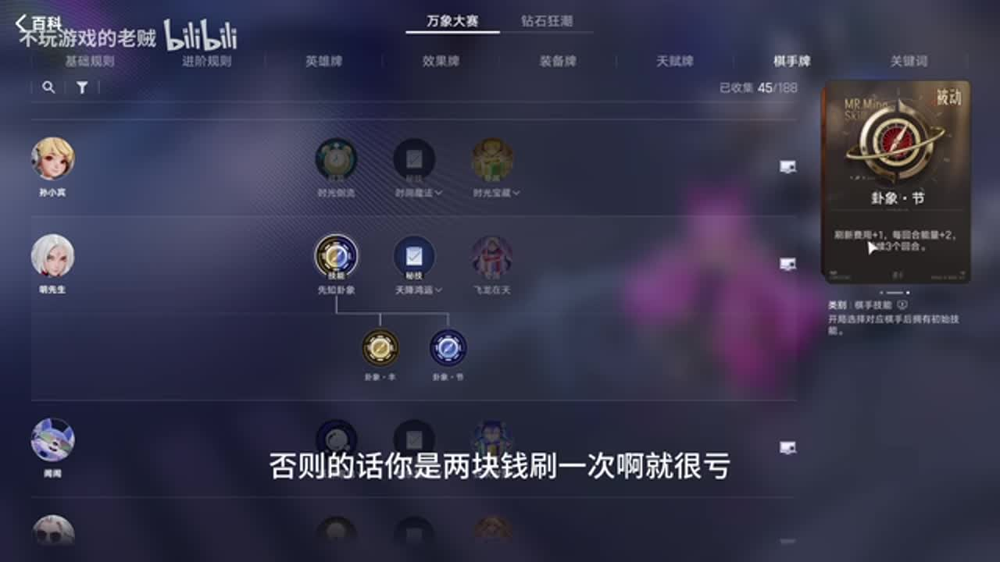

## 02:49–03:18 按血量容错在四级开刷与速五之间分支

- 事件 ID：BV1tvYS6MEHf:p1:e005
- 场景：前置讲解
- 时机：制定第一轮升本路线时
- 背景（分析推断）：讲者给出一次卦象·节后转丰、或连续两次节后转丰的路线；并要求根据血量权衡，不作为固定回合保证。
- 学习目标（分析推断）：给运营公式加上血量条件。
- 模板：level-transition
- ASR 段落：[7]

> 而且要根据你的血量进行权衡,你容错率高的时候,你就可以速五

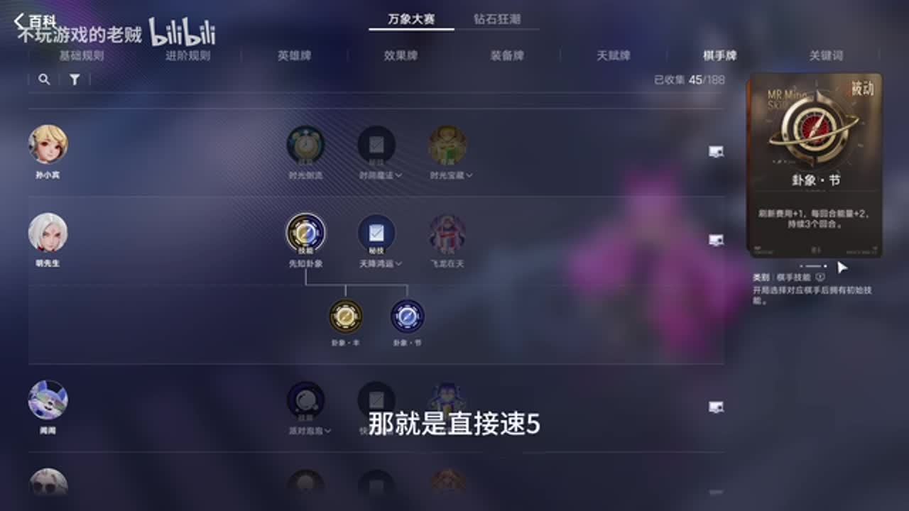

## 03:21–04:19 区分分期经济与全场等级，解释本套阵容取经济

- 事件 ID：BV1tvYS6MEHf:p1:e006
- 场景：前置讲解
- 时机：命运馈赠出现并需选择收益类型时
- 背景（分析推断）：百科展开命运馈赠·阳；讲者比较两种选项，指出加等级适合其他路线，本套更需要钱。视频回合与数值保留历史说法。
- 学习目标（分析推断）：按当前路线的资源缺口选择技能收益。
- 模板：talent-fit
- ASR 段落：[8, 9]

> 但是他是分期给你的,每回合给你三能量

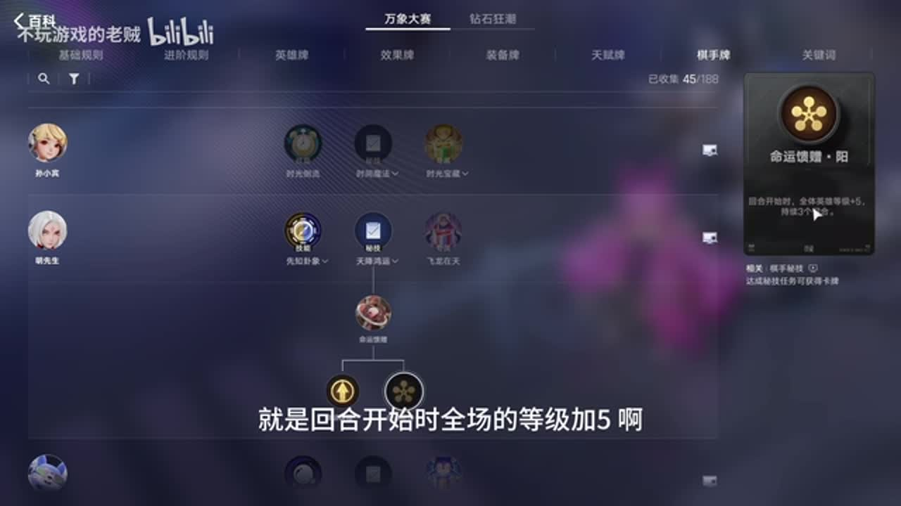

## 04:20–05:17 把刷新用不完、钱不够买和升六费用一起纳入性价比，说明低价升本牌例外

- 事件 ID：BV1tvYS6MEHf:p1:e007
- 场景：前置讲解
- 时机：准备为大招升六时
- 背景（分析推断）：画面展示飞龙在天；讲者认为强化后的刷新无法全部兑现，一般不升六，只有低价扶摇之上等例外。
- 学习目标（分析推断）：比较升本收益、成本及兑现能力。
- 模板：level-transition
- ASR 段落：[10, 11]

> 你用低价买了,咱们才升六啊,否则的话他性价比很低

## 05:44–06:31 解释额外人口能容纳战力或刷等级工具人

- 事件 ID：BV1tvYS6MEHf:p1:e008
- 场景：前置讲解
- 时机：选择增加人口的天赋时
- 背景（分析推断）：天赋页展示人口类选项，讲者把一个格子的价值连到后面的打出位和工具人循环。
- 学习目标（分析推断）：把人口理解为可用操作空间。
- 模板：talent-fit
- ASR 段落：[13, 14]

> 要不多占一个战力,要不多占一个刷等级的工具人

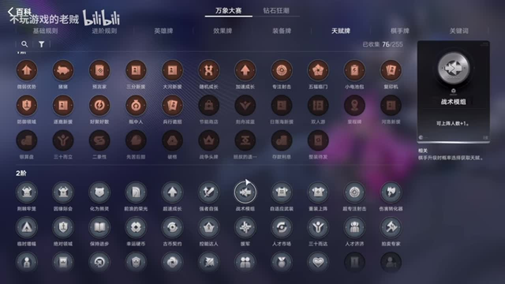

## 06:32–08:00 从反伤与多次复活的肉盾威胁解释为什么嬴政需要法术吸血

- 事件 ID：BV1tvYS6MEHf:p1:e009
- 场景：前置讲解
- 时机：挑选吸血天赋或装备前
- 背景（分析推断）：讲者提前指出花木兰、苏烈、猪八戒等耐久目标带反甲时的风险；未实测当前版本伤害关系。
- 学习目标（分析推断）：把输出装备选择与生存威胁连接。
- 模板：equipment-cause
- ASR 段落：[15, 16, 17]

> 我们必须得有一件吸血装去对冲他这个反伤

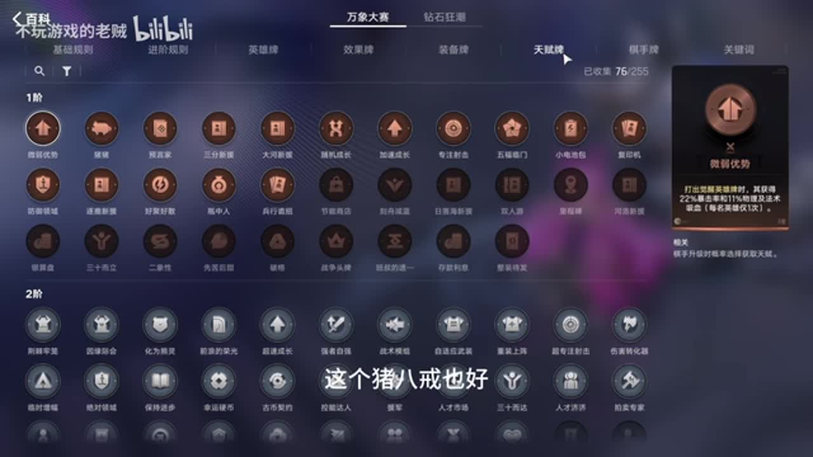

## 07:33–08:29 说明可分解非核心装备换珍品宝箱，再寻找特殊装备

- 事件 ID：BV1tvYS6MEHf:p1:e010
- 场景：前置讲解
- 时机：后期缺少关键吸血装备时
- 背景（分析推断）：效果牌百科展示珍品宝箱；本套装备集中于嬴政，讲者因此把其他位置装备当作找关键装备的资源。
- 学习目标（分析推断）：围绕核心缺口重新分配已有装备。
- 模板：equipment-cause
- ASR 段落：[17, 18]

> 其他人的装备都可以通过武装分解

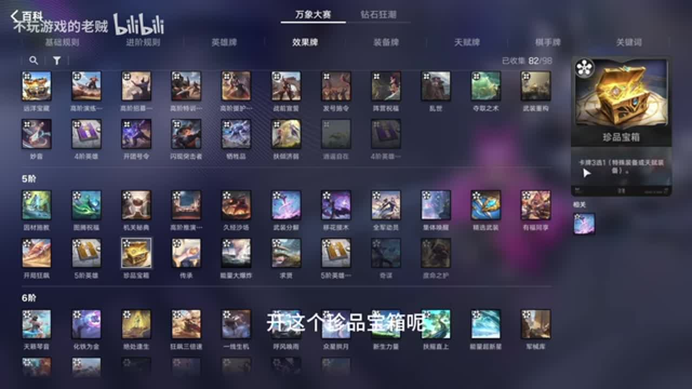

## 08:29–10:22 再解释速五更容易找高费卡，但高压力局可能必须四级启动

- 事件 ID：BV1tvYS6MEHf:p1:e011
- 场景：前置讲解
- 时机：把开局公式落实到不同对局压力时
- 背景（分析推断）：阵容编辑示意展示核心体系；讲者把血量、对手压力、四费获取和人口逐一作为两条路线的取舍。
- 学习目标（分析推断）：依据局势修改公式，而不是机械追求更高商店等级。
- 模板：level-transition
- ASR 段落：[19, 20, 21, 22]

> 你到5级的时候再启动可能就来不及了

## 10:23–10:50 串联西施效果牌、白起援护战术和芈月升级触发

- 事件 ID：BV1tvYS6MEHf:p1:e012
- 场景：前置讲解
- 时机：理解刷等级发动机时
- 背景（分析推断）：阵容编辑中展开白起卡面；讲者说明连续的效果牌如何触发装备最多的逐鹿英雄成长。
- 学习目标（分析推断）：理解工具人之间的因果链与触发前提。
- 模板：growth-combo
- ASR 段落：[23]

> 这些都能触发这个芈月的词条

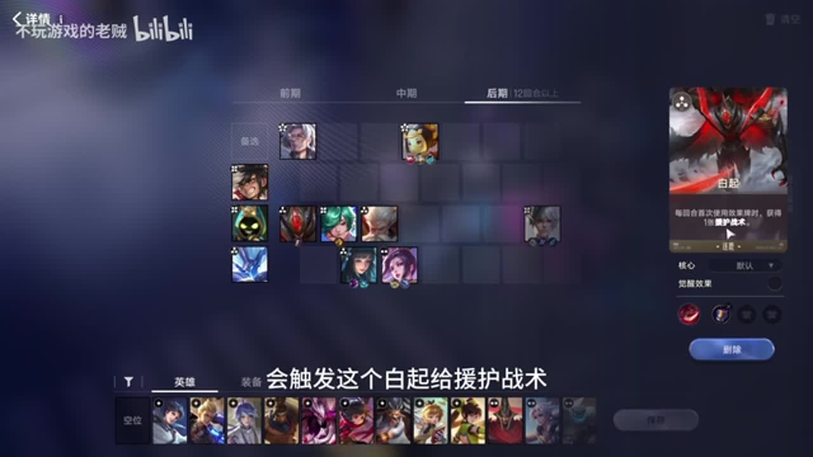

## 10:50–11:16 让芈月带装备打工，等嬴政到来再转移装备及成长目标

- 事件 ID：BV1tvYS6MEHf:p1:e013
- 场景：前置讲解
- 时机：主C嬴政尚未来牌时
- 背景（分析推断）：阵容编辑中示意核心的替换位置；阶段目标是先有战力，等待主C后再集中资源。
- 学习目标（分析推断）：使用过渡核心维持战力，知道何时换目标。
- 模板：opening-plan
- ASR 段落：[24]

> 直到嬴政来了之后,把装备卸给她

## 10:50–11:44 比较高阶援护的双倍护盾与招募战术选牌收益，优先常驻白起

- 事件 ID：BV1tvYS6MEHf:p1:e014
- 场景：前置讲解
- 时机：决定哪个工具人常驻时
- 背景（分析推断）：编辑界面展开老夫子卡面；讲者承认成型前高阶招募有价值，但当前更看重护盾对战力的贡献。
- 学习目标（分析推断）：按实际贡献分配常驻位和操作位。
- 模板：resource-order
- ASR 段落：[24, 25]

> 是高阶援护战术,有双倍的护盾,这个是对咱们战力有影响的

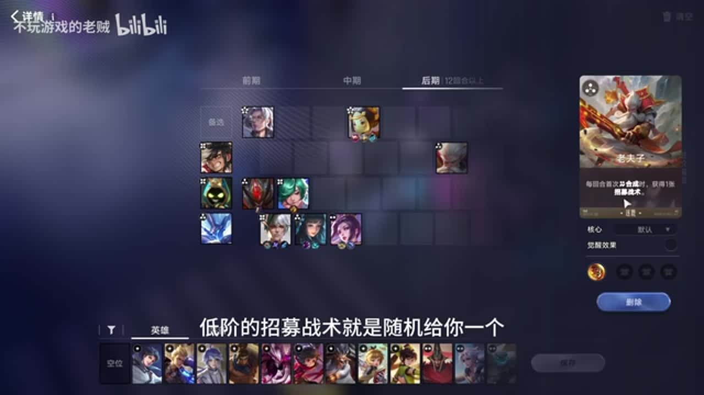

## 11:44–12:14 预留一个格子用于打出、合成及获取招募战术

- 事件 ID：BV1tvYS6MEHf:p1:e015
- 场景：前置讲解
- 时机：六人口空间有限、准备反复打出老夫子时
- 背景（分析推断）：阵容编辑示意将操作位空出；牌在手里不等于可触发，需要空间和另一张合成材料。
- 学习目标（分析推断）：在操作前检查空间和触发材料。
- 模板：resource-order
- ASR 段落：[26]

> 六人口的时候咱们需要控住一个格

## 12:14–12:40 说明减蓝与招募战术怎样帮助主C启动和全队觉醒

- 事件 ID：BV1tvYS6MEHf:p1:e016
- 场景：前置讲解
- 时机：解释西施与庄周在体系中的用途时
- 背景（分析推断）：编辑界面展开庄周卡面；讲者分别说明西施缩蓝、庄周登场补战术牌。数值10蓝沿用视频。
- 学习目标（分析推断）：用角色功能理解组件价值。
- 模板：growth-combo
- ASR 段落：[27]

> 这两个人会帮助这个阵容更快的成型跟觉醒

## 12:14–13:09 先确认小强势期，再存钱升五补鲁班七号，同时保留打出位

- 事件 ID：BV1tvYS6MEHf:p1:e017
- 场景：前置讲解
- 时机：嬴政已有能力稳血时
- 背景（分析推断）：编辑界面显示嬴政卡面和拟定阵容；约40级是讲者本套经验阈值，须以实际稳血为条件。
- 学习目标（分析推断）：把稳定战力作为转向经济或升本的信号。
- 模板：level-transition
- ASR 段落：[27, 28]

> 这个时候呢能索血,咱们就存一下钱啊,直接就升五

## 13:10–14:05 先打蒙犽拿特训，再上第二张老夫子，并利用跨回合触发

- 事件 ID：BV1tvYS6MEHf:p1:e018
- 场景：前置讲解
- 时机：老夫子有重复牌、蒙犽也待打出时
- 背景（分析推断）：编辑界面演示工具人交替位置；这是刷牌量大的体系，讲者把顺序和回合边界都纳入循环。
- 学习目标（分析推断）：独立安排触发顺序，减少遗漏收益。
- 模板：growth-combo
- ASR 段落：[29, 30]

> 先把手上多余的这个蒙犽啊一股一股脑先打上去合成

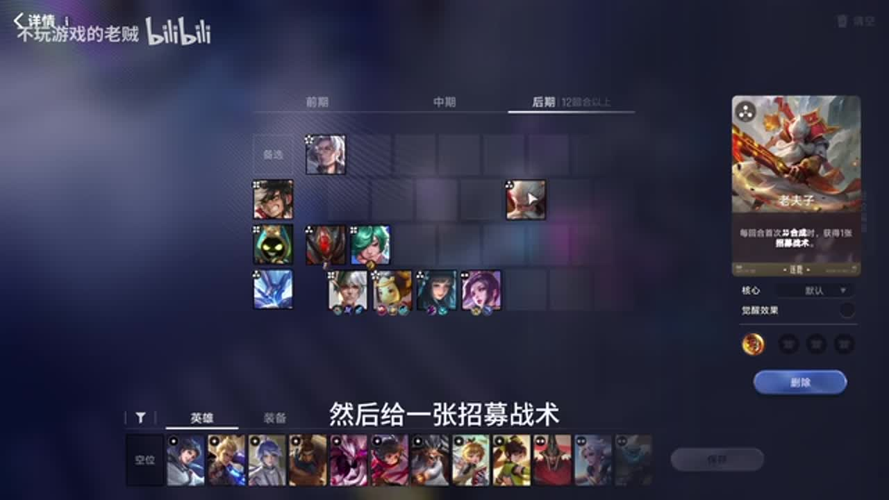

## 14:06–14:59 区分等级与永久法强，解释较低等级不等于没有输出

- 事件 ID：BV1tvYS6MEHf:p1:e019
- 场景：前置讲解
- 时机：比较不同棋手的等级上限时
- 背景（分析推断）：编辑界面展开白起及核心阵容；讲者将防御归到护盾，输出归到嬴政使用战术牌的永久法强。
- 学习目标（分析推断）：比较完整战力来源，不只比较等级数字。
- 模板：mechanic-model
- ASR 段落：[31, 32]

> 他有这个法术攻击力,即便他等级很低

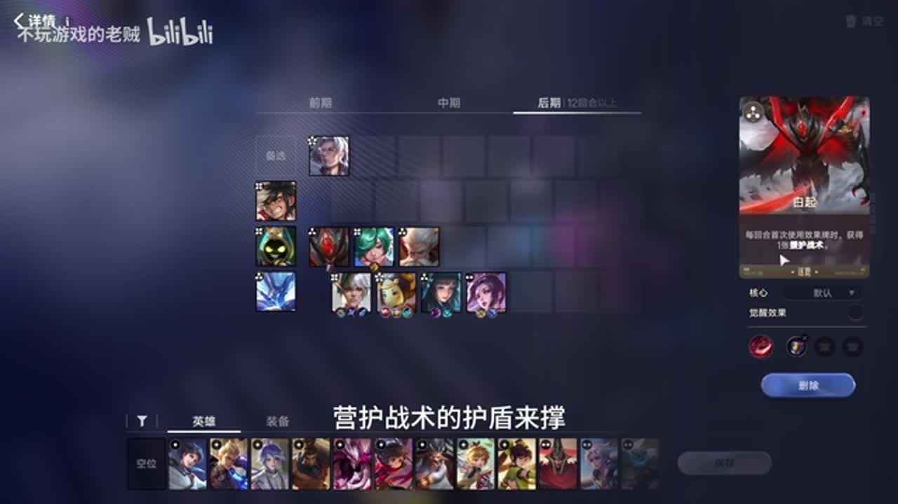

## 15:00–15:53 用囤好的鲁班大师替换老夫子，停止长期预留打出位

- 事件 ID：BV1tvYS6MEHf:p1:e020
- 场景：前置讲解
- 时机：进入两三人决赛圈、等级已够用时
- 背景（分析推断）：编辑界面展开鲁班大师，说明机关傀儡继承高等级单位并增加战力；替换条件是等级已刷得差不多。
- 学习目标（分析推断）：在成长和当下战力之间切换优先级。
- 模板：late-transition
- ASR 段落：[33, 34]

> 这个老夫子走了之后,你就上这个鲁班大师

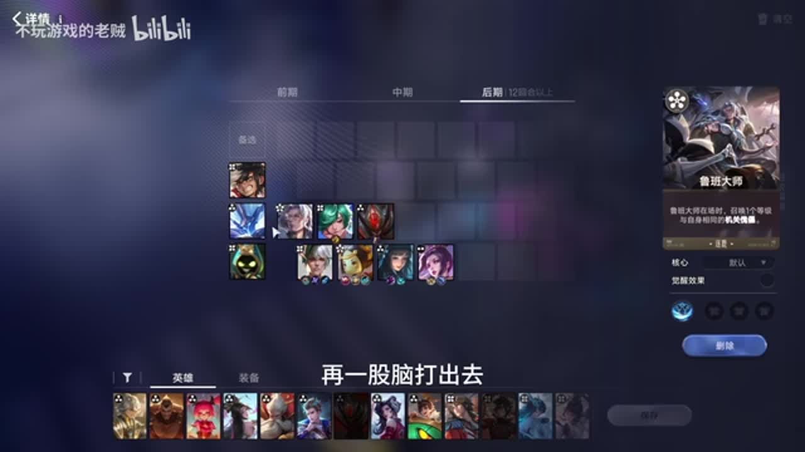

## 15:53–17:17 通常考虑钟馗降级，遇命运之种则考虑太乙复活这一例外

- 事件 ID：BV1tvYS6MEHf:p1:e021
- 场景：前置讲解
- 时机：最后一轮根据对手威胁选辅助时
- 背景（分析推断）：编辑阵容加入太乙示意；讲者解释被贴脸时复活价值有限，但命运之种造成开局暴毙时有不同价值。
- 学习目标（分析推断）：按威胁机制而不是固定名单选择辅助。
- 模板：counter-target
- ASR 段落：[35, 36, 37]

> 对面有命运之种的情况下这个时候挂一个太乙真人

## 16:50–17:46 解释集体唤醒可多触发一名工具人的登场，增加战术牌

- 事件 ID：BV1tvYS6MEHf:p1:e022
- 场景：前置讲解
- 时机：额外人口允许蒙犽与庄周同时在场时
- 背景（分析推断）：讲者把额外人口的作用具体落到全体登场触发；不同人数下的实际收益依场上角色而定。
- 学习目标（分析推断）：把人口收益追溯到多出来的触发。
- 模板：growth-combo
- ASR 段落：[37, 38]

> 就能有两张战术牌

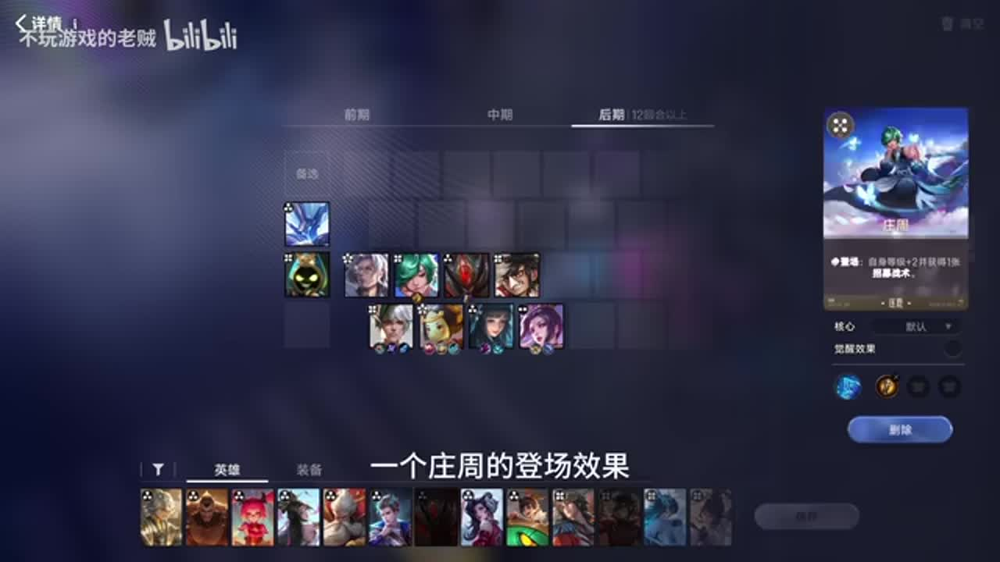

## 17:46–18:45 解释明刀争取输出时间、吸血装对冲反伤，并指出护命灵珠不能解决同一问题

- 事件 ID：BV1tvYS6MEHf:p1:e023
- 场景：前置讲解
- 时机：第三件装备需在普通装和神器间选择时
- 背景（分析推断）：讲者在装备页介绍各选择解决的威胁；1.5秒和回血说法只记为视频当时讲解。
- 学习目标（分析推断）：按装备解决的问题进行替代比较。
- 模板：equipment-cause
- ASR 段落：[39, 40]

> 护命灵珠是没法这个针对反伤的

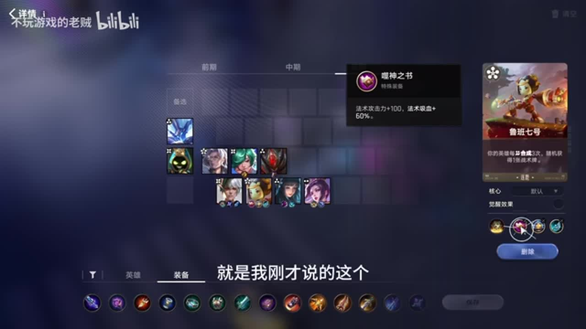

## 18:47–19:38 解释嬴政飞剑被打断后，事后解除眩晕也无法恢复该次输出

- 事件 ID：BV1tvYS6MEHf:p1:e024
- 场景：前置讲解
- 时机：准备以周期解控替代持续免控时
- 背景（分析推断）：装备比较围绕持续输出是否被中断，而非泛泛推荐免控装备。
- 学习目标（分析推断）：区分预防控制和受控后的恢复。
- 模板：equipment-cause
- ASR 段落：[41, 42]

> 哪怕解除了也没有用,它那个飞舰已经断了

## 19:12–20:08 推迟装备以免低攻速妨碍普攻回蓝，缩到10蓝后再换

- 事件 ID：BV1tvYS6MEHf:p1:e025
- 场景：前置讲解
- 时机：拿到机器头但西施还没完成缩蓝时
- 背景（分析推断）：讲者要求先使用常规装备，只有技能能开局施放后才使用会大幅降低普攻速度的特殊装备。准确装备正式名称待牌面核对。
- 学习目标（分析推断）：给强装备补充生效前提和换装时机。
- 模板：equipment-cause
- ASR 段落：[42, 43]

> 这个时候他还需要普攻进行回篮啊

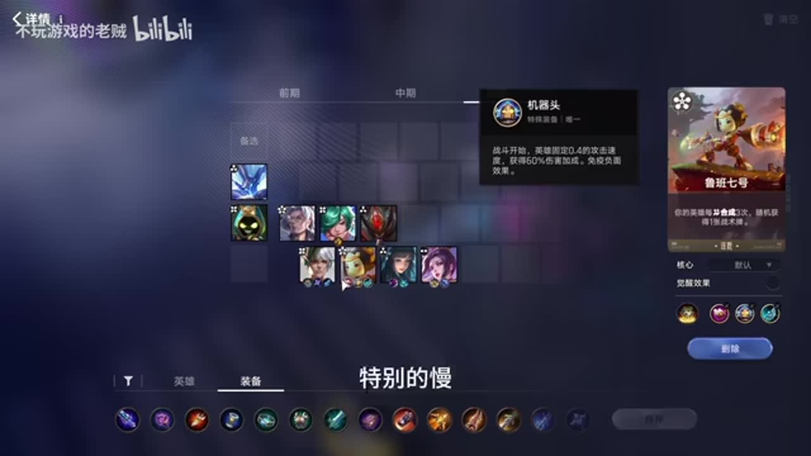

## 20:37–21:42 用普攻回蓝原理说明攻速装可作下位替代

- 事件 ID：BV1tvYS6MEHf:p1:e026
- 场景：前置讲解
- 时机：前期需要回蓝装但没有圣杯时
- 背景（分析推断）：讲者展示替代装备，解释攻速提高普攻频率，进而支持回蓝；不是把两件装备视为效果完全等同。
- 学习目标（分析推断）：从需求和机制推导临时替代。
- 模板：equipment-cause
- ASR 段落：[45, 46]

> 普攻能回篮嘛,相当于一个圣杯的效果

## 21:05–22:23 仅在不额外刷新且可保血拿牛肉时补战力，多余棋子不买

- 事件 ID：BV1tvYS6MEHf:p1:e027
- 场景：实战
- 时机：开局免费给出能够稳血的组合时
- 背景（分析推断）：第一回合讲者用现成组合争取收益，随后停止购买多余弈星；不是无条件放弃升本经济。
- 学习目标（分析推断）：比较零额外刷新投入的稳血收益与买牌成本。
- 模板：opening-plan
- ASR 段落：[46, 47]

> 就是不用刷新免费能拿的这个组合能让你吃个牛肉顺便不掉血

## 22:39–24:11 结合明先生大概率不上六重新判断天赋价值

- 事件 ID：BV1tvYS6MEHf:p1:e028
- 场景：实战
- 时机：保持进步与人才济济需要二选一时
- 背景（分析推断）：讲者先倾向保持进步，随后修正选择，依据预期升本终点而非只看天赋名称。
- 学习目标（分析推断）：在选择前核对后续路线是否会兑现收益。
- 模板：talent-fit
- ASR 段落：[48]

> 人才济济,因为咱明先生大概率不上6啊

## 22:39–24:11 提示向一侧让开，用针对性移动避开威胁

- 事件 ID：BV1tvYS6MEHf:p1:e029
- 场景：实战
- 时机：即将对阵瑶妹时
- 背景（分析推断）：讲者把摆位调整明确连到对阵瑶妹，截图需确认实际摆位；不据此泛化固定左右位置。
- 学习目标（分析推断）：看到对手后调整站位，并知道移动所解决的问题。
- 模板：position-cause
- ASR 段落：[48]

> 打瑶妹的话你就往一边让一下

## 24:51–25:45 说明更厚护盾仍不能解决反伤，选择与吸血缺口相关的天赋

- 事件 ID：BV1tvYS6MEHf:p1:e030
- 场景：实战
- 时机：水晶穹顶与强者横强出现时
- 背景（分析推断）：嬴政到来但暂时没钱买，讲者同时复述反甲威胁；天赋比较以解决主C问题为中心。
- 学习目标（分析推断）：按当前致命缺口比较防御选项。
- 模板：talent-fit
- ASR 段落：[50, 51]

> 但是他不能解决这个粉上甲的问题啊还是得给他找吸血

## 26:20–26:51 以血量充沛为前提说明可连续两次卦象·节速五，更早找到鲁班七号

- 事件 ID：BV1tvYS6MEHf:p1:e031
- 场景：实战
- 时机：当前找牌很顺、需要解释另一条升本路线时
- 背景（分析推断）：讲者边打牌边说明本局以外的分支；本条记录实战中的条件教学，不把假设分支当作实际走过的路线。
- 学习目标（分析推断）：把顺局资源优势转化为可选择的运营路线。
- 模板：level-transition
- ASR 段落：[52]

> 如果你前期血量比较充沛

## 26:56–28:25 再以圣杯缺失为触发提示鸡爪或红叉过渡

- 事件 ID：BV1tvYS6MEHf:p1:e032
- 场景：实战
- 时机：前期需要回蓝且装备未齐时
- 背景（分析推断）：讲者在实际刷牌途中补充与前置装备讲解相同的替代方案，记录为新时间的独立提醒。
- 学习目标（分析推断）：在当下缺装时落实机制相近的替代。
- 模板：equipment-cause
- ASR 段落：[53]

> 没圣杯的话就用鸡爪代替一下

## 28:26–30:22 提醒白起不宜反复刷，因觉醒后的双倍护盾需要常驻兑现

- 事件 ID：BV1tvYS6MEHf:p1:e033
- 场景：实战
- 时机：连续打出工具人时容易把白起也频繁卖掉时
- 背景（分析推断）：讲者在演示操作后再强调白起与老夫子的收益差别；允许前期小刷而非绝对禁止卖白起。
- 学习目标（分析推断）：给操作循环设置角色差异和停止条件。
- 模板：resource-order
- ASR 段落：[54, 55]

> 不建议这样刷太多,因为需要高阶援护战术

## 29:15–31:25 讨论尽早拿核心的收益，并识别李白同行先启动的压力

- 事件 ID：BV1tvYS6MEHf:p1:e034
- 场景：实战
- 时机：拍卖鲁班七号被同行争抢时
- 背景（分析推断）：讲者试图加价争抢后放弃，随后解释李白先刷起来会棘手；没有给出可推广的固定最高价。
- 学习目标（分析推断）：把竞价价值与自己启动及同行进度相连。
- 模板：auction-choice
- ASR 段落：[55, 56]

> 他李白的话要是先刷起来的话也挺棘手的

## 31:35–33:19 明确觉醒前需要回蓝，觉醒完成后可以撤掉过渡装

- 事件 ID：BV1tvYS6MEHf:p1:e035
- 场景：实战
- 时机：西施接近觉醒、准备更换回蓝装备时
- 背景（分析推断）：实际装备和刷牌流程中复述状态切换；准确换装点以西施技能状态为准。
- 学习目标（分析推断）：在关键条件变化后撤掉已无必要的过渡资源。
- 模板：equipment-cause
- ASR 段落：[57]

> 觉醒之后就可以把灰蓝装都下了

## 33:19–34:01 同时解释四级早启动能压别人、也有找不到四费核心的风险

- 事件 ID：BV1tvYS6MEHf:p1:e036
- 场景：实战
- 时机：四级已刷出核心并稳住后回看此前决策时
- 背景（分析推断）：这是本局成功启动后的复盘，讲者仍强调压力局选择受限；成功结果没有抹掉早刷风险。
- 学习目标（分析推断）：在复盘中保留收益、风险和迫不得已的条件。
- 模板：combat-review
- ASR 段落：[58]

> 风险就是四级必四飞卡,有可能递不着

## 36:55–38:55 暂缓占用经济的后期牌，继续当前成长

- 事件 ID：BV1tvYS6MEHf:p1:e037
- 场景：实战
- 时机：移花接木出现但尚不到替换阶段时
- 背景（分析推断）：讲者说明拿太早会卡经济且暂时无用；并另外讨论低价升六机会，不把后期牌定义为永久不需要。
- 学习目标（分析推断）：按使用时间管理手牌及经济。
- 模板：late-transition
- ASR 段落：[60]

> 一花拿太早卡经济也没什么用

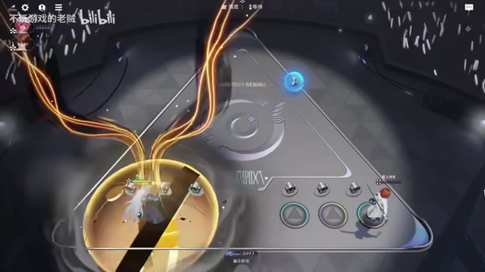

## 待核实与局限

- 卦象、秘技及装备数值按视频历史口径；天降鸿运视频称第6/10回合，当前实体描述不同，不作为ASR数值纠错。
- “机器头”“鸡爪”等装备简称未确认正式名称，保留简称及条件，不猜名称。
- 部分ASR将不同英雄、战术名或装备混淆；只对明确同音名称段内纠正，疑词保留。
- 40级稳血、低价升六及天赋适配来自本套与讲者局势判断，不推广为全版本固定阈值。
