# 【王者万象棋】班叔奶屏诸葛亮阵容详解+实战，远程弹道英雄的克星

来源：https://www.bilibili.com/video/BV1yMeq6wEGc/?p=1

分析状态：completed

完整文字稿：../../../raw/BV1yMeq6wEGc_p1.md

## 00:00–01:55 开局可选机关，之后随机；先触发陷阱弹簧再拆屏障可增加螺丝

- 事件 ID：BV1yMeq6wEGc:p1:e001
- 场景：前置讲解
- 时机：介绍机关来源与螺丝时
- 背景（分析推断）：机关触发与摧毁分别提供资源，收益取决于触发顺序
- 学习目标（分析推断）：理解机关作用与升级资源来源
- 模板：mechanic-model
- ASR 段落：[1, 2, 3, 4]

> 获得的螺丝就能最大化

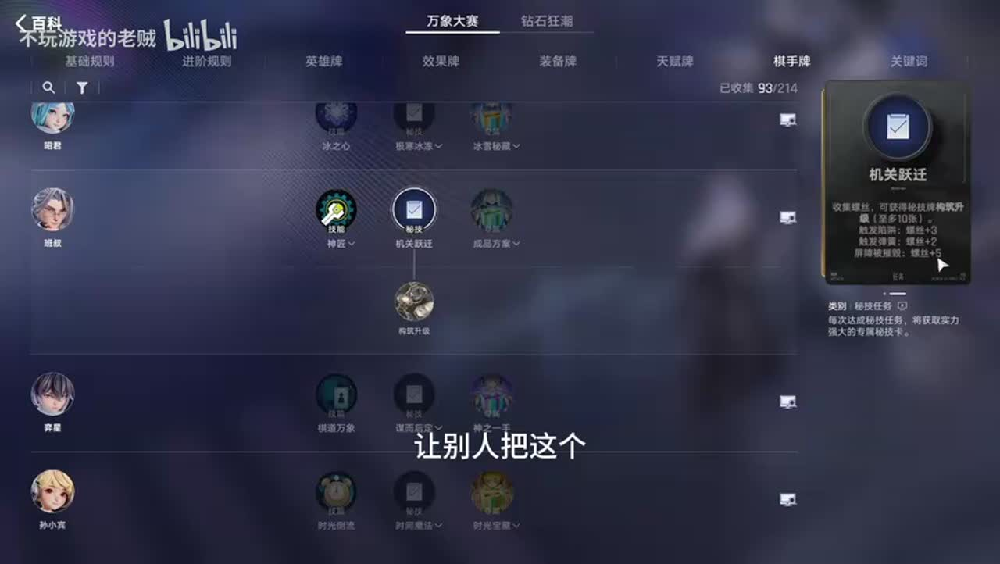

## 01:55–02:53 屏障强化增加屏障生存，三级屏障邻近单位可获复生

- 事件 ID：BV1yMeq6wEGc:p1:e002
- 场景：前置讲解
- 时机：六级机关强化选择
- 背景（分析推断）：两个核心需要屏障保护与额外生命
- 学习目标（分析推断）：按阵容防线选择强化
- 模板：module-fit
- ASR 段落：[5, 6]

> 给咱们的两个C位挂一个复生效果

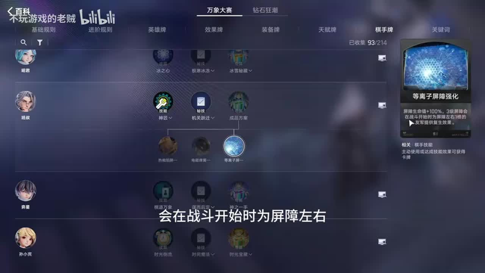

## 02:53–03:51 奶量和屏障承担生存，经济帮助升五，保血可拖后期

- 事件 ID：BV1yMeq6wEGc:p1:e003
- 场景：前置讲解
- 时机：比较吸血经济与保血
- 背景（分析推断）：防线突破后吸血未必挽救，不能照抄其他阵容吸血优先级
- 学习目标（分析推断）：判断已有生存来源与缺失功能
- 模板：talent-fit
- ASR 段落：[7, 8]

> 有羊羽环去奶

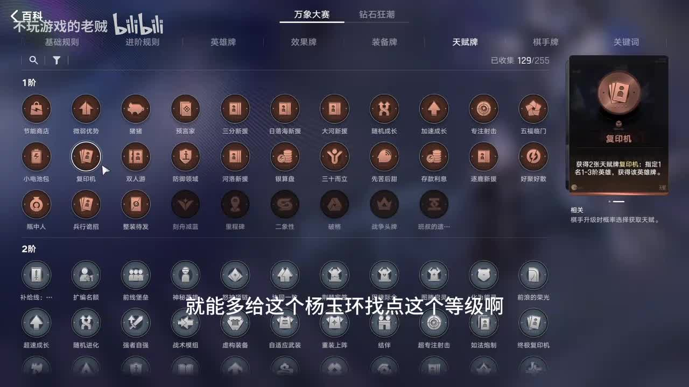

## 03:22–04:21 更快施法给诸葛亮成长回蓝，遗留物弹簧能保护柱子并产螺丝

- 事件 ID：BV1yMeq6wEGc:p1:e004
- 场景：前置讲解
- 时机：施法与遗留物天赋选择
- 背景（分析推断）：队伍施法与机关触发构成两个收益链
- 学习目标（分析推断）：将天赋接到机制触发
- 模板：talent-fit
- ASR 段落：[8, 9]

> 需要全队快速的释放技能

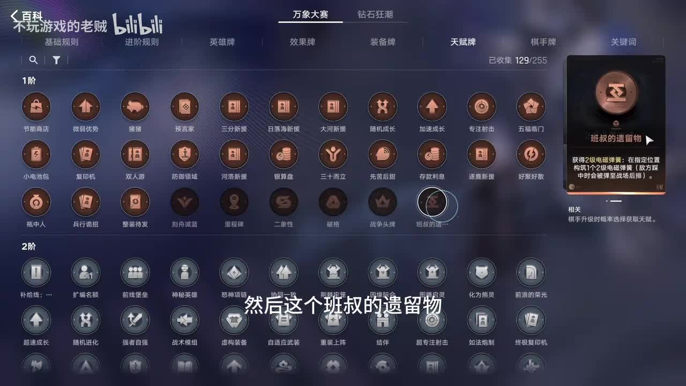

## 04:21–05:49 装备天赋可重构回蓝装，前期强势可争取累计伤害经济奖励

- 事件 ID：BV1yMeq6wEGc:p1:e005
- 场景：前置讲解
- 时机：银色装备与前期伤害奖励
- 背景（分析推断）：后者依赖本局前期强度与对手，20点为视频口径
- 学习目标（分析推断）：根据兑现能力评估随机装备和奖励
- 模板：talent-fit
- ASR 段落：[10, 11, 12]

> 给歪了也没关系

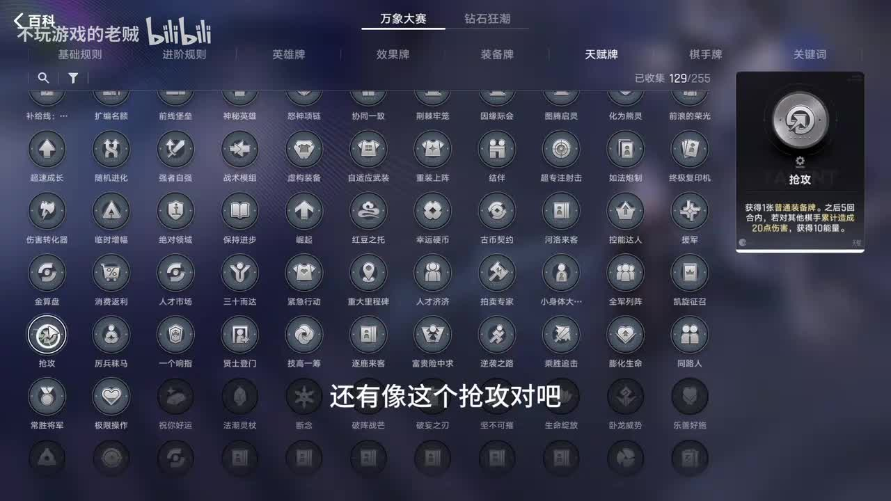

## 05:49–06:46 杨玉环为唯一五阶时可限定强化目标；等级优先治疗核心而非诸葛亮

- 事件 ID：BV1yMeq6wEGc:p1:e006
- 场景：前置讲解
- 时机：随机高阶强化与等级投入
- 背景（分析推断）：诸葛亮从队友施法获得临时等级，杨玉环要奶住屏障
- 学习目标（分析推断）：识别真正的投入瓶颈与随机目标集合
- 模板：resource-order
- ASR 段落：[13, 14]

> 确保他能奶住全场的血量奶住屏障

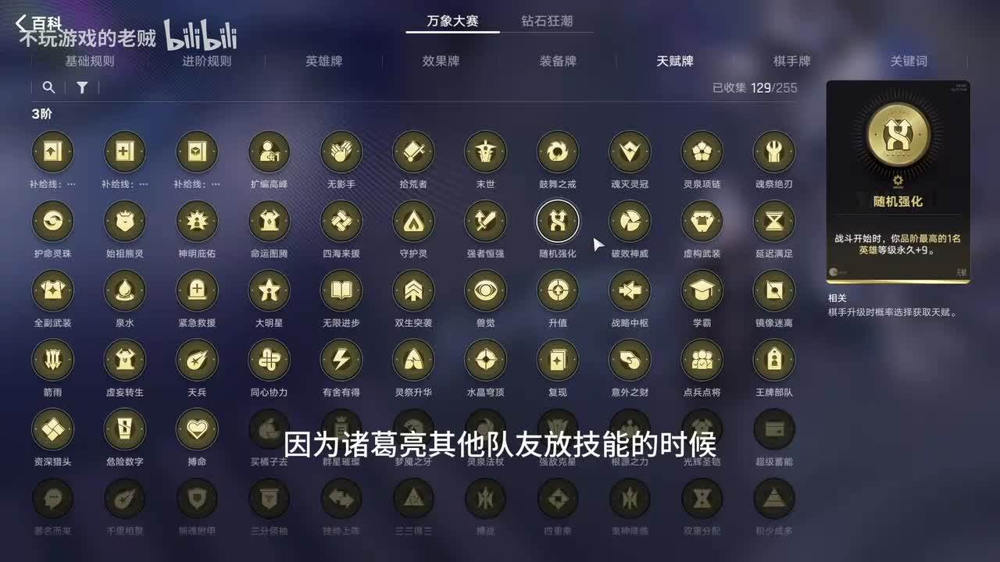

## 06:46–07:46 唤醒配明世隐，三阶兑换补工具，无阵营券可等五级再开

- 事件 ID：BV1yMeq6wEGc:p1:e007
- 场景：前置讲解
- 时机：效果牌与兑换券选择
- 背景（分析推断）：不同券的开启等级影响可获得目标
- 学习目标（分析推断）：理解资源兑现窗口
- 模板：resource-order
- ASR 段落：[15, 16]

> 可以去等到五级再开

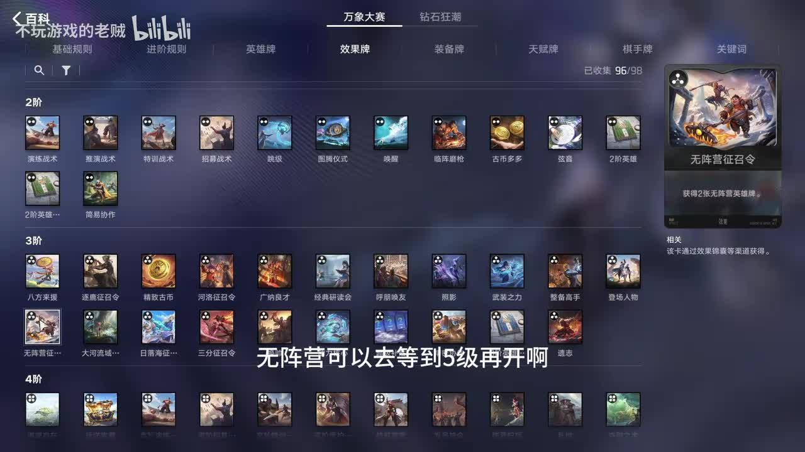

## 07:16–08:17 缺多件回蓝装备时优先重构，不因缺装备就默认分解找神器

- 事件 ID：BV1yMeq6wEGc:p1:e008
- 场景：前置讲解
- 时机：重构与分解取舍
- 背景（分析推断）：这套需要多个法师施法，神器提供回蓝来源较少
- 学习目标（分析推断）：按真实装备功能选择资源转换
- 模板：equipment-role
- ASR 段落：[16, 17]

> 缺装备,但是不太缺神器

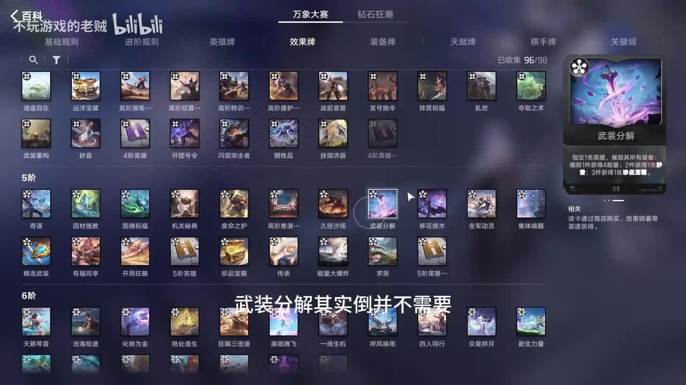

## 08:17–08:47 缺核心补核心，升六补升级资源，缺回蓝装补军械库

- 事件 ID：BV1yMeq6wEGc:p1:e009
- 场景：前置讲解
- 时机：第三轮拍卖补缺
- 背景（分析推断）：选项价值取决于当前尚未满足的功能
- 学习目标（分析推断）：以瓶颈安排拍卖
- 模板：auction-choice
- ASR 段落：[18]

> 尤其你缺了回蓝装的话

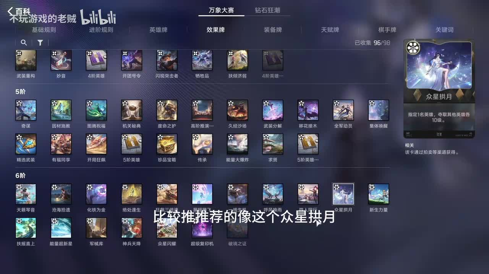

## 09:18–10:18 拉满横向格子迫使近战拆柱，升二才能挡投射物

- 事件 ID：BV1yMeq6wEGc:p1:e010
- 场景：模拟演示
- 时机：初级屏障布置与升级
- 背景（分析推断）：一级只能限制近战走位，远程仍可攻击后排
- 学习目标（分析推断）：区分机关等级与对应防御对象
- 模板：position-cause
- ASR 段落：[20, 21]

> 一级的时候只能去限制这个近战的走位

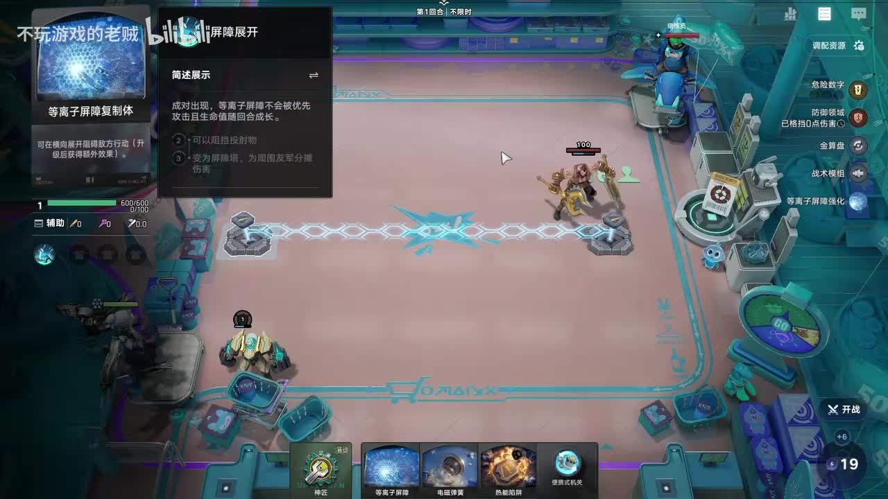

## 10:18–11:18 墙后移，后排侧置吸引路径，先踩机关再拆柱

- 事件 ID：BV1yMeq6wEGc:p1:e011
- 场景：模拟演示
- 时机：陷阱弹簧与屏障组合
- 背景（分析推断）：需要收集螺丝而非只追求这场胜利
- 学习目标（分析推断）：用路径规划提高机关收益
- 模板：position-cause
- ASR 段落：[22, 23]

> 最好是让他先踩热能陷阱

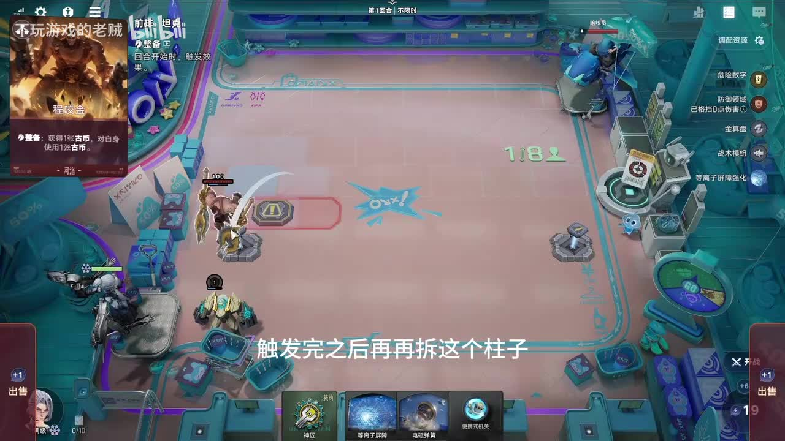

## 10:48–13:06 屏障拉满避免绕路，优先后墙挡远程，全部二级后再选三级

- 事件 ID：BV1yMeq6wEGc:p1:e012
- 场景：模拟演示
- 时机：多屏障升级顺序
- 背景（分析推断）：前墙承接近战、后墙挡远程，先保证全覆盖
- 学习目标（分析推断）：理解升级顺序与防线分工
- 模板：resource-order
- ASR 段落：[23, 24, 26]

> 不要升级前面的这个

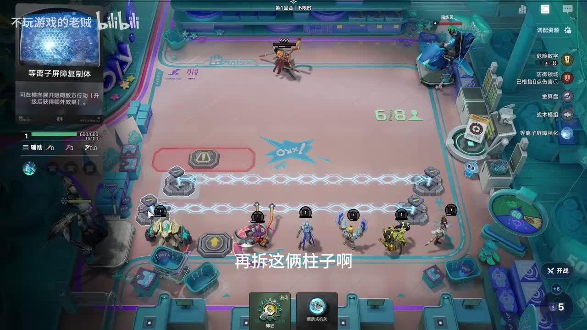

## 11:48–13:06 后排占满留空位，诱导刺客跳入弹簧陷阱路径

- 事件 ID：BV1yMeq6wEGc:p1:e013
- 场景：模拟演示
- 时机：敌方刺客跳后排
- 背景（分析推断）：固定跳点需要当前站位可执行，不能泛指刺客全被克制
- 学习目标（分析推断）：用寻敌与落点安排防御
- 模板：counter-target
- ASR 段落：[25, 26]

> 固定会跳到这个位置

## 13:06–14:02 两个核心放三级屏障左右，前墙保护，太乙连杨玉环

- 事件 ID：BV1yMeq6wEGc:p1:e014
- 场景：模拟演示
- 时机：三级屏障与复活绑定
- 背景（分析推断）：六级强化已点，复生与链接有指定空间关系
- 学习目标（分析推断）：核查保护目标是否绑定正确
- 模板：position-binding
- ASR 段落：[27, 28]

> 确保连线是连在杨玉环身上

## 14:02–15:57 先保留二级全线防护，不急升三级圆盾；后期需要复生才考虑升级

- 事件 ID：BV1yMeq6wEGc:p1:e015
- 场景：模拟演示
- 时机：随机只给一个屏障
- 背景（分析推断）：其他单位存活并施法支持诸葛亮，缩圈后暴露会减慢循环
- 学习目标（分析推断）：比较升级的收益与覆盖代价
- 模板：fallback-plan
- ASR 段落：[29, 30, 31, 32]

> 只靠一个杨玉环在这放技能是不够的

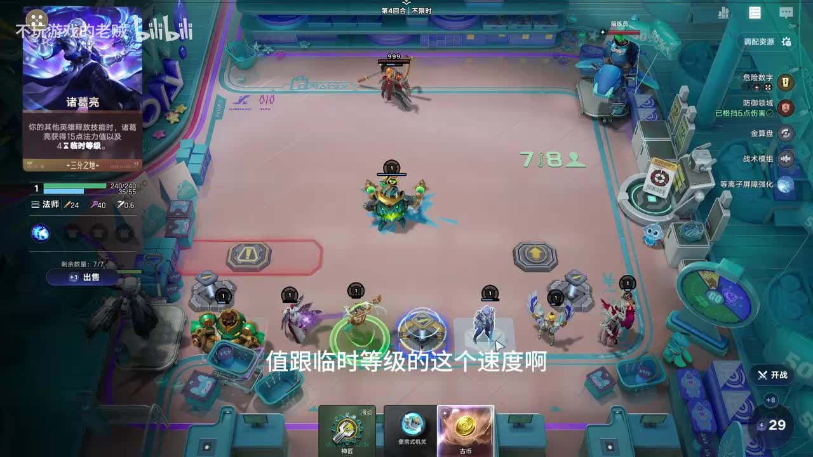

## 15:57–17:22 优先干将战力与孙膑觉醒成长，两者到位再升级

- 事件 ID：BV1yMeq6wEGc:p1:e016
- 场景：前置讲解
- 时机：开局追觉醒与升级
- 背景（分析推断）：孙膑依队友高频施法增加永久等级，回合仅示范节奏
- 学习目标（分析推断）：以关键觉醒节点确定过渡完成
- 模板：opening-plan
- ASR 段落：[33, 34, 35]

> 他们两个都觉醒了

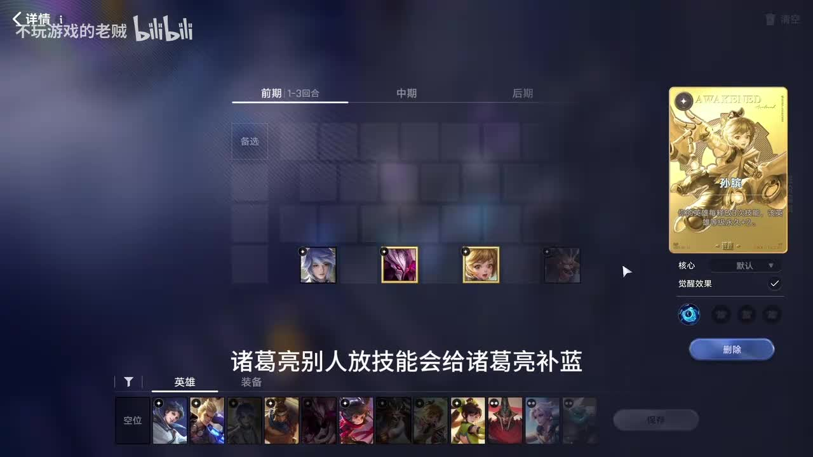

## 16:54–17:52 先刘禅再明世隐，临时等级来源到位才能转化；中期不买无关牌存钱升五

- 事件 ID：BV1yMeq6wEGc:p1:e017
- 场景：前置讲解
- 时机：首轮拍卖与中期留钱
- 背景（分析推断）：工具依赖链和觉醒后重复价值不同
- 学习目标（分析推断）：按依赖顺序买工具
- 模板：resource-order
- ASR 段落：[35, 36]

> 没有这个临时等级

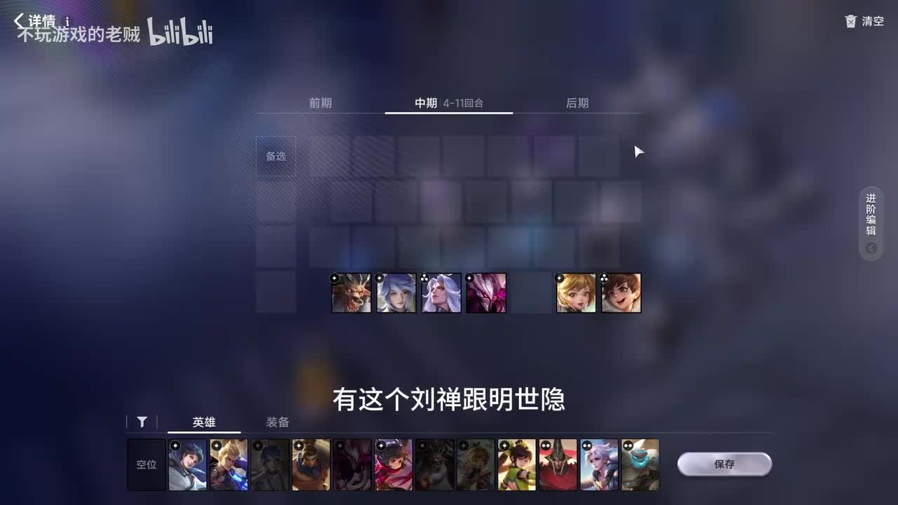

## 17:52–18:50 升五找核心，明世隐由干将转挂杨玉环

- 事件 ID：BV1yMeq6wEGc:p1:e018
- 场景：前置讲解
- 时机：升五成型与成长目标变化
- 背景（分析推断）：前期承伤与输出过渡完成，治疗屏障成为新瓶颈
- 学习目标（分析推断）：理解升级后的投入对象变化
- 模板：level-transition
- ASR 段落：[37, 38]

> 后期是挂在这个杨玉环的身上

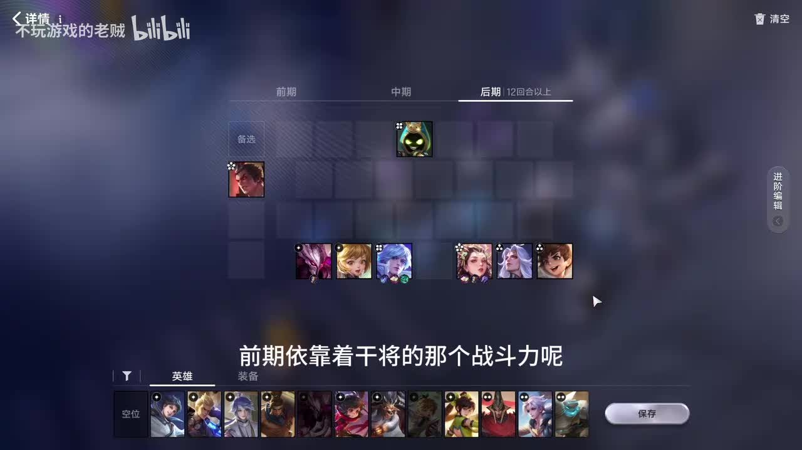

## 18:50–20:20 诸葛亮队友施法回蓝，缩蓝与控制；玉环缩蓝配圣杯双重施法

- 事件 ID：BV1yMeq6wEGc:p1:e019
- 场景：前置讲解
- 时机：诸葛亮与杨玉环配装
- 背景（分析推断）：两者法力来源不同，不能同套装备无差别分配
- 学习目标（分析推断）：按法力循环解释回蓝装
- 模板：equipment-cause
- ASR 段落：[39, 40, 41]

> 他不太需要圣杯

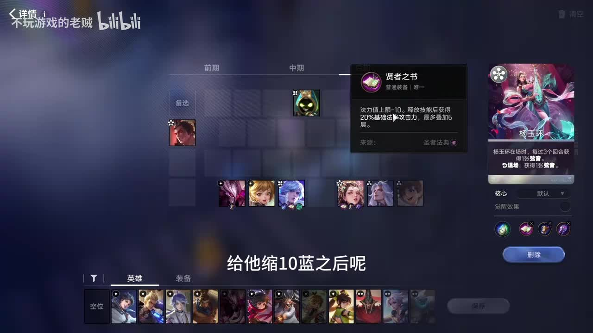

## 20:20–21:15 已有三级屏障复生时可用吕布补吸血，太乙有更好

- 事件 ID：BV1yMeq6wEGc:p1:e020
- 场景：前置讲解
- 时机：太乙抢手难找
- 背景（分析推断）：替代功能不完全等同，需要保留屏障复生条件
- 学习目标（分析推断）：区分可替代的功能与已有保障
- 模板：fallback-plan
- ASR 段落：[42, 43]

> 给他已经加了一次复生效果了

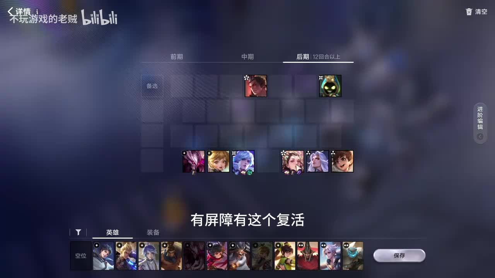

## 22:14–25:37 停止无关买牌，优先完成孙膑觉醒

- 事件 ID：BV1yMeq6wEGc:p1:e021
- 场景：实战
- 时机：干将觉醒后补孙膑
- 背景（分析推断）：干将成长已启动，孙膑成为下一依赖
- 学习目标（分析推断）：按已完成节点更新找牌重点
- 模板：resource-order
- ASR 段落：[45, 46]

> 现在得找那个孙斌

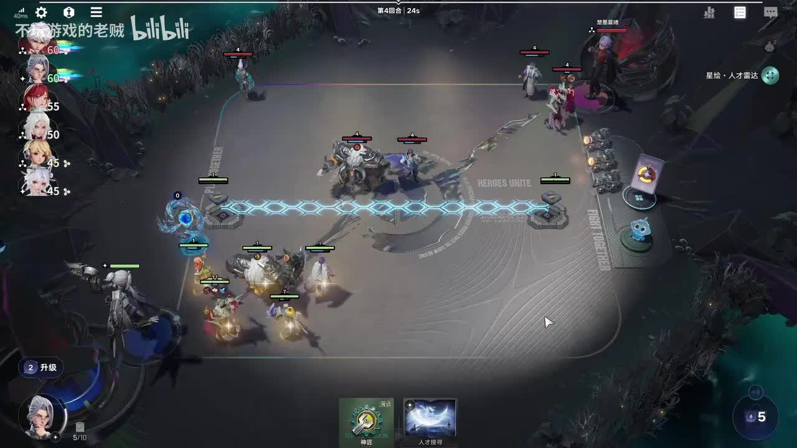

## 25:38–26:31 当前需要觉醒工具，选择复印机并调整屏障

- 事件 ID：BV1yMeq6wEGc:p1:e022
- 场景：实战
- 时机：复印机与经济选项出现
- 背景（分析推断）：本局刘禅等工具仍需补，选择依赖当前卡组
- 学习目标（分析推断）：围绕可兑现收益选天赋
- 模板：talent-fit
- ASR 段落：[47]

> 复印机好一点

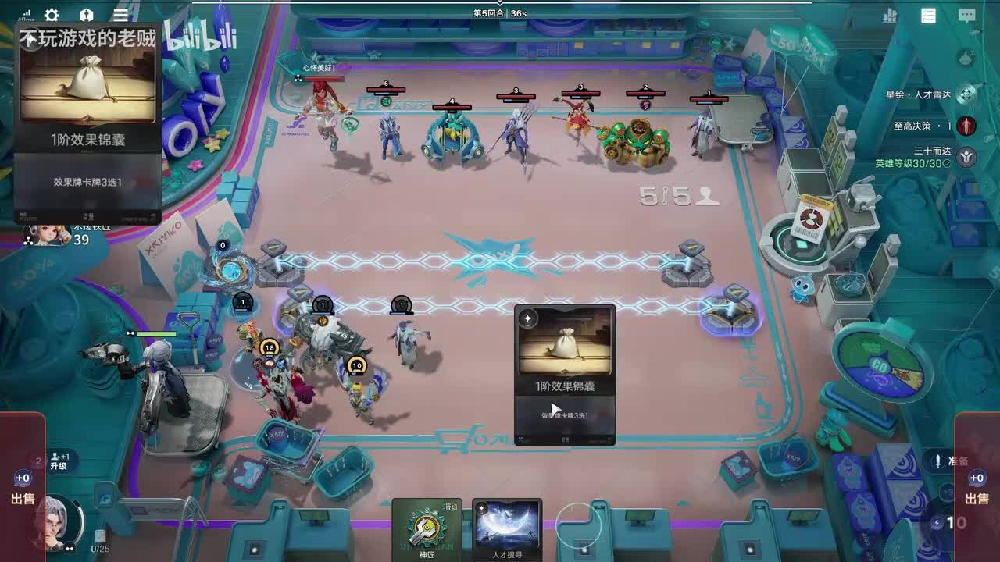

## 26:31–27:55 关注陷阱弹簧拆墙的资源反馈，干将到等级质变

- 事件 ID：BV1yMeq6wEGc:p1:e023
- 场景：实战
- 时机：机关触发且干将40级
- 背景（分析推断）：螺丝收益与核心成长并行；40级只作视频口径
- 学习目标（分析推断）：追踪机制是否已启动
- 模板：combat-review
- ASR 段落：[48]

> 干将40级了,是一个质变

## 27:55–29:19 位移把敌人送到干将旁，考虑下姬小满；屏障优先二级

- 事件 ID：BV1yMeq6wEGc:p1:e024
- 场景：实战
- 时机：姬小满位移影响保护
- 背景（分析推断）：同一工具可能破坏当前防线，不能无条件视为强
- 学习目标（分析推断）：从接敌反馈评估工具副作用
- 模板：combat-review
- ASR 段落：[49]

> 给他踢到干将旁边了

## 29:34–30:46 承认输局收益并优先五费杨玉环，诸葛亮可升五找

- 事件 ID：BV1yMeq6wEGc:p1:e025
- 场景：实战
- 时机：输局却螺丝和血量充足
- 背景（分析推断）：剩余血量允许发育，治疗核心卡池与稀有度影响拍卖价值
- 学习目标（分析推断）：用资源与血量评估局面而非单看胜负
- 模板：auction-choice
- ASR 段落：[50]

> 优先拿五费的杨玉环

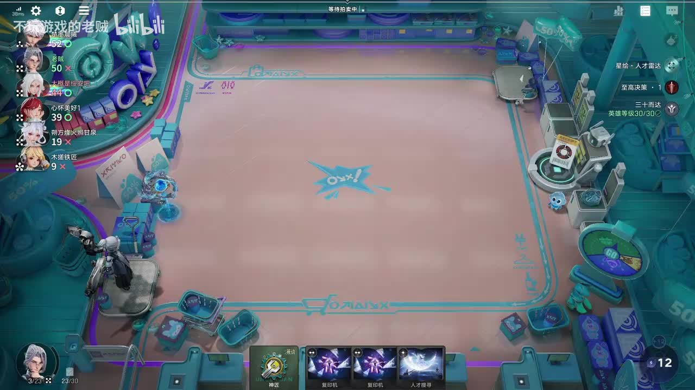

## 31:51–32:55 屏障二三级保障后，剩余螺丝可升级弹簧

- 事件 ID：BV1yMeq6wEGc:p1:e026
- 场景：实战
- 时机：面对三分猴而机关资源富余
- 背景（分析推断）：条件为屏障较少且当前敌人适合弹回，非一律弹簧优先
- 学习目标（分析推断）：将机关升级接到具体对手
- 模板：counter-target
- ASR 段落：[52]

> 多余的这个楼司去升级那个弹簧

## 32:57–37:49 先依孙膑成长与三级护盾维持战力

- 事件 ID：BV1yMeq6wEGc:p1:e027
- 场景：实战
- 时机：明世隐一直未到
- 背景（分析推断）：缺失永久转化工具，保留实际可用成长而非假装已完整成型
- 学习目标（分析推断）：识别缺牌时已有机制能承担什么
- 模板：fallback-plan
- ASR 段落：[53, 54, 55]

> 那只能靠孙斌给加上击了

## 38:43–39:46 挂杨玉环并补明世隐觉醒提高每回合成长

- 事件 ID：BV1yMeq6wEGc:p1:e028
- 场景：实战
- 时机：明世隐终于到场
- 背景（分析推断）：治疗核心是当前资源目标，链接需要核查
- 学习目标（分析推断）：核对成长资源实际作用对象
- 模板：position-binding
- ASR 段落：[57]

> 挂在这个杨玉环身上

## 39:49–42:45 低阶工具等免费弦音，妙音可留给更高阶太乙，不急投杨玉环觉醒

- 事件 ID：BV1yMeq6wEGc:p1:e029
- 场景：实战
- 时机：自然觉醒资源即将到来
- 背景（分析推断）：玉环觉醒主要扩大觉醒效果适用等阶，全员到位后价值下降
- 学习目标（分析推断）：比较当前消耗与即将获得的替代资源
- 模板：resource-order
- ASR 段落：[58, 59, 60]

> 下一回合这个杨玉环就发这个弦音了

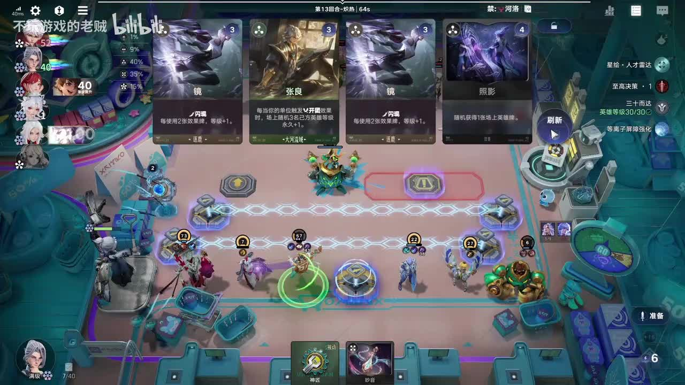

## 42:47–44:33 找控制变猪，提高持续施法的针对效果

- 事件 ID：BV1yMeq6wEGc:p1:e030
- 场景：实战
- 时机：需要对付单核心
- 背景（分析推断）：对方免控与生效时机仍需检查；未获得前不称已生效
- 学习目标（分析推断）：按威胁选择装备功能
- 模板：counter-target
- ASR 段落：[61]

> 打这种单盒有变珠还是好一点

## 46:00–47:17 将胜势连回奶量与屏障防线，而非等级压制

- 事件 ID：BV1yMeq6wEGc:p1:e031
- 场景：实战
- 时机：高等级射手无法突破屏障
- 背景（分析推断）：对手等级高仍难突破，结论限定当前局面与远程输出
- 学习目标（分析推断）：从战斗观察解释阵容机制
- 模板：combat-review
- ASR 段落：[63, 64]

> 他拓不了那个屏障了

## 待核实与局限

- 不做ASR修正，机关升级、英雄与效果名称同音误识保留原话。
- 第19段仅广告式缺失，不从缺失转写补背景。
- 随机单屏障和刺客跳点属于模拟演示，独立统计，不冒充实战验证。
- 强势和克制判断来自讲者与本局反馈，不证明跨版本或玩家学习效果。
