# 【王者万象棋】白歌三分射阵容详解+实战，吃分能力比猪离还稳

来源：https://www.bilibili.com/video/BV1akH96fEPp/?p=1

分析状态：completed

完整文字稿：../../../raw/BV1akH96fEPp_p1.md

## 00:00–00:55 以登场效果构筑，合成触发复制与锦囊，形成正向资源循环

- 事件 ID：BV1akH96fEPp:p1:e001
- 场景：前置讲解
- 时机：理解白歌复制与合成收益时
- 背景（分析推断）：界面进度提示何时获得下一发复制。
- 学习目标（分析推断）：用机制解释构筑选择。
- 模板：mechanic-model
- ASR 段落：[1, 2]

> 形成一个正向循环

## 00:56–01:51 选择高价值登场牌或补觉醒目标，转瞬复制必须本回合使用

- 事件 ID：BV1akH96fEPp:p1:e002
- 场景：前置讲解
- 时机：用剑气切手牌时
- 背景（分析推断）：收益受目标价值、觉醒状态和时效约束。
- 学习目标（分析推断）：在释放资源前检查目标与使用窗口。
- 模板：resource-order
- ASR 段落：[3, 4]

> 当会合不用的话就没有了

## 01:51–03:11 已有每种体系牌至少一张后，可通过棋手复制继续觉醒；但速度可能慢

- 事件 ID：BV1akH96fEPp:p1:e003
- 场景：前置讲解
- 时机：体系牌被其他玩家抢走时
- 背景（分析推断）：讲者解释复制与牌库关系，不将不怕抢牌等同快速成型。
- 学习目标（分析推断）：区分资源稀缺与可复制的替代来源。
- 模板：fallback-plan
- ASR 段落：[5, 6, 7]

> 觉醒的慢一点

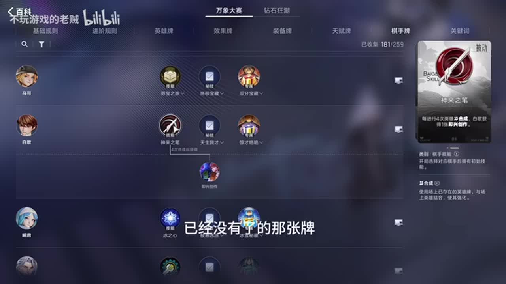

## 03:12–04:38 长期停三使经验工具价值较低，二级先补战力避免占位置掉血

- 事件 ID：BV1akH96fEPp:p1:e004
- 场景：模拟演示
- 时机：开局是否拿弈星时
- 背景（分析推断）：路线前期目标是场面质量，不是最快升六。
- 学习目标（分析推断）：让开局购买服从本路线阶段目标。
- 模板：opening-plan
- ASR 段落：[8, 9, 10]

> 因此我们可以完全不要的

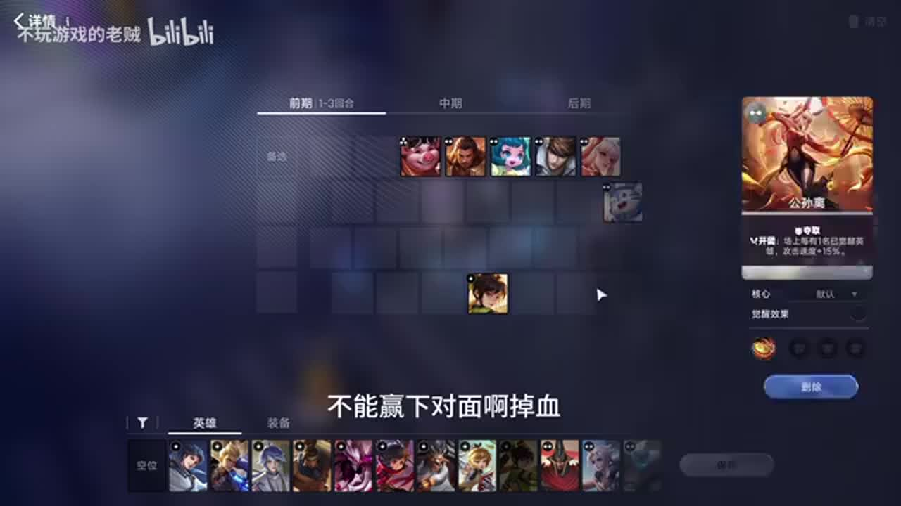

## 04:39–05:37 优先猪八戒及二阶体系；无直接目标可用梦奇转二阶兑换

- 事件 ID：BV1akH96fEPp:p1:e005
- 场景：模拟演示
- 时机：第一轮拍卖补体系时
- 背景（分析推断）：本构筑大多二阶，所以在二级找牌。
- 学习目标（分析推断）：根据体系品阶和缺口选择拍卖资源。
- 模板：auction-choice
- ASR 段落：[11, 12]

> 二阶的卡非常的多

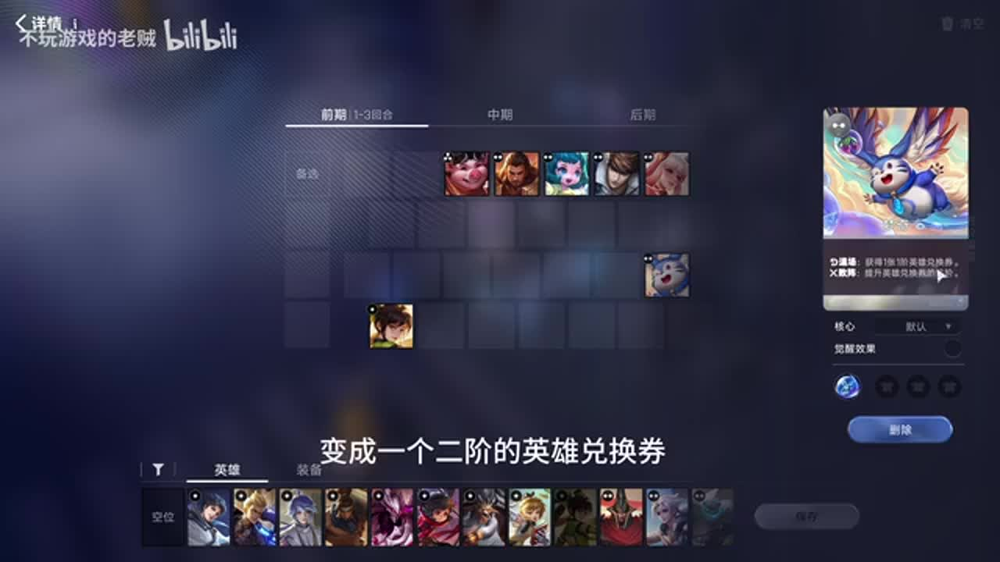

## 05:37–06:08 暂不上赵云以稳定触发孙尚香经济，曹操觉醒可同时触发两人再补赵云

- 事件 ID：BV1akH96fEPp:p1:e006
- 场景：模拟演示
- 时机：曹操未觉醒且想上赵云时
- 背景（分析推断）：触发目标数量随觉醒改变。
- 学习目标（分析推断）：检查目标池和触发次数再改变阵容。
- 模板：position-binding
- ASR 段落：[13, 14]

> 稳定触发孙尚香

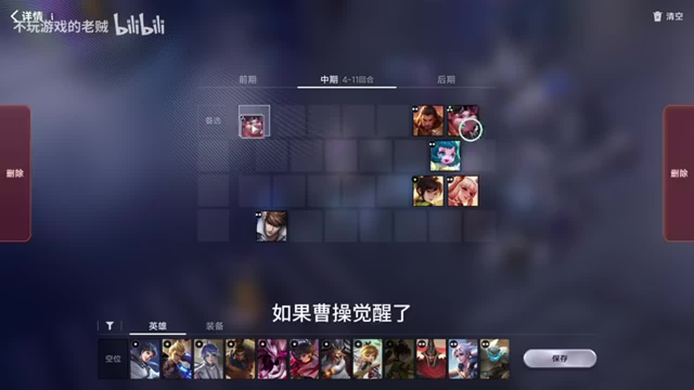

## 06:37–08:30 集中等级给公孙离；猪八戒只是工具，觉醒后不继续合成；缺刷新时可用孙尚香补

- 事件 ID：BV1akH96fEPp:p1:e007
- 场景：模拟演示
- 时机：等级转移和剑气目标选择时
- 背景（分析推断）：不是所有体系单位都承担相同成长角色。
- 学习目标（分析推断）：按单位功能集中成长与循环资源。
- 模板：resource-order
- ASR 段落：[15, 16, 17, 18]

> 猪八戒在这套阵容里,它是一个纯的工具人

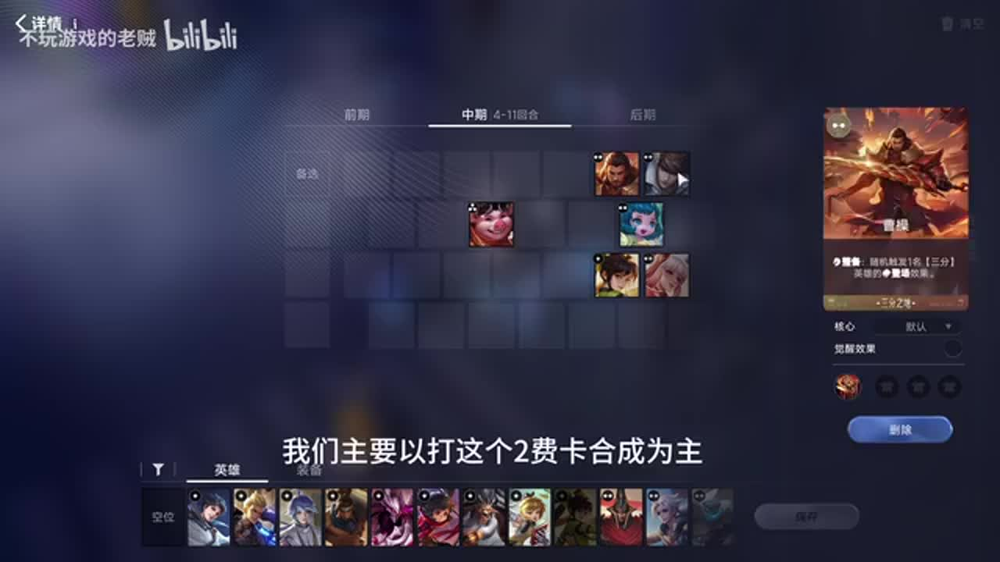

## 08:31–09:59 血量和对手战力决定升五时机；预计两三轮有出局风险时找战力天赋和换帅，不默认急升六

- 事件 ID：BV1akH96fEPp:p1:e008
- 场景：模拟演示
- 时机：停三多久需要升级时
- 背景（分析推断）：高等级低阶牌难搜，本套缺高价值高阶登场牌。
- 学习目标（分析推断）：根据生存与搜牌效率调整升级。
- 模板：level-transition
- ASR 段落：[19, 20, 21]

> 没有一个标准答案

## 10:00–12:26 转移等级并换帅会减少觉醒人数，从而降低公孙离攻速；提前留低阶牌补觉醒

- 事件 ID：BV1akH96fEPp:p1:e009
- 场景：模拟演示
- 时机：终局想转高等级吕布时
- 背景（分析推断）：高等级吕布不能直接代替射手处理单核的作用。
- 学习目标（分析推断）：转阵前识别原阵容隐含的输出条件。
- 模板：late-transition
- ASR 段落：[22, 23, 24, 25, 26]

> 他的攻速掉的非常厉害

## 12:26–14:21 可少拆或保持觉醒阵容只换一名高等级单位，再补太乙；升六仅在需要觉醒等收益时考虑

- 事件 ID：BV1akH96fEPp:p1:e010
- 场景：模拟演示
- 时机：不想承担全拆转阵风险时
- 背景（分析推断）：讲者给出多条替代路线与不同攻速损失。
- 学习目标（分析推断）：按当前资源选择转阵强度，而非只学唯一公式。
- 模板：fallback-plan
- ASR 段落：[27, 28, 29, 30]

> 比较稳妥的打法

## 13:55–14:48 解控保护爆发，冰杖风筝近战，分裂提供范围输出并打后排辅助

- 事件 ID：BV1akH96fEPp:p1:e011
- 场景：前置讲解
- 时机：给公孙离配输出装备时
- 背景（分析推断）：装备分别回应控制、接近与缺范围伤害的问题。
- 学习目标（分析推断）：从输出环境和覆盖目标推导装备。
- 模板：equipment-role
- ASR 段落：[30, 31]

> 这套阵容是没有什么AOE能力的

## 14:49–15:46 明刀争取施法与恢复窗口，回蓝和恢复装备延长前排存活

- 事件 ID：BV1akH96fEPp:p1:e012
- 场景：前置讲解
- 时机：前排需要撑过嬴政第一轮技能时
- 背景（分析推断）：视频削弱后第二次技能较难释放的判断只适用于其版本语境。
- 学习目标（分析推断）：理解保命装备如何改变敌方技能窗口。
- 模板：counter-target
- ASR 段落：[32, 33]

> 帮助他能撑很久

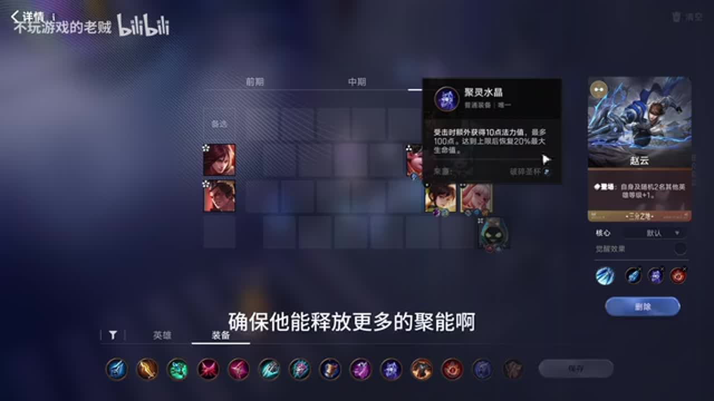

## 15:18–16:45 辅助抗性与控制服务团队；射手高攻速和主要击杀使部分神器更适配

- 事件 ID：BV1akH96fEPp:p1:e013
- 场景：前置讲解
- 时机：给辅助和射手分配神器时
- 背景（分析推断）：按实际承担功能和击杀归属评价神器。
- 学习目标（分析推断）：基于角色选择装备使用者。
- 模板：equipment-role
- ASR 段落：[33, 34, 35]

> 人头基本上都是公孙离的

## 16:16–18:16 优先补战力，赵云专属强化可稳连胜；并非所有路线都最缺经济和人口

- 事件 ID：BV1akH96fEPp:p1:e014
- 场景：前置讲解
- 时机：天赋选择时现有经济较充足时
- 背景（分析推断）：曹操与孙尚香提供大量刷新，当前瓶颈是战斗质量。
- 学习目标（分析推断）：让天赋服务当前短板。
- 模板：talent-fit
- ASR 段落：[35, 36, 37, 38, 39]

> 主要咱们考虑这个战力类的为主

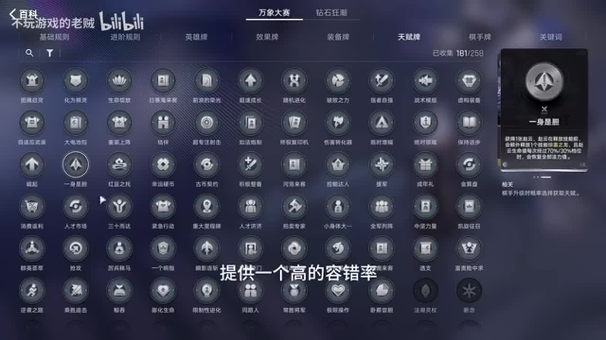

## 18:44–19:41 小咖秀长期停三能回本；三阶奖励大多不属于本体系，未必比登场补给好

- 事件 ID：BV1akH96fEPp:p1:e015
- 场景：前置讲解
- 时机：比较小咖秀与永不独行时
- 背景（分析推断）：同为停三路线，不同体系对奖励牌品阶的需求不同。
- 学习目标（分析推断）：区分名义资源数量与体系可利用资源。
- 模板：talent-fit
- ASR 段落：[40, 41]

> 其他的基本上都是两块钱

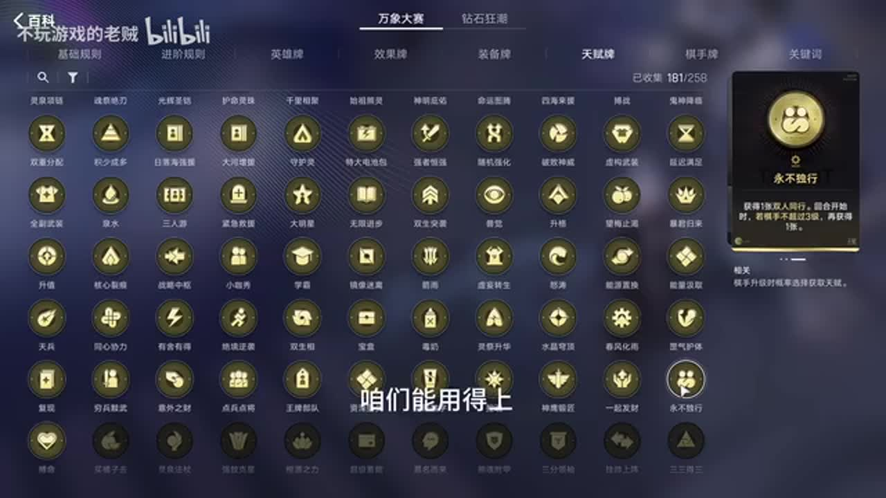

## 19:42–20:11 保留触发所需三分英雄，让召唤前排给射手延长输出时间

- 事件 ID：BV1akH96fEPp:p1:e016
- 场景：前置讲解
- 时机：选择鬼神降临后考虑下工具时
- 背景（分析推断）：拆阵前需要重新检查天赋触发条件。
- 学习目标（分析推断）：避免转阵破坏已选天赋。
- 模板：position-binding
- ASR 段落：[42]

> 他们四个一个都别下

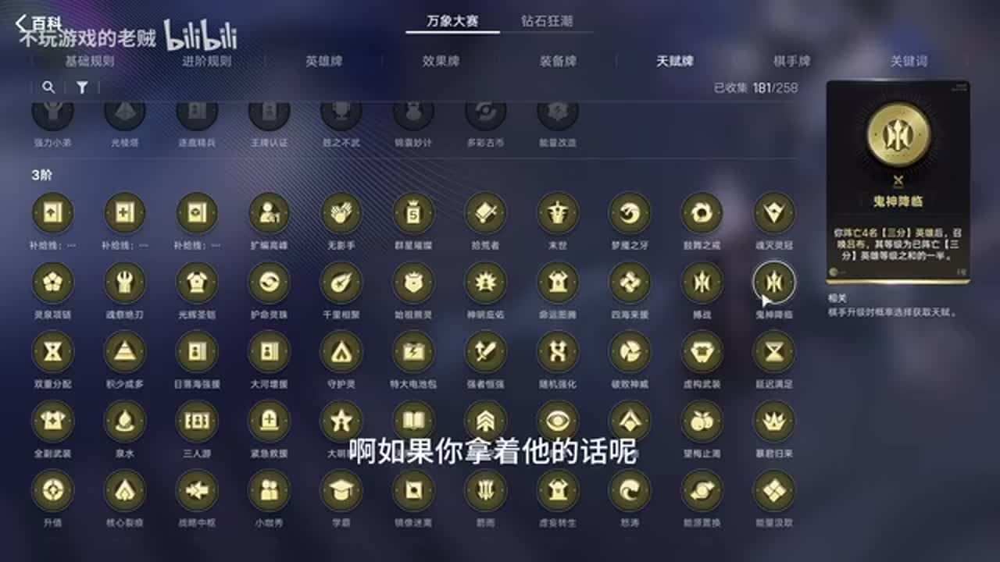

## 20:11–22:05 停三阶段优先花钱合成二阶体系；锦囊免费资源可拿，高阶段再买找装牌

- 事件 ID：BV1akH96fEPp:p1:e017
- 场景：前置讲解
- 时机：商店出现有用唤醒与装备牌时
- 背景（分析推断）：有用不等于当前购买最划算；升级资源使用阶段变化。
- 学习目标（分析推断）：理解机会成本和资源获取渠道。
- 模板：economy-budget
- ASR 段落：[43, 44, 45, 46]

> 咱们的钱都要去打那四张二阶卡的合成

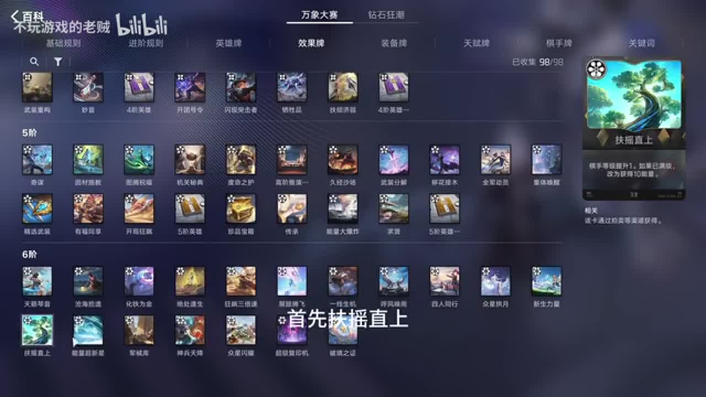

## 21:37–23:01 保留升级能力以免低容错突然暴毙；也按装备和保命缺口竞拍

- 事件 ID：BV1akH96fEPp:p1:e018
- 场景：前置讲解
- 时机：第三轮拍卖且升级时机不确定时
- 背景（分析推断）：看不清伤害或存不住预算时，升级资源提供决策容错。
- 学习目标（分析推断）：为危险转折保留可执行后手。
- 模板：auction-choice
- ASR 段落：[46, 47, 48]

> 确保咱们有一个上五上六的能力

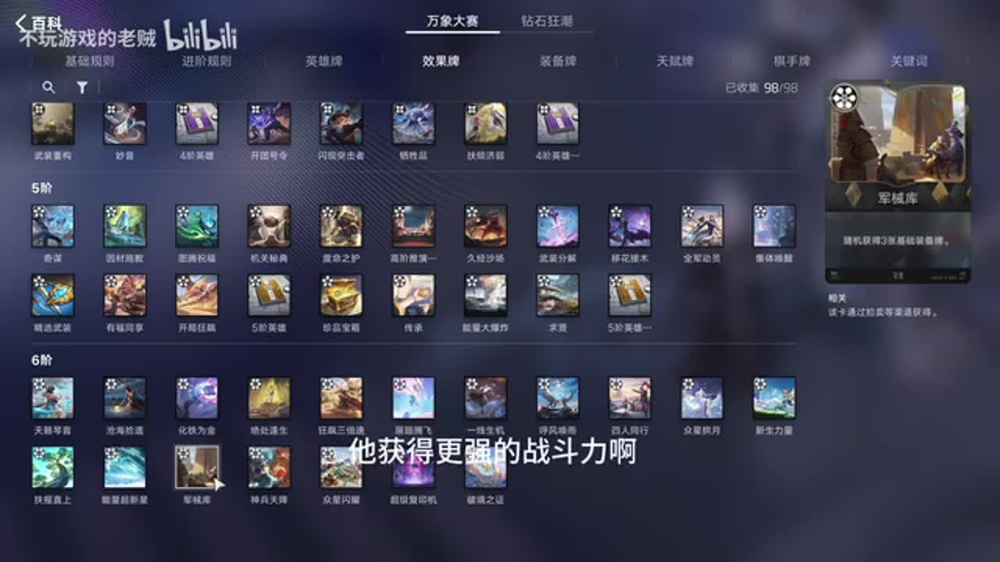

## 22:35–23:30 当前仍强不急用，真正打不过时再兑现；缺吕布或传承则找对应资源

- 事件 ID：BV1akH96fEPp:p1:e019
- 场景：前置讲解
- 时机：拿到终局成长效果时
- 背景（分析推断）：奖励收益与当前阶段和具体缺口有关。
- 学习目标（分析推断）：区分保留资源与及时兑现的条件。
- 模板：late-transition
- ASR 段落：[48, 49]

> 等到大后棋实在打不过的时候再扔

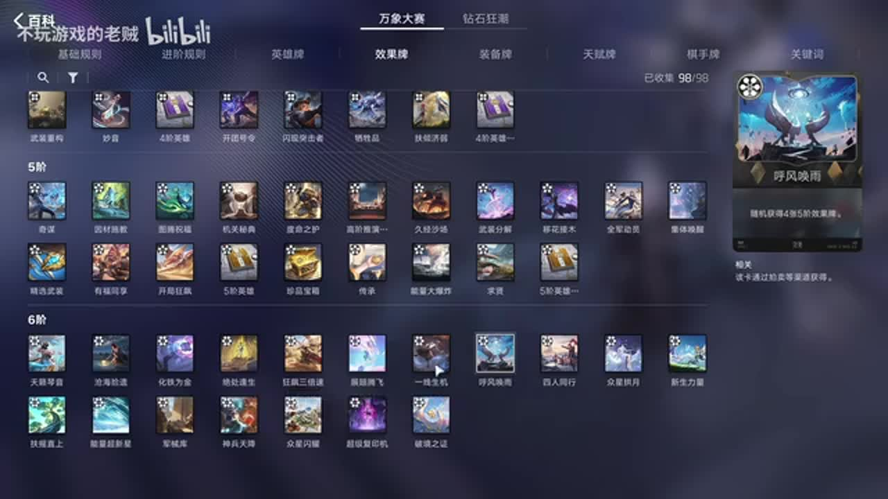

## 23:43–24:48 优先攻速暴击战力，降低生命的代价须结合前排技能评估

- 事件 ID：BV1akH96fEPp:p1:e020
- 场景：实战
- 时机：开局天赋三选一时
- 背景（分析推断）：讲者说明此路线前期能兑现战力；闲聊不计入记录。
- 学习目标（分析推断）：比较选择的收益与损失。
- 模板：talent-fit
- ASR 段落：[50, 51, 52]

> 能加攻速加个暴击率

## 26:21–28:24 先补缺位，不急买不能完整兑现的效果牌；孙尚香觉醒可改善循环

- 事件 ID：BV1akH96fEPp:p1:e021
- 场景：实战
- 时机：体系尚缺赵云时
- 背景（分析推断）：当局来牌较顺，但仍需先保证目标体系。
- 学习目标（分析推断）：按当前缺口排序资源。
- 模板：resource-order
- ASR 段落：[53, 54]

> 主要是缺赵云

## 28:26–29:21 以保血为主上赵云，不为更多刷新冒失去战力风险

- 事件 ID：BV1akH96fEPp:p1:e022
- 场景：实战
- 时机：赵云到场但会分走刷新收益时
- 背景（分析推断）：这是前置经济优先规则的实战例外，取决于对手压力。
- 学习目标（分析推断）：在长期收益与即时生存之间取舍。
- 模板：economy-budget
- ASR 段落：[55]

> 以这个保持血量为主

## 28:26–30:35 优先寻找解控，神器选择比较与主输出适配性

- 事件 ID：BV1akH96fEPp:p1:e023
- 场景：实战
- 时机：看到快速成长韩信时
- 背景（分析推断）：控制威胁由讲者指出；具体装备名误识未人工校正。
- 学习目标（分析推断）：观察对手并提前补针对资源。
- 模板：counter-target
- ASR 段落：[55, 56]

> 要不然打不了这件汉信

## 30:56–33:05 提前拿后期吕布会干扰剑气目标，当前没用还要卖，不急为未来买牌

- 事件 ID：BV1akH96fEPp:p1:e024
- 场景：实战
- 时机：来牌多但缺可吸等级工具时
- 背景（分析推断）：手牌位置和随机切牌目标带来隐藏成本。
- 学习目标（分析推断）：理解未来有用的牌为什么现在仍可放弃。
- 模板：resource-order
- ASR 段落：[57, 58, 59]

> 剑气切牌的时候吕布会碍身

## 33:15–35:34 放宽原有吸等级对象限制，先把主输出提到能稳血的等级，必要效果立即交

- 事件 ID：BV1akH96fEPp:p1:e025
- 场景：实战
- 时机：低血且主输出手牌积压时
- 背景（分析推断）：对手发力早，讲者估计最多两轮容错，必须转为当场战力。
- 学习目标（分析推断）：在生存危机下识别可打破的常规规则。
- 模板：fallback-plan
- ASR 段落：[60, 61, 62]

> 咱现在主要是以保血量为主

## 35:35–38:30 把战斗反馈连接到觉醒人数、攻速天赋与主输出成长，保留缺冰杖的近身风险

- 事件 ID：BV1akH96fEPp:p1:e026
- 场景：实战
- 时机：全员觉醒后伤害明显提升时
- 背景（分析推断）：讲者比较成型前后输出；一次稳血不证明稳定必胜。
- 学习目标（分析推断）：从实际战斗确认输出条件是否兑现。
- 模板：combat-review
- ASR 段落：[63, 64, 65]

> 全场已经都觉醒之后

## 38:30–40:41 补冰杖强化风筝，拍卖仍按升级与替代资源设置可接受价位

- 事件 ID：BV1akH96fEPp:p1:e027
- 场景：实战
- 时机：面对近战李信且开始恢复连胜时
- 背景（分析推断）：讲者明确五块可接受，缺关键装备时优先解决输出环境。
- 学习目标（分析推断）：把明确威胁与资源预算相连。
- 模板：counter-target
- ASR 段落：[66, 67, 68]

> 兵杖有了

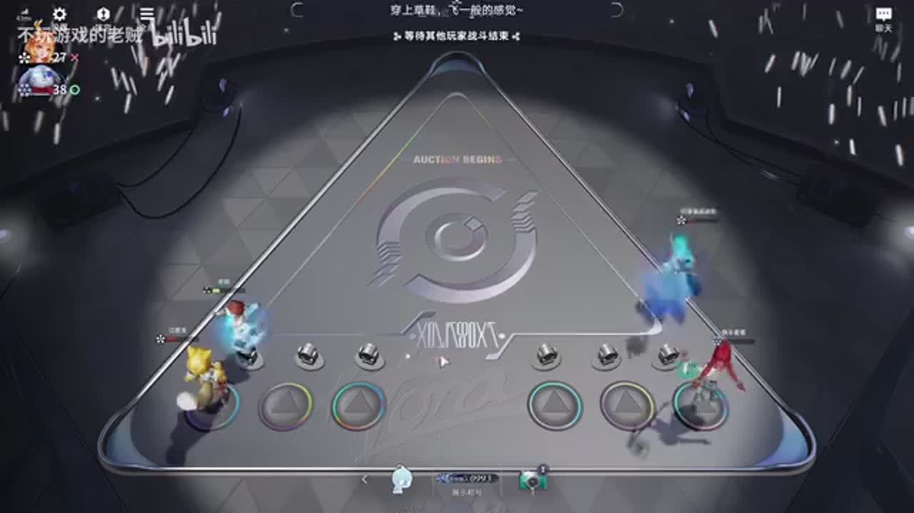

## 41:37–43:48 利用中后期发力窗口争取淘汰对手；此前过早来主输出造成前期弱势

- 事件 ID：BV1akH96fEPp:p1:e028
- 场景：实战
- 时机：主输出等级达到强势期时
- 背景（分析推断）：同样来牌在不同阶段价值不同。
- 学习目标（分析推断）：识别当前应该从积累转向施压。
- 模板：late-transition
- ASR 段落：[69, 70]

> 现在就到咱发力点了

## 44:04–45:34 给后排辅助做制裁提供重伤，天赋补射手输出；高频分段伤害影响敌方防具效果

- 事件 ID：BV1akH96fEPp:p1:e029
- 场景：实战
- 时机：决赛芈月依赖恢复时
- 背景（分析推断）：针对恢复而非只追等级，辅助承担减疗功能。
- 学习目标（分析推断）：根据对手胜负条件选择针对手段。
- 模板：counter-target
- ASR 段落：[71, 72]

> 给他降流

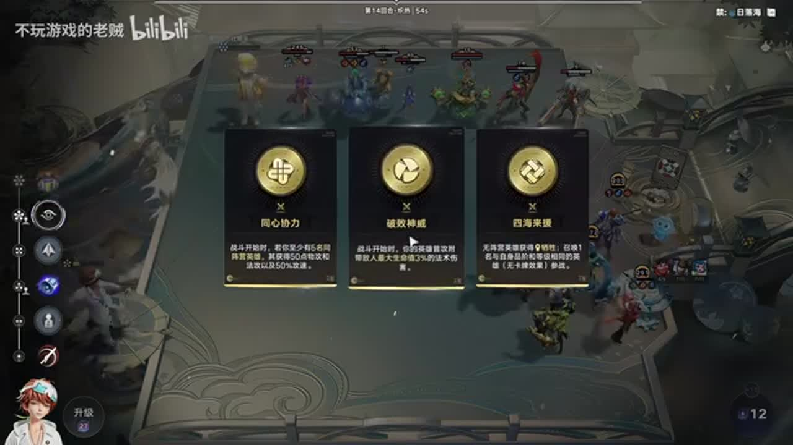

## 45:35–47:06 暂不交等级集中，依据当前战斗判断；总结路线重心是前中期到中后期速攻

- 事件 ID：BV1akH96fEPp:p1:e030
- 场景：实战
- 时机：完成对局复盘时
- 背景（分析推断）：不把这次获胜等同教学效果验证或所有局通用。
- 学习目标（分析推断）：连接阶段优势、操作节奏与对局目标。
- 模板：combat-review
- ASR 段落：[73, 74]

> 争取把别人抬走

## 待核实与局限

- 多处转写存在静音或漏识别间隔，未补写。
- 棋手技能在ASR中偶被称李白，卡名同音误识保留原文未修正。
- 低血容错由讲者估计，未独立重算敌方伤害。
- 装备及数值取视频版本，不声称适用于所有更新后环境。
