# 【王者万象棋】胜率100%孙小膑三分倒转，新手保姆级对战教学解说！进阶2.0思路运营!新手也能王者段位乱杀？

来源：https://www.bilibili.com/video/BV1Zdau6BEEu/?p=1

分析状态：completed

完整文字稿：../../../raw/BV1Zdau6BEEu_p1.md

## 00:11–01:17 上一轮尽量打资源牌或未觉醒目标，效果牌也会进入复制池。

- 事件 ID：BV1Zdau6BEEu:p1:e001
- 场景：前置讲解
- 时机：孙膑复制上轮牌时
- 背景（分析推断）：复制并非固定复制最后一张，多个候选会改变结果。
- 学习目标（分析推断）：规划跨回合候选池。
- 模板：mechanic-model
- ASR 段落：[1, 2]

> 效果牌也算

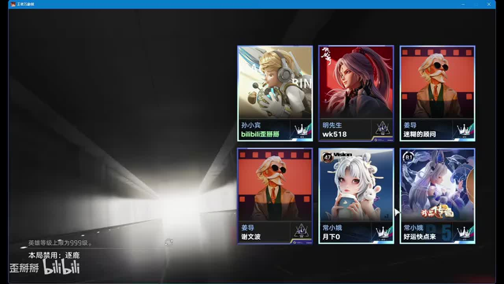

## 01:18–02:24 优先弈星支持升级，每轮至少打牌避免下轮技能空转。

- 事件 ID：BV1Zdau6BEEu:p1:e002
- 场景：实战
- 时机：开局找弈星时
- 背景（分析推断）：本局成长依赖复制弈星，没来时路线风险更高。
- 学习目标（分析推断）：识别路线前提与跨回合动作。
- 模板：opening-plan
- ASR 段落：[3, 4]

> 如果你这一轮不打牌,你下一轮技能是不能触发的

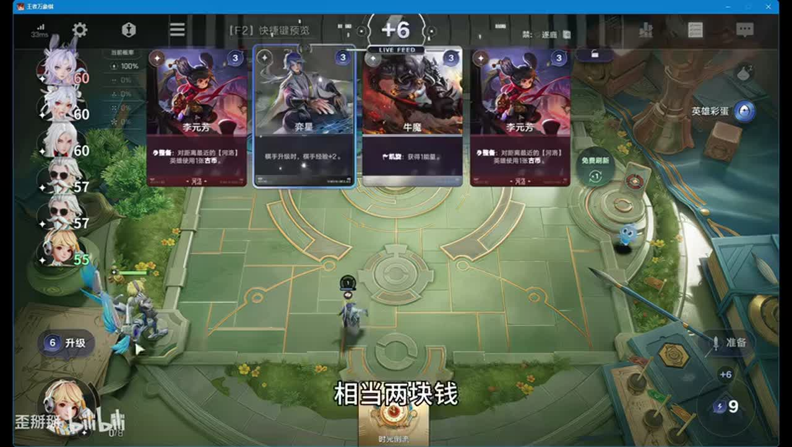

## 01:49–03:04 先觉醒再升级以兑现经验，保留可存手牌用于累计出牌任务。

- 事件 ID：BV1Zdau6BEEu:p1:e003
- 场景：实战
- 时机：弈星接近觉醒并准备升本时
- 背景（分析推断）：提前升本或清空资源会错过收益窗口。
- 学习目标（分析推断）：将升级和任务顺序连接。
- 模板：resource-order
- ASR 段落：[4, 5]

> 觉醒之后我们再升级

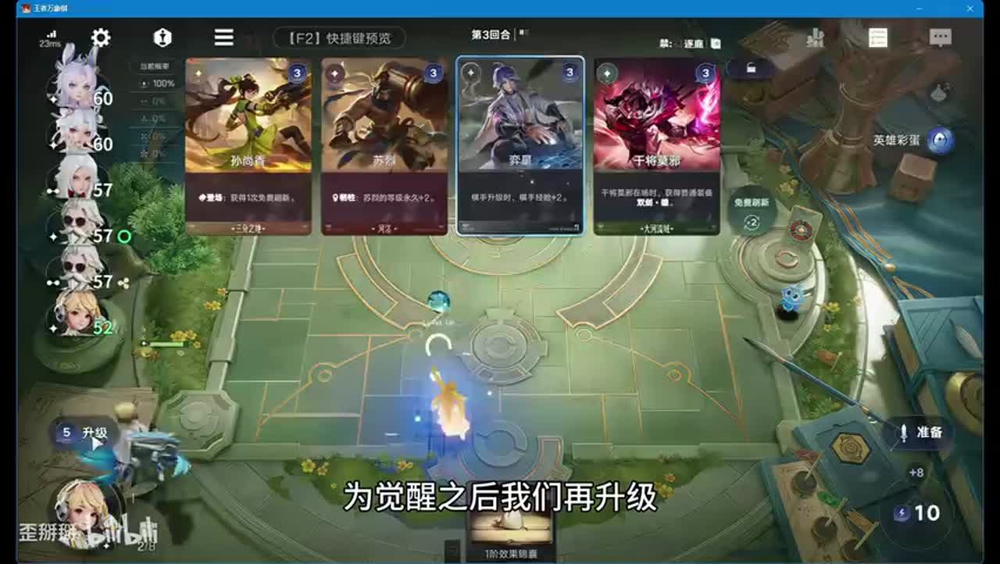

## 03:05–04:12 保战力失败时复盘是否本应留牌，不把无效投入继续加码。

- 事件 ID：BV1Zdau6BEEu:p1:e004
- 场景：实战
- 时机：打完手牌仍输了前期后
- 背景（分析推断）：讲者本想少损血，实际未达到目标并承认操作错误。
- 学习目标（分析推断）：以实际结果评估资源投入。
- 模板：combat-review
- ASR 段落：[6, 7]

> 这一轮我这个操作是不对的

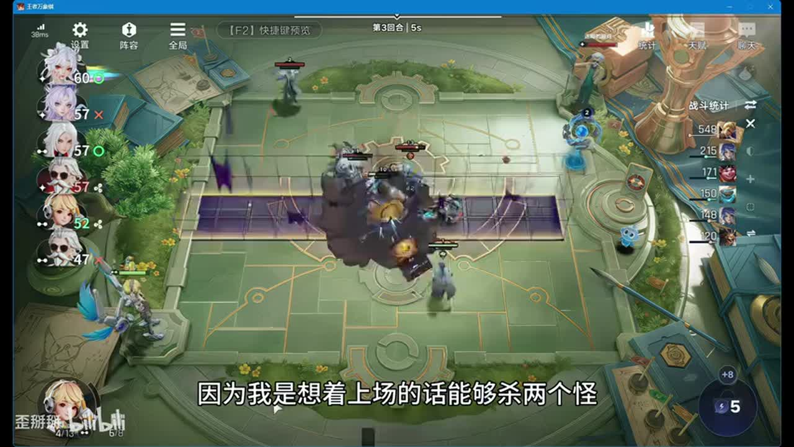

## 03:40–04:55 孟奇可提供多次出牌，复印机也能补任务资源，先存够再集中打。

- 事件 ID：BV1Zdau6BEEu:p1:e005
- 场景：实战
- 时机：准备激活八张牌任务时
- 背景（分析推断）：八张是本视频棋手阶段条件，当前版本不另行推断。
- 学习目标（分析推断）：按任务计数挑工具。
- 模板：talent-fit
- ASR 段落：[7, 8]

> 总共是三张牌

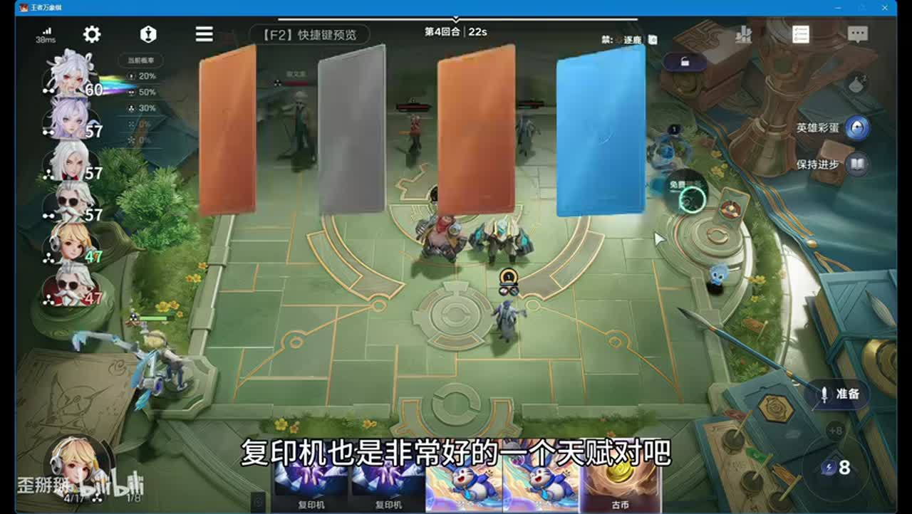

## 04:55–06:21 先完成八张任务持有专属技能，找小乔甄姬与曹操启动。

- 事件 ID：BV1Zdau6BEEu:p1:e006
- 场景：实战
- 时机：前五轮连败且曹操未到时
- 背景（分析推断）：任务完成不等于战斗成形，还缺经济与循环核心。
- 学习目标（分析推断）：区分技能就绪与阵容就绪。
- 模板：resource-order
- ASR 段落：[9, 10]

> 首先把这个技能激活掉

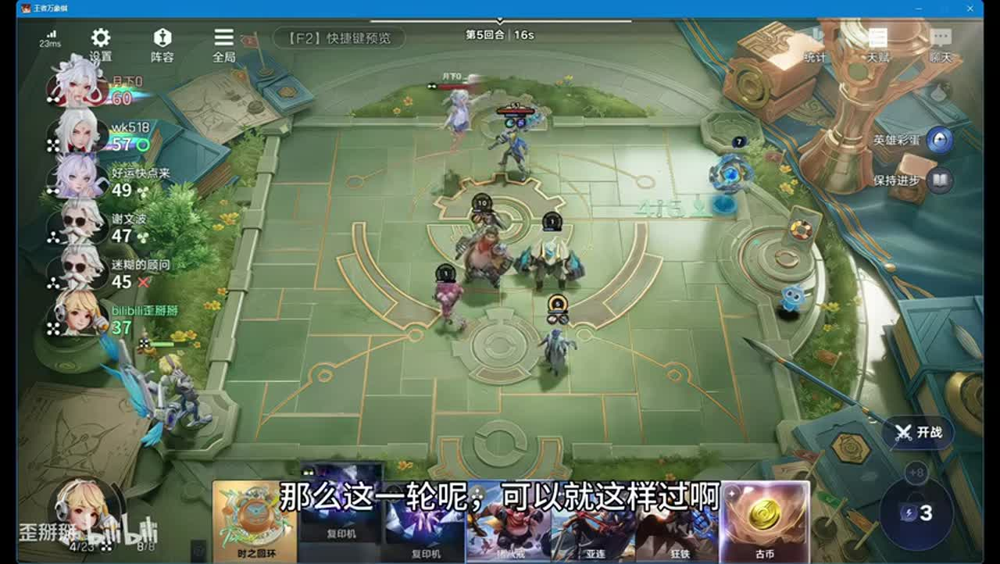

## 06:26–08:08 立即复制曹操触发整备，荆轲补等级；不能继续等待。

- 事件 ID：BV1Zdau6BEEu:p1:e007
- 场景：实战
- 时机：血量将低于30且曹操终于来时
- 背景（分析推断）：连续失利压缩容错，来牌改变可行动范围。
- 学习目标（分析推断）：识别启动信号与紧迫度。
- 模板：fallback-plan
- ASR 段落：[11, 13]

> 如果再不启动可能你的血线就到30以下了

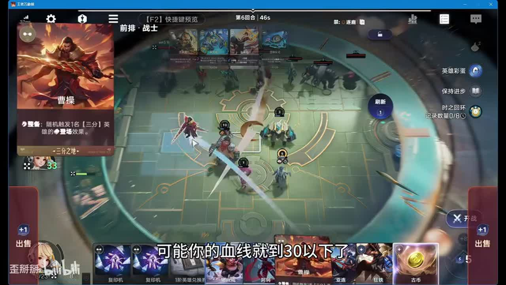

## 07:35–08:52 多拿三分发现及随机场上牌，升级点兵点将加强后续触发。

- 事件 ID：BV1Zdau6BEEu:p1:e008
- 场景：实战
- 时机：甄姬与发现牌到位时
- 背景（分析推断）：手牌操作时间有限，优先关键循环而非全套齐。
- 学习目标（分析推断）：用产牌和触发串起增长。
- 模板：growth-combo
- ASR 段落：[13, 14]

> 来了一张点兵点将,是非常好的

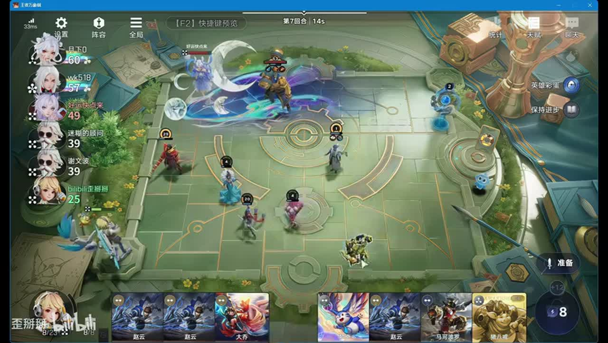

## 08:52–10:11 无争抢可拿露娜，有竞争不无限追；没露娜用周瑜路线。

- 事件 ID：BV1Zdau6BEEu:p1:e009
- 场景：实战
- 时机：露娜拍卖无同行争抢时
- 背景（分析推断）：讲者说明这局抢牌环境宽松，不能据此验证保前三。
- 学习目标（分析推断）：按竞争准备替代并设边界。
- 模板：auction-choice
- ASR 段落：[15, 16]

> 如果没有露娜就周瑜

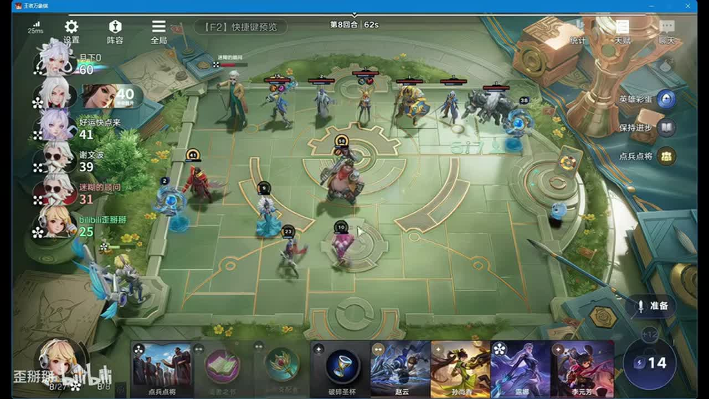

## 09:24–10:42 先补可复制目标再开，露娜装备到位后多拿立即触发牌。

- 事件 ID：BV1Zdau6BEEu:p1:e010
- 场景：实战
- 时机：点兵点将与露娜配合时
- 背景（分析推断）：讲者指出应多打一张多复制一张，漏步骤减少资源。
- 学习目标（分析推断）：检查触发前的目标池。
- 模板：resource-order
- ASR 段落：[16, 17]

> 应该多打一张牌,多复制一张

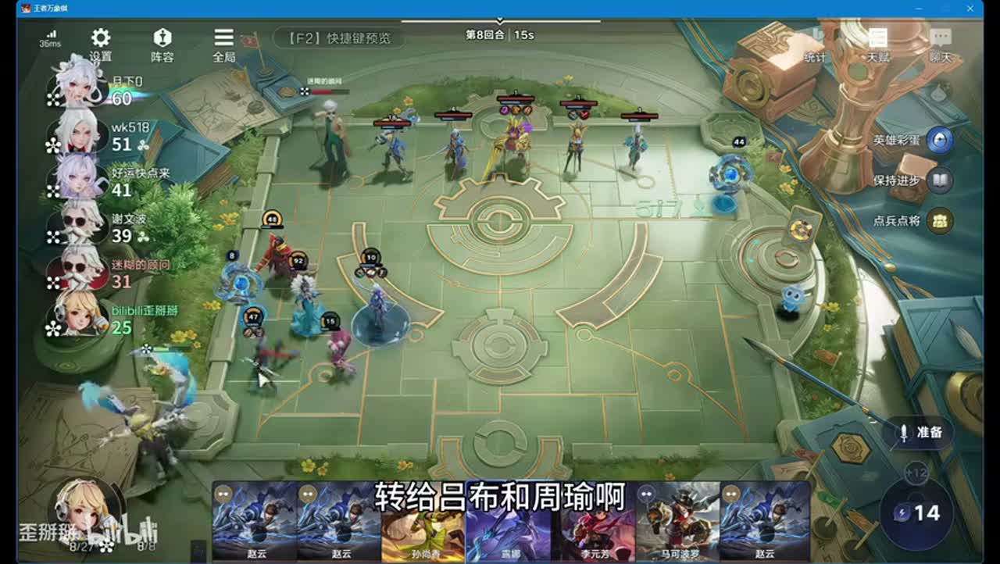

## 10:11–11:20 用遗址换帅等把等级交给周瑜吕布，荆轲收到可再传承。

- 事件 ID：BV1Zdau6BEEu:p1:e011
- 场景：实战
- 时机：露娜阶段转移成长时
- 背景（分析推断）：工具位与战斗主核职责开始分离。
- 学习目标（分析推断）：把成长转到能兑现战斗的单位。
- 模板：late-transition
- ASR 段落：[17, 18]

> 换帅转给吕布和周瑜

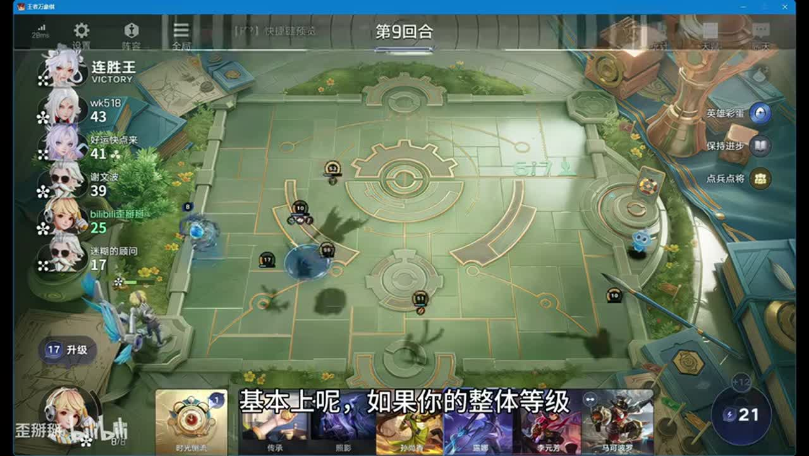

## 10:42–12:51 清无用牌并先觉醒小乔甄姬提高立即触发收益，再完成新任务。

- 事件 ID：BV1Zdau6BEEu:p1:e012
- 场景：实战
- 时机：升级后十二张出牌任务时
- 背景（分析推断）：八张任务和十二张任务分属不同阶段，不混用阈值。
- 学习目标（分析推断）：识别阶段条件和准备顺序。
- 模板：resource-order
- ASR 段落：[18, 19, 20]

> 打12张牌肯定是够的

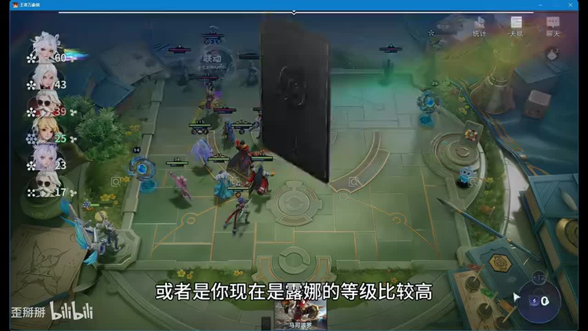

## 12:01–15:01 集中找露娜周瑜甄姬，最终补吕布；其他组件找不到可降低优先级。

- 事件 ID：BV1Zdau6BEEu:p1:e013
- 场景：实战
- 时机：后期循环已启动时
- 背景（分析推断）：露娜回找和循环资源支持后期成长，操作不应无目标刷。
- 学习目标（分析推断）：随阶段缩小搜索范围。
- 模板：growth-combo
- ASR 段落：[20, 21, 22]

> 最后的话只需要去刷露娜和周瑜

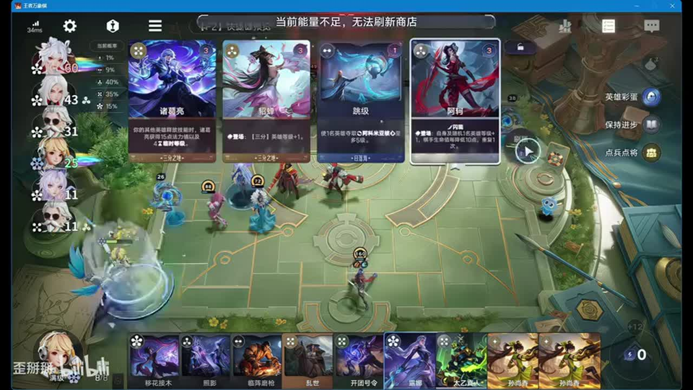

## 13:36–15:34 把小乔甄姬等等级转给主核，并留换帅；不必所有工具保等级。

- 事件 ID：BV1Zdau6BEEu:p1:e014
- 场景：实战
- 时机：无装备法师只剩控制职责时
- 背景（分析推断）：场上作用取决于装备与功能，等级高不一定值得保留。
- 学习目标（分析推断）：评估单位真实战斗价值。
- 模板：late-transition
- ASR 段落：[22, 23]

> 法师没有装备,作用不大

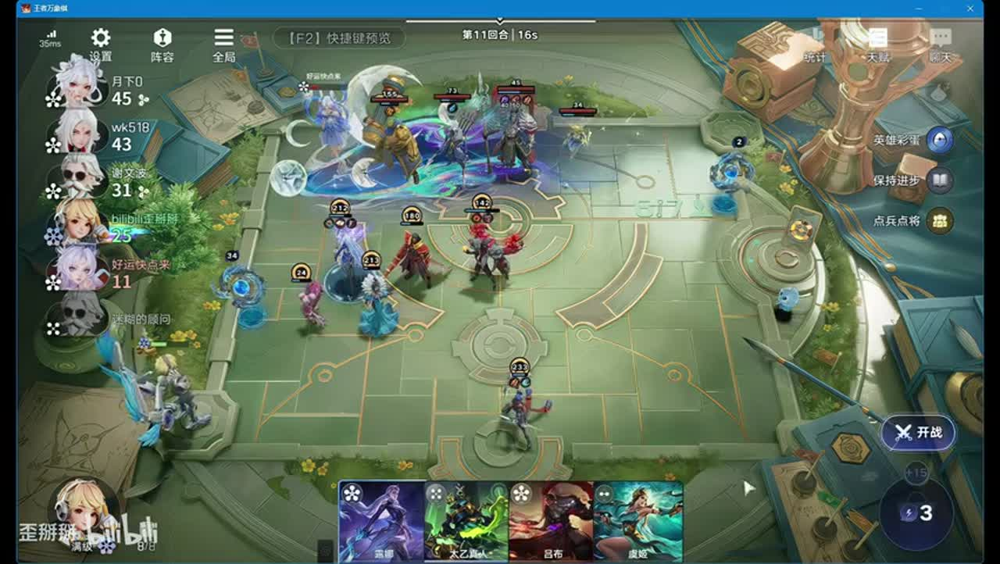

## 15:01–16:12 可卡海月等敌方关键牌，限制成形；竞价关键全体成长效果需考虑敌方收益。

- 事件 ID：BV1Zdau6BEEu:p1:e015
- 场景：实战
- 时机：不愿复杂转型但经济充足时
- 背景（分析推断）：这是降低自身执行复杂度的分支，并非保证阻断所有转型。
- 学习目标（分析推断）：比较自身增益与限制对手。
- 模板：counter-target
- ASR 段落：[23, 24]

> 多卡一下对面的牌

## 16:54–19:29 先给吕布有效装备，荆轲等级不足价值时可转；周瑜兼前排法伤。

- 事件 ID：BV1Zdau6BEEu:p1:e016
- 场景：实战
- 时机：吕布成主核并准备转等级时
- 背景（分析推断）：成长单位不能替代装备和角色分工。
- 学习目标（分析推断）：将等级装备职责同时配置。
- 模板：equipment-role
- ASR 段落：[26, 27, 28]

> 把装备给吕布

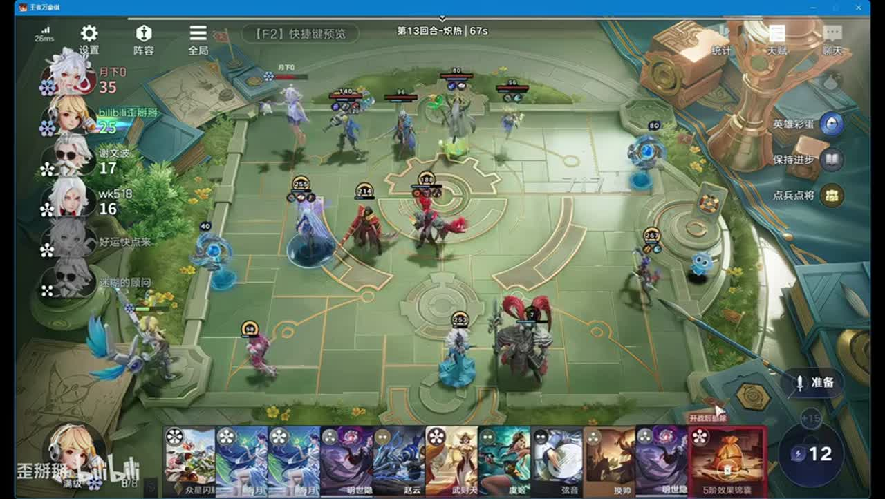

## 19:29–21:02 更多预算用于有效成长与经济牌，脆弱无保护姜子牙不盲上。

- 事件 ID：BV1Zdau6BEEu:p1:e017
- 场景：实战
- 时机：高等级后还在找次要牌时
- 背景（分析推断）：后期次要组件边际收益降低，仍需承伤与存活。
- 学习目标（分析推断）：依据实际贡献分配操作。
- 模板：economy-budget
- ASR 段落：[29, 30]

> 最主要是打这个buff

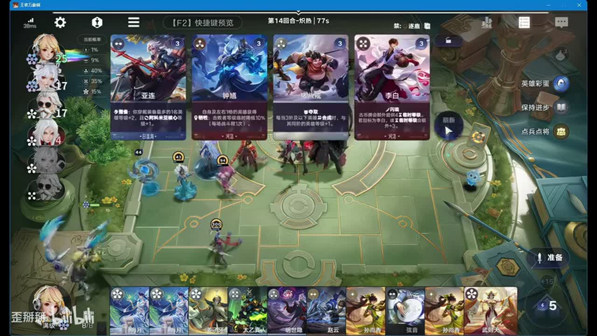

## 21:08–23:24 保留物法双核，考虑反甲或变形控制针对单核，位移辅助也可服务控制。

- 事件 ID：BV1Zdau6BEEu:p1:e018
- 场景：实战
- 时机：对手韩信快速成长时
- 背景（分析推断）：韩信已从百级涨至三百多，等级领先不能保证安全。
- 学习目标（分析推断）：按敌方增长与弱点提前应对。
- 模板：counter-target
- ASR 段落：[31, 32, 33]

> 一个单核的缺点就是容易被针对

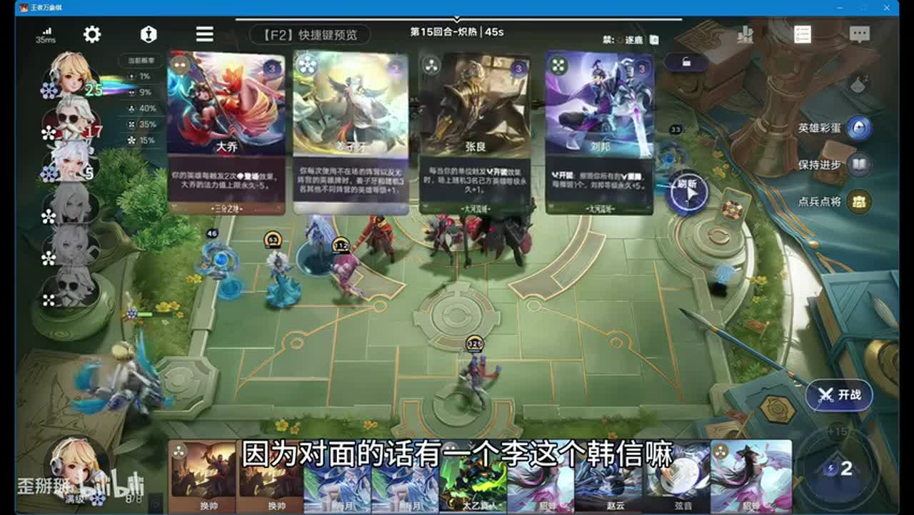

## 23:27–24:57 吕布补名刀提高稳定性；转貂蝉收益低则不做，海月一换一是未实测建议。

- 事件 ID：BV1Zdau6BEEu:p1:e019
- 场景：实战
- 时机：韩信打出主核保命后
- 背景（分析推断）：上一战暴露存活风险，最后一战补装后获胜不等于100%胜率。
- 学习目标（分析推断）：把复盘风险转为最小有效补强。
- 模板：combat-review
- ASR 段落：[34, 35]

> 刚才是没有明刀的,现在有明刀了

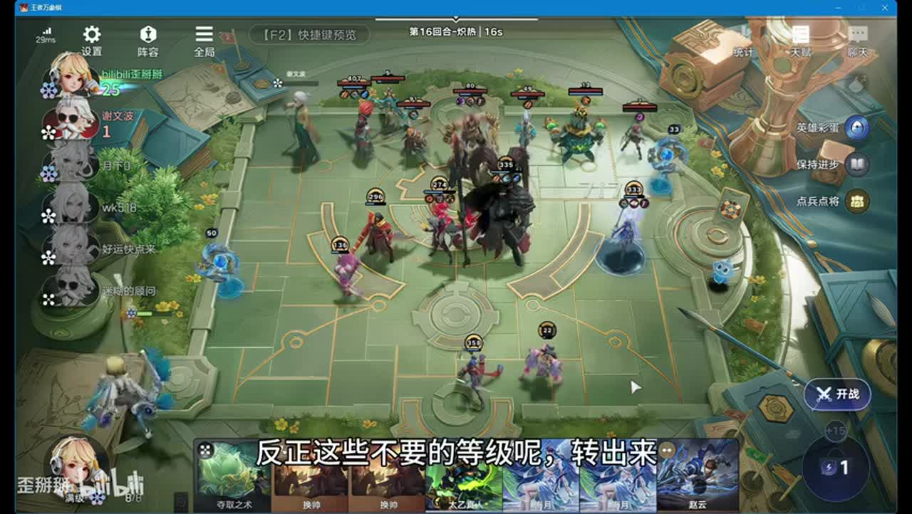

## 待核实与局限

- 原始ASR术语和数值可能有误；未经画面确认者不作为精确机制结论。
