# 【王者万象棋】胜率95%大河挂机流，全流程保姆级对战教学解说！香香主C爆射？

来源：https://www.bilibili.com/video/BV1z4Yv67E4R/?p=1

分析状态：completed

完整文字稿：../../../raw/BV1z4Yv67E4R_p1.md

## 00:09–01:19 三阶以下单位成长提高炮击收益，六本再按等级总和强化。

- 事件 ID：BV1z4Yv67E4R:p1:e001
- 场景：前置讲解
- 时机：香香大河路线介绍时
- 背景（分析推断）：低阶组件可自动成长，炮击承担主要输出。
- 学习目标（分析推断）：理解单位成长与棋手输出联系。
- 模板：mechanic-model
- ASR 段落：[1, 2]

> 自动成长等级

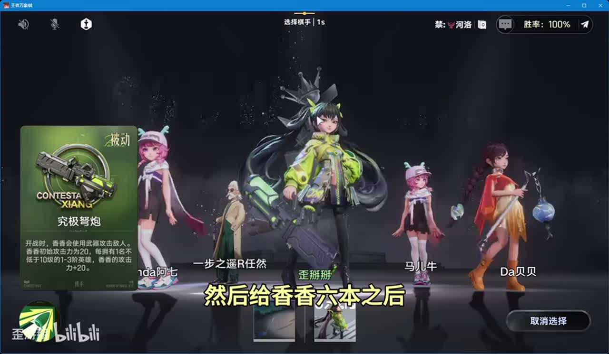

## 00:45–01:59 选干将狂铁等即时战力，赢局损血推进改造，不只凑后期组件。

- 事件 ID：BV1z4Yv67E4R:p1:e002
- 场景：实战
- 时机：前期需要胜利改装进度时
- 背景（分析推断）：棋手升级依赖战斗结果，前期战力也是资源发动机。
- 学习目标（分析推断）：用机制解释稳血与赢局价值。
- 模板：opening-plan
- ASR 段落：[2, 3]

> 首先要胜利

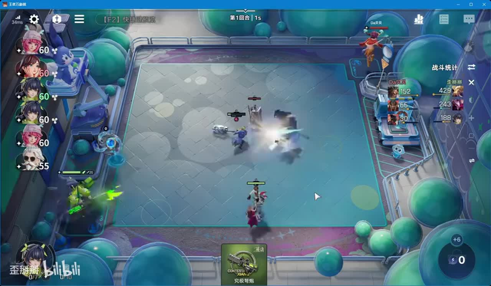

## 01:59–03:02 有机关炮优先，没有可狙击最高等级等功能替代。

- 事件 ID：BV1z4Yv67E4R:p1:e003
- 场景：实战
- 时机：首个炮改装出现时
- 背景（分析推断）：改装决定打击目标与路线，不能假定每局必有激光。
- 学习目标（分析推断）：识别选项功能与可替代范围。
- 模板：module-fit
- ASR 段落：[4, 5]

> 如果没有机关炮的情况下

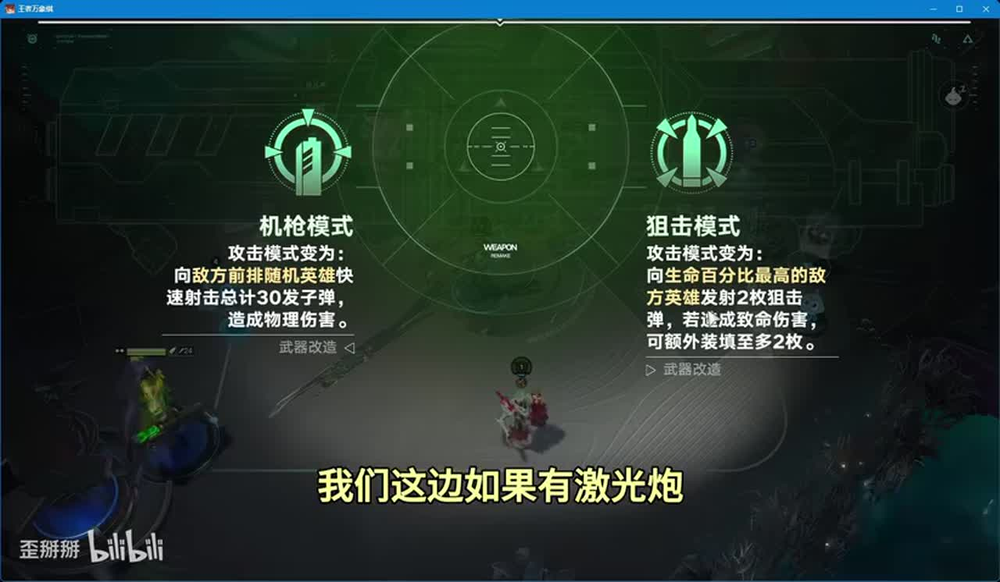

## 03:02–04:24 图腾前排有用但无需无限竞价，低价可拿，过高不强争。

- 事件 ID：BV1z4Yv67E4R:p1:e004
- 场景：实战
- 时机：图腾拍卖遇同行时
- 背景（分析推断）：同行也可能需要同牌，预算需用于后续成长。
- 学习目标（分析推断）：区分需要与不计成本。
- 模板：auction-choice
- ASR 段落：[6, 7]

> 抢不抢无所谓,这个没必要

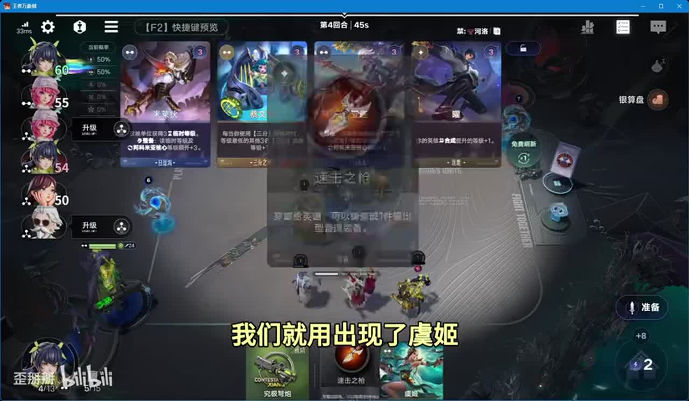

## 03:52–05:14 换掉短期打工单位，虞姬按图腾等触发给大河单位成长。

- 事件 ID：BV1z4Yv67E4R:p1:e005
- 场景：实战
- 时机：虞姬与图腾到位时
- 背景（分析推断）：单位等级跨门槛再提高香香攻击，具体数值不从ASR确认。
- 学习目标（分析推断）：将成长组件串到输出机制。
- 模板：growth-combo
- ASR 段落：[7, 8]

> 等级高了之后香香攻击力就会变高

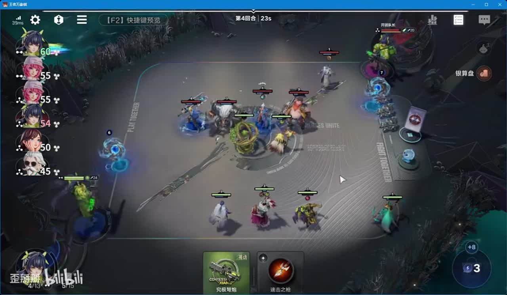

## 04:24–05:44 选择可获取所需低阶单位或复制的选项，晚期才生效的分支降优先级。

- 事件 ID：BV1z4Yv67E4R:p1:e006
- 场景：实战
- 时机：三本已能成形时
- 背景（分析推断）：本局有同行，获取有效组件比无关长期收益紧迫。
- 学习目标（分析推断）：按成形窗口挑技能收益。
- 模板：talent-fit
- ASR 段落：[8, 9]

> 三本就基本上成型了

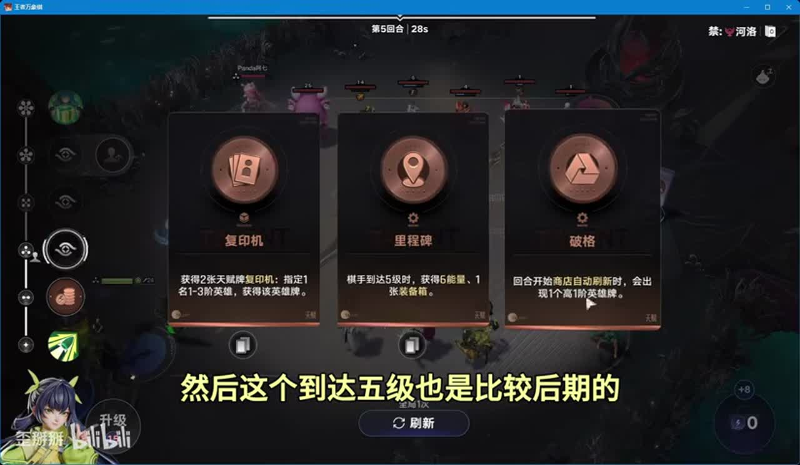

## 05:48–07:49 比较立即改造与等等级门槛后的收益，若前排阻挡则先补穿过前排能力。

- 事件 ID：BV1z4Yv67E4R:p1:e007
- 场景：实战
- 时机：敌方前排变强时
- 背景（分析推断）：讲者承认价值需要考量，不能把概率收益视为稳定击杀。
- 学习目标（分析推断）：比较当期安全与未来成长。
- 模板：module-fit
- ASR 段落：[10, 11, 12]

> 值不值得这个东西要去考量一下

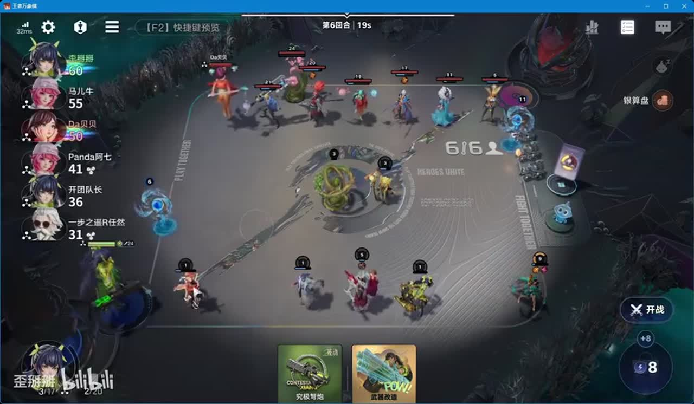

## 07:13–09:10 用阵营发现找需要牌，先养云中君，瑶补装备，不死等完整阵容。

- 事件 ID：BV1z4Yv67E4R:p1:e008
- 场景：实战
- 时机：组件缺失且需成长时
- 背景（分析推断）：三本可出大部分组件，阵容仍未全部齐。
- 学习目标（分析推断）：按功能逐步补齐而非空等。
- 模板：fallback-plan
- ASR 段落：[12, 13, 14]

> 我们找到自己需要的牌

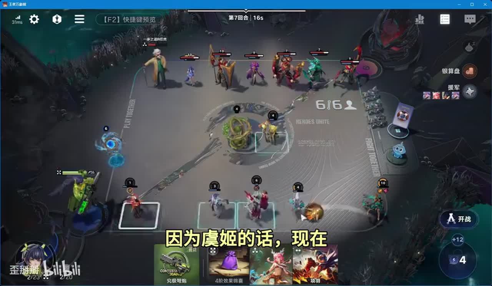

## 09:10–10:44 补真实战力保障赢局进度，瑶等分装延长单位存活。

- 事件 ID：BV1z4Yv67E4R:p1:e009
- 场景：实战
- 时机：担心无战力拖慢改造时
- 背景（分析推断）：只自动成长却持续输，会拖慢棋手改造循环。
- 学习目标（分析推断）：识别战力与资源进度反馈。
- 模板：combat-review
- ASR 段落：[15, 16]

> 我们的改造就比较慢

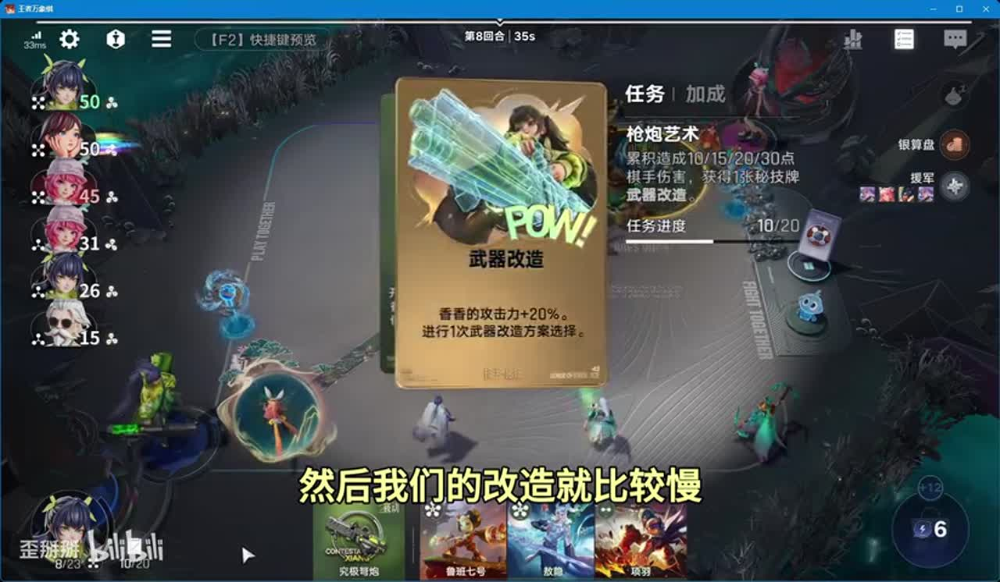

## 10:46–11:53 组件越早来成长越久，已有自动成长则不必强贪低收益选项。

- 事件 ID：BV1z4Yv67E4R:p1:e010
- 场景：实战
- 时机：错点后搜回云中君与图腾时
- 背景（分析推断）：讲者明确失误后补回核心，并转向下轮升级。
- 学习目标（分析推断）：衡量组件到来时间与贪收益成本。
- 模板：resource-order
- ASR 段落：[17, 18]

> 早一点的话我们的等级上的快一些

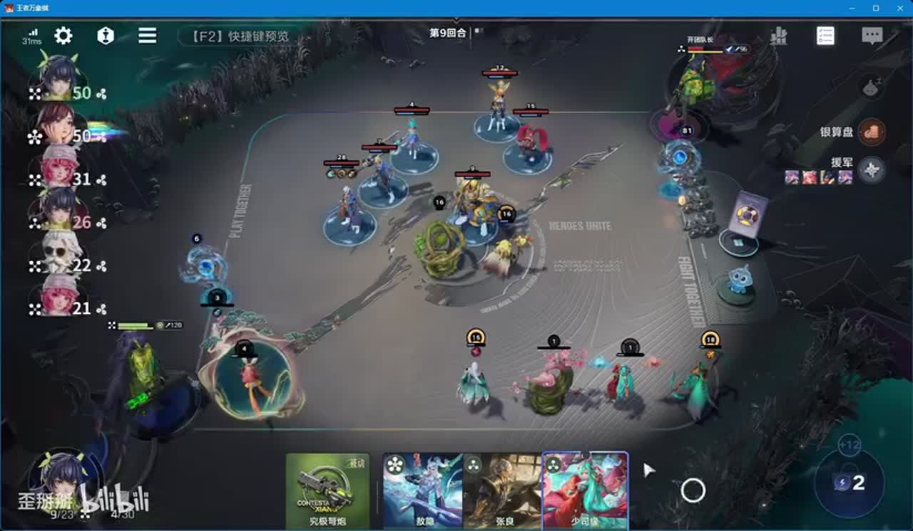

## 11:54–12:30 可用韩信的开团成长暂替，张良接开团触发。

- 事件 ID：BV1z4Yv67E4R:p1:e011
- 场景：实战
- 时机：没有云中君时
- 背景（分析推断）：替代依据触发功能，不意味着最终阵容效果完全相同。
- 学习目标（分析推断）：按机制找备选而非背牌名。
- 模板：fallback-plan
- ASR 段落：[19]

> 韩信也是开盘可以去增加等级

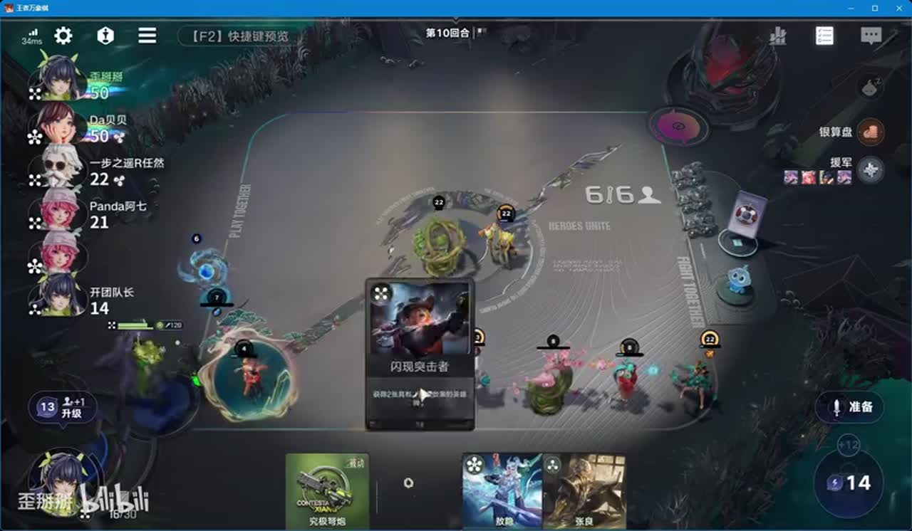

## 12:30–14:01 按图腾邻接范围调整站位，让多个单位吃加成，结合分装提高战场时间。

- 事件 ID：BV1z4Yv67E4R:p1:e012
- 场景：实战
- 时机：图腾强化邻接单位时
- 背景（分析推断）：此局需要图腾叠加收益，密集站位仍需另看敌方范围伤害。
- 学习目标（分析推断）：根据明确范围摆位。
- 模板：position-binding
- ASR 段落：[20, 21]

> 站在图腾里面

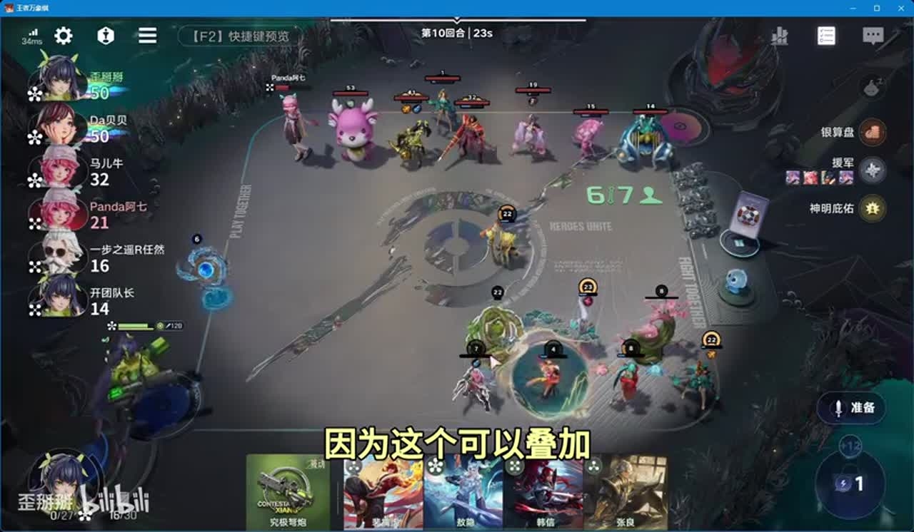

## 13:15–14:31 留升级预算，张良可锁；改造选击杀回子弹扩大持续输出。

- 事件 ID：BV1z4Yv67E4R:p1:e013
- 场景：实战
- 时机：准备冲六且张良尚未急需时
- 背景（分析推断）：同牌暂无竞争且即时战力增益低，本局可以延迟拿。
- 学习目标（分析推断）：结合竞争和收益安排购买。
- 模板：economy-budget
- ASR 段落：[21, 22]

> 因为拿了之后呢,也提升不了太多战力

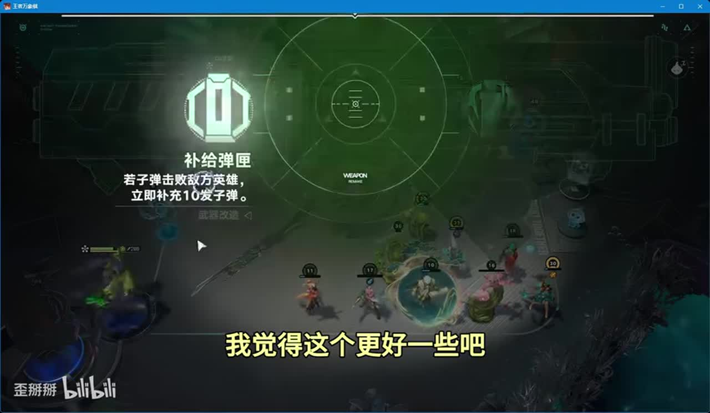

## 14:32–15:51 把主要投资集中到六本棋手输出，额外上阵位才补太乙或高阶图腾。

- 事件 ID：BV1z4Yv67E4R:p1:e014
- 场景：实战
- 时机：下轮六本大幅提升时
- 背景（分析推断）：三阶以下组件支持等级总和，升本是棋手收益而非搜高阶主核。
- 学习目标（分析推断）：区别棋手升级与商店搜牌目标。
- 模板：level-transition
- ASR 段落：[23, 24]

> 不需要什么四阶五阶的牌

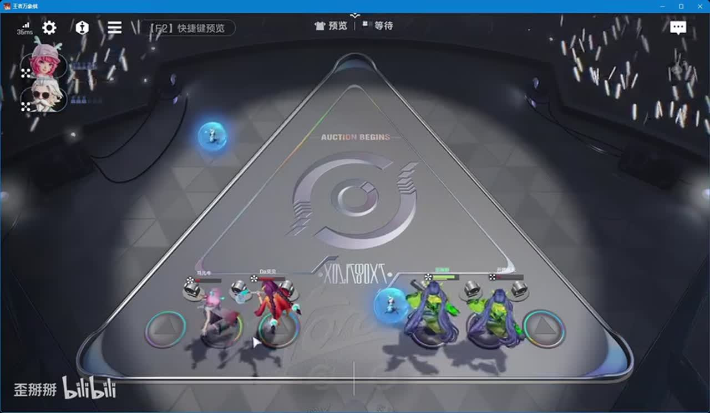

## 15:51–17:10 优先补未觉醒组件，装备给仍承担输出或成长的公孙离虞姬。

- 事件 ID：BV1z4Yv67E4R:p1:e015
- 场景：实战
- 时机：升级后挑未觉醒单位与分装时
- 背景（分析推断）：本局公孙离未充分成长，实际贡献要用战斗检验。
- 学习目标（分析推断）：把购买优先级接到角色职责。
- 模板：equipment-role
- ASR 段落：[25, 26]

> 谁没有觉醒,我们尽量优先去拿谁

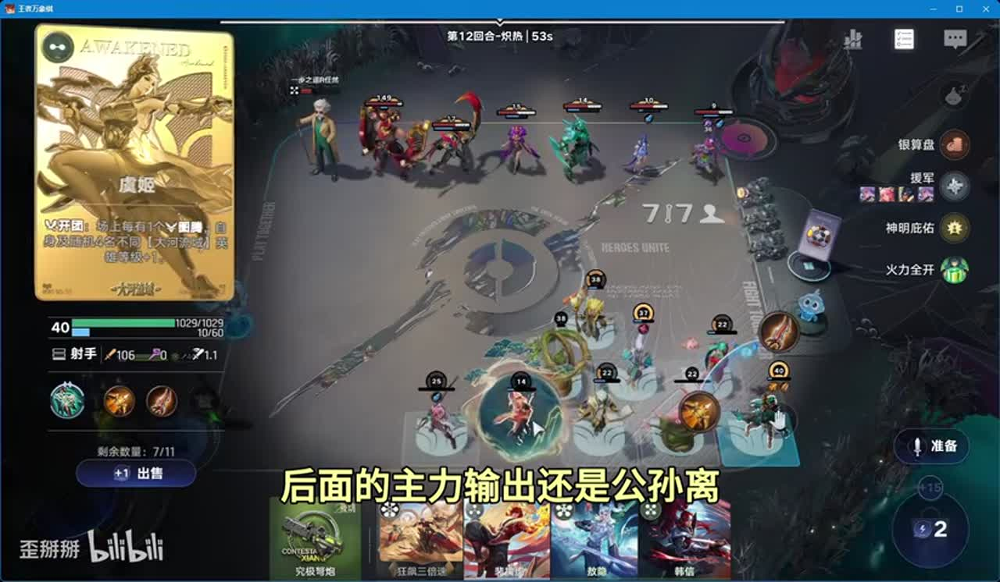

## 16:33–18:30 额外技能与临时等级按压力用；单位等级低时移花收益小。

- 事件 ID：BV1z4Yv67E4R:p1:e016
- 场景：实战
- 时机：战局压力不大且缺低阶牌时
- 背景（分析推断）：升六后找低阶也可能缺牌，不能声称必然全觉醒。
- 学习目标（分析推断）：按实际可兑现收益挑资源。
- 模板：economy-budget
- ASR 段落：[26, 27, 28]

> 一花接木没太大用处

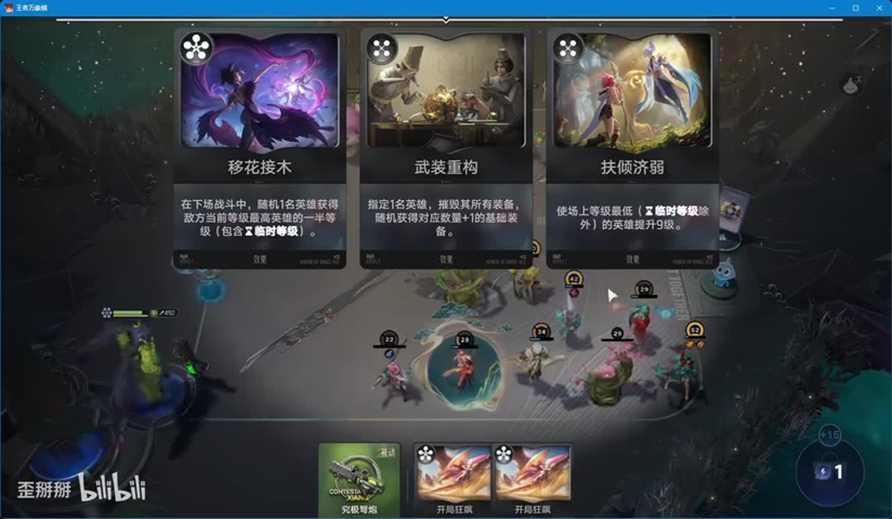

## 18:32–19:40 把高额技能留给真正有威胁的下一敌人，利用已有炮击压血。

- 事件 ID：BV1z4Yv67E4R:p1:e017
- 场景：实战
- 时机：中期对手尚未升六时
- 背景（分析推断）：本局对手未成形，不将挂机赢推广到所有分段。
- 学习目标（分析推断）：按敌方压力决定兑现窗口。
- 模板：late-transition
- ASR 段落：[29, 30]

> 留到下一个人去用

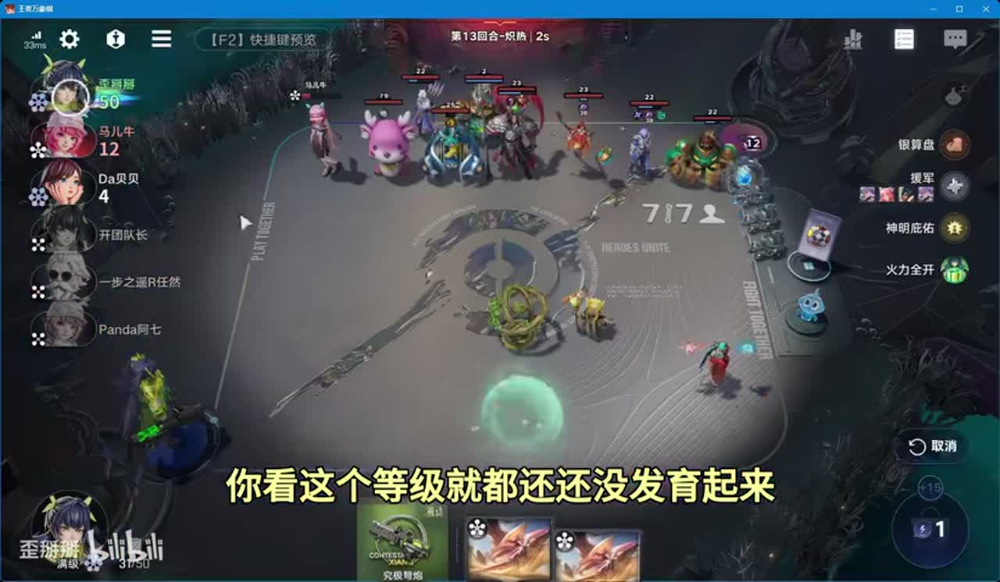

## 19:44–21:11 用完有效资源拉战力，不为全员觉醒拖延胜利窗口。

- 事件 ID：BV1z4Yv67E4R:p1:e018
- 场景：实战
- 时机：最后一次改装与决赛前
- 背景（分析推断）：本局未全觉醒就结束，阵容完整不等于胜利必要条件。
- 学习目标（分析推断）：识别终局资源价值与停止条件。
- 模板：resource-order
- ASR 段落：[31, 32]

> 该用的都用掉

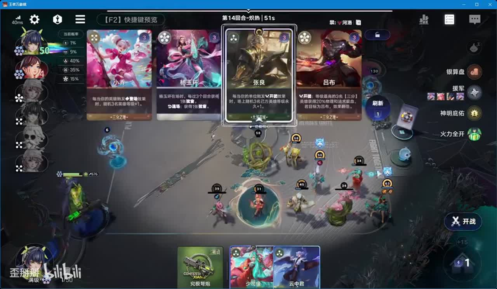

## 21:11–22:13 虞姬接图腾，张良接开团，分装单位提供关键装备；逐一说明功能。

- 事件 ID：BV1z4Yv67E4R:p1:e019
- 场景：实战
- 时机：赛后解释成长组件时
- 背景（分析推断）：回顾实际阵容，但精确等级加成未经画面清晰确认者待核实。
- 学习目标（分析推断）：用功能关系记住阵容。
- 模板：mechanic-model
- ASR 段落：[33, 34]

> 每当这个你触发开弹效果

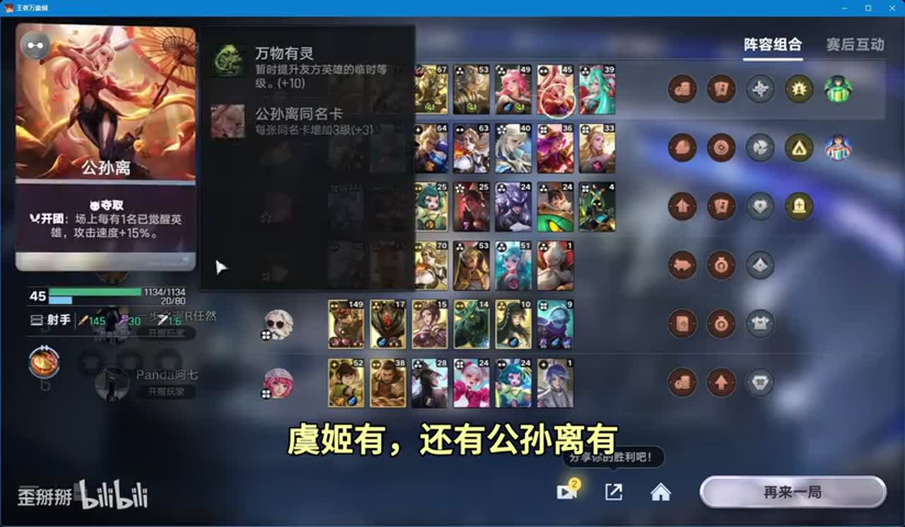

## 22:13–23:15 名刀拖时间让炮持续击杀回弹，公孙离无装备攻速机制未体现。

- 事件 ID：BV1z4Yv67E4R:p1:e020
- 场景：实战
- 时机：总结公孙离本局没发挥时
- 背景（分析推断）：讲者明确区分配套潜力与本局实际贡献。
- 学习目标（分析推断）：避免将理论组件收益当作已观测。
- 模板：combat-review
- ASR 段落：[35, 36]

> 这局没有体现出来

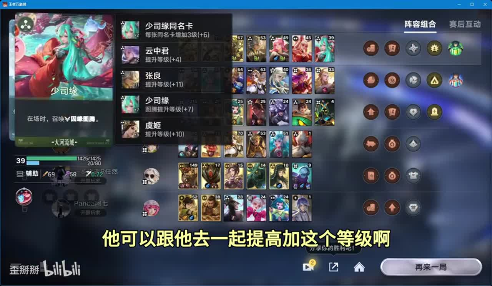

## 22:44–23:46 击杀补弹适合持续炮击，机关炮可针对艾琳与跳后刺客。

- 事件 ID：BV1z4Yv67E4R:p1:e021
- 场景：实战
- 时机：复盘改装适用敌方时
- 背景（分析推断）：讲者说明铂金等新手分段适用建议，单局不能验证95%胜率。
- 学习目标（分析推断）：把改装效果和敌方目标配对。
- 模板：counter-target
- ASR 段落：[36, 37]

> 机关炮可以直接针对于艾琳

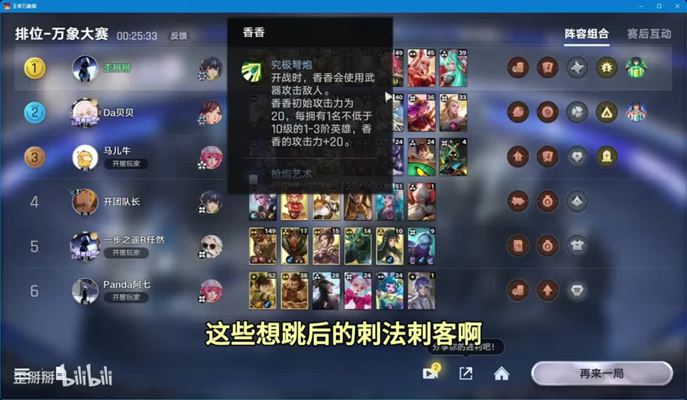

## 待核实与局限

- 原始ASR术语和数值可能有误；未经画面确认者不作为精确机制结论。
