# 【王者万象棋】胜率95%无阵营刷牌流，全流程保姆级对战教学解说！老虎移形换影？

来源：https://www.bilibili.com/video/BV1ZueJ6qE3g/?p=1

分析状态：completed

完整文字稿：../../../raw/BV1ZueJ6qE3g_p1.md

## 00:21–01:54 每回合开镜像，随下一张打出牌变化；存牌为核心到来后复制。

- 事件 ID：BV1ZueJ6qE3g:p1:e001
- 场景：前置讲解
- 时机：镜的三本无阵营路线开局时
- 背景（分析推断）：棋手机制与猪八戒老虎等三阶单位匹配，使用次数门槛需核实。
- 学习目标（分析推断）：理解复制资源的来源与时序。
- 模板：mechanic-model
- ASR 段落：[1, 2, 3]

> 这个流派非常适合三本的无阵营

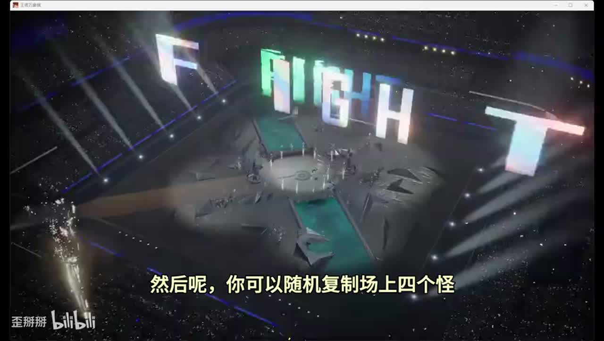

## 01:23–02:40 按敌方选干将等稳血，二三本连续升级，不急离开三本。

- 事件 ID：BV1ZueJ6qE3g:p1:e002
- 场景：实战
- 时机：前期看对手过渡时
- 背景（分析推断）：核心集中三本，继续升本会错开找牌窗口。
- 学习目标（分析推断）：将商店等级与目标池匹配。
- 模板：opening-plan
- ASR 段落：[3, 4]

> 因为我们是三本

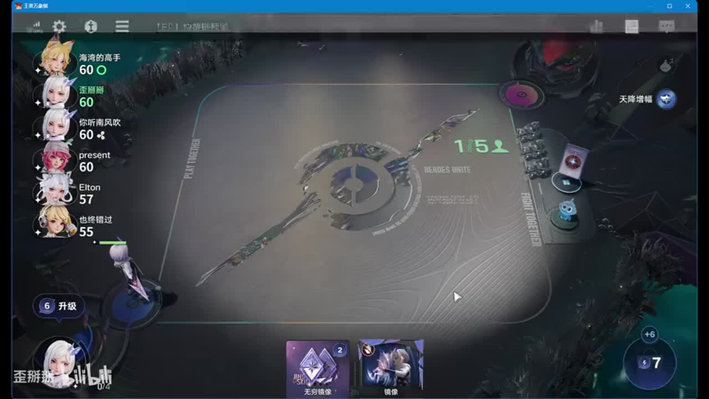

## 02:40–03:54 中坚力量与主阵容阶级吻合，拍卖明世隐可补成长辅助。

- 事件 ID：BV1ZueJ6qE3g:p1:e003
- 场景：实战
- 时机：三阶加成天赋出现时
- 背景（分析推断）：无阵营不等于没有标签条件，三阶是具体触发要求。
- 学习目标（分析推断）：检查天赋适用标签。
- 模板：talent-fit
- ASR 段落：[5, 6]

> 打出三阶的牌额外加4

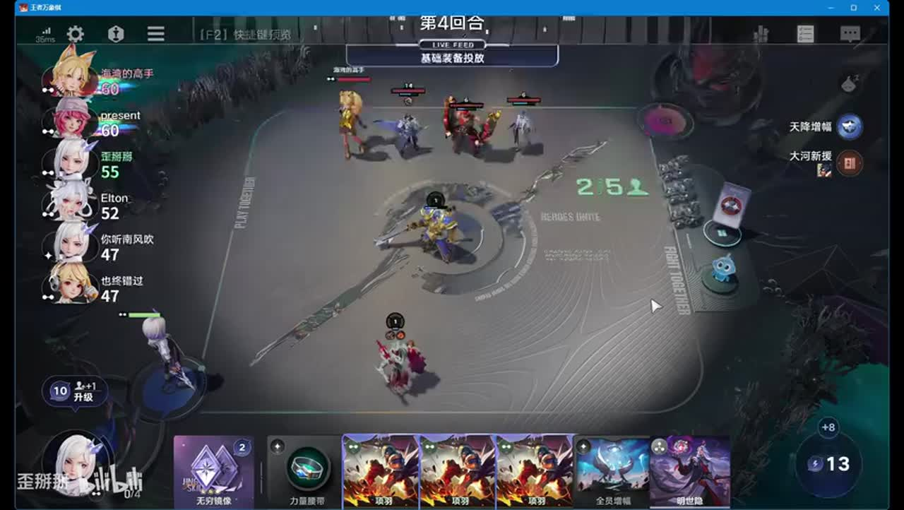

## 03:55–04:25 打一张后等镜像变化再打下一张，连续过快可能没变成目标牌。

- 事件 ID：BV1ZueJ6qE3g:p1:e004
- 场景：实战
- 时机：镜像变牌与合成时
- 背景（分析推断）：讲者复盘自己连续操作漏变牌；辅助早觉醒也非最高优先。
- 学习目标（分析推断）：使用可确认的状态再继续步骤。
- 模板：resource-order
- ASR 段落：[7]

> 连续操作,所以他这个牌是没有变的

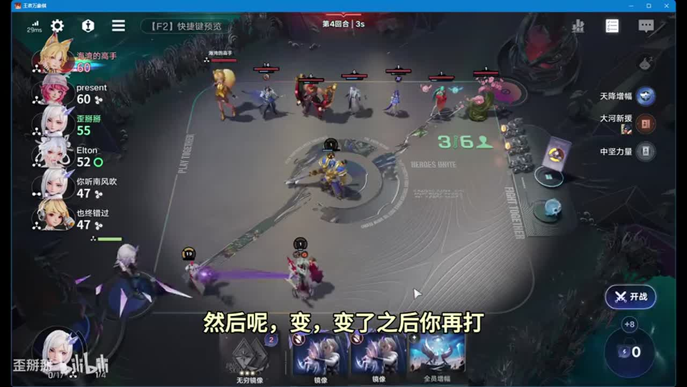

## 04:30–05:46 利用免费刷新和现成成长稳血，避免无预算无限搜索。

- 事件 ID：BV1ZueJ6qE3g:p1:e005
- 场景：实战
- 时机：核心不来且钱少时
- 背景（分析推断）：本局只反复出现明世隐，对手也在存钱给了缓冲。
- 学习目标（分析推断）：按血量预算规划等待。
- 模板：economy-budget
- ASR 段落：[8, 9]

> 没有刷新没有钱所以拿了个刷新

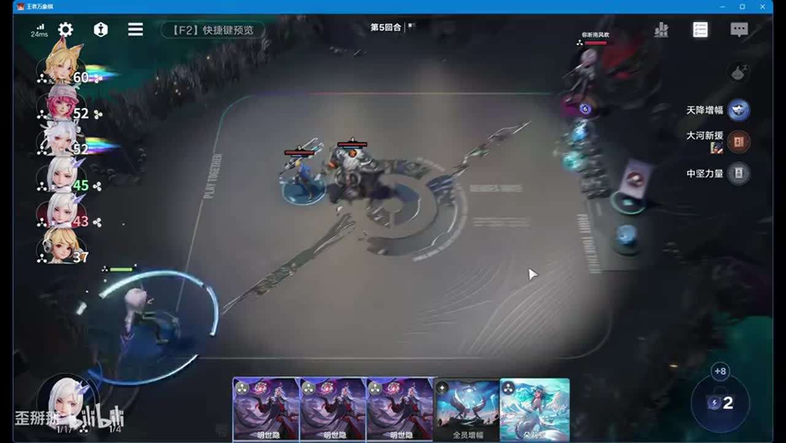

## 05:46–07:18 猪八戒没来先养老虎，低血必须花钱搜，不能继续只存钱。

- 事件 ID：BV1ZueJ6qE3g:p1:e006
- 场景：实战
- 时机：血量下滑到必须启动时
- 背景（分析推断）：等待已失去容错，镜像也应打以推进金色复制窗口。
- 学习目标（分析推断）：识别从等待转主动补救的阈值。
- 模板：fallback-plan
- ASR 段落：[10, 11, 12]

> 我们也不能说再存钱了

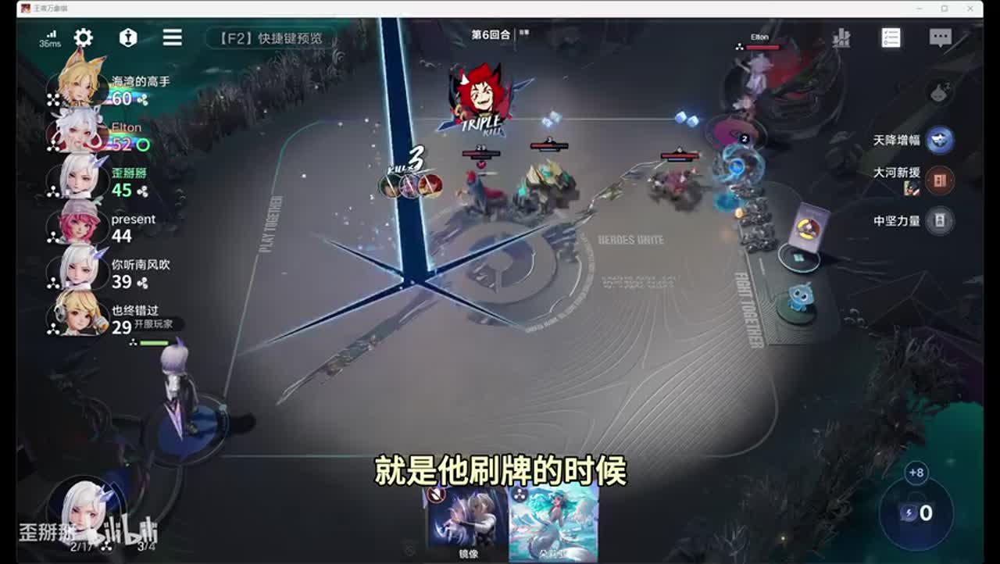

## 07:18–08:23 先用复制资源，目标优先未觉醒的猪八戒与老虎。

- 事件 ID：BV1ZueJ6qE3g:p1:e007
- 场景：实战
- 时机：金色复制就绪但核心未觉醒时
- 背景（分析推断）：讲者说明先复制其他单位是次优，缺主核觉醒会拖节奏。
- 学习目标（分析推断）：按主核需求安排复制优先级。
- 模板：resource-order
- ASR 段落：[13, 14]

> 优先还是打老虎

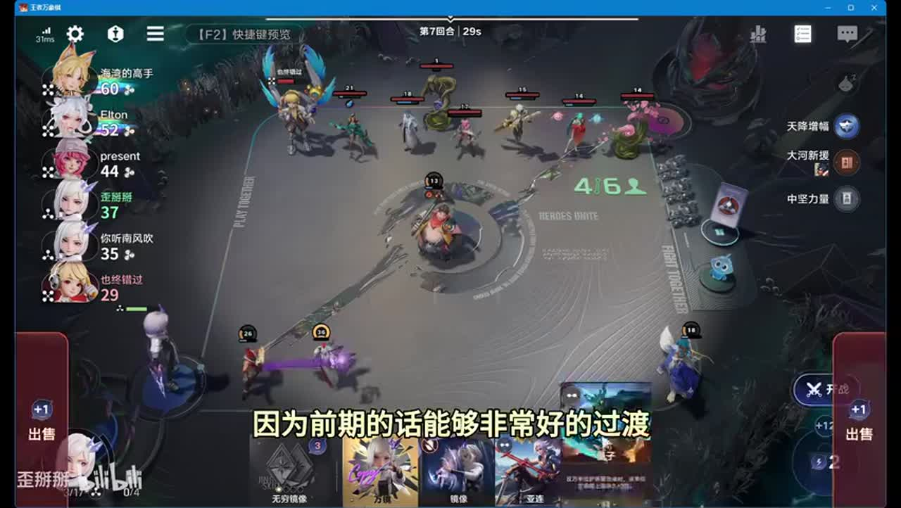

## 08:23–09:26 明世隐养老虎，荆轲补全队等级，同名合成产效果牌再换经济牌。

- 事件 ID：BV1ZueJ6qE3g:p1:e008
- 场景：实战
- 时机：三本核心组齐时
- 背景（分析推断）：少数低阶单位组成循环，而非任何牌都刷。
- 学习目标（分析推断）：理解循环入口与资源回流。
- 模板：growth-combo
- ASR 段落：[15, 16]

> 不停的去产生合成

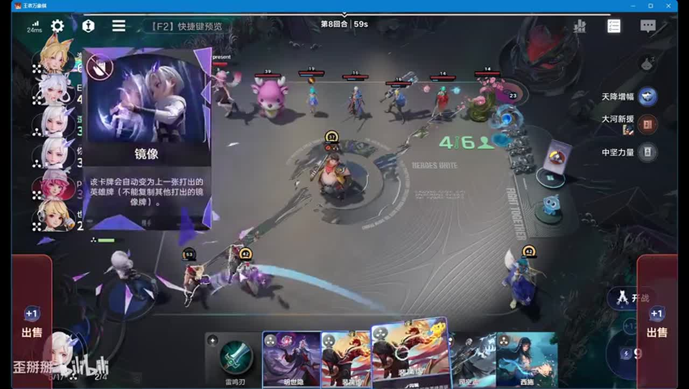

## 09:27–10:28 留三本继续刷，结合血量可承受轮数再平滑升级。

- 事件 ID：BV1ZueJ6qE3g:p1:e009
- 场景：实战
- 时机：战力稳住且还有血时
- 背景（分析推断）：讲者估计尚可扛两轮，实际损血不能保证。
- 学习目标（分析推断）：以局势决定离开核心商店时间。
- 模板：economy-budget
- ASR 段落：[17, 18]

> 我们三本可以继续刷

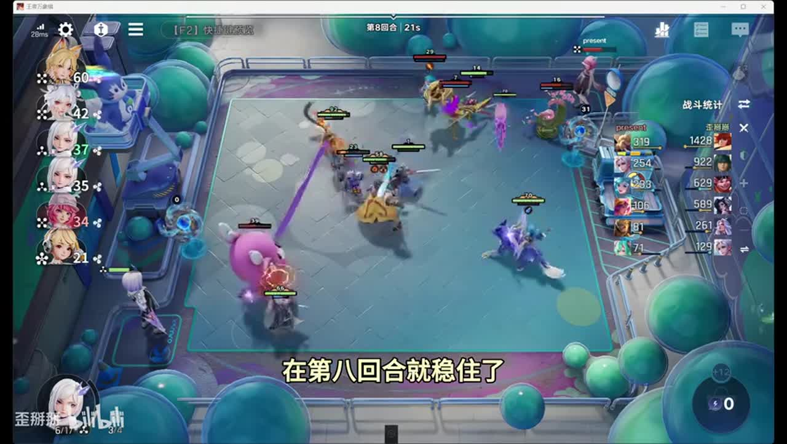

## 10:28–11:36 留一张目标牌给下轮复制，其余卖无用或换经济。

- 事件 ID：BV1ZueJ6qE3g:p1:e010
- 场景：实战
- 时机：计划下轮镜像复制时
- 背景（分析推断）：目标较易再次找到时全打也可，是有条件分支。
- 学习目标（分析推断）：规划跨回合资源而非机械留牌。
- 模板：resource-order
- ASR 段落：[19, 20]

> 留一张,因为到时候要复制一张

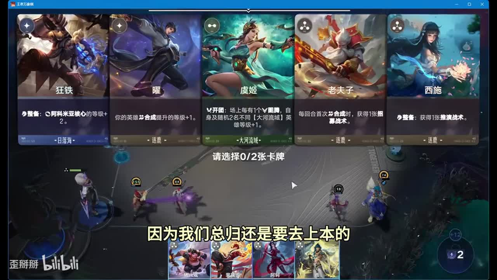

## 11:03–12:32 给瞬移法杖和名刀，刺客击杀后的快速换目标与保命相配。

- 事件 ID：BV1ZueJ6qE3g:p1:e011
- 场景：实战
- 时机：老虎主核装备选择时
- 背景（分析推断）：本局高等级和装备共同造成压制，不单因装备即必胜。
- 学习目标（分析推断）：将装备机制接入主核输出路径。
- 模板：equipment-role
- ASR 段落：[20, 21]

> 我们直接给老虎带

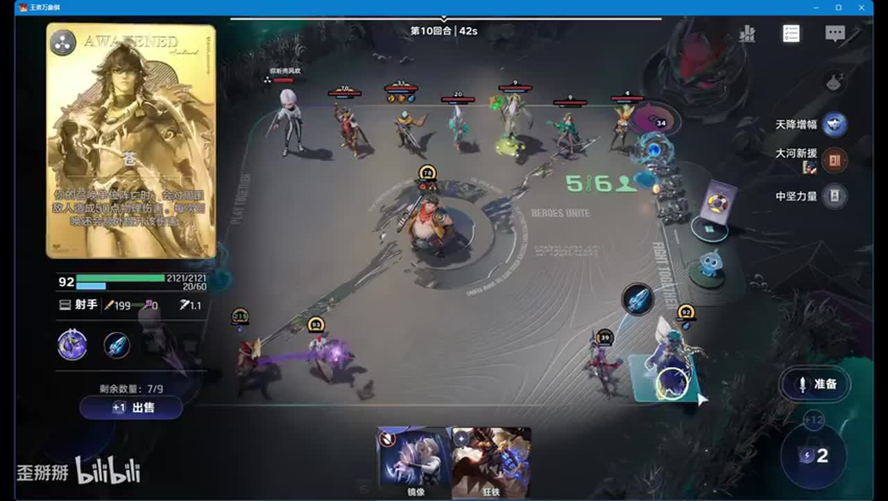

## 12:32–14:12 可直接卖两元，不为无用合成亏一元。

- 事件 ID：BV1ZueJ6qE3g:p1:e012
- 场景：实战
- 时机：发现同名二牌不需合成时
- 背景（分析推断）：讲者承认这次合成是经济失误；不是所有同名都值得合。
- 学习目标（分析推断）：比较合成实际收益与出售价值。
- 模板：combat-review
- ASR 段落：[22, 23]

> 合成的话亏了一块

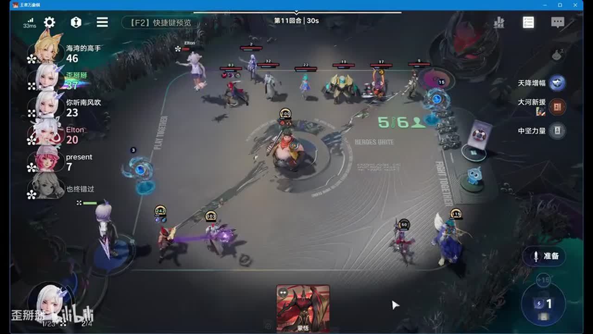

## 14:12–15:16 不执着999，继续有效刷牌压血；转等级集中老虎并补攻速。

- 事件 ID：BV1ZueJ6qE3g:p1:e013
- 场景：实战
- 时机：中期压住未成形对手时
- 背景（分析推断）：目标是在对手后期体系启动前结束。
- 学习目标（分析推断）：根据胜利窗口选择成长节奏。
- 模板：late-transition
- ASR 段落：[24, 25]

> 就不想拖到后期

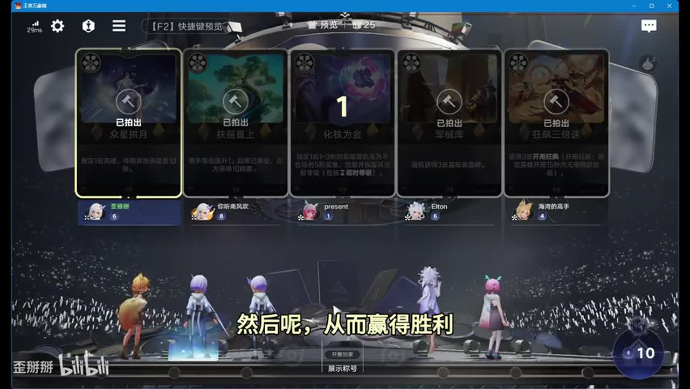

## 15:16–16:42 低价值工具先吸等级再卖，瑶带减伤发装让其他单位顶住。

- 事件 ID：BV1ZueJ6qE3g:p1:e014
- 场景：实战
- 时机：辅助装与等级转移时
- 背景（分析推断）：老虎负责收割，辅助职责是延长其输出窗口。
- 学习目标（分析推断）：组织主核与工具位分工。
- 模板：position-binding
- ASR 段落：[26, 27]

> 让其他人稍微顶一顶

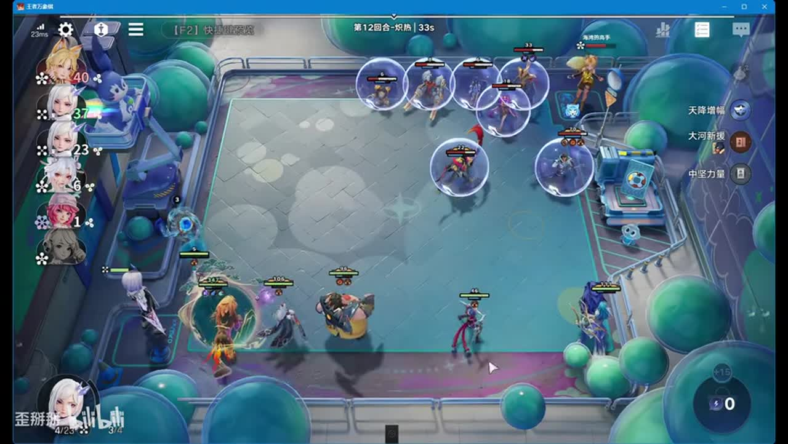

## 17:25–18:52 强敌一定要补复活，弱敌缺太乙可接受；有余资源再升级。

- 事件 ID：BV1ZueJ6qE3g:p1:e015
- 场景：实战
- 时机：准备补太乙时
- 背景（分析推断）：本局对手血线被压，不能把缺保命照常赢当通用规则。
- 学习目标（分析推断）：按敌方压力调整保命优先级。
- 模板：counter-target
- ASR 段落：[29, 30]

> 如果有很强大的对手,一定要把太乙收到

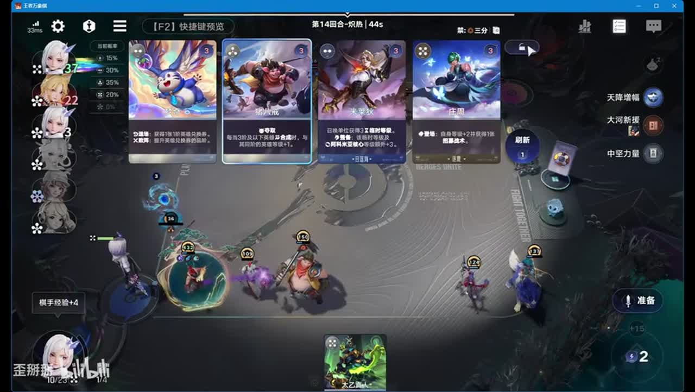

## 18:53–19:26 回血、加单位等与当前需求不符时刷新，不因金色就拿。

- 事件 ID：BV1ZueJ6qE3g:p1:e016
- 场景：实战
- 时机：后期升级天赋选择时
- 背景（分析推断）：计划上太乙占格，敌方等级低也限制偷等级价值。
- 学习目标（分析推断）：核对当前瓶颈与选项条件。
- 模板：talent-fit
- ASR 段落：[31]

> 所以我们刷新一下

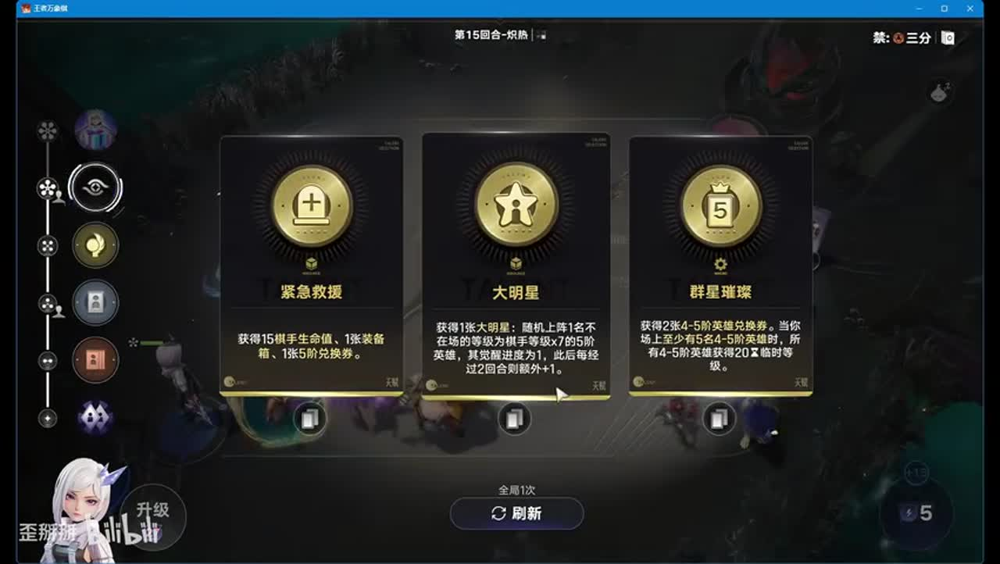

## 19:59–20:49 猪八戒老虎明世隐荆轲优先，其他三阶组件可后补。

- 事件 ID：BV1ZueJ6qE3g:p1:e017
- 场景：实战
- 时机：终局回顾拿牌顺序时
- 背景（分析推断）：核心列表降低新手搜索范围，但仍受来牌和血量约束。
- 学习目标（分析推断）：用优先级代替完整阵容硬凑。
- 模板：opening-plan
- ASR 段落：[33]

> 仓可以后面再出

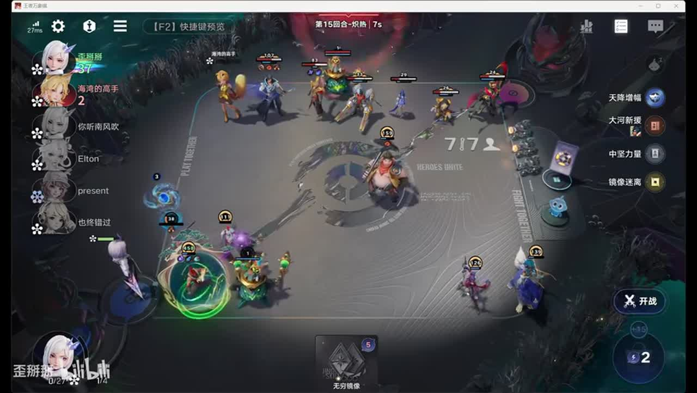

## 19:59–21:19 没瞬移装备时需依靠更多等级和剩余血量继续成长，而非保证同样结果。

- 事件 ID：BV1ZueJ6qE3g:p1:e018
- 场景：实战
- 时机：瞬移装备赢下最后战斗时
- 背景（分析推断）：本局强装备改变接触路径，讲者给的是未实测替代设想。
- 学习目标（分析推断）：辨认成功依赖与证据边界。
- 模板：combat-review
- ASR 段落：[33, 34]

> 如果没有那个瞬移的装备

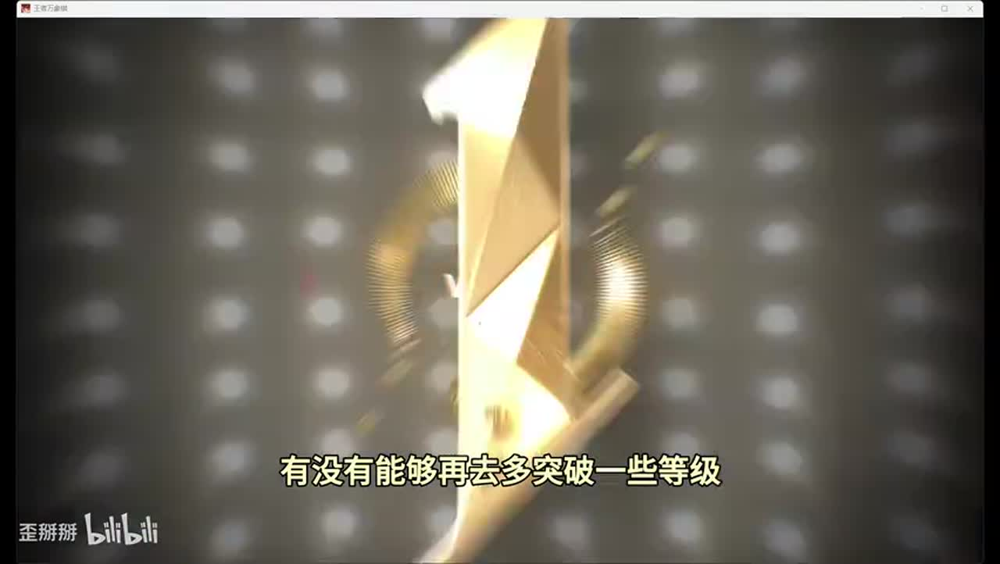

## 待核实与局限

- 原始ASR术语和数值可能有误；未经画面确认者不作为精确机制结论。
