# 【王者万象棋】胜率95%诸葛挂机流，全流程保姆级对战教学解说！诸葛亮无限放大招？

来源：https://www.bilibili.com/video/BV1UtYi6vEpi/?p=1

分析状态：completed

完整文字稿：../../../raw/BV1UtYi6vEpi_p1.md

## 00:18–01:26 用诸葛亮刘禅路线降低抢热门五阶牌的依赖。

- 事件 ID：BV1UtYi6vEpi:p1:e001
- 场景：前置讲解
- 时机：热门海陆空牌竞争时
- 背景（分析推断）：讲者担心抢不到核心暴毙，本局实际为较低分段示范。
- 学习目标（分析推断）：按竞争与执行成本选择路线。
- 模板：opening-plan
- ASR 段落：[1, 2]

> 不用去跟别人去抢这个热门的这个角色

## 00:48–02:03 每回合打成长牌，关注等级门槛与群体技能激活。

- 事件 ID：BV1UtYi6vEpi:p1:e002
- 场景：实战
- 时机：嫦娥开局成长教学时
- 背景（分析推断）：棋手技能是路线发动机，具体数值仍保留ASR待核实。
- 学习目标（分析推断）：把技能进度转成每回合行动。
- 模板：mechanic-model
- ASR 段落：[2, 3]

> 每一回合你都要去打

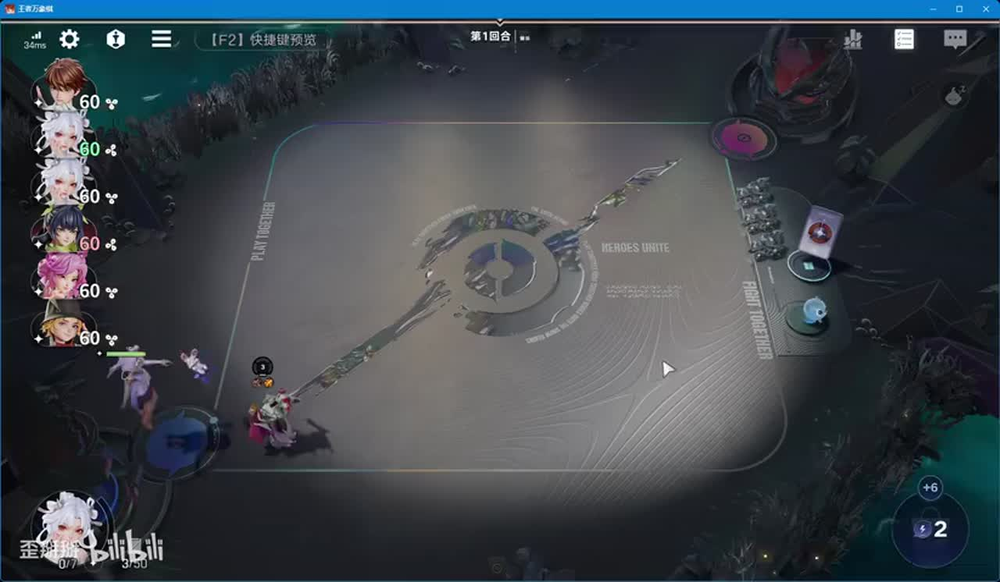

## 01:26–02:48 养干将保战力，三本找刘禅、四本找诸葛亮。

- 事件 ID：BV1UtYi6vEpi:p1:e003
- 场景：实战
- 时机：选过渡并规划商店时
- 背景（分析推断）：目标核心在四本，不需一味抢升六。
- 学习目标（分析推断）：将路线拆成前中期里程碑。
- 模板：opening-plan
- ASR 段落：[3, 4]

> 尽量的话升到四本

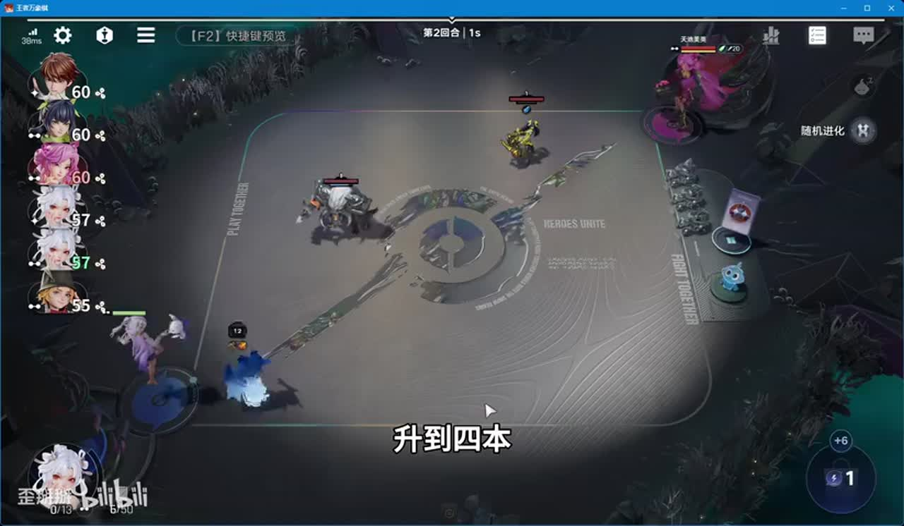

## 02:52–04:02 先拿接近觉醒的同名牌，再锁剩余牌；没牌时考虑升级。

- 事件 ID：BV1UtYi6vEpi:p1:e004
- 场景：实战
- 时机：干将接近觉醒时
- 背景（分析推断）：觉醒提升当期战斗能力，购买与升级存在预算竞争。
- 学习目标（分析推断）：根据即时收益调整升级顺序。
- 模板：resource-order
- ASR 段落：[5, 6]

> 把剩下一个锁一下就可以了

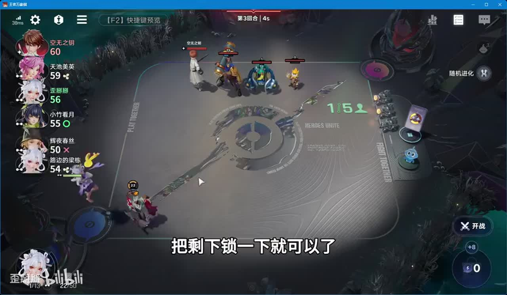

## 03:27–05:12 有刘禅则争取，没来用前排打工保战力。

- 事件 ID：BV1UtYi6vEpi:p1:e005
- 场景：实战
- 时机：首次拍卖刘禅未出现时
- 背景（分析推断）：维持赢局可抬高棋手成长收益，避免为了公式缺牌停摆。
- 学习目标（分析推断）：按功能找临时替代。
- 模板：auction-choice
- ASR 段落：[6, 8]

> 随便拿一个混一下,前排混一下就可以了

## 04:39–05:45 优先衍生高阶牌等经济选项，用于补刘禅或卖钱升四。

- 事件 ID：BV1UtYi6vEpi:p1:e006
- 场景：实战
- 时机：升级技能选择时
- 背景（分析推断）：兼顾稳血升级，直接跳本可能失血过多。
- 学习目标（分析推断）：把技能收益接入下一阶段预算。
- 模板：economy-budget
- ASR 段落：[8, 9]

> 技能方选择尽量有拿可以拿去加经济的

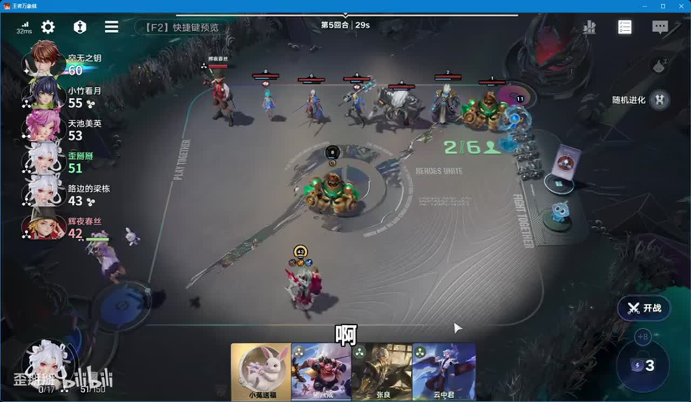

## 05:45–07:04 移除纯打工单位后再打成长，减少目标分流。

- 事件 ID：BV1UtYi6vEpi:p1:e007
- 场景：实战
- 时机：集中给干将成长时
- 背景（分析推断）：场上多个非核心会分走技能；后续再补有功能的单位。
- 学习目标（分析推断）：控制成长目标池。
- 模板：resource-order
- ASR 段落：[10, 11]

> 技能全部加了干将

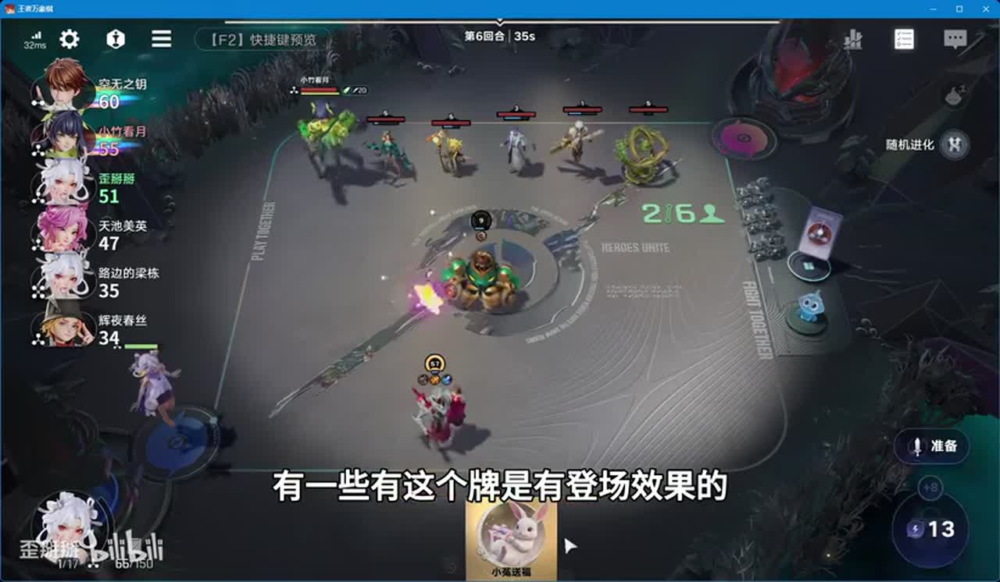

## 07:04–08:36 为诸葛亮准备减蓝耗的大书，具体名称以截图为准。

- 事件 ID：BV1UtYi6vEpi:p1:e008
- 场景：实战
- 时机：装备天赋出现时
- 背景（分析推断）：本阵容依靠持续施法，装备服务机制循环。
- 学习目标（分析推断）：按核心机制判断装备刚需。
- 模板：equipment-role
- ASR 段落：[12, 13]

> 诸葛亮到时候会减他蓝号

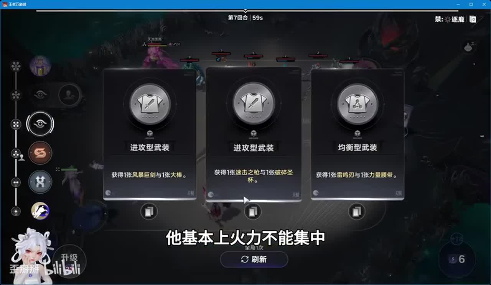

## 07:44–09:13 识别激光输出是主要威胁，区别于难集中打少量单位的范围炮。

- 事件 ID：BV1UtYi6vEpi:p1:e009
- 场景：实战
- 时机：被激光炮香香击杀后
- 背景（分析推断）：上一战干将被高伤害击杀，威胁判断来自战斗反馈。
- 学习目标（分析推断）：按实际技能形态定位敌方风险。
- 模板：counter-target
- ASR 段落：[13, 14]

> 唯一的威胁就是激光炮

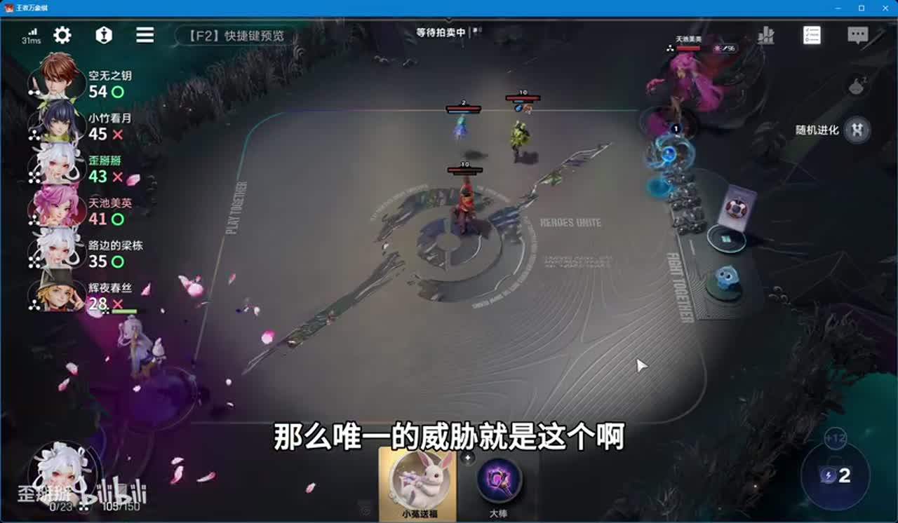

## 08:38–09:47 杨玉环用于较长对局，若提前结束可不强求。

- 事件 ID：BV1UtYi6vEpi:p1:e010
- 场景：实战
- 时机：后期第四核心规划时
- 背景（分析推断）：前三个核心能在中期形成压力。
- 学习目标（分析推断）：依据剩余阶段决定补牌价值。
- 模板：late-transition
- ASR 段落：[14, 15]

> 如果前期能解决战斗,杨玉环就不用上了

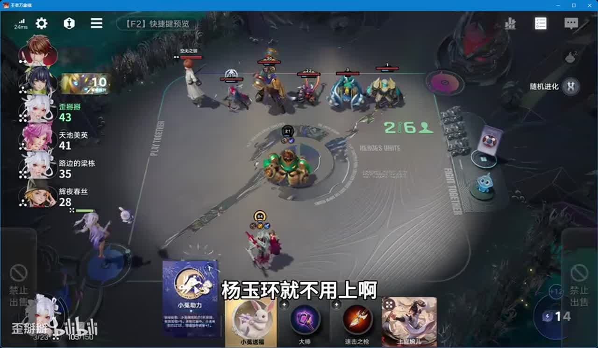

## 09:13–10:20 观察同行再决定升五或搜四阶核心；已有同行则提前搜。

- 事件 ID：BV1UtYi6vEpi:p1:e011
- 场景：实战
- 时机：诸葛亮迟来且战力尚稳时
- 背景（分析推断）：继续等待可能丢掉牌池机会，不能把本局宽松环境当常态。
- 学习目标（分析推断）：用竞争与血量决定搜牌窗口。
- 模板：economy-budget
- ASR 段落：[15, 16]

> 如果说你看到这时候的话有人拿诸葛亮

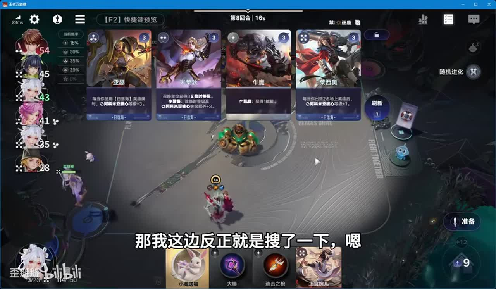

## 10:20–11:40 先打群体成长再打单体，利用前一效果抬高后一收益。

- 事件 ID：BV1UtYi6vEpi:p1:e012
- 场景：实战
- 时机：诸葛亮到位后成长牌顺序时
- 背景（分析推断）：同时预留下一轮升级所需金币。
- 学习目标（分析推断）：掌握有因果依据的操作顺序。
- 模板：resource-order
- ASR 段落：[17, 18]

> 先打大的,然后再打小的

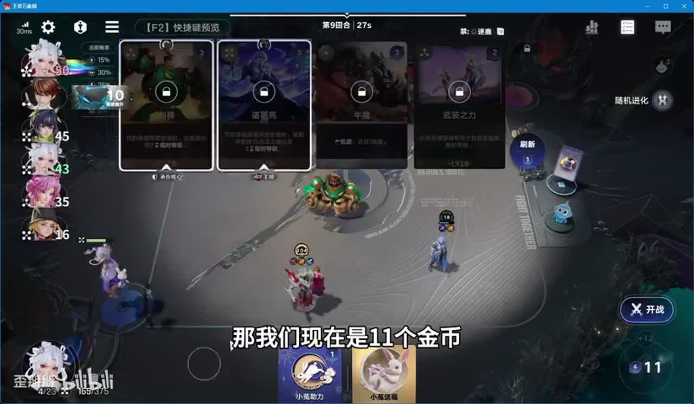

## 11:40–12:42 不优先回血，选补高阶单位的选项提高即时强度。

- 事件 ID：BV1UtYi6vEpi:p1:e013
- 场景：实战
- 时机：血量健康且中期成形时
- 背景（分析推断）：对手五阶路线启动慢，本局四阶核心已能压血。
- 学习目标（分析推断）：从当前瓶颈选择收益。
- 模板：talent-fit
- ASR 段落：[19, 20]

> 我现在血量比较健康

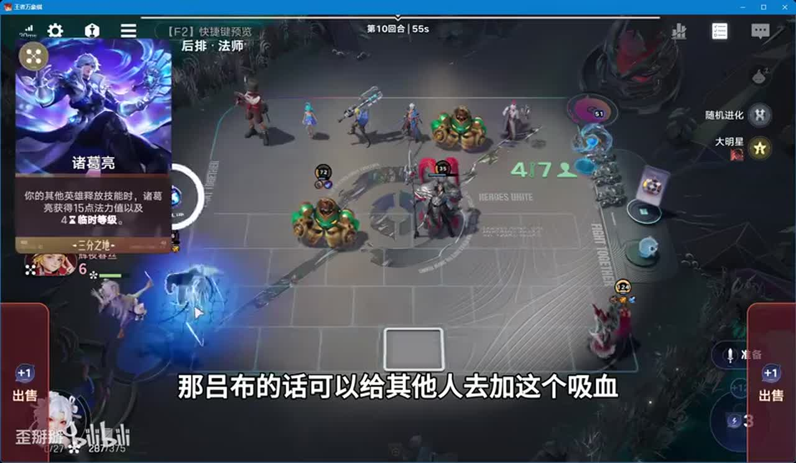

## 12:12–13:52 用吕布吸血与控制延长战斗，刘禅觉醒提高持续承伤。

- 事件 ID：BV1UtYi6vEpi:p1:e014
- 场景：实战
- 时机：诸葛亮刘禅发动后
- 背景（分析推断）：更久的施法时间转为等级与回血，辅助位按功能服务循环。
- 学习目标（分析推断）：理解存活时间与成长循环的联系。
- 模板：growth-combo
- ASR 段落：[20, 21, 22]

> 流汕时间长,用技能自己可以加等级

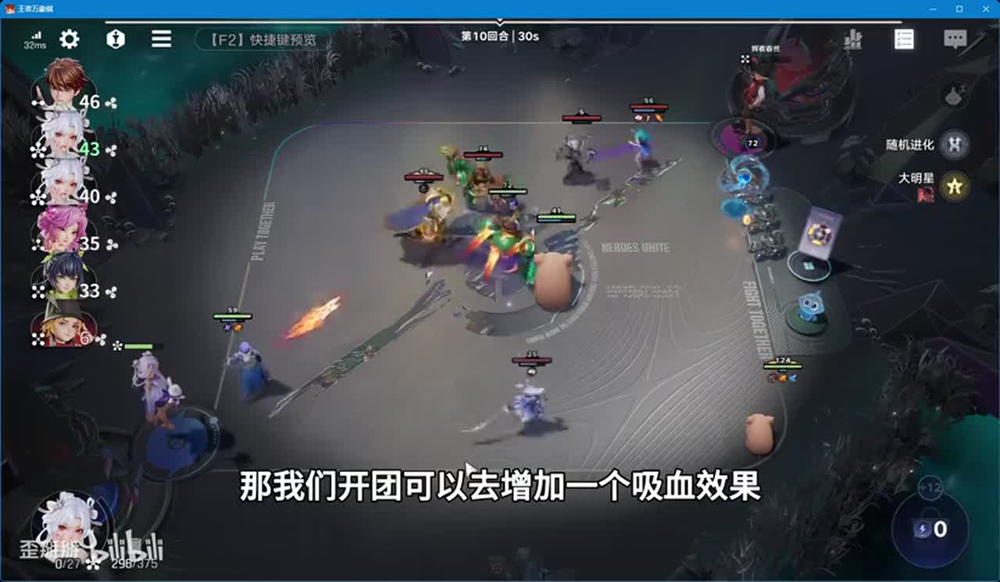

## 13:22–14:27 留传承，其他能辅助主核或前排的单位也可替代吕布。

- 事件 ID：BV1UtYi6vEpi:p1:e015
- 场景：实战
- 时机：准备后期移交过渡单位时
- 背景（分析推断）：临时辅助不必固定为一个牌名。
- 学习目标（分析推断）：按功能补位并准备转等级。
- 模板：fallback-plan
- ASR 段落：[22, 23]

> 能够辅助C位的或者是能够辅助这个前排的辅助都可以

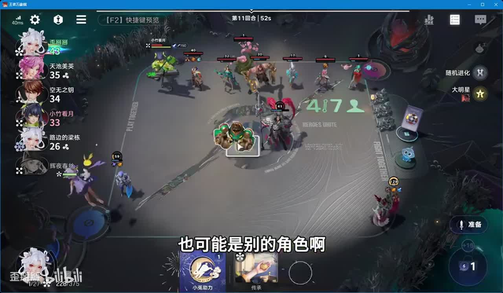

## 15:01–16:23 补名刀保命，有余钱再升六提高棋手成长。

- 事件 ID：BV1UtYi6vEpi:p1:e016
- 场景：实战
- 时机：核心逐渐觉醒时
- 背景（分析推断）：本局诸葛亮争夺少，不能把容易觉醒推广到所有局。
- 学习目标（分析推断）：兼顾保命与后续成长投入。
- 模板：equipment-role
- ASR 段落：[25, 26]

> 有钱的情况下还是需要去升六本的

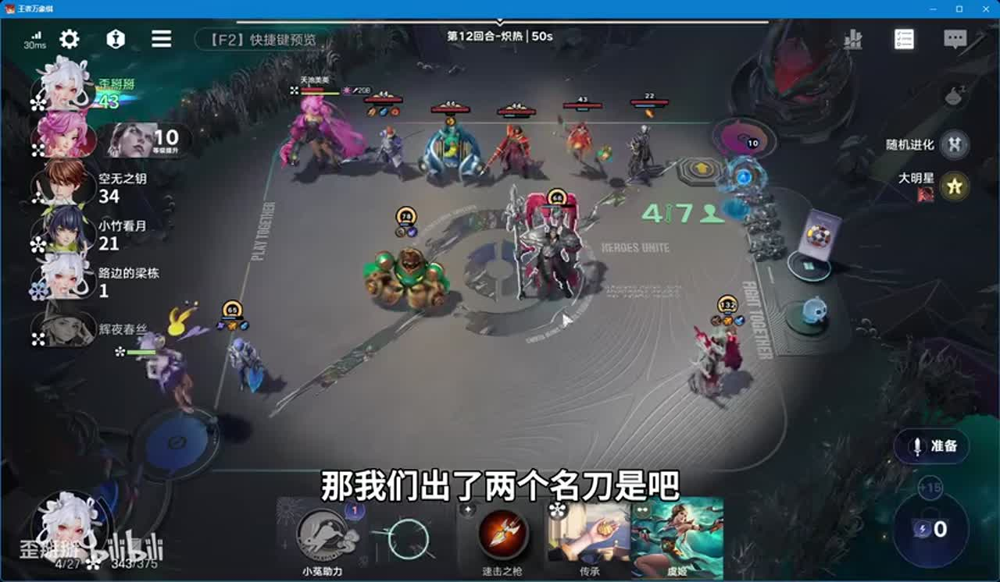

## 17:01–18:34 停止只搜同名卡，补功能牌；决赛太乙分走少量成长可接受。

- 事件 ID：BV1UtYi6vEpi:p1:e017
- 场景：实战
- 时机：同名牌已全部觉醒时
- 背景（分析推断）：核心成长已充分，辅助价值超过继续集中每一级。
- 学习目标（分析推断）：识别边际收益变化。
- 模板：late-transition
- ASR 段落：[28, 30]

> 我们不可能说一直去收,就是收我们的同名卡

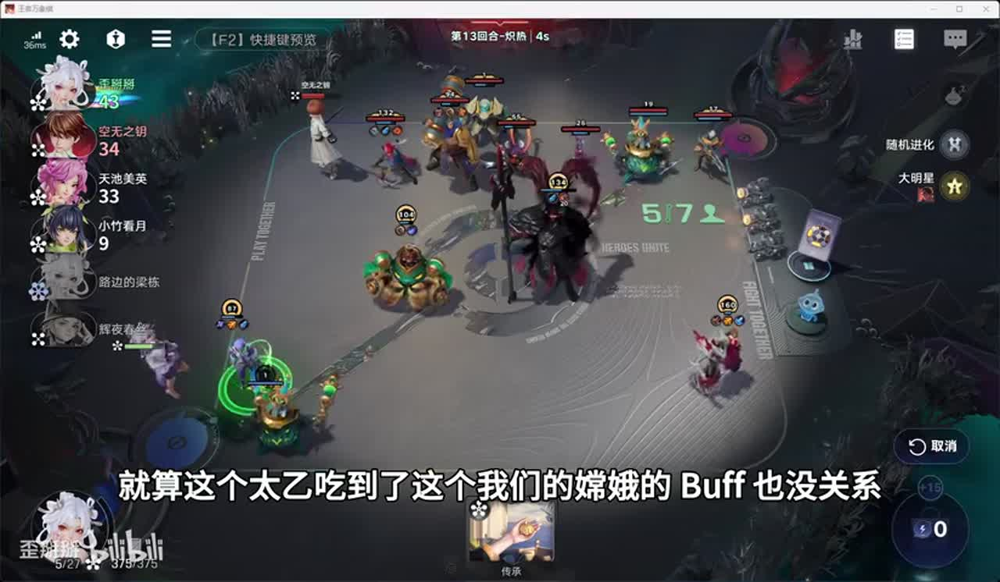

## 18:34–19:35 低等级新核心易被切，不因公式要求立即替换强辅助。

- 事件 ID：BV1UtYi6vEpi:p1:e018
- 场景：实战
- 时机：杨玉环最后阶段才来时
- 背景（分析推断）：倒数第二轮已缺成长时间，保留现有吕布可能更稳。
- 学习目标（分析推断）：评估迟到单位的上场成本。
- 模板：combat-review
- ASR 段落：[31, 32]

> 已经是最后倒数第二轮了

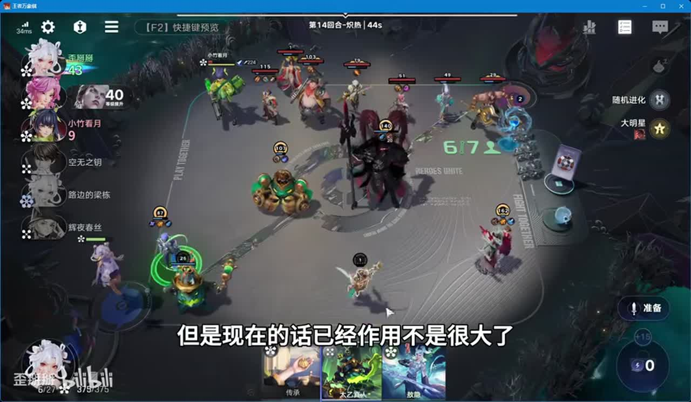

## 19:36–20:48 根据局势决定是否把吕布太乙等级转给核心，而非强制照搬。

- 事件 ID：BV1UtYi6vEpi:p1:e019
- 场景：实战
- 时机：考虑最终四人阵容时
- 背景（分析推断）：本局强势吕布可保留；长局四核持续施法是条件分支。
- 学习目标（分析推断）：区分通用功能与本局选择。
- 模板：late-transition
- ASR 段落：[33, 34]

> 根据场上的一个情况来决定

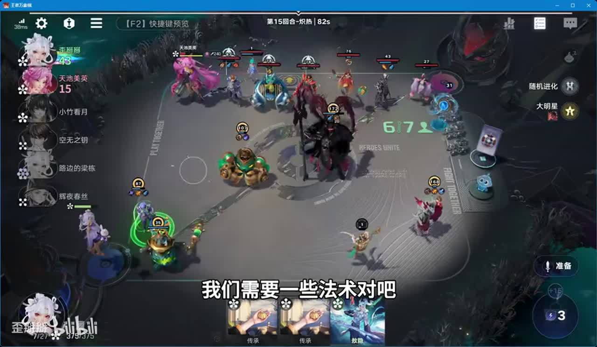

## 20:48–22:08 前期干将稳血，中期四阶诸葛亮成形；低分段示范不能验证95%胜率。

- 事件 ID：BV1UtYi6vEpi:p1:e020
- 场景：实战
- 时机：结局总结适用范围时
- 背景（分析推断）：讲者自述铂金二，本局吃鸡只是单局结果。
- 学习目标（分析推断）：理解策略路径与证据边界。
- 模板：combat-review
- ASR 段落：[35, 36]

> 这个是搏金二段的分数不高

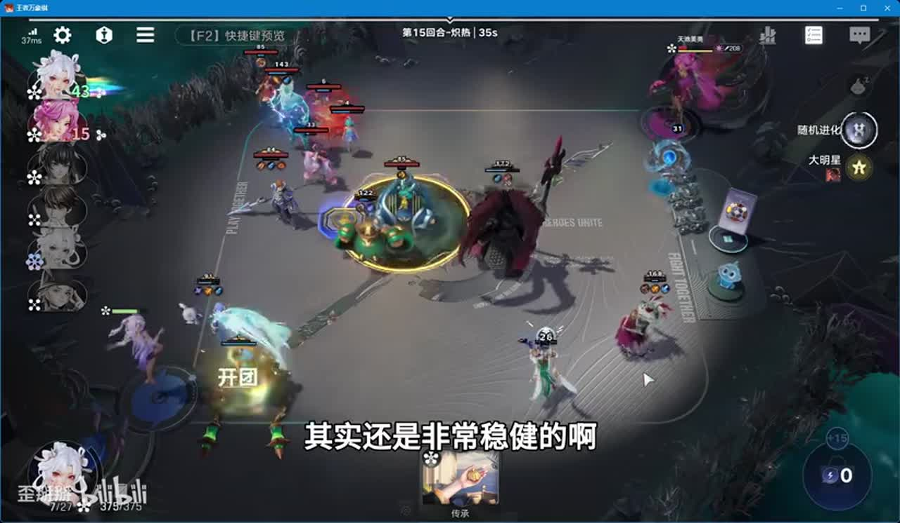

## 待核实与局限

- 原始ASR术语和数值可能有误；未经画面确认者不作为精确机制结论。
