# 【王者万象棋】胜率95%逐鹿倒转流，全流程保姆级对战教学解说！赢政一个大招清屏？

来源：https://www.bilibili.com/video/BV1LCew6HEhT/?p=1

分析状态：completed

完整文字稿：../../../raw/BV1LCew6HEhT_p1.md

## 00:23–01:45 每回合开同阵营牌，嬴政靠效果牌累计开团攻击。

- 事件 ID：BV1LCew6HEhT:p1:e001
- 场景：实战
- 时机：闹闹选逐鹿路线时
- 背景（分析推断）：棋手稳定供牌与主核触发机制共同构成路线。
- 学习目标（分析推断）：理解资源来源与核心收益。
- 模板：mechanic-model
- ASR 段落：[1, 2]

> 以银阵为核心

## 01:45–02:51 先上老夫子等首轮合成产牌工具，兑现后可移除。

- 事件 ID：BV1LCew6HEhT:p1:e002
- 场景：实战
- 时机：早期合成前
- 背景（分析推断）：先合成再上会错过首个触发。
- 学习目标（分析推断）：识别工具牌的有限触发窗口。
- 模板：resource-order
- ASR 段落：[3, 4]

> 打牌的间隙呢去上

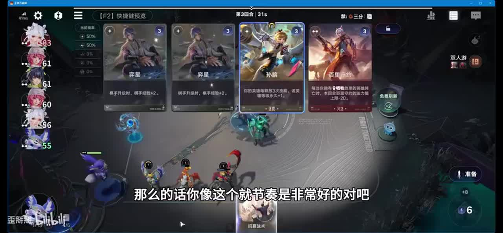

## 02:18–03:34 把装备集中给预期成长目标，芈月按装备最多者加等级。

- 事件 ID：BV1LCew6HEhT:p1:e003
- 场景：实战
- 时机：用芈月过渡成长时
- 背景（分析推断）：早期芈月可自养，主核到后需重新指定。
- 学习目标（分析推断）：用装备数量控制成长归属。
- 模板：position-binding
- ASR 段落：[4, 5]

> 带装备最多的一个角色呢加等级

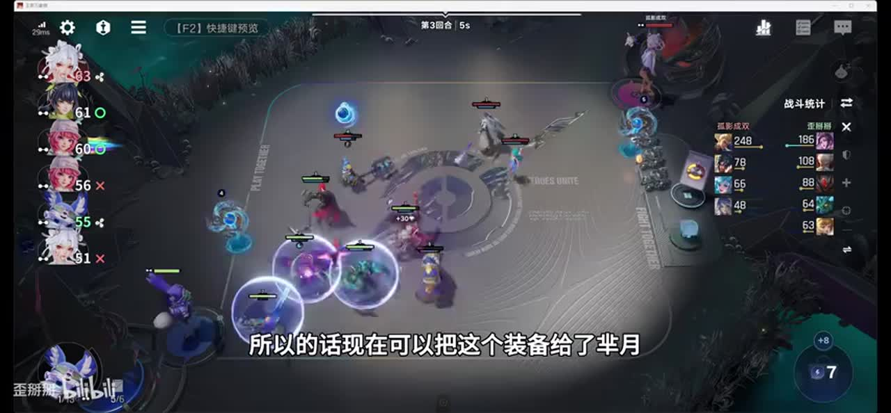

## 03:34–05:34 拿解控武器留给嬴政，镜与芈月可组合过渡。

- 事件 ID：BV1LCew6HEhT:p1:e004
- 场景：实战
- 时机：前期武器为后期准备时
- 背景（分析推断）：中期替代角色不改变后期防控制需求。
- 学习目标（分析推断）：跨阶段规划关键装备。
- 模板：equipment-role
- ASR 段落：[6, 8]

> 一定要选择一个解控的

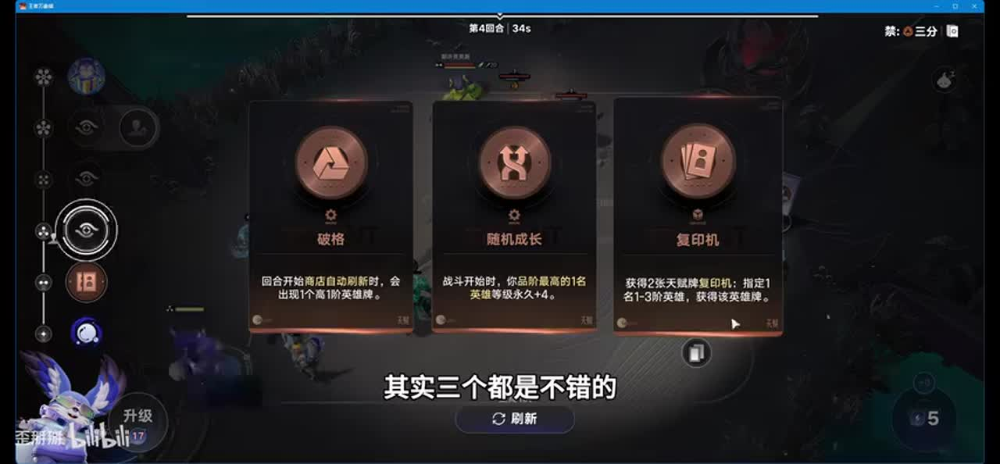

## 04:55–06:26 选胜利产最高等级同名牌，用战斗优势推动觉醒。

- 事件 ID：BV1LCew6HEhT:p1:e005
- 场景：实战
- 时机：当前战力高时选胜利天赋
- 背景（分析推断）：先能赢才有供牌收益，后面等级目标需要匹配主核。
- 学习目标（分析推断）：核对收益条件和触发对象。
- 模板：talent-fit
- ASR 段落：[8, 9]

> 战斗胜利获得一张

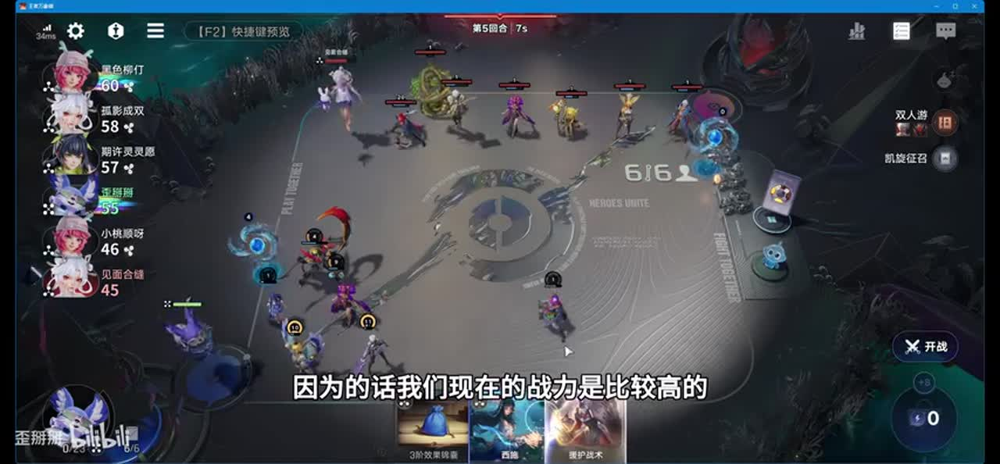

## 06:26–08:44 留芈月过渡，补蒙犽西施与庄周产效果牌，并留一个操作空位。

- 事件 ID：BV1LCew6HEhT:p1:e006
- 场景：实战
- 时机：四本嬴政迟来时
- 背景（分析推断）：发动工具先到能支持后续核心，镜后期需求降低。
- 学习目标（分析推断）：按资源功能补组件。
- 模板：fallback-plan
- ASR 段落：[10, 11, 12]

> 留一个位置去打buff

## 08:44–10:00 及时把两件装备转给嬴政，否则芈月继续吃成长和同名奖励。

- 事件 ID：BV1LCew6HEhT:p1:e007
- 场景：实战
- 时机：嬴政到后仍养错芈月时
- 背景（分析推断）：讲者明确承认操作失误，错误同时影响等级与胜利天赋目标。
- 学习目标（分析推断）：检查耦合的目标选择条件。
- 模板：combat-review
- ASR 段落：[13, 14]

> 确实是一个很大的失误

## 10:00–11:01 先把装备集中嬴政，再打法术兑现等级。

- 事件 ID：BV1LCew6HEhT:p1:e008
- 场景：实战
- 时机：纠正装备归属后
- 背景（分析推断）：上一轮目标错误被修正，先后顺序决定主核收益。
- 学习目标（分析推断）：用可检查步骤纠错。
- 模板：resource-order
- ASR 段落：[15, 16]

> 把装备全部给了嬴政了

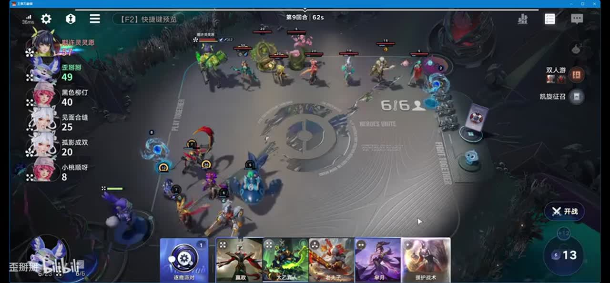

## 10:28–11:28 看对手强度再跳本，站位被范围伤害惩罚后补血量容错。

- 事件 ID：BV1LCew6HEhT:p1:e009
- 场景：实战
- 时机：范围炮一枪打倒密集阵容后
- 背景（分析推断）：本局失利揭示集中站位风险，回血用于多争取成长回合。
- 学习目标（分析推断）：把战斗结果接入升级和生存预算。
- 模板：combat-review
- ASR 段落：[16, 17]

> 一枪被他直接全部爆死了

## 11:28–12:32 先上鲁班再做同名合成，庄周让位以触发产战术牌。

- 事件 ID：BV1LCew6HEhT:p1:e010
- 场景：实战
- 时机：鲁班加入循环前
- 背景（分析推断）：讲者承认少处理了合成细节；错序丢资源。
- 学习目标（分析推断）：让工具先到位再兑现触发。
- 模板：resource-order
- ASR 段落：[18, 19]

> 应该先把鲁班打上去

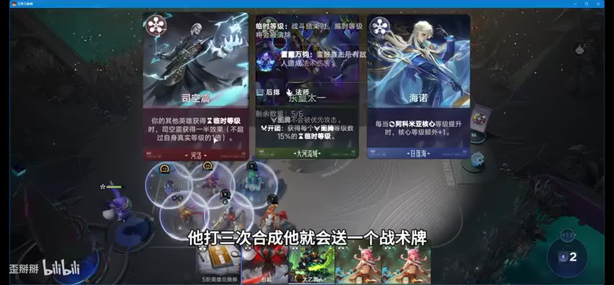

## 11:59–13:04 与直接升级成本比较，二十元以下是本局上限，不无限追价。

- 事件 ID：BV1LCew6HEhT:p1:e011
- 场景：实战
- 时机：拍卖升本牌时
- 背景（分析推断）：十一十二回合的升级与拍卖预算需要提前计划。
- 学习目标（分析推断）：比较替代成本设竞价边界。
- 模板：auction-choice
- ASR 段落：[19, 20]

> 如果超过20块钱那就亏了

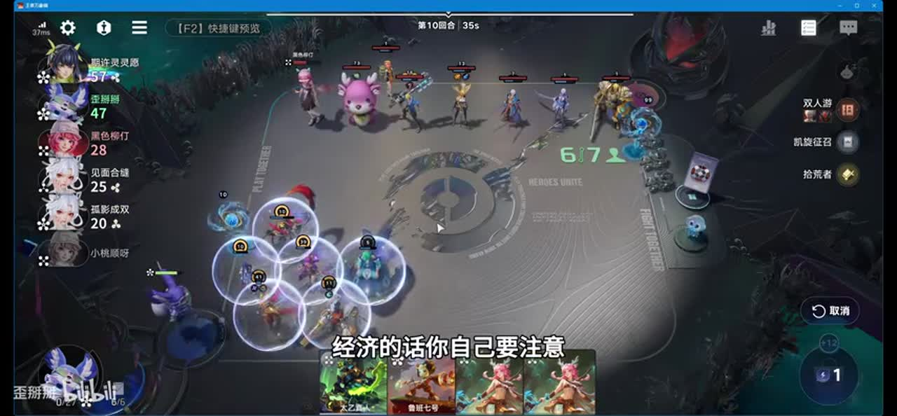

## 13:04–14:11 保留空位，登场与合成产战术牌持续打出，推动攻击与等级。

- 事件 ID：BV1LCew6HEhT:p1:e012
- 场景：实战
- 时机：嬴政觉醒与战术牌循环时
- 背景（分析推断）：胜利天赋持续补核心，工具牌服务循环。
- 学习目标（分析推断）：把多组件串成稳定行动循环。
- 模板：growth-combo
- ASR 段落：[21, 22]

> 留一个空位去打这个buff

## 13:40–15:07 按对手威胁补装备或复活，弱敌可暂不上；提前抬走时补即时战力。

- 事件 ID：BV1LCew6HEhT:p1:e013
- 场景：实战
- 时机：是否上瑶太乙时
- 背景（分析推断）：辅助上场会改变操作空间，取舍由战斗目标决定。
- 学习目标（分析推断）：按敌方压力决定辅助优先级。
- 模板：counter-target
- ASR 段落：[22, 23]

> 根据对,就是你的对手的一个情况

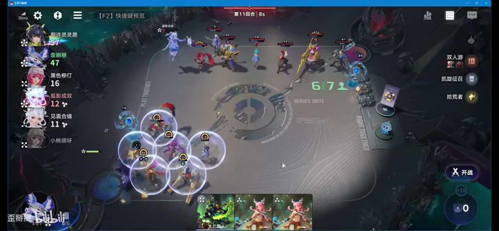

## 15:07–16:21 比较省下的金币，再选提升法术牌阶级的分支强化循环。

- 事件 ID：BV1LCew6HEhT:p1:e014
- 场景：实战
- 时机：低价扶摇升级六本后
- 背景（分析推断）：本局五元无人竞争，不能视为稳定价格。
- 学习目标（分析推断）：连接升级成本与体系收益。
- 模板：level-transition
- ASR 段落：[24, 25]

> 你的法术牌变得高阶了

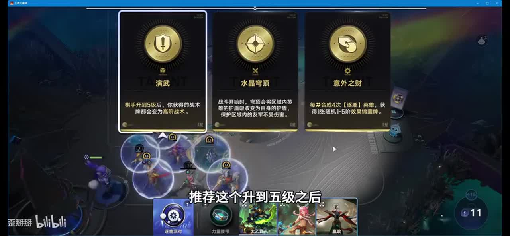

## 16:24–17:43 嬴政未到可养镜，鲁班中期非绝对必需，后期加强经济循环。

- 事件 ID：BV1LCew6HEhT:p1:e015
- 场景：实战
- 时机：回顾嬴政或鲁班迟来时
- 背景（分析推断）：闹闹供牌缓解断牌，但不保证任何局都必到核心。
- 学习目标（分析推断）：区分必需核心与加速组件。
- 模板：fallback-plan
- ASR 段落：[26, 27]

> 鲁班不是说必须的

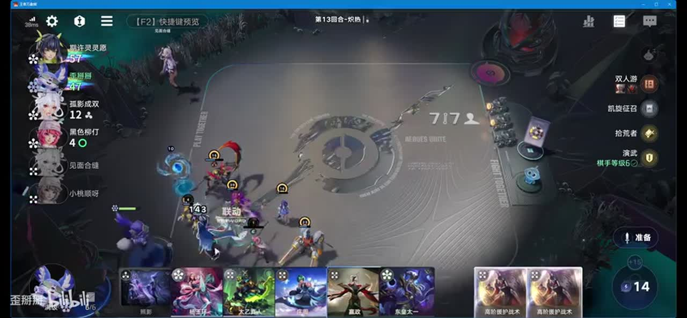

## 16:53–18:26 优先补齐嬴政装备，打不完的次要牌可留下一轮。

- 事件 ID：BV1LCew6HEhT:p1:e016
- 场景：实战
- 时机：攻击已足够且操作繁忙时
- 背景（分析推断）：资源很多不代表继续刷比补装重要。
- 学习目标（分析推断）：转向真实瓶颈而非追操作量。
- 模板：late-transition
- ASR 段落：[27, 28]

> 比刷牌更关键的一件事情

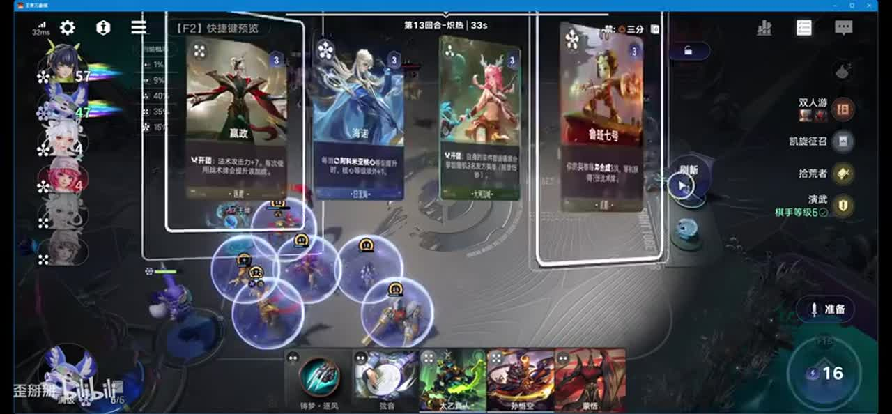

## 18:32–19:45 可转走其等级给有效单位，但本局只是锦上添花。

- 事件 ID：BV1LCew6HEhT:p1:e017
- 场景：实战
- 时机：后期芈月作用降低时
- 背景（分析推断）：对手长期受压，不能从单局优势推导必胜。
- 学习目标（分析推断）：评估转移收益与必要性。
- 模板：late-transition
- ASR 段落：[29, 30]

> 只是锦上添花了现在

## 19:45–21:16 先打现成法术保证嬴政攻击，再处理庄周等登场牌，次要牌可延后。

- 事件 ID：BV1LCew6HEhT:p1:e018
- 场景：实战
- 时机：手速慢且准备时间有限时
- 背景（分析推断）：先处理角色可能到时间仍剩大量关键法术。
- 学习目标（分析推断）：按关键收益排序有限操作时间。
- 模板：resource-order
- ASR 段落：[31, 32]

> 先把法术全部打完

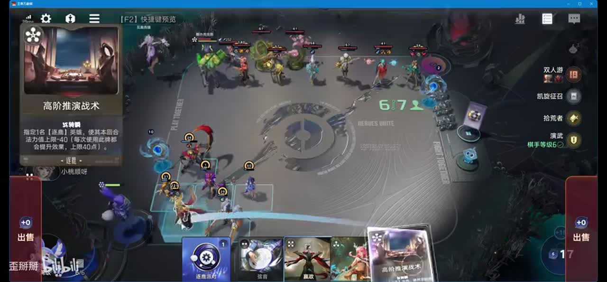

## 20:44–21:50 敌方能切后排则上太乙，不能则瑶补装；高法防坦克仍是风险。

- 事件 ID：BV1LCew6HEhT:p1:e019
- 场景：实战
- 时机：后排威胁与法防前排出现时
- 背景（分析推断）：单核攻击高不消除克制，需要读敌方接触路径与防御。
- 学习目标（分析推断）：选择针对辅助并保留策略局限。
- 模板：counter-target
- ASR 段落：[32, 33]

> 能够切到这个后排

## 21:50–24:17 先兑现已有资源，再用剩钱补战术牌和临时等级。

- 事件 ID：BV1LCew6HEhT:p1:e020
- 场景：实战
- 时机：终局资源兑现时
- 背景（分析推断）：后期等级增量来自多项触发，具体数值不作普遍保证。
- 学习目标（分析推断）：组织终战资源顺序。
- 模板：economy-budget
- ASR 段落：[34, 35, 36]

> 最后把钱用完就可以了

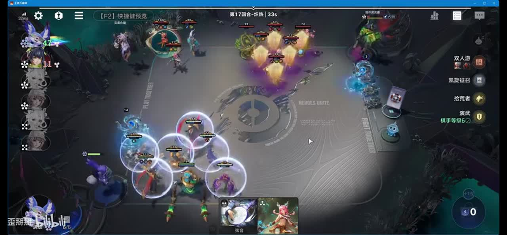

## 23:41–25:00 移除不能继续配合的低等级工具，转为保护主核的太乙瑶。

- 事件 ID：BV1LCew6HEhT:p1:e021
- 场景：实战
- 时机：遇额外百级反打单位时
- 背景（分析推断）：主核循环完成后工具与战斗辅助价值倒转；本局仅钻石段位示范。
- 学习目标（分析推断）：按终局威胁更换功能位。
- 模板：late-transition
- ASR 段落：[36, 37, 38]

> 已经没办法再配合的全卖掉

## 待核实与局限

- 原始ASR术语和数值可能有误；未经画面确认者不作为精确机制结论。
