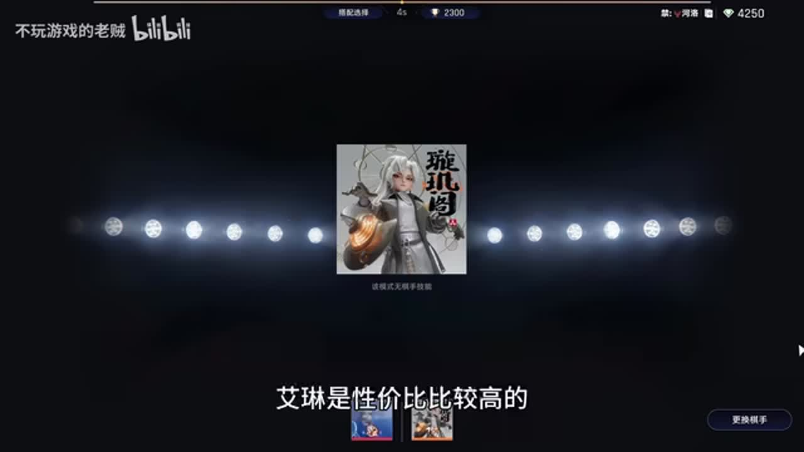
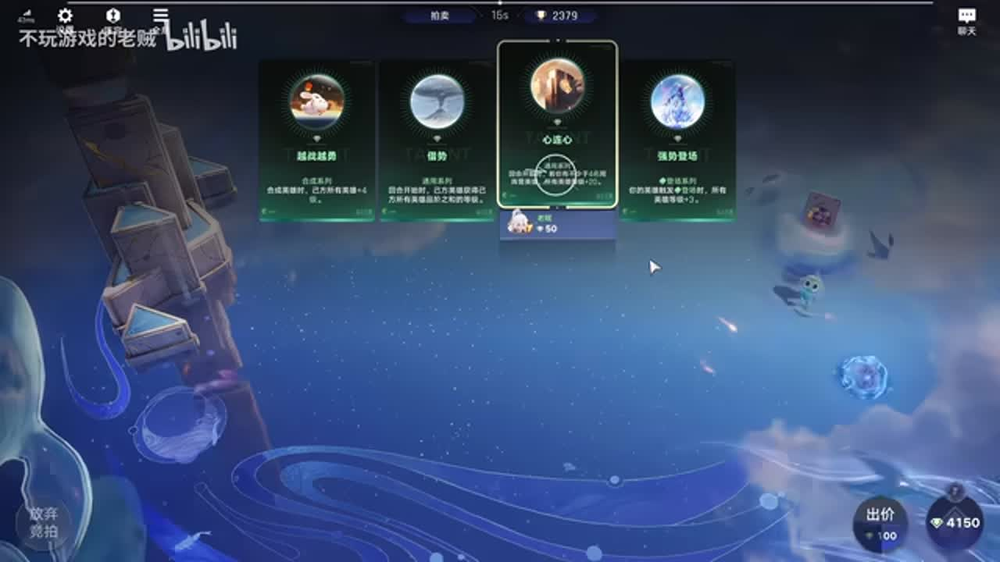
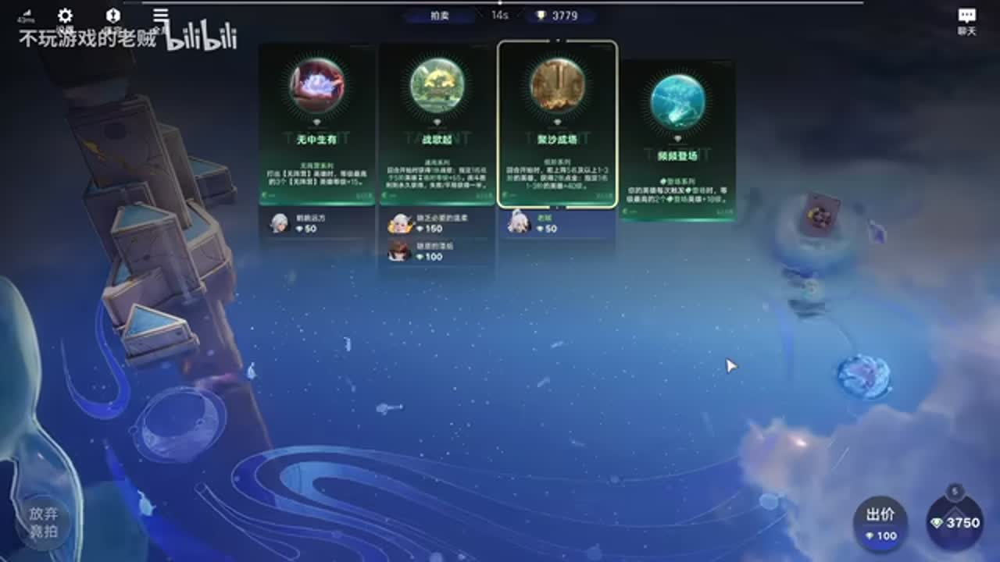
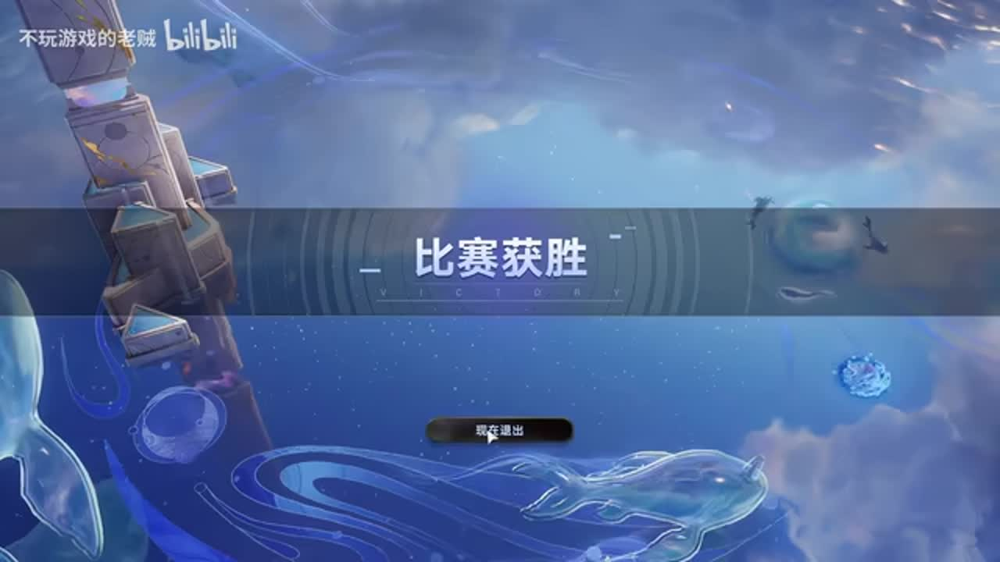

# 【王者万象棋】钻石狂潮艾琳卡组实战，老二，但是吃鸡，650元性价比极高的卡组

来源：https://www.bilibili.com/video/BV1wZH66GEdA/?p=1

分析状态：completed

完整文字稿：../../../raw/BV1wZH66GEdA_p1.md

## 00:01–00:22 按克制关系与技能机制评估，而非只比等级

- 事件 ID：BV1wZH66GEdA:p1:e001
- 场景：前置讲解
- 时机：决定是否采用艾琳卡组时
- 背景（分析推断）：讲者说明本卡组机制支持越级对抗；六百成本为口述，标题六百五十未统一。
- 学习目标（分析推断）：理解阵容选择应结合对手与机制。
- 模板：opening-plan
- ASR 段落：[1]

> 可以越等级去杀人

## 00:56–02:31 优先能立刻提升战力的觉醒和艾琳三件装备，特定条件未满足的觉醒可暂缓

- 事件 ID：BV1wZH66GEdA:p1:e002
- 场景：实战
- 时机：前期准备觉醒与装备时
- 背景（分析推断）：讲者将雅典娜整备人数条件与当前操作相连。
- 学习目标（分析推断）：区分即时战力与尚未满足的收益。
- 模板：resource-order
- ASR 段落：[2, 3]

> 前期艾琳有三件装备的话

## 02:32–03:38 同路线拥挤可退出准备之力；当局独家日落海更易获取目标

- 事件 ID：BV1wZH66GEdA:p1:e003
- 场景：实战
- 时机：观察其他玩家阵容竞争时
- 背景（分析推断）：特殊模式允许退出，与普通排位策略不同。
- 学习目标（分析推断）：根据竞争程度调整是否继续投入。
- 模板：fallback-plan
- ASR 段落：[4]

> 如果同行太多的话你就直接走

## 03:57–06:44 讲者尝试竞价增加奖池，但意外接盘会增加成本，需要重新估计名次与利润

- 事件 ID：BV1wZH66GEdA:p1:e004
- 场景：实战
- 时机：奖池偏小且自己是独家时
- 背景（分析推断）：该模式目标包括净收益；抬价并非无成本，讲者承认三百五偏贵。
- 学习目标（分析推断）：理解竞价收益与接盘风险，避免将名次等同净收益。
- 模板：auction-choice
- ASR 段落：[5, 6, 7]

> 稍微有点小贵

## 08:19–10:48 将成长给米莱狄，让召唤物吸引火力保护艾琳

- 事件 ID：BV1wZH66GEdA:p1:e005
- 场景：实战
- 时机：选择召唤辅助时
- 背景（分析推断）：讲者比较米莱狄与安琪拉的辅助作用。
- 学习目标（分析推断）：从主输出需要的保护功能选择辅助。
- 模板：growth-combo
- ASR 段落：[9, 10]

> 帮咱艾琳吸引这个火力

## 09:23–10:48 放弃继续追价，为后续关键装备与特殊天赋保留预算

- 事件 ID：BV1wZH66GEdA:p1:e006
- 场景：实战
- 时机：已投入较多竞拍成本时
- 背景（分析推断）：同段先考虑竞价，再因先前支出改变决策。
- 学习目标（分析推断）：根据累计投入动态设定支出上限。
- 模板：economy-budget
- ASR 段落：[10]

> 后边可能还得抢装备

## 10:52–14:08 根据艾琳范围输出机制考虑暗影战斧替代；防具给承担控制的前排

- 事件 ID：BV1wZH66GEdA:p1:e007
- 场景：实战
- 时机：逐日之弓竞拍竞争较高时
- 背景（分析推断）：装备优先级应回应伤害与功能，原始ASR装备名有误识保留。
- 学习目标（分析推断）：理解替代装备的功能依据。
- 模板：equipment-role
- ASR 段落：[11, 12]

> 暗影战斧也可以

## 14:10–14:50 先满足四个整备单位条件，海月可后续用等级转移补足；太乙提供容错

- 事件 ID：BV1wZH66GEdA:p1:e008
- 场景：实战
- 时机：海月未上且雅典娜效果需要整备人数时
- 背景（分析推断）：立即换单位可能破坏现有成长条件。
- 学习目标（分析推断）：在换人前检查当前组合的生效条件。
- 模板：resource-order
- ASR 段落：[13]

> 场上确保有四个这个整备卡

## 18:16–19:23 艾琳主要是物理普攻，把法系装备转给能利用的其他英雄

- 事件 ID：BV1wZH66GEdA:p1:e009
- 场景：实战
- 时机：法系装备出现时
- 背景（分析推断）：主输出名称不代表所有输出装备都适配。
- 学习目标（分析推断）：按伤害构成分配装备。
- 模板：equipment-role
- ASR 段落：[16]

> 她是一个普攻的物理伤害

## 19:28–21:17 保护艾琳避开猴子攻击，竞拍关键牌时同时考虑成本，过高价格仍需放弃

- 事件 ID：BV1wZH66GEdA:p1:e010
- 场景：实战
- 时机：决赛对手控制与命运之种威胁时
- 背景（分析推断）：讲者曾说多少钱都抢，但随后九百五十放弃，显示当局价格约束。
- 学习目标（分析推断）：将敌方关键威胁与资源上限一起判断。
- 模板：counter-target
- ASR 段落：[17, 18]

> 950,算了吧

## 21:20–22:09 讲者不选万魂归一，因为单一单位被控会丧失战力

- 事件 ID：BV1wZH66GEdA:p1:e011
- 场景：实战
- 时机：考虑单人高等级的救场效果时
- 背景（分析推断）：拒绝理由是控制风险，而非泛化所有场景无效；其吐槽不记。
- 学习目标（分析推断）：评价救场方案能否解决当前失败原因。
- 模板：talent-fit
- ASR 段落：[19]

> 一旦控住就没了

## 22:10–25:21 分散并调整站位，让其他单位先消耗威胁，保护主输出

- 事件 ID：BV1wZH66GEdA:p1:e012
- 场景：实战
- 时机：艾琳容易先打中命运之种时
- 背景（分析推断）：战斗反馈后改变站位；讲者指出太乙缺失限制容错。
- 学习目标（分析推断）：以明确保护目标做站位调整并观察结果。
- 模板：position-cause
- ASR 段落：[20, 21, 22]

> 主要目标躲开他的猴子

## 25:24–27:02 保留其他单位回蓝装备以提前释放技能和消耗种子；普通神器无法解决该失败条件

- 事件 ID：BV1wZH66GEdA:p1:e013
- 场景：实战
- 时机：对手买活且命运之种威胁持续时
- 背景（分析推断）：不是单纯追求总战力，需让主输出避开致命互动。
- 学习目标（分析推断）：用针对性功能决定装备保留与拆分。
- 模板：equipment-role
- ASR 段落：[23, 24]

> 争取把那个种子提前打掉

## 27:03–28:16 比较复活成本与最终净收益，名次第二也可能净收益更高

- 事件 ID：BV1wZH66GEdA:p1:e014
- 场景：实战
- 时机：输掉决赛后考虑是否买活时
- 背景（分析推断）：这是钻石狂潮特殊结算目标，不能直接作为普通排位建议。
- 学习目标（分析推断）：区分对局名次与模式经济目标。
- 模板：combat-review
- ASR 段落：[25, 26]

> 他买活之后他亏,然后我小赚

## 待核实与局限

- 特殊钻石狂潮模式，退出、竞价、买活及净收益结论不直接推广普通排位。
- 标题650与口述600成本不一致，未校正。
- 原始ASR卡名存在同音误识，未人工修正。
