# 【王者万象棋】阿离伞守约阵容详解+实战，颗秒的暴力美学

来源：https://www.bilibili.com/video/BV1hRem66EMw/?p=1

分析状态：completed

完整文字稿：../../../raw/BV1hRem66EMw_p1.md

## 01:54–02:54 伤害强化提高狙击爆发，回蓝使首轮牺牲完成前也能连续施法

- 事件 ID：BV1hRem66EMw:p1:e001
- 场景：前置讲解
- 时机：选择伞强化时
- 背景（分析推断）：尚未缩到低法力上限时仍需要回蓝，不把爆发和启动混为一谈
- 学习目标（分析推断）：比较伤害与施法启动的作用
- 模板：module-fit
- ASR 段落：[5, 6]

> 你还是需要一个回蓝的

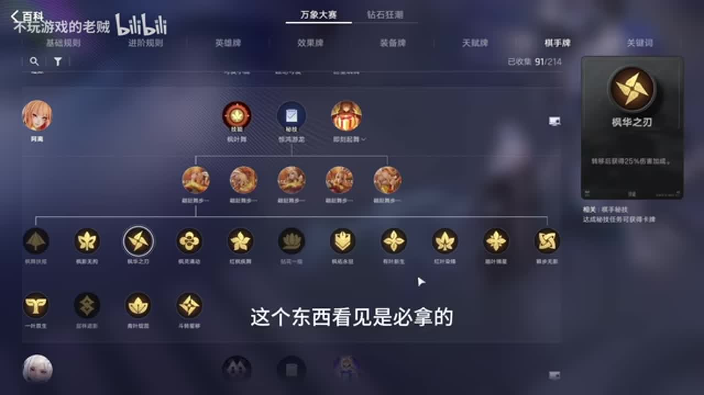

## 02:24–03:24 按对面人口多少选择不同转移强化

- 事件 ID：BV1hRem66EMw:p1:e002
- 场景：前置讲解
- 时机：比较转移模块时
- 背景（分析推断）：对方多人阵容与单挂阵容的转移需求不同
- 学习目标（分析推断）：依对手结构选择强化
- 模板：module-fit
- ASR 段落：[6, 7]

> 人口比较少的话

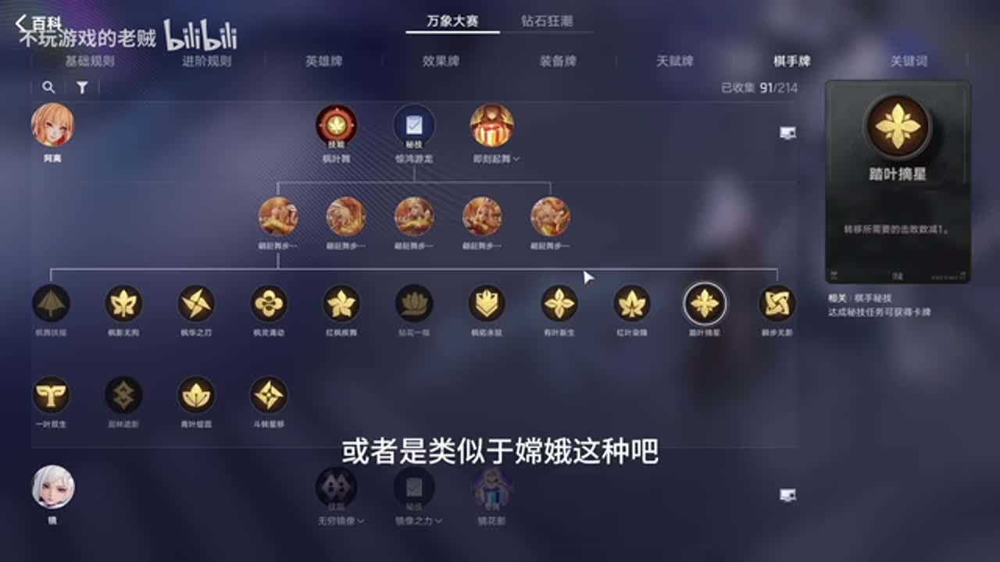

## 02:54–03:53 分身嘲讽创造输出环境，吸血使高爆发核心可以一枪恢复

- 事件 ID：BV1hRem66EMw:p1:e003
- 场景：前置讲解
- 时机：补核心生存时
- 背景（分析推断）：守约血量较低、施法前摇长，需保证能出手
- 学习目标（分析推断）：区分避险和恢复两类生存功能
- 模板：module-fit
- ASR 段落：[7, 8]

> 直接就能吸满血

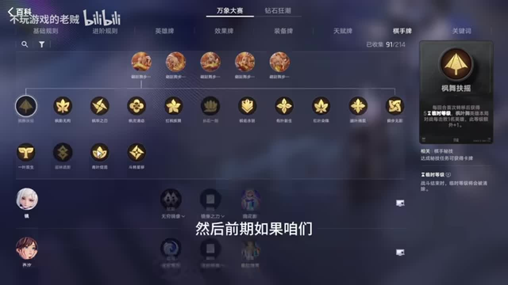

## 03:53–04:52 排除依赖普攻次数及伞落点伤害的选项

- 事件 ID：BV1hRem66EMw:p1:e004
- 场景：前置讲解
- 时机：六级大招选项时
- 背景（分析推断）：本阵容守约以技能狙击为主，伞落在空地
- 学习目标（分析推断）：按实际攻击方式排除不生效选项
- 模板：module-fit
- ASR 段落：[9, 10]

> 没有什么普攻次数

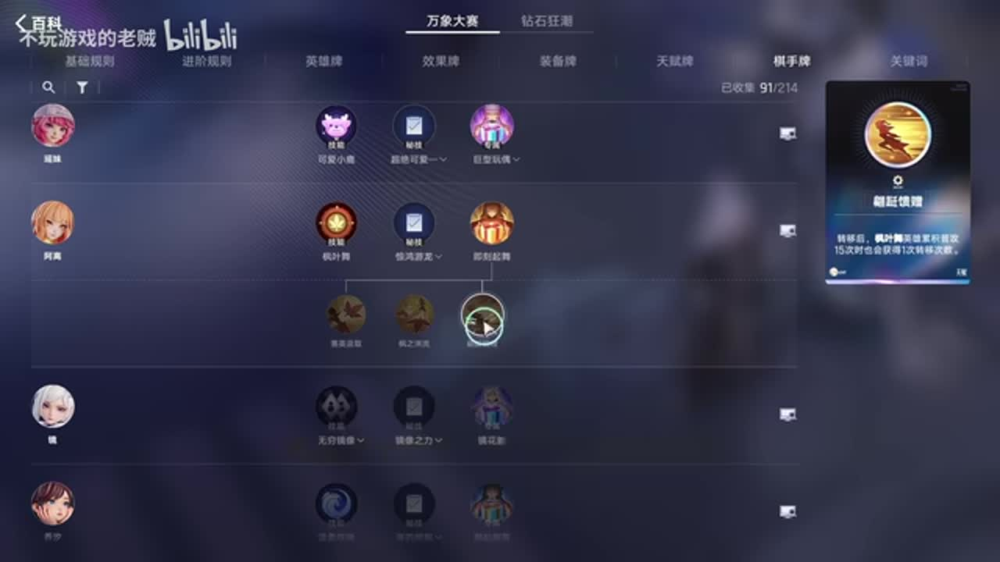

## 04:23–05:22 优先战力、经济和人口，将资源用于前中期发力

- 事件 ID：BV1hRem66EMw:p1:e005
- 场景：前置讲解
- 时机：安排天赋路线时
- 背景（分析推断）：讲者认为路线主要强势窗口在前中期；不是所有棋手的规则
- 学习目标（分析推断）：根据阵容强势窗口投入资源
- 模板：talent-fit
- ASR 段落：[10, 11]

> 把资源集中在前期强势点

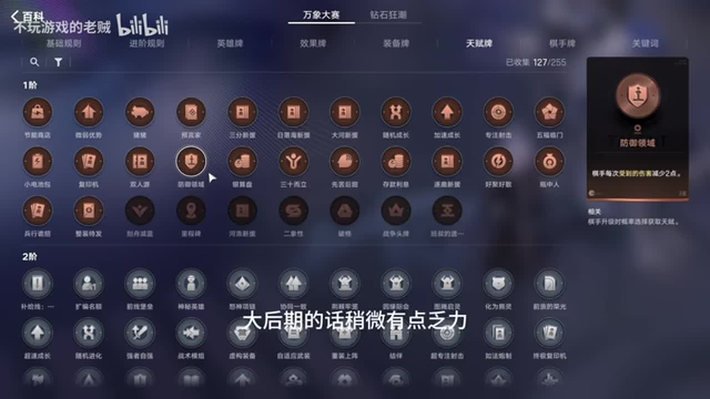

## 04:52–05:52 低阶卡组能用复印机补觉醒，增加人口可挂成长工具

- 事件 ID：BV1hRem66EMw:p1:e006
- 场景：前置讲解
- 时机：考虑复制与人口天赋时
- 背景（分析推断）：阵容卡牌三阶以下，新增人口支持额外河洛工具
- 学习目标（分析推断）：把卡池与工具位接到天赋收益
- 模板：talent-fit
- ASR 段落：[11, 12]

> 用复印机能给他们补觉醒

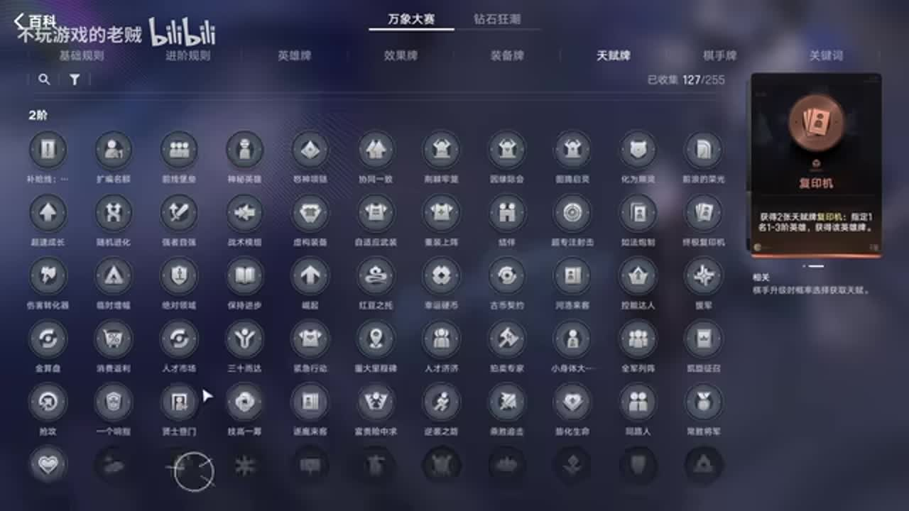

## 05:53–06:49 用天赋或神器补吸血，不需要大量但需要稳定来源

- 事件 ID：BV1hRem66EMw:p1:e007
- 场景：前置讲解
- 时机：没有吸血模块时
- 背景（分析推断）：高狙击伤害与较低血量上限形成快速恢复条件
- 学习目标（分析推断）：按技能伤害判断恢复需求
- 模板：equipment-cause
- ASR 段落：[13, 14]

> 他稍微有点吸血能力就可以

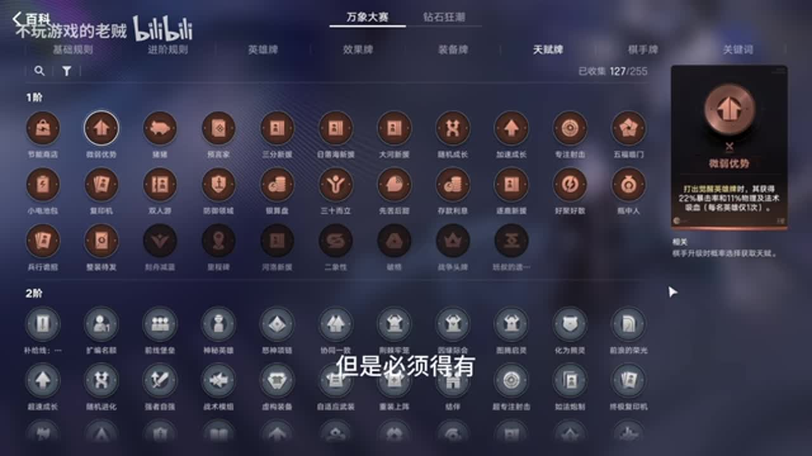

## 06:49–08:12 崛起提供临时等级与成长，后续双生突袭增加分身狙击

- 事件 ID：BV1hRem66EMw:p1:e008
- 场景：前置讲解
- 时机：银色天赋选择时
- 背景（分析推断）：限定马可守约CP组合与讲者所述奖励链，具体数值保留原话
- 学习目标（分析推断）：理解前期成长与后期战力的关联
- 模板：talent-fit
- ASR 段落：[15, 16, 17]

> 后续的话会拿到这个双生突袭

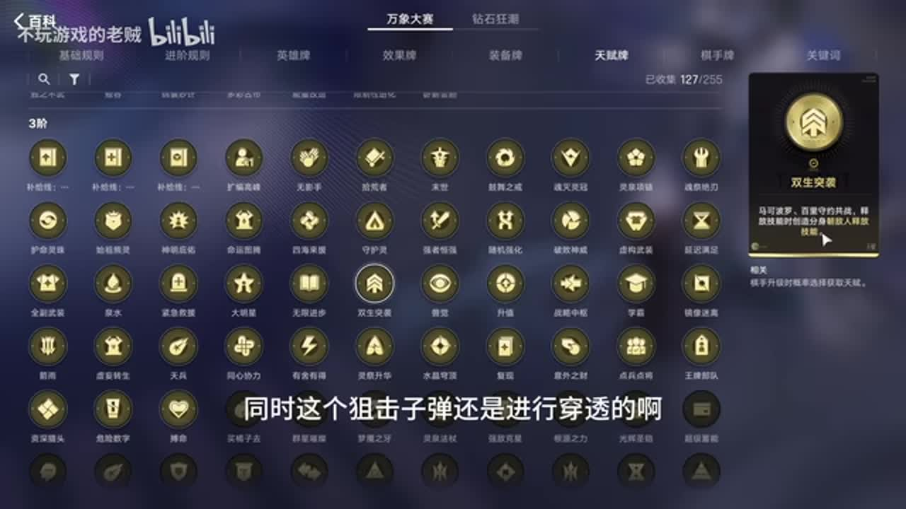

## 07:43–09:10 用牺牲次数延长无敌窗口，保护守约完成较长施法

- 事件 ID：BV1hRem66EMw:p1:e009
- 场景：前置讲解
- 时机：比较最终守卫时
- 背景（分析推断）：守约通常最后存活且牺牲卡较多，增加容错
- 学习目标（分析推断）：从施法时间与牺牲机制判断天赋价值
- 模板：talent-fit
- ASR 段落：[17, 18, 19]

> 守约由于他的施法前摇比较长

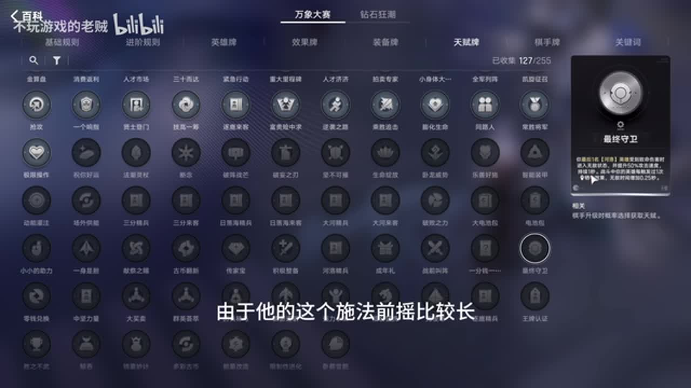

## 08:41–09:39 不选依赖囤币的传家宝，本路线前期打币提高战力

- 事件 ID：BV1hRem66EMw:p1:e010
- 场景：前置讲解
- 时机：比较古币天赋时
- 背景（分析推断）：早期滚雪球要求立即投入，与留在手中的收益相冲突
- 学习目标（分析推断）：判断资源使用节奏是否契合天赋
- 模板：economy-budget
- ASR 段落：[19, 20]

> 不可能存在手里的

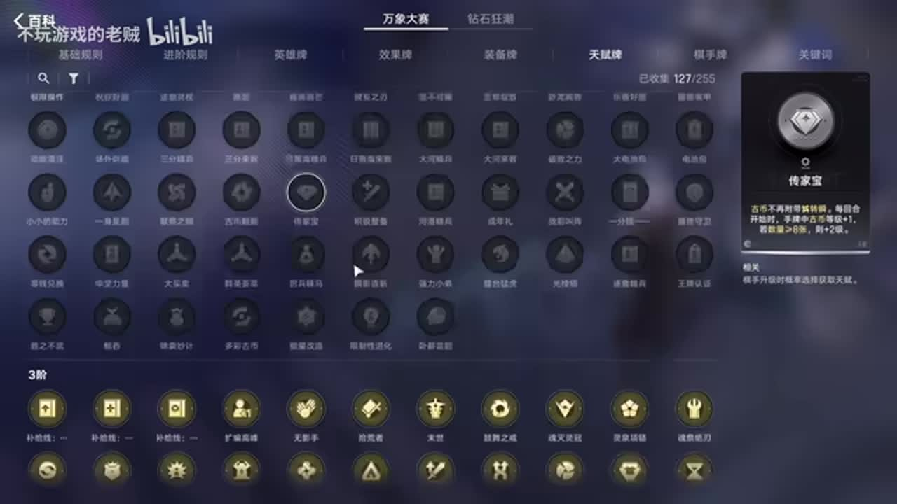

## 09:10–10:07 牺牲补给在三级有助找到牺牲工具；普攻触发效果不适合技能守约

- 事件 ID：BV1hRem66EMw:p1:e011
- 场景：前置讲解
- 时机：金色补给选项时
- 背景（分析推断）：本局停留三级找铠盾山钟馗等，具体卡名以证据为准
- 学习目标（分析推断）：以卡池与攻击方式筛选效果
- 模板：talent-fit
- ASR 段落：[20, 21]

> 他普攻的这个次数很有限

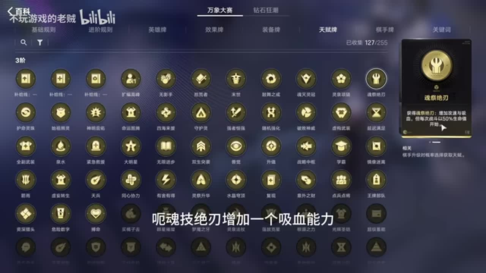

## 10:07–11:34 低阶合成补觉醒和锦囊；临时等级可由明世隐转成永久等级

- 事件 ID：BV1hRem66EMw:p1:e012
- 场景：前置讲解
- 时机：低阶成长机制介绍时
- 背景（分析推断）：分清卡牌等阶和英雄等级，资源组合依据当时口述
- 学习目标（分析推断）：理解临时成长如何保存
- 模板：growth-combo
- ASR 段落：[22, 23, 24]

> 临时等级变成这个真实等级

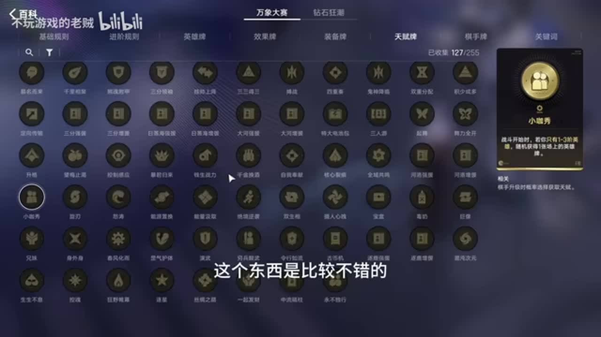

## 11:34–12:28 核心未到暂缓效果牌，核心到场且工具觉醒后再投入

- 事件 ID：BV1hRem66EMw:p1:e013
- 场景：前置讲解
- 时机：首张守约到来前后
- 背景（分析推断）：效果需要收益对象与觉醒条件，不在对象缺失时浪费
- 学习目标（分析推断）：在兑现资源前检查核心与门槛
- 模板：resource-order
- ASR 段落：[25, 26]

> 在第一张首约来之前

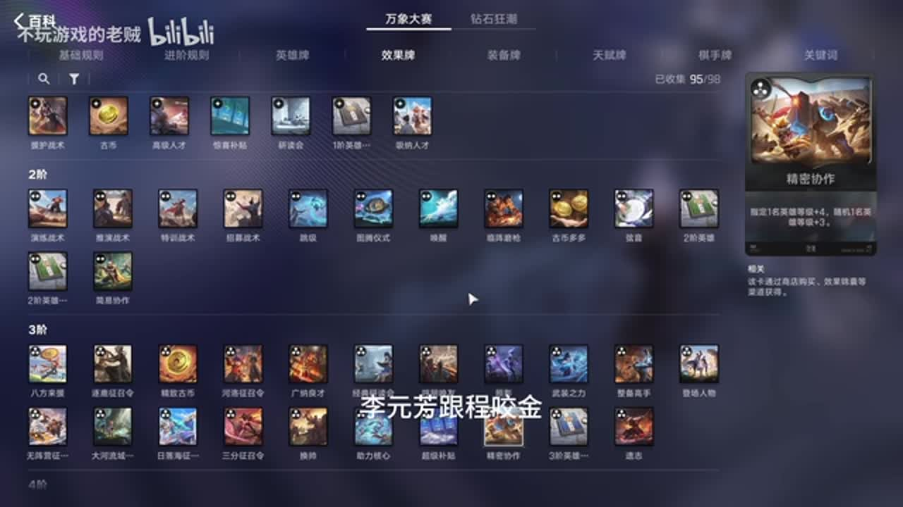

## 12:03–12:58 分解非核心装备找神器、吸血；对面控制少时可换输出效果

- 事件 ID：BV1hRem66EMw:p1:e014
- 场景：前置讲解
- 时机：单核心装备整理时
- 背景（分析推断）：单核心集中资源，解控取舍取决于对方控制
- 学习目标（分析推断）：把装备集中到瓶颈并保留反制条件
- 模板：equipment-role
- ASR 段落：[26, 27]

> 如果对面控制不太多的话

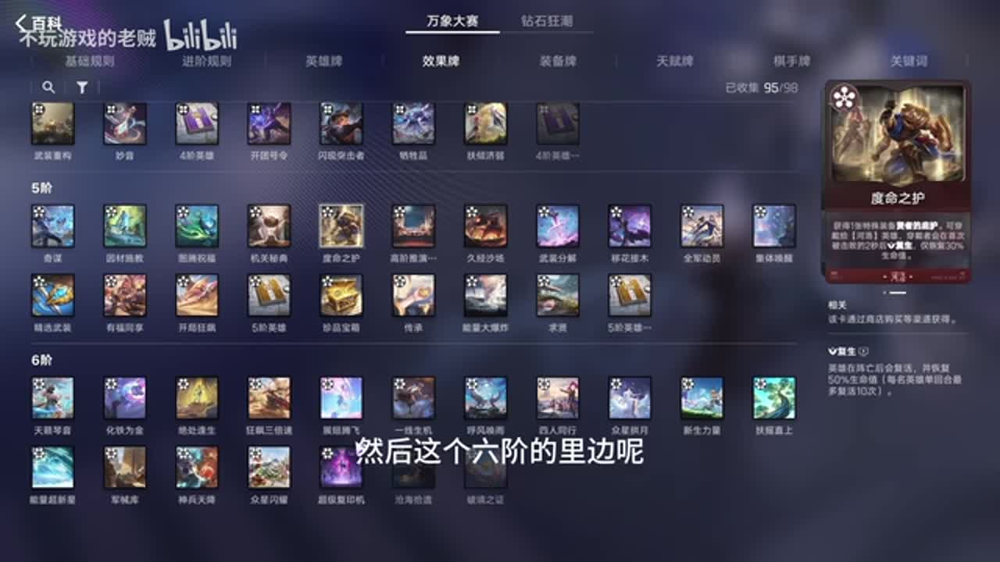

## 12:29–14:25 缺明刀考虑多一条命，缺牌补牌，三倍速加快牺牲完成前启动

- 事件 ID：BV1hRem66EMw:p1:e015
- 场景：前置讲解
- 时机：高阶资源补强时
- 背景（分析推断）：不同瓶颈需要不同拍卖资源，不构成固定必抢清单
- 学习目标（分析推断）：按缺失功能评估拍卖
- 模板：auction-choice
- ASR 段落：[27, 29, 30]

> 他就不需要等那些牺牲子去死了

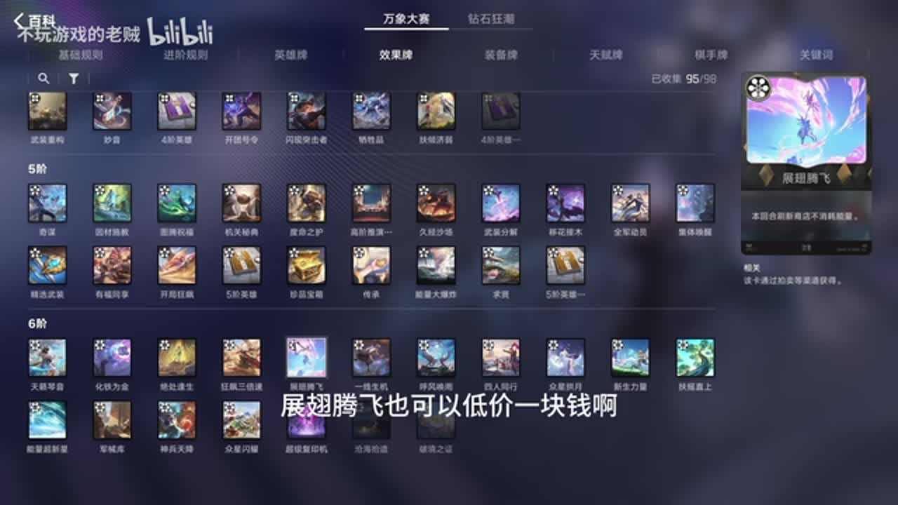

## 13:56–15:25 过渡伞给可替换的苏烈，守约到来后换掉；直升三与更稳开局有经济取舍

- 事件 ID：BV1hRem66EMw:p1:e016
- 场景：前置讲解
- 时机：开局安排与升三时
- 背景（分析推断）：李元芳仍有古币工具作用，苏烈为临时承伤
- 学习目标（分析推断）：理解过渡分工与升级成本
- 模板：opening-plan
- ASR 段落：[30, 31, 32]

> 但是可能会比较脱经济

## 15:25–16:24 先查临时等级来源与上限，再判断是否继续拿明世隐

- 事件 ID：BV1hRem66EMw:p1:e017
- 场景：前置讲解
- 时机：决定明世隐重复投入时
- 背景（分析推断）：没有其他临时等级来源时，重复投入不能无限提高收益
- 学习目标（分析推断）：识别成长链上限与边际收益
- 模板：growth-combo
- ASR 段落：[33, 34]

> 如果没有其他的找临时等级的方法

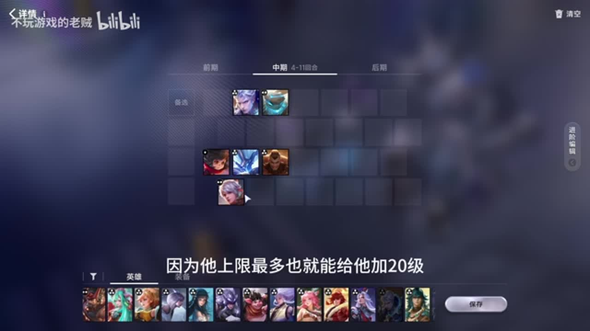

## 16:24–17:50 牺牲死亡降低法力上限，等级门槛改变狙击穿透与衰减

- 事件 ID：BV1hRem66EMw:p1:e018
- 场景：前置讲解
- 时机：牺牲缩蓝与穿透机制时
- 背景（分析推断）：数值仅记录视频口径，不独立确认为当前版本
- 学习目标（分析推断）：理解启动与等级质变两个条件
- 模板：mechanic-model
- ASR 段落：[35, 36, 37]

> 他就能基本上无限放技能了

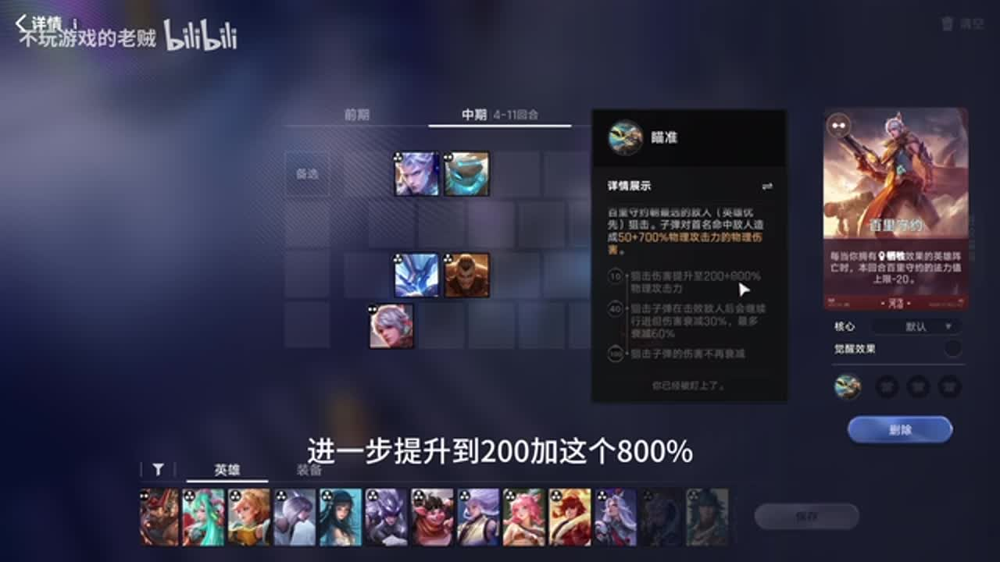

## 17:50–18:43 优先提供战力与双次牺牲的铠，其他工具与明世隐后置

- 事件 ID：BV1hRem66EMw:p1:e019
- 场景：前置讲解
- 时机：首轮拍卖时
- 背景（分析推断）：还处于缩蓝启动和工具成型阶段
- 学习目标（分析推断）：按当前瓶颈安排工具优先级
- 模板：auction-choice
- ASR 段落：[38, 39]

> 快速的给他缩蓝条

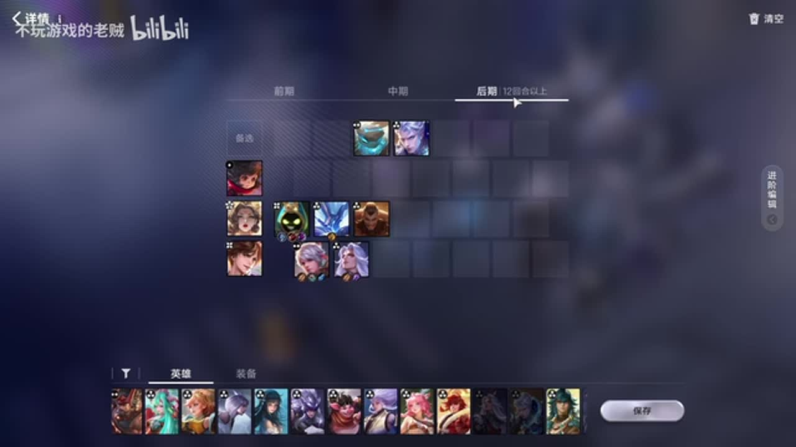

## 18:44–20:35 不一定等觉醒，升五补复活和后续觉醒，额外人口再挂成长工具

- 事件 ID：BV1hRem66EMw:p1:e020
- 场景：前置讲解
- 时机：考虑守约觉醒与升阶时
- 背景（分析推断）：觉醒主要缩短启动所需牺牲次数；回合数字限于示例
- 学习目标（分析推断）：比较留级补觉醒与升级工具收益
- 模板：level-transition
- ASR 段落：[40, 41, 42, 43]

> 他不觉醒其实也无所谓

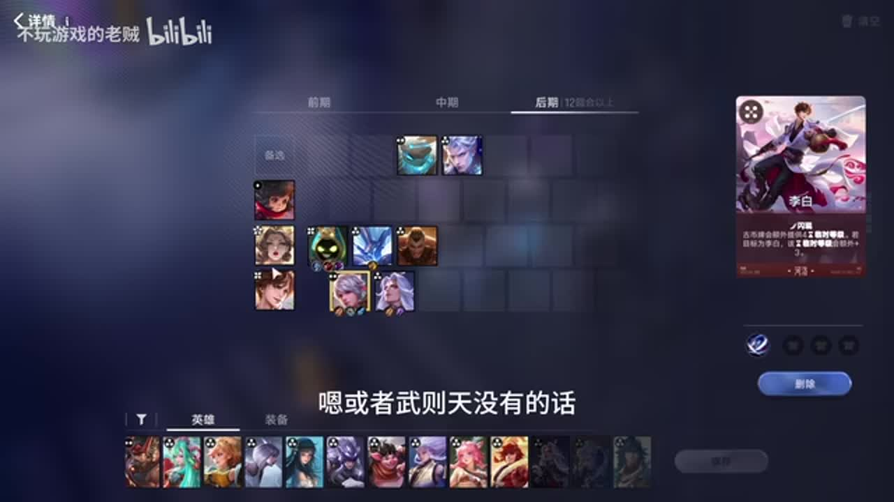

## 21:05–22:33 反伤用保命多出一枪，长前摇怕打断，免控与间歇解控不能等同

- 事件 ID：BV1hRem66EMw:p1:e021
- 场景：前置讲解
- 时机：面对反伤或控制配装时
- 背景（分析推断）：没有对应威胁时可把保命或免控换成伤害
- 学习目标（分析推断）：按威胁推导装备并保留例外
- 模板：equipment-cause
- ASR 段落：[45, 46, 47]

> 一旦被打断,他就要重新施法

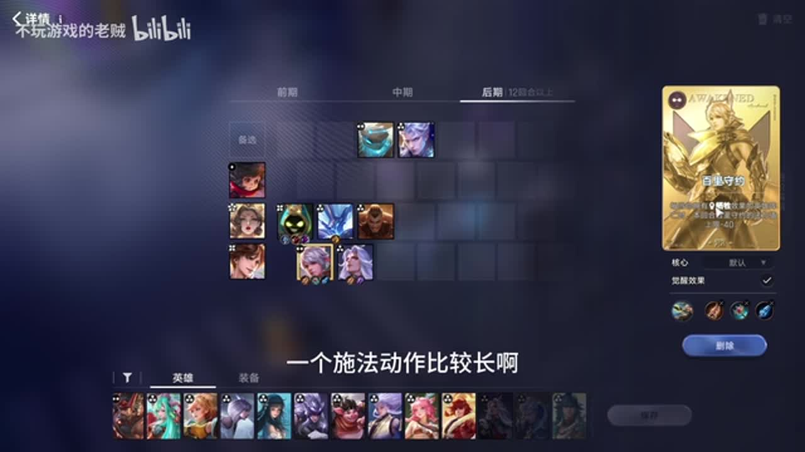

## 22:33–23:45 击杀频繁适配击杀成长神器，吸血需要可触发来源，钟馗补抗性

- 事件 ID：BV1hRem66EMw:p1:e022
- 场景：前置讲解
- 时机：神器与辅助装分配时
- 背景（分析推断）：守约输出方式决定哪些恢复装备有效
- 学习目标（分析推断）：将触发频率接到装备价值
- 模板：equipment-role
- ASR 段落：[48, 49]

> 人头收的非常快

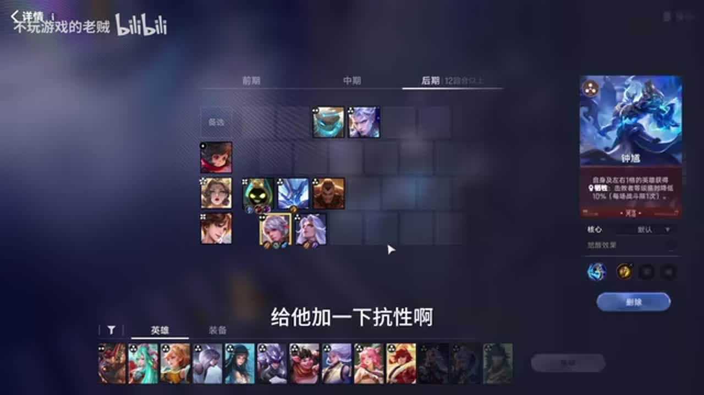

## 23:00–25:35 用成长天赋加快度过弱势期，选择速三找核心

- 事件 ID：BV1hRem66EMw:p1:e023
- 场景：实战
- 时机：开局速三且遇到崛起
- 背景（分析推断）：当前开局质量较轻，不能将天胡路线等同所有开局
- 学习目标（分析推断）：识别快速成型条件
- 模板：level-transition
- ASR 段落：[49, 50, 51]

> 快速的度过那个弱势期

## 25:35–26:22 先让挂伞单位吸引攻击，通过转移浪费对手时间

- 事件 ID：BV1hRem66EMw:p1:e024
- 场景：实战
- 时机：开战前安排接敌
- 背景（分析推断）：尚在前期，守约需要争取输出与击杀
- 学习目标（分析推断）：用接敌顺序解释站位
- 模板：position-cause
- ASR 段落：[52]

> 一转移能浪费他们的时间

## 26:22–27:06 用其他工具替换马可位置，不照抄这局天赋配置

- 事件 ID：BV1hRem66EMw:p1:e025
- 场景：实战
- 时机：解释没有崛起时怎么办
- 背景（分析推断）：本局有CP成长天赋，其他条件下需要额外工具
- 学习目标（分析推断）：区分天赋特化与常规配置
- 模板：fallback-plan
- ASR 段落：[53]

> 你如果没有崛起的话

## 27:58–28:55 现在可以打古币提高等级并减少马可抢击杀

- 事件 ID：BV1hRem66EMw:p1:e026
- 场景：实战
- 时机：守约已到而效果牌出现
- 背景（分析推断）：核心到场后资源能投入目标；击杀归属影响成长
- 学习目标（分析推断）：把投入时机连到成长收益
- 模板：resource-order
- ASR 段落：[55]

> 守约来了之后咱就可以拿古壁多多了

## 27:58–29:40 明刀可防止单次爆发直接击杀，削弱守约滚雪球

- 事件 ID：BV1hRem66EMw:p1:e027
- 场景：实战
- 时机：观察守约的弱点
- 背景（分析推断）：这是本套路爆发节奏的反制，不声称普遍无敌
- 学习目标（分析推断）：识别对方反制自己的机制
- 模板：counter-target
- ASR 段落：[55, 56]

> 怎么克制守约呢

## 30:58–31:47 先提高守约等级抢击杀而不等武则天

- 事件 ID：BV1hRem66EMw:p1:e028
- 场景：实战
- 时机：决定古币现在打还是留后期
- 背景（分析推断）：前期质量影响击杀成长速度，留牌有机会成本
- 学习目标（分析推断）：判断当前投入的滚雪球价值
- 模板：economy-budget
- ASR 段落：[58]

> 前期有资源就直接给了

## 31:59–32:48 多次复活不易靠一枪清除，对本路线威胁大

- 事件 ID：BV1hRem66EMw:p1:e029
- 场景：实战
- 时机：看到多次复活木兰成型
- 背景（分析推断）：对手多次复活与单命目标不同
- 学习目标（分析推断）：评估阵容伤害节奏的克制
- 模板：counter-target
- ASR 段落：[59]

> 多次复活的话可能对咱们的威胁比较大

## 33:40–34:25 奖励链已指向双生突袭，当前刷新机会要考虑后续不能使用

- 事件 ID：BV1hRem66EMw:p1:e030
- 场景：实战
- 时机：后续天赋刷新窗口
- 背景（分析推断）：崛起已拿，后续选择受其奖励链限制
- 学习目标（分析推断）：根据后续确定机会管理刷新
- 模板：talent-fit
- ASR 段落：[61]

> 刷新次数已经用不了了

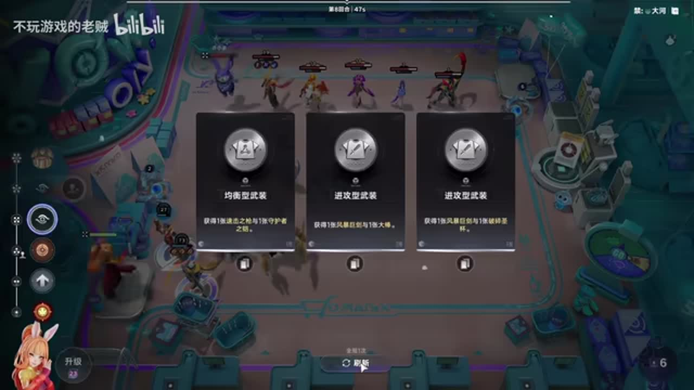

## 34:25–35:18 最远目标规则使角落嬴政成为狙击目标

- 事件 ID：BV1hRem66EMw:p1:e031
- 场景：实战
- 时机：对手核心站角落时
- 背景（分析推断）：讲者说明守约寻敌方式，前提对方无明刀
- 学习目标（分析推断）：根据寻敌规则判断暴露位置
- 模板：position-cause
- ASR 段落：[62]

> 守约是居那个最远的位置

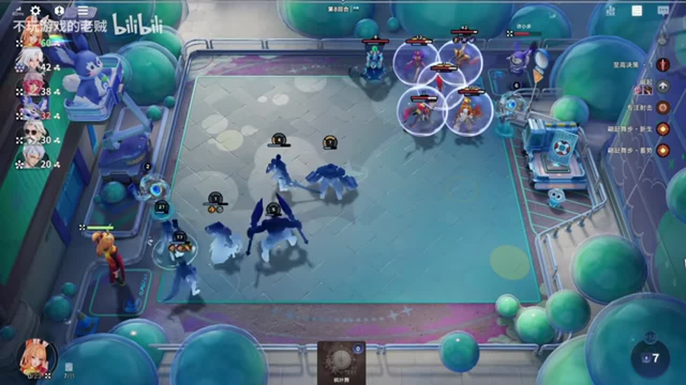

## 35:18–37:11 马可位换明世隐，更多合成补觉醒来稳住战力

- 事件 ID：BV1hRem66EMw:p1:e032
- 场景：实战
- 时机：再次解释无崛起路线
- 背景（分析推断）：本局天赋提供快速等级，常规开局缺少该成长
- 学习目标（分析推断）：识别替代路线的额外资源成本
- 模板：fallback-plan
- ASR 段落：[63, 64]

> 在第一集需要多打

## 37:11–39:01 临时等级配合永久转化，双生突袭生成分身同时狙击

- 事件 ID：BV1hRem66EMw:p1:e033
- 场景：实战
- 时机：铠和明世隐到场时
- 背景（分析推断）：画面与口述需要分别确认成长和分身，不把同一收益混记
- 学习目标（分析推断）：理解两条配合的收益来源
- 模板：growth-combo
- ASR 段落：[65, 66]

> 明士隐跟凯就能开始跌等级了

## 40:23–42:47 识别减伤和保命对单发爆发的克制

- 事件 ID：BV1hRem66EMw:p1:e034
- 场景：实战
- 时机：磐石之心挡住伤害后
- 背景（分析推断）：对手装备使狙击无法按原节奏清场
- 学习目标（分析推断）：从战斗反馈寻找具体反制
- 模板：counter-target
- ASR 段落：[68, 69]

> 挡了非常多的伤害

## 42:49–43:53 先等程咬金觉醒再使用资源

- 事件 ID：BV1hRem66EMw:p1:e035
- 场景：实战
- 时机：准备效果投入时
- 背景（分析推断）：当前工具未觉醒，收益门槛未完成
- 学习目标（分析推断）：在投入前复查工具觉醒
- 模板：resource-order
- ASR 段落：[70]

> 最好等这个程晓金觉醒

## 47:23–50:56 补太乙增加出手机会，盾罩目标至少需要破盾与击杀两发

- 事件 ID：BV1hRem66EMw:p1:e036
- 场景：实战
- 时机：对多复活和护盾目标输局后
- 背景（分析推断）：前次未挂复活辅助而出手不足；不是伤害面板越高越好
- 学习目标（分析推断）：把失败连回出手次数并修补
- 模板：combat-review
- ASR 段落：[74, 75, 76]

> 咱刚才输的主要原因是没挂那个谁

## 52:18–53:27 调整站位避开李白并尝试优先狙木兰

- 事件 ID：BV1hRem66EMw:p1:e037
- 场景：实战
- 时机：仍难击败木兰时
- 背景（分析推断）：装备成长空间有限，用接敌与目标调整寻找解法
- 学习目标（分析推断）：从局势限制选择可行调整
- 模板：position-cause
- ASR 段落：[78]

> 换个站位能把李白避开

## 53:28–55:40 解控可换保命，多一条命争取多一枪

- 事件 ID：BV1hRem66EMw:p1:e038
- 场景：实战
- 时机：确认对方无控制时
- 背景（分析推断）：对手威胁已变，装备作用需重新判断
- 学习目标（分析推断）：根据威胁更新配装
- 模板：equipment-role
- ASR 段落：[79, 80]

> 复活甲给他多一条命的话

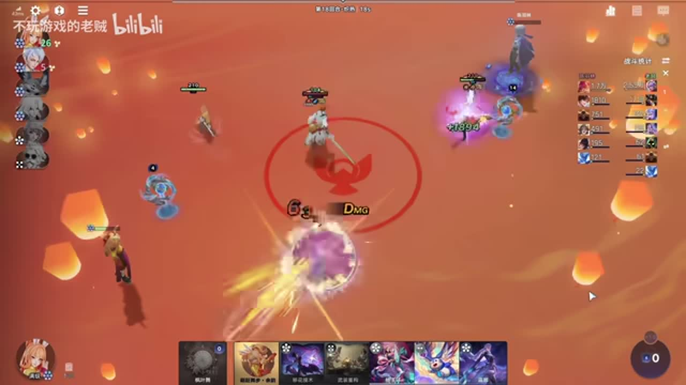

## 55:43–56:48 成长工具价值下降，下多余单位减少随机目标集合

- 事件 ID：BV1hRem66EMw:p1:e039
- 场景：实战
- 时机：最后回合准备随机目标效果
- 背景（分析推断）：移花接木希望落到守约，不保证必定命中
- 学习目标（分析推断）：理解随机目标与单位数量的关系
- 模板：resource-order
- ASR 段落：[81]

> 场上籽越少越好

## 待核实与局限

- 本次不修正ASR，同音人名与效果牌名保留原话；不清晰数值不作为现版本验证。
- 视频有崛起天赋的来牌偏向，讲者也指出局例不具代表性，不能用胜局证明一般学习效果。
- 前置段的机制数值及固定回合属于当时讲解；未核实版本。
