# 【王者万象棋】马可养猪八戒阵容详解+实战，养出超级无敌大肥猪

来源：https://www.bilibili.com/video/BV1Mseb6EEMq/?p=1

分析状态：completed

完整文字稿：../../../raw/BV1Mseb6EEMq_p1.md

## 00:00–00:58 停留低阶打出再卖出，用宝藏奖励构成资源循环

- 事件 ID：BV1Mseb6EEMq:p1:e001
- 场景：前置讲解
- 时机：理解马可刷牌循环时
- 背景（分析推断）：被动对打出低阶英雄计数，购买并非同一触发动作。
- 学习目标（分析推断）：理解循环资源来源。
- 模板：mechanic-model
- ASR 段落：[1, 2]

> 打牌卖牌就能不停的获得

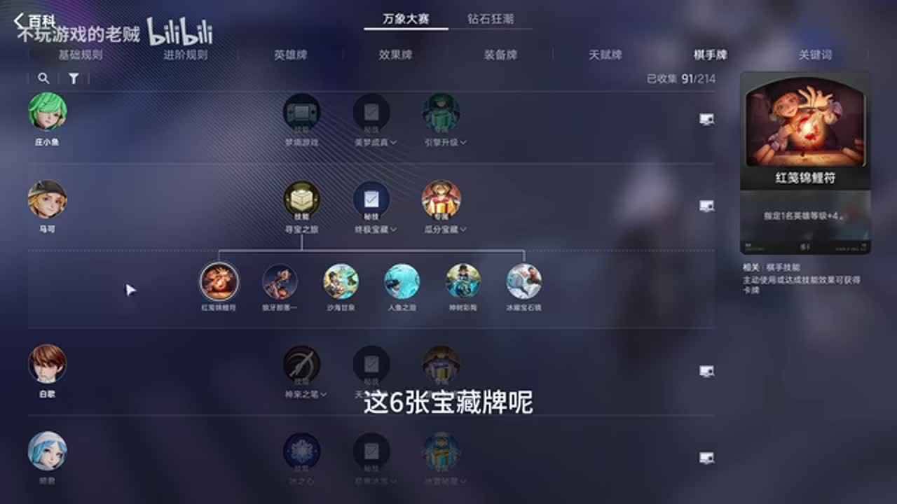

## 00:58–01:55 清理其他非觉醒手牌，只留目标，让随机复制集中到目标

- 事件 ID：BV1Mseb6EEMq:p1:e002
- 场景：前置讲解
- 时机：用随机镜子复制猪八戒时
- 背景（分析推断）：镜子从手牌随机选取，手牌构成决定结果。
- 学习目标（分析推断）：操作前控制随机目标集合。
- 模板：resource-order
- ASR 段落：[3, 4]

> 手上只留猪八戒

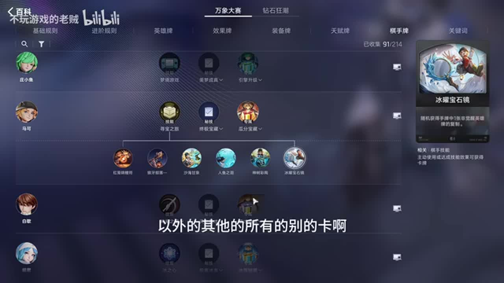

## 01:55–02:57 吸睛自拍可拿目标或合成资源，同时联动等级、锦囊与被动

- 事件 ID：BV1Mseb6EEMq:p1:e003
- 场景：前置讲解
- 时机：选择终极宝藏奖励时
- 背景（分析推断）：场上五人留打出位，随机复制不到主输出也可能有循环收益。
- 学习目标（分析推断）：评价奖励的多层资源联动。
- 模板：growth-combo
- ASR 段落：[5, 6, 7]

> 加三个进度

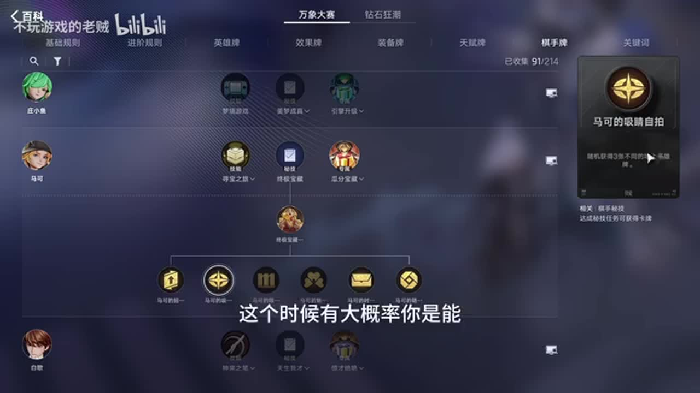

## 03:26–04:17 早期争取强化镜子，完成后改选增加宝藏数量的奖励

- 事件 ID：BV1Mseb6EEMq:p1:e004
- 场景：前置讲解
- 时机：镜子强化已经完成时
- 背景（分析推断）：奖励优先级随强化状态变化。
- 学习目标（分析推断）：根据已完成的成长步骤调整选择。
- 模板：talent-fit
- ASR 段落：[8, 9]

> 一旦强化出宝石镜

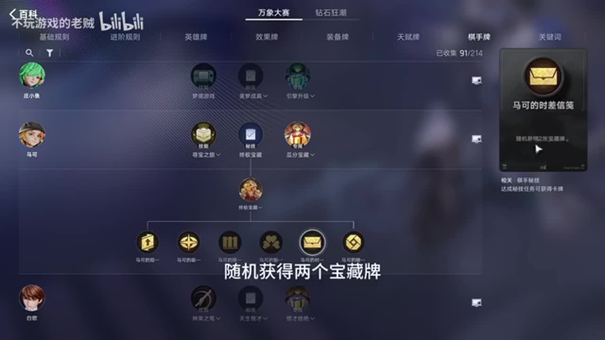

## 04:18–05:14 先积累宝藏数量，再确保主输出品阶在场人数最多以利用重点照顾

- 事件 ID：BV1Mseb6EEMq:p1:e005
- 场景：前置讲解
- 时机：准备升六开启大招时
- 背景（分析推断）：数量与场上品阶分布共同影响增伤；视频数值未独立校验。
- 学习目标（分析推断）：开技能前检查收益条件。
- 模板：resource-order
- ASR 段落：[10, 11]

> 三阶英雄是场上人数最多的

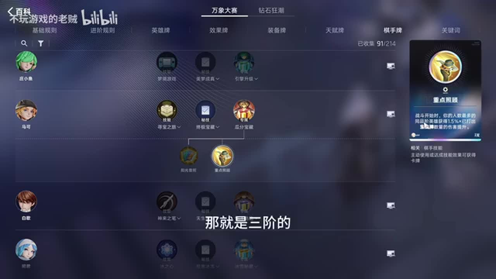

## 05:16–06:12 刷新减费因操作次数获得较高累计收益，额外低阶牌加速被动与成型

- 事件 ID：BV1Mseb6EEMq:p1:e006
- 场景：前置讲解
- 时机：高频刷新路线选择早期天赋时
- 背景（分析推断）：同样单次优惠在高频操作中总价值更大。
- 学习目标（分析推断）：按使用次数评价资源天赋。
- 模板：talent-fit
- ASR 段落：[12, 13]

> 他的总收益都会非常高

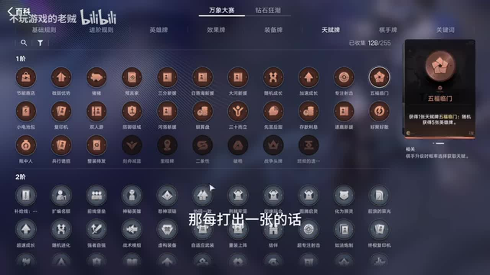

## 05:44–06:38 复制机可提供种猪替代，随机等级给转移工具也不必然浪费

- 事件 ID：BV1Mseb6EEMq:p1:e007
- 场景：前置讲解
- 时机：一直没有镜子但需要主输出上场时
- 背景（分析推断）：启动缺口是保留可复制主输出，替代资源解决同一缺口。
- 学习目标（分析推断）：识别资源的功能替代。
- 模板：fallback-plan
- ASR 段落：[13, 14]

> 复印机是非常优质的选择

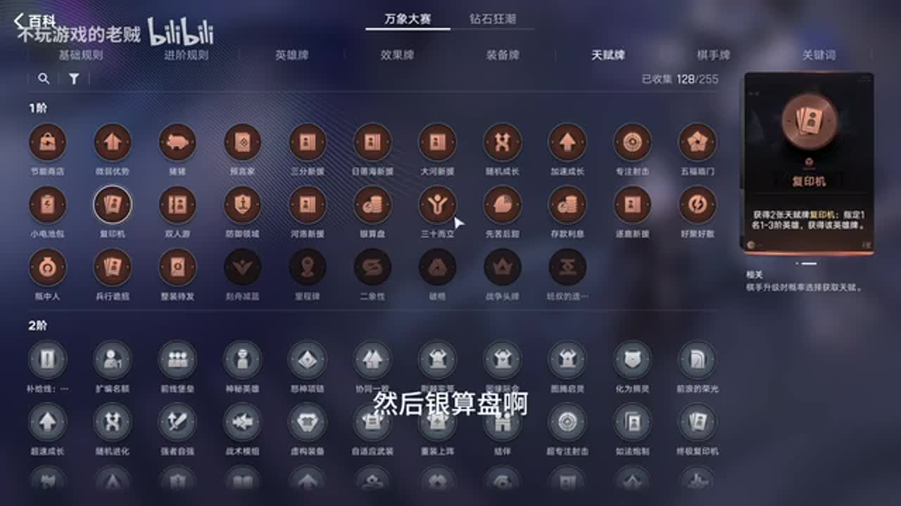

## 07:11–08:05 只有对局压力低且能赢时才考虑瓶中人

- 事件 ID：BV1Mseb6EEMq:p1:e008
- 场景：前置讲解
- 时机：考虑连胜积累天赋时
- 背景（分析推断）：对手后期发力可给前中期连续获胜窗口。
- 学习目标（分析推断）：基于实际连胜概率评估天赋。
- 模板：talent-fit
- ASR 段落：[16, 17]

> 对局压力不大的情况下

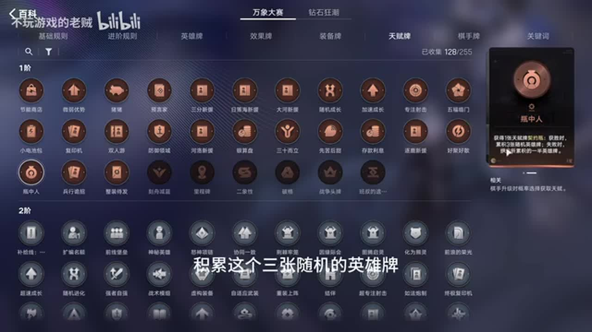

## 08:30–09:27 反复打卖触发额外英雄牌，再触发马可宝藏，扩展循环

- 事件 ID：BV1Mseb6EEMq:p1:e009
- 场景：前置讲解
- 时机：刷牌流遇到同路人时
- 背景（分析推断）：收益来自牌与被动的双向联动，而非天赋名称本身。
- 学习目标（分析推断）：理解反馈式资源循环。
- 模板：growth-combo
- ASR 段落：[19, 20]

> 它就形成一个倒转的效果

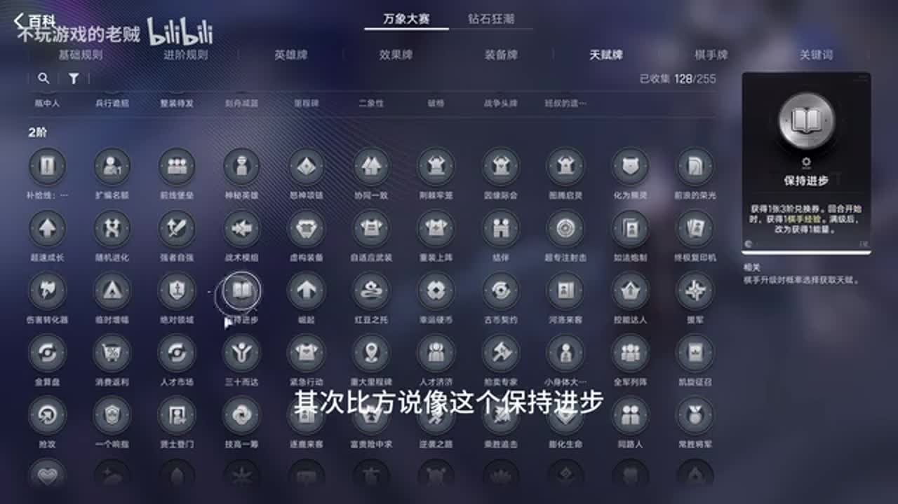

## 09:42–10:24 猪八戒等级和装备足以继续赢时才把连胜转化为更多主输出牌

- 事件 ID：BV1Mseb6EEMq:p1:e010
- 场景：前置讲解
- 时机：凯旋征兆出现时
- 背景（分析推断）：输赢把握是收益兑现的前提。
- 学习目标（分析推断）：判断有条件奖励是否能兑现。
- 模板：talent-fit
- ASR 段落：[21, 22]

> 根据情况判定你这局能不能赢

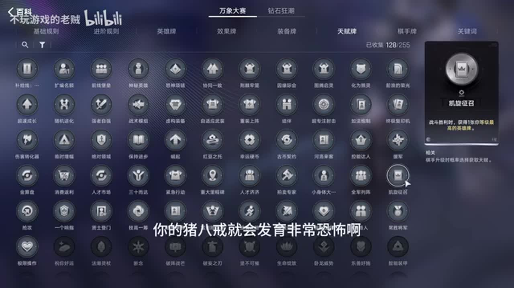

## 10:26–11:46 小咖秀与永不独行可在长期停三期间回本，未来失效不等于当前无价值

- 事件 ID：BV1Mseb6EEMq:p1:e011
- 场景：前置讲解
- 时机：后期可能用高阶辅助但当前是低阶构筑时
- 背景（分析推断）：太乙到场较晚且不是立即必须，评估实际生效时长。
- 学习目标（分析推断）：按生效阶段评价天赋。
- 模板：talent-fit
- ASR 段落：[23, 24, 25]

> 那个时候早就已经回本了

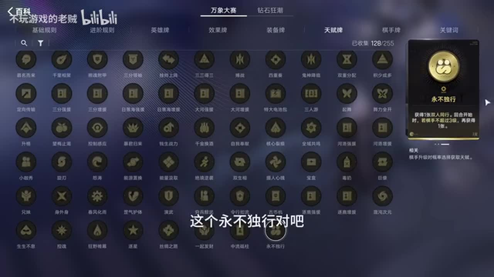

## 11:56–13:15 护盾损失也能触发成长；扣大量生命的吸血装备需考虑被秒风险

- 事件 ID：BV1Mseb6EEMq:p1:e012
- 场景：前置讲解
- 时机：给猪八戒选护盾与吸血资源时
- 背景（分析推断）：高生命主输出对扣半生命损失敏感。
- 学习目标（分析推断）：同时评估增益与代价。
- 模板：equipment-role
- ASR 段落：[26, 27, 28]

> 扣这50的损失太大

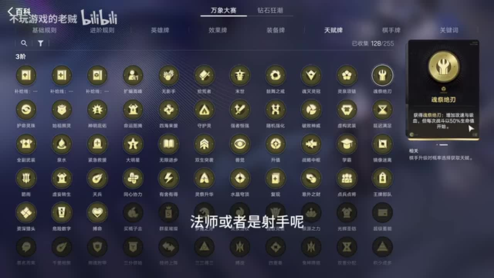

## 12:45–13:44 较少单位与镜子降低全员觉醒难度，提高强者恒强的可兑现性

- 事件 ID：BV1Mseb6EEMq:p1:e013
- 场景：前置讲解
- 时机：考虑全员觉醒奖励时
- 背景（分析推断）：奖励条件是否能完成取决于构筑工具。
- 学习目标（分析推断）：判断条件型增益的达成难度。
- 模板：talent-fit
- ASR 段落：[28, 29]

> 想复制出全员觉醒是很简单的

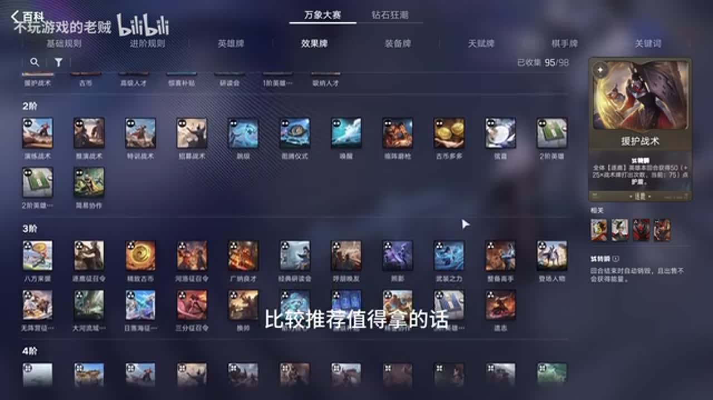

## 13:46–15:41 优先两张体系英雄牌，再一张目标，最后刷新或升级资源

- 事件 ID：BV1Mseb6EEMq:p1:e014
- 场景：前置讲解
- 时机：合成锦囊三选一时
- 背景（分析推断）：每张牌同时提供回收经济与宝藏进度。
- 学习目标（分析推断）：从循环收益排序奖励。
- 模板：resource-order
- ASR 段落：[30, 31, 32, 33]

> 有两张的就拿两张

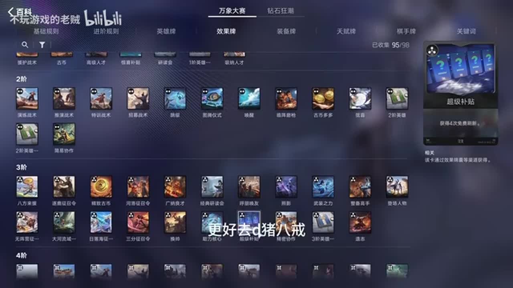

## 15:14–16:35 按速六、肉装、复制或太乙觉醒缺口选择，救命牌并非固定最高

- 事件 ID：BV1Mseb6EEMq:p1:e015
- 场景：前置讲解
- 时机：第三轮拍卖时
- 背景（分析推断）：太乙被抢空而仅一张时，觉醒资源价值上升。
- 学习目标（分析推断）：根据当前缺口而非固定表格竞拍。
- 模板：auction-choice
- ASR 段落：[33, 34, 35]

> 根据情况来选择

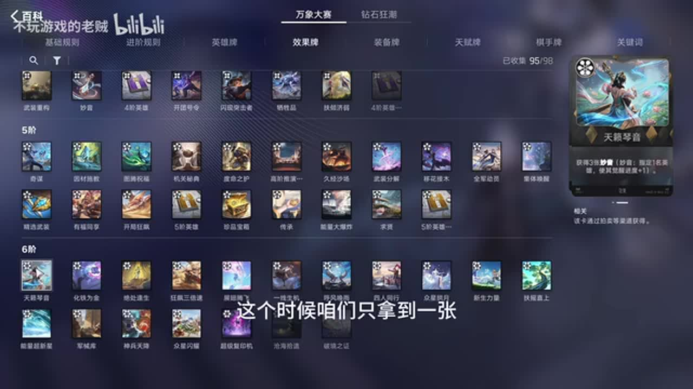

## 16:36–18:02 用孙尚香合成奖励找曹操或梦奇，没找到也可补两名二阶稳血

- 事件 ID：BV1Mseb6EEMq:p1:e016
- 场景：模拟演示
- 时机：规划开局五人口时
- 背景（分析推断）：梦奇失败后品阶变化提供目标兑换与后续刷牌价值。
- 学习目标（分析推断）：把开局稳血和后续资源计划相连。
- 模板：opening-plan
- ASR 段落：[36, 37, 38]

> 前期形成一个很好的战力

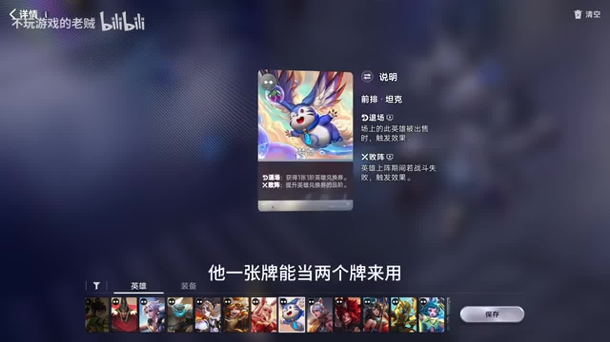

## 18:03–19:01 不在二级额外搜曹操，三级成型时顺带找；先有姬小满再卖工具兑现刷新

- 事件 ID：BV1Mseb6EEMq:p1:e017
- 场景：模拟演示
- 时机：升三更换过渡阵容时
- 背景（分析推断）：替换顺序影响可获得的刷新次数。
- 学习目标（分析推断）：在换人前保留退出收益。
- 模板：resource-order
- ASR 段落：[39, 40]

> 先下这个曹老板

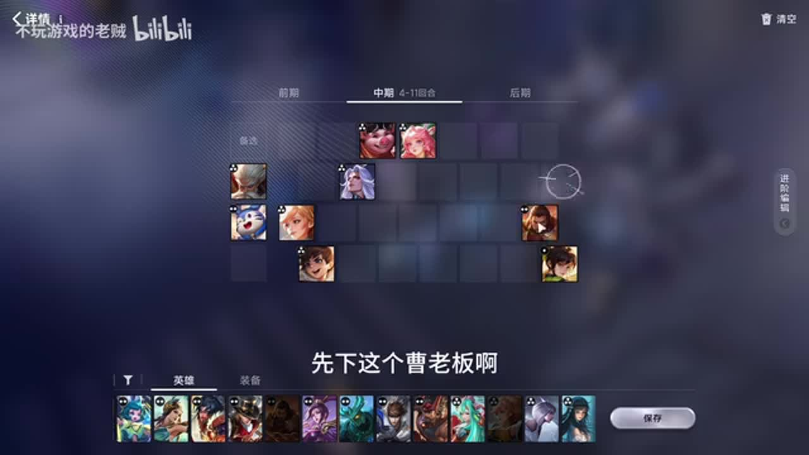

## 19:01–20:29 通常留种猪等待镜子；独家时可先上第一张，同行多须先复制

- 事件 ID：BV1Mseb6EEMq:p1:e018
- 场景：模拟演示
- 时机：第一次获得猪八戒时
- 背景（分析推断）：牌库竞争影响留手与立即上场的风险。
- 学习目标（分析推断）：按竞争程度调整主输出保留策略。
- 模板：fallback-plan
- ASR 段落：[41, 42, 43]

> 如果猪八戒同行比较多

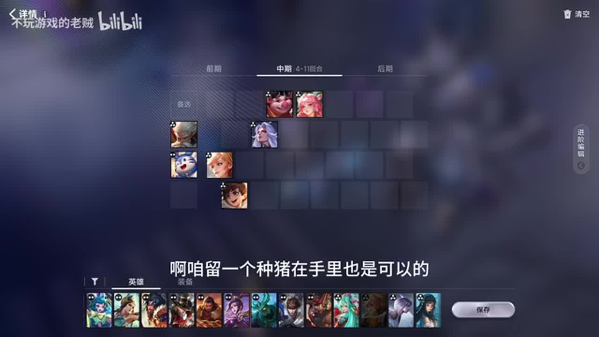

## 20:02–21:25 必须先上场再卖；电脑可用快捷键提高操作效率；优先吸工具而保留瑶等级

- 事件 ID：BV1Mseb6EEMq:p1:e019
- 场景：模拟演示
- 时机：执行打卖与吸等级操作时
- 背景（分析推断）：触发被动与单位功能同时约束操作。
- 学习目标（分析推断）：掌握正确操作顺序并减少机械负担。
- 模板：resource-order
- ASR 段落：[43, 44, 45]

> 一定要先打到场上再卖

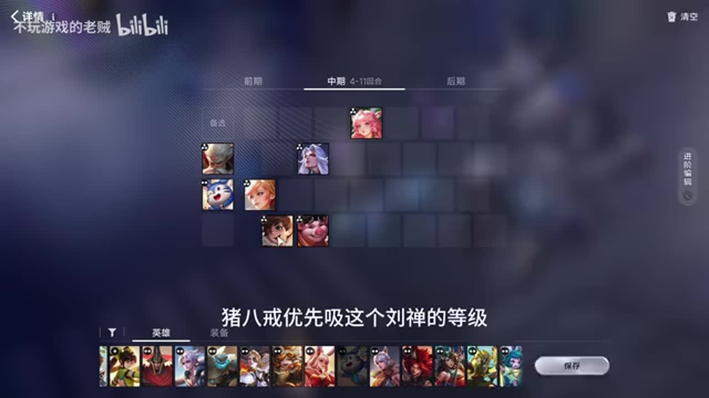

## 20:59–22:23 优先能额外给牌、金币或刷新的单位；老夫子可跨回合再触发

- 事件 ID：BV1Mseb6EEMq:p1:e020
- 场景：模拟演示
- 时机：挑选刷牌材料时
- 背景（分析推断）：不是任意同价英雄收益都相等。
- 学习目标（分析推断）：识别复合收益的工具卡。
- 模板：growth-combo
- ASR 段落：[45, 46, 47]

> 这些有额外收益的这些牌

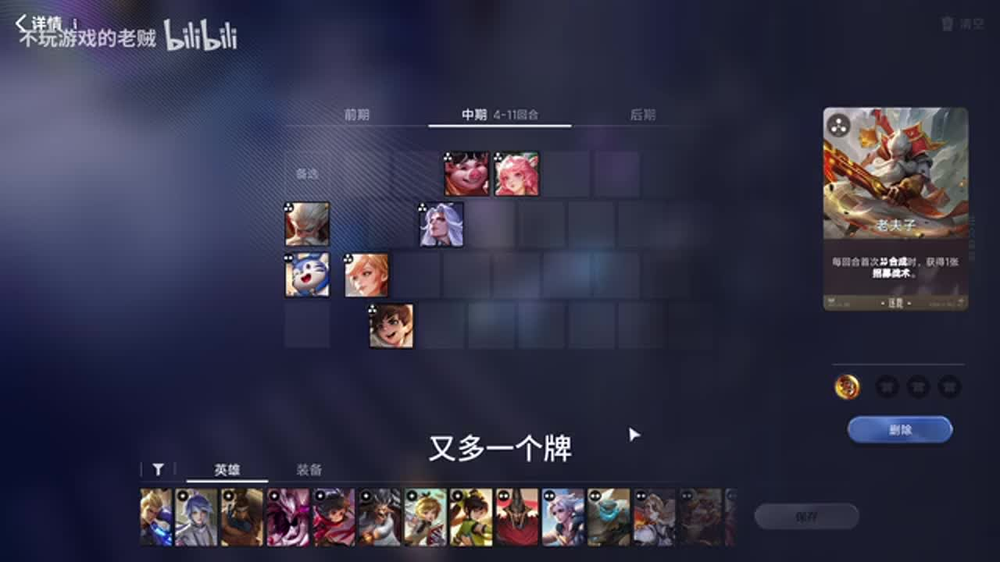

## 21:54–22:51 比较体系需要的阵营和老夫子工具可用性，缺工具时收益上限较低

- 事件 ID：BV1Mseb6EEMq:p1:e021
- 场景：前置讲解
- 时机：检查禁用阵营是否适合路线时
- 背景（分析推断）：讲者区分可玩与最适合；原始ASR禁字误识未修正。
- 学习目标（分析推断）：区分核心依赖和效率工具。
- 模板：opening-plan
- ASR 段落：[47, 48]

> 上限会低一点

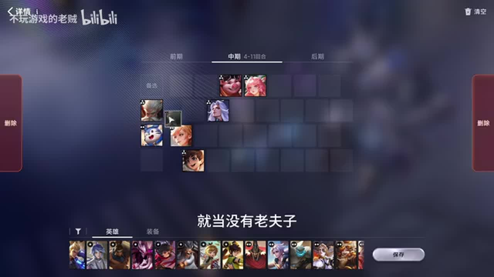

## 22:51–24:16 结束低阶刷牌；太乙库存少先四级抢，再连续升六，否则可直接六级找

- 事件 ID：BV1Mseb6EEMq:p1:e022
- 场景：模拟演示
- 时机：第三轮拍卖后其他路线发力时
- 背景（分析推断）：阶段战力压力与关键牌剩余库存共同决定升级路径。
- 学习目标（分析推断）：把升级时机与对手压力、牌库信息相连。
- 模板：level-transition
- ASR 段落：[49, 50, 51]

> 咱们只升四级

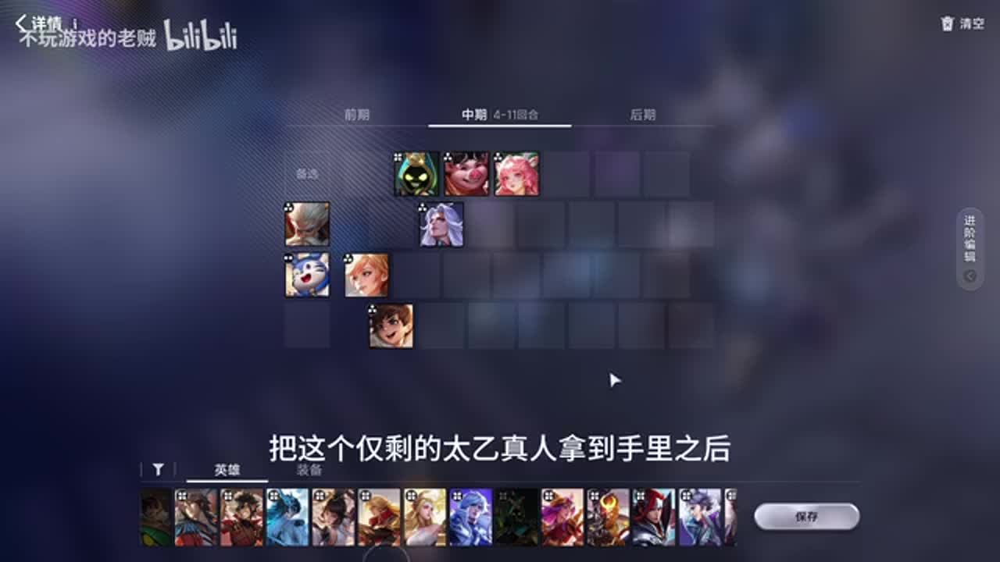

## 24:46–26:37 回血延长承伤并积累生命，反甲利用高坦度应对射手

- 事件 ID：BV1Mseb6EEMq:p1:e023
- 场景：前置讲解
- 时机：理解猪八戒成长与装备时
- 背景（分析推断）：技能按生命造成法伤，不能只依据普攻外观配装。
- 学习目标（分析推断）：从技能与承伤机制推导装备。
- 模板：equipment-role
- ASR 段落：[53, 54, 55, 56]

> 给他出回血,他就能承受更多的伤害

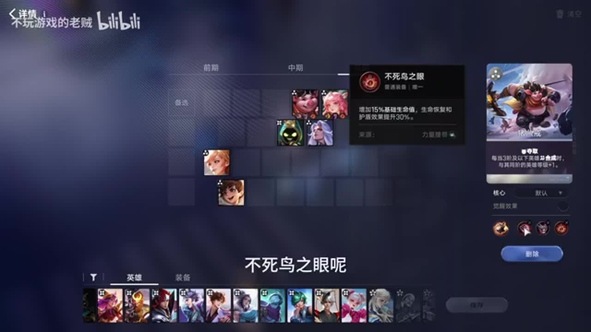

## 26:38–28:05 辅助自身属性可回馈主输出，附身状态仍可利用部分装备功能

- 事件 ID：BV1Mseb6EEMq:p1:e024
- 场景：前置讲解
- 时机：给瑶分配防具时
- 背景（分析推断）：视频说明属性返还与附身的组合收益，比例未独立校验。
- 学习目标（分析推断）：理解辅助装备也能服务核心。
- 模板：growth-combo
- ASR 段落：[57, 58, 59]

> 返还给这个猪八戒

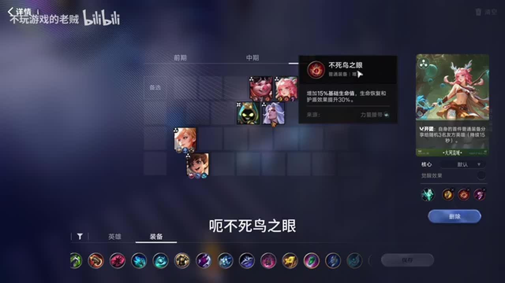

## 27:38–29:03 比较恢复频率、回蓝、护盾、控制与法术吸血，替换同功能位置

- 事件 ID：BV1Mseb6EEMq:p1:e025
- 场景：前置讲解
- 时机：神器替代普通恢复装时
- 背景（分析推断）：神器优先级由实际功能和单位伤害机制决定。
- 学习目标（分析推断）：进行有依据的装备替代。
- 模板：equipment-role
- ASR 段落：[59, 60, 61]

> 帮助它能更快地进行砸地板

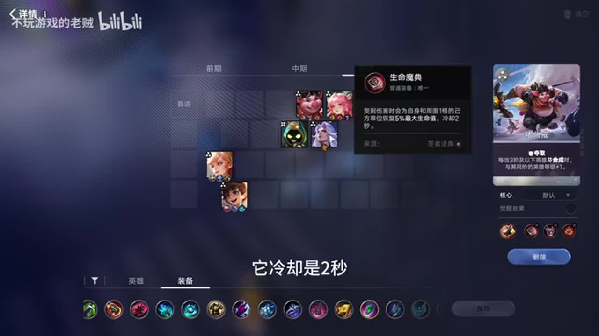

## 28:34–30:13 考虑免控输出装备，但会占防御位；射手威胁小才更适合换反甲

- 事件 ID：BV1Mseb6EEMq:p1:e026
- 场景：前置讲解
- 时机：控制影响猪八戒释放技能时
- 背景（分析推断）：免控提高输出而损失坦度，不是无条件升级。
- 学习目标（分析推断）：在针对收益与生存代价之间取舍。
- 模板：counter-target
- ASR 段落：[61, 62, 63]

> 会少一件防御类装备

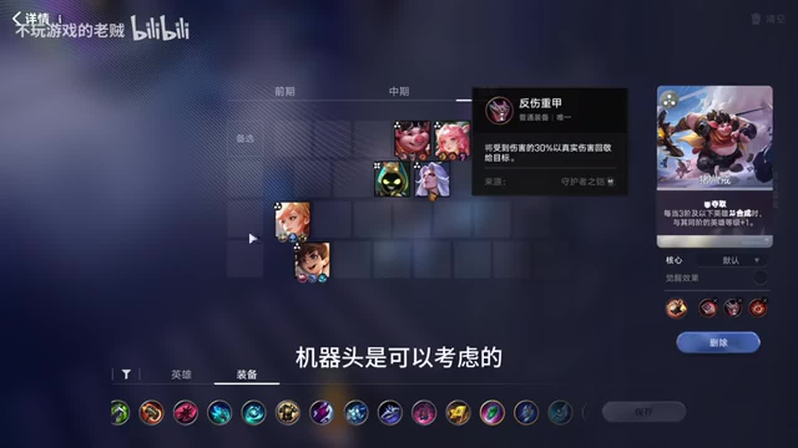

## 30:18–31:33 暂把等级给孙尚香，后续可转猪；让牛魔承担前排保护后排

- 事件 ID：BV1Mseb6EEMq:p1:e027
- 场景：实战
- 时机：开局需要过渡稳血时
- 背景（分析推断）：资源可回收转移减少过渡投入损失。
- 学习目标（分析推断）：结合站位与可转移资源稳血。
- 模板：position-cause
- ASR 段落：[64]

> 确保打这个牛魔

## 31:35–33:25 不花额外费用和刷新追孙尚香，拍卖先主输出，再工具；避免同行竞争

- 事件 ID：BV1Mseb6EEMq:p1:e028
- 场景：实战
- 时机：开局自然牌未觉醒时
- 背景（分析推断）：路线更依赖三级后成型与刷牌，开局过渡不宜挤占预算。
- 学习目标（分析推断）：识别过渡投入的合理上限。
- 模板：economy-budget
- ASR 段落：[65, 66]

> 咱们不花钱去那个找

## 34:11–35:10 复制机承担留种功能，可不用额外保留种猪

- 事件 ID：BV1Mseb6EEMq:p1:e029
- 场景：实战
- 时机：已有复制机准备上猪八戒时
- 背景（分析推断）：同一留牌规则随着替代功能到位改变。
- 学习目标（分析推断）：根据现有资源调整保留要求。
- 模板：fallback-plan
- ASR 段落：[67]

> 复印机就是种猪

## 35:17–39:48 吸走孙尚香等级后下场，避免多余单位干扰自拍目标

- 事件 ID：BV1Mseb6EEMq:p1:e030
- 场景：实战
- 时机：等级集中与自拍之前时
- 背景（分析推断）：临时贪等级与复制范围存在冲突。
- 学习目标（分析推断）：兑现工具收益后及时撤下。
- 模板：resource-order
- ASR 段落：[68, 69, 70]

> 别影响那个影响那个自拍

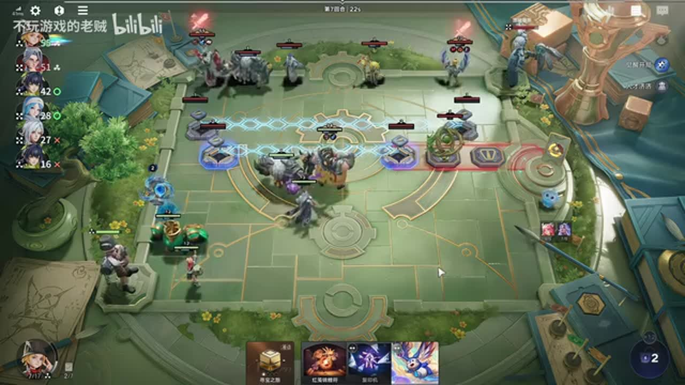

## 41:30–44:46 保留两张种猪以利用强化复制；老夫子可留下一轮再触发

- 事件 ID：BV1Mseb6EEMq:p1:e031
- 场景：实战
- 时机：镜子强化终于成功时
- 背景（分析推断）：强化状态改变可复制数量与最佳手牌配置。
- 学习目标（分析推断）：在关键成长完成后更新操作方式。
- 模板：growth-combo
- ASR 段落：[72, 73]

> 一下能复制两个

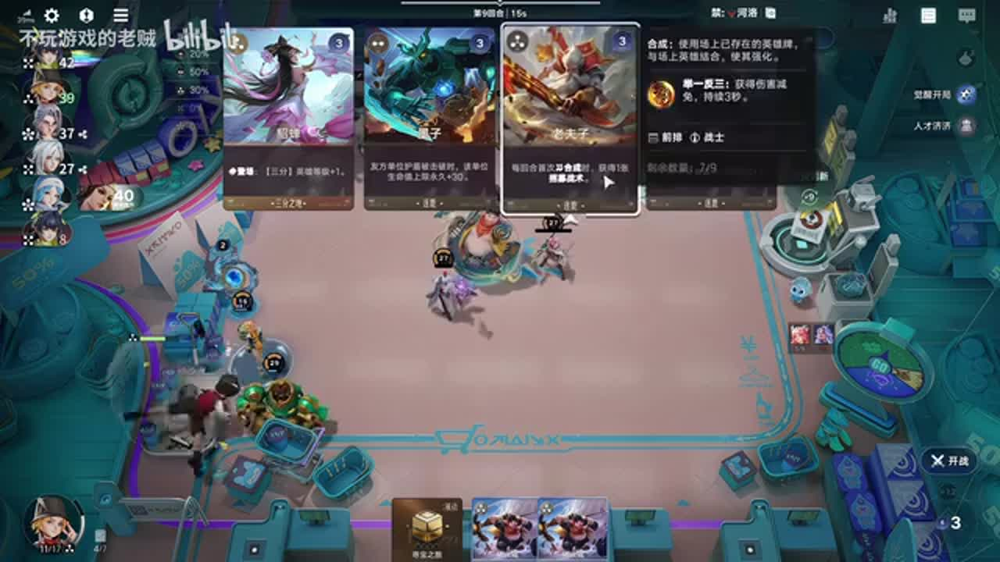

## 46:59–47:39 想先挂老夫子再打猪以多得牌，但因时间不足舍弃额外收益

- 事件 ID：BV1Mseb6EEMq:p1:e032
- 场景：实战
- 时机：倒计时操作来不及时
- 背景（分析推断）：明确展示手速约束；不能要求玩家无条件照做完整组合。
- 学习目标（分析推断）：根据时间预算优先完成关键操作。
- 模板：resource-order
- ASR 段落：[75]

> 操作有点来不及了

## 47:41–50:16 争取升级资源并补回血书，为高等级阶段准备战力

- 事件 ID：BV1Mseb6EEMq:p1:e033
- 场景：实战
- 时机：拍卖后准备从停三转速六时
- 背景（分析推断）：讲者指出装备缺防御，启动资源与生存缺口同时存在。
- 学习目标（分析推断）：升级前补齐阶段最紧迫的功能。
- 模板：level-transition
- ASR 段落：[76, 77]

> 优先拿回血书

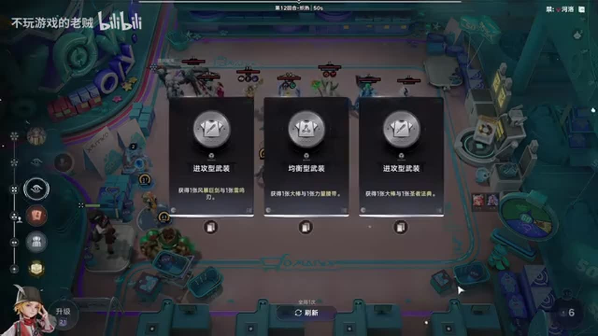

## 48:54–52:04 屏障未铺满最后一排，让猪八戒能跳进去；站位应回应敌人突进机制

- 事件 ID：BV1Mseb6EEMq:p1:e034
- 场景：实战
- 时机：观察敌方屏障防线战斗时
- 背景（分析推断）：讲者对对手布局做机制解释，不以单次输赢推广所有站位。
- 学习目标（分析推断）：识别防线布局如何影响敌方技能路径。
- 模板：position-cause
- ASR 段落：[77, 78]

> 这让我跳进去了

## 50:16–53:02 紧急找太乙复活提高容错；高等级刷牌量下降，不能仍按停三阶段预期

- 事件 ID：BV1Mseb6EEMq:p1:e035
- 场景：实战
- 时机：进入决赛但仅一条命时
- 背景（分析推断）：残局需求从循环积累转为保护当前战力。
- 学习目标（分析推断）：识别阶段变化后的核心缺口。
- 模板：fallback-plan
- ASR 段落：[78, 79]

> 这一条命还是有点悬

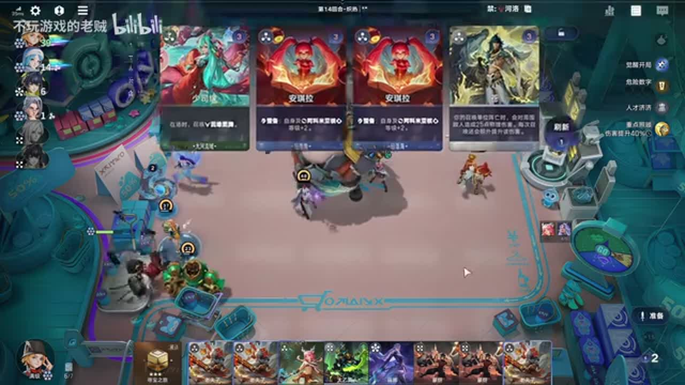

## 待核实与局限

- 段18与19起点有0.31秒倒退，原始时间戳保留未修正。
- 转写存在静音或缺口，尤其终局长间隔，不补写缺失解释。
- 卡名、禁用阵营同音误识保留，机制和数值仅据视频版本讲解。
