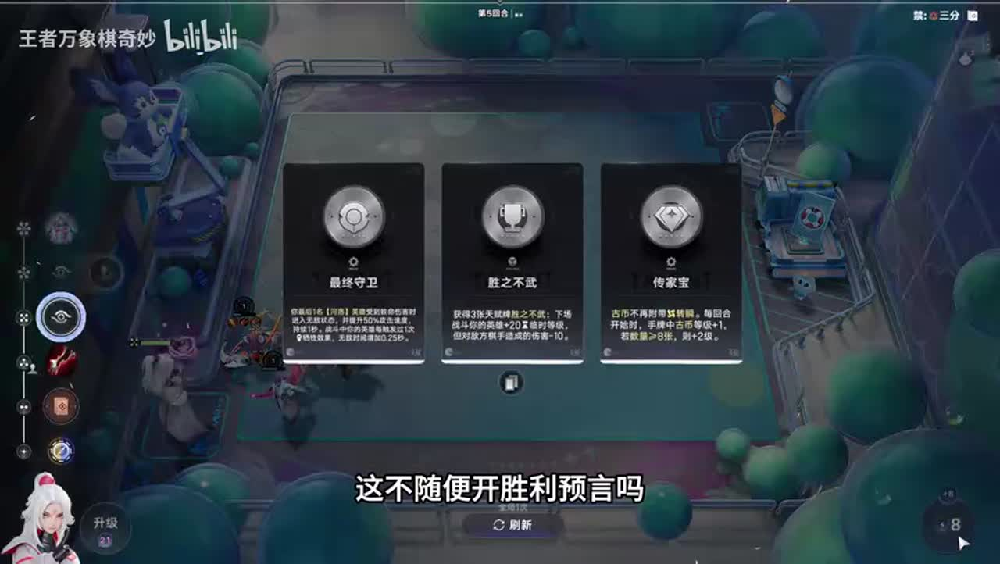
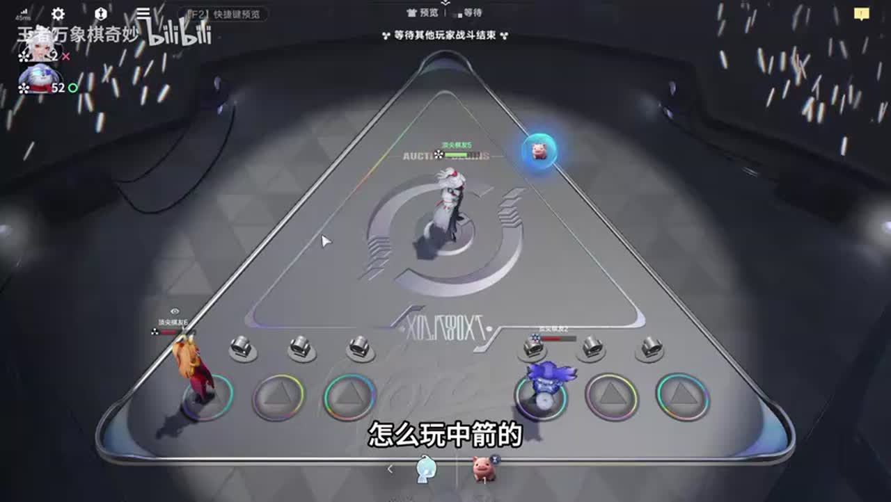

# 万分局明世隐木兰大人全局思路

来源：https://www.bilibili.com/video/BV1W7ab6KEhS/?p=1

分析状态：completed

完整文字稿：../../../raw/BV1W7ab6KEhS_p1.md

## 01:27–02:37 有啥玩啥，已有苏烈则转木兰复活方向，不强行一套。

- 事件 ID：BV1W7ab6KEhS:p1:e001
- 场景：实战
- 时机：明世隐开局来苏烈时
- 背景（分析推断）：讲者根据实际来牌放弃另一方向。
- 学习目标（分析推断）：用已有功能牌决定路线。
- 模板：fallback-plan
- ASR 段落：[3, 4]

> 都上苏烈了,还怎么删鬼。

## 03:15–04:31 比较双方等级与单位强度，再判断输赢预言。

- 事件 ID：BV1W7ab6KEhS:p1:e002
- 场景：实战
- 时机：选择失败预言前
- 背景（分析推断）：对方马可、亚连、狂铁更强，讲者调整站位使预测匹配。
- 学习目标（分析推断）：理解预言需要当前对局证据。
- 模板：combat-review
- ASR 段落：[6, 7]

> 等级比我高人也比我强

## 04:31–08:00 前期优先钱；只买负担得起的低价牌。

- 事件 ID：BV1W7ab6KEhS:p1:e003
- 场景：实战
- 时机：七回合前选技能收益时
- 背景（分析推断）：讲者对比左右技能货币收益，强调经济启动。
- 学习目标（分析推断）：区分早期积累与后期搜索阶段。
- 模板：economy-budget
- ASR 段落：[8, 9, 12]

> 左边是不是给三块钱右边是不是不给钱

## 05:46–06:24 按对手强弱选择预言，不能脱离即时对局。

- 事件 ID：BV1W7ab6KEhS:p1:e004
- 场景：实战
- 时机：按对手选择预言时
- 背景（分析推断）：讲者在传家宝与预言之间切换；原稿术语待核实。
- 学习目标（分析推断）：将天赋收益与触发可能性联系。
- 模板：talent-fit
- ASR 段落：[10]

> 对面不垃圾我直接生力预言。

## 08:33–09:04 技能收益从拿钱转为拿刷新。

- 事件 ID：BV1W7ab6KEhS:p1:e005
- 场景：实战
- 时机：到第七回合时
- 背景（分析推断）：已有经济基础，开始主动搜阵容。
- 学习目标（分析推断）：识别阶段变化并调整技能选择。
- 模板：level-transition
- ASR 段落：[14]

> 七回合要拿刷新了

## 09:05–09:52 及时交当前可用战斗增益，不为低价值未来无限保留。

- 事件 ID：BV1W7ab6KEhS:p1:e006
- 场景：实战
- 时机：临时增益即将失去价值时
- 背景（分析推断）：讲者判断后面交也没用，当前需要稳血。
- 学习目标（分析推断）：比较增益的当前与未来收益。
- 模板：resource-order
- ASR 段落：[15]

> 现在不交白不交

## 10:42–11:52 先检查支撑觉醒与上场收益，不只因有露娜就立即投入。

- 事件 ID：BV1W7ab6KEhS:p1:e007
- 场景：实战
- 时机：考虑露娜吃群星时
- 背景（分析推断）：讲者想让露娜吃群星，但婉儿还未觉醒。
- 学习目标（分析推断）：确认成长链关键条件后再触发。
- 模板：resource-order
- ASR 段落：[17, 18]

> 上了这个玩儿没觉醒

## 12:35–14:27 保留关键启动资源，目标明确地找婉儿和露娜，不误吃棋手。

- 事件 ID：BV1W7ab6KEhS:p1:e008
- 场景：实战
- 时机：搜觉醒婉儿时
- 背景（分析推断）：木兰路线需婉儿与复活支撑；吃明世隐会改变棋手。
- 学习目标（分析推断）：区分关键配件和改变路线的资源。
- 模板：module-fit
- ASR 段落：[20, 21, 22]

> 不能吃明士饮,吃了明士饮我去瑶妹了!

## 15:07–22:33 优先无人竞争的阵容，减少被占牌；李白临时等级用于当轮战斗。

- 事件 ID：BV1W7ab6KEhS:p1:e009
- 场景：实战
- 时机：判断是否容易成型时
- 背景（分析推断）：讲者将顺利来牌归因独门；概率不是必来保证。
- 学习目标（分析推断）：将同行观察与临时战力作用纳入决策。
- 模板：opening-plan
- ASR 段落：[24, 33, 34]

> 同行多的话就是很难进啊

## 17:12–17:54 太乙提供额外死亡与复活机会，对应木兰死亡增临时等级。

- 事件 ID：BV1W7ab6KEhS:p1:e010
- 场景：实战
- 时机：解释木兰配太乙时
- 背景（分析推断）：讲者读取木兰词条，解释辅助价值。
- 学习目标（分析推断）：用技能触发解释复活支撑为何有效。
- 模板：growth-combo
- ASR 段落：[27]

> 他要个太乙他能多加十几的

## 17:55–18:38 把升六级带来的刷新次数算入升级收益。

- 事件 ID：BV1W7ab6KEhS:p1:e011
- 场景：实战
- 时机：决定升六级时
- 背景（分析推断）：讲者明确明世隐六级有八次刷新。
- 学习目标（分析推断）：以当前搜索需求衡量升级价值。
- 模板：level-transition
- ASR 段落：[28]

> 明师印升六级有八次刷新

## 18:40–21:56 比较敌方等级与分摊后的自身等级，选择反甲或追击速度并检查冰刀。

- 事件 ID：BV1W7ab6KEhS:p1:e012
- 场景：实战
- 时机：面对艾琳时
- 背景（分析推断）：讲者认为跑得快且对方无冰刀，可以追上；属于此局条件。
- 学习目标（分析推断）：以具体威胁而非固定装备公式判断。
- 模板：counter-target
- ASR 段落：[29, 32, 33]

> 她没冰到,我能追上她

## 19:18–20:03 用干将积累击杀成长，后期通过移植转海月。

- 事件 ID：BV1W7ab6KEhS:p1:e013
- 场景：实战
- 时机：解释对手干将过渡时
- 背景（分析推断）：这是对手路线讲解，不是本局木兰操作。
- 学习目标（分析推断）：理解过渡单位和最终输出功能。
- 模板：late-transition
- ASR 段落：[30]

> 拿干将一直k头

## 22:34–23:07 不来关键牌直接转其他路线。

- 事件 ID：BV1W7ab6KEhS:p1:e014
- 场景：实战
- 时机：回答关键韩信不来时
- 背景（分析推断）：讲者用不给韩信举例，不建议无限搜。
- 学习目标（分析推断）：将失败来牌转为路线调整信号。
- 模板：fallback-plan
- ASR 段落：[35]

> 直接转其他阵容就行了

## 23:07–24:52 提高复活预算应对海月，打完检查实际消耗。

- 事件 ID：BV1W7ab6KEhS:p1:e015
- 场景：实战
- 时机：对手转海月时
- 背景（分析推断）：投入八次后仍只剩两条，不能假设高复活数必胜。
- 学习目标（分析推断）：把敌方转型作为重新评估信号。
- 模板：counter-target
- ASR 段落：[36, 37, 38]

> 差点没打过啊

## 24:17–26:14 先用已有唤醒、低价牌和免费刷新，再必要时用真实货币。

- 事件 ID：BV1W7ab6KEhS:p1:e016
- 场景：实战
- 时机：急找露娜时
- 背景（分析推断）：下一轮对手也会找露娜，拖延有库存风险。
- 学习目标（分析推断）：按资源顺序搜牌，同时识别紧迫性。
- 模板：resource-order
- ASR 段落：[38, 39, 40]

> 下波他俩也要找露娜了

## 25:37–26:14 钱不能带到下一局，关键成型牌值得消耗预算。

- 事件 ID：BV1W7ab6KEhS:p1:e017
- 场景：实战
- 时机：临近决赛还在攒钱时
- 背景（分析推断）：讲者愿用15块换露娜；是此局价值判断。
- 学习目标（分析推断）：从储蓄阶段转向战斗兑现。
- 模板：economy-budget
- ASR 段落：[40]

> 你这个钱又带不走下一把

## 26:53–28:21 先估计可承受失利，再保留资源下一轮反打。

- 事件 ID：BV1W7ab6KEhS:p1:e018
- 场景：实战
- 时机：决定暂不交唤醒时
- 背景（分析推断）：讲者认为可输一轮，但随后实际伤害偏高。
- 学习目标（分析推断）：用血量约束等待方案并反馈纠偏。
- 模板：combat-review
- ASR 段落：[42, 43]

> 这波输就输呗

## 28:22–30:35 补钟馗与反甲、准备复活次数，同时注意倒计时。

- 事件 ID：BV1W7ab6KEhS:p1:e019
- 场景：实战
- 时机：最终面对远程输出时
- 背景（分析推断）：临近结束不能继续唤醒导致单位掉场；实际只消耗一条命。
- 学习目标（分析推断）：同时处理目标威胁与操作时间预算。
- 模板：counter-target
- ASR 段落：[44, 45, 46]

> 不能再交了。再交他下来了。时间不够。

## 待核实与局限

- 原始ASR术语和数值可能有误；未经画面确认者不作为精确机制结论。
