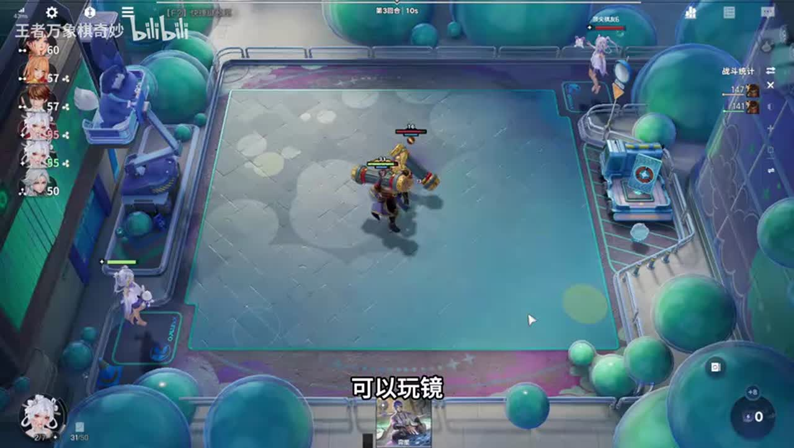
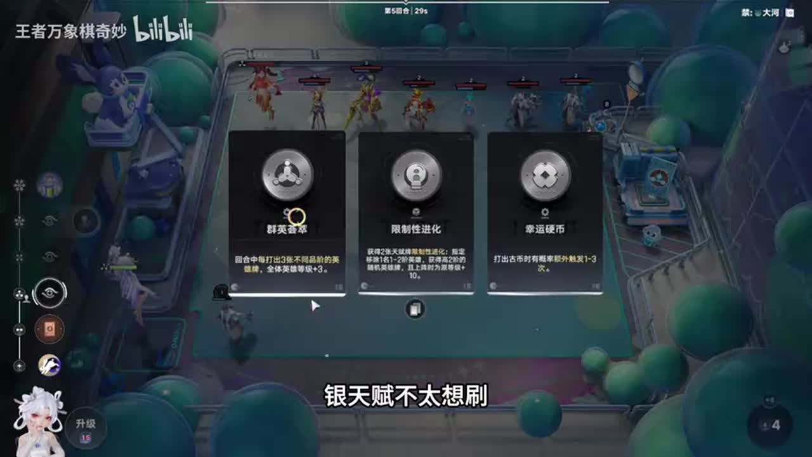
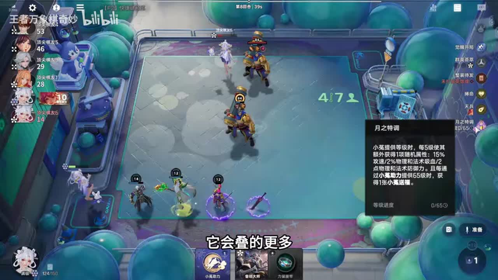
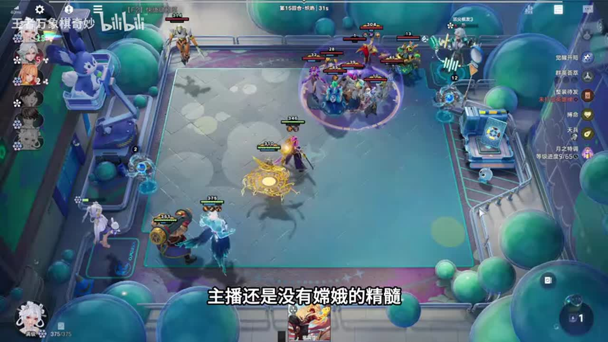

# 万分局最强特邀+嫦娥，特殊天赋 特殊玩法

来源：https://www.bilibili.com/video/BV1GNag6aEfd/?p=1

分析状态：completed

完整文字稿：../../../raw/BV1GNag6aEfd_p1.md

## 00:00–02:07 玉环禁大河更有钱，禁逐鹿少老夫子庄周需强经济天赋；独门也影响生存

- 事件 ID：BV1GNag6aEfd:p1:e001
- 场景：前置讲解
- 时机：禁用环境影响经济
- 背景（分析推断）：与当局嫦娥实战穿插的观众路线问答，不是当局实际操作；禁用环境影响经济，条件由讲者说明。
- 学习目标（分析推断）：检查经济链和竞争条件
- 模板：opening-plan
- ASR 段落：[1, 3, 4]

> 进足路特别穷

## 01:40–02:07 高级人才免费抽卡四五级可赌司空震；三费卡可赌老虎但讲者本局不赌

- 事件 ID：BV1GNag6aEfd:p1:e002
- 场景：实战
- 时机：高级人才使用层级
- 背景（分析推断）：本局特邀嫦娥用苏烈稳血、整装待发快升六，群英补全体等级，司空震木兰暂用且一直缺传承；高级人才使用层级，具体条件依据所引前后文。
- 学习目标（分析推断）：把抽牌道具与可获取卡池匹配
- 模板：opening-plan
- ASR 段落：[4]

> 五级的时候可以赌司空阵

## 02:07–02:39 缺钟馗降级威胁时转高等级吕布更好，仍要考虑同行

- 事件 ID：BV1GNag6aEfd:p1:e003
- 场景：前置讲解
- 时机：马可在禁河洛环境
- 背景（分析推断）：与当局嫦娥实战穿插的观众路线问答，不是当局实际操作；马可在禁河洛环境，条件由讲者说明。
- 学习目标（分析推断）：把环境克制与成长上限联系
- 模板：counter-target
- ASR 段落：[5]

> 外面没有中魁的话

## 02:39–03:10 孙尚香和姬小满买少会缺钱，早孙尚香提供刷新十级还能被猪吸

- 事件 ID：BV1GNag6aEfd:p1:e004
- 场景：前置讲解
- 时机：养猪缺钱时补经济
- 背景（分析推断）：与当局嫦娥实战穿插的观众路线问答，不是当局实际操作；养猪缺钱时补经济，条件由讲者说明。
- 学习目标（分析推断）：从组件解释经济短缺
- 模板：economy-budget
- ASR 段落：[6]

> 孙尚香开的话是有刷新的

## 03:12–04:17 整装待发适配嫦娥，前面赢两轮少阵亡成长，本局接受损失继续升级

- 事件 ID：BV1GNag6aEfd:p1:e005
- 场景：实战
- 时机：苏烈没到40且升三级
- 背景（分析推断）：本局特邀嫦娥用苏烈稳血、整装待发快升六，群英补全体等级，司空震木兰暂用且一直缺传承；苏烈没到40且升三级，具体条件依据所引前后文。
- 学习目标（分析推断）：识别保血与成长收益冲突
- 模板：level-transition
- ASR 段落：[7, 8]

> 赢了两波输点少了四级

## 03:42–06:26 刘邦配三图腾复活扁鹊，禁大河逐鹿会影响支撑，不单凭拿到核心转

- 事件 ID：BV1GNag6aEfd:p1:e006
- 场景：前置讲解
- 时机：找不到李信可用刘邦
- 背景（分析推断）：与当局嫦娥实战穿插的观众路线问答，不是当局实际操作；找不到李信可用刘邦，条件由讲者说明。
- 学习目标（分析推断）：按功能替代并核对支撑可用性
- 模板：fallback-plan
- ASR 段落：[8, 9, 11, 12]

> 配一个柱子那你就可以直接就去玩刘邦了

## 04:17–05:21 先知进化版本改动、星人古币无法负担；群英三不同卡全场加三级可发动，银天赋不再冒险刷

- 事件 ID：BV1GNag6aEfd:p1:e007
- 场景：实战
- 时机：天赋无法发动时换群英
- 背景（分析推断）：本局特邀嫦娥用苏烈稳血、整装待发快升六，群英补全体等级，司空震木兰暂用且一直缺传承；天赋无法发动时换群英，具体条件依据所引前后文。
- 学习目标（分析推断）：先检查条件和刷新风险
- 模板：talent-fit
- ASR 段落：[9, 10]

> 打出三张不同的卡

## 04:50–05:52 40级有第二条命，反甲日炎把高血转换伤害；自身不必补输出

- 事件 ID：BV1GNag6aEfd:p1:e008
- 场景：实战
- 时机：苏烈40级为何能稳血
- 背景（分析推断）：本局特邀嫦娥用苏烈稳血、整装待发快升六，群英补全体等级，司空震木兰暂用且一直缺传承；苏烈40级为何能稳血，具体条件依据所引前后文。
- 学习目标（分析推断）：将等级门槛与装备作用组合
- 模板：equipment-cause
- ASR 段落：[10, 11]

> 他的血量就是伤害

## 05:52–06:58 姬小满卖掉而不上，卖钱丢兔升级；51血博命是主播风险选择，不要求观众照搬

- 事件 ID：BV1GNag6aEfd:p1:e009
- 场景：实战
- 时机：整装待发要求不上牌
- 背景（分析推断）：本局特邀嫦娥用苏烈稳血、整装待发快升六，群英补全体等级，司空震木兰暂用且一直缺传承；整装待发要求不上牌，具体条件依据所引前后文。
- 学习目标（分析推断）：区分经济触发条件与风险偏好
- 模板：economy-budget
- ASR 段落：[12, 13]

> 如果觉得博名不稳的话可以不博

## 06:59–08:04 整装待发不打牌能得能量，当前保血面对强嬴政仍需快升六

- 事件 ID：BV1GNag6aEfd:p1:e010
- 场景：实战
- 时机：为八回合六级留牌
- 背景（分析推断）：本局特邀嫦娥用苏烈稳血、整装待发快升六，群英补全体等级，司空震木兰暂用且一直缺传承；为八回合六级留牌，具体条件依据所引前后文。
- 学习目标（分析推断）：保持触发条件与阶段目标一致
- 模板：resource-order
- ASR 段落：[14, 15]

> 只要不打卡就能获得能量

## 08:40–09:54 当前末位可通过顶价增加分红，但姜子牙三块后再顶贵，别因分红无限加价

- 事件 ID：BV1GNag6aEfd:p1:e011
- 场景：实战
- 时机：低血拍卖分红与顶价
- 背景（分析推断）：本局特邀嫦娥用苏烈稳血、整装待发快升六，群英补全体等级，司空震木兰暂用且一直缺传承；低血拍卖分红与顶价，具体条件依据所引前后文。
- 学习目标（分析推断）：权衡竞价收益与拿到无用牌风险
- 模板：auction-choice
- ASR 段落：[17, 18]

> 再顶就有点贵了

## 09:17–10:27 司空震姜子牙木兰先上，大兔先给成长使小兔层数更多，之后可传苏烈给老虎

- 事件 ID：BV1GNag6aEfd:p1:e012
- 场景：实战
- 时机：六级启动先大后小
- 背景（分析推断）：本局特邀嫦娥用苏烈稳血、整装待发快升六，群英补全体等级，司空震木兰暂用且一直缺传承；六级启动先大后小，具体条件依据所引前后文。
- 学习目标（分析推断）：理解技能顺序如何放大连锁收益
- 模板：resource-order
- ASR 段落：[18, 19]

> 先大后小

## 10:27–12:02 四个人类即可先启动，差的之后传承替换；21血再等两轮可能死

- 事件 ID：BV1GNag6aEfd:p1:e013
- 场景：实战
- 时机：低血六级不要等理想四人
- 背景（分析推断）：本局特邀嫦娥用苏烈稳血、整装待发快升六，群英补全体等级，司空震木兰暂用且一直缺传承；低血六级不要等理想四人，具体条件依据所引前后文。
- 学习目标（分析推断）：保命启动优先于等待完美阵容
- 模板：economy-budget
- ASR 段落：[20, 21, 22]

> 启动大于一切

## 12:37–13:09 讲者提磐石削弱、海月仍强本局可优先于木兰；版本观点需保留日期

- 事件 ID：BV1GNag6aEfd:p1:e014
- 场景：实战
- 时机：磐石削弱与核心优先级
- 背景（分析推断）：本局特邀嫦娥用苏烈稳血、整装待发快升六，群英补全体等级，司空震木兰暂用且一直缺传承；磐石削弱与核心优先级，具体条件依据所引前后文。
- 学习目标（分析推断）：区分临时过渡与版本优先级
- 模板：version-change
- ASR 段落：[24]

> 比这个木兰的优先级要高点

## 13:11–14:19 海月偏单体廉颇木兰，吕布对多杂鱼群体和倒转更好，来什么玩什么

- 事件 ID：BV1GNag6aEfd:p1:e015
- 场景：实战
- 时机：海月与吕布面对不同敌人
- 背景（分析推断）：本局特邀嫦娥用苏烈稳血、整装待发快升六，群英补全体等级，司空震木兰暂用且一直缺传承；海月与吕布面对不同敌人，具体条件依据所引前后文。
- 学习目标（分析推断）：按对手结构选择输出功能
- 模板：counter-target
- ASR 段落：[25, 26]

> 海越是针对单体的

## 14:19–15:22 起初认为司空震弱，战后看输出纠正，苏烈双反甲保血；不能只以无装备断定无用

- 事件 ID：BV1GNag6aEfd:p1:e016
- 场景：实战
- 时机：司空震没装备仍有贡献
- 背景（分析推断）：本局特邀嫦娥用苏烈稳血、整装待发快升六，群英补全体等级，司空震木兰暂用且一直缺传承；司空震没装备仍有贡献，具体条件依据所引前后文。
- 学习目标（分析推断）：用实际输出校准先入判断
- 模板：combat-review
- ASR 段落：[27, 28]

> 我给司空正道歉

## 14:50–16:29 按三不同卡发动群英，老虎不留因偷大兔受益名额；375满足后先大后小

- 事件 ID：BV1GNag6aEfd:p1:e017
- 场景：实战
- 时机：群英补375门槛并卖老虎
- 背景（分析推断）：本局特邀嫦娥用苏烈稳血、整装待发快升六，群英补全体等级，司空震木兰暂用且一直缺传承；群英补375门槛并卖老虎，具体条件依据所引前后文。
- 学习目标（分析推断）：控制随机成长名额并补齐门槛
- 模板：resource-order
- ASR 段落：[28, 29, 30]

> 他会偷吃大兔子

## 15:58–17:00 对手金钟罩不怕反甲，司空震仍有效但缺圣剑，等待发育补输出

- 事件 ID：BV1GNag6aEfd:p1:e018
- 场景：实战
- 时机：反甲被金钟罩克制
- 背景（分析推断）：本局特邀嫦娥用苏烈稳血、整装待发快升六，群英补全体等级，司空震木兰暂用且一直缺传承；反甲被金钟罩克制，具体条件依据所引前后文。
- 学习目标（分析推断）：战斗结果要检查敌方天赋与装备交互
- 模板：combat-review
- ASR 段落：[30, 31]

> 这金钟罩的话他不怕反甲

## 17:00–18:10 呼风唤雨概率开传承，未开到继续合成找；未来老虎临时等级给司空震偷，当前先补圣剑

- 事件 ID：BV1GNag6aEfd:p1:e019
- 场景：实战
- 时机：传承未出时暂不能换苏烈
- 背景（分析推断）：本局特邀嫦娥用苏烈稳血、整装待发快升六，群英补全体等级，司空震木兰暂用且一直缺传承；传承未出时暂不能换苏烈，具体条件依据所引前后文。
- 学习目标（分析推断）：保留可执行条件，不把未来转型当已完成
- 模板：late-transition
- ASR 段落：[32, 33]

> 没开到传承

## 18:11–19:25 八方向扩散近身可多吃技能，但过前先被打也不好；司空震近4攻速少需鸡爪

- 事件 ID：BV1GNag6aEfd:p1:e020
- 场景：实战
- 时机：姜子牙前顶与扇形命中
- 背景（分析推断）：本局特邀嫦娥用苏烈稳血、整装待发快升六，群英补全体等级，司空震木兰暂用且一直缺传承；姜子牙前顶与扇形命中，具体条件依据所引前后文。
- 学习目标（分析推断）：按技能几何及承伤风险调整站位
- 模板：position-cause
- ASR 段落：[34, 35]

> 贴着脸越近

## 18:44–20:31 三分等不同卡发动群英和姜子牙，不打河洛避免无法触发；临时等级还可被司空震偷

- 事件 ID：BV1GNag6aEfd:p1:e021
- 场景：实战
- 时机：不同阵营卡同时触发成长
- 背景（分析推断）：本局特邀嫦娥用苏烈稳血、整装待发快升六，群英补全体等级，司空震木兰暂用且一直缺传承；不同阵营卡同时触发成长，具体条件依据所引前后文。
- 学习目标（分析推断）：分清卡名差异与阵营条件两种门槛
- 模板：growth-combo
- ASR 段落：[35, 36, 37]

> 不要打合录啊

## 19:55–21:13 木兰与苏烈都一次复活，当前苏烈300木兰200仍先给高等级者，传承后再转

- 事件 ID：BV1GNag6aEfd:p1:e022
- 场景：实战
- 时机：木兰更强但暂不转装备
- 背景（分析推断）：本局特邀嫦娥用苏烈稳血、整装待发快升六，群英补全体等级，司空震木兰暂用且一直缺传承；木兰更强但暂不转装备，具体条件依据所引前后文。
- 学习目标（分析推断）：综合等级与功能而非仅按卡阶分装备
- 模板：equipment-role
- ASR 段落：[37, 38]

> 现在她三百级她两百级

## 21:13–22:20 群英不要只打场上河洛，孟奇当两张卡；合成找传承，小兔继续长层每两回合大兔

- 事件 ID：BV1GNag6aEfd:p1:e023
- 场景：实战
- 时机：孟奇等多次用牌与兔子循环
- 背景（分析推断）：本局特邀嫦娥用苏烈稳血、整装待发快升六，群英补全体等级，司空震木兰暂用且一直缺传承；孟奇等多次用牌与兔子循环，具体条件依据所引前后文。
- 学习目标（分析推断）：用可触发道具持续补资源且保留机制条件
- 模板：resource-order
- ASR 段落：[39, 40]

> 孟奇是两张卡

## 24:13–25:34 觉醒加传承与觉醒老虎才能进一步成长，本局没传承所以没偷临时等级；群英白嫖全体仍用

- 事件 ID：BV1GNag6aEfd:p1:e024
- 场景：实战
- 时机：司空震觉醒后仍需临时等级来源
- 背景（分析推断）：本局特邀嫦娥用苏烈稳血、整装待发快升六，群英补全体等级，司空震木兰暂用且一直缺传承；司空震觉醒后仍需临时等级来源，具体条件依据所引前后文。
- 学习目标（分析推断）：识别最终缺失环节而非照搬终局999目标
- 模板：late-transition
- ASR 段落：[42, 43]

> 没偷10等级

## 待核实与局限

- 不做ASR修正；同音原話保留。
- 第23段疑似ASR幻觉排除，钻石预测投注、账号广告、聊天如厕排除。
- 前半玉环马可养猪刘邦为与实战穿插的问答，背景不写成本局已玩这些路线。
- 主播51血博命自己承认偏好，不输出必须冒险规则。
- 375门槛、四人兔子与群英触发按讲者当时版本说明，未独立测量。
- 磐石削弱一个月和S1/S2周期为当时观点，不推断当前版本。
