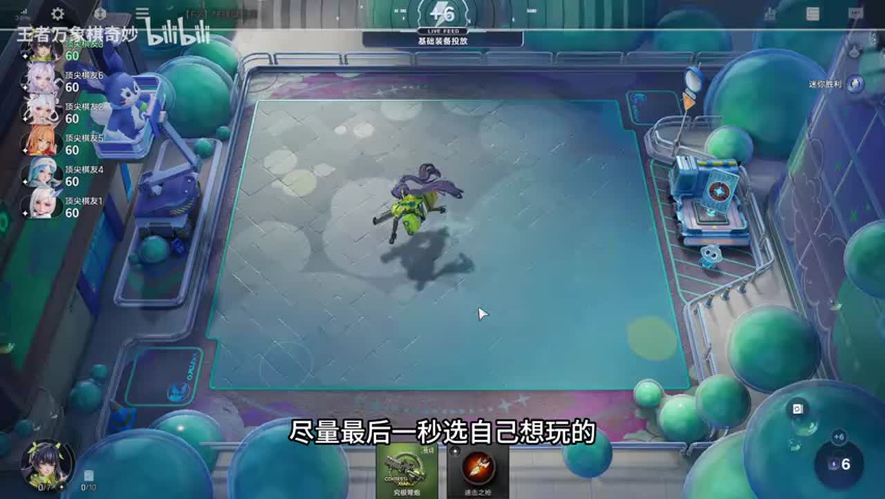
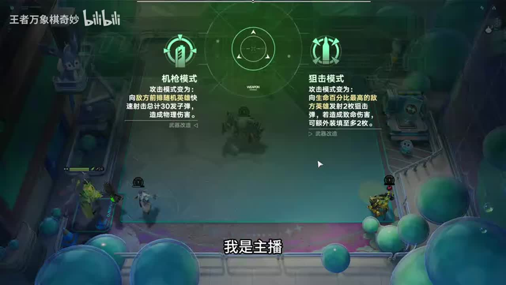
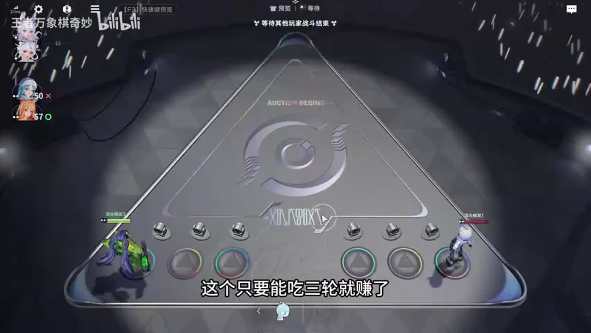
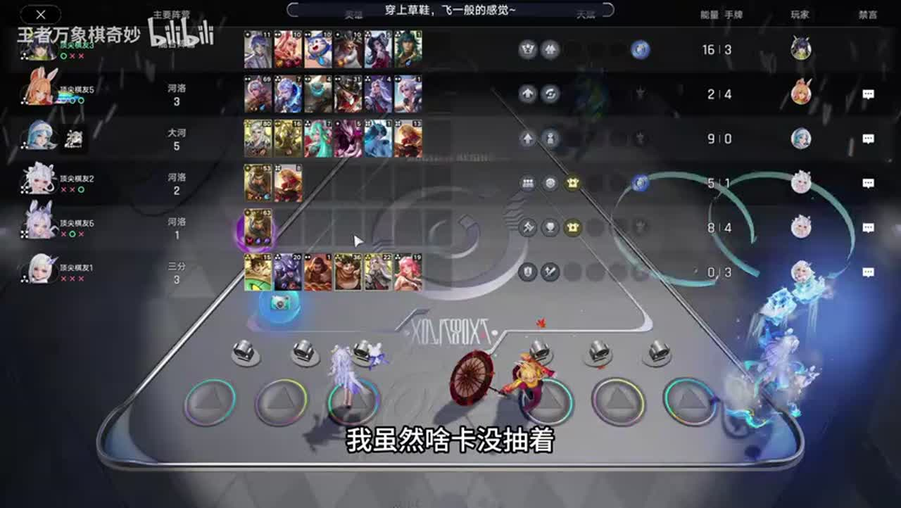
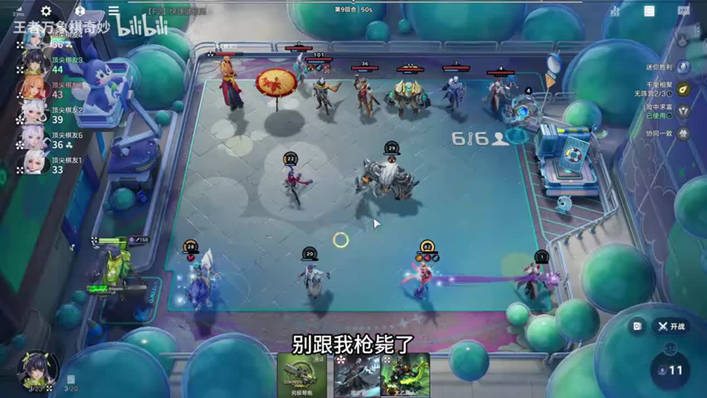
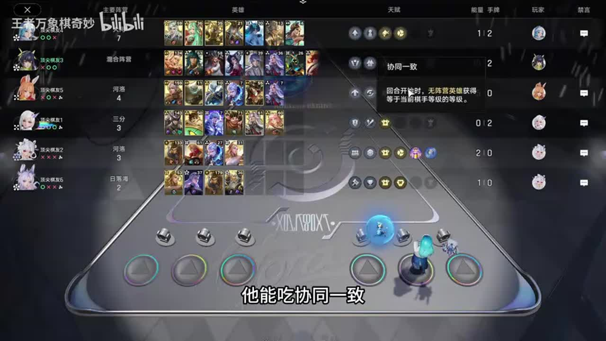
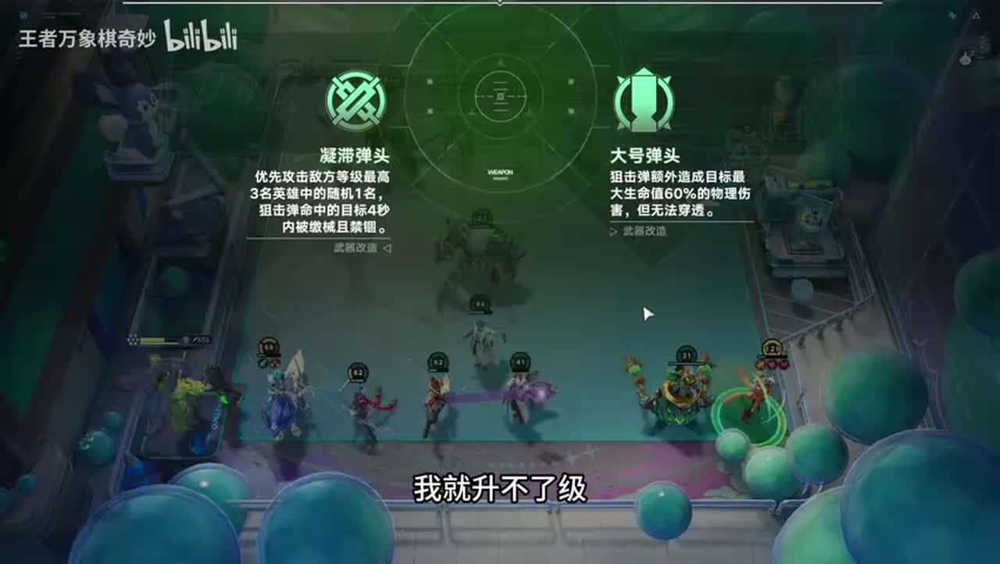
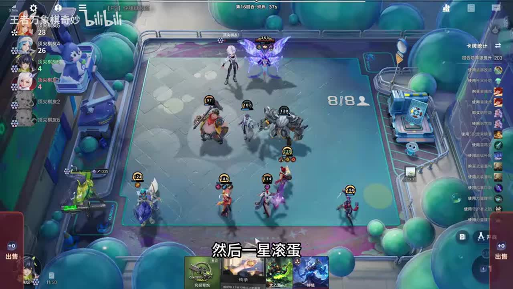
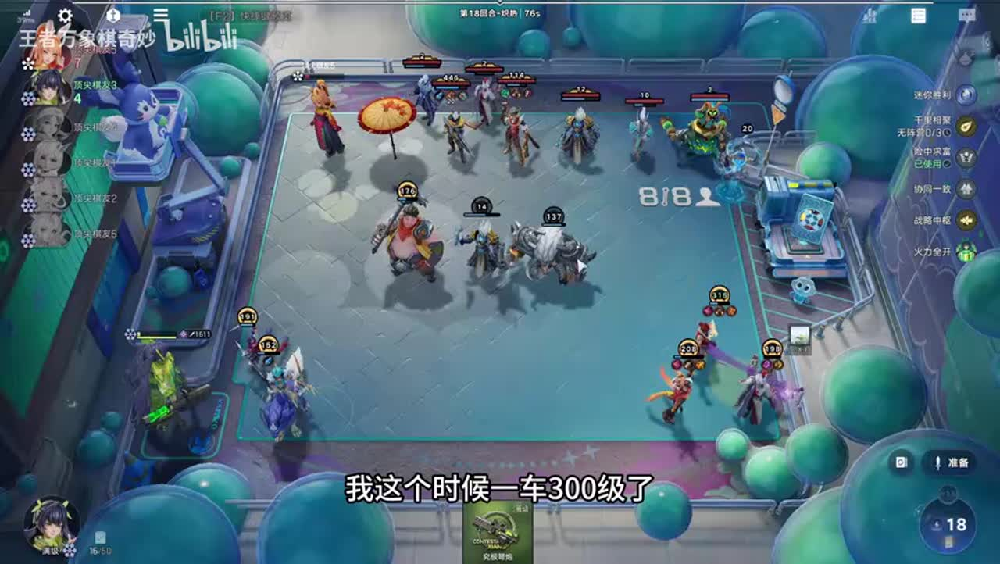

# 万分局极致眉笔连败香香，另类阵容后期吃鸡

来源：https://www.bilibili.com/video/BV1qNaq6jEWZ/?p=1

分析状态：completed

完整文字稿：../../../raw/BV1qNaq6jEWZ_p1.md

## 00:00–01:12 讲者延迟亮出孙尚香，避免前两轮碰阿离伞影响开枪。

- 事件 ID：BV1qNaq6jEWZ:p1:e001
- 场景：实战
- 时机：开局选棋手时
- 背景（分析推断）：仅针对讲者描述的早期匹配环境，不推广为通用规则。
- 学习目标（分析推断）：理解开局对手与成长触发关系。
- 模板：counter-target
- ASR 段落：[1, 2]

> 前两回合别打这个伞

## 01:16–01:47 与另一名单位合并火力打同一目标。

- 事件 ID：BV1qNaq6jEWZ:p1:e002
- 场景：实战
- 时机：开局安排孙尚香位置时
- 背景（分析推断）：人数优势下仍需集中攻击以兑现输出。
- 学习目标（分析推断）：按目标集中火力。
- 模板：position-cause
- ASR 段落：[3]

> 两个人一起射他

## 01:47–03:09 比较前期机枪和后期狙击，按本局后期目标选狙击。

- 事件 ID：BV1qNaq6jEWZ:p1:e003
- 场景：实战
- 时机：成长与枪型选择时
- 背景（分析推断）：讲者放弃适合倒转的选项而选本路线所需。
- 学习目标（分析推断）：将选项收益与阶段目标对齐。
- 模板：talent-fit
- ASR 段落：[4, 5]

> 前期机枪屌,后期狙击屌

## 02:36–03:42 能赢则留，打不过及时交，否则资源会销毁。

- 事件 ID：BV1qNaq6jEWZ:p1:e004
- 场景：实战
- 时机：保留富贵险中求时
- 背景（分析推断）：讲者解释持有期间收益与失败损失。
- 学习目标（分析推断）：在失效前使用资源。
- 模板：resource-order
- ASR 段落：[5, 6]

> 打不过你还不交的话他就销毁了

## 03:42–05:50 依据崛起对手预判开资源，战后却赢，说明需校准预测。

- 事件 ID：BV1qNaq6jEWZ:p1:e005
- 场景：实战
- 时机：预判打不过而交资源后
- 背景（分析推断）：讲者认为白开，预测并非确定结论。
- 学习目标（分析推断）：对照事前判断与实际结果。
- 模板：combat-review
- ASR 段落：[7, 8, 9]

> 这富亏显钟球白开了

## 04:26–05:08 用无阵营单位吃协同一致，不拘固定单位名字。

- 事件 ID：BV1qNaq6jEWZ:p1:e006
- 场景：实战
- 时机：协同一致路线成型时
- 背景（分析推断）：当前非大河传统阵容，单位标签比名称重要。
- 学习目标（分析推断）：按标签理解成长体系。
- 模板：growth-combo
- ASR 段落：[8]

> 只要是无阵营都可以上

## 05:08–06:31 把搜索范围扩大到符合无阵营条件的多个候选。

- 事件 ID：BV1qNaq6jEWZ:p1:e007
- 场景：实战
- 时机：连续抽不到指定牌时
- 背景（分析推断）：讲者强调四个人都行，但本次仍未抽到。
- 学习目标（分析推断）：用功能条件扩大可替代集合。
- 模板：fallback-plan
- ASR 段落：[9, 10]

> 这无人营里面四个人都行

## 09:06–09:43 虽缺牌但已有等级，仍有后期空间；不是见到连败就认输。

- 事件 ID：BV1qNaq6jEWZ:p1:e008
- 场景：实战
- 时机：缺牌连败后判断存活空间时
- 背景（分析推断）：讲者由悲观转为检查已积累成长。
- 学习目标（分析推断）：区别当期弱势和未来成长能力。
- 模板：combat-review
- ASR 段落：[14]

> 但是我的等级是有的

## 09:44–11:08 不需要觉醒则更重视无阵营出牌提供全体等级。

- 事件 ID：BV1qNaq6jEWZ:p1:e009
- 场景：实战
- 时机：点兵点将与千里相聚二选一时
- 背景（分析推断）：阵营觉醒需求与本局无阵营标签不匹配。
- 学习目标（分析推断）：根据缺口比较天赋适配。
- 模板：talent-fit
- ASR 段落：[15, 16]

> 我根本不需要觉醒的

## 11:11–11:50 检查前期增伤是否实际触发，不能只看天赋名强。

- 事件 ID：BV1qNaq6jEWZ:p1:e010
- 场景：实战
- 时机：两枪仍杀不掉人时
- 背景（分析推断）：讲者点伤害加三却没兑现，出现连续失利。
- 学习目标（分析推断）：验证收益是否落地。
- 模板：combat-review
- ASR 段落：[17]

> 伤害加三没用过

## 11:50–12:34 上明刀保命；缺有效牵制时调整站位。

- 事件 ID：BV1qNaq6jEWZ:p1:e011
- 场景：实战
- 时机：连败阶段避免被枪杀时
- 背景（分析推断）：低战力过渡仍需争取成长时间。
- 学习目标（分析推断）：用保命装备延长启动窗口。
- 模板：equipment-role
- ASR 段落：[18]

> 上个明刀别跟我枪毙了

## 12:34–14:00 本局依靠协同一致、千里相聚等后期天赋承受连败后反打。

- 事件 ID：BV1qNaq6jEWZ:p1:e012
- 场景：实战
- 时机：讲解连败香未来时
- 背景（分析推断）：讲者说连败更强，但本例不能证明所有香香都应连败。
- 学习目标（分析推断）：把连败策略限定在成长与血量条件内。
- 模板：opening-plan
- ASR 段落：[19, 20]

> 我们是后期棋手啊

## 15:00–15:34 核算下一波21块是否够升级。

- 事件 ID：BV1qNaq6jEWZ:p1:e013
- 场景：实战
- 时机：计划下一轮升级时
- 背景（分析推断）：预算约束会影响拍卖和成型节奏。
- 学习目标（分析推断）：提前分配升级所需资金。
- 模板：economy-budget
- ASR 段落：[22]

> 21块钱够升级

## 15:34–16:48 一费无阵营单位给枪加攻击力，技能输出可不重要。

- 事件 ID：BV1qNaq6jEWZ:p1:e014
- 场景：实战
- 时机：解释弱单位为何上场时
- 背景（分析推断）：辅助站场主要提供标签和成长，而非自身伤害。
- 学习目标（分析推断）：区分功能位与输出位。
- 模板：mechanic-model
- ASR 段落：[23, 24]

> 他是无阵营的单位他能吃协同一致

## 16:48–17:54 收益不错但本轮必须升级，出高价会挤掉升级预算。

- 事件 ID：BV1qNaq6jEWZ:p1:e015
- 场景：实战
- 时机：拍卖全体等级收益时
- 背景（分析推断）：讲者比较群体等级即时收益与阶段升级。
- 学习目标（分析推断）：用机会成本约束竞价。
- 模板：auction-choice
- ASR 段落：[25, 26]

> 升不了级就坏了

## 17:54–19:59 把低价值过渡单位替换为猪，仍保留必要无阵营标签。

- 事件 ID：BV1qNaq6jEWZ:p1:e016
- 场景：实战
- 时机：找到猪和老虎后
- 背景（分析推断）：低等级单位已难承担战斗功能。
- 学习目标（分析推断）：从触发工具向前排战力过渡。
- 模板：late-transition
- ASR 段落：[27, 28, 29]

> 它换成猪好像很舒服

## 19:59–21:18 三张无阵营出牌触发全体等级，单位不必承担输出。

- 事件 ID：BV1qNaq6jEWZ:p1:e017
- 场景：实战
- 时机：再次解释千里相聚时
- 背景（分析推断）：讲者回答观众机制问题，和此前解释为独立教学。
- 学习目标（分析推断）：把触发条件和枪成长联系起来。
- 模板：growth-combo
- ASR 段落：[30, 31]

> 打三张无人影全体加四级

## 20:41–22:38 排查攻击是否命中马超、是否缺冰刀和前排。

- 事件 ID：BV1qNaq6jEWZ:p1:e018
- 场景：实战
- 时机：高攻击仍开始输时
- 背景（分析推断）：高攻击数值无法解决飞行难命中与承伤缺口。
- 学习目标（分析推断）：复盘功能性短板。
- 模板：combat-review
- ASR 段落：[31, 32, 33]

> 我现在没前排主要是

## 23:16–23:58 按8个无阵营单位计算群体成长总收益。

- 事件 ID：BV1qNaq6jEWZ:p1:e019
- 场景：实战
- 时机：搜关键效果卡前
- 背景（分析推断）：讲者用16乘8估算一张卡加128等级，数值待核实。
- 学习目标（分析推断）：用受益人数估计资源价值。
- 模板：economy-budget
- ASR 段落：[35]

> 16乘8,一张加128级

## 23:58–25:22 优先打掉龙人，再复盘东皇难处理与缺免控装备。

- 事件 ID：BV1qNaq6jEWZ:p1:e020
- 场景：实战
- 时机：全队被东皇杀后
- 背景（分析推断）：讲者原以为能推走东皇，实际推不走且队伍被杀。
- 学习目标（分析推断）：以实际控制结果修正敌方处理方案。
- 模板：combat-review
- ASR 段落：[36, 37]

> 我全家加起来被一个东方给杀了

## 24:37–26:13 给最高等级老虎明刀，缺冰刀时改重伤与防护。

- 事件 ID：BV1qNaq6jEWZ:p1:e021
- 场景：实战
- 时机：补装备准备反击时
- 背景（分析推断）：库存限制下采用次优功能装备。
- 学习目标（分析推断）：依据当前威胁和可用装备替代。
- 模板：equipment-cause
- ASR 段落：[37, 38]

> 没有感觉的话来个重伤

## 27:01–27:45 调到能接触目标的一侧，临场更换功能装备。

- 事件 ID：BV1qNaq6jEWZ:p1:e022
- 场景：实战
- 时机：让公孙离处理指定目标时
- 背景（分析推断）：对手主核位置与输出方向影响处理效率。
- 学习目标（分析推断）：通过接敌路径组织战斗。
- 模板：position-cause
- ASR 段落：[40]

> 这个要站这边要打

## 28:28–29:32 该类天赋早期点更有累计价值，此时已接近结束不追。

- 事件 ID：BV1qNaq6jEWZ:p1:e023
- 场景：实战
- 时机：胜利后获得击败成长时
- 背景（分析推断）：讲者回顾无法先看天赋再选棋手的限制。
- 学习目标（分析推断）：理解收益窗口而非固定天赋排名。
- 模板：talent-fit
- ASR 段落：[42, 43]

> 现在点没有用了

## 29:32–30:54 六级技能与场上总等级相连，牛和弈星可只为提高枪攻击。

- 事件 ID：BV1qNaq6jEWZ:p1:e024
- 场景：实战
- 时机：决赛解释六级孙尚香收益时
- 背景（分析推断）：协同一致与千里相聚累积队伍等级成为终局收益。
- 学习目标（分析推断）：理解早期成长如何转化为终局输出。
- 模板：mechanic-model
- ASR 段落：[44, 45]

> 场上总等级的乘零点五

## 待核实与局限

- 原始ASR术语和数值可能有误；未经画面确认者不作为精确机制结论。
