# 万象棋冷门偷分姜导廉颇全局教学

来源：https://www.bilibili.com/video/BV172b86sE9J/?p=1

分析状态：completed

完整文字稿：../../../raw/BV172b86sE9J_p1.md

## 00:59–02:27 打牌成长与芈月效果牌成长联动，达到关键等级后额外成长加速

- 事件 ID：BV172b86sE9J:p1:e001
- 场景：实战
- 时机：理解棋手为何适合养廉颇时
- 背景（分析推断）：主角标记、等级门槛和封神机制共同形成成长链；初始宣传强度不计。
- 学习目标（分析推断）：理解棋手与核心单位配合的原因。
- 模板：growth-combo
- ASR 段落：[3, 4, 5]

> 为什么去玩这个足路联播很厉害

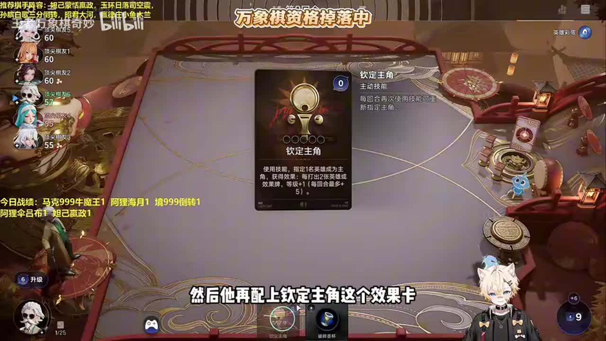

## 01:56–03:58 资源一般时停三找廉颇与芈月，经济特别好才提前四级找高阶资源

- 事件 ID：BV172b86sE9J:p1:e002
- 场景：实战
- 时机：规划前期升级与找牌时
- 背景（分析推断）：不是固定回合无条件升四，升级路径受经济制约。
- 学习目标（分析推断）：用可用预算选择成型路径。
- 模板：level-transition
- ASR 段落：[5, 6, 7, 8]

> 这是比较有钱的情况下

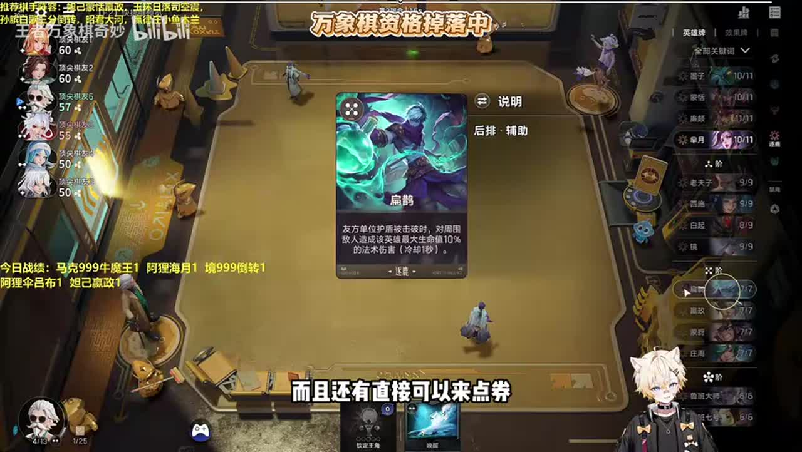

## 03:29–04:29 优先关键成长单位芈月；梦奇多次出牌能推进主角成长

- 事件 ID：BV172b86sE9J:p1:e003
- 场景：实战
- 时机：第一轮拍卖补成型时
- 背景（分析推断）：价格只是当局示例，不作为跨版本固定竞拍上限。
- 学习目标（分析推断）：按启动功能与出牌价值确定竞拍优先级。
- 模板：auction-choice
- ASR 段落：[8, 9]

> 为什么梦奇很重要

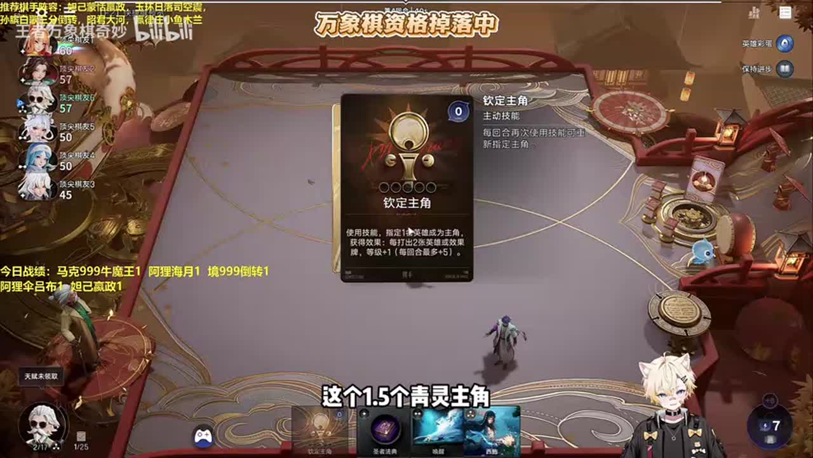

## 04:00–05:27 复制天赋可加速芈月觉醒；若养蒙恬，棋手六级吸血不适配，需重验升级收益

- 事件 ID：BV172b86sE9J:p1:e004
- 场景：实战
- 时机：获得春风化雨且考虑改养蒙恬时
- 背景（分析推断）：来牌可提供转型方向，但技能适配限制上限。
- 学习目标（分析推断）：转型前检查棋手技能是否仍能兑现。
- 模板：talent-fit
- ASR 段落：[9, 10, 11]

> 六级的大招是不适配蒙田的

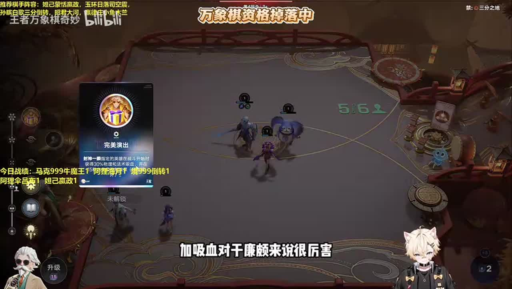

## 05:27–06:55 先给芈月少量成长，找到廉颇后可换主角；封神标记后不可卖目标

- 事件 ID：BV172b86sE9J:p1:e005
- 场景：实战
- 时机：廉颇一直未到但主角标记可用时
- 背景（分析推断）：可转移的早期标记与不可转移的关键标记必须区分。
- 学习目标（分析推断）：识别资源分配中的不可逆阶段。
- 模板：fallback-plan
- ASR 段落：[12, 13, 14]

> 风神一瞬是不能换人的

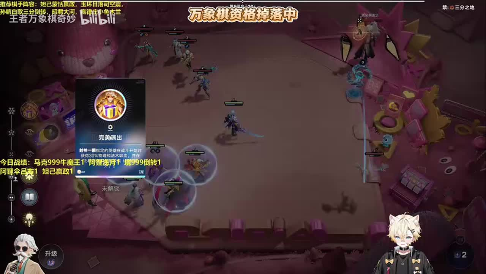

## 06:26–07:54 先觉醒芈月再用效果牌，能提高同批资源的等级收益

- 事件 ID：BV172b86sE9J:p1:e006
- 场景：实战
- 时机：芈月差一张觉醒且准备交效果牌时
- 背景（分析推断）：讲者当场承认先用效果牌失误，以损失解释正确顺序。
- 学习目标（分析推断）：在可达成强化条件时先强化再兑现资源。
- 模板：resource-order
- ASR 段落：[14, 15, 16]

> 尽量先觉醒敏玥,然后你再打效果牌

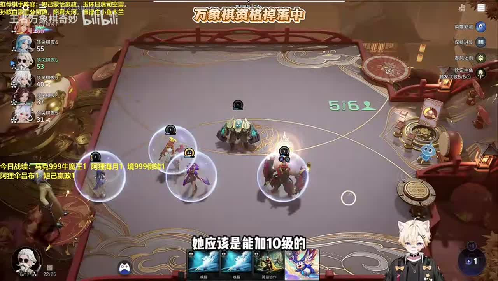

## 07:55–09:53 墨子护盾击破联动成长与恢复，廉颇百级后开始形成循环；早期弱不等于路线无效

- 事件 ID：BV172b86sE9J:p1:e007
- 场景：实战
- 时机：前期廉颇弱且墨子到场时
- 背景（分析推断）：用关键等级与辅助机制解释战力转折，而非只报高等级能赢。
- 学习目标（分析推断）：识别阵容启动门槛和弱势期。
- 模板：mechanic-model
- ASR 段落：[17, 18, 19, 20]

> 他到100级很关键

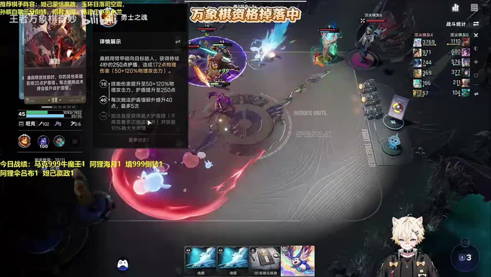

## 09:54–10:52 优先扁鹊形成伤害，再太乙提供额外生命；拍卖后升四找关键单位

- 事件 ID：BV172b86sE9J:p1:e008
- 场景：实战
- 时机：第二轮拍卖且阵容缺炸盾与复活时
- 背景（分析推断）：竞拍目标对应当下战力缺口；示例五六金币限当局。
- 学习目标（分析推断）：按功能瓶颈排序拍卖和升级。
- 模板：auction-choice
- ASR 段落：[21, 22]

> 扁鹊优先级最高

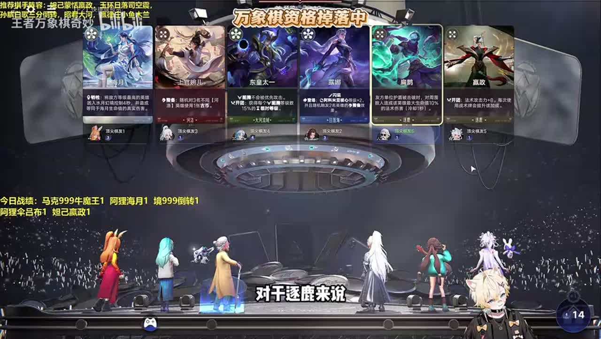

## 10:25–11:24 讲者承认把选项记成另一张，重新说明经济型与后期战力型差异

- 事件 ID：BV172b86sE9J:p1:e009
- 场景：实战
- 时机：天赋误读后复盘选择时
- 背景（分析推断）：误选仍能用不代表原始理解正确，比较必须依据真实卡面。
- 学习目标（分析推断）：先核对选项效果再比较阶段收益。
- 模板：talent-fit
- ASR 段落：[22, 23]

> 当时记错了

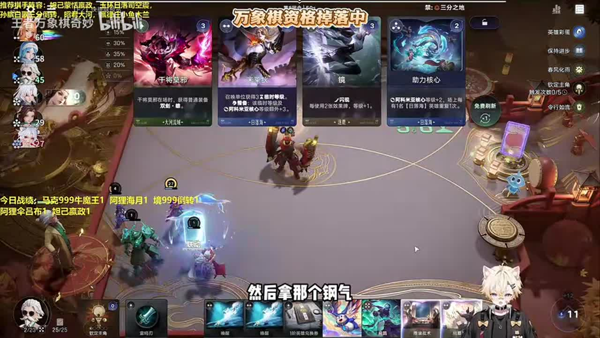

## 10:53–12:25 先到关键等级与觉醒芈月、西施、墨子，不必优先追廉颇觉醒

- 事件 ID：BV172b86sE9J:p1:e010
- 场景：实战
- 时机：廉颇接近百级但尚未觉醒时
- 背景（分析推断）：辅助决定成长、施法和生命循环，核心觉醒未必最急。
- 学习目标（分析推断）：区分核心等级门槛与不同单位觉醒优先级。
- 模板：resource-order
- ASR 段落：[23, 24, 25]

> 都比连波觉醒重要

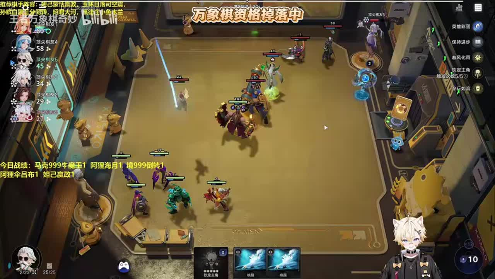

## 11:57–13:26 升五寻找新的战力天赋或人口，补足多个关键辅助位置

- 事件 ID：BV172b86sE9J:p1:e011
- 场景：实战
- 时机：廉颇百级稳住战力后时
- 背景（分析推断）：升级时机从启动前成型转为启动后补强。
- 学习目标（分析推断）：在战力足以支撑时扩展后续资源。
- 模板：level-transition
- ASR 段落：[25, 26, 27]

> 联播一百级之后我们拉五级

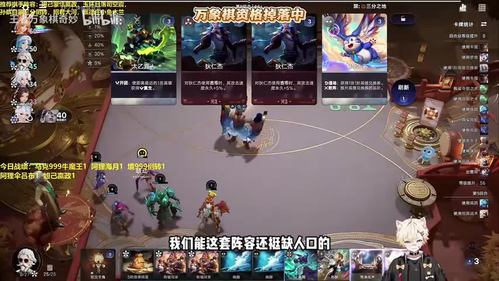

## 13:27–13:54 尽量打满本轮主角成长次数，未使用额度不会变成下轮更多次数

- 事件 ID：BV172b86sE9J:p1:e012
- 场景：实战
- 时机：一轮打牌额度未用满时
- 背景（分析推断）：成长存在逐回合上限，攒着不打会失去收益窗口。
- 学习目标（分析推断）：识别不能跨回合积累的资源。
- 模板：resource-order
- ASR 段落：[28]

> 你下回合也只能打五次

## 13:55–14:55 把护盾破裂、生命增长和技能恢复连回墨子与廉颇机制

- 事件 ID：BV172b86sE9J:p1:e013
- 场景：实战
- 时机：面对更高整体等级仍持续恢复时
- 背景（分析推断）：讲者观察血量线变化，不以一次战胜证明任何对手都能打。
- 学习目标（分析推断）：用战斗反馈检验循环是否启动。
- 模板：combat-review
- ASR 段落：[29, 30]

> 越回血,对面越打不动

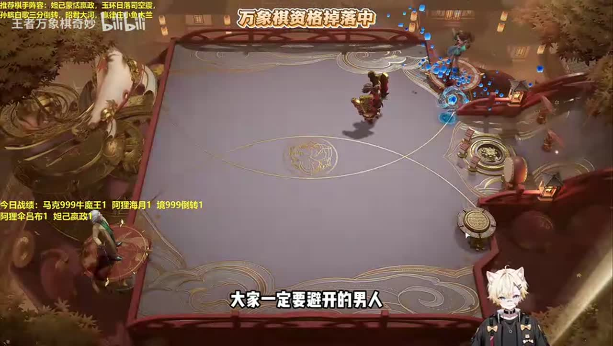

## 14:24–15:27 老夫子、白起、露娜等提供牌与额外触发，再利用芈月转成等级或西施减蓝

- 事件 ID：BV172b86sE9J:p1:e014
- 场景：实战
- 时机：获得合成和效果牌工具时
- 背景（分析推断）：工具的收益来自完整触发链，不是只要买就有效。
- 学习目标（分析推断）：理解出牌工具在成长链中的作用。
- 模板：growth-combo
- ASR 段落：[30, 31]

> 触发效果卡会升级更快

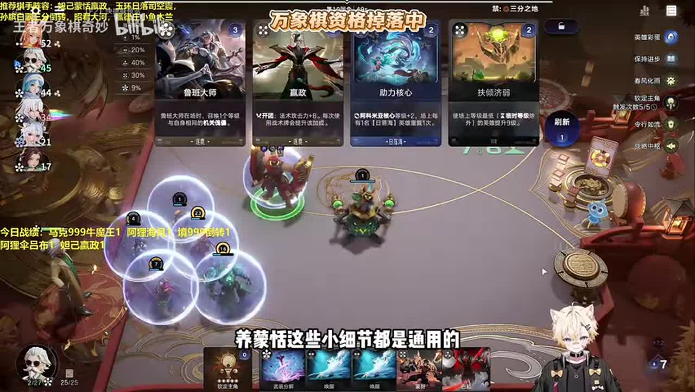

## 15:28–16:27 把等级集中给唯一主输出，工具人主要保留功能

- 事件 ID：BV172b86sE9J:p1:e015
- 场景：实战
- 时机：比较工具人与主输出等级价值时
- 背景（分析推断）：低等级工具也有卡面作用，不能将低战斗力误认为完全无用。
- 学习目标（分析推断）：区分等级投资与功能保留。
- 模板：resource-order
- ASR 段落：[32, 33]

> 这些全是提供全是围绕着这个大哥来建立的

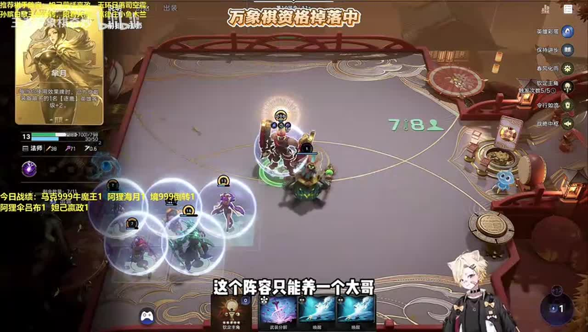

## 15:57–16:53 恢复装与反甲或冰心服务前排，冰心针对高速普攻

- 事件 ID：BV172b86sE9J:p1:e016
- 场景：实战
- 时机：面对射手且装备不够理想时
- 背景（分析推断）：装备取舍回应敌方伤害方式，而非只列固定套装。
- 学习目标（分析推断）：按攻击节奏选择防御与控制装备。
- 模板：counter-target
- ASR 段落：[33, 34]

> 打这种射手其实很厉害的

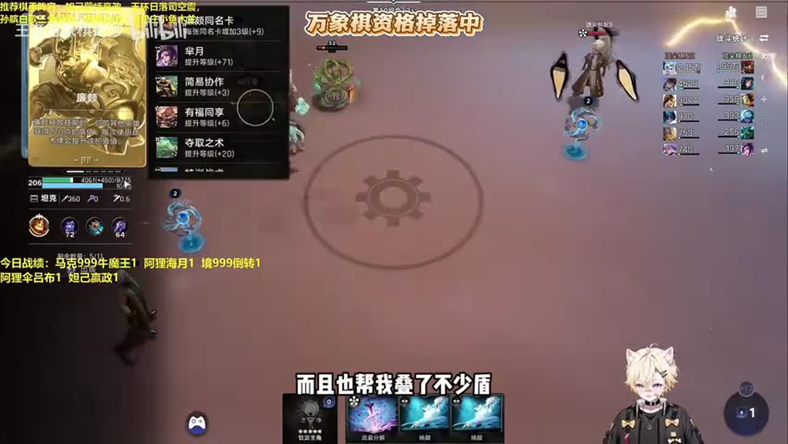

## 16:53–18:21 能稳血才考虑攒四张再合成多用一次；古币多多产生多次效果牌与成长

- 事件 ID：BV172b86sE9J:p1:e017
- 场景：实战
- 时机：五级阶段可买更多合成与古币资源时
- 背景（分析推断）：攒牌具有即时战力代价，必须先满足能赢的前提。
- 学习目标（分析推断）：计算资源的连锁收益与等待成本。
- 模板：economy-budget
- ASR 段落：[35, 36, 37]

> 能打过对面的前提下

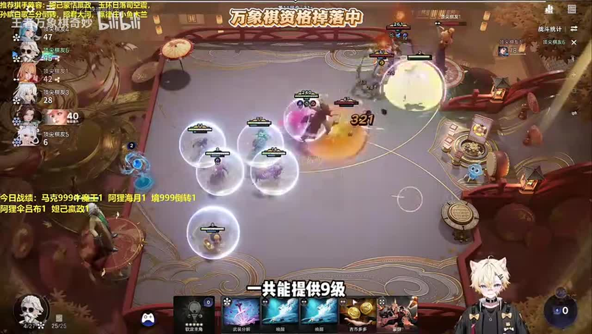

## 17:52–18:51 武装分解是寻找关键免控神器的渠道，而不是无目的重洗

- 事件 ID：BV172b86sE9J:p1:e018
- 场景：实战
- 时机：装备一般但想提升上限时
- 背景（分析推断）：抽到与否是随机结果，讲者无敌表述不作为验证结论。
- 学习目标（分析推断）：围绕明确缺口安排随机装备资源。
- 模板：equipment-role
- ASR 段落：[37, 38]

> 想赌一手机械筒

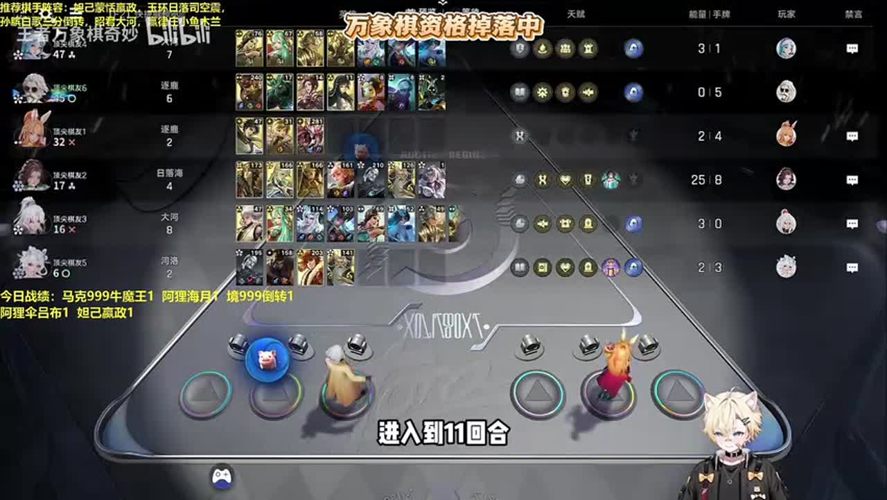

## 18:21–19:49 血不足抢救命资源，血充足优先经济或集中等级；吸等级前先提高工具等级

- 事件 ID：BV172b86sE9J:p1:e019
- 场景：实战
- 时机：第三轮拍卖血量不同且可集中等级时
- 背景（分析推断）：当前容错决定资源用途，集中等级可以先放大可回收总量。
- 学习目标（分析推断）：把拍卖选择与后续使用顺序连接。
- 模板：auction-choice
- ASR 段落：[38, 39, 40]

> 血量不够的话

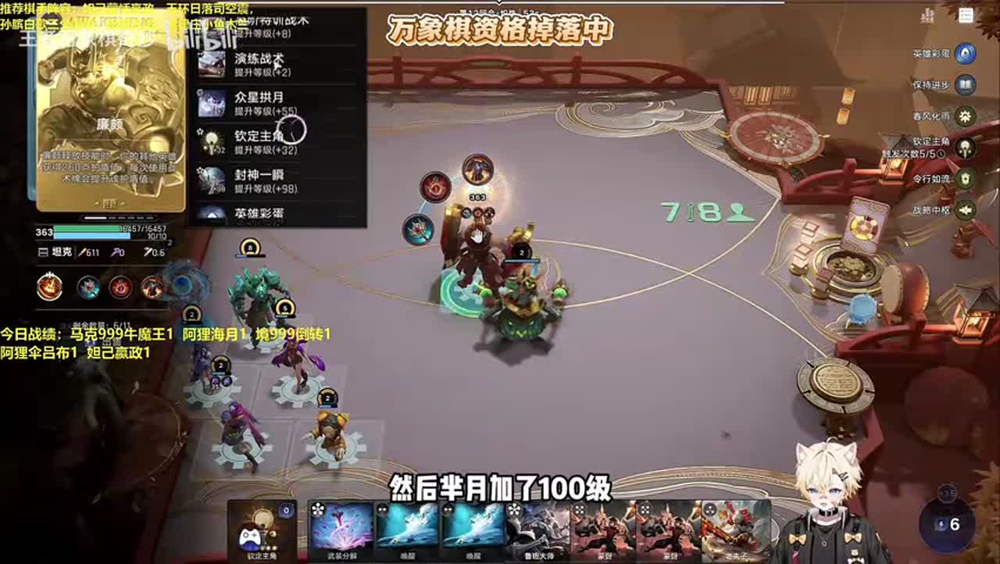

## 19:50–21:45 多个戒指与墨子生命成长联动，但具体累计数值仅作讲者估算

- 事件 ID：BV172b86sE9J:p1:e020
- 场景：实战
- 时机：获得可叠加生命装备时
- 背景（分析推断）：口述一万四、一万八、两万二等变化存在不同观察时点，未独立重算。
- 学习目标（分析推断）：理解叠加收益来源，同时避免猜测精确算式。
- 模板：growth-combo
- ASR 段落：[41, 42, 43, 44]

> 因为它是可以叠加的

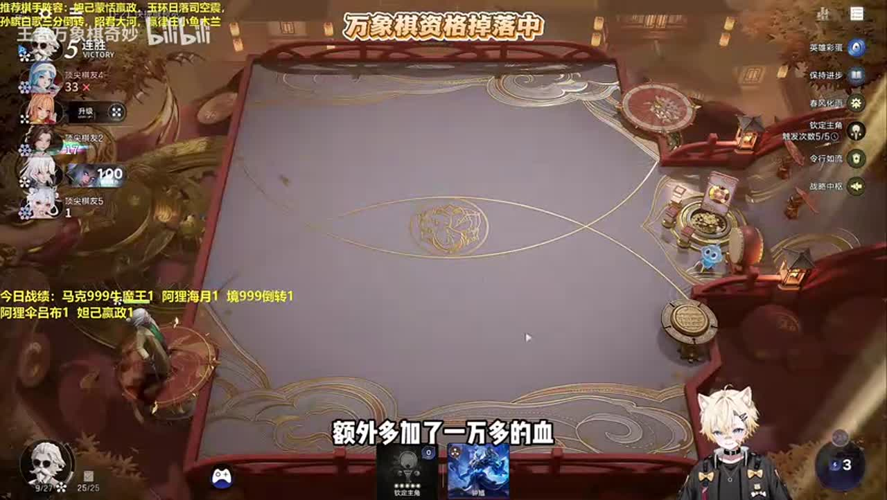

## 20:16–21:14 使用冰心限制其攻击频率和控制触发

- 事件 ID：BV172b86sE9J:p1:e021
- 场景：实战
- 时机：对手变速会持续控制时
- 背景（分析推断）：防具也能通过干扰对手机制减少自身承压。
- 学习目标（分析推断）：找到控制链的上游触发条件。
- 模板：counter-target
- ASR 段落：[42, 43]

> 防止他的变珠来控我们

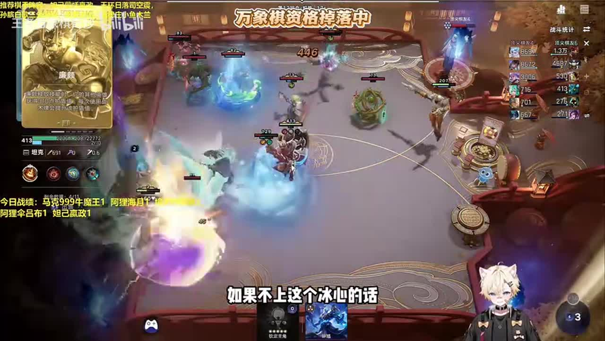

## 21:14–22:13 六级自带吸血与免控，可考虑把重复功能装备换成更有价值的防御

- 事件 ID：BV172b86sE9J:p1:e022
- 场景：实战
- 时机：棋手升六后时
- 背景（分析推断）：当局装备不足暂留并非最优通用搭配。
- 学习目标（分析推断）：阶段技能到位后重新检查装备功能重复。
- 模板：equipment-role
- ASR 段落：[44, 45]

> 六级自带一个吸血

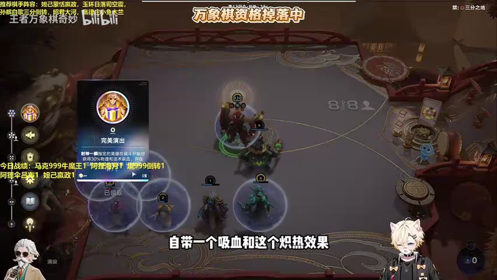

## 22:13–24:05 已有恢复与免控时额外回血收益有限；反甲可应对射手转型，讲者承认之前没做更理想装备

- 事件 ID：BV172b86sE9J:p1:e023
- 场景：实战
- 时机：洗装得到回血选项且对手可能转艾琳时
- 背景（分析推断）：一次获胜不消除配装改进空间，讲者给出事后反思。
- 学习目标（分析推断）：按现有功能和敌方变化重新配装。
- 模板：equipment-role
- ASR 段落：[46, 47, 48, 49]

> 有反甲会更好一点

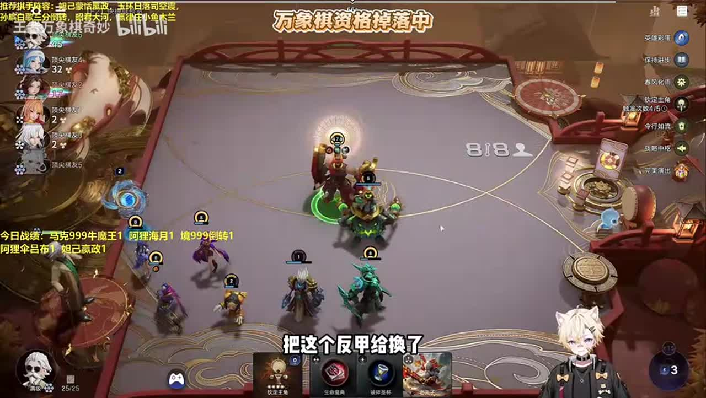

## 24:05–25:23 说明司空震对多核与厚血单核的伤害表现不同，等级差不能单独判断胜负

- 事件 ID：BV172b86sE9J:p1:e024
- 场景：实战
- 时机：敌方等级更高但无法压低生命时
- 背景（分析推断）：钟馗降等级与己方恢复也影响当局结果。
- 学习目标（分析推断）：结合伤害覆盖与生存机制判断对局。
- 模板：combat-review
- ASR 段落：[50, 51, 52]

> 对单体的伤害不是很厉害

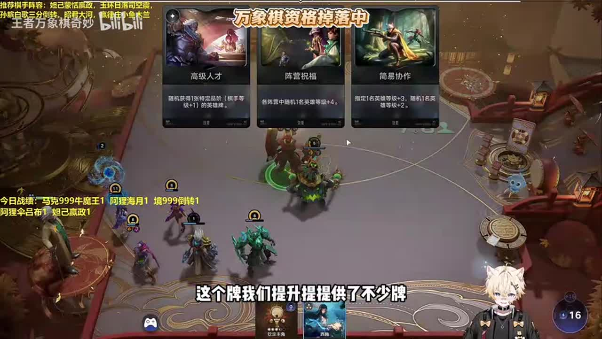

## 25:24–26:24 免减速、变速与减甲等针对功能可提高上限，但随机未到不当作已生效

- 事件 ID：BV172b86sE9J:p1:e025
- 场景：实战
- 时机：继续重构装备找机械头时
- 背景（分析推断）：明确各类敌方干扰与神器功能关系。
- 学习目标（分析推断）：用具体问题评价随机装备目标。
- 模板：counter-target
- ASR 段落：[53, 54]

> 一个是能免减速

## 25:54–27:26 比较自身生命、复活和防具减伤是否能承担换命，不仅看对方等级

- 事件 ID：BV172b86sE9J:p1:e026
- 场景：实战
- 时机：对手海月以换命伤害威胁核心时
- 背景（分析推断）：讲者按当局生命数值估算，未独立验证真实伤害减免细节。
- 学习目标（分析推断）：识别对手致胜方式并判断对应生存缺口。
- 模板：counter-target
- ASR 段落：[54, 55, 56]

> 一条命根本换不掉我一条命

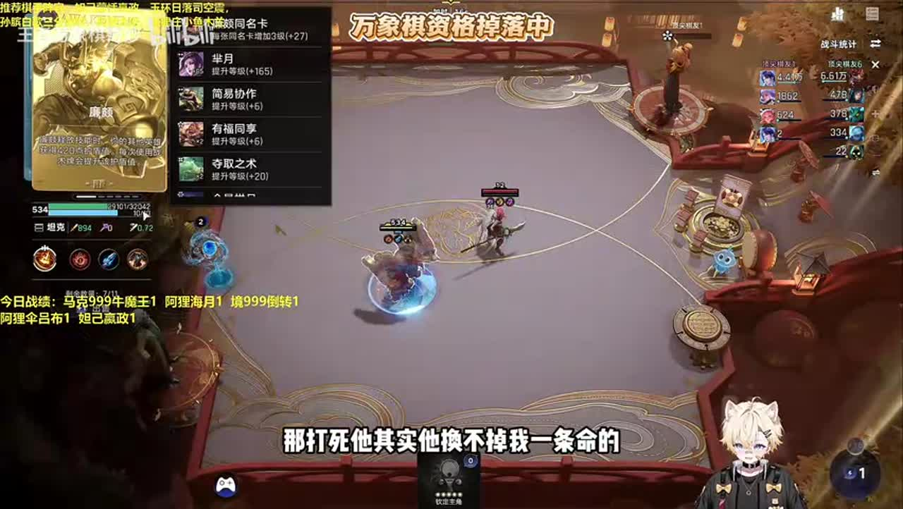

## 26:55–28:51 墨子后续少量成长可让位钟馗或高等级机器人；最后一轮芈月成长也可换战力，但扁鹊关键伤害功能需保留

- 事件 ID：BV172b86sE9J:p1:e027
- 场景：实战
- 时机：终局人口不足需要换辅助时
- 背景（分析推断）：升级成长与即时战力边际价值不同；西施在减蓝已兑现后才可考虑退出。
- 学习目标（分析推断）：终局逐个确认辅助功能是否已兑现再替换。
- 模板：late-transition
- ASR 段落：[56, 57, 58, 59]

> 这全部都换成战斗力

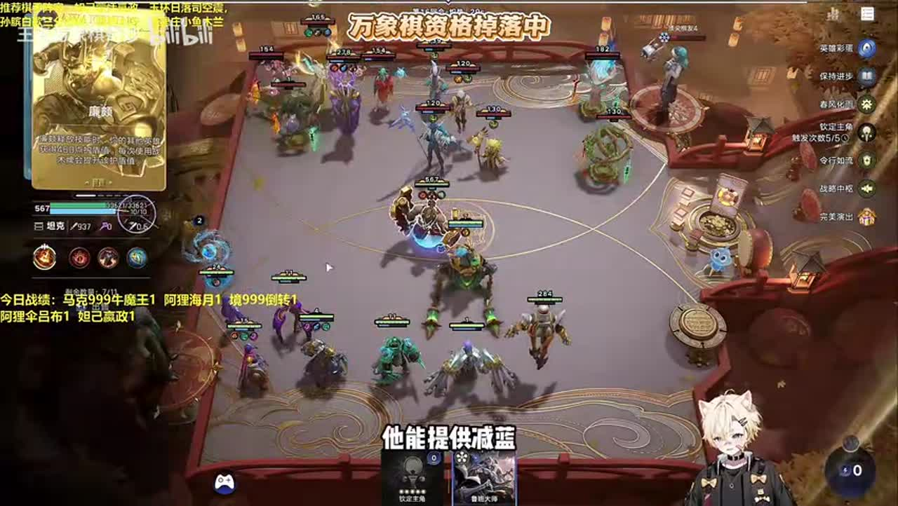

## 28:25–29:22 敌人被移动到远处会让近战核心无法施法和回血，召唤工具也可能有负收益

- 事件 ID：BV172b86sE9J:p1:e028
- 场景：实战
- 时机：机器人搬人导致廉颇一直走路时
- 背景（分析推断）：讲者观察当局站位和移动互动，不将召唤单位一概当作正收益。
- 学习目标（分析推断）：识别己方技能互相干扰的失败原因。
- 模板：combat-review
- ASR 段落：[59, 60]

> 走不到人跟前,那就不放弃了

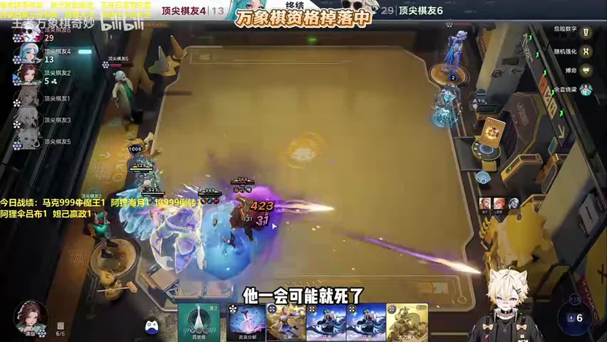

## 29:23–30:22 太乙觉醒提高复活质量，钟馗觉醒提升针对，工具仍可补效果牌循环

- 事件 ID：BV172b86sE9J:p1:e029
- 场景：实战
- 时机：补太乙与钟馗觉醒时
- 背景（分析推断）：终局优先觉醒承担胜负关键功能的单位。
- 学习目标（分析推断）：按关键战斗功能分配合成资源。
- 模板：resource-order
- ASR 段落：[61, 62]

> 这个太乙真人觉醒也很重要

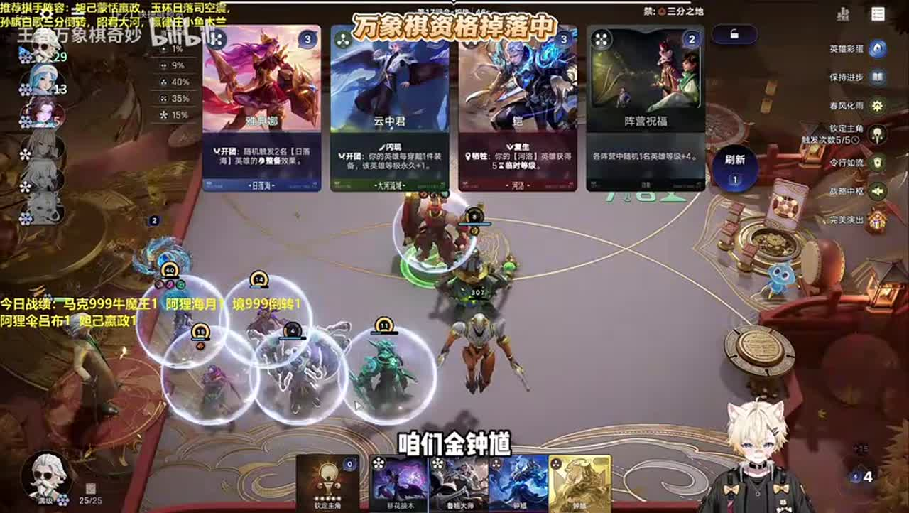

## 30:23–32:26 额外生命来源与基础等级生命不同；冰心继续限制射手，反甲是仍可改进的选择

- 事件 ID：BV172b86sE9J:p1:e030
- 场景：实战
- 时机：被降等级后仍能保持厚血时
- 背景（分析推断）：讲者分别解释被降等级后的生命留存与装备后悔，不用胜利证明原配装最佳。
- 学习目标（分析推断）：区分属性来源并从战斗反馈改进配装。
- 模板：combat-review
- ASR 段落：[63, 64, 65, 66]

> 莫子家的血量还是在的

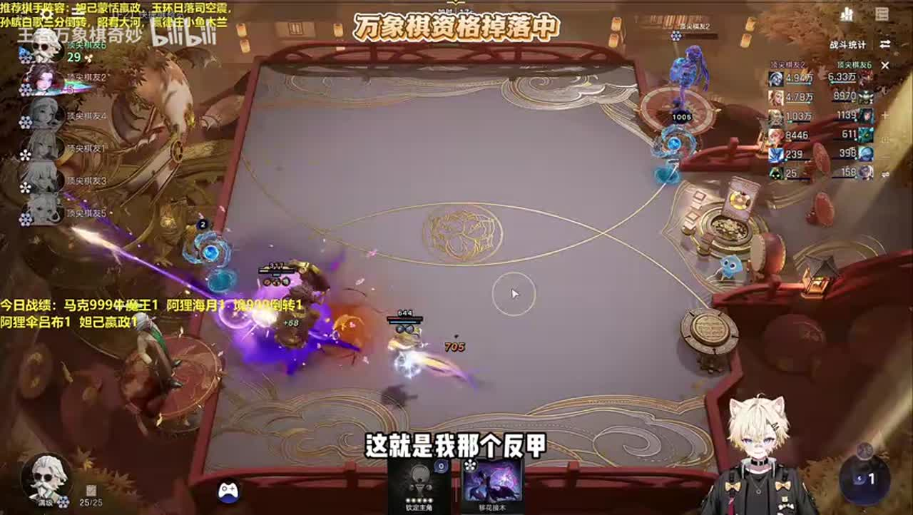

## 32:30–33:24 把扁鹊炸盾、当前生命与工具搬人反馈连接起来，并标注伤害估计不含敌方抗性

- 事件 ID：BV172b86sE9J:p1:e031
- 场景：实战
- 时机：最终战斗确认炸盾伤害时
- 背景（分析推断）：同一机器人在前局负收益、末局搬近敌人转为正收益，取决于位置与对象。
- 学习目标（分析推断）：基于实际互动而非单位标签评估辅助效果。
- 模板：combat-review
- ASR 段落：[67, 68]

> 不算对面磨炕的情况下

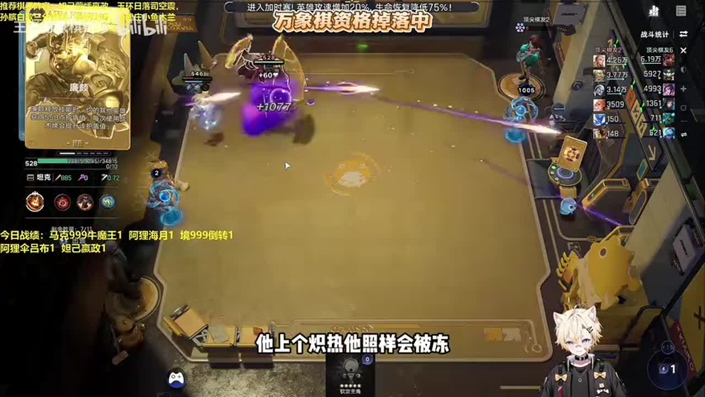

## 待核实与局限

- 原始ASR存在人名、装备、阵营同音误识，未修正。
- 戒指叠加、炸盾伤害和生命变化只保留讲者估计，不独立重算有矛盾的口述数字。
- 必赢、无敌等说法是讲者当局判断，非教学效果或通用克制的验证。
- 开场精彩宣传与结尾互动已排除；所选机制说明均发生在实战中。
