# 万象棋昭君养700级红蛋+999机器人特殊套路，无线经济一局学会

来源：https://www.bilibili.com/video/BV1Mzex6GErK/?p=1

分析状态：completed

完整文字稿：../../../raw/BV1Mzex6GErK_p1.md

## 00:57–02:05 低费单位每回合冻结升阶，可逐步变成高费单位

- 事件 ID：BV1Mzex6GErK:p1:e001
- 场景：实战
- 时机：开局说明昭君技能
- 背景（分析推断）：只保留明确技能结构，不记录前段逮捕与直播聊天
- 学习目标（分析推断）：区分卡牌升阶与英雄等级成长
- 模板：mechanic-model
- ASR 段落：[3, 4]

> 一个回合动一次

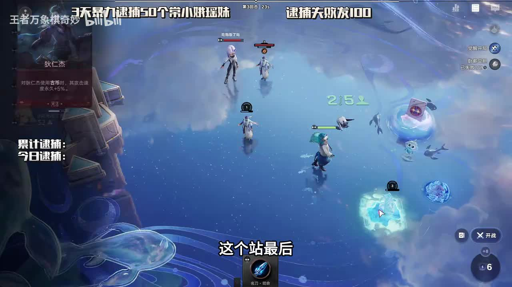

## 01:32–02:39 预期输局才能兑现的收益没有获得，当前赢局不能算吃到收益

- 事件 ID：BV1Mzex6GErK:p1:e002
- 场景：实战
- 时机：卧薪尝胆未触发
- 背景（分析推断）：本局不带装备仍获胜，讲者明确指出该轮收益落空
- 学习目标（分析推断）：理解奖励条件与实际结果的差异
- 模板：combat-review
- ASR 段落：[4, 5]

> 我卧薪尝胆没吃到

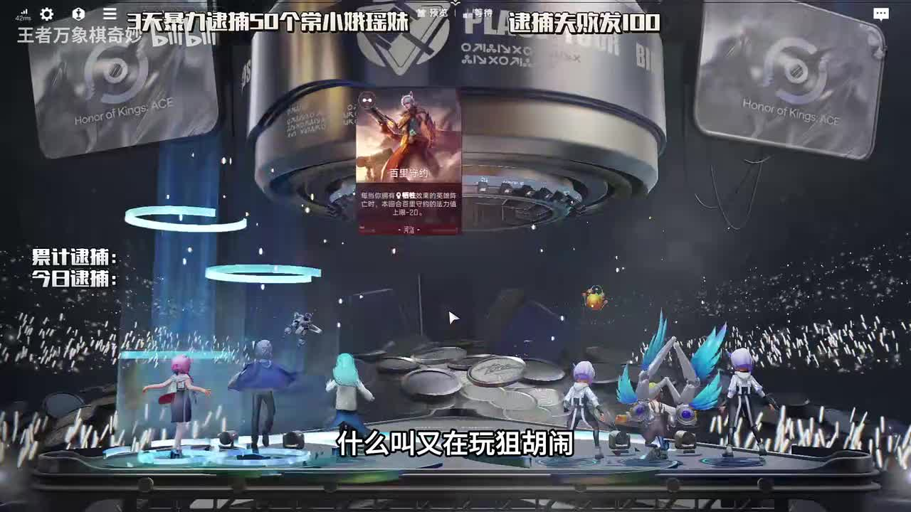

## 04:20–05:30 改用鲁班七号全屏高等级技能路线，不强等原计划

- 事件 ID：BV1Mzex6GErK:p1:e003
- 场景：实战
- 时机：大河牌不来而对手玩大河
- 背景（分析推断）：原定来牌缺失且对手结构成为选核心理由，人物同音误识保留原话
- 学习目标（分析推断）：结合来牌与对手选替代核心
- 模板：fallback-plan
- ASR 段落：[9, 10]

> 没有大和的牌

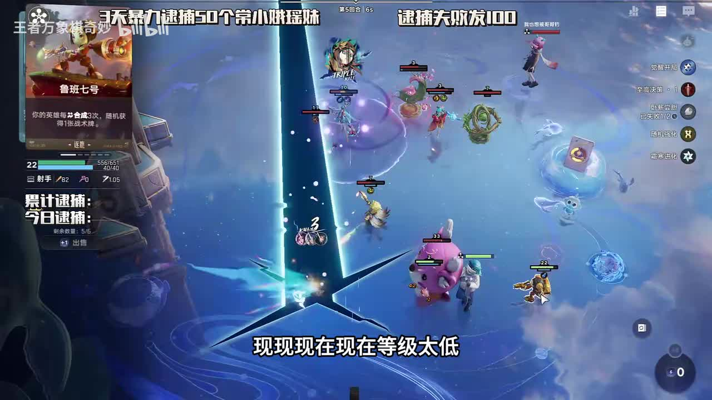

## 07:13–07:50 100级前后技能表现不同，当前成长未完成

- 事件 ID：BV1Mzex6GErK:p1:e004
- 场景：实战
- 时机：鲁班未到技能门槛且掉血
- 背景（分析推断）：回合与等级为本局讲者口径，不把无敌宣传当验证
- 学习目标（分析推断）：用技能质变门槛解释发育阶段
- 模板：mechanic-model
- ASR 段落：[14]

> 等我鲁班大地雷到100级

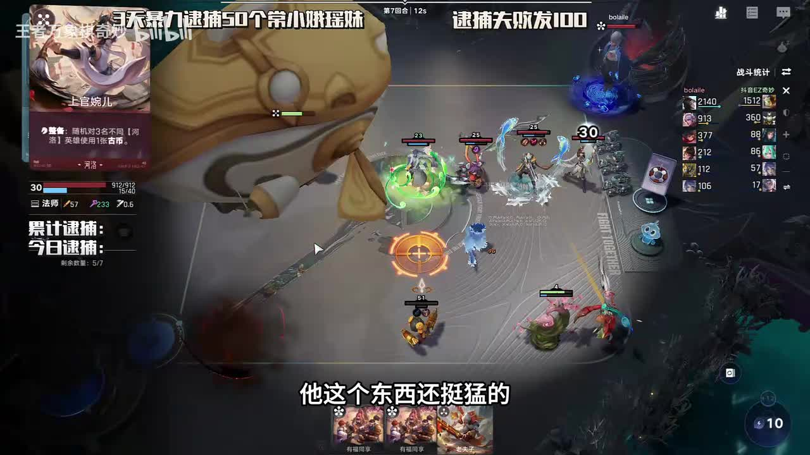

## 08:26–08:57 优先芈月觉醒，核心鲁班觉醒并非同样紧急

- 事件 ID：BV1Mzex6GErK:p1:e005
- 场景：实战
- 时机：逐鹿工具觉醒资源出现
- 背景（分析推断）：成长工具对循环作用大于当前核心觉醒需求
- 学习目标（分析推断）：按收益依赖决定觉醒对象
- 模板：resource-order
- ASR 段落：[16]

> 芈月觉醒很重要

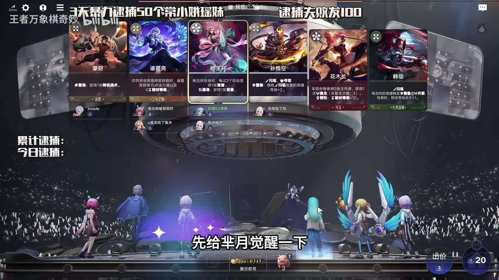

## 08:57–09:26 逐鹿低费卡路线选择对应阵营效果，不照搬大河高阶方案

- 事件 ID：BV1Mzex6GErK:p1:e006
- 场景：实战
- 时机：昭君阵营相关选项
- 背景（分析推断）：两条路线卡池结构不同，具体选项名称未可靠识别
- 学习目标（分析推断）：按卡组等阶结构判断技能选项
- 模板：talent-fit
- ASR 段落：[17]

> 因为逐鹿全是低费卡

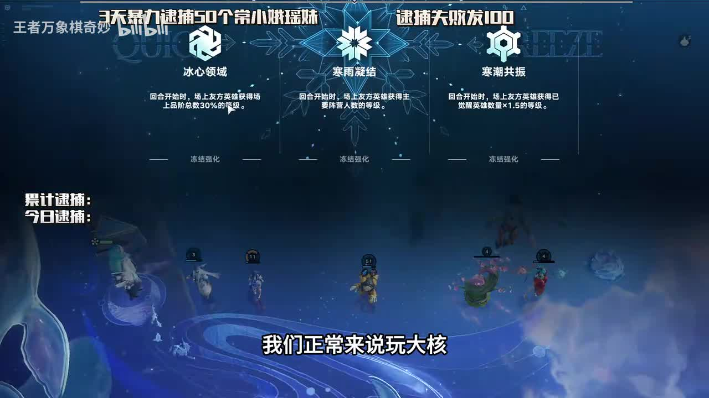

## 09:26–09:56 按三张卡等阶和为十完成额外给牌条件

- 事件 ID：BV1Mzex6GErK:p1:e007
- 场景：实战
- 时机：危险数字效果需满足购买组合
- 背景（分析推断）：本局使用危险数字，示例三加四加三，不用于其他天赋
- 学习目标（分析推断）：在刷牌时追踪可兑现奖励条件
- 模板：economy-budget
- ASR 段落：[18]

> 买三张卡加起来等于十

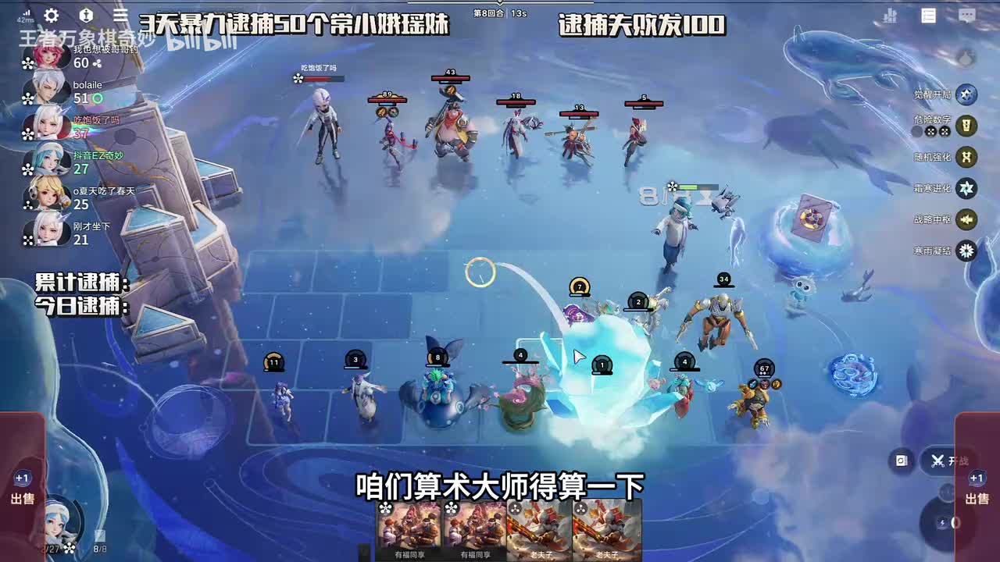

## 12:05–12:38 区分卡牌星数与实际买卖价格

- 事件 ID：BV1Mzex6GErK:p1:e008
- 场景：实战
- 时机：观众询问卡牌星数价格
- 背景（分析推断）：讲者解释高星仍可能三块买一块卖，本局规则不确认为现版本
- 学习目标（分析推断）：避免将等阶直接等同价格
- 模板：mechanic-model
- ASR 段落：[23]

> 他其实都是三块钱买一块钱卖掉的

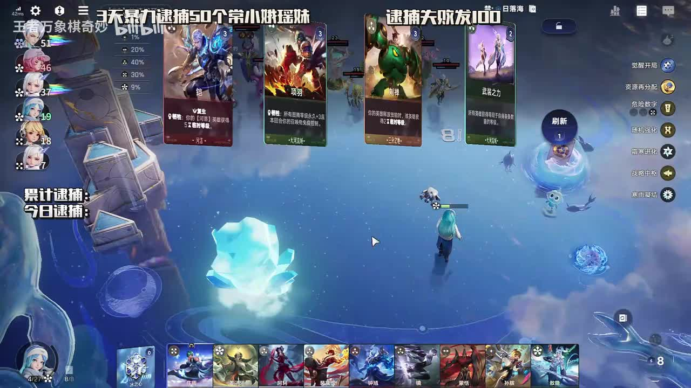

## 13:37–14:39 单核心选单核心收益而非大河全体生命方案

- 事件 ID：BV1Mzex6GErK:p1:e009
- 场景：实战
- 时机：六级核心强化选项
- 背景（分析推断）：当前主要输出集中，与原大河方案结构不同
- 学习目标（分析推断）：根据资源集中程度选强化
- 模板：talent-fit
- ASR 段落：[26, 27]

> 我们这个阵容只有一个主C

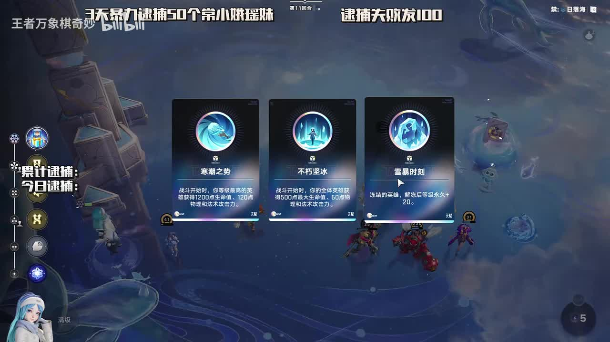

## 14:39–15:08 援护效果放在本轮其他成长操作之后用

- 事件 ID：BV1Mzex6GErK:p1:e010
- 场景：实战
- 时机：准备兑现援护战术
- 背景（分析推断）：讲者反复强调顺序，但具体叠加机制未完全解释，不补造因果
- 学习目标（分析推断）：关注结算前资源操作的先后关系
- 模板：resource-order
- ASR 段落：[28]

> 这个圆弧战术最后交

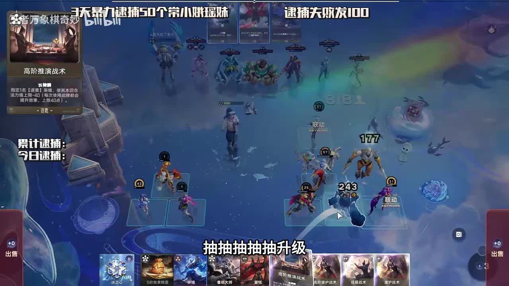

## 20:45–21:15 降低法力上限与持续回蓝组合可实现更频繁施法

- 事件 ID：BV1Mzex6GErK:p1:e011
- 场景：实战
- 时机：缩蓝后施法循环形成
- 背景（分析推断）：本局法力数值依据讲者，不声称所有单位无限技能
- 学习目标（分析推断）：理解法力门槛与恢复速度关系
- 模板：equipment-cause
- ASR 段落：[40]

> 这个推演战术就是简蓝条

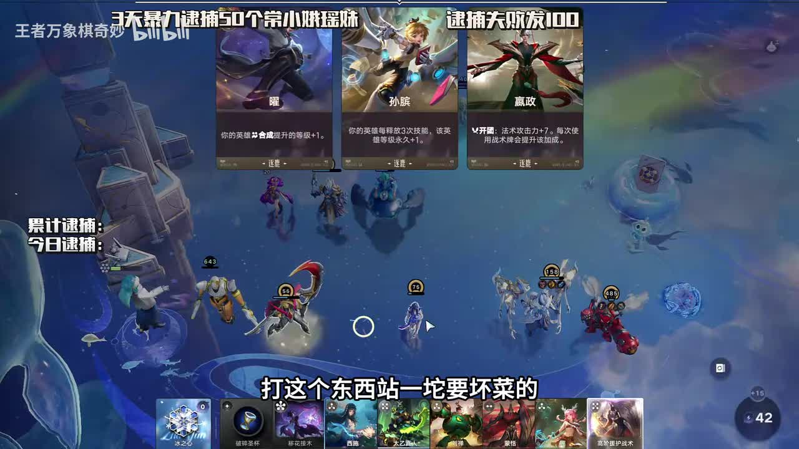

## 20:45–21:15 阵容分散，避免集中承受范围伤害

- 事件 ID：BV1Mzex6GErK:p1:e012
- 场景：实战
- 时机：面对优先打人数最多位置的技能
- 背景（分析推断）：讲者明确说明对手瞄准人最多区域，未确认具体对方名称
- 学习目标（分析推断）：按寻敌规则调整聚散
- 模板：position-cause
- ASR 段落：[40]

> 对着人最多的地方放技能

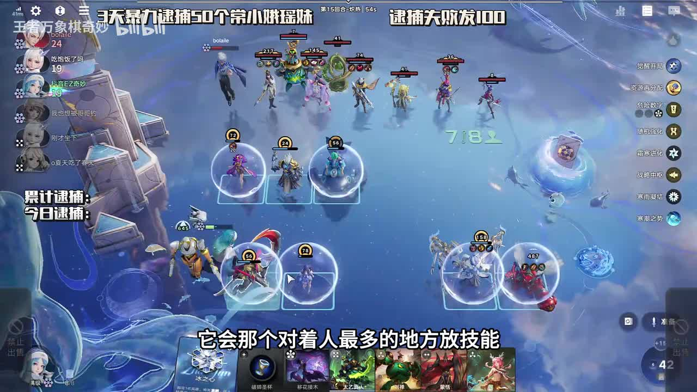

## 21:44–22:43 鲁班全屏爆发对大河有针对价值，不把单局表现说成普遍优于嬴政

- 事件 ID：BV1Mzex6GErK:p1:e013
- 场景：实战
- 时机：比较鲁班与嬴政的对局表现
- 背景（分析推断）：讲者说明多数情况仍更偏嬴政，保留条件与反例
- 学习目标（分析推断）：区分通用强度与特定对手适配
- 模板：counter-target
- ASR 段落：[42, 43]

> 打那个大和就特别屌

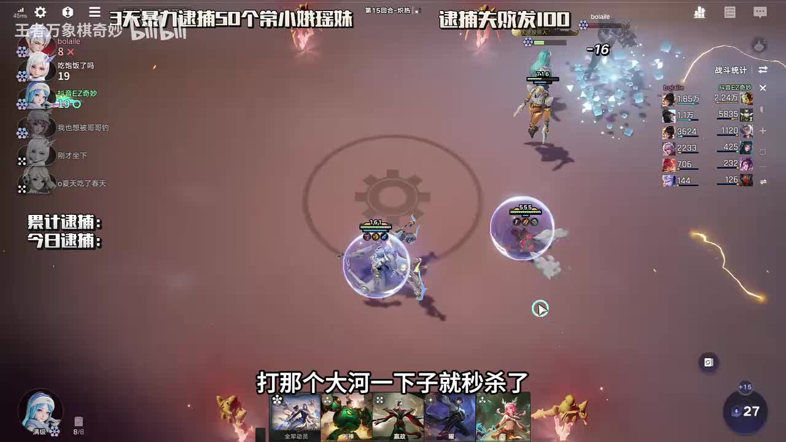

## 22:14–23:14 排除不适合技能核心的末世、暴击，考虑限制对方施法的铃铛

- 事件 ID：BV1Mzex6GErK:p1:e014
- 场景：实战
- 时机：神器与装备需要更新
- 背景（分析推断）：当前输出是技能爆发，具体神器名称按明确口述保留
- 学习目标（分析推断）：从触发方式评估配装
- 模板：equipment-role
- ASR 段落：[43, 44]

> 小鲁班是不要漠视的

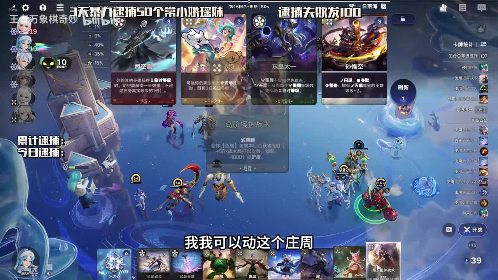

## 22:44–23:43 移除当前不需要的免控；合成可产战术卡用于循环

- 事件 ID：BV1Mzex6GErK:p1:e015
- 场景：实战
- 时机：确认对面控制少
- 背景（分析推断）：仅当前对手条件，之后受控反馈并不消除此前取舍风险
- 学习目标（分析推断）：按威胁更新装备且保留风险
- 模板：equipment-role
- ASR 段落：[44, 45]

> 没啥控制,这个免控不要了

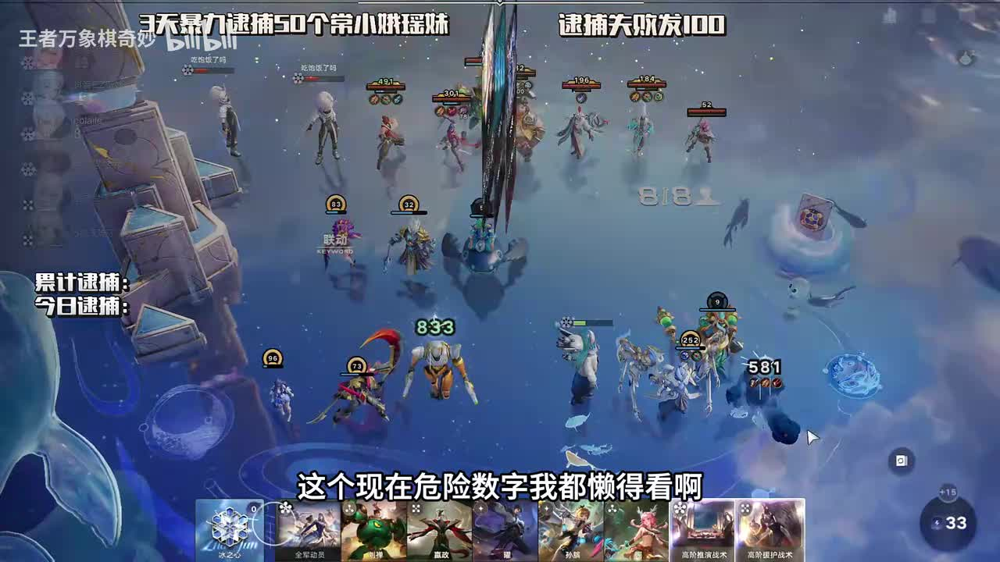

## 24:14–24:43 承认对老虎效果不如对大河，不能从先前克制推导所有对局都强

- 事件 ID：BV1Mzex6GErK:p1:e016
- 场景：实战
- 时机：打老虎险些翻车
- 背景（分析推断）：本局战斗暴露路线适用边界
- 学习目标（分析推断）：用不同对局反馈修正强度判断
- 模板：combat-review
- ASR 段落：[47]

> 打这个老虎怎么感觉这么曲啊

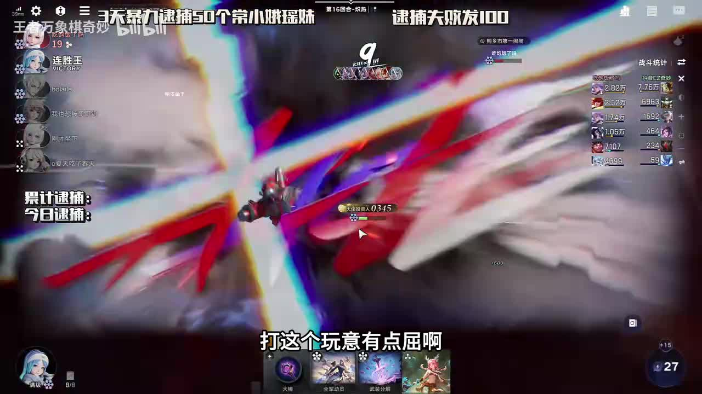

## 25:44–26:17 调整站位保护机器人与输出，不让关键单位过早阵亡

- 事件 ID：BV1Mzex6GErK:p1:e017
- 场景：实战
- 时机：机器人上轮先死
- 背景（分析推断）：终局双核心高等级但仍有接敌风险，983为当局口述
- 学习目标（分析推断）：从阵亡顺序定位站位问题
- 模板：position-cause
- ASR 段落：[50]

> 记忆人不能先死啊

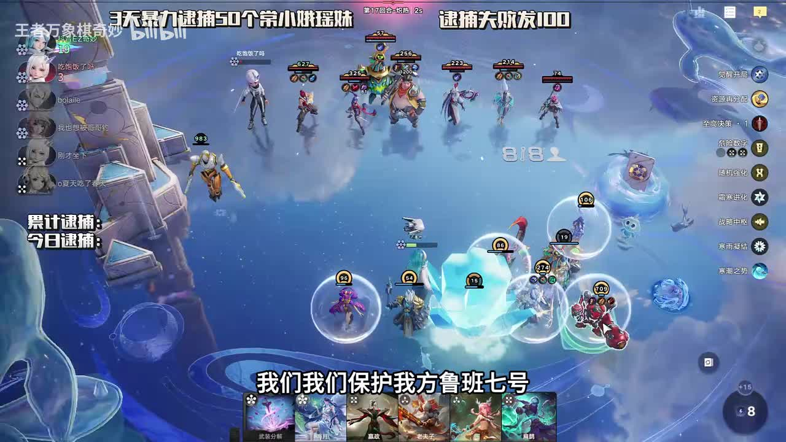

## 待核实与局限

- 原ASR鲁班七号与鲁班大师混用，315秒详情与1560秒字幕确认输出核心是鲁班七号；原话保留。
- 第2段重复字符及闲聊、吐槽、无理由操作不计事件。
- 援护最后用的具体收益机制未充分解释，只作为提示操作顺序的事件，不填编造的机制。
- 宣传999与高等级不是学习效果验证，视频终局机器人口述983，未冒称实际999。
- 单纯老夫子买入合成与含混冻结操作缺少可确认教学理由，未纳入事件。
