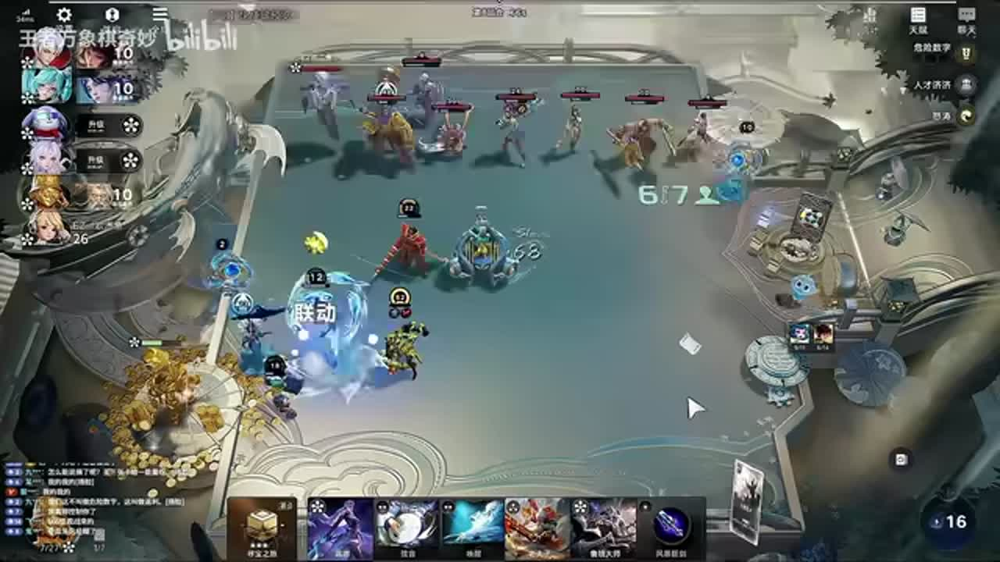
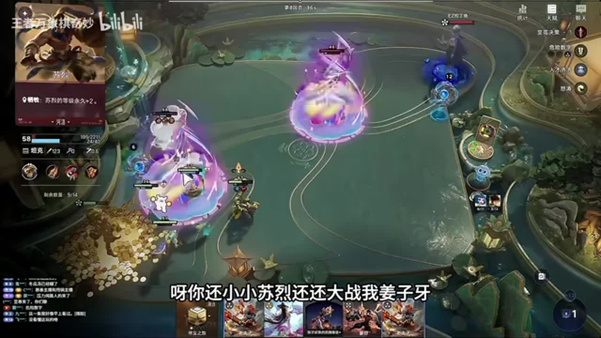
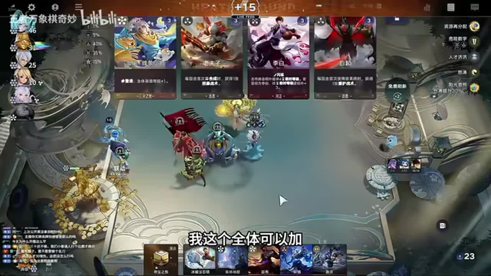
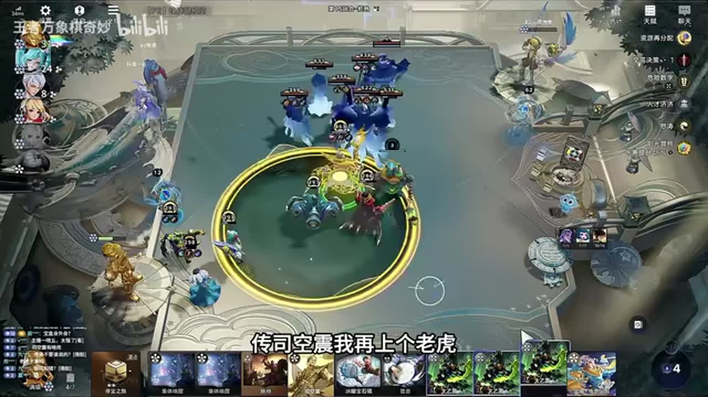
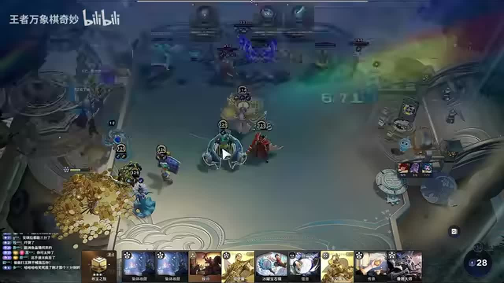

# 万象棋最帅的马可！颠覆你的认知！倒转转司空震吊打999宝盒+猴毛

来源：https://www.bilibili.com/video/BV1tkHS6VECD/?p=1

分析状态：completed

完整文字稿：../../../raw/BV1tkHS6VECD_p1.md

## 11:10–11:55 不要把姜子牙的觉醒路径等同于高价抢拍：本局后续买牌已经完成觉醒

- 事件 ID：BV1tkHS6VECD:p1:e001
- 场景：实战
- 时机：核心姜子牙尚待觉醒、拍卖竞价与后续买牌都可投入资源时
- 背景（分析推断）：前文已经拿到姜子牙，讲者刚处理曹操觉醒，随后指出姜子牙也已觉醒。690秒画面仍在战斗阶段，并非竞价界面；是否能复现便宜觉醒取决于手牌与来牌。
- 学习目标（分析推断）：比较拍卖价格与可用替代路径，避免为已可完成的目标过度花钱。
- 模板：resource-order
- ASR 段落：[19]

> 你看这姜子牙不就觉醒了吗?姜子牙需要抢三块吗?抢那么贵干嘛呢?

## 12:38–13:17 用已选成长天赋解释为什么本局提前培养姜子牙

- 事件 ID：BV1tkHS6VECD:p1:e002
- 场景：实战
- 时机：拿到人才济济与危险数字后，面对观众对培养姜子牙的疑问
- 背景（明确说明）：讲者明确将当前培养目标与人才济济、危险数字关联。画面处于战斗，右侧显示当前天赋，字幕提到姜子牙；讲者没有在这一段展开完整公式。
- 学习目标（分析推断）：依据当前已有成长条件判断培养目标，而不把固定阵容名单当作唯一依据。
- 模板：talent-fit
- ASR 段落：[21]

> 这么早养姜子牙那肯定养姜子牙呀我人才济济加危险数字我肯定是养姜子牙呀

## 20:54–21:28 解释马可宝藏触发边界：五费卡不能代替三阶卡触发宝藏

- 事件 ID：BV1tkHS6VECD:p1:e003
- 场景：实战
- 时机：玩家质疑宝藏数量少，而本局主要在打五费卡时
- 背景（明确说明）：讲者回应宝藏少的疑问，指出自己打的是五费卡，所以没有宝藏。画面可见马可棋手与高费手牌；不能把本条泛化成五费卡一律不该打。
- 学习目标（分析推断）：区分卡的费用与触发要求，先判断操作能否触发经济机制。
- 模板：mechanic-model
- ASR 段落：[34]

> 他打三阶卡才给宝藏,我打的全是五费卡。五费卡压根儿不给宝藏的。

## 21:30–22:05 比较天赋不能只看倍率，还要看当前受益对象：现阶段要全体成长，转吕布后再考虑单体收益

- 事件 ID：BV1tkHS6VECD:p1:e004
- 场景：实战
- 时机：比较阳光普照和重点照顾，当前仍需全队成长而后期计划转单核时
- 背景（明确说明）：讲者先对比两项天赋的倍率与作用范围，再明确当前至少是全体需要成长，后续转吕布时单体更适合。这是本局阶段条件下的取舍，并非所有马可局统一优先阳光普照。
- 学习目标（分析推断）：同时比较收益范围、阵容阶段与倍率，理解当下较优选择可能随阵容转型改变。
- 模板：talent-fit
- ASR 段落：[35]

> 我这个全体可以加我现在至少我至少现在是全体,得吃全体我一会的话我换个吕布周约是吃那个单体好但是我现在吃单体不好

## 26:39–28:25 受挫后确定传承司空震并补老虎的转型目标，说明这条路线用于补足后期成长

- 事件 ID：BV1tkHS6VECD:p1:e005
- 场景：实战
- 时机：先前回合没有打过对手，急需改变后期战力结构时
- 背景（明确说明）：43段先说没有打过，随后改为先觉醒司空震，并从此前不想拿传承转为急需传承。45段明确传司空震再上老虎，称这样接近999；具体等级公式没有讲全。
- 学习目标（分析推断）：将失败反馈转成具体的转型资源清单，辨认局势改变后需要重新排序的关键牌。
- 模板：late-transition
- ASR 段落：[43, 44, 45]

> 我想传个司空震出来传司空震我再上个老虎就司空震差不多就999了

## 29:10–29:53 围绕当前缺口调整操作优先级：继续合成找转型资源，随后优先找老虎

- 事件 ID：BV1tkHS6VECD:p1:e006
- 场景：实战
- 时机：转型路线明确但仍缺传承，刷牌和合成需要选择优先级时
- 背景（明确说明）：前文已说明传承司空震加老虎的转型路线。本段明确仍缺传承，因此强调合成，并把老虎作为下一项找牌目标；没有保证某次合成一定给传承。
- 学习目标（分析推断）：让资源操作服务于当前瓶颈，而不是机械沿用早期的宝藏或其他成长目标。
- 模板：resource-order
- ASR 段落：[47]

> 我要多打点合成我现在缺传承,我现在别跟我什么宝藏这了那了你都给我说多了

## 待核实与局限

- 部分直播口语、非教学闲聊中的人名未逐字消歧，保留完整原始ASR。
- 人才济济与危险数字的具体成长公式未在所引用讲解中完整展开，不推导固定回合或必达999规则。
- 阳光普照1.0与重点照顾1.5为视频当时讲者说法，不作为当前版本数值验证。
