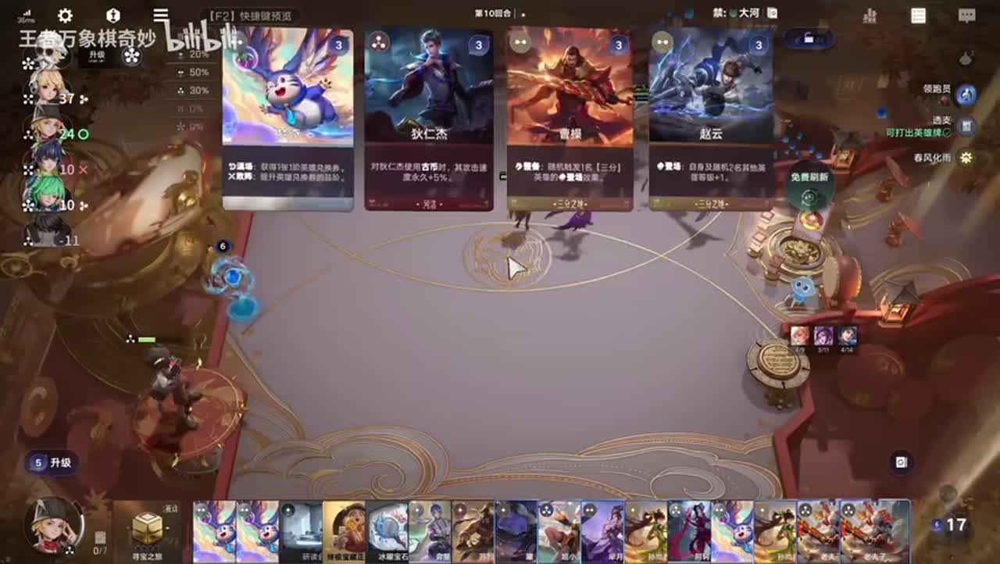
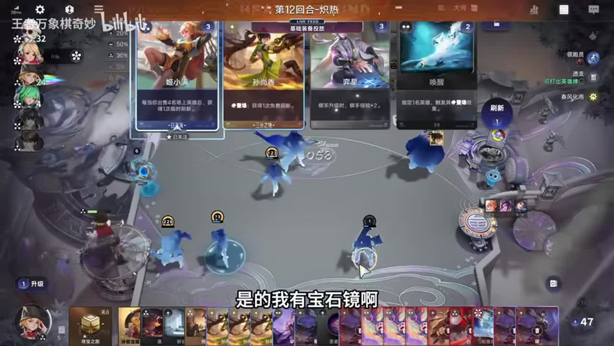

# 万象棋最强棋手马可！14回合999吕布爽挂机！从头强到尾全程碾压

来源：https://www.bilibili.com/video/BV1JGpM62EC5/?p=1

分析状态：completed

完整文字稿：../../../raw/BV1JGpM62EC5_p1.md

## 09:08–10:36 解释春风化雨与曜的合成成长比镜的效果牌成长更匹配

- 事件 ID：BV1JGpM62EC5:p1:e001
- 场景：实战
- 时机：观众问为何不养镜、正在利用重复英雄合成成长时
- 背景（明确说明）：讲者在这局利用合成，面对养镜建议时明确对照了两个英雄的成长触发方式。
- 学习目标（分析推断）：按当前资源的触发行为选择成长核心，而非固定选择某个英雄。
- 模板：talent-fit
- ASR 段落：[12, 13]

> 春风化雨的话养曜屌。曜是打合成的。

## 15:22–16:13 对照经济紧张与富余时的买牌取舍

- 事件 ID：BV1JGpM62EC5:p1:e002
- 场景：实战
- 时机：经济已明显富余后连续刷新购买时
- 背景（明确说明）：讲者明确对比穷的时候会挑选和有钱时购买更多牌；适用范围仅限这局能从出牌持续获益的组合。
- 学习目标（分析推断）：理解操作优先级随资源约束变化，不把少买牌当作永远正确。
- 模板：resource-order
- ASR 段落：[18]

> 反正,带颜色的全都买

## 18:02–19:05 把宝石镜的成长组合与当前经济表现联系

- 事件 ID：BV1JGpM62EC5:p1:e003
- 场景：实战
- 时机：解释这局钱不断增加时
- 背景（明确说明）：讲者用宝石镜解释为何本局能够持续刷新；该段没有完整讲清所有经济环节。
- 学习目标（分析推断）：知道经济表现需要追溯到具体组合，并识别解释不足之处。
- 模板：growth-combo
- ASR 段落：[21]

> 有宝石镜就会有钱啊。

## 18:02–19:05 提醒及时补免控，避免高等级核心被控制影响输出

- 事件 ID：BV1JGpM62EC5:p1:e004
- 场景：实战
- 时机：核心成长较高、仍未做免控时
- 背景（明确说明）：讲者明确说不做免控之后可能成为失误，提醒补齐核心功能需求。
- 学习目标（分析推断）：在资源富余时仍检查核心的关键功能短板。
- 模板：equipment-role
- ASR 段落：[21]

> 虽然做个免控吧,不做免控一会儿伏笔了。

## 20:40–21:31 解释五费卡不能触发马可宝藏，说明操作节奏下降的机制

- 事件 ID：BV1JGpM62EC5:p1:e005
- 场景：实战
- 时机：升级后发现出牌成长变慢时
- 背景（明确说明）：讲者观察到升级后的卡牌结构变化，指出五费卡与宝藏触发之间的限制。
- 学习目标（分析推断）：知道等级或商店卡池变化会影响成长引擎，能排查速度下降原因。
- 模板：mechanic-model
- ASR 段落：[24]

> 因为现在全五费卡。五费卡触发不了马可的宝藏。

## 21:32–23:07 比较不同转型目标的等级要求，不凭当前等级总和直接判断可转

- 事件 ID：BV1JGpM62EC5:p1:e006
- 场景：实战
- 时机：在吕布与海月之间考虑等级转型时
- 背景（明确说明）：讲者认为当前条件可让吕布到999，但海月还需要曜自身达到相应等级；没有完整讲明转化公式。
- 学习目标（分析推断）：转型前检查目标条件，不把不同转型路线视为同一操作。
- 模板：fallback-plan
- ASR 段落：[25, 26]

> 海月等级有点不够,海月得曜的等级到999,海月才够。

## 待核实与局限

- 136–199秒、443–491秒等转写间隔需要保留，尚未确认是否缺少语音。
- 末段坦克面板与装备针对的目标昵称未确认，因此不据此建立英雄克制结论。
- 经济富余下购买方式来自本局特定成长组合，不推广到其他棋手或无相同收益机制的情况。
