# 万象棋最简单棋手，半程都在挂机，13回合轻松999司空震

来源：https://www.bilibili.com/video/BV1J3ec6WET9/?p=1

分析状态：completed

完整文字稿：../../../raw/BV1J3ec6WET9_p1.md

## 02:04–03:10 牛魔狂铁加弈星觉醒后升五，中间少做无关操作

- 事件 ID：BV1J3ec6WET9:p1:e001
- 场景：实战
- 时机：开局完成过渡公式
- 背景（分析推断）：讲者针对杨玉环的同阵营循环路线，非所有棋手公式
- 学习目标（分析推断）：识别过渡完成条件
- 模板：opening-plan
- ASR 段落：[5, 6]

> 这个攻势达成之后直接升五级

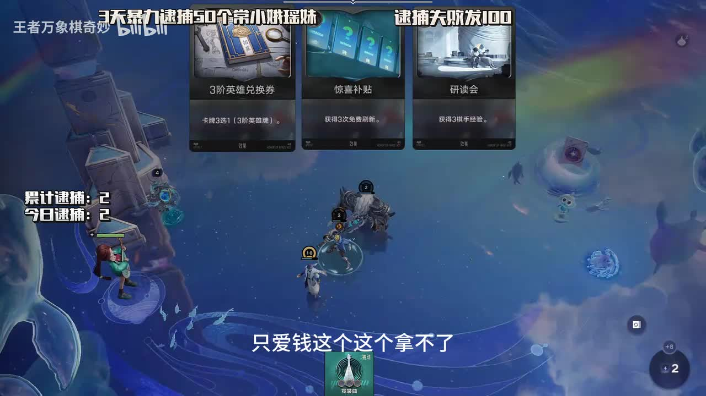

## 03:10–04:17 日落海工具均可辅助启动，但固定金币比随机三选一更确定

- 事件 ID：BV1J3ec6WET9:p1:e002
- 场景：实战
- 时机：拍卖选择可用卡或金币
- 背景（分析推断）：姬小满或其他工具的随机获得有风险；价格仅当局
- 学习目标（分析推断）：比较确定资源与随机找牌收益
- 模板：auction-choice
- ASR 段落：[7, 8]

> 百分百给三块钱

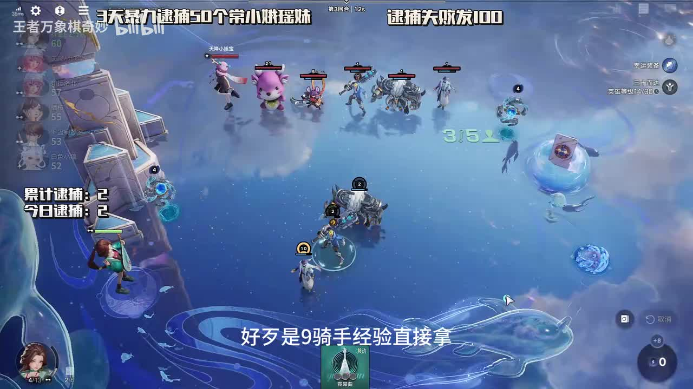

## 04:19–04:54 不为工具抬价，保留最快升五预算

- 事件 ID：BV1J3ec6WET9:p1:e003
- 场景：实战
- 时机：拍卖亚连与升五预算
- 背景（分析推断）：额外花费可能推迟启动并持续掉血，报价限于本局
- 学习目标（分析推断）：从阶段目标推导竞价上限
- 模板：economy-budget
- ASR 段落：[9]

> 我们就升不到五级了

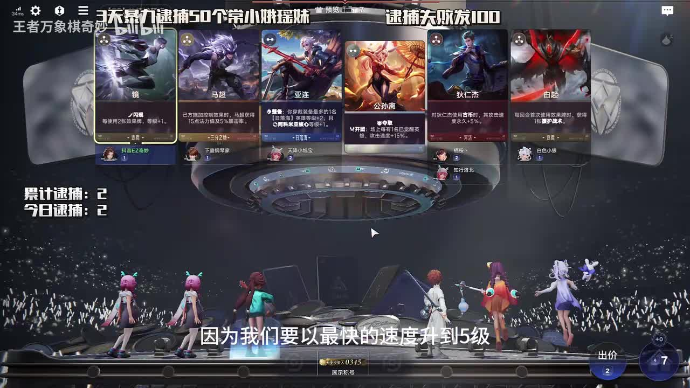

## 07:20–08:21 同阵营出牌但把给牌技能留五级，才可能给高阶核心

- 事件 ID：BV1J3ec6WET9:p1:e004
- 场景：实战
- 时机：五级前是否触发执法
- 背景（分析推断）：高阶卡池由等级限制，早开会耗用低质量牌
- 学习目标（分析推断）：理解技能兑现与卡池窗口
- 模板：resource-order
- ASR 段落：[14, 15]

> 你五级打他有可能送你司空刃

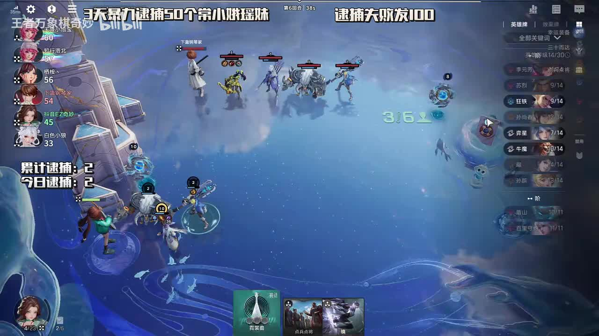

## 08:54–09:28 五级无关键卡也要启动，技能给牌才有机会补核心

- 事件 ID：BV1J3ec6WET9:p1:e005
- 场景：实战
- 时机：升五后仍没核心
- 背景（分析推断）：不启动可能再掉两轮直接死亡，不能无限等来牌
- 学习目标（分析推断）：用剩余生存窗口决定启动
- 模板：level-transition
- ASR 段落：[17]

> 启动之后才可能给关键卡

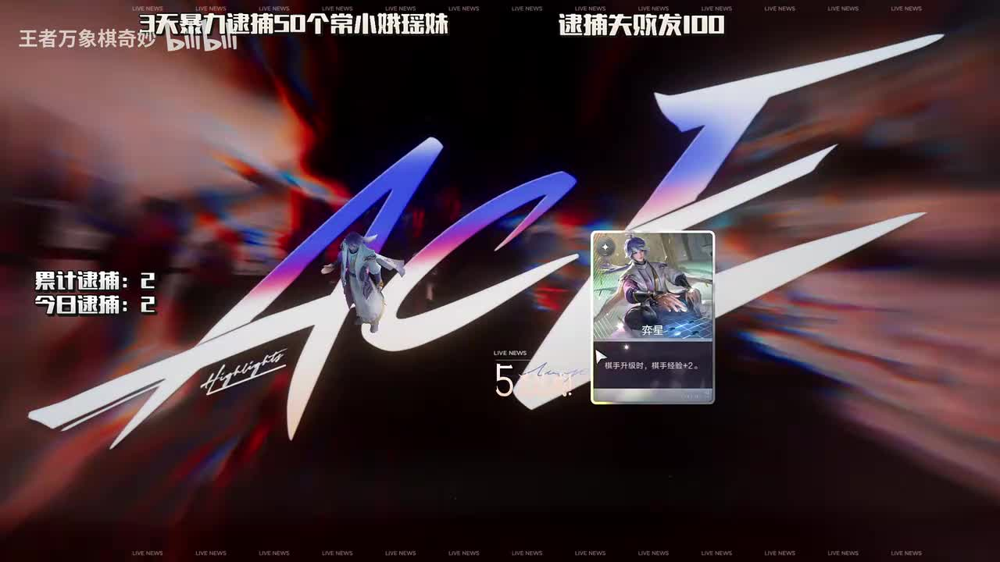

## 09:28–11:14 暂缓触发，避免早给废卡又需额外花钱打出

- 事件 ID：BV1J3ec6WET9:p1:e006
- 场景：实战
- 时机：准备上狂铁却将触发执法
- 背景（分析推断）：当前还未到五级，额外低效牌会拖循环
- 学习目标（分析推断）：预防过早兑现的成本
- 模板：resource-order
- ASR 段落：[18]

> 花更多的钱去打那两张废卡

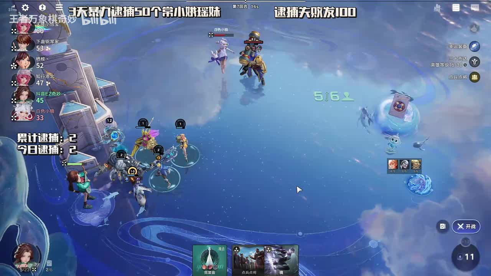

## 13:50–14:49 同阵营触发对应收益，无阵营不触发阴柔，可另分组处理

- 事件 ID：BV1J3ec6WET9:p1:e007
- 场景：实战
- 时机：同阵营与无阵营分组
- 背景（分析推断）：牌顺序与组合决定不同奖励，不能都当同阵营收益
- 学习目标（分析推断）：识别资源循环触发条件
- 模板：mechanic-model
- ASR 段落：[23, 24]

> 触发不了那个阴柔的

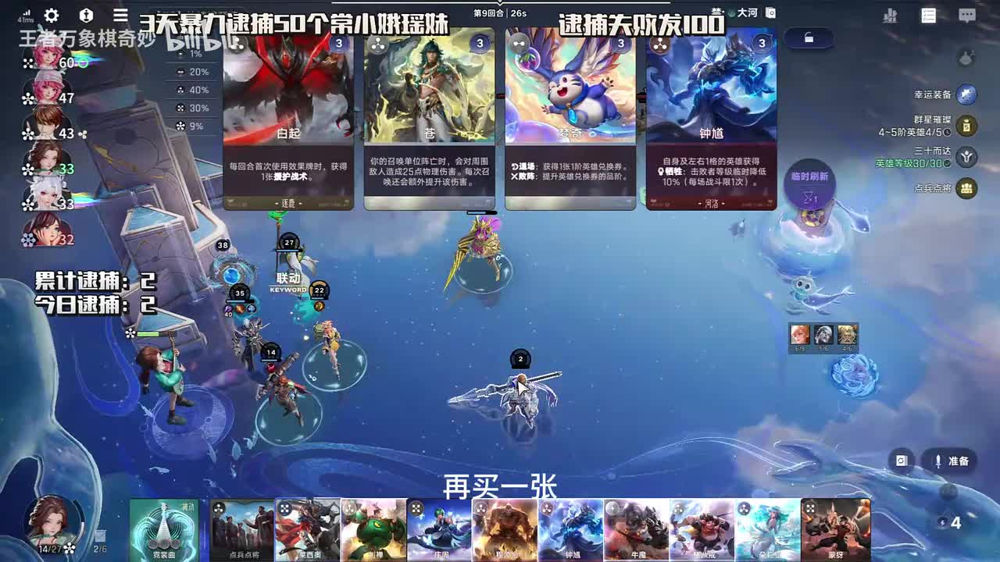

## 14:49–15:18 来不及完整组合时先处理牌，避免全部留手消失

- 事件 ID：BV1J3ec6WET9:p1:e008
- 场景：实战
- 时机：时间不足且牌将消失
- 背景（分析推断）：是操作时间不足时的权衡，不是平时鼓励乱打
- 学习目标（分析推断）：比较次优操作与过期损失
- 模板：economy-budget
- ASR 段落：[25]

> 乱扔总比砸在手里消失好

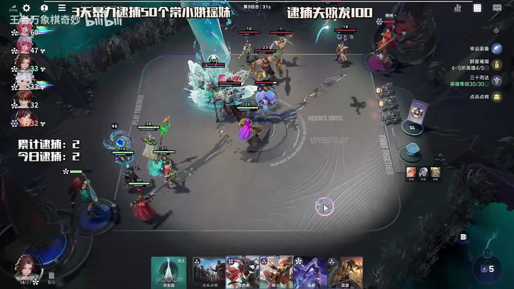

## 17:45–18:34 整理手牌帮助分阵营，但仍核查排序是否正确

- 事件 ID：BV1J3ec6WET9:p1:e009
- 场景：实战
- 时机：手牌多而分组困难
- 背景（分析推断）：当前大量循环牌，界面排序不总等同所需组合
- 学习目标（分析推断）：减少操作负担并核查分组
- 模板：resource-order
- ASR 段落：[31, 32]

> 按照他这个顺序打就完事了

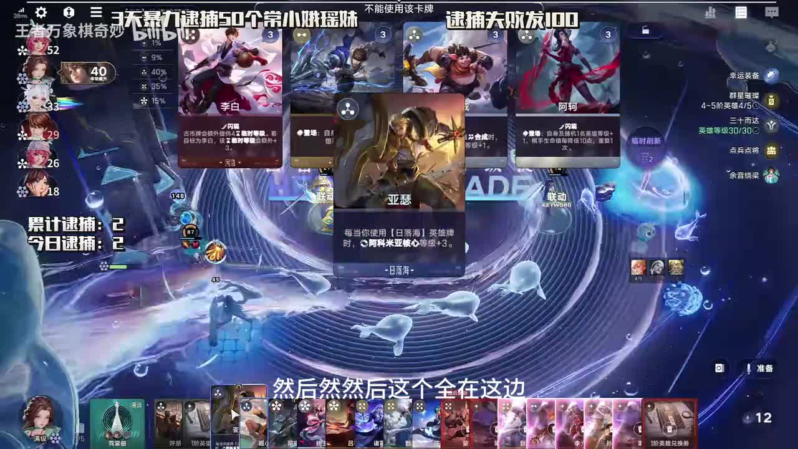

## 19:04–19:32 姜子牙依未在场阵营进入触发成长，重复打河洛可能不加司空震等级

- 事件 ID：BV1J3ec6WET9:p1:e010
- 场景：实战
- 时机：场上已挂司空震后
- 背景（分析推断）：场上阵营决定收益，不能只数出了几张卡
- 学习目标（分析推断）：按在场阵营检查成长触发
- 模板：growth-combo
- ASR 段落：[34]

> 场上有司空阵的话

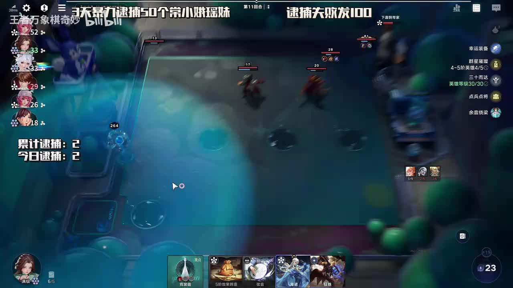

## 19:32–21:54 发现组牌错位，从三张变两张半，停止盲信整理并核对每组

- 事件 ID：BV1J3ec6WET9:p1:e011
- 场景：实战
- 时机：连续出牌却没奖励
- 背景（分析推断）：一次顺序错位可连续损失奖励，未给牌是应检查的反馈
- 学习目标（分析推断）：从奖励缺失发现操作错误
- 模板：combat-review
- ASR 段落：[35, 36, 38]

> 没给我卡,我还没有发现不对劲

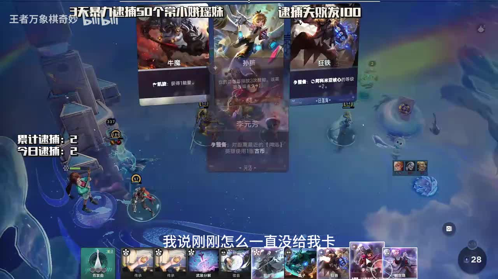

## 22:25–22:54 甄姬庄周能给牌，老夫子合成也可提供资源

- 事件 ID：BV1J3ec6WET9:p1:e012
- 场景：实战
- 时机：筛选循环购买对象
- 背景（分析推断）：优先能返还资源的工具，不是无条件买所有单位
- 学习目标（分析推断）：按循环资源收益筛选买牌
- 模板：growth-combo
- ASR 段落：[40]

> 真鸡加庄周能给两张卡

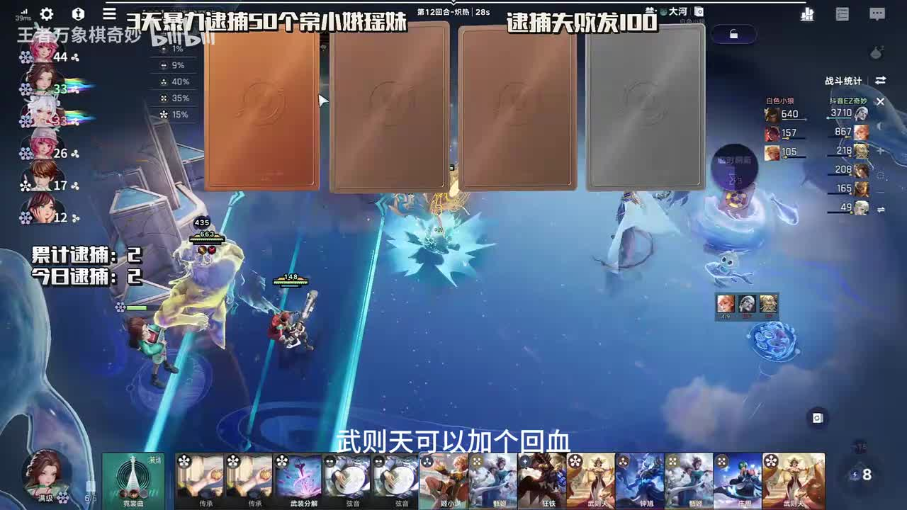

## 24:52–25:56 给牌和给钱工具继续有价值，转扫赋可能变穷

- 事件 ID：BV1J3ec6WET9:p1:e013
- 场景：实战
- 时机：循环后期金币短缺
- 背景（分析推断）：当前核心等级接近上限，持续经济决定还能补多少牌
- 学习目标（分析推断）：比较不同奖励对循环的影响
- 模板：economy-budget
- ASR 段落：[45, 46]

> 他给钱主要是

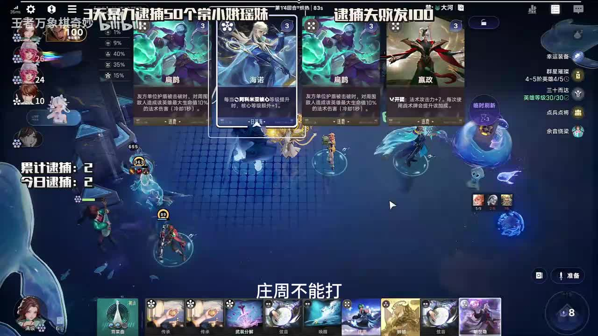

## 25:26–26:25 按规则优先级结算，三张同品阶可能先触发对应效果

- 事件 ID：BV1J3ec6WET9:p1:e014
- 场景：实战
- 时机：同阵营同品阶同时满足
- 背景（分析推断）：相同阵营不保证触发阵营奖励，还需排除更高优先组合
- 学习目标（分析推断）：理解重叠条件的结算顺序
- 模板：mechanic-model
- ASR 段落：[46, 47]

> 他会优先触发三个铜品节

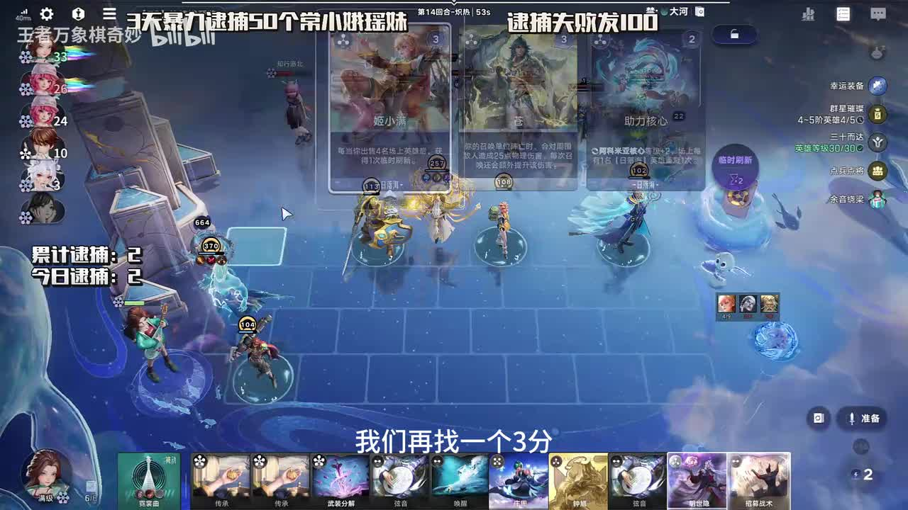

## 26:55–28:01 继续等级给姜子牙等其他单位，不浪费到999核心

- 事件 ID：BV1J3ec6WET9:p1:e015
- 场景：实战
- 时机：司空震等级上限已到
- 背景（分析推断）：当前成长对象收益已封顶，不能沿用中期投入方式
- 学习目标（分析推断）：识别成长上限并转移资源
- 模板：resource-order
- ASR 段落：[49, 50]

> 再给他就浪费了

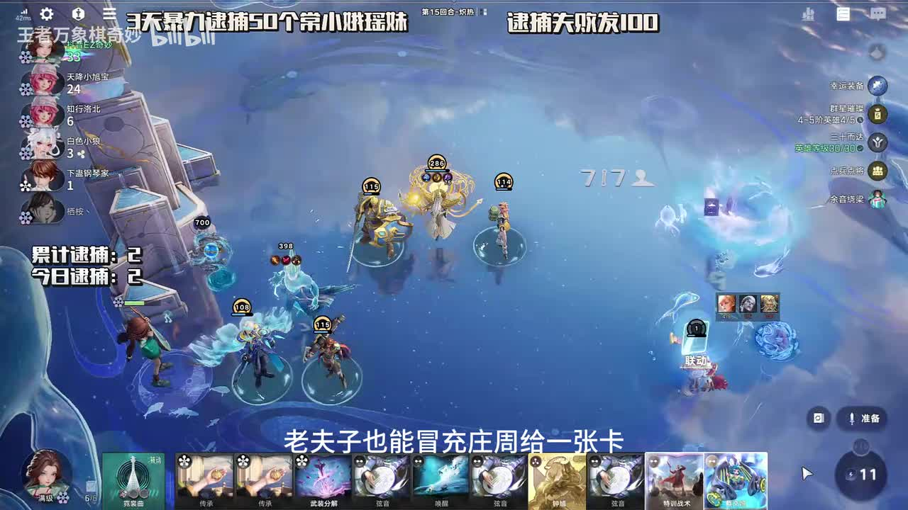

## 28:01–29:06 按对方等级强度决定钟馗针对是否值得占位

- 事件 ID：BV1J3ec6WET9:p1:e016
- 场景：实战
- 时机：针对倒转对手是否上钟馗
- 背景（分析推断）：对方尚低等级无需过度针对，高等级群体另论
- 学习目标（分析推断）：保留反制建议的威胁阈值
- 模板：counter-target
- ASR 段落：[51, 52]

> 如果这个时候是一车六七百的话

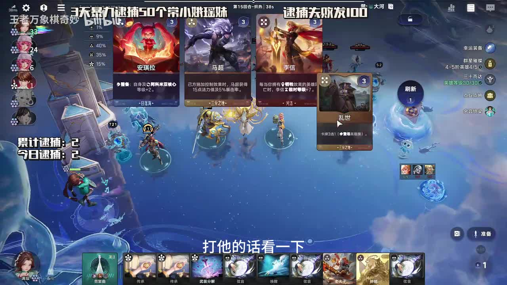

## 29:06–29:49 隐身保护司空震，让其他工具承担后排接敌

- 事件 ID：BV1J3ec6WET9:p1:e017
- 场景：实战
- 时机：莱西奥烟雾与敌人跳后排
- 背景（分析推断）：技能可改变对手目标选择，站位需要与其配合
- 学习目标（分析推断）：根据隐身和跳点分配承伤
- 模板：position-cause
- ASR 段落：[53]

> 烟雾弹的话能让这个自封阵隐身

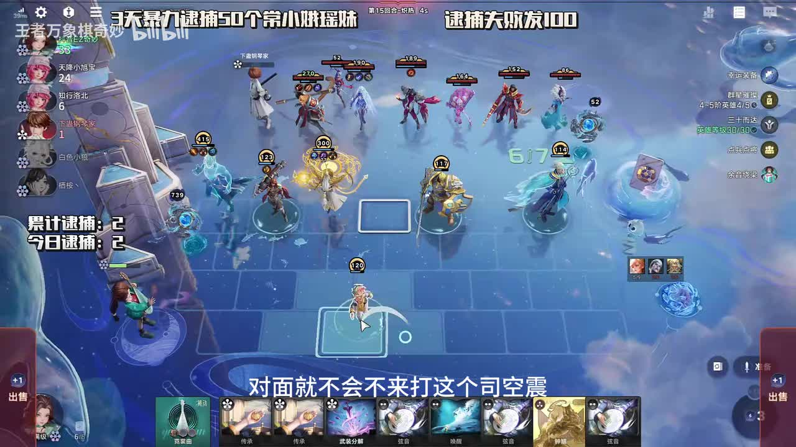

## 29:49–30:21 补免控以防被勾走，没钱找工具可锁商店

- 事件 ID：BV1J3ec6WET9:p1:e018
- 场景：实战
- 时机：后期控制风险
- 背景（分析推断）：当前仍有未知控制威胁，属于风险判断而非已发生事实
- 学习目标（分析推断）：在补强时考虑技能被打断风险
- 模板：equipment-role
- ASR 段落：[54]

> 搞不好谁有个控制给我勾走了

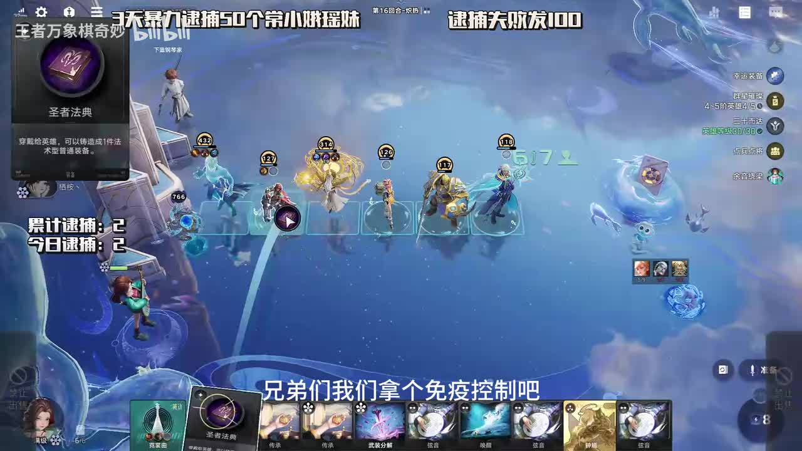

## 30:58–31:35 替换已无用亚瑟补艾琳和钟馗，移植要避免错到钟馗

- 事件 ID：BV1J3ec6WET9:p1:e019
- 场景：实战
- 时机：准备最终对手
- 背景（分析推断）：核心成型后由成长转向战斗辅助，随机目标需检查
- 学习目标（分析推断）：根据终局目标更新工具位
- 模板：late-transition
- ASR 段落：[56]

> 这个亚瑟。直接滚

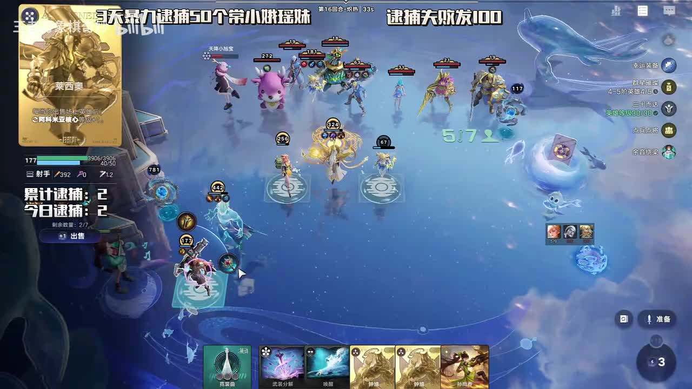

## 31:35–32:15 寻找复活甲和太乙等生存资源

- 事件 ID：BV1J3ec6WET9:p1:e020
- 场景：实战
- 时机：最后补强
- 背景（分析推断）：已进入终局，继续等级收益有限，额外生命有直接战力意义
- 学习目标（分析推断）：围绕终局生存补强
- 模板：equipment-role
- ASR 段落：[57]

> 找个复活甲吧

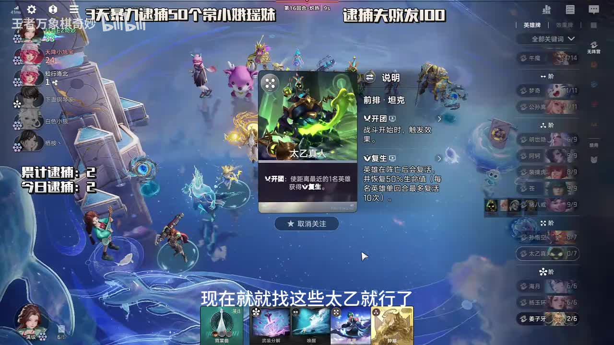

## 待核实与局限

- 不做ASR修正；盖伦等直播戏称与同音英雄不自动标准化，按截图可靠信息另记。
- 第20、28、39等重复字符及逮捕闲聊、喊口号、无理由操作排除。
- 同阵营与同品阶规则及具体数值属于视频所处规则，未核实当前版本。
- 整理手牌建议后讲者发现组牌错误，报告保留其限制，不能写成自动排序保证正确。
