# 三分倒转全网最细直播教学，全局运营思路，手速慢也能轻松999

来源：https://www.bilibili.com/video/BV1R7hx6yEVK/?p=1

分析状态：completed

完整文字稿：../../../raw/BV1R7hx6yEVK_p1.md

## 01:13–02:31 用干将等即时战力稳血，先观察有无白歌同行。

- 事件 ID：BV1R7hx6yEVK:p1:e001
- 场景：实战
- 时机：前期对手干将强时
- 背景（分析推断）：讲者不建议前三轮主动卖血，目标是为后段提供容错。
- 学习目标（分析推断）：用过渡战力争取启动时间。
- 模板：opening-plan
- ASR 段落：[3, 4]

> 前期三把一定要稳血

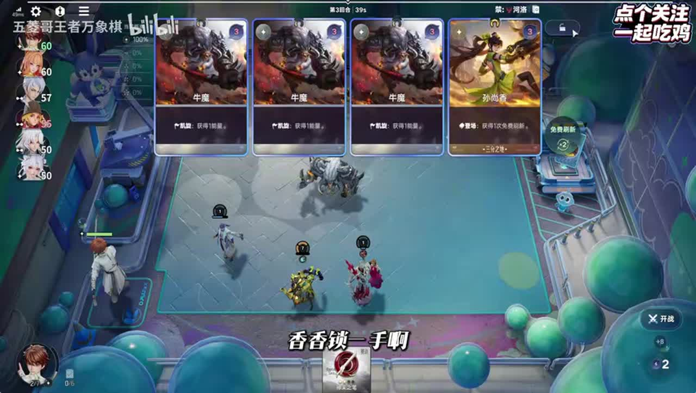

## 02:59–04:02 需要牌就补，没有则选守约等战斗能力强的过渡。

- 事件 ID：BV1R7hx6yEVK:p1:e002
- 场景：实战
- 时机：拍卖缺本阵容牌时
- 背景（分析推断）：拍卖阿轲到来，讲者说明未出现时的分支。
- 学习目标（分析推断）：按功能与库存挑拍卖。
- 模板：auction-choice
- ASR 段落：[6, 7]

> 找一张战斗能力强的

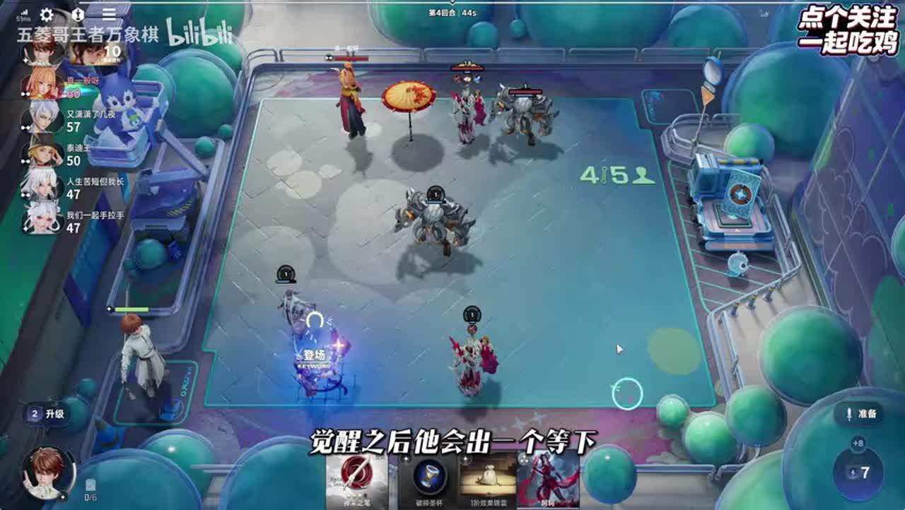

## 03:31–04:43 刺客多可选瞬影连斩，锦囊偏好增加英雄牌。

- 事件 ID：BV1R7hx6yEVK:p1:e003
- 场景：实战
- 时机：天赋与效果锦囊选择时
- 背景（分析推断）：选择基于单位标签与循环需求，具体名有ASR疑词。
- 学习目标（分析推断）：判断选项能否接到现有路线。
- 模板：talent-fit
- ASR 段落：[7, 8]

> 因为我们的阵容会很多刺客

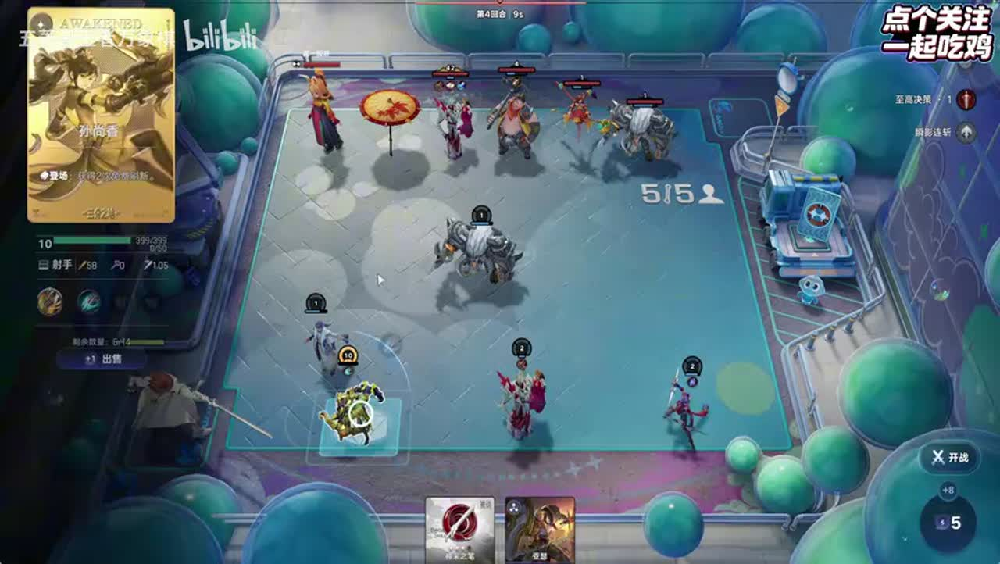

## 04:43–05:14 给承担输出的阿轲，不随意丢给工具位。

- 事件 ID：BV1R7hx6yEVK:p1:e004
- 场景：实战
- 时机：征服者之剑到来时
- 背景（分析推断）：已有明确即时输出目标。
- 学习目标（分析推断）：装备优先服务当期主核。
- 模板：equipment-role
- ASR 段落：[9]

> 我们刚好是给阿柯用

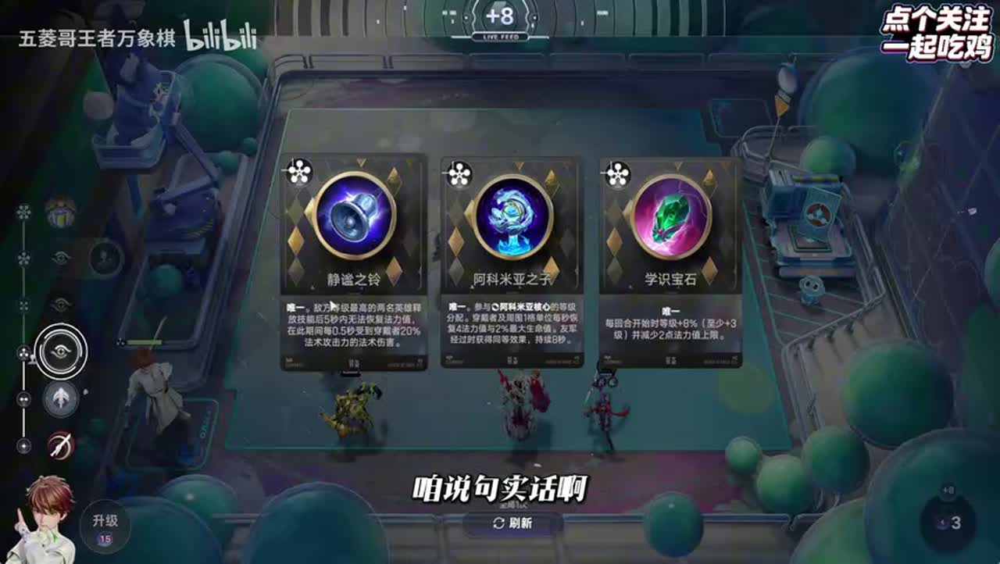

## 05:46–07:44 免费商店顺来曹操就拿，没有则速升四；把免费刷新留到四级。

- 事件 ID：BV1R7hx6yEVK:p1:e005
- 场景：实战
- 时机：曹操未到或已有时
- 背景（分析推断）：主动早搜曹操会消耗后续关键牌窗口。
- 学习目标（分析推断）：分配刷新到有效商店等级。
- 模板：level-transition
- ASR 段落：[11, 12, 13]

> 把免费刷新留到4级的时候再用

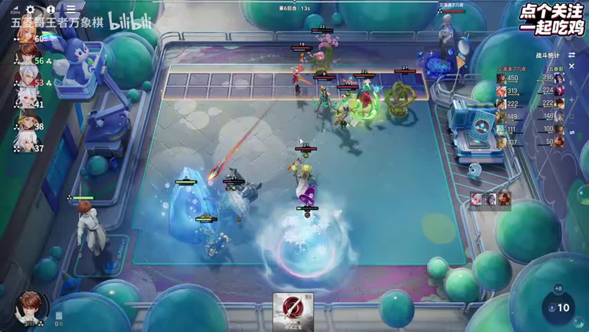

## 07:44–09:00 优先三阶三分牌作目标，二阶成功概率较低；缺牌可多等一回合。

- 事件 ID：BV1R7hx6yEVK:p1:e006
- 场景：实战
- 时机：用前浪荣光找高阶三分时
- 背景（分析推断）：希望得到小乔甄姬，具体概率不作保证。
- 学习目标（分析推断）：按目标池条件安排升阶。
- 模板：resource-order
- ASR 段落：[14, 15]

> 尽量去用在三阶牌

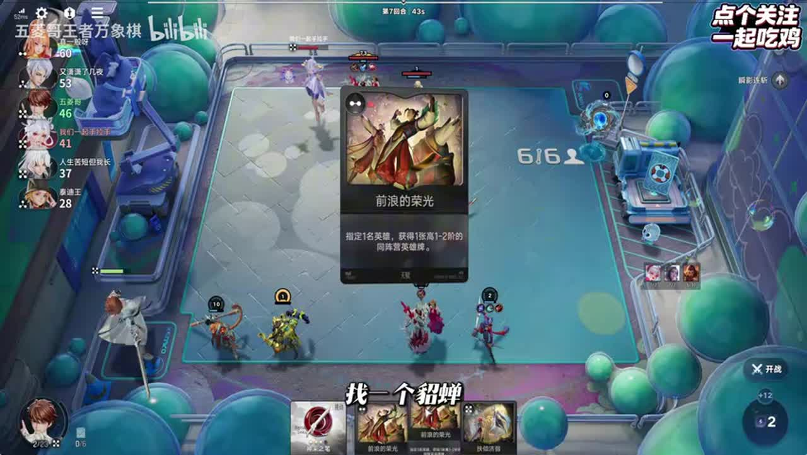

## 08:18–09:37 单核对手可能让败局损血较少，倒转多一轮很重要。

- 事件 ID：BV1R7hx6yEVK:p1:e007
- 场景：实战
- 时机：匹配单养一核的对手时
- 背景（分析推断）：实际强弱和入血仍需观察，不能保证不伤。
- 学习目标（分析推断）：把敌方结构转化为成长时间判断。
- 模板：economy-budget
- ASR 段落：[15, 16]

> 每一回合对三分倒转的非常的重要

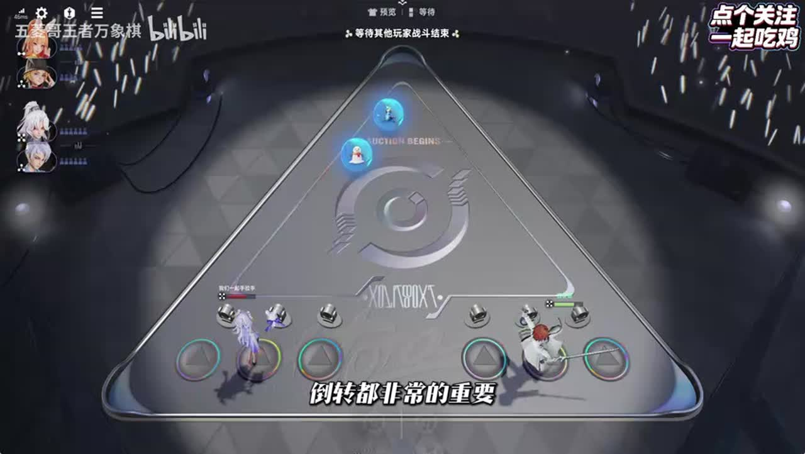

## 09:49–11:10 本局最高五块，识别对手无用途却抬价时退出。

- 事件 ID：BV1R7hx6yEVK:p1:e008
- 场景：实战
- 时机：竞价孙悟空时
- 背景（分析推断）：孙悟空是主输出，但不无限竞价。
- 学习目标（分析推断）：保留预算并读对手竞价动机。
- 模板：auction-choice
- ASR 段落：[17, 18]

> 超过五块钱咱不要

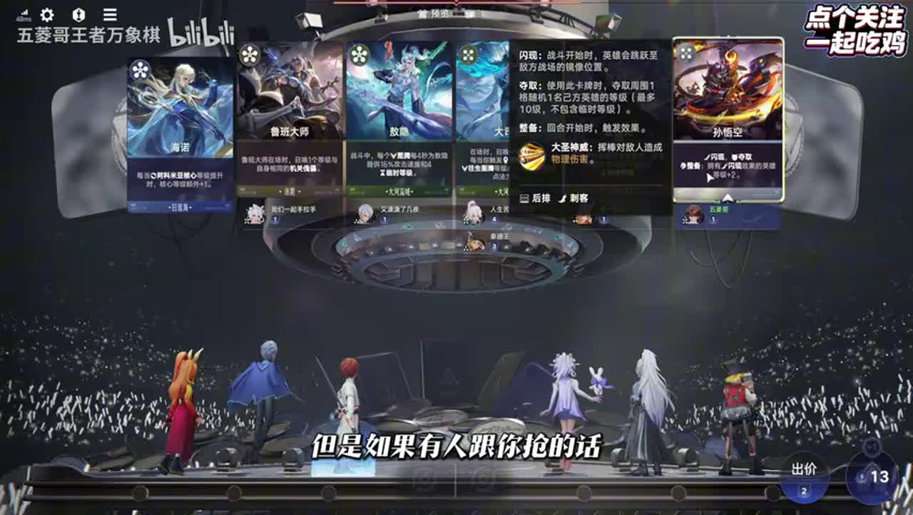

## 10:24–12:24 留即兴创作，先用三阶目标得到甄姬再找小乔。

- 事件 ID：BV1R7hx6yEVK:p1:e009
- 场景：实战
- 时机：启动小乔前
- 背景（分析推断）：关键发动机未到，复制资源不能提前浪费。
- 学习目标（分析推断）：保存组合启动所需的顺序资源。
- 模板：resource-order
- ASR 段落：[18, 19]

> 即兴创作留住哦,不要用哦

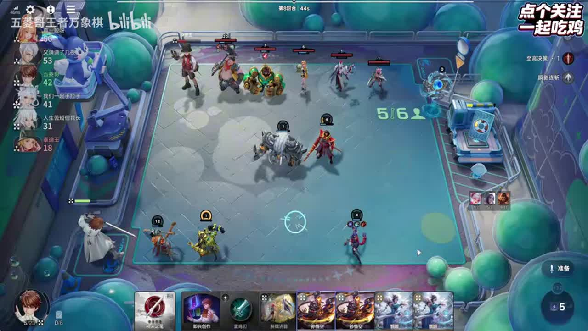

## 11:10–13:07 把猴子移到待上单位旁，再上牌触发吸取。

- 事件 ID：BV1R7hx6yEVK:p1:e010
- 场景：实战
- 时机：猴子吸等级时
- 背景（分析推断）：目标由邻接控制，不是随机报操作。
- 学习目标（分析推断）：用位置指定成长受益人。
- 模板：position-binding
- ASR 段落：[19, 20]

> 猴子放过去

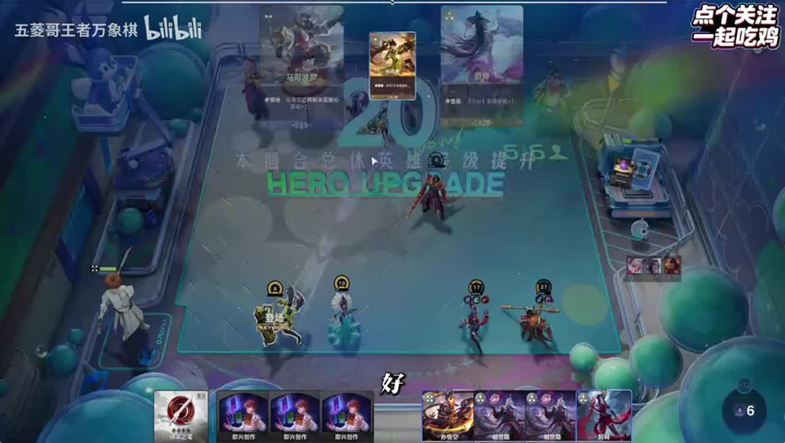

## 13:46–15:20 先打登场兑现等级再卖，给猴子吸血，并用复制触发循环。

- 事件 ID：BV1R7hx6yEVK:p1:e011
- 场景：实战
- 时机：小乔终于到来时
- 背景（分析推断）：此前漏给吸血刀，且小乔迟到带来生存风险。
- 学习目标（分析推断）：启动后按收益顺序出牌。
- 模板：resource-order
- ASR 段落：[22, 23]

> 登场牌先用了,然后卖掉。

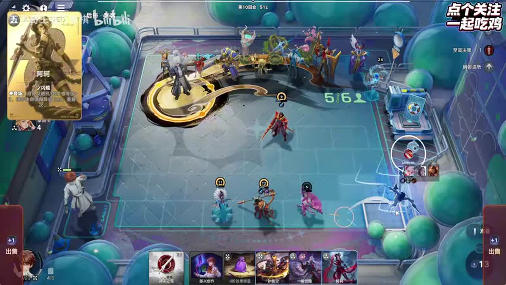

## 15:23–17:09 先补控制、回手甄姬与唤醒，继续启动而非无条件提前收尾。

- 事件 ID：BV1R7hx6yEVK:p1:e012
- 场景：实战
- 时机：升五后输到20血时
- 背景（分析推断）：实际低血收缩了等待空间。
- 学习目标（分析推断）：以血量和发动状态决定补救。
- 模板：combat-review
- ASR 段落：[24, 25]

> 现在20滴血我们能稳得住

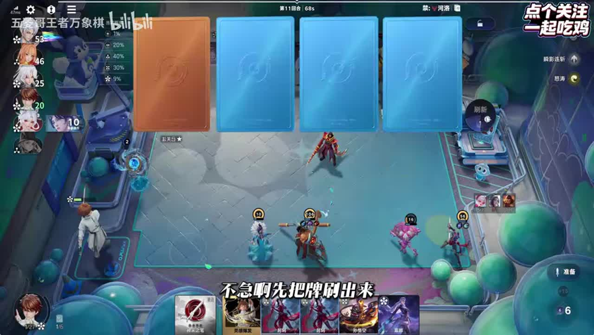

## 17:10–18:28 当前缺能量，20血有容错则优先扶摇或超新星，不拿额外命。

- 事件 ID：BV1R7hx6yEVK:p1:e013
- 场景：实战
- 时机：体系已启动但没六级时
- 背景（分析推断）：是本局可承受失利的判断，不是低血一律不保命。
- 学习目标（分析推断）：诊断当前瓶颈而非只看血量。
- 模板：economy-budget
- ASR 段落：[26, 27]

> 我们现在需要能量

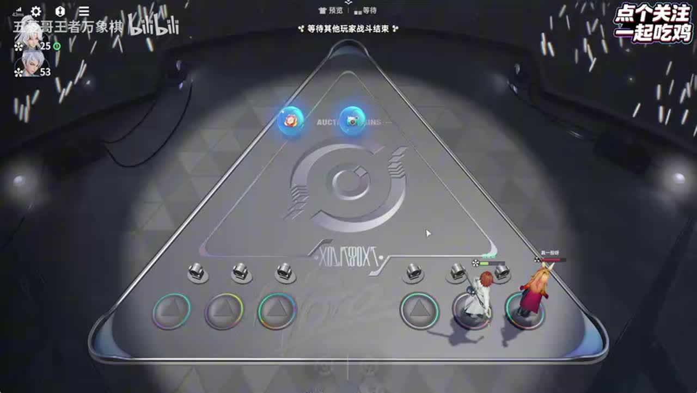

## 18:29–19:09 最多十块，十一让给对方，保留升级预算。

- 事件 ID：BV1R7hx6yEVK:p1:e014
- 场景：实战
- 时机：竞价能量超新星时
- 背景（分析推断）：上一教学明确缺能量但仍设上限。
- 学习目标（分析推断）：把急需与预算上限同时表达。
- 模板：auction-choice
- ASR 段落：[28]

> 十一块钱给他

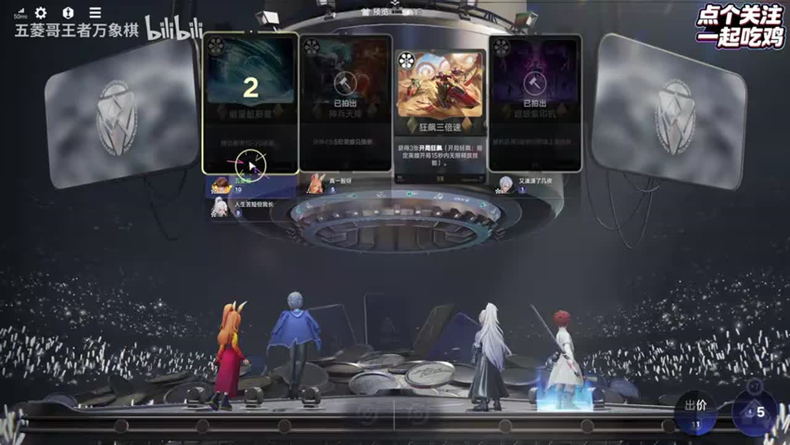

## 18:29–19:39 先消耗无用登场和已有回手牌，再给露娜奇才触发灵感爆发。

- 事件 ID：BV1R7hx6yEVK:p1:e015
- 场景：实战
- 时机：奇才准备给露娜时
- 背景（分析推断）：避免随机效果或顺序收益浪费。
- 学习目标（分析推断）：用清晰步骤完成关键循环。
- 模板：resource-order
- ASR 段落：[28, 29]

> 先把这个没用的牌登场打掉

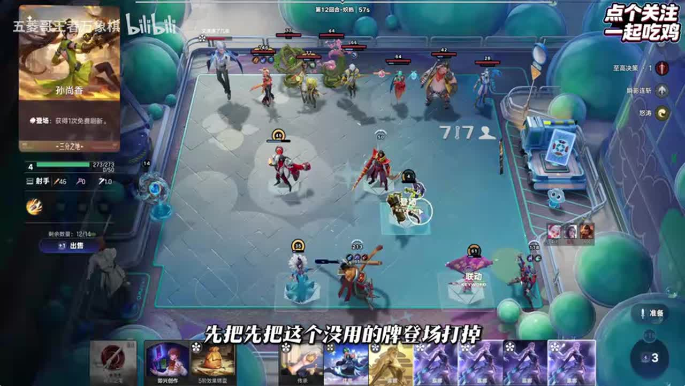

## 19:39–20:49 此局不卖露娜，以回手持续再触发；照影相当复制机会。

- 事件 ID：BV1R7hx6yEVK:p1:e016
- 场景：实战
- 时机：保留露娜循环时
- 背景（分析推断）：不同倒转流派的露娜去留不能统一。
- 学习目标（分析推断）：识别回手循环而非套卖牌公式。
- 模板：growth-combo
- ASR 段落：[30, 31]

> 这一局我不卖露娜

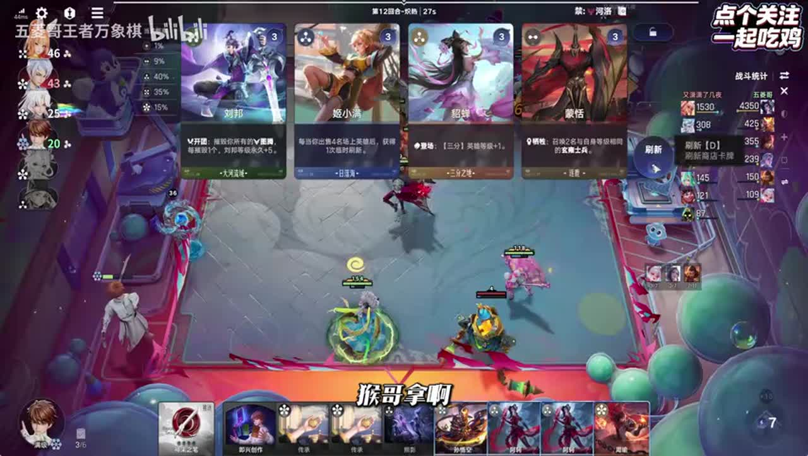

## 20:49–21:55 卖无用牌，换帅不需要就不拿以免占格；只补有效资源。

- 事件 ID：BV1R7hx6yEVK:p1:e017
- 场景：实战
- 时机：手牌与格子拥挤时
- 背景（分析推断）：本局不计划转吕布。
- 学习目标（分析推断）：控制操作空间与搜索目标。
- 模板：economy-budget
- ASR 段落：[32, 33]

> 我不需要换帅浪费我格子

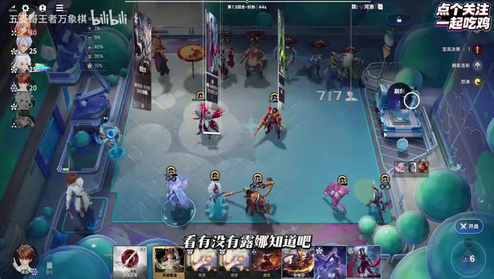

## 21:55–22:59 可用移花继续长等级，同时全员明刀提高容错，不必追极限速度。

- 事件 ID：BV1R7hx6yEVK:p1:e018
- 场景：实战
- 时机：已有稳定回手循环时
- 背景（分析推断）：讲者以慢操作演示，不视为玩家学习效果验证。
- 学习目标（分析推断）：用可执行循环与保命替代速度焦虑。
- 模板：equipment-role
- ASR 段落：[34, 35]

> 每个人身上都有明刀

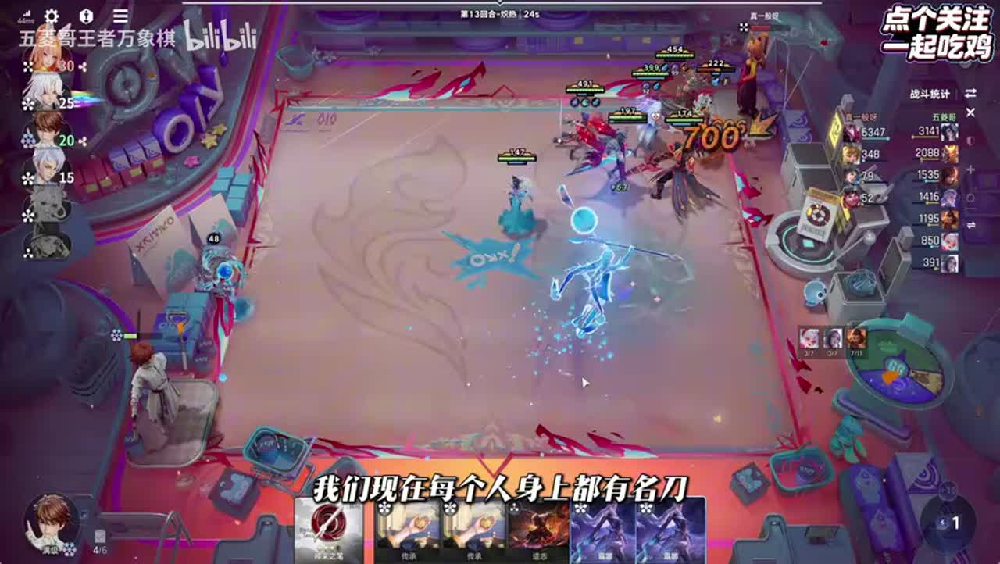

## 22:59–24:35 周瑜给全队等级，露娜回手后再上，循环资源逐项兑现。

- 事件 ID：BV1R7hx6yEVK:p1:e019
- 场景：实战
- 时机：周瑜与露娜重复触发时
- 背景（分析推断）：并非只强调主核等级，群体成长工具持续发挥作用。
- 学习目标（分析推断）：识别循环里的群体受益节点。
- 模板：growth-combo
- ASR 段落：[36, 37, 38]

> 周瑜加的等级是加全队的

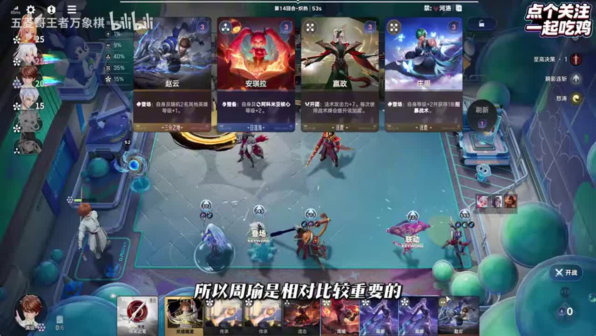

## 24:37–26:14 保持猴子阿轲露娜路线，没钱后停止无效刷新。

- 事件 ID：BV1R7hx6yEVK:p1:e020
- 场景：实战
- 时机：不准备转吕布时
- 背景（分析推断）：高等级已经成形，换帅不是必须。
- 学习目标（分析推断）：按已有战力决定收尾范围。
- 模板：late-transition
- ASR 段落：[39, 40, 41]

> 我就不要玩旅步

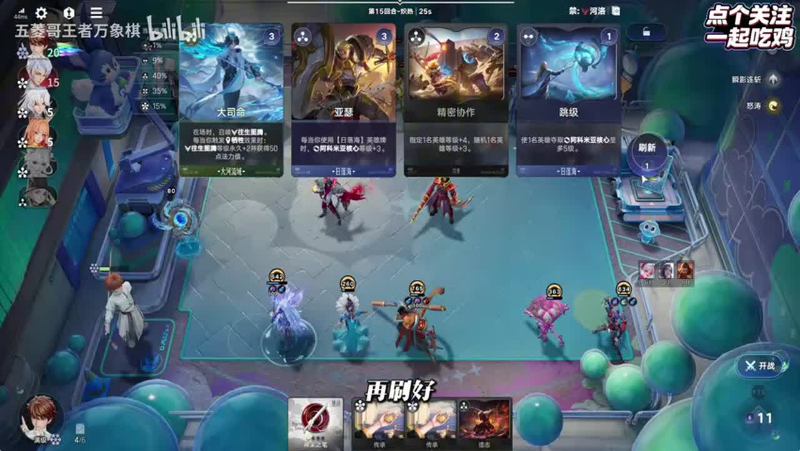

## 26:30–28:19 补安全装备并把剩余有效资源兑现，不再无故保留。

- 事件 ID：BV1R7hx6yEVK:p1:e021
- 场景：实战
- 时机：最后一局前
- 背景（分析推断）：剩余回合减少，保留未来收益价值下降。
- 学习目标（分析推断）：识别最后一战的资源窗口。
- 模板：resource-order
- ASR 段落：[42, 43, 44]

> 最后一把了已经

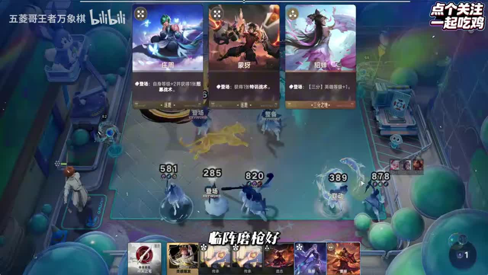

## 28:19–29:02 讲者原计划移植却误点传承，四个999只是未实现的设想。

- 事件 ID：BV1R7hx6yEVK:p1:e022
- 场景：实战
- 时机：误点传承后复盘时
- 背景（分析推断）：标题轻松999不能替代实际结果验证。
- 学习目标（分析推断）：检查相似选项误点并区分预期与实测。
- 模板：combat-review
- ASR 段落：[45, 46]

> 点错了点成团成了

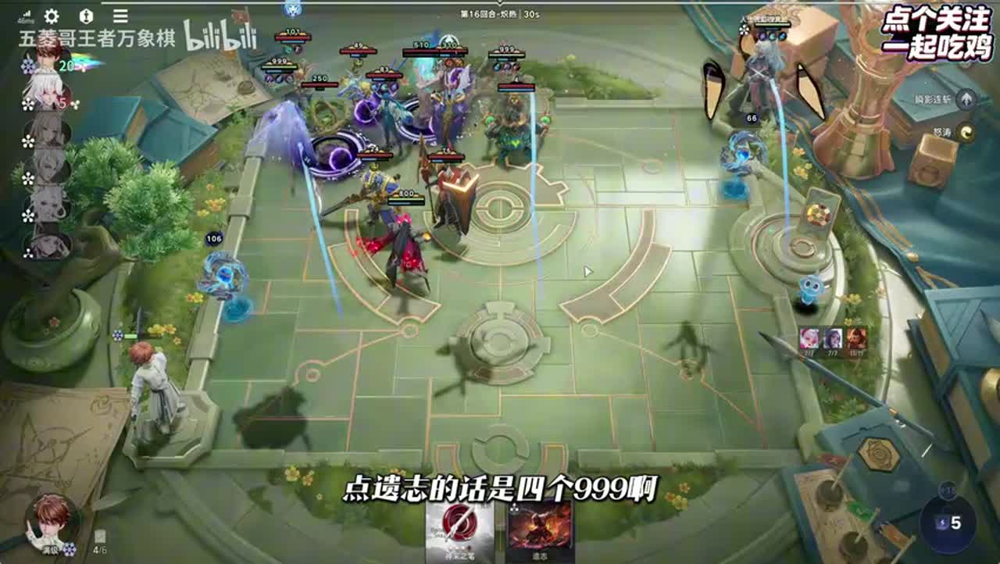

## 待核实与局限

- 原始ASR术语和数值可能有误；未经画面确认者不作为精确机制结论。
