# 三分倒转容易暴毙？前期稳血流白歌！后期转 999 马瑶 + 999 吕布，全局思路精讲

来源：https://www.bilibili.com/video/BV1hnHr6xEQG/?p=1

分析状态：completed

完整文字稿：../../../raw/BV1hnHr6xEQG_p1.md

## 00:53–03:10 四回合用蔡文姬、孙尚香、曹操、貂蝉过渡，觉醒后再升五六级。

- 事件 ID：BV1hnHr6xEQG:p1:e001
- 场景：实战
- 时机：比较稳血与快速倒转时
- 背景（分析推断）：讲者比较直接拉五级和更稳路线，本局独门条件重要。
- 学习目标（分析推断）：将过渡与终局分为两个阶段。
- 模板：opening-plan
- ASR 段落：[2, 3, 4]

> 四回合直接拿蔡文基开始转

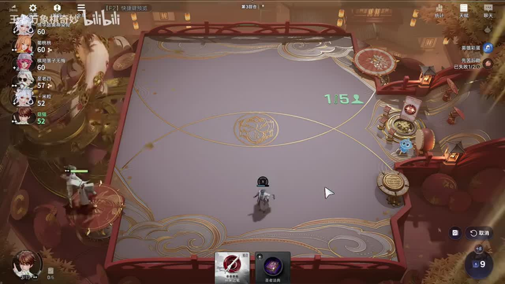

## 03:10–04:46 早期输两轮可承受，启动前优先钱与必要组件。

- 事件 ID：BV1hnHr6xEQG:p1:e002
- 场景：实战
- 时机：前期准备四回合启动时
- 背景（分析推断）：本局计划三级启动，资源选择以循环为目标。
- 学习目标（分析推断）：让经济与血量服务启动节奏。
- 模板：economy-budget
- ASR 段落：[5, 6]

> 前期输两轮无所谓的

## 04:46–06:41 指出等级不足是错误演示，补觉醒后再看。

- 事件 ID：BV1hnHr6xEQG:p1:e003
- 场景：实战
- 时机：貂蝉前排被苏烈打死时
- 背景（分析推断）：讲者原先自信无敌，实际被打死后修正。
- 学习目标（分析推断）：区分站位机制成立与生存条件不足。
- 模板：combat-review
- ASR 段落：[7, 8]

> 雕缠主要是等级有点低

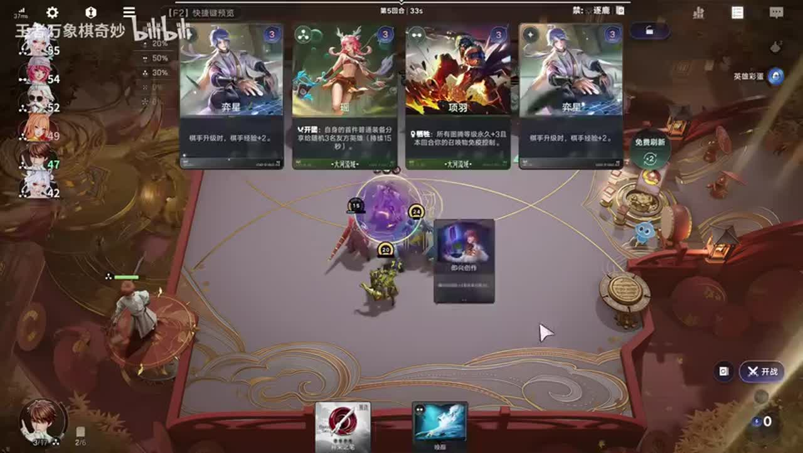

## 06:41–08:06 组件到位再升级，英雄彩蛋额外等级强化当轮战力。

- 事件 ID：BV1hnHr6xEQG:p1:e004
- 场景：实战
- 时机：三名过渡核心觉醒后
- 背景（分析推断）：貂蝉觉醒不作为同等刚需。
- 学习目标（分析推断）：按发动条件而非统一回合升级。
- 模板：level-transition
- ASR 段落：[9, 10]

> 这仨差不多觉醒就可以升级了

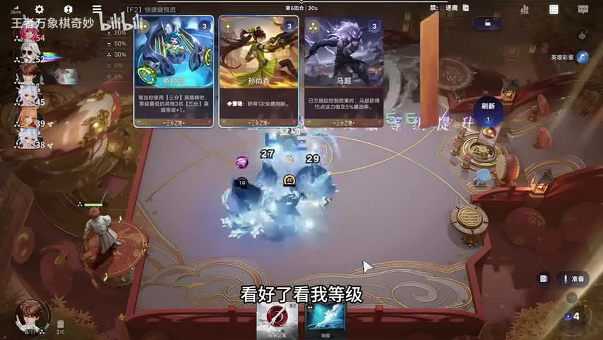

## 07:19–09:21 前排挨打回蓝，用蔡文姬支持；不能只靠慢普攻。

- 事件 ID：BV1hnHr6xEQG:p1:e005
- 场景：实战
- 时机：貂蝉没圣杯时
- 背景（分析推断）：站前排收益依赖能活下来。
- 学习目标（分析推断）：理解回蓝来源决定站位。
- 模板：position-cause
- ASR 段落：[10, 11, 12]

> 没有生悲的话就就挨打

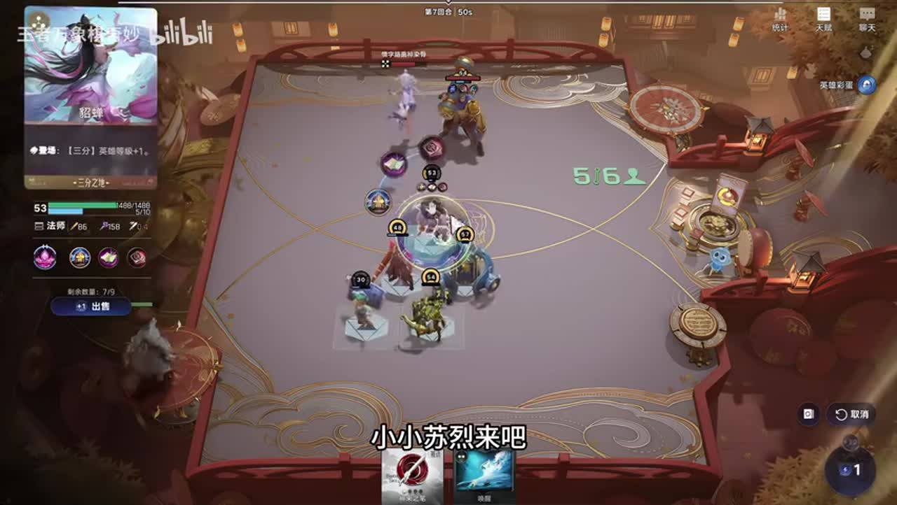

## 08:48–09:21 优先可能给曹操、蔡文姬的牌而不是经验。

- 事件 ID：BV1hnHr6xEQG:p1:e006
- 场景：实战
- 时机：为什么没拿经验时
- 背景（分析推断）：当前组件补齐比纯等级更重要。
- 学习目标（分析推断）：按关键缺口比较奖励。
- 模板：resource-order
- ASR 段落：[12]

> 因为我想我想要曹操和蔡文姬啊

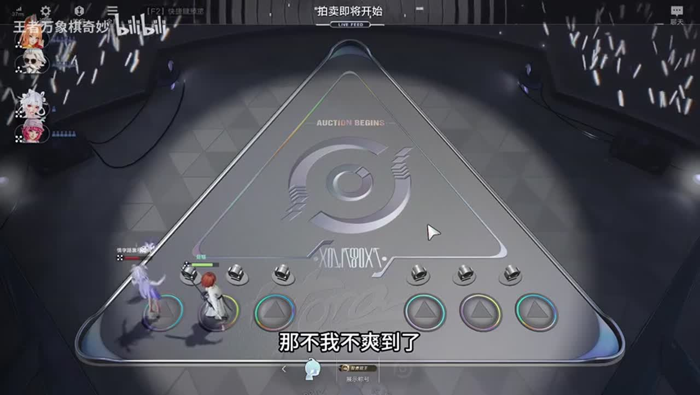

## 09:21–10:28 前期不用露娜也能循环，露娜是后续加速器。

- 事件 ID：BV1hnHr6xEQG:p1:e007
- 场景：实战
- 时机：解释是否要露娜时
- 背景（分析推断）：能启动与最快启动是不同判断。
- 学习目标（分析推断）：区别必需发动机与加速组件。
- 模板：mechanic-model
- ASR 段落：[13, 14]

> 要露娜赚的更快

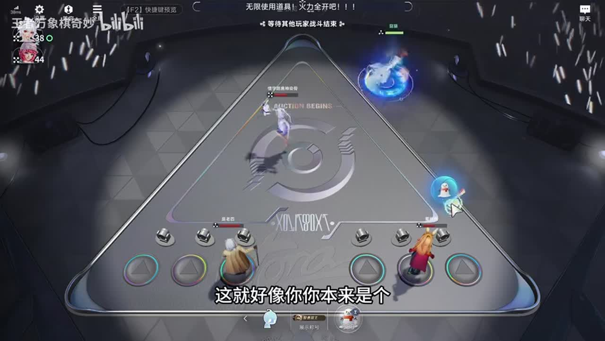

## 11:13–12:23 山鬼需要逐鹿机器人、日落海米莱迪、大河组件，不能硬玩缺阵营。

- 事件 ID：BV1hnHr6xEQG:p1:e008
- 场景：实战
- 时机：回答禁阵营能否山鬼时
- 背景（分析推断）：讲者检查禁阵营后限定河洛三分情况。
- 学习目标（分析推断）：用关键功能可获得性筛路线。
- 模板：opening-plan
- ASR 段落：[16, 17]

> 还真不能硬玩

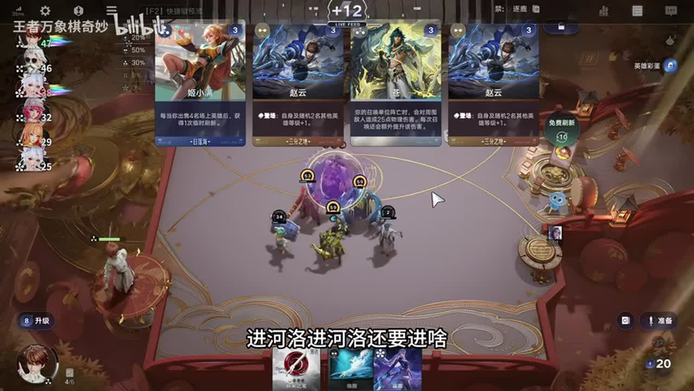

## 12:25–14:00 比较额外等级收益与实际操作负担，当前可选简单路径。

- 事件 ID：BV1hnHr6xEQG:p1:e009
- 场景：实战
- 时机：群英强但操作累时
- 背景（分析推断）：讲者明确不差几级但群英太累；并非否定强度。
- 学习目标（分析推断）：把可执行性纳入策略选择。
- 模板：talent-fit
- ASR 段落：[18, 19]

> 群英肯定是厉害但是群英太累了

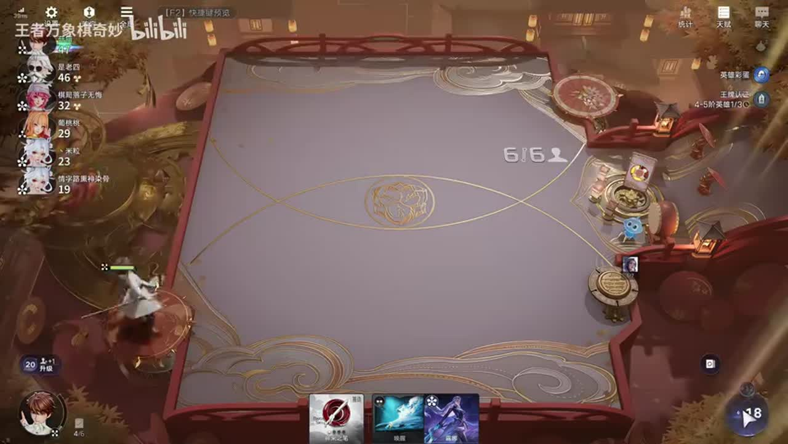

## 13:16–14:00 反甲反伤也能形成掉血回蓝，注意双向效果。

- 事件 ID：BV1hnHr6xEQG:p1:e010
- 场景：实战
- 时机：遭反甲持续掉血时
- 背景（分析推断）：同一防御机制对技能频率可能有正面作用。
- 学习目标（分析推断）：按完整因果判断装备交互。
- 模板：equipment-cause
- ASR 段落：[19]

> 我一直掉血我就一直回蓝

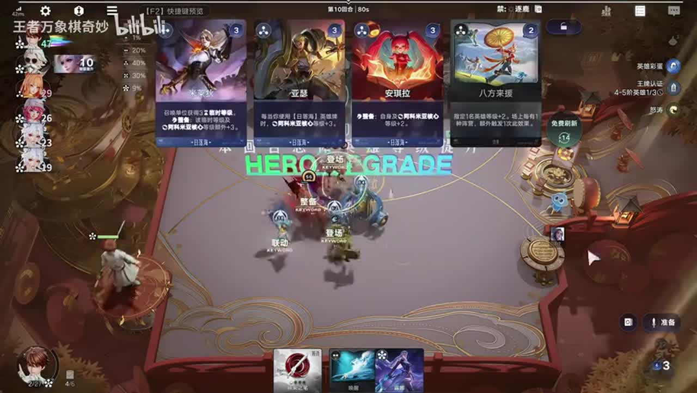

## 14:01–14:34 识别特殊远程输出威胁，不按普通守约评价。

- 事件 ID：BV1hnHr6xEQG:p1:e011
- 场景：实战
- 时机：面对百段刀守约时
- 背景（分析推断）：讲者被高伤一枪命中，判断有具体机制。
- 学习目标（分析推断）：观察敌方装备组合而非只看单位名。
- 模板：counter-target
- ASR 段落：[20]

> 百段刀的手续很屌的

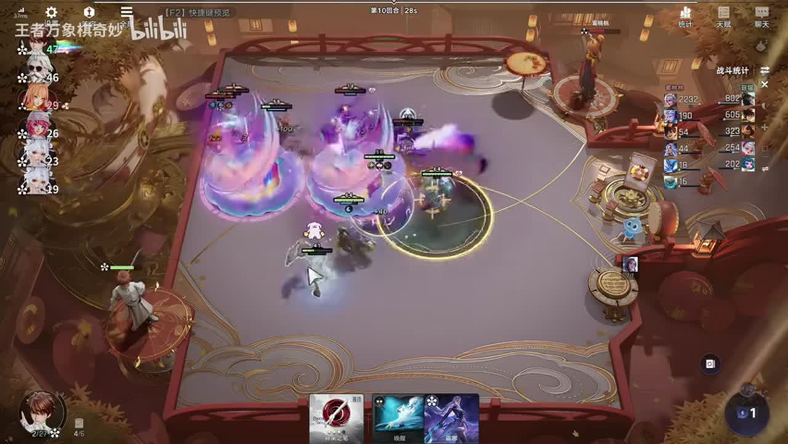

## 15:17–16:07 围绕三分单位触发，不把任意强牌加入循环。

- 事件 ID：BV1hnHr6xEQG:p1:e012
- 场景：实战
- 时机：蔡文姬在场买牌时
- 背景（分析推断）：阿轲不属当前资源链。
- 学习目标（分析推断）：用阵营条件控制购买。
- 模板：growth-combo
- ASR 段落：[22]

> 我们上蔡文基的话只上三分的卡

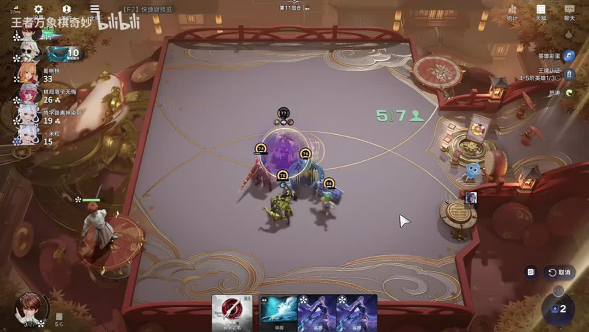

## 16:07–16:52 按钮显示开战说明对方已准备，仍显示准备说明对方未准备。

- 事件 ID：BV1hnHr6xEQG:p1:e013
- 场景：实战
- 时机：判断对方是否准备时
- 背景（分析推断）：界面信号能帮助安排剩余操作时间。
- 学习目标（分析推断）：读懂状态而非记时间。
- 模板：mechanic-model
- ASR 段落：[23]

> 我这是开战就说明对面准备了

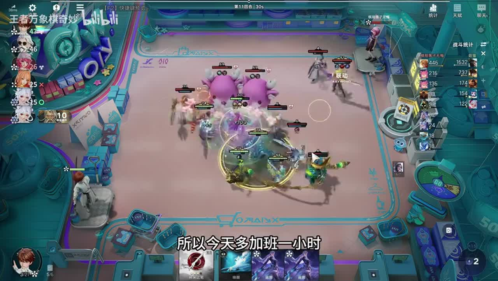

## 16:55–17:58 放第一排尽早死亡，避免其干扰战斗。

- 事件 ID：BV1hnHr6xEQG:p1:e014
- 场景：实战
- 时机：小乔成为内鬼时
- 背景（分析推断）：是否内鬼必须按本局行为判断，不能普遍主动送小乔。
- 学习目标（分析推断）：用退场位置处理负面副作用。
- 模板：position-cause
- ASR 段落：[24]

> 小条是内鬼丢到第一排让他去死

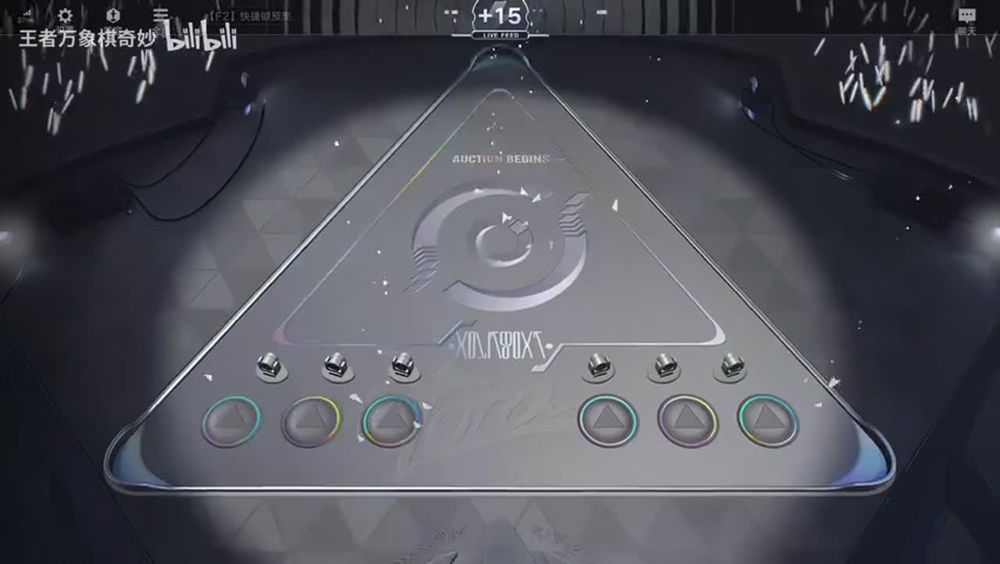

## 18:01–20:09 先不拿吕布扩大随机池，避免大招落错目标。

- 事件 ID：BV1hnHr6xEQG:p1:e015
- 场景：实战
- 时机：准备大招劈露娜时
- 背景（分析推断）：讲者保留大招专门复制露娜。
- 学习目标（分析推断）：在随机成长前隔离目标。
- 模板：resource-order
- ASR 段落：[25, 26]

> 劈到吕布脑门上怎么办?

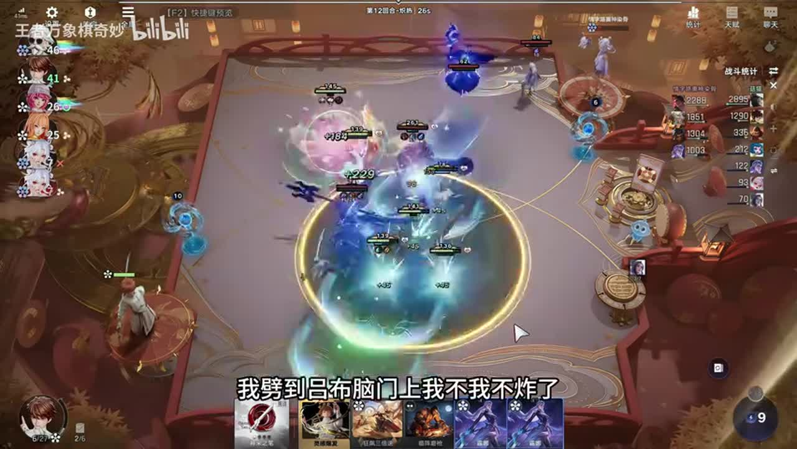

## 21:14–23:49 保留传承与换帅，先露娜大招和双击，再转核心。

- 事件 ID：BV1hnHr6xEQG:p1:e016
- 场景：实战
- 时机：倒转准备收尾时
- 背景（分析推断）：时间不足先等下一窗口，不仓促换。
- 学习目标（分析推断）：用最小顺序管理终局转换。
- 模板：resource-order
- ASR 段落：[28, 29]

> 我大招一用,击中双击一用

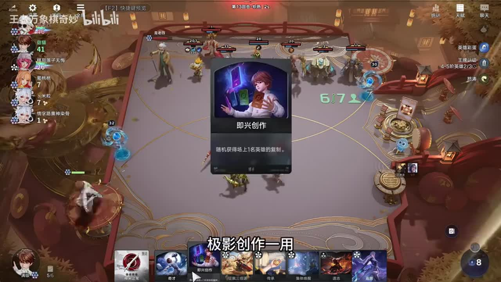

## 23:50–26:13 成长工具小乔曹操未退，可继续准备支撑；不是越早收尾越好。

- 事件 ID：BV1hnHr6xEQG:p1:e017
- 场景：实战
- 时机：目标已999但还有刷新时
- 背景（分析推断）：当前仍有大量刷新，讲者选择先用完。
- 学习目标（分析推断）：把上限、工具位和操作时间一起判断。
- 模板：late-transition
- ASR 段落：[30, 31]

> 我的小乔和曹操还没走

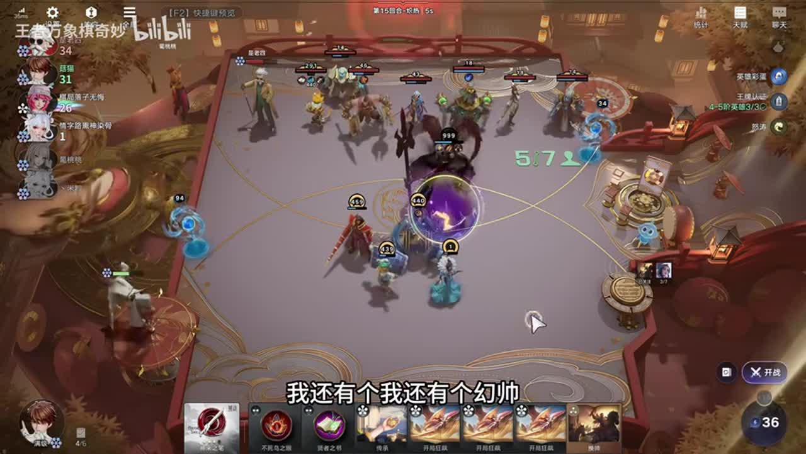

## 26:13–28:25 做变猪、重伤、控制，并确认太乙保命。

- 事件 ID：BV1hnHr6xEQG:p1:e018
- 场景：实战
- 时机：准备终局装备与太乙时
- 背景（分析推断）：大量成长之后需要战斗功能，不再只花钱升级。
- 学习目标（分析推断）：终局从成长转向控制与复活。
- 模板：equipment-role
- ASR 段落：[32, 33]

> 该拿太乙的

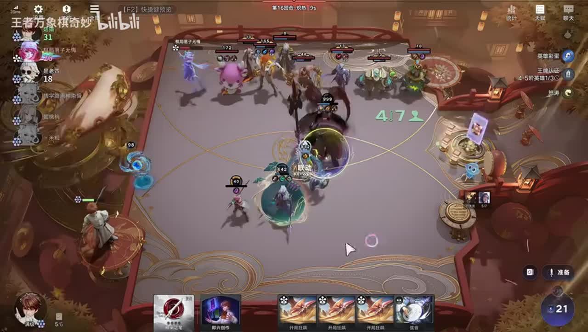

## 28:25–30:11 按本局目标选择马超，并保留装备分解与太乙。

- 事件 ID：BV1hnHr6xEQG:p1:e019
- 场景：实战
- 时机：改用马超主核时
- 背景（分析推断）：语音实际讲马超，标题马瑶是否组合需要画面确认。
- 学习目标（分析推断）：按敌方条件选终局而非照抄标题。
- 模板：late-transition
- ASR 段落：[34, 35]

> 马超999有点少

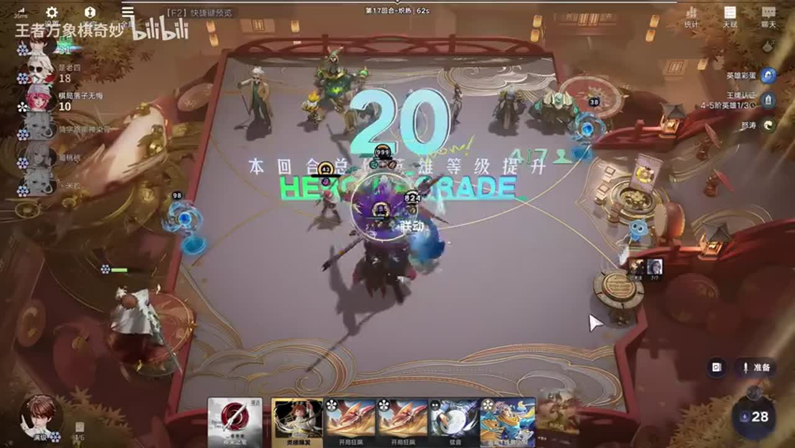

## 30:12–30:47 敌方缺无限免控时，讲者判断马超比吕布更适合。

- 事件 ID：BV1hnHr6xEQG:p1:e020
- 场景：实战
- 时机：面对特殊李信单体时
- 背景（分析推断）：这是对特定单体的比较，不是全局强度排名。
- 学习目标（分析推断）：将主核比较限定在控制与敌方机制。
- 模板：counter-target
- ASR 段落：[36]

> 他没有无限免控的情况下

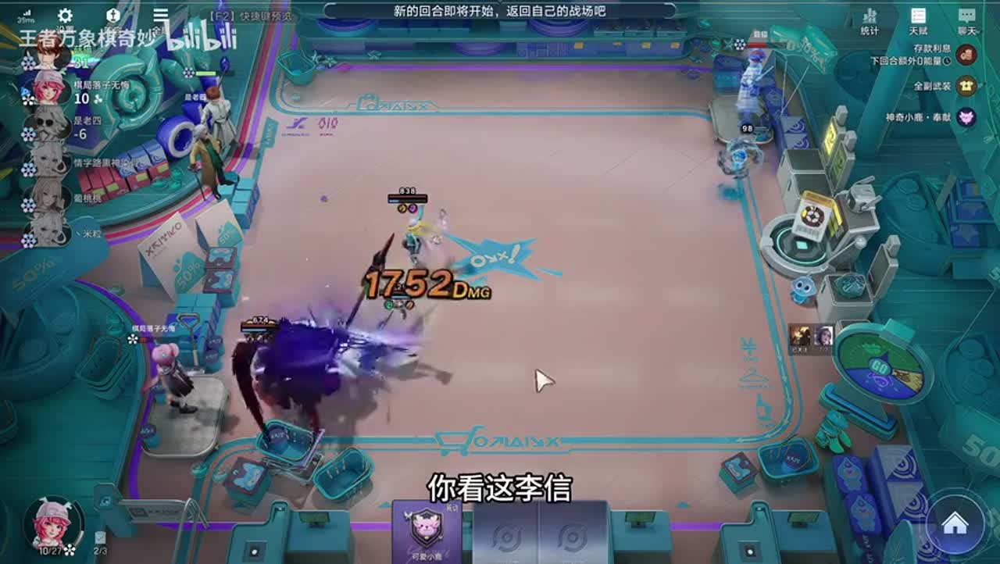

## 待核实与局限

- 原始ASR术语和数值可能有误；未经画面确认者不作为精确机制结论。
- 标题马瑶与语音马超需区分；终局字幕确认为李信，ASR李星原文保留。
