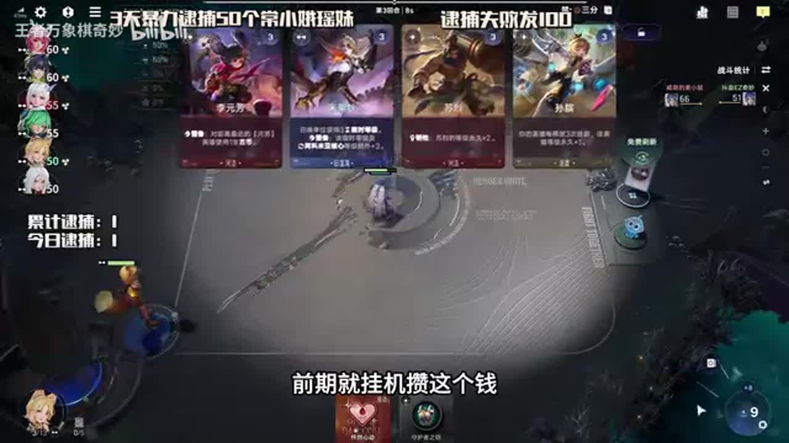
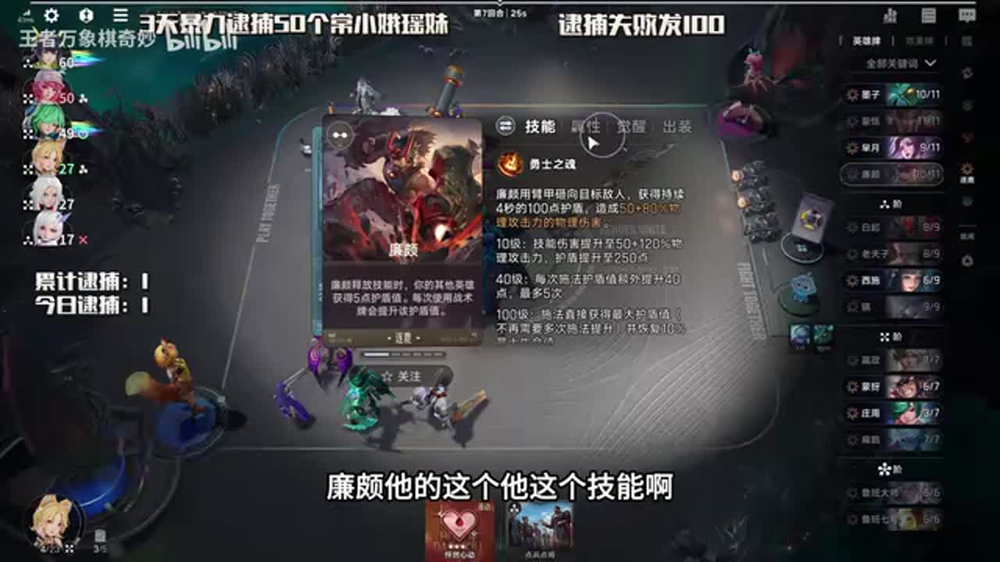
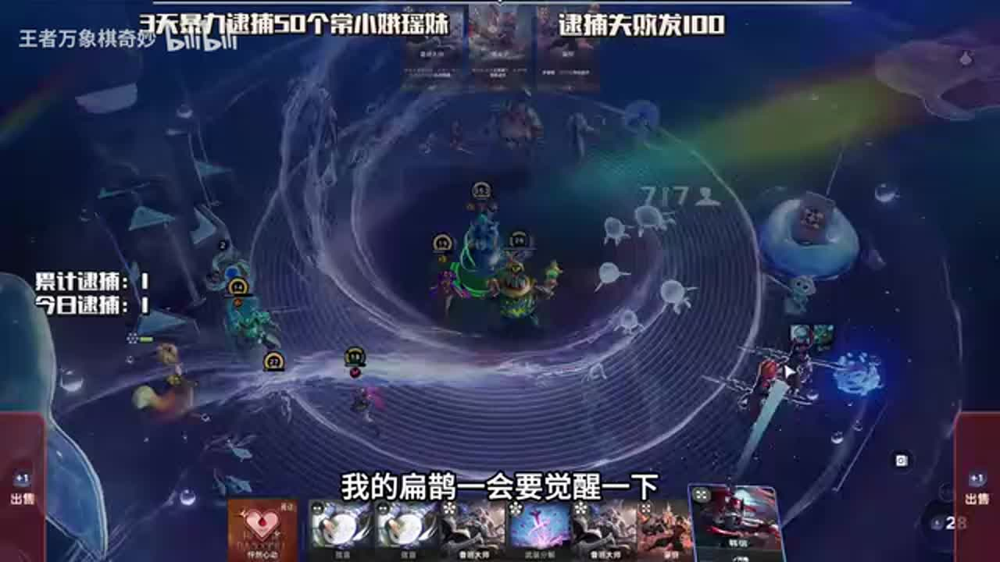

# 不来牌怎么办？来什么玩什么！小妲己养3w血庄周照样无敌

来源：https://www.bilibili.com/video/BV1Lnec67EV9/?p=1

分析状态：completed

完整文字稿：../../../raw/BV1Lnec67EV9_p1.md

## 01:35–02:42 消费返利勉强能用就保留，不为低级选项消耗刷新

- 事件 ID：BV1Lnec67EV9:p1:e001
- 场景：实战
- 时机：低级天赋收益都较低时
- 背景（分析推断）：讲者比较重刷可能更差的机会成本，排除抱怨辱骂。
- 学习目标（分析推断）：评估刷新资源是否值得用于当前选择。
- 模板：talent-fit
- ASR 段落：[4, 5]

> 有一个抽盒能用的就点吧

## 02:42–03:15 棋手买四张给效果牌，前期能量少先积钱，等关键天赋再集中买牌

- 事件 ID：BV1Lnec67EV9:p1:e002
- 场景：实战
- 时机：小妲己早期购买能力不足时
- 背景（分析推断）：等待不是无意义挂机，目的是为棋手购买循环准备预算。
- 学习目标（分析推断）：理解棋手机制与运营节奏的关系。
- 模板：economy-budget
- ASR 段落：[6]

> 买四张卡送你一个效果卡

## 03:58–05:32 先看资深猎头实际给的四张牌，再决定天赋与养庄周的方向

- 事件 ID：BV1Lnec67EV9:p1:e003
- 场景：实战
- 时机：计划阵容牌一直不来时
- 背景（分析推断）：来牌驱动转型，不先点天赋锁死路线；实际禁用阵营口述误识待核实。
- 学习目标（分析推断）：以获得的资源选择可成型路线。
- 模板：fallback-plan
- ASR 段落：[8, 9, 10]

> 先不点天赋,先看资深猎头

## 06:38–07:05 白起上场让效果牌生效，完成工具功能后卖掉，继续找墨子推进循环

- 事件 ID：BV1Lnec67EV9:p1:e004
- 场景：实战
- 时机：白起与效果牌工具出现时
- 背景（分析推断）：操作价值来自效果触发，而不是买卖本身。
- 学习目标（分析推断）：识别一次性工具何时退出。
- 模板：growth-combo
- ASR 段落：[13]

> 效果卡生效完这个效果卡他就可以直接滚了

## 07:05–08:08 庄周提供护盾，扁鹊将破盾转成伤害，所以扁鹊是输出瓶颈

- 事件 ID：BV1Lnec67EV9:p1:e005
- 场景：实战
- 时机：庄周没有伤害而缺扁鹊时
- 背景（分析推断）：高等级庄周本身不是完整阵容，辅助提供致胜功能。
- 学习目标（分析推断）：理解防御资源怎样转化成输出。
- 模板：mechanic-model
- ASR 段落：[14, 15]

> 护盾被击破的时候就可以炸别人

## 08:42–09:47 廉颇百级施法能回血而庄周主要是护盾，但庄周出牌成长更快

- 事件 ID：BV1Lnec67EV9:p1:e006
- 场景：实战
- 时机：比较庄周与廉颇是否可互换时
- 背景（分析推断）：比较技能与成长速度的取舍，不仅套用同类坦克。
- 学习目标（分析推断）：识别替代核心的机制差异。
- 模板：fallback-plan
- ASR 段落：[17, 18]

> 呆呆鱼他只有护盾他没有回血

## 09:47–11:01 继续寻找伤害辅助，芈月先觉醒加速成长，施法装备支持循环

- 事件 ID：BV1Lnec67EV9:p1:e007
- 场景：实战
- 时机：迟迟缺关键扁鹊时
- 背景（分析推断）：不能把高等级等同已补齐输出；随便装备能打999宣传不计。
- 学习目标（分析推断）：按当前瓶颈分配找牌和合成资源。
- 模板：resource-order
- ASR 段落：[19, 20]

> 明月仙觉醒很重要

## 11:01–12:41 先确认西施觉醒与关键装备，复现第一波尽量交高价值效果

- 事件 ID：BV1Lnec67EV9:p1:e008
- 场景：实战
- 时机：拿到复现天赋准备第一张效果时
- 背景（分析推断）：首次双倍窗口稀缺，提前用普通效果会浪费机会。
- 学习目标（分析推断）：把有限倍增机会留给当前关键资源。
- 模板：resource-order
- ASR 段落：[21, 22, 23]

> 第一波尽量交个好的

## 12:06–13:10 护盾炸伤路线有共同配装方向，但廉颇可换免控；某些宝箱效果不能复现

- 事件 ID：BV1Lnec67EV9:p1:e009
- 场景：实战
- 时机：比较相同装备能否支持廉颇时
- 背景（分析推断）：说明通用性与例外，不能将所有效果都看作可双倍。
- 学习目标（分析推断）：先确认机制适用范围再复用方案。
- 模板：mechanic-model
- ASR 段落：[23, 24]

> 这个不能复现

## 13:10–13:40 先保留待六级再分解或开箱，六级首效果双倍提高宝箱收益

- 事件 ID：BV1Lnec67EV9:p1:e010
- 场景：实战
- 时机：装备可拆但尚未六级时
- 背景（分析推断）：保留原有装备承担本轮战斗，延迟动作有阶段风险。
- 学习目标（分析推断）：把资源兑现时机与棋手门槛相连。
- 模板：resource-order
- ASR 段落：[25]

> 升六级之后再分解

## 13:43–15:38 辅助分别提供等级、生命、破盾伤害与永久减蓝，低蓝量提高施法频率

- 事件 ID：BV1Lnec67EV9:p1:e011
- 场景：实战
- 时机：解释一堆辅助围绕庄周时
- 背景（分析推断）：逐鹿不是只靠核心面板，转移等级到别处会丢辅助已兑现的收益。
- 学习目标（分析推断）：理解完整功能链而非只记阵容名。
- 模板：mechanic-model
- ASR 段落：[26, 28, 29]

> 一堆人辅助他一个

## 16:18–16:45 生命越厚，按生命比例炸盾越疼，墨子将生存成长和输出成长连接

- 事件 ID：BV1Lnec67EV9:p1:e012
- 场景：实战
- 时机：战斗里墨子持续叠生命时
- 背景（分析推断）：讲者口述百分比与血量只保留为当局解释，未重算版本公式。
- 学习目标（分析推断）：识别同一属性同时影响生存与输出。
- 模板：growth-combo
- ASR 段落：[32]

> 我的生命值非常的厚

## 16:45–17:13 先完成老夫子合成拿牌后退出，给核心交最好的首次双倍效果

- 事件 ID：BV1Lnec67EV9:p1:e013
- 场景：实战
- 时机：老夫子工具与复现首效果同时可用时
- 背景（分析推断）：先检查工具条件是否达成，避免只上场不合成没有收益。
- 学习目标（分析推断）：以触发条件安排工具牌与稀缺倍增窗口。
- 模板：resource-order
- ASR 段落：[33]

> 上场之后打一次合成他能给一张卡

## 17:13–17:42 留一个空位给买卖工具，最后战斗前再上鲁班大师；存钱准备六级

- 事件 ID：BV1Lnec67EV9:p1:e014
- 场景：实战
- 时机：整备没有空位又想上鲁班大师时
- 背景（分析推断）：人口同时服务操作循环与战斗，不是一直满员最优。
- 学习目标（分析推断）：按整备和战斗阶段切换人口用途。
- 模板：resource-order
- ASR 段落：[34]

> 得留一个位置打这个牌

## 17:42–18:39 倒转路线可先养更快成长核心再传承转马超瑶，本局整体等级投入不适合照搬

- 事件 ID：BV1Lnec67EV9:p1:e015
- 场景：实战
- 时机：讨论如何转马超瑶时
- 背景（分析推断）：这是实战中解释另一条路线，明确本局不适合直接转的条件。
- 学习目标（分析推断）：根据已投入资源判断转型成本。
- 模板：late-transition
- ASR 段落：[35, 36]

> 整体等级太多了,不适合去传

## 18:47–20:00 优先能服务双倍效果的资源，呼风唤雨中希望获得武装分解而非传承

- 事件 ID：BV1Lnec67EV9:p1:e016
- 场景：实战
- 时机：六级前拍卖选择资源时
- 背景（分析推断）：传承适合倒转，本局重点是装备重构与倍增。
- 学习目标（分析推断）：让拍卖目标服务当前路线瓶颈。
- 模板：auction-choice
- ASR 段落：[37, 38]

> 要武装分解

## 20:00–21:06 别立即开，等下一轮首效果窗口开两个箱，防误点浪费双倍

- 事件 ID：BV1Lnec67EV9:p1:e017
- 场景：实战
- 时机：宝箱持有且本轮首效果已用时
- 背景（分析推断）：等待增加收益，但本轮尚无好装备会有短暂弱势。
- 学习目标（分析推断）：识别逐回合首次动作的兑现窗口。
- 模板：resource-order
- ASR 段落：[39, 40]

> 一会开能开俩

## 21:08–22:48 本轮缺宝箱装备，且扁鹊未觉醒，复盘后补觉醒和装备而非盲加等级

- 事件 ID：BV1Lnec67EV9:p1:e018
- 场景：实战
- 时机：战斗失败后解释原因时
- 背景（分析推断）：失败原因由讲者提出，非独立验证完整因果。
- 学习目标（分析推断）：将失败定位为具体可补的功能缺口。
- 模板：combat-review
- ASR 段落：[41, 42, 43]

> 我的扁鹊很绝喜

## 22:48–23:42 把无效装备分解，下轮首次效果再开双倍箱，继续找吸血书和机械头

- 事件 ID：BV1Lnec67EV9:p1:e019
- 场景：实战
- 时机：再次得到不适合装备时
- 背景（分析推断）：随机没拿到目标装备时重复有条件重构，而非证明一定能开出。
- 学习目标（分析推断）：以明确缺口管理随机装备资源。
- 模板：equipment-role
- ASR 段落：[44, 45]

> 三个装备一起分解下一轮再开双倍

## 23:42–24:46 扁鹊炸盾是魔法伤害，吸血书可把高额伤害转回血，回蓝支持更频繁施法

- 事件 ID：BV1Lnec67EV9:p1:e020
- 场景：实战
- 时机：吸血书终于出现时
- 背景（分析推断）：缺少原生回血的庄周由装备补齐恢复环，伤害翻倍口述待核实。
- 学习目标（分析推断）：解释装备如何补齐核心机制。
- 模板：equipment-cause
- ASR 段落：[46, 47]

> 吸血书来了

## 24:46–25:49 讲者指出漏合成会失去工具收益，重新完成合成循环

- 事件 ID：BV1Lnec67EV9:p1:e021
- 场景：实战
- 时机：老夫子买了却忘记合成时
- 背景（分析推断）：不是所有买牌陈述都记，仅提取承认漏关键触发条件的复盘。
- 学习目标（分析推断）：在快速操作中核对关键触发是否完成。
- 模板：combat-review
- ASR 段落：[48, 49]

> 刚刚没打合成伏笔了

## 25:49–26:46 等级被降需重看生命与伤害，机器人可先砸敌方关键点，输出来源仍是扁鹊破盾

- 事件 ID：BV1Lnec67EV9:p1:e022
- 场景：实战
- 时机：被降等级但机器人提供突破时
- 背景（分析推断）：一次战胜不证明任何同等级对手都无伤。
- 学习目标（分析推断）：把单位功能与实际战斗结果相连。
- 模板：combat-review
- ASR 段落：[50, 51]

> 伤害全是扁剑提供的魔法伤害

## 26:46–28:20 墨子卖掉不消失已叠生命，后续少量成长可让位其他战斗单位

- 事件 ID：BV1Lnec67EV9:p1:e023
- 场景：实战
- 时机：生命已叠足但终局需要空位时
- 背景（分析推断）：可再上吃少量收益，但不必把成长辅助永久留场。
- 学习目标（分析推断）：区分已兑现属性与继续留场的边际价值。
- 模板：late-transition
- ASR 段落：[52, 53, 54]

> 卖掉之后他跌的血也不会消失

## 27:48–29:17 按敌方可偷的等级评估资源价值；核心生命和魔法吸血支持持续破盾

- 事件 ID：BV1Lnec67EV9:p1:e024
- 场景：实战
- 时机：敌方等级低却出现移花接木时
- 背景（分析推断）：口述六千伤害与四千回血为估计，不独立重算。
- 学习目标（分析推断）：按敌方资源状态判断针对牌是否值得交。
- 模板：counter-target
- ASR 段落：[54, 55, 56]

> 偷对面一半的等级

## 29:17–30:13 坚持保留吸血书，因为破盾魔法伤害触发吸血；机械头仍是未必到的额外目标

- 事件 ID：BV1Lnec67EV9:p1:e025
- 场景：实战
- 时机：有人建议替换吸血书时
- 背景（分析推断）：装备效果通过本路线伤害类型解释，不按装备名机械排名。
- 学习目标（分析推断）：识别核心循环中不能随意拆掉的装备。
- 模板：equipment-cause
- ASR 段落：[57, 58]

> 魔法伤害的话是能触发吸血输的

## 30:49–31:48 买足够牌得到免费刷新与便宜商店，只买仍有用途的牌；本轮第一张效果尽量用好

- 事件 ID：BV1Lnec67EV9:p1:e026
- 场景：实战
- 时机：棋手大招再次刷新商店时
- 背景（分析推断）：便宜不代表所有卡都值得买，传承对本局仍可能破坏已累积收益。
- 学习目标（分析推断）：利用价格折扣但保持功能筛选。
- 模板：economy-budget
- ASR 段落：[60, 61]

> 用不着的就不买

## 31:48–32:37 敌方高攻击仍打不动厚血循环，但讲者认为反甲可能更好

- 事件 ID：BV1Lnec67EV9:p1:e027
- 场景：实战
- 时机：终局赢下后仍反思配装时
- 背景（分析推断）：获胜不代表实际配装已经最佳，不把完全不掉血泛化。
- 学习目标（分析推断）：保留成功局中的改进空间。
- 模板：combat-review
- ASR 段落：[62, 63]

> 带反甲会更好一点

## 待核实与局限

- 不修正ASR；人名、技能同音误识、生命和炸盾伤害数字保留待核实。
- 第2、27、30、31段重复口号或无可确认教学上下文排除；闲聊、礼物感谢、宣传、辱骂和无理由操作不计。
- 部分教学发生在实战中解释其他路线，背景明确限定非本局正在执行。
- 当局高血量和胜利并不证明学习效果或通用克制有效。
