# 倒转天赋烂掉？多彩古币特殊玩法，900级海月乱杀

来源：https://www.bilibili.com/video/BV1Bqei6pEyZ/?p=1

分析状态：completed

完整文字稿：../../../raw/BV1Bqei6pEyZ_p1.md

## 00:00–01:35 根据禁用阵营选择适配棋手，避免硬套阵容

- 事件 ID：BV1Bqei6pEyZ:p1:e001
- 场景：实战
- 时机：选棋手和阵容前看禁用阵营
- 背景（分析推断）：讲者比较姜导、马可、阿离的阵营条件
- 学习目标（分析推断）：建立条件先行的开局判断
- 模板：opening-plan
- ASR 段落：[1, 2, 3]

> 咱们得根据情况来选择阵容

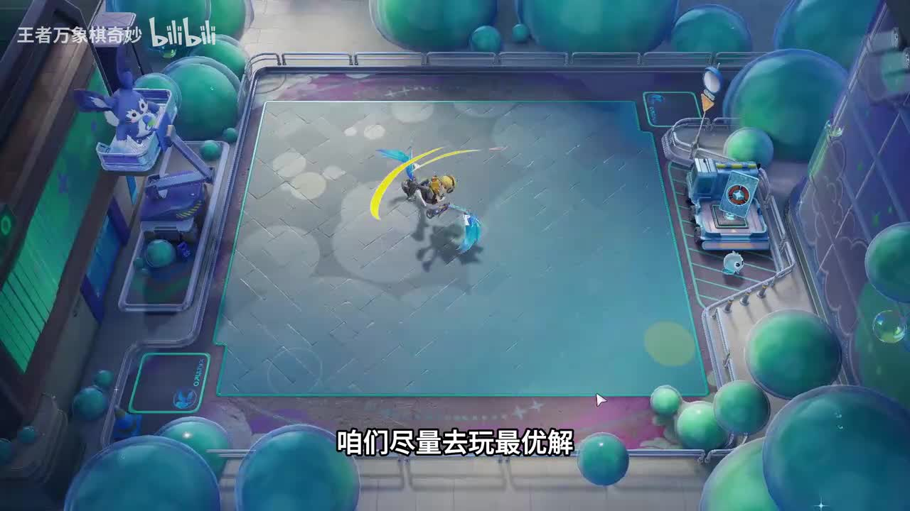

## 00:29–02:06 前期少出牌，第三回合回溯小回环

- 事件 ID：BV1Bqei6pEyZ:p1:e002
- 场景：实战
- 时机：前期技能回溯目标安排
- 背景（分析推断）：需要让回溯返回指定技能卡，不让无关操作污染目标
- 学习目标（分析推断）：理解回溯目标与出牌历史关系
- 模板：resource-order
- ASR 段落：[2, 4]

> 三回合回溯

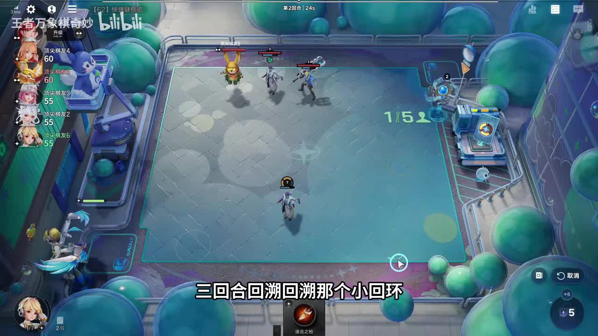

## 02:37–03:52 保留弈星到下回合，将登场与回环返还计入八张卡

- 事件 ID：BV1Bqei6pEyZ:p1:e003
- 场景：实战
- 时机：两张技能到手准备八张触发
- 背景（分析推断）：大招按使用卡数量触发，提前登场会浪费下一轮计数机会
- 学习目标（分析推断）：按卡数规划启动回合
- 模板：growth-combo
- ASR 段落：[6, 7]

> 这个异星也算一张卡的

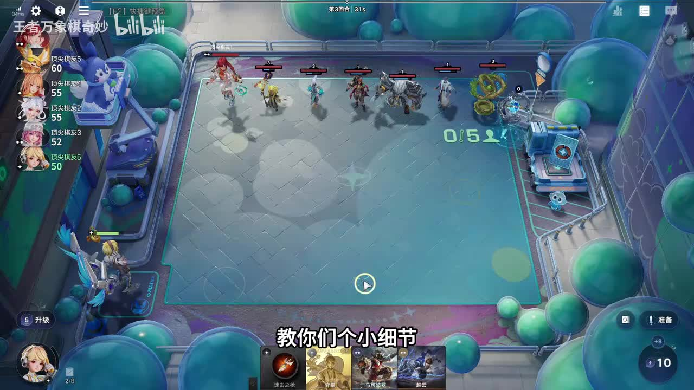

## 03:06–04:23 优先曹操、阿轲、孟奇；被抬价时转次优

- 事件 ID：BV1Bqei6pEyZ:p1:e004
- 场景：实战
- 时机：拍卖补充启动组件
- 背景（分析推断）：这些组件用于经济或出牌计数，孟奇可提供多张卡的价值
- 学习目标（分析推断）：结合启动贡献与竞价选择拍卖目标
- 模板：auction-choice
- ASR 段落：[7, 8]

> 梦奇一张卡等于三张卡

## 04:23–05:30 改用多彩古币配武则天，放弃固定猴子或周瑜方案

- 事件 ID：BV1Bqei6pEyZ:p1:e005
- 场景：实战
- 时机：升级候选不支持原定路线
- 背景（分析推断）：原候选被讲者判断不理想，转向已拿到的随机变换组件
- 学习目标（分析推断）：用现有资源构造替代路线
- 模板：fallback-plan
- ASR 段落：[9, 10]

> 根据来排灵活变阵

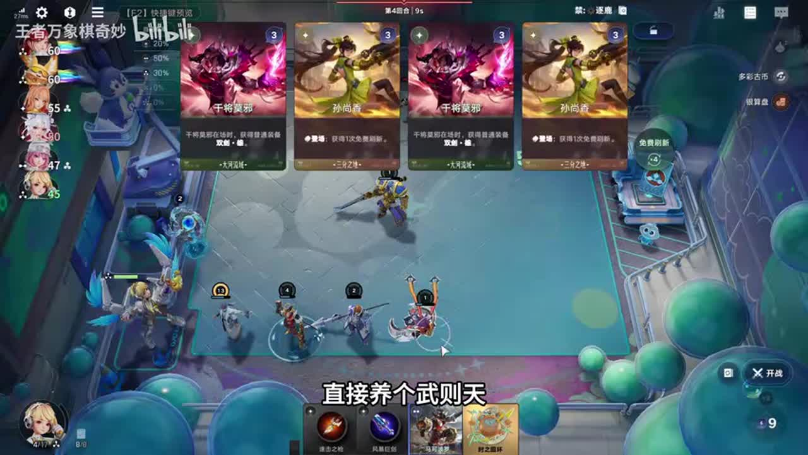

## 07:00–07:37 接受孟奇输一次换二费券，用券找曹操

- 事件 ID：BV1Bqei6pEyZ:p1:e006
- 场景：实战
- 时机：孟奇允许输一轮的收益
- 背景（分析推断）：本局仍在收集经济组件，败战有技能收益
- 学习目标（分析推断）：比较即时胜负与后续资源收益
- 模板：combat-review
- ASR 段落：[13]

> 梦奇输一次他里面能给个二费券

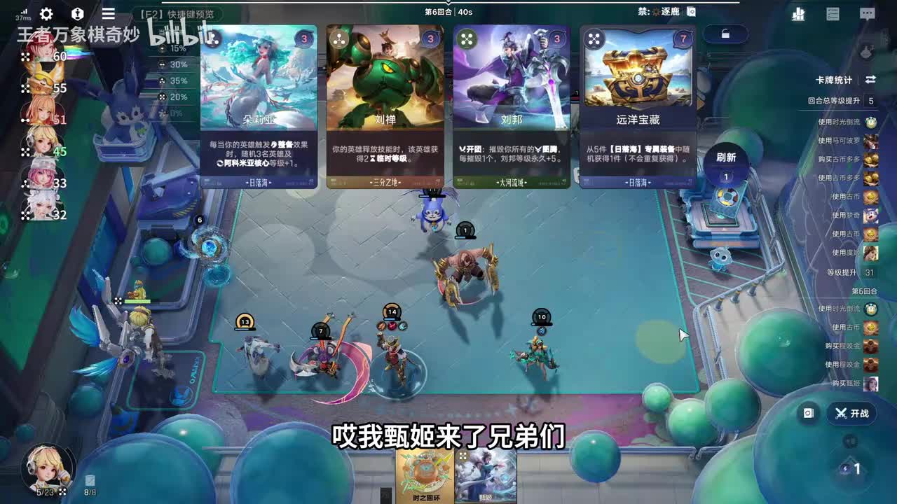

## 08:07–09:17 停止继续喂古币并安排下一轮回溯变换

- 事件 ID：BV1Bqei6pEyZ:p1:e007
- 场景：实战
- 时机：保留下一轮变换目标
- 背景（分析推断）：本轮已确定古币目标，继续用卡可能改变下一轮返回内容
- 学习目标（分析推断）：让操作顺序服务下一轮目标
- 模板：resource-order
- ASR 段落：[15, 16]

> 这轮不能再喂了

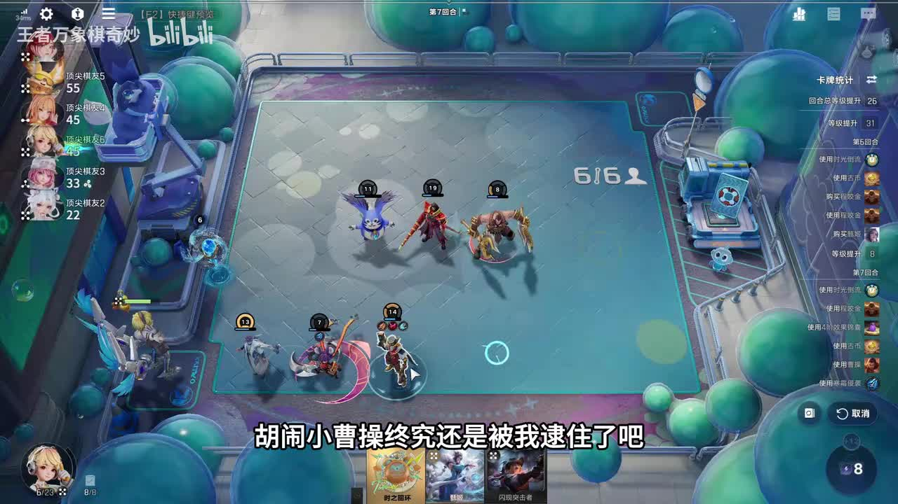

## 09:18–09:53 注意讲者观察到回溯打到李元芳且不判定多彩

- 事件 ID：BV1Bqei6pEyZ:p1:e008
- 场景：实战
- 时机：回溯目标出现异常
- 背景（分析推断）：讲者认为当时存在异常，不能直接当成稳定游戏机制
- 学习目标（分析推断）：发现预期与实际不符时保留异常记录
- 模板：mechanic-model
- ASR 段落：[17]

> 回数不会判定多彩

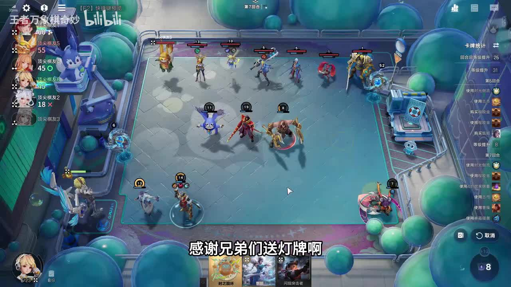

## 10:54–11:55 停止用古币，使用甄姬并让下轮小回环返回她

- 事件 ID：BV1Bqei6pEyZ:p1:e009
- 场景：实战
- 时机：血量允许延迟启动
- 背景（分析推断）：本轮只购露娜并使用甄姬；讲者判断血量健康，可等更好组合
- 学习目标（分析推断）：在安全窗口保持回溯目标纯净
- 模板：resource-order
- ASR 段落：[20, 21]

> 反正血量健康根本不慌

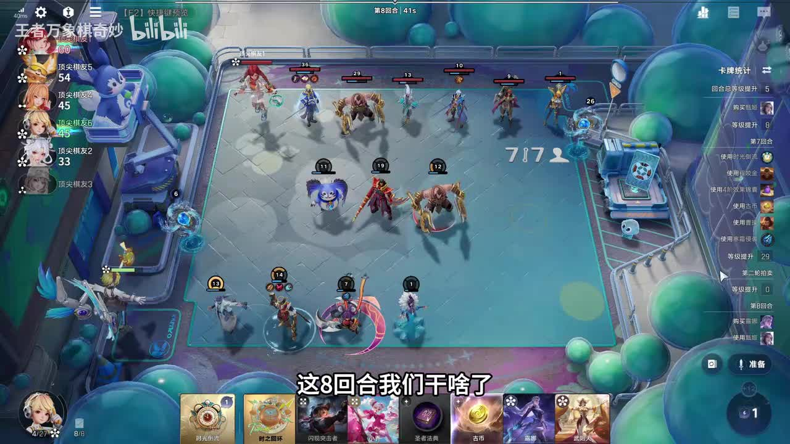

## 11:21–12:28 把变换后的英雄按整备给古币等功能映射到原组件岗位

- 事件 ID：BV1Bqei6pEyZ:p1:e010
- 场景：实战
- 时机：随机变换后重新分配岗位
- 背景（分析推断）：阵容每回合变化，不能仅按原英雄名称执行
- 学习目标（分析推断）：识别英雄在循环中的功能位置
- 模板：growth-combo
- ASR 段落：[21, 22]

> 代替猴子的位置去打整备

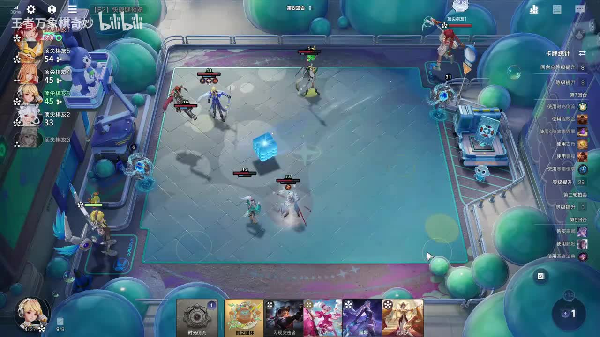

## 12:28–14:41 不无限等小乔，先用现有甄姬觉醒和集体唤醒启动

- 事件 ID：BV1Bqei6pEyZ:p1:e011
- 场景：实战
- 时机：关键小乔迟迟未到
- 背景（分析推断）：小乔缺牌阻碍理想循环，但时间与资源要求继续执行
- 学习目标（分析推断）：设置缺牌时可运行的次优方案
- 模板：fallback-plan
- ASR 段落：[23, 24, 25, 26]

> 不来也得打呀

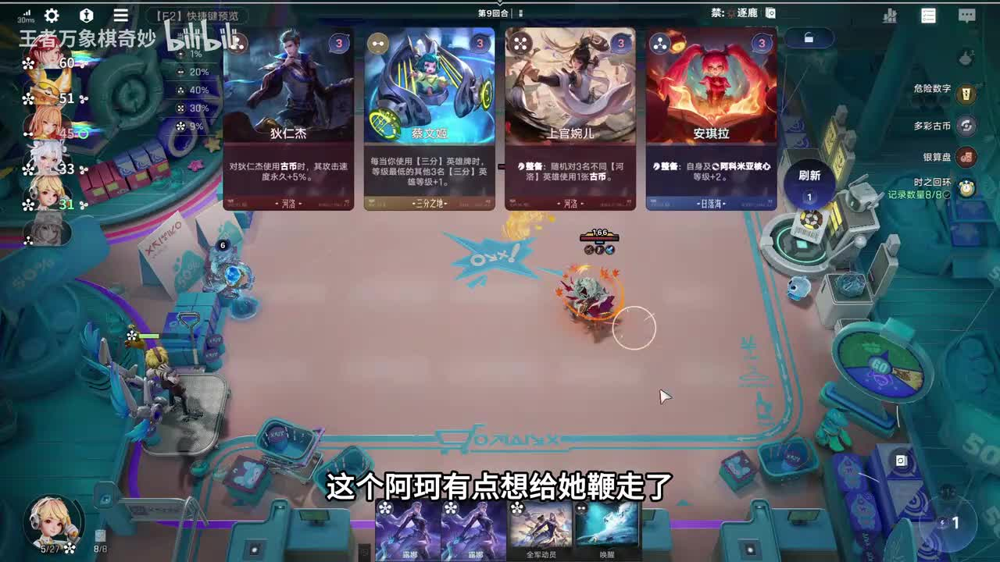

## 14:41–15:41 留一批露娜和唤醒，在大回环启动时集中使用

- 事件 ID：BV1Bqei6pEyZ:p1:e012
- 场景：实战
- 时机：大回环前留批量操作
- 背景（分析推断）：下一轮计划进行大回环，武则天承担唤醒给古币功能
- 学习目标（分析推断）：围绕下一次启动预存资源
- 模板：resource-order
- ASR 段落：[27, 28]

> 打大会完的时候打

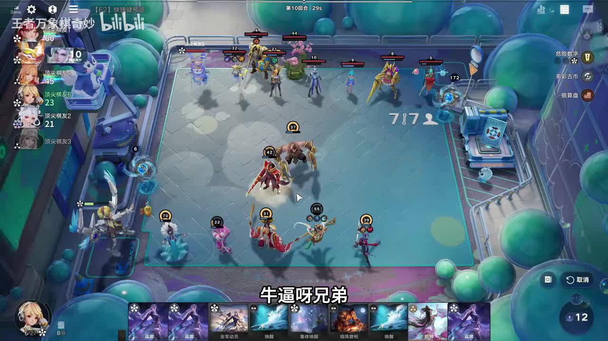

## 15:10–16:48 低血缺人口时放弃武则天功能位，优先当前战力

- 事件 ID：BV1Bqei6pEyZ:p1:e013
- 场景：实战
- 时机：血量和人口不再允许功能挂件
- 背景（分析推断）：原本想留武则天吃唤醒收益，随后判断七血更需要战力人口
- 学习目标（分析推断）：把生存压力作为功能位替换条件
- 模板：late-transition
- ASR 段落：[28, 29, 30]

> 血量低的话

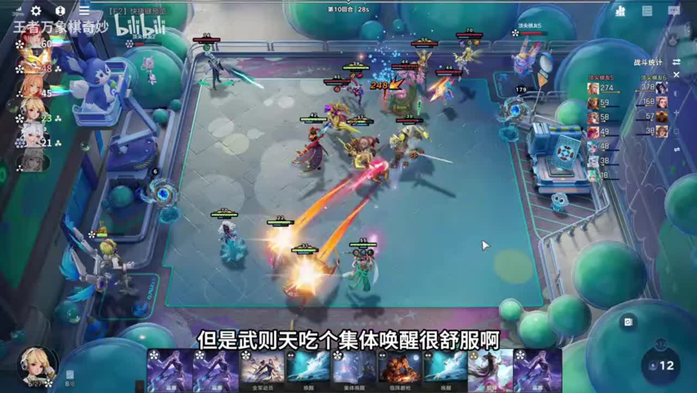

## 17:22–17:57 指出小乔未觉醒持续亏等级，尝试替代和补觉醒

- 事件 ID：BV1Bqei6pEyZ:p1:e014
- 场景：实战
- 时机：觉醒缺失导致循环收益低
- 背景（分析推断）：多轮循环后关键组件仍未觉醒
- 学习目标（分析推断）：用缺失机制解释成长低于预期
- 模板：combat-review
- ASR 段落：[32]

> 小乔没觉醒亏了很多等级

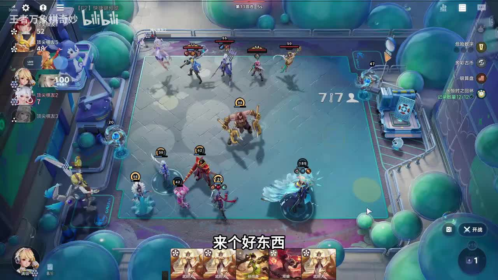

## 18:32–19:37 需要人口时优先人口；露娜先登场，觉醒武则天再用唤醒

- 事件 ID：BV1Bqei6pEyZ:p1:e015
- 场景：实战
- 时机：拍卖人口与唤醒先后安排
- 背景（分析推断）：在有限整备时间里希望每个相关英雄都接到唤醒收益
- 学习目标（分析推断）：避免技能先用后登场导致漏收益
- 模板：resource-order
- ASR 段落：[34, 35]

> 要不然那个集体唤醒就漏了

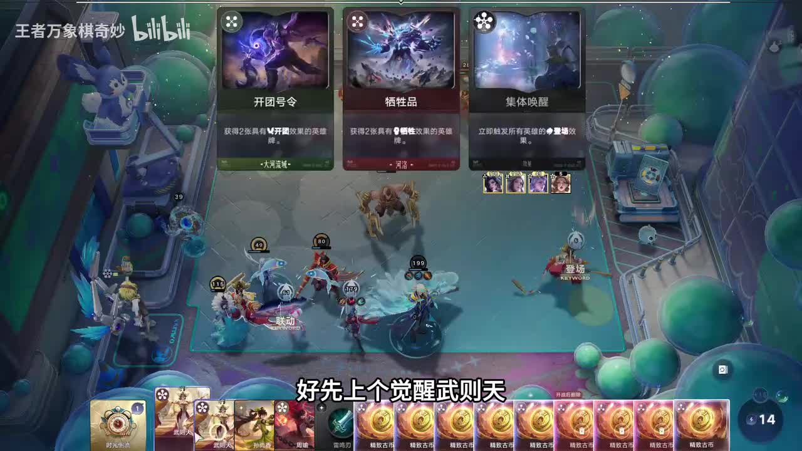

## 19:37–21:16 用复活甲增加容错，并争取太乙避免对手拿到

- 事件 ID：BV1Bqei6pEyZ:p1:e016
- 场景：实战
- 时机：面对同样的海月大招输出
- 背景（分析推断）：双方都使用海月，讲者比较两条命与一条命
- 学习目标（分析推断）：围绕对手核心输出设计防守和资源争夺
- 模板：counter-target
- ASR 段落：[36, 37, 38]

> 我两条命的海月还打不你一条命的海月

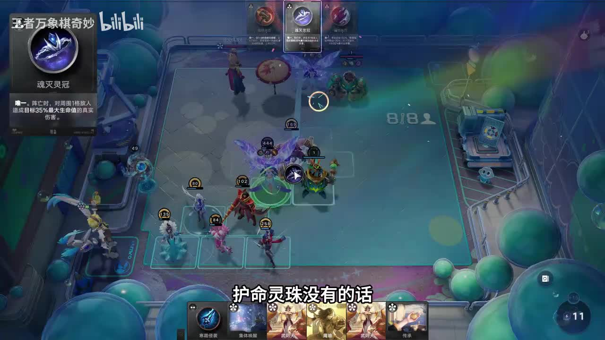

## 21:16–21:48 卖旧露娜再上新露娜，腾人口执行登场卖出循环

- 事件 ID：BV1Bqei6pEyZ:p1:e017
- 场景：实战
- 时机：露娜被外部卡牌限制
- 背景（分析推断）：讲者指出外部有人卡露娜，此时有额外人口可操作
- 学习目标（分析推断）：通过替换实例应对卡牌限制
- 模板：fallback-plan
- ASR 段落：[39]

> 再上个新露娜

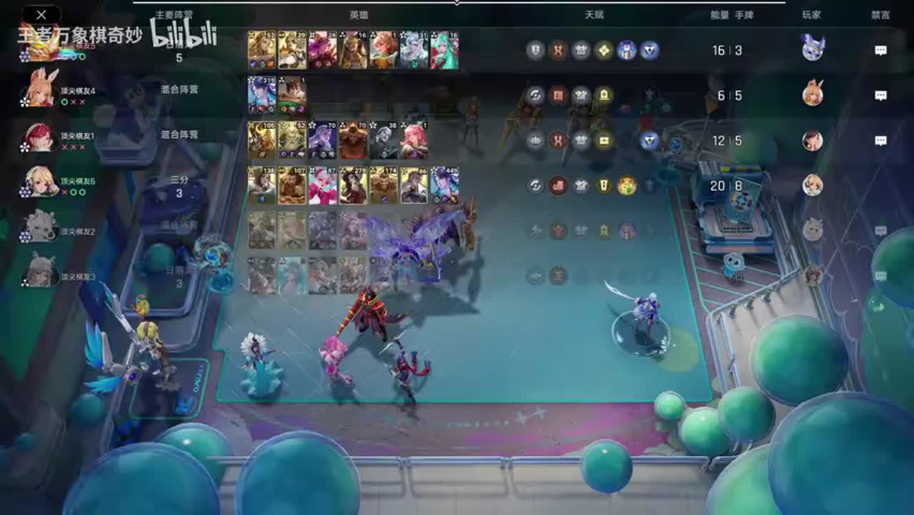

## 23:27–24:28 暂留吕布，不再赌武则天变换，优先敲装备

- 事件 ID：BV1Bqei6pEyZ:p1:e018
- 场景：实战
- 时机：整备剩十秒随机变换
- 背景（分析推断）：变换次数尚少且剩余操作时间不足
- 学习目标（分析推断）：把操作时间纳入风险预算
- 模板：economy-budget
- ASR 段落：[43, 44]

> 最后十秒了

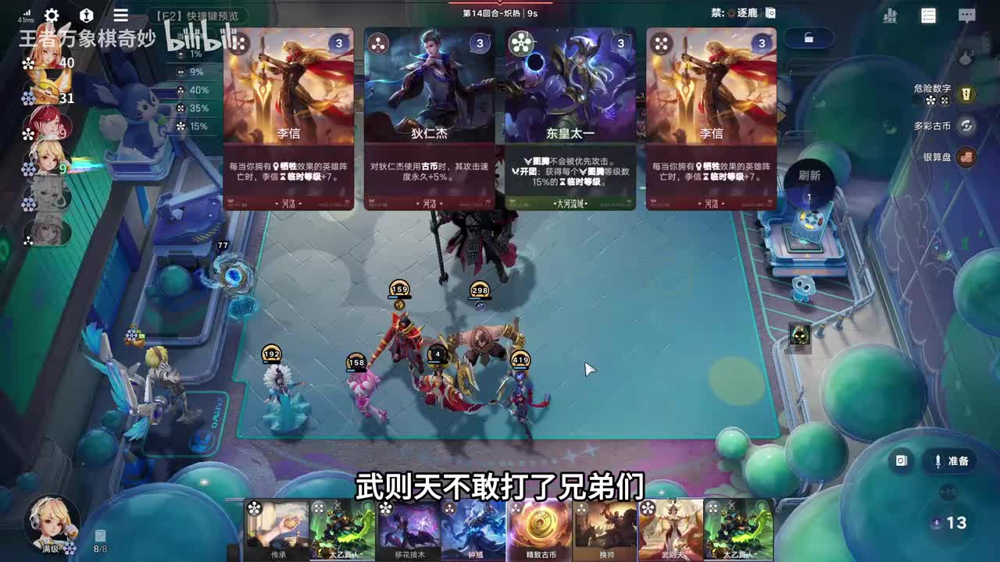

## 24:28–25:36 好英雄先保留并将装备临时给其他人，变坏会降低战力

- 事件 ID：BV1Bqei6pEyZ:p1:e019
- 场景：实战
- 时机：强力英雄到手时停止继续赌
- 背景（分析推断）：随机变换可以把当前好英雄换成更差结果，仍尝试找瑶作为备用
- 学习目标（分析推断）：理解随机收益的止损与备选
- 模板：fallback-plan
- ASR 段落：[45, 46]

> 好的,好东西,就他了

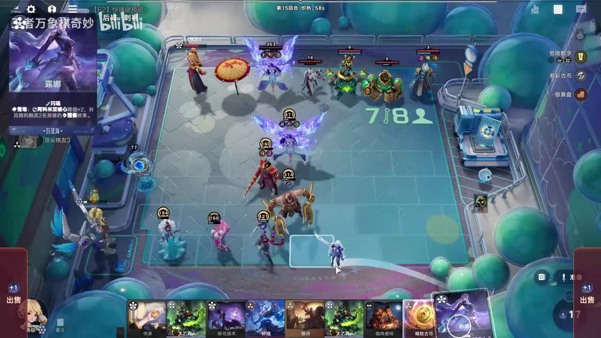

## 28:22–28:55 用磐石之心限制单次受伤，再观察敌方大招反馈

- 事件 ID：BV1Bqei6pEyZ:p1:e020
- 场景：实战
- 时机：海月大招高额单次伤害
- 背景（分析推断）：讲者说明对面大招约一万伤害，当前拥有单次承伤上限装备
- 学习目标（分析推断）：按伤害形态选择防御装备并验证效果
- 模板：counter-target
- ASR 段落：[52]

> 最多成伤百分之十五

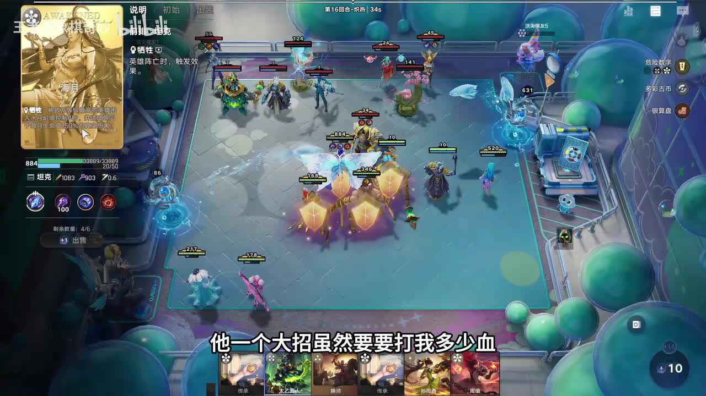

## 29:32–30:33 瑶配铃铛和盾，转换主力后重新分配装备

- 事件 ID：BV1Bqei6pEyZ:p1:e021
- 场景：实战
- 时机：随机获得瑶后分装备
- 背景（分析推断）：本轮终于变出瑶，后续艾琳也成为可用主力
- 学习目标（分析推断）：随实际成型英雄调整装备职责
- 模板：equipment-role
- ASR 段落：[54, 55]

> 瑶妹带铃铛

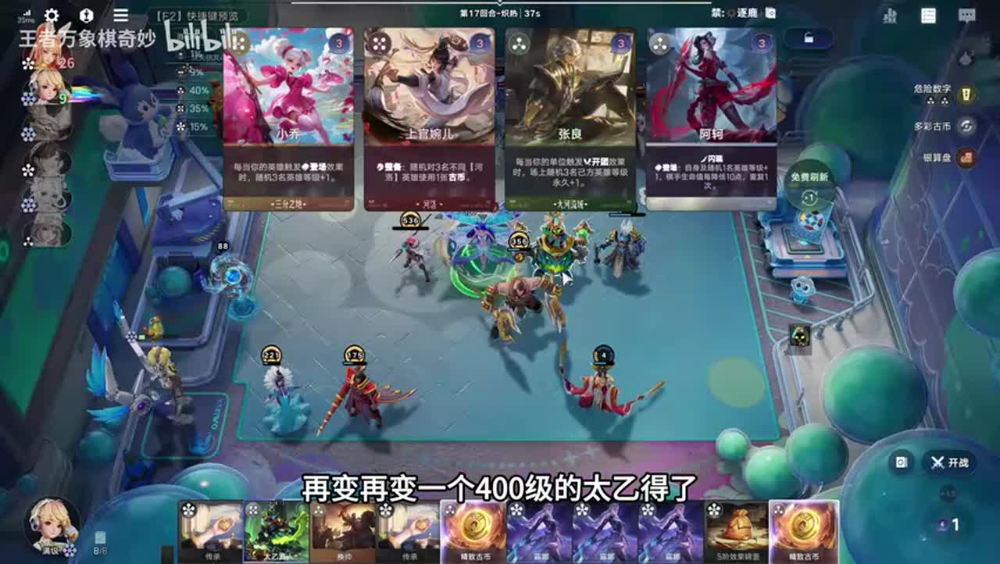

## 30:33–31:05 钟馗旁边应站人，避免其额外吃掉等级资源

- 事件 ID：BV1Bqei6pEyZ:p1:e022
- 场景：实战
- 时机：发现钟馗旁边没有英雄
- 背景（分析推断）：讲者回看钟馗偷吃很多且旁边空位
- 学习目标（分析推断）：从站位错误解释资源分配偏差
- 模板：position-cause
- ASR 段落：[56]

> 中奎旁边应该站个人的

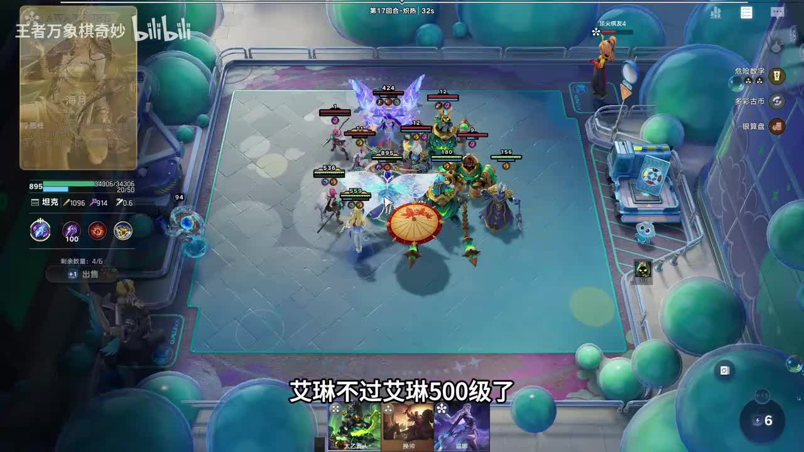

## 31:05–31:35 将实际大招伤害与磐石之心承伤上限联系起来

- 事件 ID：BV1Bqei6pEyZ:p1:e023
- 场景：实战
- 时机：海月大招落下后核对减伤
- 背景（分析推断）：先前针对海月配置防御，讲者观察到大招伤害显著降低
- 学习目标（分析推断）：用实际战斗反馈验证装备选择
- 模板：combat-review
- ASR 段落：[57]

> 受到伤害不会超过15

## 待核实与局限

- 不做ASR修正；术语如回环、唤醒存在同音错写，原话保留。
- 第49段大量重复字符无有效教学，排除；闲聊与单纯变换操作不统计。
- 回溯异常属于讲者当时观察，不当作当前版本机制。
- 多彩古币随机变换是本局特殊路径，不推广为固定稳定阵容。
- 磐石之心比例与海月伤害为讲者旧版说明；不同英雄等级不证明学习效果。
