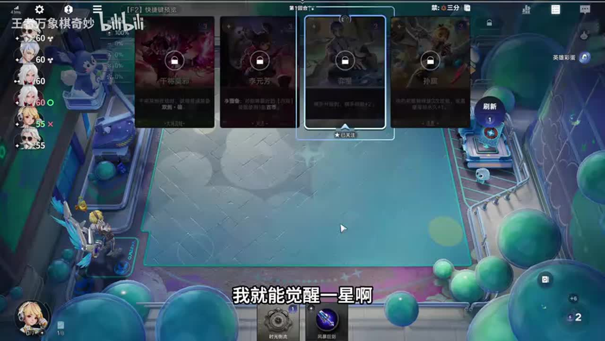
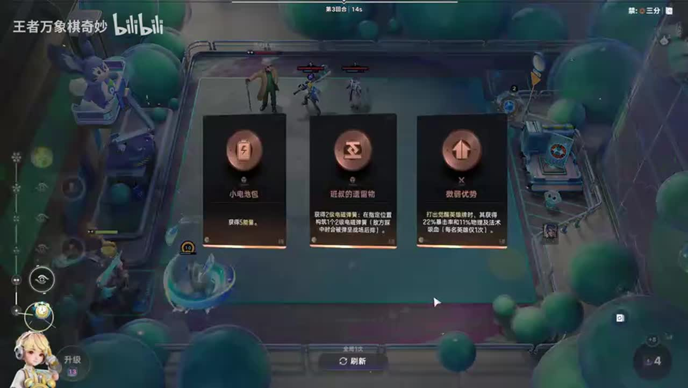
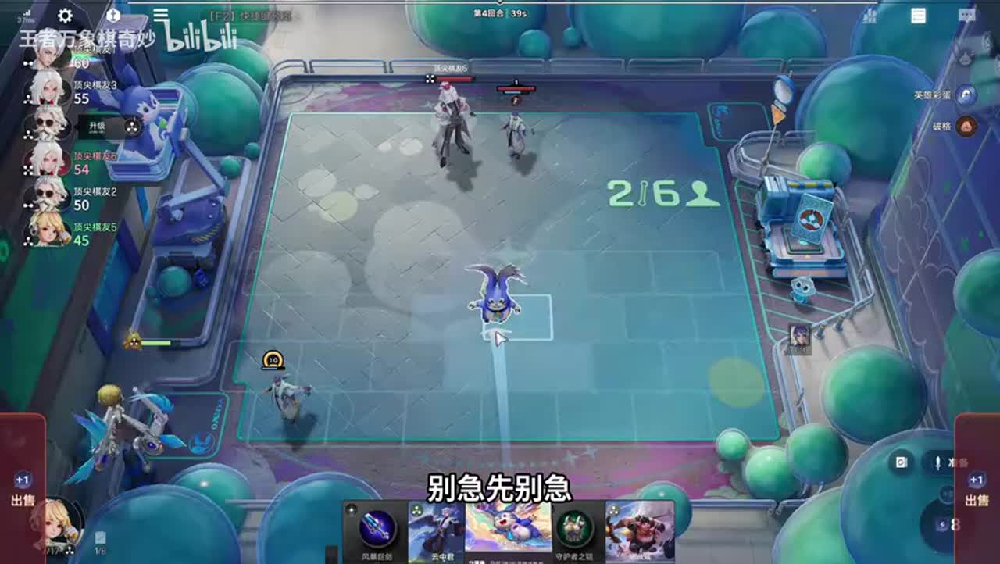
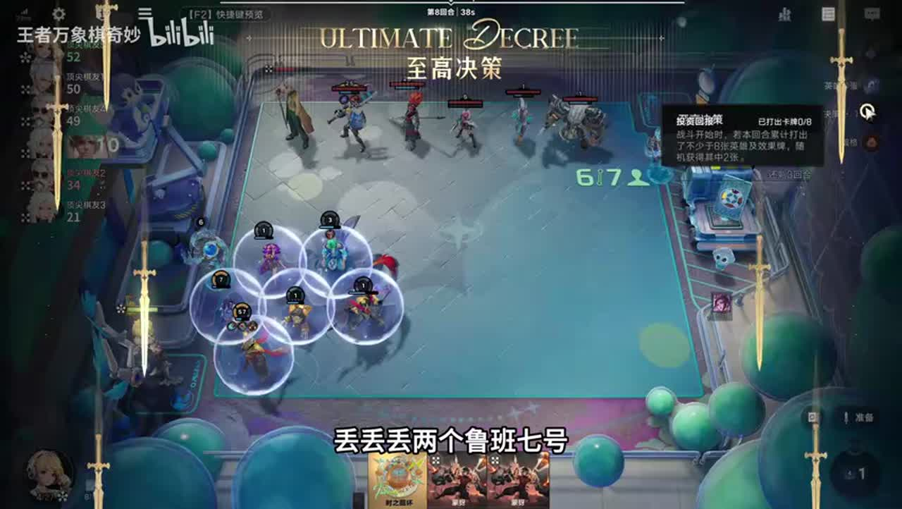

# 冷知识孙小宾禁什么阵营都能用，而且都很强

来源：https://www.bilibili.com/video/BV1vvab69E8U/?p=1

分析状态：completed

完整文字稿：../../../raw/BV1vvab69E8U_p1.md

## 00:00–01:14 孙膑仍可转其他阵营，本局选择逐鹿成长路线。

- 事件 ID：BV1vvab69E8U:p1:e001
- 场景：实战
- 时机：三分阵营被禁时
- 背景（分析推断）：讲者宣称任何禁阵营可用；本视频只展示一个禁阵营案例。
- 学习目标（分析推断）：把棋手功能和阵营路线分开判断。
- 模板：opening-plan
- ASR 段落：[1, 2]

> 不管三分倒转玩啥

## 01:14–02:28 比较商店买牌与一费时光倒流回溯成本。

- 事件 ID：BV1vvab69E8U:p1:e002
- 场景：实战
- 时机：追弈星觉醒时
- 背景（分析推断）：讲者估算两张牌与两次回溯共八块；数值是此局说法。
- 学习目标（分析推断）：计算回溯带来的成型成本。
- 模板：economy-budget
- ASR 段落：[3, 4]

> 他一个时光倒流一块!

## 01:52–03:50 开之前明确需要的两张二费牌，认识赌不到的亏损。

- 事件 ID：BV1vvab69E8U:p1:e003
- 场景：实战
- 时机：用二级锦囊追连胜时
- 背景（分析推断）：讲者说二级锦囊天生亏两块且需要双卡；不采纳赌输投降为通用建议。
- 学习目标（分析推断）：先确定随机资源的目标与风险。
- 模板：talent-fit
- ASR 段落：[4, 5, 6]

> 先想好再开啊

## 03:50–04:31 按讲者提示每波上一张，不一次堆多。

- 事件 ID：BV1vvab69E8U:p1:e004
- 场景：实战
- 时机：使用鸡爪类成长资源时
- 背景（分析推断）：具体道具名称与机制待核实，保留原话条件。
- 学习目标（分析推断）：识别同回合触发可能存在上限。
- 模板：resource-order
- ASR 段落：[7]

> 一波上一个千万不要上多

## 07:51–08:34 装备最多的逐鹿单位是成长目标；芈月不在则效果牌难兑现目标成长。

- 事件 ID：BV1vvab69E8U:p1:e005
- 场景：实战
- 时机：缺芈月但不断打效果牌时
- 背景（分析推断）：讲者解释迟来芈月为何使嬴政等级落后；一万是夸张表达。
- 学习目标（分析推断）：检查成长发动机是否已就位。
- 模板：growth-combo
- ASR 段落：[12]

> 装备穿戴最多的一名足路加一级。

## 08:34–09:20 腾出老夫子与弈星位置，区分前期工具与后期需求。

- 事件 ID：BV1vvab69E8U:p1:e006
- 场景：实战
- 时机：下回合计划升级时
- 背景（分析推断）：芈月终于到来后开始调整占位。
- 学习目标（分析推断）：随成长阶段变化替换过渡工具。
- 模板：late-transition
- ASR 段落：[13]

> 下个回合升级把一星扔了

## 09:20–10:36 芈月用于给逐鹿嬴政升级，不是只看单卡战斗力。

- 事件 ID：BV1vvab69E8U:p1:e007
- 场景：实战
- 时机：回答芈月作用时
- 背景（分析推断）：己方低等级面对高等级阵容，需要解释核心差距。
- 学习目标（分析推断）：从技能联动理解辅助价值。
- 模板：mechanic-model
- ASR 段落：[14, 15]

> 用芈月给这个竹鹿,给这个嬴政升级啊。

## 10:37–11:19 先计数本回合能打的牌，数量不足则等下回合。

- 事件 ID：BV1vvab69E8U:p1:e008
- 场景：实战
- 时机：准备回溯效果牌时
- 背景（分析推断）：讲者数两个庄周、蒙犽、鲁班后发现还不满足窗口。
- 学习目标（分析推断）：操作前确认触发数量与回合窗口。
- 模板：resource-order
- ASR 段落：[16]

> 我下个回合倒行这个回合回输不了

## 11:52–14:36 必须在上一波完成卖出，当前窗口关闭后再卖无法让目标回来。

- 事件 ID：BV1vvab69E8U:p1:e009
- 场景：实战
- 时机：避免老夫子被吃时
- 背景（分析推断）：讲者尝试卖庄周但失败，承认卖得太慢。
- 学习目标（分析推断）：用失败识别触发先后与不可逆窗口。
- 模板：combat-review
- ASR 段落：[18, 19, 20, 21]

> 我应该上一波就卖的。

## 14:37–15:13 合成能提供额外卡，所以保留老夫子是资源功能选择。

- 事件 ID：BV1vvab69E8U:p1:e010
- 场景：实战
- 时机：解释保留老夫子时
- 背景（分析推断）：并非无理由操作陈述，直接回答单位用途。
- 学习目标（分析推断）：评估工具单位提供的资源。
- 模板：mechanic-model
- ASR 段落：[22]

> 老头打一次合成给一张卡啊。

## 15:14–15:48 先让白起吃到援护再回溯，漏掉会损失成长。

- 事件 ID：BV1vvab69E8U:p1:e011
- 场景：实战
- 时机：回溯前漏援护时
- 背景（分析推断）：讲者发现少吃一口白起援护，称亏两级。
- 学习目标（分析推断）：以受益对象检查操作顺序。
- 模板：resource-order
- ASR 段落：[23]

> 少吃了一口白起的小员户

## 16:31–18:34 先攒有效牌再用大回环；不用高成本资源强追受竞争的觉醒。

- 事件 ID：BV1vvab69E8U:p1:e012
- 场景：实战
- 时机：手牌不足时考虑大回环
- 背景（分析推断）：讲者牌少且嬴政库存被对手占用。
- 学习目标（分析推断）：判断资源准备是否足够，避免空启动。
- 模板：economy-budget
- ASR 段落：[25, 26, 27]

> 这个大会完打不了,等我攒点货再打。

## 21:23–21:57 返回唤醒未必优于庄周，要按当前资源链判断。

- 事件 ID：BV1vvab69E8U:p1:e013
- 场景：实战
- 时机：比较回环返回的牌时
- 背景（分析推断）：讲者觉得本次返回不如庄周，非通用牌强弱排序。
- 学习目标（分析推断）：将随机结果与当局缺口对照。
- 模板：combat-review
- ASR 段落：[32]

> 幻醒没有庄周回的好啊

## 21:58–23:09 用装备数量优先指定嬴政；装备相同再比较等级。

- 事件 ID：BV1vvab69E8U:p1:e014
- 场景：实战
- 时机：芈月等级高于新来嬴政时
- 背景（分析推断）：高等级芈月可能抢到目标，不能只按常规装备分配。
- 学习目标（分析推断）：理解目标选择的优先级。
- 模板：position-binding
- ASR 段落：[33, 34]

> 就是谁装备多谁优先级高

## 23:10–24:30 让对方射向有弹簧的一边，再用扫射处理队伍。

- 事件 ID：BV1vvab69E8U:p1:e015
- 场景：实战
- 时机：最终对局有弹簧保护时
- 背景（分析推断）：讲者强调已有四个弹；具体弹簧机制以此局说明为限。
- 学习目标（分析推断）：把敌方接敌方向与保护条件结合。
- 模板：position-cause
- ASR 段落：[35, 36]

> 让他打这边去打这边我直接扫他全部

## 待核实与局限

- 原始ASR术语和数值可能有误；未经画面确认者不作为精确机制结论。
