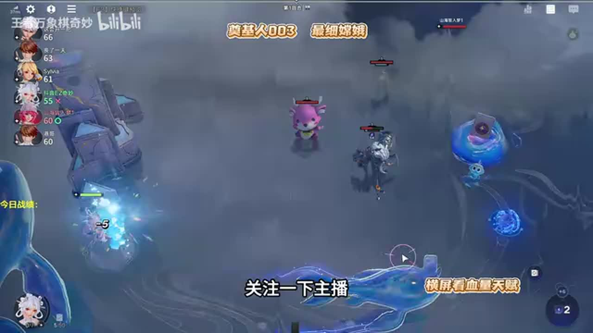
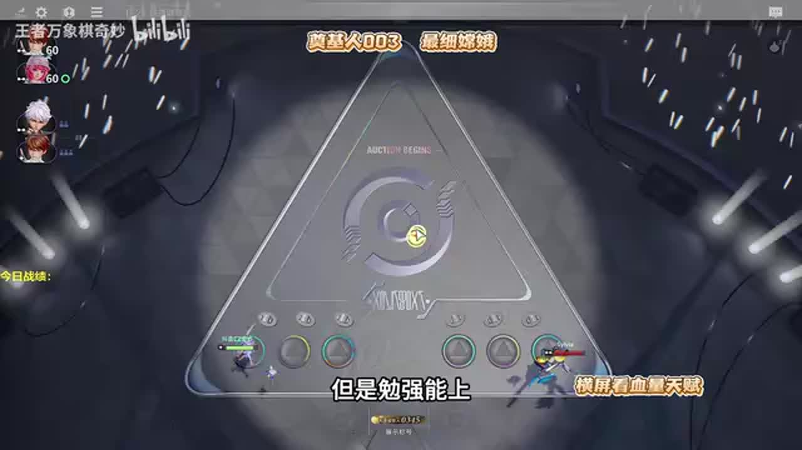
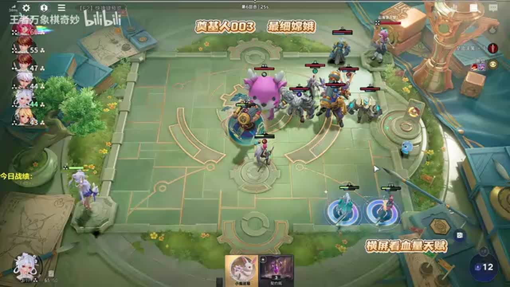
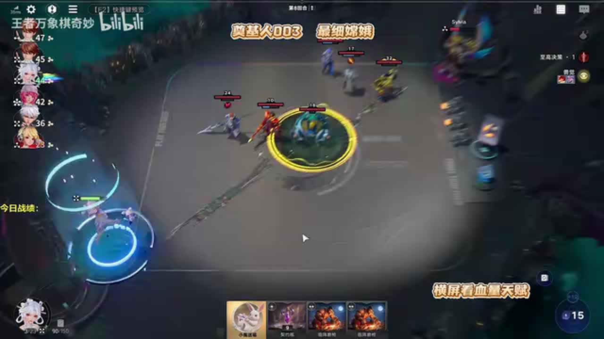
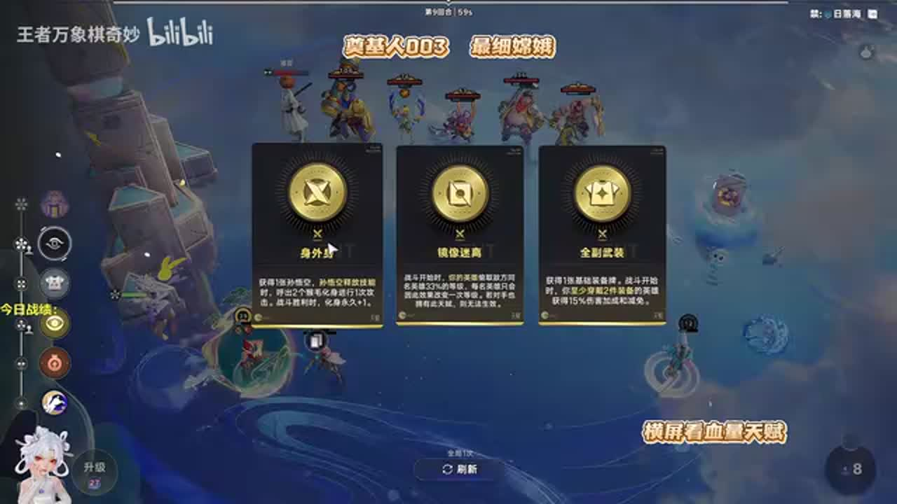
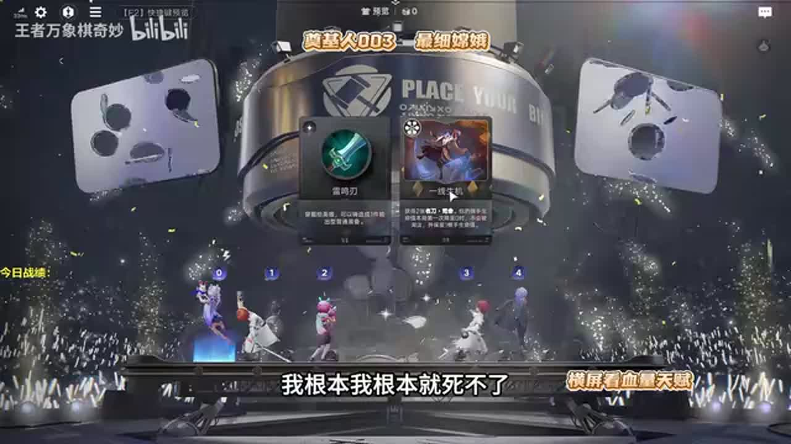
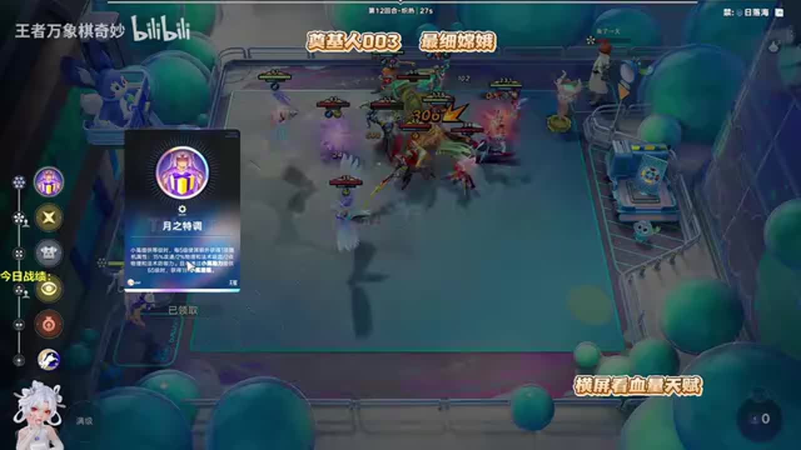

# 嫦娥CP天赋几乎都是强的！兽决+猴毛吊打小鹿李信

来源：https://www.bilibili.com/video/BV1TPej65ECC/?p=1

分析状态：completed

完整文字稿：../../../raw/BV1TPej65ECC_p1.md

## 00:39–01:45 对手强先觉醒苏烈保血，同行多且弱才单苏烈速升级

- 事件 ID：BV1TPej65ECC:p1:e001
- 场景：实战
- 时机：开局观察敌方人口和质量时
- 背景（分析推断）：两种开局由外部压力决定，不以公式棋手掩盖条件。
- 学习目标（分析推断）：识别快速成长与保血的取舍。
- 模板：level-transition
- ASR 段落：[2, 3, 4]

> 如果外面压力不大

## 02:17–02:49 拿经验推进六级，下一轮自然刷新找弈星可省刷新费用

- 事件 ID：BV1TPej65ECC:p1:e002
- 场景：实战
- 时机：升级前等商店自然刷新时
- 背景（分析推断）：当前目标是速六，但单苏烈最快路线有暴毙风险。
- 学习目标（分析推断）：在不危及生存时复用免费刷新。
- 模板：economy-budget
- ASR 段落：[5]

> 下一轮商店会自动刷新

## 02:50–03:19 海月、姜子牙易于搭配，玉环需特定施法装备，猴子是次选

- 事件 ID：BV1TPej65ECC:p1:e003
- 场景：实战
- 时机：考虑未到司空震的替代单位时
- 背景（分析推断）：替代不是随便上人，比较装备依赖和可兑现的功能。
- 学习目标（分析推断）：按当前资源评估替代核心。
- 模板：fallback-plan
- ASR 段落：[6]

> 玉环必须得特定的装备

## 03:22–03:57 先不上其他人交助力，再上弈星作为工具

- 事件 ID：BV1TPej65ECC:p1:e004
- 场景：实战
- 时机：准备交随机小兔助力时
- 背景（分析推断）：先锁目标再使用工具，避免随机资源错配。
- 学习目标（分析推断）：控制随机助力的目标集合。
- 模板：resource-order
- ASR 段落：[7]

> 不要上人先丢小兔助力

## 03:58–04:27 已完成觉醒导致部分选项失去收益，但保留刷新机会给后续金天赋

- 事件 ID：BV1TPej65ECC:p1:e005
- 场景：实战
- 时机：铜天赋无法吃到当前动作时
- 背景（分析推断）：讲者选择接受低收益铜天赋，避免后面关键选择无刷新。
- 学习目标（分析推断）：比较当前天赋与未来刷新机会成本。
- 模板：talent-fit
- ASR 段落：[8]

> 同天赋刷的话很亏

## 04:27–04:57 即使不能赢，击杀部分敌人仍可减少掉血，用战斗反馈看减损目标

- 事件 ID：BV1TPej65ECC:p1:e006
- 场景：实战
- 时机：预计打不过时寻找能杀的单位时
- 背景（分析推断）：苏烈击杀顺序的实际结果与最初预测不同；阶段扣血口述不独立重算。
- 学习目标（分析推断）：将失败局也转化为可执行的减损目标。
- 模板：combat-review
- ASR 段落：[9]

> 杀两个能少掉血

## 04:57–06:09 先把苏烈喂到四十级获得复生门槛，再上其他单位分装备

- 事件 ID：BV1TPej65ECC:p1:e007
- 场景：实战
- 时机：拿兽决准备增加队友时
- 背景（分析推断）：没有达到门槛时随机助力应继续锁定苏烈。
- 学习目标（分析推断）：先完成生存阈值再扩展阵容。
- 模板：resource-order
- ASR 段落：[10, 11]

> 他先喂到40级才能上其他人

## 06:09–06:45 分装备联动群体升级，场上等级成长更快让大兔资源更早可用

- 事件 ID：BV1TPej65ECC:p1:e008
- 场景：实战
- 时机：瑶分装备与云中君共同上场时
- 背景（分析推断）：来牌组成的循环可以改变原计划挂司空震。
- 学习目标（分析推断）：理解群体等级与棋手资源之间的联动。
- 模板：growth-combo
- ASR 段落：[12]

> 她这个兔子是怎么开的

## 06:45–07:54 瑶能吃到成长则保留，不吃则换司空震；也可用传承转移苏烈等级

- 事件 ID：BV1TPej65ECC:p1:e009
- 场景：实战
- 时机：观察瑶是否获得兔子成长时
- 背景（分析推断）：设置观察条件而不是盲等原阵容。
- 学习目标（分析推断）：用资源归属和转移可用性判断转型。
- 模板：fallback-plan
- ASR 段落：[13, 14]

> 要是不吃兔子的话

## 07:54–09:04 复生门槛已满足，此后更多助力给其他成长单位价值可能更高

- 事件 ID：BV1TPej65ECC:p1:e010
- 场景：实战
- 时机：苏烈已经四十级时
- 背景（分析推断）：苏烈四十到一百的差别未必是本路线瓶颈。
- 学习目标（分析推断）：识别达到门槛后的边际收益变化。
- 模板：resource-order
- ASR 段落：[15, 16]

> 他只要40级就够了

## 09:05–09:47 承认额外购牌拖慢升级；干将前期有效但不能无限代替后期角色

- 事件 ID：BV1TPej65ECC:p1:e011
- 场景：实战
- 时机：临时多买嬴政导致升级慢时
- 背景（分析推断）：同段还解释瑶百级分属性与兔子属性联动，突出购买需服务路线。
- 学习目标（分析推断）：识别看似有用的牌带来的时间和经济成本。
- 模板：economy-budget
- ASR 段落：[17]

> 这一买我升级慢了

## 09:51–10:54 玉环卖出资源可支持老虎觉醒；海月虽强但本局无人口位置

- 事件 ID：BV1TPej65ECC:p1:e012
- 场景：实战
- 时机：拍卖玉环用于老虎觉醒时
- 背景（分析推断）：按当局功能与人口限制选择，而非照推荐榜全买。
- 学习目标（分析推断）：把竞拍收益与合成缺口相连。
- 模板：resource-order
- ASR 段落：[18, 19]

> 老虎觉醒还挺重要

## 10:55–12:15 先杀一个后排才能叠物理伤害，跳到难杀目标则循环失效

- 事件 ID：BV1TPej65ECC:p1:e013
- 场景：实战
- 时机：兽决老虎依赖首次击杀时
- 背景（分析推断）：同时检查大斧子等装备与挂瑶的收益冲突，不能默认所有组合叠加。
- 学习目标（分析推断）：识别触发链启动条件和组合冲突。
- 模板：counter-target
- ASR 段落：[20, 21]

> 得先杀一个才行

## 12:15–13:29 停止贪契约瓶，交保命资源；原核心不来时专属天赋路线可替代

- 事件 ID：BV1TPej65ECC:p1:e014
- 场景：实战
- 时机：遇到明确打不过的一家时
- 背景（分析推断）：贪资源只适用于仍能打过的阶段，生命风险改变使用时机。
- 学习目标（分析推断）：在生存临界点停止等待。
- 模板：economy-budget
- ASR 段落：[22, 23]

> 这一家不丢瓶子死球了

## 13:30–14:02 觉醒苏烈会拖慢升级，但不觉醒又持续掉血，承认这是保血的成本

- 事件 ID：BV1TPej65ECC:p1:e015
- 场景：实战
- 时机：反思六级启动比预期慢时
- 背景（分析推断）：缺少经济天赋也影响速度，不把慢启动只归咎单一操作。
- 学习目标（分析推断）：区分合理取舍与错误操作。
- 模板：combat-review
- ASR 段落：[24]

> 但是不觉醒苏烈开的话

## 14:02–15:05 通常留到六级获得属性，再先大后小，提高小兔触发月之词条的次数

- 事件 ID：BV1TPej65ECC:p1:e016
- 场景：实战
- 时机：五级输了但持有大兔时
- 背景（分析推断）：总等级相近不代表词条进度一致；口述十一十五十九层仅作讲者示例。
- 学习目标（分析推断）：区分直接收益与间接触发收益。
- 模板：resource-order
- ASR 段落：[25, 26]

> 总体加的等级是一样的

## 15:05–16:04 达到百级技能门槛更重要，可用成长资源补足或传承调整

- 事件 ID：BV1TPej65ECC:p1:e017
- 场景：实战
- 时机：老虎随机偷到低等级时
- 背景（分析推断）：十级四十级百级门槛来自讲者解释，未独立验证版本数值。
- 学习目标（分析推断）：在随机结果不好时补关键能力阈值。
- 模板：resource-order
- ASR 段落：[27, 28]

> 100级挺重要的

## 15:31–16:38 通常六级交大兔，但一滴血升不了六时可提前交以多活一轮争名次

- 事件 ID：BV1TPej65ECC:p1:e018
- 场景：实战
- 时机：五级即将死亡且无法升六时
- 背景（分析推断）：明确通常规则的生存例外，不能将六级前绝不交写成硬规则。
- 学习目标（分析推断）：在无法实现长期收益时优先生存。
- 模板：economy-budget
- ASR 段落：[28, 29]

> 不丢就要死了

## 16:04–17:19 用便宜等级工具和无阵营单位补门槛，随后卖工具让大兔只给四名主力

- 事件 ID：BV1TPej65ECC:p1:e019
- 场景：实战
- 时机：离三百七十五等级门槛差一点时
- 背景（分析推断）：花钱加少量等级不划算的选项应跳过。
- 学习目标（分析推断）：以成本和目标集合安排阈值补齐。
- 模板：resource-order
- ASR 段落：[29, 30]

> 其他杂鱼一律别吃

## 18:23–19:00 低血争一线生机，血零免死与当前生命压力配合评价

- 事件 ID：BV1TPej65ECC:p1:e020
- 场景：实战
- 时机：低血拍卖遇到保命资源时
- 背景（分析推断）：讲者同时认为自己暂不易死，最终选择不等于一般最佳。
- 学习目标（分析推断）：按真实生存缺口比较竞拍功能。
- 模板：auction-choice
- ASR 段落：[33]

> 血量少就去抢一线生机

## 19:00–19:38 差一层未到六十五就不能得到大兔，提示提前检查临界阈值

- 事件 ID：BV1TPej65ECC:p1:e021
- 场景：实战
- 时机：词条进度停在六十四时
- 背景（分析推断）：口述等级与词条用语混用，按语义记为进度不修原ASR。
- 学习目标（分析推断）：在操作前核对临界值而非大致够了。
- 模板：combat-review
- ASR 段落：[34]

> 我要65的话他给个大兔子

## 19:39–22:05 用传承换成瑶等更会兑现攻速吸血的单位，苏烈后期主要吃防御

- 事件 ID：BV1TPej65ECC:p1:e022
- 场景：实战
- 时机：开局苏烈完成保血与凑等级后时
- 背景（分析推断）：原先强的过渡单位到了后期可能吸走成长，未找到传承前仍被迫保留。
- 学习目标（分析推断）：按照阶段和属性利用率替换过渡单位。
- 模板：late-transition
- ASR 段落：[35, 36, 37, 38]

> 凑够375级他就没用了

## 23:11–24:54 太乙战斗提供复活，下一轮整备触发前立刻卖掉，避免老虎偷七级而非高等级苏烈

- 事件 ID：BV1TPej65ECC:p1:e023
- 场景：实战
- 时机：战斗后太乙还在而老虎即将偷等级时
- 背景（分析推断）：操作有真实时间窗口，不能只说下一轮卖而忽视触发顺序。
- 学习目标（分析推断）：识别阶段交界时的目标控制与操作时限。
- 模板：resource-order
- ASR 段落：[41, 42, 43]

> 在老虎他触发整备这个特效生效之前

## 25:29–26:02 仅在面对蒙恬时考虑换技能，其他对局木兰自身技能更适合

- 事件 ID：BV1TPej65ECC:p1:e024
- 场景：实战
- 时机：有人问青莲剑谱能否给木兰时
- 背景（分析推断）：限定敌方条件，泛化换技能会丢失原角色优势。
- 学习目标（分析推断）：按照对手决定是否替换核心技能。
- 模板：counter-target
- ASR 段落：[45]

> 打其他人都是自己的技能厉害

## 26:02–27:12 交资源前确认老虎偷等级对象，苏烈当前最高时加给别的单位可能反而降低偷取收益

- 事件 ID：BV1TPej65ECC:p1:e025
- 场景：实战
- 时机：全军动员可能改变最高等级目标时
- 背景（分析推断）：更强的牌并不总是更好，随机目标与相对等级共同决定收益。
- 学习目标（分析推断）：识别资源动作对目标选择的间接影响。
- 模板：resource-order
- ASR 段落：[46, 47]

> 全军动员不能交

## 27:12–28:14 猴子和云中君实际伤害突出，利用结果重新评估工具的战斗作用

- 事件 ID：BV1TPej65ECC:p1:e026
- 场景：实战
- 时机：终局战斗伤害统计与原先预期不同时
- 背景（分析推断）：口述一万多及胜利不作为普遍强度验证，排除娱乐闲聊。
- 学习目标（分析推断）：用实际战斗反馈更新对辅助和输出的认识。
- 模板：combat-review
- ASR 段落：[48, 49]

> 这鸟还打了一万多伤害

## 待核实与局限

- 本次不修正ASR，人物、装备和天赋同音误识保留；时间和原话来自原始分段。
- 部分口述等级与词条进度混用、伤害数字只为讲者当局估计。
- 专属天赋普遍强、随便阵容可赢等绝对宣传不作为验证；闲聊辱骂感谢观众排除。
