# 嫦娥上什么卡最厉害？选什么天赋最好？一局看懂

来源：https://www.bilibili.com/video/BV1eYYY6vEka/?p=1

分析状态：completed

完整文字稿：../../../raw/BV1eYYY6vEka_p1.md

## 00:00–00:28 队友管理进修配弈星经验，四级前不早上弈星

- 事件 ID：BV1eYYY6vEka:p1:e001
- 场景：前置讲解
- 时机：讲解组排快速六级条件
- 背景（分析推断）：依赖队友提供额外经验，不是单排节奏
- 学习目标（分析推断）：识别加速前提
- 模板：level-transition
- ASR 段落：[1]

> 在六到七回合就能拉到六级

## 00:28–01:59 不是必等司空震，前后排合理且强卡可接大兔

- 事件 ID：BV1eYYY6vEka:p1:e002
- 场景：实战
- 时机：讲解六级核心选择
- 背景（分析推断）：雅典娜承伤、刘邦韩信等按功能补
- 学习目标（分析推断）：缺牌时拆功能选人
- 模板：fallback-plan
- ASR 段落：[2, 3, 4]

> 你随便上四个人

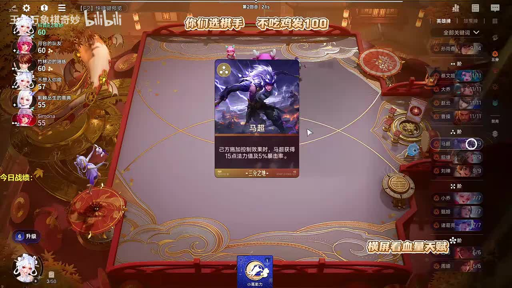

## 01:29–02:31 觉醒苏烈提高中期强度，玉环要装备才可用

- 事件 ID：BV1eYYY6vEka:p1:e003
- 场景：实战
- 时机：第一局两瑶压力
- 背景（分析推断）：外部高压力与第二局不同
- 学习目标（分析推断）：按对手决定过渡投资
- 模板：opening-plan
- ASR 段落：[4, 5]

> 中期能赢两波

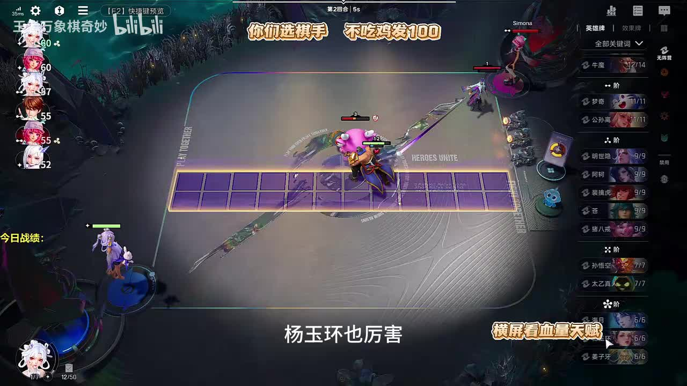

## 02:34–03:01 直接五级成长尽早达复活与两次牺牲

- 事件 ID：BV1eYYY6vEka:p1:e004
- 场景：实战
- 时机：苏烈接近40级
- 背景（分析推断）：复生阈值额外提高成长
- 学习目标（分析推断）：识别辅助成长门槛
- 模板：growth-combo
- ASR 段落：[6]

> 死两次能加八级

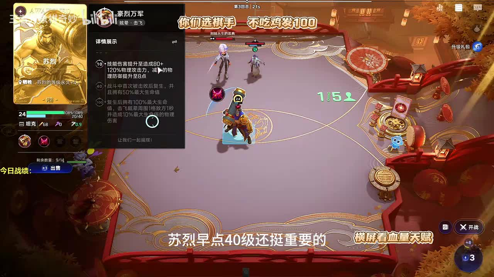

## 03:03–04:07 来牌是最强组合成立的前提，不硬等

- 事件 ID：BV1eYYY6vEka:p1:e005
- 场景：实战
- 时机：理想司空震不来
- 背景（分析推断）：过渡可赢但最优核心未到
- 学习目标（分析推断）：避免把理论强度当现成战力
- 模板：fallback-plan
- ASR 段落：[7, 8]

> 他不来他就不屌了

## 04:07–04:40 先小兔再上弈星，等级集中苏烈

- 事件 ID：BV1eYYY6vEka:p1:e006
- 场景：实战
- 时机：弈星登场前
- 背景（分析推断）：尽早40级保血
- 学习目标（分析推断）：清理技能目标干扰
- 模板：resource-order
- ASR 段落：[9]

> 让异星一定不能吃到兔子

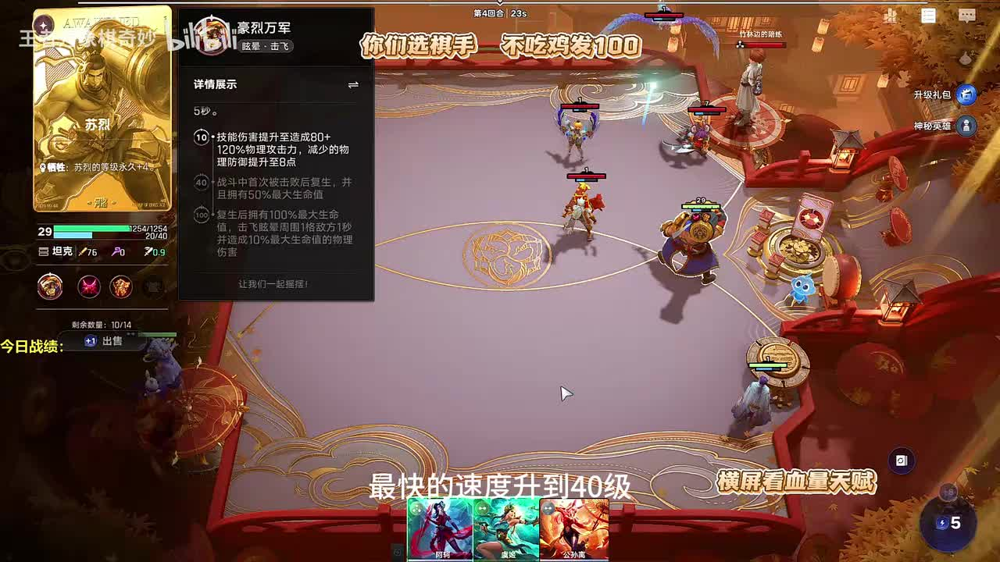

## 05:10–05:44 经验折算省钱，等级与钱优先；免费抽留更高卡池

- 事件 ID：BV1eYYY6vEka:p1:e007
- 场景：实战
- 时机：选经济或成长
- 背景（分析推断）：当前要升级保血
- 学习目标（分析推断）：按成长路线估天赋价值
- 模板：talent-fit
- ASR 段落：[11]

> 六经验等于六块钱

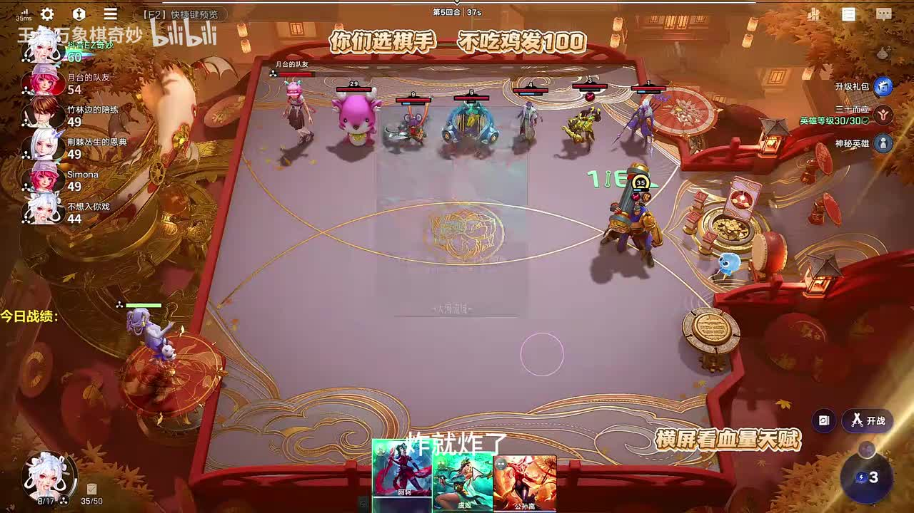

## 05:44–06:42 看已交战列表找尚未遇对手，让苏烈绕后

- 事件 ID：BV1eYYY6vEka:p1:e008
- 场景：实战
- 时机：预测下轮敌人站位
- 背景（分析推断）：敌阵靠侧可利用路径
- 学习目标（分析推断）：观察对手再布置切后排
- 模板：position-cause
- ASR 段落：[12, 13]

> 我们的苏联就大概站在这个位置

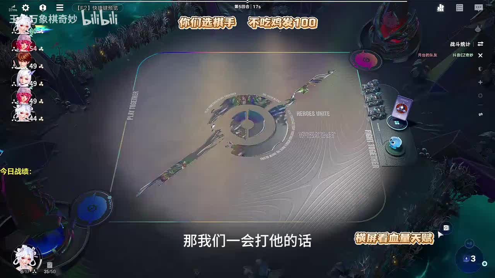

## 06:42–07:44 腰带日炎护甲反甲，不死鸟加生命增强日炎伤害

- 事件 ID：BV1eYYY6vEka:p1:e009
- 场景：实战
- 时机：前期苏烈装备
- 背景（分析推断）：将未来司空震棒暂让承伤核心
- 学习目标（分析推断）：用伤害公式配装备
- 模板：equipment-cause
- ASR 段落：[14, 15]

> 他这个烧甲会烧得更疼一点

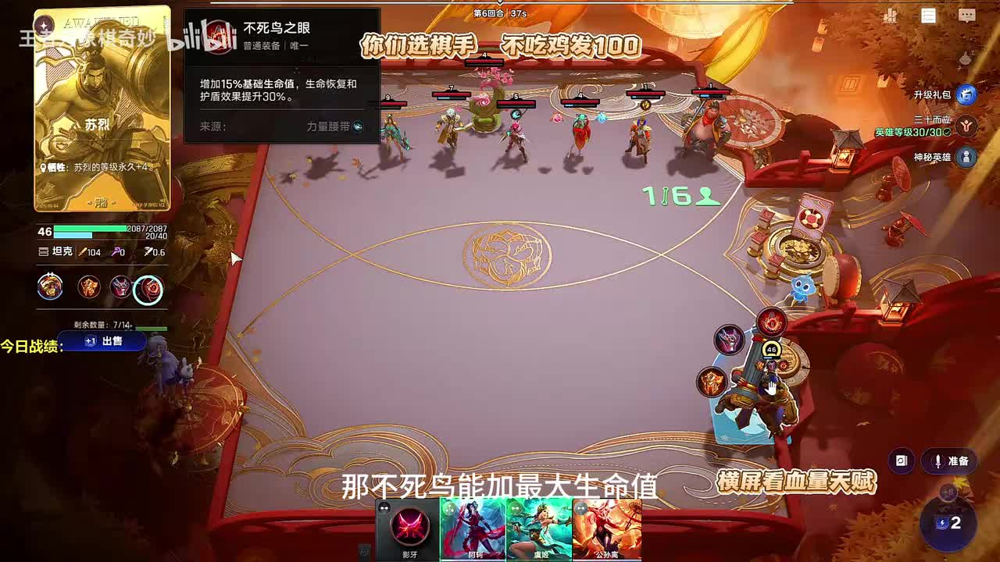

## 07:12–07:44 立即上场避免下回合销毁

- 事件 ID：BV1eYYY6vEka:p1:e010
- 场景：实战
- 时机：神秘英雄出司空震
- 背景（分析推断）：资源有概率过期
- 学习目标（分析推断）：及时兑现易失牌
- 模板：resource-order
- ASR 段落：[15]

> 下一轮可能就炸了

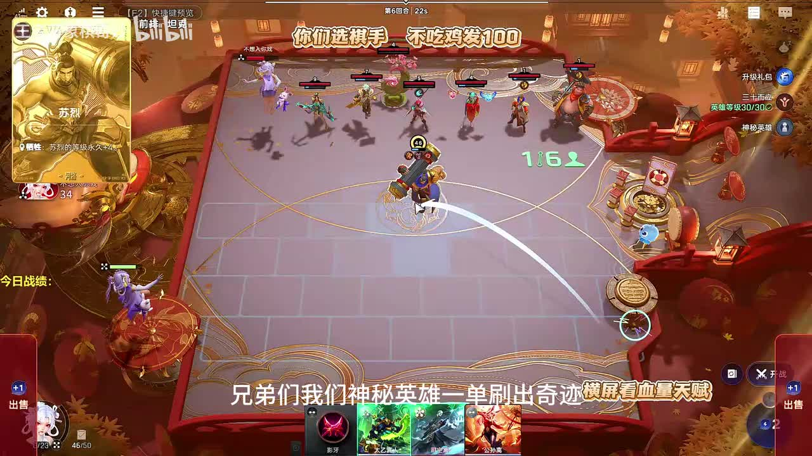

## 07:44–08:42 吕布能替海月承伤，双前排司空震后排老虎切后

- 事件 ID：BV1eYYY6vEka:p1:e011
- 场景：实战
- 时机：已有吕布时
- 背景（分析推断）：前后排功能优于固定海陆空名单
- 学习目标（分析推断）：按职责构建四人阵容
- 模板：module-fit
- ASR 段落：[16, 17]

> 前排有两个挨打的

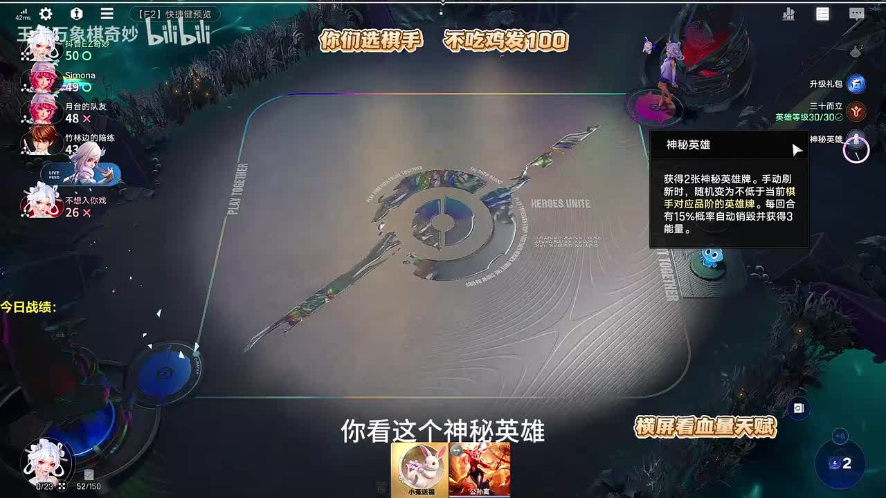

## 08:42–09:48 分侧诱导未成功，反甲仍维持战斗收益

- 事件 ID：BV1eYYY6vEka:p1:e012
- 场景：实战
- 时机：预计小鹿追吕布却追苏烈
- 背景（分析推断）：站位预期与实际路径不一致
- 学习目标（分析推断）：观察结果修正路径假设
- 模板：combat-review
- ASR 段落：[18, 19]

> 还是来追我苏联了

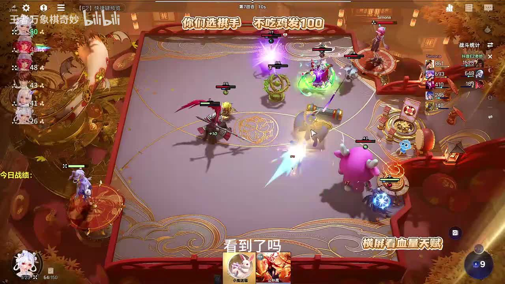

## 09:48–10:19 讲者给概率非必然，连续存留不证明安全

- 事件 ID：BV1eYYY6vEka:p1:e013
- 场景：实战
- 时机：问神秘牌是否必炸
- 背景（分析推断）：临时牌需要过期风险管理
- 学习目标（分析推断）：区分随机与保证
- 模板：mechanic-model
- ASR 段落：[20]

> 不是百分百炸

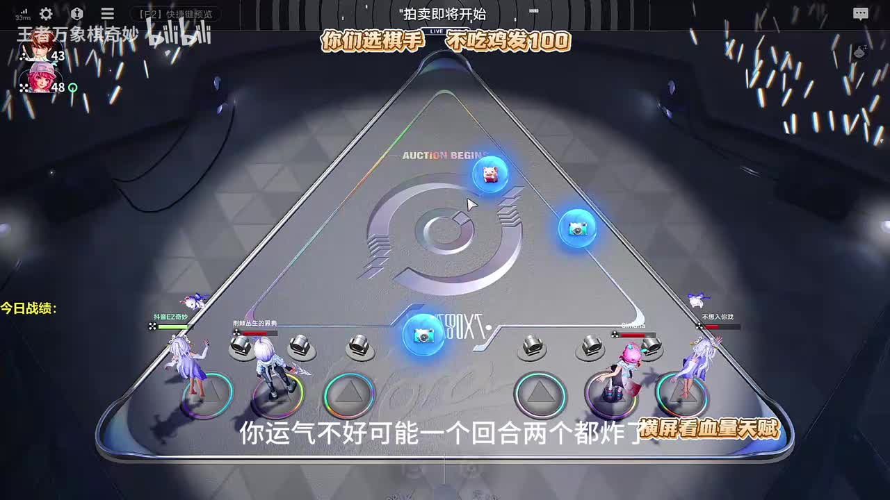

## 10:51–12:06 可用天赋先拿，五十血不赌搏命；按数量补登场

- 事件 ID：BV1eYYY6vEka:p1:e014
- 场景：实战
- 时机：点兵点将或重抽
- 背景（分析推断）：重抽可能更差且生存有代价
- 学习目标（分析推断）：比较重抽风险与当前收益
- 模板：talent-fit
- ASR 段落：[22, 23]

> 五十血不刷个博

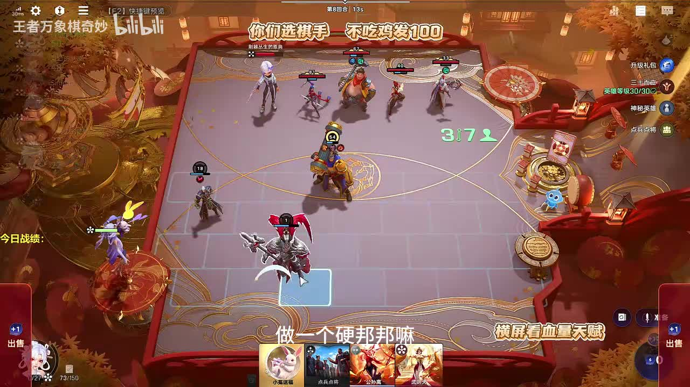

## 13:21–14:33 姜子牙先留且移植可转换，老虎来后替苏烈

- 事件 ID：BV1eYYY6vEka:p1:e015
- 场景：实战
- 时机：老虎一直不来
- 背景（分析推断）：不因必要辅助缺失停止成型
- 学习目标（分析推断）：按已持移植找替代
- 模板：fallback-plan
- ASR 段落：[26, 27]

> 没有老虎他就先挂着

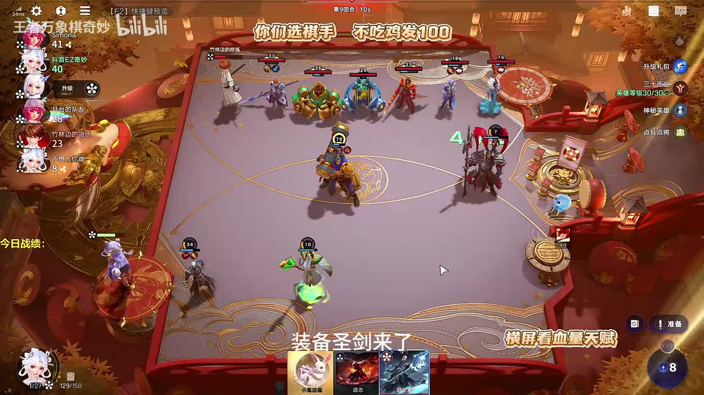

## 14:33–15:34 经济天赋少导致晚六，损失大兔强化与月之特调

- 事件 ID：BV1eYYY6vEka:p1:e016
- 场景：实战
- 时机：十回合还没六级
- 背景（分析推断）：当前装备天赋不能等价给升级钱
- 学习目标（分析推断）：解释节奏晚的资源原因
- 模板：level-transition
- ASR 段落：[28, 29]

> 我们这把经济天赋太少了

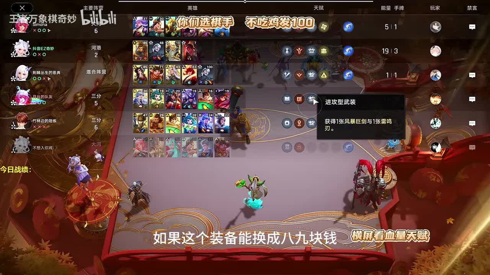

## 15:34–17:02 升级后先大再小叠月之特调，不在五级先消耗

- 事件 ID：BV1eYYY6vEka:p1:e017
- 场景：实战
- 时机：即将升六连兔
- 背景（分析推断）：要先扩大等级与层数反馈
- 学习目标（分析推断）：说明顺序改变成长链
- 模板：resource-order
- ASR 段落：[30, 31, 32]

> 那叠这个月之特条叠的快

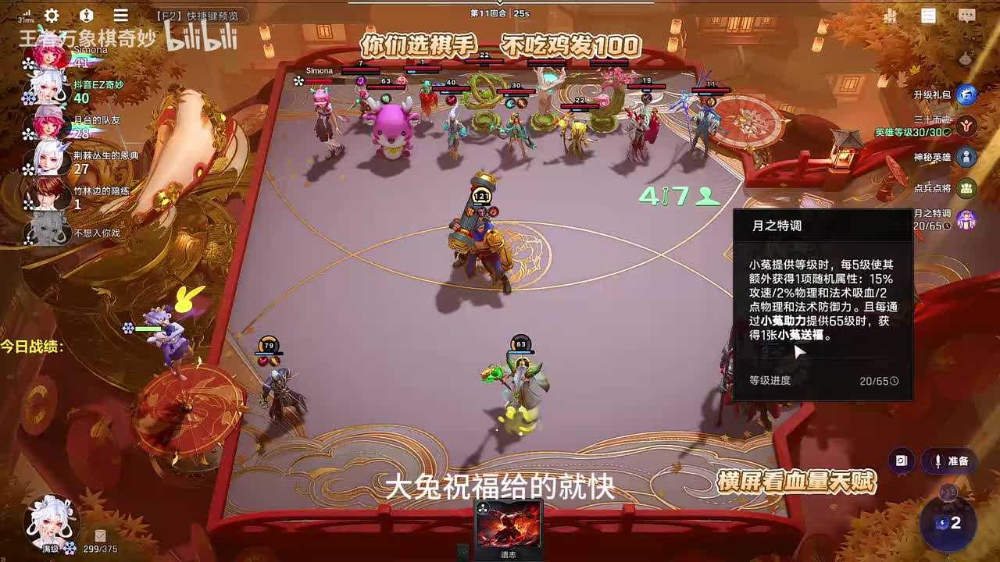

## 17:02–18:39 不能再硬等，先四张战力牌和大兔保命，可用海月艾琳

- 事件 ID：BV1eYYY6vEka:p1:e018
- 场景：实战
- 时机：六级仍缺老虎司空震
- 背景（分析推断）：后期每波满入可能迅速死亡
- 学习目标（分析推断）：用生存风险划定等待上限
- 模板：fallback-plan
- ASR 段落：[33, 34, 35]

> 不能硬等这个老虎的

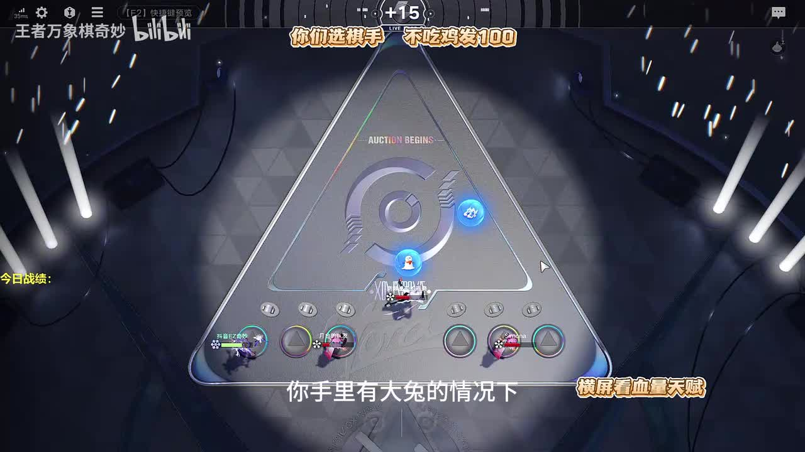

## 18:39–20:32 能凑尽量凑，实在不够就交，不耗无用资源

- 事件 ID：BV1eYYY6vEka:p1:e019
- 场景：实战
- 时机：大兔375阈值缺少等级
- 背景（分析推断）：当前所有牌无法达门槛
- 学习目标（分析推断）：比较阈值收益与可行资源
- 模板：economy-budget
- ASR 段落：[36, 37, 38]

> 咋都凑不够那就不凑了

## 19:57–21:31 不在场阵营牌让司空震吕布增长，大小兔正反馈继续

- 事件 ID：BV1eYYY6vEka:p1:e020
- 场景：实战
- 时机：姜子牙登场加级
- 背景（分析推断）：必须辨认在场阵营
- 学习目标（分析推断）：按目标选择触发材料
- 模板：growth-combo
- ASR 段落：[38, 39, 40]

> 只要不打三分和合落

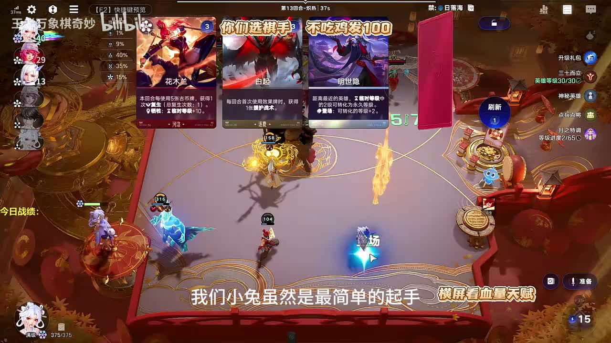

## 21:31–22:41 复活等价增加核心生命机会，觉醒钟馗减半敌等级

- 事件 ID：BV1eYYY6vEka:p1:e021
- 场景：实战
- 时机：准备后期太乙钟馗
- 背景（分析推断）：少额外加级可能不如战斗辅助
- 学习目标（分析推断）：按终局胜负功能留卡
- 模板：late-transition
- ASR 段落：[41, 42]

> 多一次复活是不是就又等于多了一个300级

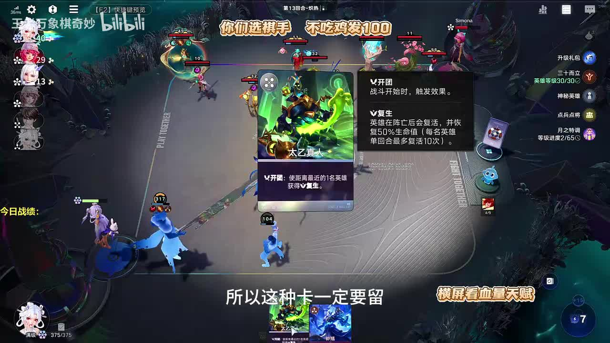

## 22:41–23:41 小兔给在场核心，跨阵营祝福有条件均分成长

- 事件 ID：BV1eYYY6vEka:p1:e022
- 场景：实战
- 时机：成长技能选择目标
- 背景（分析推断）：杂鱼会占核心收益
- 学习目标（分析推断）：核对目标与单位成本
- 模板：resource-order
- ASR 段落：[43, 44]

> 一定不要丢到杂鱼卡身上

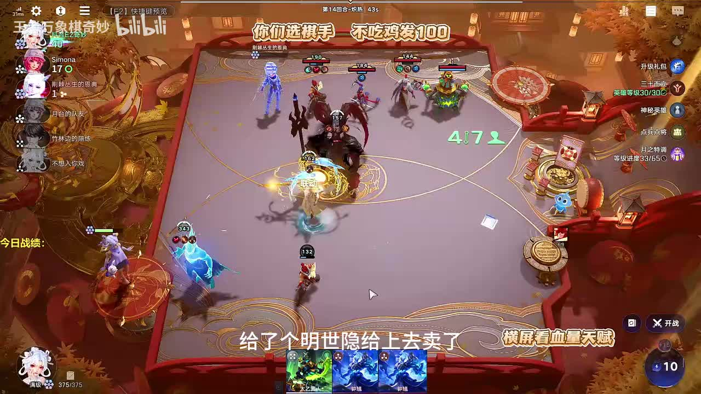

## 23:41–24:45 老虎伸手前卖瑶防偷一级，司空震共享受损

- 事件 ID：BV1eYYY6vEka:p1:e023
- 场景：实战
- 时机：瑶分装后回合切换
- 背景（分析推断）：整备技能有短暂窗口
- 学习目标（分析推断）：在自动技能前移除工具
- 模板：resource-order
- ASR 段落：[45, 46]

> 我先把瑶妹给卖了

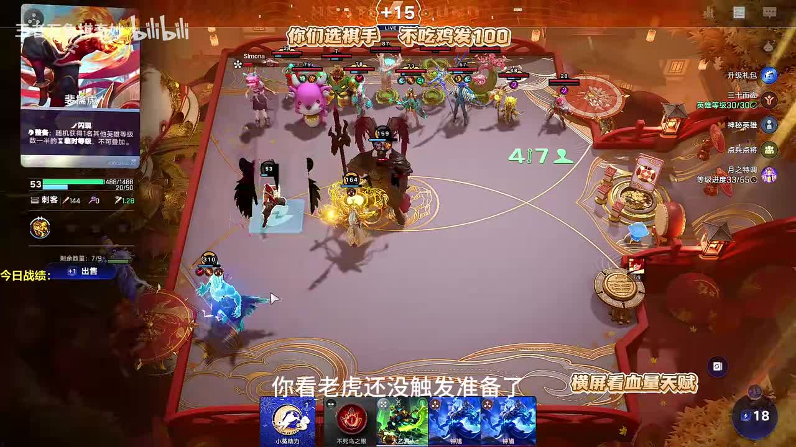

## 24:45–25:54 应老虎回手时丢小兔，核心吃后再上老虎偷级

- 事件 ID：BV1eYYY6vEka:p1:e024
- 场景：实战
- 时机：老虎上场吃小兔误操作
- 背景（分析推断）：老虎不需要直接消耗小兔成长
- 学习目标（分析推断）：防止目标错误分配
- 模板：combat-review
- ASR 段落：[47, 48]

> 老虎回首的时候丢这个兔子好了

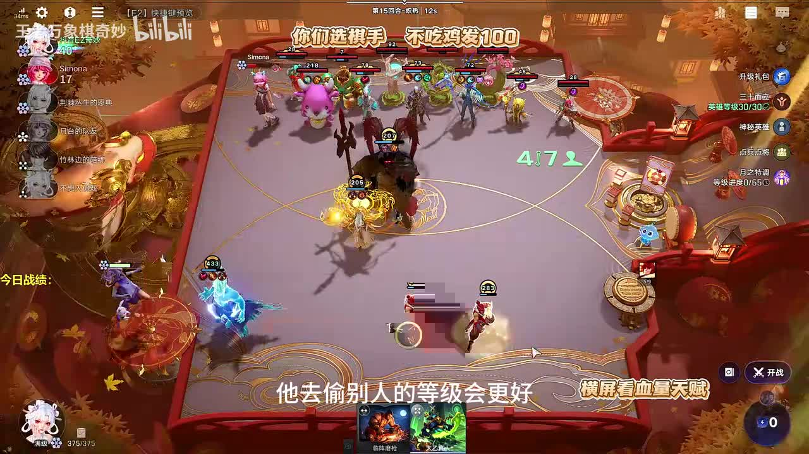

## 26:30–28:06 管理进修经验与日落海降低外部上限帮助早六；单排高分易死

- 事件 ID：BV1eYYY6vEka:p1:e025
- 场景：实战
- 时机：组排环境限制
- 背景（分析推断）：两局策略均受队友与阵营环境影响
- 学习目标（分析推断）：保留策略适用环境
- 模板：mechanic-model
- ASR 段落：[50, 51, 52]

> 升级的时候额外加三经验

## 28:36–29:44 不觉醒苏烈省钱抢首个六级

- 事件 ID：BV1eYYY6vEka:p1:e026
- 场景：实战
- 时机：第二局外部全单人低压力
- 背景（分析推断）：与第一局双瑶压力相比可少花过渡
- 学习目标（分析推断）：条件改变则改升级计划
- 模板：opening-plan
- ASR 段落：[54, 55]

> 这把是没有压力的

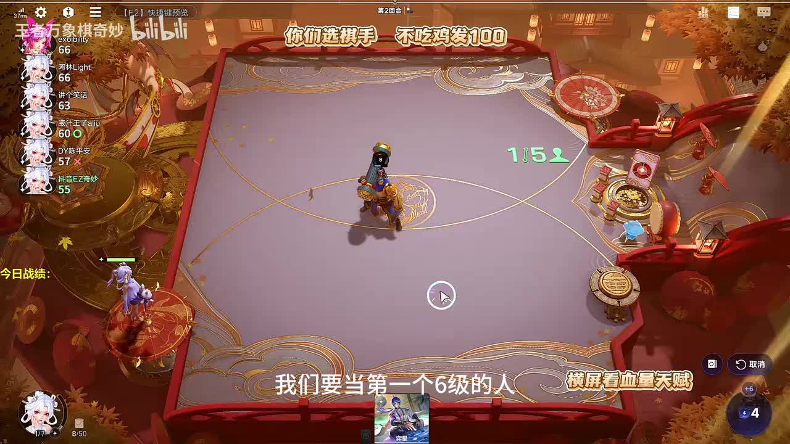

## 29:44–31:07 可凑合且加速40级就拿，不赌更差重抽

- 事件 ID：BV1eYYY6vEka:p1:e027
- 场景：实战
- 时机：第二局早期天赋
- 背景（分析推断）：生存等级阈值比理想天赋重要
- 学习目标（分析推断）：基于最低可用收益选择
- 模板：talent-fit
- ASR 段落：[56, 57]

> 能凑合用就直接用

## 30:15–31:48 孟奇出售再券可回两元，潜在弈星更赚；升级先吃经验

- 事件 ID：BV1eYYY6vEka:p1:e028
- 场景：实战
- 时机：拍卖孟奇和分钱
- 背景（分析推断）：早期钱需要多项小收益积累
- 学习目标（分析推断）：计算工具总净收益
- 模板：economy-budget
- ASR 段落：[57, 58]

> 你就纯卖钱都能卖两块

## 31:48–33:12 先只让苏烈吃兔，五级窗口再上弈星

- 事件 ID：BV1eYYY6vEka:p1:e029
- 场景：实战
- 时机：等弈星跨两次升级
- 背景（分析推断）：直接早上只能吃一口经验
- 学习目标（分析推断）：按跨级数量保留工具
- 模板：resource-order
- ASR 段落：[59, 60]

> 四级能吃一口,五级吃一口

## 33:14–34:55 当前加下轮收入不足跳五，晚一轮保两元

- 事件 ID：BV1eYYY6vEka:p1:e030
- 场景：实战
- 时机：算是否现在升级
- 背景（分析推断）：过渡仍稳不需立即升级
- 学习目标（分析推断）：算下一轮完整预算
- 模板：economy-budget
- ASR 段落：[61, 62, 63]

> 升不到5级会少吃一口异星

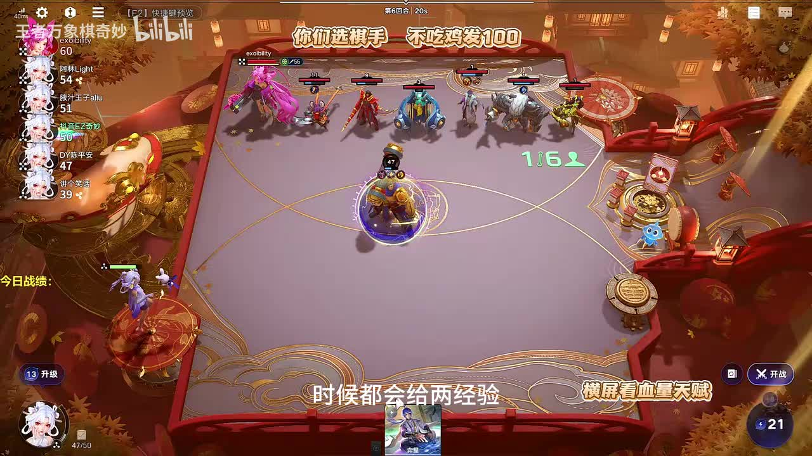

## 35:27–36:31 钱等级血三类优先，最终无理想选项按可用收益；拍卖后恰能六

- 事件 ID：BV1eYYY6vEka:p1:e031
- 场景：实战
- 时机：第二局四级天赋重抽
- 背景（分析推断）：不是所有候选都值得追求
- 学习目标（分析推断）：按瓶颈和预算接受次优
- 模板：talent-fit
- ASR 段落：[65, 66]

> 这三个不给钱,不给等级,不给血,直接刷

## 37:09–38:27 先升六再小兔，启动月之特调奖励循环

- 事件 ID：BV1eYYY6vEka:p1:e032
- 场景：实战
- 时机：拍卖结束快速六级
- 背景（分析推断）：小兔此前不在六级会少层数
- 学习目标（分析推断）：理解级别解锁与成长速度
- 模板：level-transition
- ASR 段落：[68, 69]

> 升到六级之后你才能叠这个月之特条

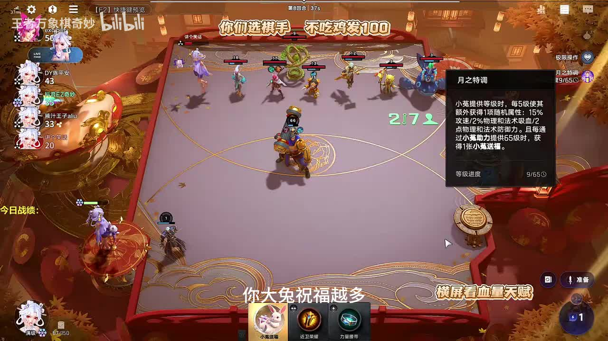

## 38:27–40:03 三元购买一元兔不能刷掉，免费刷另算，没来就开大兔

- 事件 ID：BV1eYYY6vEka:p1:e033
- 场景：实战
- 时机：搜海月前留四元
- 背景（分析推断）：补第三核心不能断技能预算
- 学习目标（分析推断）：限定搜牌次数与停止条件
- 模板：economy-budget
- ASR 段落：[70, 71, 72]

> 四块钱是不能用的

## 39:31–41:07 纠正为先大后小，下一轮150阈值再交

- 事件 ID：BV1eYYY6vEka:p1:e034
- 场景：实战
- 时机：海月终于来险先小兔
- 背景（分析推断）：本轮凑不够不硬等
- 学习目标（分析推断）：识别实时顺序错误与阈值
- 模板：resource-order
- ASR 段落：[72, 73, 74]

> 先抽150级再丢这个小兔祝福

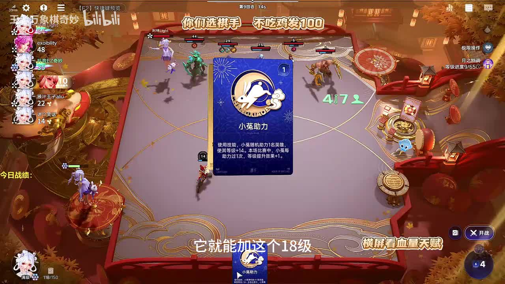

## 41:36–43:11 先补少量等级到门槛，凑够后再买太乙

- 事件 ID：BV1eYYY6vEka:p1:e035
- 场景：实战
- 时机：150阈值前太乙诱惑
- 背景（分析推断）：成长节点的机会成本暂高
- 学习目标（分析推断）：按阈值重新排序购买
- 模板：economy-budget
- ASR 段落：[76, 77, 78]

> 那我抽够了那就可以拿了

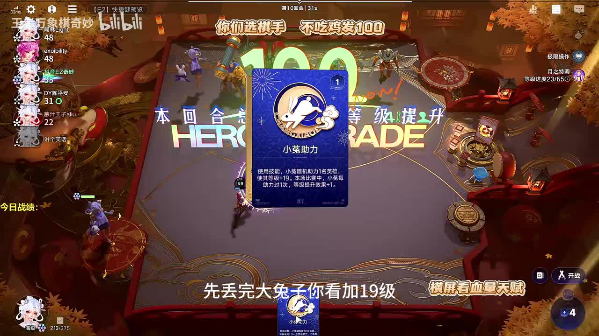

## 43:46–44:22 顺序影响累计层数，减少后续大兔等待

- 事件 ID：BV1eYYY6vEka:p1:e036
- 场景：实战
- 时机：对比大小兔层数进度
- 背景（分析推断）：讲者反事实估算非实测对照
- 学习目标（分析推断）：理解累计差异而非仅本轮等级
- 模板：growth-combo
- ASR 段落：[80]

> 35左右,我这个,这个就叠的巨慢

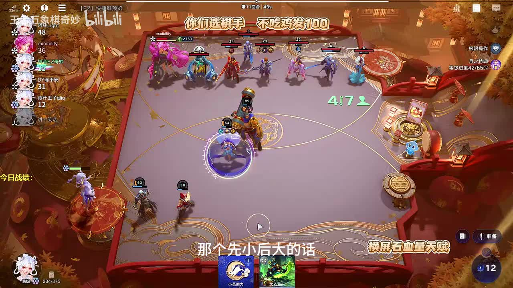

## 44:22–45:32 百级完美复生比此前半血复生多耐久

- 事件 ID：BV1eYYY6vEka:p1:e037
- 场景：实战
- 时机：苏烈99到100级
- 背景（分析推断）：差一级改变技能强度
- 学习目标（分析推断）：识别技能跨阈值收益
- 模板：growth-combo
- ASR 段落：[81, 82]

> 100级他的技能会强啊

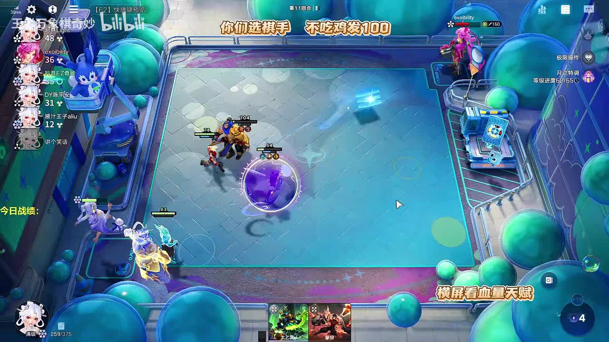

## 45:34–47:09 先小兔触发大兔，再凑375接新大兔，最后补小兔

- 事件 ID：BV1eYYY6vEka:p1:e038
- 场景：实战
- 时机：本轮无大兔却可触发奖励
- 背景（分析推断）：与手里已有大兔时规则条件不同
- 学习目标（分析推断）：按当前可用技能组织循环
- 模板：resource-order
- ASR 段落：[83, 84, 85]

> 这轮先丢个小的,他给个大的

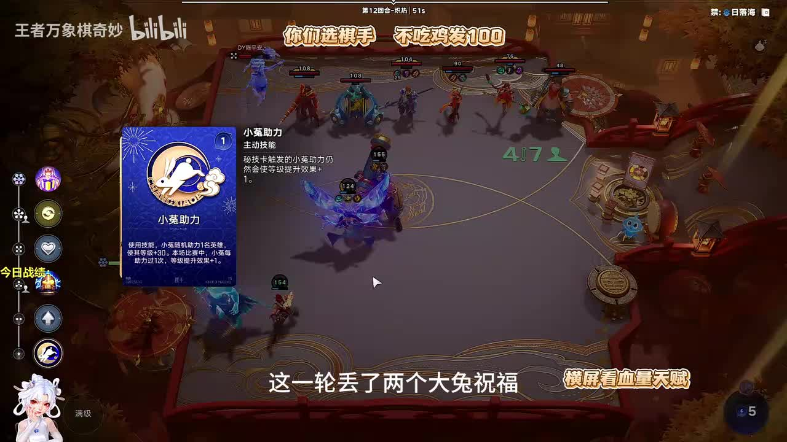

## 46:39–48:27 司空震与老虎先觉醒，玉环可帮助老虎；海月次要

- 事件 ID：BV1eYYY6vEka:p1:e039
- 场景：实战
- 时机：核心和辅助觉醒优先
- 背景（分析推断）：等级互偷链依赖双觉醒
- 学习目标（分析推断）：按循环关键点分配觉醒
- 模板：growth-combo
- ASR 段落：[85, 86, 87]

> 没有老虎这么重要

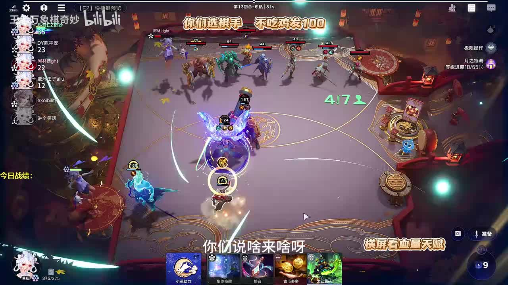

## 48:28–49:01 把海月当肉与自爆肉，不必要求成长上限最高

- 事件 ID：BV1eYYY6vEka:p1:e040
- 场景：实战
- 时机：海月削弱但仍承伤
- 背景（分析推断）：替代苏烈的坦克职责
- 学习目标（分析推断）：以剩余功能评价削弱英雄
- 模板：module-fit
- ASR 段落：[88]

> 你就把他当成个肉

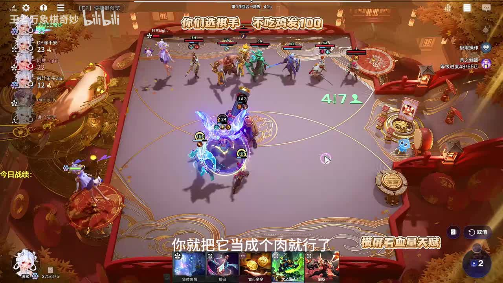

## 49:01–50:10 先按登场标签找甄姬武则天蒙犽，下一轮多目标兑现

- 事件 ID：BV1eYYY6vEka:p1:e041
- 场景：实战
- 时机：准备下轮集体唤醒
- 背景（分析推断）：第二局已持集体唤醒但目标尚未齐
- 学习目标（分析推断）：提前为批量技能准备目标
- 模板：resource-order
- ASR 段落：[89, 90]

> 我们下轮上三个登场

## 51:34–52:06 先甄姬武则天蒙犽三登场再唤醒

- 事件 ID：BV1eYYY6vEka:p1:e042
- 场景：实战
- 时机：终局集体唤醒
- 背景（分析推断）：临时资源要集中多目标兑现
- 学习目标（分析推断）：检查批量触发前置数量
- 模板：resource-order
- ASR 段落：[93]

> 来一个两个三个集体唤醒

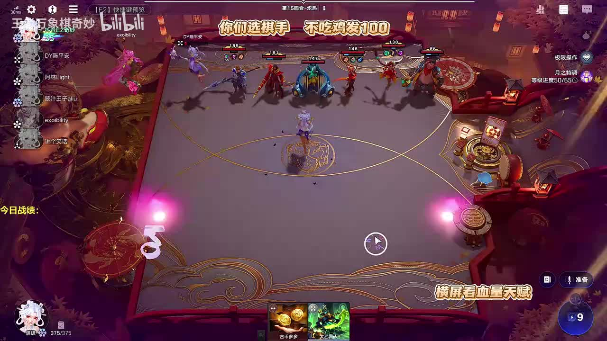

## 待核实与局限

- 不做ASR修正；第10段明显异样广告转写、第64段重复字符和口号闲聊排除。
- 视频包含两局，第一局双瑶压力与第二局单人环境不混为通用开局公式。
- 神秘英雄过期概率、阶段阈值数字属讲者版本说明未核实当前。
- 组排队友管理进修前提不推广到单排；缺牌等待上限按血量与对手压力。
