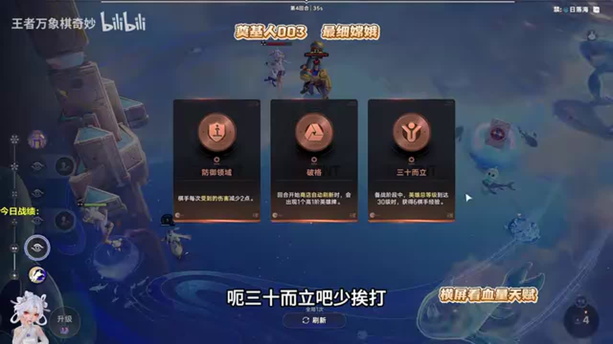
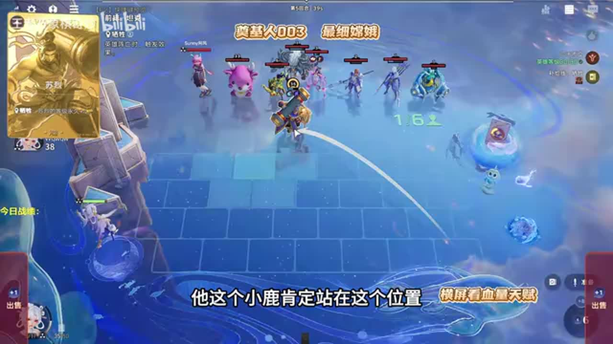
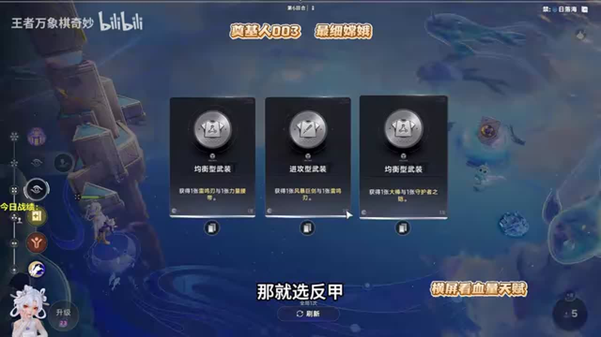
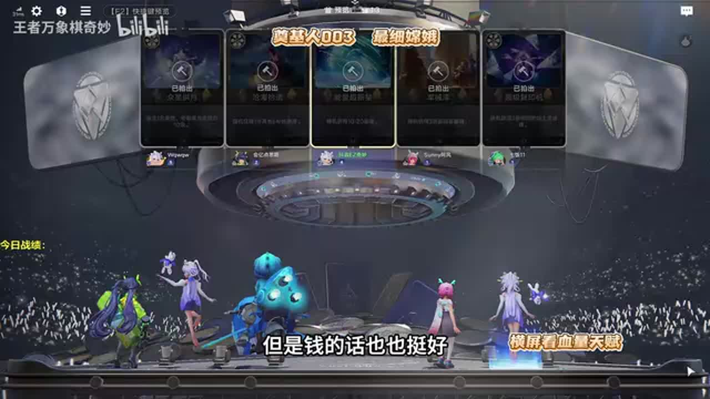
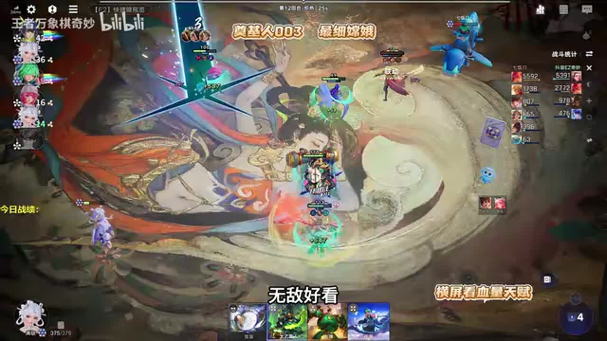
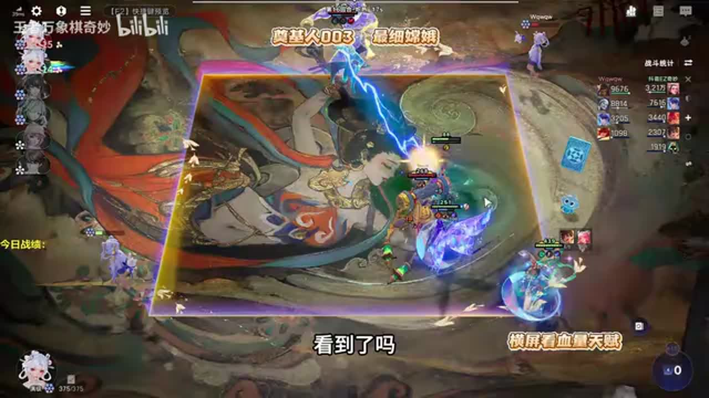

# 嫦娥找不到司空震？教你最强思路！吊打海陆空

来源：https://www.bilibili.com/video/BV17CeL6ZEcv/?p=1

分析状态：completed

完整文字稿：../../../raw/BV17CeL6ZEcv_p1.md

## 00:54–01:31 对手强就先觉醒苏烈少掉血，对手弱才单张苏烈尽快升级

- 事件 ID：BV17CeL6ZEcv:p1:e001
- 场景：实战
- 时机：开局观察外面战力时
- 背景（分析推断）：速六收益与保血成本互相制约，不能无条件照固定回合升级。
- 学习目标（分析推断）：根据敌方压力选择成长速度。
- 模板：level-transition
- ASR 段落：[2, 3]

> 外面太猛的话我们就需要觉醒

## 01:59–03:07 战斗后承认本可上牛魔吃收益；预判打不过的判断应由战斗反馈更新

- 事件 ID：BV17CeL6ZEcv:p1:e002
- 场景：实战
- 时机：低估己方能否击杀牛魔后时
- 背景（分析推断）：原先因敌方铠判断赢不了，实际击败后复盘漏掉收益。
- 学习目标（分析推断）：区分预测与已观察到的结果。
- 模板：combat-review
- ASR 段落：[4, 5]

> 我应该上牛魔的

## 03:07–03:38 梦奇提供多次出牌且卖掉还有牌，解释其作为资源工具的价值

- 事件 ID：BV17CeL6ZEcv:p1:e003
- 场景：实战
- 时机：商店出现梦奇时
- 背景（分析推断）：去掉主播回应瑶玩法与无依据大师宣传。
- 学习目标（分析推断）：用完整买卖收益判断工具牌。
- 模板：growth-combo
- ASR 段落：[6]

> 闷奇卖了之后还给一张卡

## 03:39–03:59 只留一个单位锁定成长目标，再上弈星触发三十而立补经济

- 事件 ID：BV17CeL6ZEcv:p1:e004
- 场景：实战
- 时机：小兔助力随机选目标时
- 背景（分析推断）：先控制随机目标集合再加入临时工具。
- 学习目标（分析推断）：避免目标分散浪费成长资源。
- 模板：resource-order
- ASR 段落：[7]

> 只需要上一个人

## 04:33–05:03 打工单位用完清场，再交小兔助力确保落在苏烈

- 事件 ID：BV17CeL6ZEcv:p1:e005
- 场景：实战
- 时机：临时工具触发经济后时
- 背景（分析推断）：保留工具会干扰随机成长的归属。
- 学习目标（分析推断）：完成工具功能后及时恢复目标集合。
- 模板：resource-order
- ASR 段落：[9]

> 他们打完工就可以清场了

## 05:06–05:32 将苏烈后置等待敌人向前，以便范围伤害接触关键单位并少掉血

- 事件 ID：BV17CeL6ZEcv:p1:e006
- 场景：实战
- 时机：预判对方小鹿位置时
- 背景（分析推断）：根据对手站位设计接敌，不单纯背诵前排坦克。
- 学习目标（分析推断）：用敌人移动路径安排核心站位。
- 模板：position-cause
- ASR 段落：[10]

> 为什么站后面

## 05:32–06:47 讲者比较反甲与腰带，并提到部分装备留给后续司空震

- 事件 ID：BV17CeL6ZEcv:p1:e007
- 场景：实战
- 时机：给苏烈选择装备时
- 背景（分析推断）：这是当局个人优先级，未说明全部配装条件，不能泛化绝对最优。
- 学习目标（分析推断）：区分当前生存装与未来核心的装备分配。
- 模板：equipment-role
- ASR 段落：[11, 12]

> 反甲是第一好

## 08:44–09:15 五级回血型选项兼给金卡，可将升级与保命资源联动

- 事件 ID：BV17CeL6ZEcv:p1:e008
- 场景：实战
- 时机：血量下降且准备五级时
- 背景（分析推断）：口述回血与开卡数值未独立验证；去掉对同行的抱怨。
- 学习目标（分析推断）：把升级收益与当前生命压力一起比较。
- 模板：level-transition
- ASR 段落：[16]

> 上五级点一个那个15滴血

## 09:48–10:21 先检查敌方是不是倒转玩法，再决定是否把针对资源投过去

- 事件 ID：BV17CeL6ZEcv:p1:e009
- 场景：实战
- 时机：准备针对李白之前时
- 背景（分析推断）：讲者看到对方并非预想玩法而取消，避免误投。
- 学习目标（分析推断）：验证敌方真实机制再花资源。
- 模板：counter-target
- ASR 段落：[18]

> 还好我看了一眼

## 10:22–10:55 选攻速提高施法频率，再寻找圣杯配合技能循环

- 事件 ID：BV17CeL6ZEcv:p1:e010
- 场景：实战
- 时机：大明星司空震选择强化时
- 背景（分析推断）：同一施法目标需要属性与装备配套，天赋名称疑词不硬修正。
- 学习目标（分析推断）：从输出机制解释强化选择。
- 模板：equipment-cause
- ASR 段落：[19]

> 攻速放技能快

## 11:34–12:05 下一轮关注司空震和老虎，到不了就转阵，避免无限等待

- 事件 ID：BV17CeL6ZEcv:p1:e011
- 场景：实战
- 时机：需要核心牌但尚未到来时
- 背景（分析推断）：用明确来牌窗口设置跳车条件。
- 学习目标（分析推断）：提前设定转型触发条件。
- 模板：fallback-plan
- ASR 段落：[21]

> 不来的话我们就得转阵跑路

## 12:06–12:42 把核心反向前置，借其他单位接住跳入，避免苏烈被偷

- 事件 ID：BV17CeL6ZEcv:p1:e012
- 场景：实战
- 时机：看到敌方老虎跳后排时
- 背景（分析推断）：与先前后置策略不同，站位随敌人寻敌方式改变。
- 学习目标（分析推断）：按敌方目标选择规则调整站位。
- 模板：position-cause
- ASR 段落：[22]

> 细节站位

## 12:43–13:27 区分固定格挡与百分比格挡，固定值随敌方伤害增长会相对变弱

- 事件 ID：BV17CeL6ZEcv:p1:e013
- 场景：实战
- 时机：讨论海月前期强度时
- 背景（分析推断）：只纳入机制解释，后续误购抱怨不计。
- 学习目标（分析推断）：理解固定数值防御的阶段性价值。
- 模板：mechanic-model
- ASR 段落：[23]

> 他是固定格挡

## 14:15–15:23 瑶、刘禅、吕布或东皇可替代，优先补前排，让杨玉环后排治疗

- 事件 ID：BV17CeL6ZEcv:p1:e014
- 场景：实战
- 时机：司空震与老虎未到而准备换阵时
- 背景（分析推断）：不是无条件认定任何替代都等价，按坦度与技能职责筛选。
- 学习目标（分析推断）：以缺失功能寻找替代单位。
- 模板：fallback-plan
- ASR 段落：[25, 26]

> 最好就是整个前排

## 15:25–16:09 圣杯与降低蓝耗的装备支持连续施法；等级牌与小兔助力补成长

- 事件 ID：BV17CeL6ZEcv:p1:e015
- 场景：实战
- 时机：杨玉环成为治疗主力时
- 背景（分析推断）：装备俗称与ASR疑词保留，不能猜测未显示的确切神器名。
- 学习目标（分析推断）：围绕施法频率构建治疗循环。
- 模板：equipment-cause
- ASR 段落：[27]

> 杨玉环是要圣杯

## 16:10–16:43 司空震晚一回合已不再适合当前方向；刘禅能因频繁施法和控制进入替代路线

- 事件 ID：BV17CeL6ZEcv:p1:e016
- 场景：实战
- 时机：原计划核心终于迟到时
- 背景（分析推断）：已投入的治疗前排路线改变了原核心的边际价值。
- 学习目标（分析推断）：根据当前状态而非开局愿望判断新牌。
- 模板：late-transition
- ASR 段落：[28]

> 来的太晚了

## 16:46–17:21 现有高等级苏烈先站前排承担伤害，找到转移资源才换核心

- 事件 ID：BV17CeL6ZEcv:p1:e017
- 场景：实战
- 时机：寻找传承但尚未找到时
- 背景（分析推断）：转型未准备好之前维持过渡战力。
- 学习目标（分析推断）：在资源缺口下保留可用过渡单位。
- 模板：resource-order
- ASR 段落：[29]

> 找不到的话这个苏联就一直挂着

## 17:52–18:36 比较钱与沧海开保命装备的价值，讲者承认沧海可能更好但选了钱

- 事件 ID：BV17CeL6ZEcv:p1:e018
- 场景：实战
- 时机：低血量选择奖励时
- 背景（分析推断）：原选择不是最佳解的证明，低血状况提高即时保命权重。
- 学习目标（分析推断）：明确经济和保命选项的机会成本。
- 模板：economy-budget
- ASR 段落：[31]

> 沧海给我开个明刀我就活了

## 18:36–19:49 先用小兔与可积攒工具补齐门槛，再开大兔；未够时不强行目标阵容

- 事件 ID：BV17CeL6ZEcv:p1:e019
- 场景：实战
- 时机：准备大兔子但资源不足时
- 背景（分析推断）：把资源阈值与本轮能实现的动作连起来。
- 学习目标（分析推断）：按可达门槛安排操作顺序。
- 模板：resource-order
- ASR 段落：[32, 33]

> 还缺一点点

## 19:51–20:28 交大兔前撤太乙，控制目标后再恢复复活辅助

- 事件 ID：BV17CeL6ZEcv:p1:e020
- 场景：实战
- 时机：太乙可能误吃大兔成长时
- 背景（分析推断）：随机成长的目标控制与战斗辅助保留需要分阶段处理。
- 学习目标（分析推断）：避免把关键成长交给非目标辅助。
- 模板：resource-order
- ASR 段落：[34]

> 要不然一会兔子丢到太一头上了

## 20:30–21:37 刘禅技能频率适配玉环循环，重构装备时继续追施法资源

- 事件 ID：BV17CeL6ZEcv:p1:e021
- 场景：实战
- 时机：刘禅大量出现且玉环频繁施法时
- 背景（分析推断）：来牌驱动组成替代奶桶思路，装备仍有不足不称完美。
- 学习目标（分析推断）：识别队友技能与核心循环的协同。
- 模板：growth-combo
- ASR 段落：[35, 36]

> 流扇的词条是放技能快

## 21:37–22:45 讲者认为高等级前排海月比只养后排玉环更能支撑治疗；大兔已用后无需继续为旧门槛卡小兔

- 事件 ID：BV17CeL6ZEcv:p1:e022
- 场景：实战
- 时机：回顾大兔等级分配时
- 背景（分析推断）：后排治疗需要前排存活，资源用途随门槛完成改变。
- 学习目标（分析推断）：把成长分配给当前循环瓶颈。
- 模板：combat-review
- ASR 段落：[37, 38]

> 他需要海月能顶得住

## 23:21–23:57 站位分散减少核心同时受威胁，并上太乙提供额外生命

- 事件 ID：BV17CeL6ZEcv:p1:e023
- 场景：实战
- 时机：敌方守约单体爆发时
- 背景（分析推断）：针对狙击单点爆发，施法蓝耗解释来自同段讲解。
- 学习目标（分析推断）：根据敌方致胜方式安排生存措施。
- 模板：position-cause
- ASR 段落：[40]

> 站的散一点

## 24:32–25:11 承认之前移除太乙的代价，重新找复活辅助；双倍施法提高治疗频率

- 事件 ID：BV17CeL6ZEcv:p1:e024
- 场景：实战
- 时机：先前卖掉太乙而终局需要复活时
- 背景（分析推断）：当前生存威胁让复活的重要性超过避免随机成长误投。
- 学习目标（分析推断）：及时更新不同阶段辅助价值。
- 模板：combat-review
- ASR 段落：[42]

> 我错了,我吃错了

## 25:11–26:24 把钟馗放两人中间拦截落点保护玉环，复活辅助仍需补齐

- 事件 ID：BV17CeL6ZEcv:p1:e025
- 场景：实战
- 时机：司空震跳向治疗核心时
- 背景（分析推断）：误交兔子与误吃的后续复盘说明站位和资源操作需同步核对。
- 学习目标（分析推断）：针对跳跃路线保护主力。
- 模板：position-cause
- ASR 段落：[43, 44]

> 保护我方玉环

## 26:24–27:07 选择日炎降低吸血，比继续依赖反甲更贴合对方恢复机制

- 事件 ID：BV17CeL6ZEcv:p1:e026
- 场景：实战
- 时机：老虎高吸血造成反甲效果不足时
- 背景（分析推断）：明确敌方威胁是跳入后的恢复，装备不是固定三件套。
- 学习目标（分析推断）：用敌方具体机制解释克制装备。
- 模板：counter-target
- ASR 段落：[45]

> 能降低这个吸血效果

## 27:08–28:42 百级后技能兼顾回血与伤害，频繁施法形成持续恢复，说明不只司空震能承担路线

- 事件 ID：BV17CeL6ZEcv:p1:e027
- 场景：实战
- 时机：战斗看到杨玉环不断回血时
- 背景（分析推断）：当局翻盘与吃鸡不能证明随便四个人都可赢，泛化口号不计。
- 学习目标（分析推断）：从等级门槛与施法频率理解替代路线为何可行。
- 模板：mechanic-model
- ASR 段落：[46, 47, 48]

> 技能100级之后

## 待核实与局限

- 未经ASR修正；装备俗称、人物同音误识和部分数字保留待核实。
- 第39段为明显不属于教学的ASR杂音或套话，排除；主播聊天、辱骂、抱怨、宣传及无理由操作均排除。
- 最优装备与任何四人都强等说法仅为讲者判断，未验证普遍适用或学习效果。
