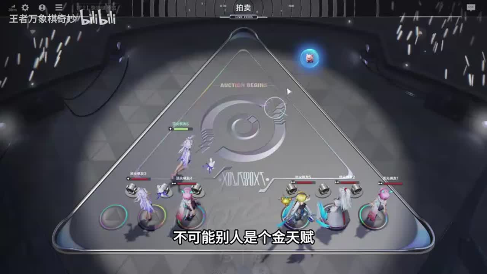
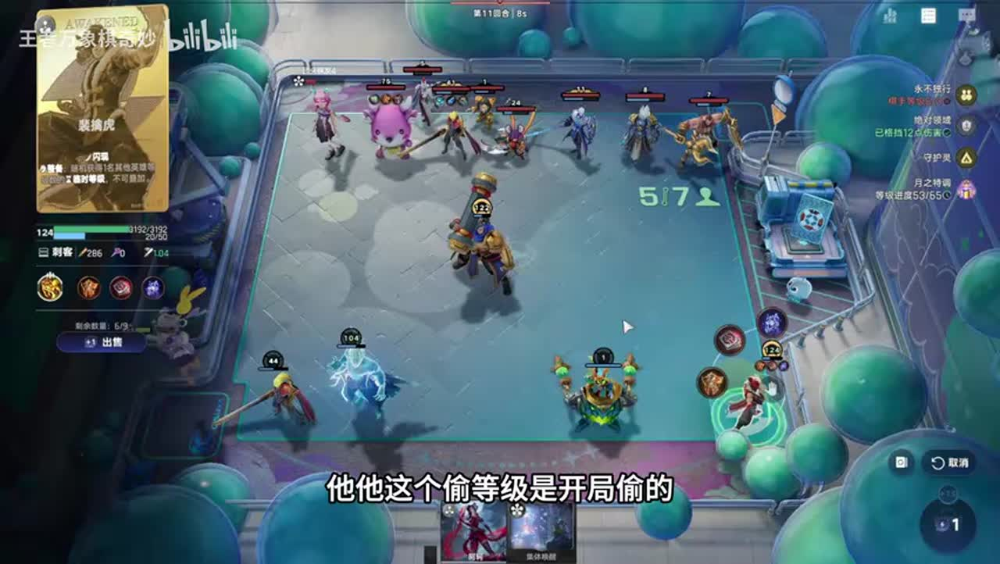
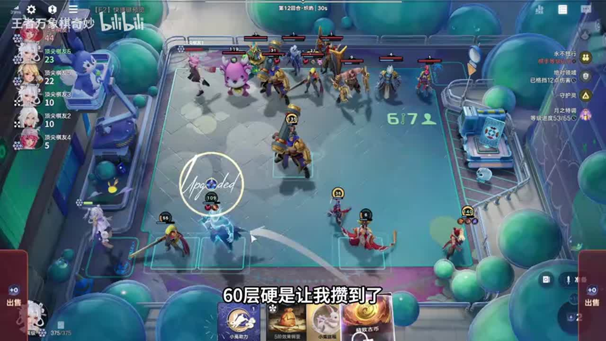
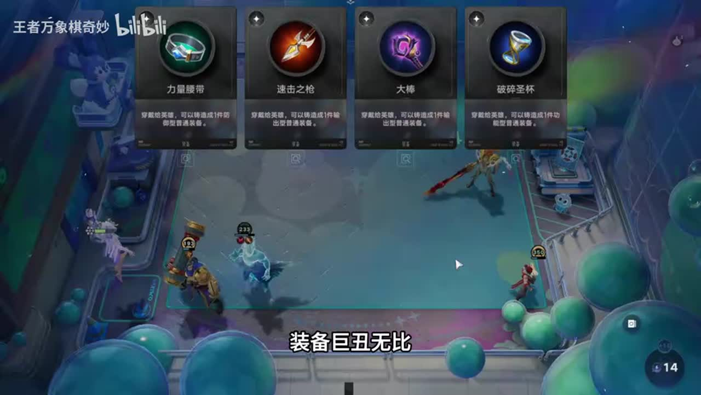
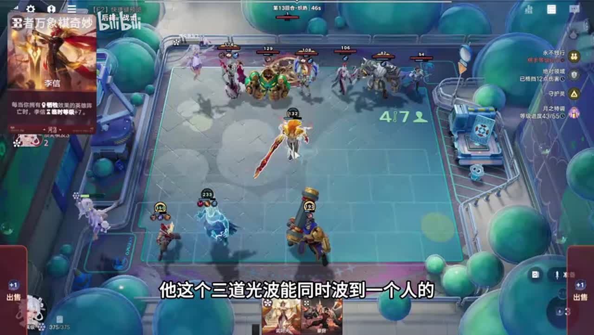
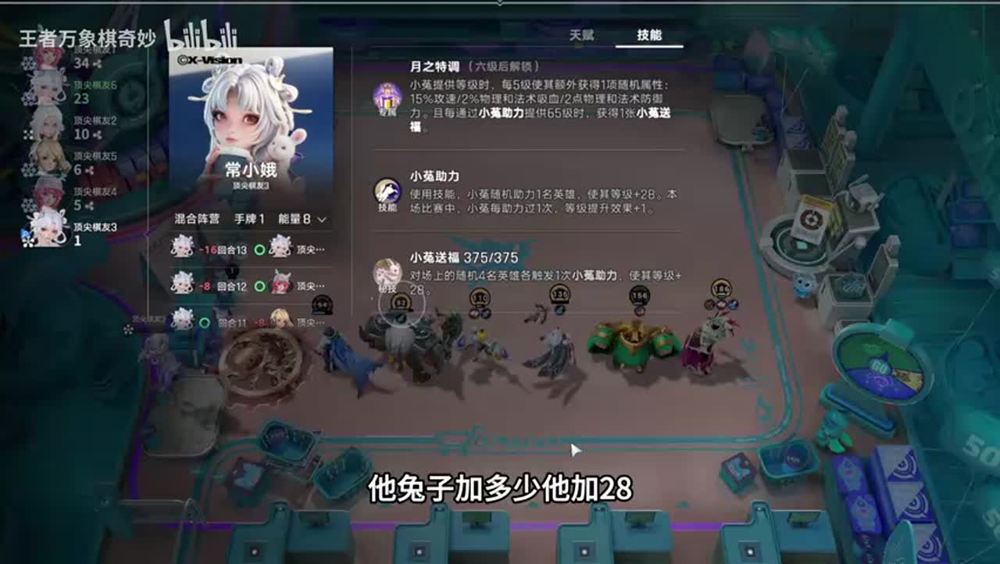
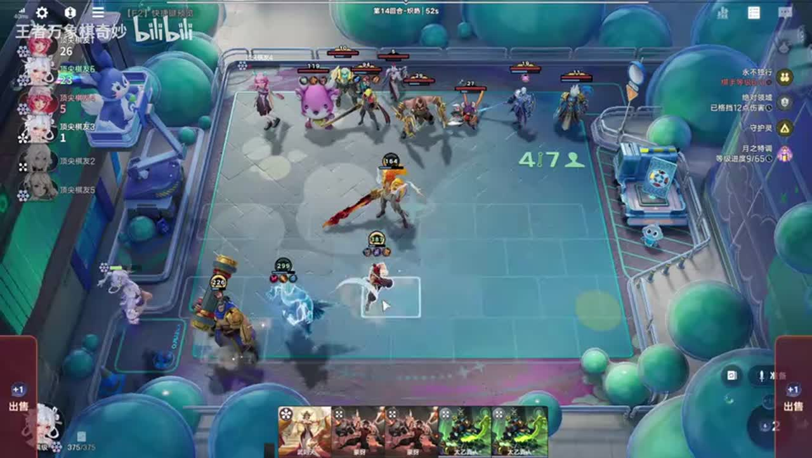

# 嫦娥高分局玩不了？接近8000分段，运营思路细节活到后期吃鸡

来源：https://www.bilibili.com/video/BV1Pahk6gEWZ/?p=1

分析状态：completed

完整文字稿：../../../raw/BV1Pahk6gEWZ_p1.md

## 00:00–01:45 孙膑和明先生也上满人施压时觉醒苏烈，若挂机则可单苏烈直升六

- 事件 ID：BV1Pahk6gEWZ:p1:e001
- 场景：实战
- 时机：判断开局对手是否连败
- 背景（分析推断）：对手实际行动比棋手名称更能决定需要多少前期战力
- 学习目标（分析推断）：按外部压力决定保血投入
- 模板：opening-plan
- ASR 段落：[1, 2, 3]

> 他俩也不打联败

## 01:10–02:23 强经济成长天赋会改变早升级的价值，晚上一轮可能损失收益

- 事件 ID：BV1Pahk6gEWZ:p1:e002
- 场景：实战
- 时机：发现本局金色天赋后反思
- 背景（分析推断）：讲者觉醒开后才意识到本局金天赋，表示若早知道会少买苏烈
- 学习目标（分析推断）：将天赋信息及时纳入资源决策
- 模板：talent-fit
- ASR 段落：[3, 4]

> 晚上一波就等于是在赔钱

## 01:45–02:56 不为无效经验立即花钱，等待下一轮升三级

- 事件 ID：BV1Pahk6gEWZ:p1:e003
- 场景：实战
- 时机：当前读研无法立即升级
- 背景（分析推断）：讲者明确现在使用也升不了级，下一轮自然到位
- 学习目标（分析推断）：先检查经验是否跨阈值再消费
- 模板：level-transition
- ASR 段落：[4, 5]

> 我现在就算丢这个读言也升不了级

## 02:59–03:35 输一轮获取更多拍卖经济，孟奇两块钱仍被视为赚

- 事件 ID：BV1Pahk6gEWZ:p1:e004
- 场景：实战
- 时机：允许输一轮后参加拍卖
- 背景（分析推断）：前期计划并非硬打连胜，拍卖经济和孟奇返资源都重要
- 学习目标（分析推断）：把败战资源纳入拍卖预算
- 模板：auction-choice
- ASR 段落：[6]

> 输一轮拍卖多分点钱

## 03:39–04:12 先兔子再上弈星再升级，让当前技能与经验先兑现

- 事件 ID：BV1Pahk6gEWZ:p1:e005
- 场景：实战
- 时机：三级升级之前技能顺序
- 背景（分析推断）：本轮即将上三级，但顺序影响当前成长和升级
- 学习目标（分析推断）：在升级前兑现已有资源
- 模板：resource-order
- ASR 段落：[7]

> 先丢兔子先丢兔子先丢兔子然后再上一星再升级

## 03:39–06:32 留三级享每轮两张牌，攒够一口气到六级再升级，四级会停发牌

- 事件 ID：BV1Pahk6gEWZ:p1:e006
- 场景：实战
- 时机：永不独行留三级攒钱
- 背景（分析推断）：永不独行与绝对领域共同提供资源和少失血窗口
- 学习目标（分析推断）：比较留级收益与跳级总成本
- 模板：economy-budget
- ASR 段落：[7, 8, 9, 10, 11]

> 待到五六十块钱

## 06:32–07:05 弈星升级到四级再卖出回本，到五级则有额外收益

- 事件 ID：BV1Pahk6gEWZ:p1:e007
- 场景：实战
- 时机：购买弈星的回本计算
- 背景（分析推断）：苏烈主要需要复生阈值，额外等级可移作战力
- 学习目标（分析推断）：计算工具位投入与回收成本
- 模板：economy-budget
- ASR 段落：[12]

> 一张一星升到四级就回本了

## 06:32–07:05 苏烈只需四十级触发复生，多余等级让老虎偷作战力

- 事件 ID：BV1Pahk6gEWZ:p1:e008
- 场景：实战
- 时机：苏烈过复生阈值后加入老虎
- 背景（分析推断）：前排复生功能已满足，老虎可复制超过必要阈值的等级
- 学习目标（分析推断）：把额外成长交给有战力价值的组件
- 模板：growth-combo
- ASR 段落：[12]

> 苏烈到四十级跟一百级没啥区别

## 07:05–07:42 装备不足导致未换掉敌人，红莲可能帮助换掉更多单位

- 事件 ID：BV1Pahk6gEWZ:p1:e009
- 场景：实战
- 时机：满入后检查原因
- 背景（分析推断）：讲者发现对面孙尚香治疗，当前输出装备不足
- 学习目标（分析推断）：用治疗与装备解释一次失利
- 模板：combat-review
- ASR 段落：[13]

> 我要是个红莲的话

## 07:42–10:08 把到四、五、六级成本加总，并考虑弈星降低各段费用

- 事件 ID：BV1Pahk6gEWZ:p1:e010
- 场景：实战
- 时机：连续跳级总成本计算
- 背景（分析推断）：三级存22金币，目标约55金币，需要预先算资金缺口
- 学习目标（分析推断）：按完整升级路径预算而不是只看下一等级
- 模板：economy-budget
- ASR 段落：[14, 15, 16, 17]

> 如果上一星的话就是21

## 08:15–10:41 临时加级英雄用后要及时卖，忘卖让老虎偷到低等级

- 事件 ID：BV1Pahk6gEWZ:p1:e011
- 场景：实战
- 时机：忘卖临时英雄后发现老虎偷错
- 背景（分析推断）：讲者先忘卖并发现老虎收益下降，再预告下一回合卖快
- 学习目标（分析推断）：从操作失误识别回合触发前的清场要求
- 模板：combat-review
- ASR 段落：[15, 17, 18]

> 又忘了卖了

## 11:17–11:46 临时卡能加苏烈等级，但老虎偷级之前要卖掉以免偷低等级

- 事件 ID：BV1Pahk6gEWZ:p1:e012
- 场景：实战
- 时机：临时加级卡上场后必须及时卖
- 背景（分析推断）：讲者先忘卖导致老虎收益低，随后演示卖快才能偷准
- 学习目标（分析推断）：在回合触发前清除错误目标
- 模板：resource-order
- ASR 段落：[20]

> 凯特卖快点,这个老虎就投准了

## 11:17–12:27 用弈星连续升六，卖工具位并开始月之特调，补四名可用英雄

- 事件 ID：BV1Pahk6gEWZ:p1:e013
- 场景：实战
- 时机：资金到位连续升六
- 背景（分析推断）：九回合升六后进入兔子循环，当前目标是建立核心技能反馈
- 学习目标（分析推断）：把升级动作连接到升级后第一轮运行
- 模板：level-transition
- ASR 段落：[20, 21]

> 升到六级正好打一层月之特调

## 11:46–13:36 先大后小可多叠月之特调，重复少四层会少拿大兔

- 事件 ID：BV1Pahk6gEWZ:p1:e014
- 场景：实战
- 时机：六级后大小兔先后
- 背景（分析推断）：单次英雄加级看似一样，但后续奖励层数不同
- 学习目标（分析推断）：用后续反馈收益解释操作顺序
- 模板：resource-order
- ASR 段落：[21, 22, 23]

> 你就少丢一个大兔子

## 13:36–14:10 老虎偷到较高苏烈等级后才值得承担装备与战力

- 事件 ID：BV1Pahk6gEWZ:p1:e015
- 场景：实战
- 时机：老虎觉醒后考虑分装备
- 背景（分析推断）：初始低级老虎主要偷级，成长达阈值后角色变化
- 学习目标（分析推断）：根据实际等级调整装备优先级
- 模板：equipment-role
- ASR 段落：[24]

> 老虎就可以带装备了

## 15:44–16:45 尽量先凑出大兔再用小兔，让小兔多加四层

- 事件 ID：BV1Pahk6gEWZ:p1:e016
- 场景：实战
- 时机：下一轮快到65层前再排顺序
- 背景（分析推断）：当前一个小兔能到65层，但提前奖励可提高当前收益
- 学习目标（分析推断）：在反馈奖励临界点重新核对顺序
- 模板：resource-order
- ASR 段落：[27, 28]

> 然后再丢小兔子

## 16:13–17:53 老虎开局偷相邻等级，太乙一秒卖出或旁边空位以免偷一级

- 事件 ID：BV1Pahk6gEWZ:p1:e017
- 场景：实战
- 时机：太乙保命后下轮必须先卖
- 背景（分析推断）：太乙刚用于保命，但留在偷级路径会降低老虎临时等级
- 学习目标（分析推断）：把回合开始触发与阵容位置一起规划
- 模板：position-cause
- ASR 段落：[28, 29, 30]

> 开局偷,你只要你的手比他快

## 17:54–18:32 复生大前排在对手身边再复活可以多次雇佣目标

- 事件 ID：BV1Pahk6gEWZ:p1:e018
- 场景：实战
- 时机：高等级前排提供多条命
- 背景（分析推断）：讲者讨论大前排复生后再雇佣的收益，本轮希望减少失血
- 学习目标（分析推断）：将复生视作重复功能触发而不只是生命值
- 模板：counter-target
- ASR 段落：[31]

> 死了之后复活能孤用一下

## 18:32–19:06 展翅腾飞可觉醒司空震，应与购买四张的成本比较

- 事件 ID：BV1Pahk6gEWZ:p1:e019
- 场景：实战
- 时机：漏看展翅腾飞机会后的复盘
- 背景（分析推断）：讲者已拿别的拍卖项，随后指出漏掉核心觉醒机会
- 学习目标（分析推断）：按关键目标评价拍卖而非只看直接经济
- 模板：auction-choice
- ASR 段落：[32]

> 展翅腾飞司空镇觉醒了

## 19:06–20:19 用集体唤醒与多张登场凑层数，先大后小再大越过阈值

- 事件 ID：BV1Pahk6gEWZ:p1:e020
- 场景：实战
- 时机：凑375反馈前集中登场
- 背景（分析推断）：当前接近375奖励，讲者保留多个可触发登场英雄
- 学习目标（分析推断）：按反馈阈值计算一次整备的触发次数
- 模板：growth-combo
- ASR 段落：[33, 34]

> 我先大后小,再大

## 20:59–21:32 考虑冰刀与更高等级装备对付李信

- 事件 ID：BV1Pahk6gEWZ:p1:e021
- 场景：实战
- 时机：面对李信高等级前排
- 背景（分析推断）：对手李信高等级并有装备，本方需要补针对手段
- 学习目标（分析推断）：根据敌方战斗方式挑选控制或减速装备
- 模板：counter-target
- ASR 段落：[36]

> 这种冰刀打理性

## 21:33–22:48 李信贴近目标让三道光波同时命中，可作大号苏烈前排

- 事件 ID：BV1Pahk6gEWZ:p1:e022
- 场景：实战
- 时机：李信放第一排的原因
- 背景（分析推断）：已经用李信替代缺失核心，前排位置影响技能命中
- 学习目标（分析推断）：用技能几何关系解释站位
- 模板：position-cause
- ASR 段落：[37, 38]

> 三道光波能同时播到一个人的

## 21:33–22:03 先凑够四名英雄再打贪婪，不要少目标提前用

- 事件 ID：BV1Pahk6gEWZ:p1:e023
- 场景：实战
- 时机：贪婪技能使用之前
- 背景（分析推断）：当前兔循环依赖足够目标数量
- 学习目标（分析推断）：核对技能需要的目标数再使用
- 模板：resource-order
- ASR 段落：[37]

> 斩够四个再打贪婪

## 22:03–23:19 观察小兔和大兔互相反馈，升六后的奖励链提升成长

- 事件 ID：BV1Pahk6gEWZ:p1:e024
- 场景：实战
- 时机：比较同棋手不同技能层数
- 背景（分析推断）：讲者比较自己每兔36与未升六同行28；只能说明当局条件差异
- 学习目标（分析推断）：理解成长反馈回路，避免只看即时保血
- 模板：combat-review
- ASR 段落：[38, 39]

> 大兔子长得快,小兔子就长得更快

## 23:19–24:28 三个核心重要，第四个任意可用英雄凑目标数，不硬搜海月姜子牙

- 事件 ID：BV1Pahk6gEWZ:p1:e025
- 场景：实战
- 时机：核心缺牌且剩余经济不多
- 背景（分析推断）：剩五块钱又缺理想英雄，四目标比英雄名称更紧迫
- 学习目标（分析推断）：按最低功能条件组织缺牌方案
- 模板：fallback-plan
- ASR 段落：[40, 41]

> 反正四个人丢上去就行了

## 23:51–24:28 点英雄面板中的小手一键换装备

- 事件 ID：BV1Pahk6gEWZ:p1:e026
- 场景：实战
- 时机：需要快速换主核装备
- 背景（分析推断）：装备移交频繁，可减少手动拖动的操作负担
- 学习目标（分析推断）：掌握降低操作成本的界面功能
- 模板：mechanic-model
- ASR 段落：[41]

> 你点这个小手

## 24:29–25:37 开局偷线前卖太乙，避免老虎少等级进一步让司空震也少等级

- 事件 ID：BV1Pahk6gEWZ:p1:e027
- 场景：实战
- 时机：再次上太乙后的开局提醒
- 背景（分析推断）：末期再用太乙保命，错误偷级会沿联动传导
- 学习目标（分析推断）：理解组件错误会造成连锁损失
- 模板：resource-order
- ASR 段落：[42, 43]

> 然后司空站再少82级

## 待核实与局限

- 不做ASR修正；永不独行、绝对领域、传奇耐打王等天赋名以截图再确认。
- 本局多位对手同时施压，觉醒开局与留三级的条件不能套用低压力单人对局。
- 成本、层数、每兔等级等数字为讲者当局计算；未验证当前版本通用值。
- 同棋手同行对比非控制实验，讲者早期已经吃鸡的判断不证明后续结果必然。
- 技能每次回合偷级需要按画面与原话核对，不引入额外ASR修正。
