# 嫦小鹅单苏烈开，顶住压力999司空震全局

来源：https://www.bilibili.com/video/BV1YweC68EuA/?p=1

分析状态：completed

完整文字稿：../../../raw/BV1YweC68EuA_p1.md

## 00:01–00:40 缺姬小满露娜不沿用马可倒转

- 事件 ID：BV1YweC68EuA:p1:e001
- 场景：实战
- 时机：选择棋手
- 背景（分析推断）：日落海缺关键组件
- 学习目标（分析推断）：按可用卡池选择路线
- 模板：opening-plan
- ASR 段落：[1]

> 机枪满和露娜都没有了

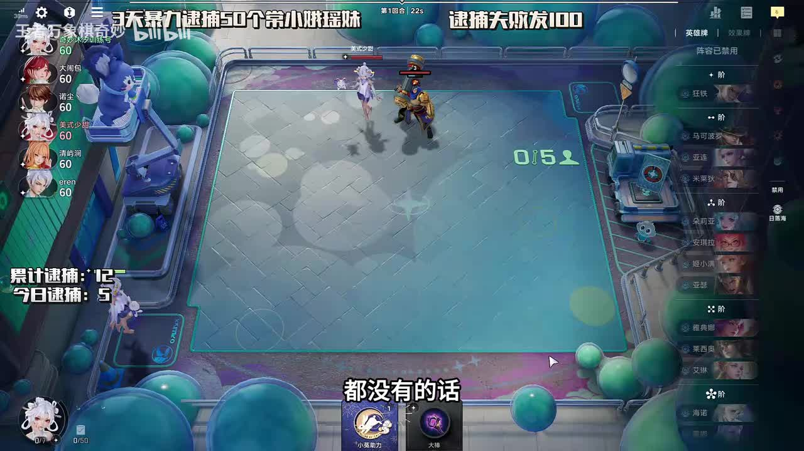

## 00:40–01:11 比较一人两人与空城失血

- 事件 ID：BV1YweC68EuA:p1:e002
- 场景：实战
- 时机：开局考虑空城
- 背景（分析推断）：技能收益与失血存在权衡
- 学习目标（分析推断）：计算技能收益与血量代价
- 模板：economy-budget
- ASR 段落：[2]

> 直接入5滴血

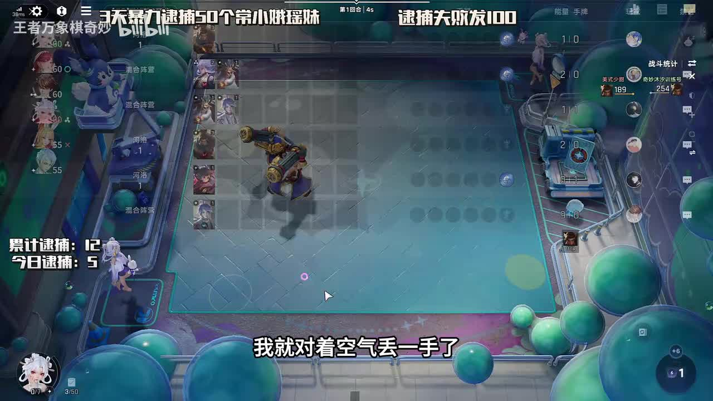

## 01:11–02:20 第三回合弈星升级，按胜率选预言

- 事件 ID：BV1YweC68EuA:p1:e003
- 场景：实战
- 时机：苏烈未觉醒
- 背景（分析推断）：本局压力低
- 学习目标（分析推断）：联系升级与过渡强度
- 模板：level-transition
- ASR 段落：[3, 4]

> 三回合上一张异星直接升级

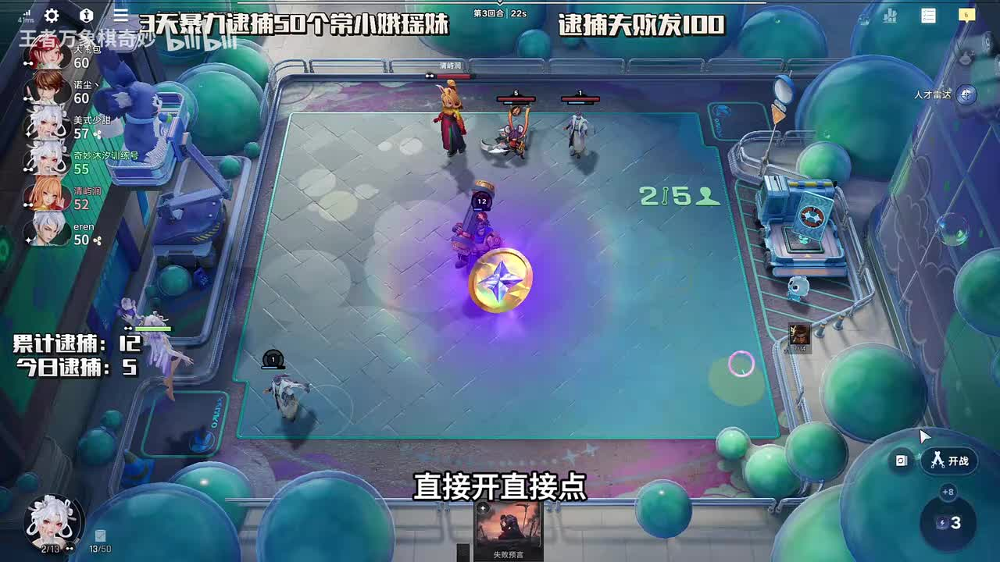

## 02:57–03:45 先升级，云中君五级开

- 事件 ID：BV1YweC68EuA:p1:e004
- 场景：实战
- 时机：拍卖后
- 背景（分析推断）：资金优先到成长卡池
- 学习目标（分析推断）：识别卡池窗口
- 模板：resource-order
- ASR 段落：[6]

> 这个五级开吧

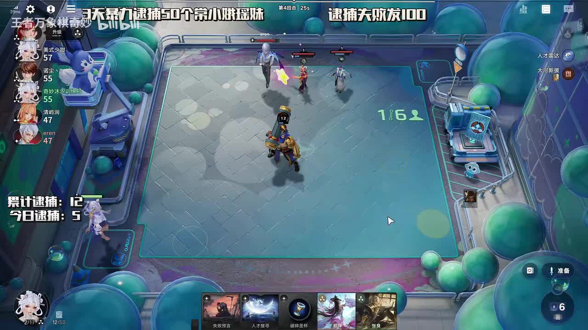

## 03:45–04:18 先不上额外牌，下轮丢兔后看对手

- 事件 ID：BV1YweC68EuA:p1:e005
- 场景：实战
- 时机：当前可赢
- 背景（分析推断）：无必要战力延误升六
- 学习目标（分析推断）：按压力投资过渡
- 模板：economy-budget
- ASR 段落：[7]

> 下一轮我碰到个猛男我再上一车

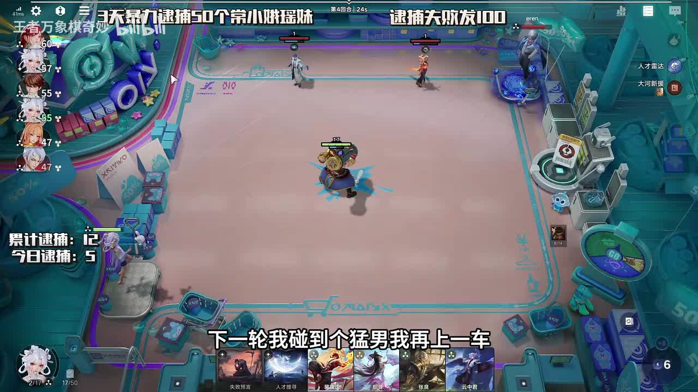

## 04:18–05:28 五级多人口再招提高核心机会

- 事件 ID：BV1YweC68EuA:p1:e006
- 场景：实战
- 时机：全军列阵可用
- 背景（分析推断）：升级多召一人
- 学习目标（分析推断）：将人口与随机候选数联系
- 模板：resource-order
- ASR 段落：[8, 9]

> 多一个人口能招6个

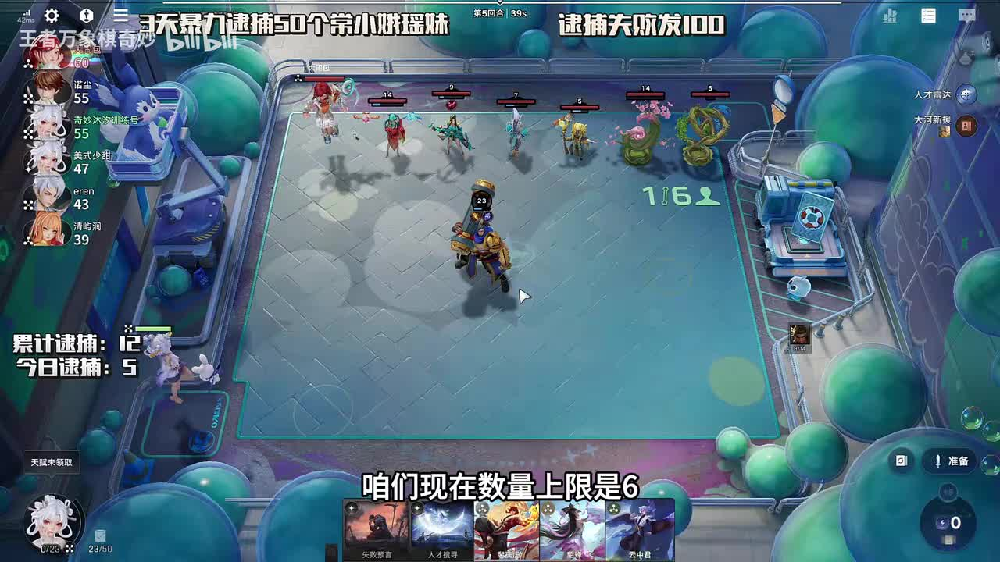

## 05:28–06:08 每回合登场一次加级再卖

- 事件 ID：BV1YweC68EuA:p1:e007
- 场景：实战
- 时机：云中君过渡
- 背景（分析推断）：不是一直挂场
- 学习目标（分析推断）：区分登场与留场收益
- 模板：growth-combo
- ASR 段落：[10]

> 一个回合上一张

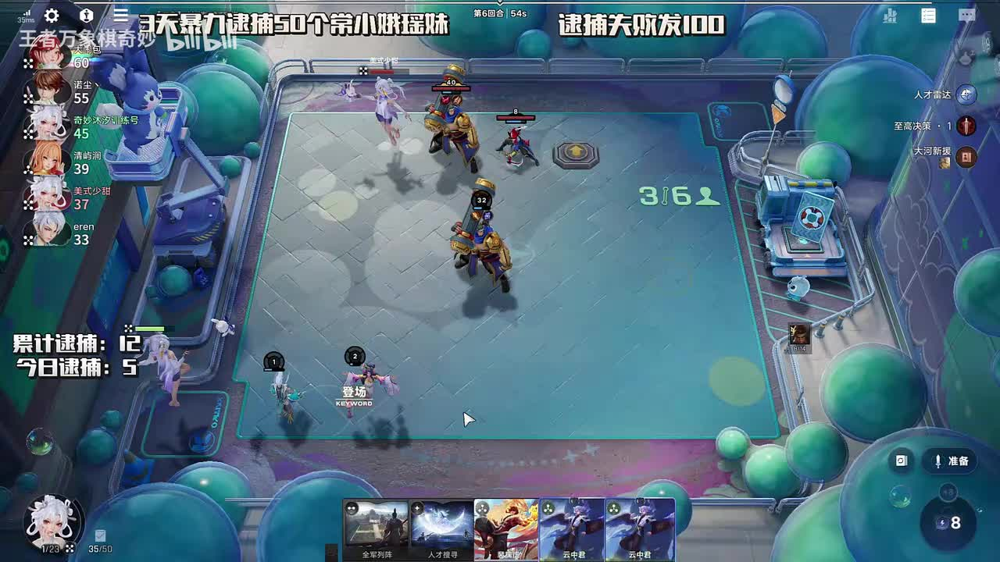

## 07:18–07:51 复活可两次牺牲，适合上裴擒虎

- 事件 ID：BV1YweC68EuA:p1:e008
- 场景：实战
- 时机：苏烈40级
- 背景（分析推断）：已有复活门槛
- 学习目标（分析推断）：按阈值选择辅助
- 模板：growth-combo
- ASR 段落：[13]

> 因为苏联40级就能给一次复活

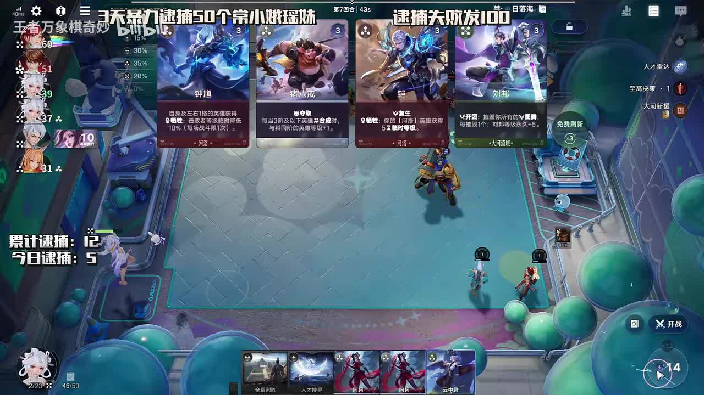

## 07:51–09:09 压力小不觉醒，活不下来就觉醒；六级前少合成

- 事件 ID：BV1YweC68EuA:p1:e009
- 场景：实战
- 时机：觉醒或抢六
- 背景（分析推断）：合成耗钱会延误六级
- 学习目标（分析推断）：按生存条件分配钱
- 模板：level-transition
- ASR 段落：[14, 15]

> 你看你本局压力大不大

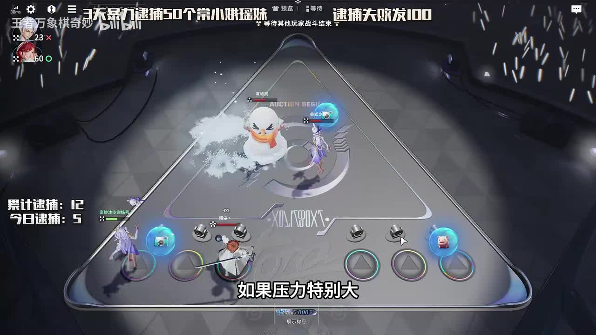

## 09:09–10:32 记录上单张海月亏钱，王牌仅有限补偿

- 事件 ID：BV1YweC68EuA:p1:e010
- 场景：实战
- 时机：单海月误操作
- 背景（分析推断）：讲者承认错误
- 学习目标（分析推断）：从反馈识别成本
- 模板：combat-review
- ASR 段落：[16, 17]

> 我上个单的海月我是傻子

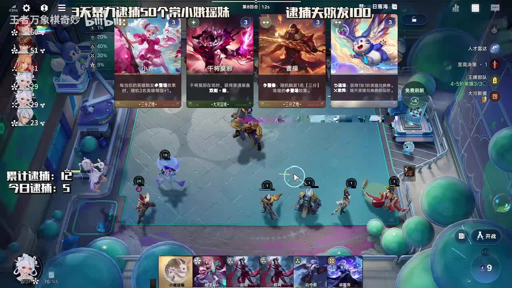

## 11:13–12:21 先大后小，即使王牌吃不到

- 事件 ID：BV1YweC68EuA:p1:e011
- 场景：实战
- 时机：连用兔子
- 背景（分析推断）：差一元迫使卖玉环
- 学习目标（分析推断）：区分主顺序与附加收益
- 模板：resource-order
- ASR 段落：[19, 20]

> 先大后小

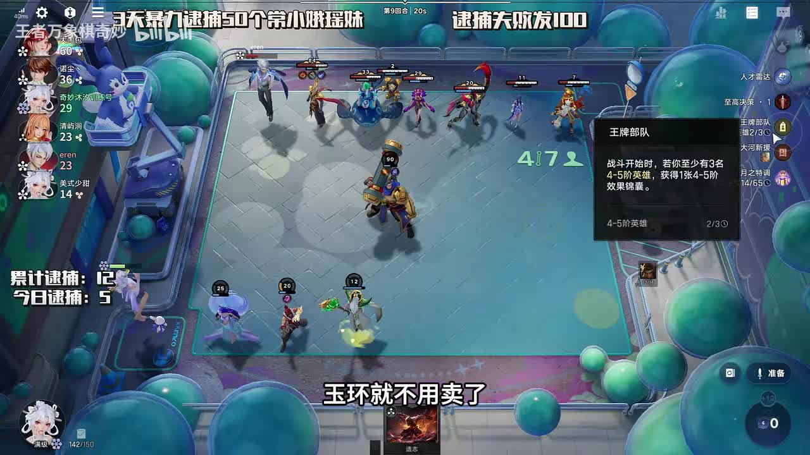

## 11:50–13:00 缺反甲导致承伤方案不完整

- 事件 ID：BV1YweC68EuA:p1:e012
- 场景：实战
- 时机：面对嬴政掉血
- 背景（分析推断）：现有等级无法替代防守功能
- 学习目标（分析推断）：定位装备缺口
- 模板：equipment-role
- ASR 段落：[20, 21]

> 没反甲掉血掉太多了

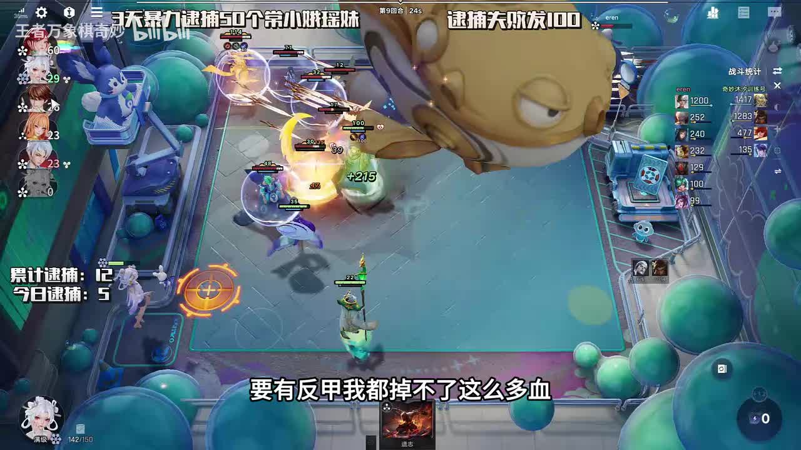

## 13:04–14:11 先找司空震，大兔人数开局计算

- 事件 ID：BV1YweC68EuA:p1:e013
- 场景：实战
- 时机：移植前
- 背景（分析推断）：过早移植可能无目标
- 学习目标（分析推断）：核查触发时点目标
- 模板：resource-order
- ASR 段落：[22, 23]

> 这东西是开局算的

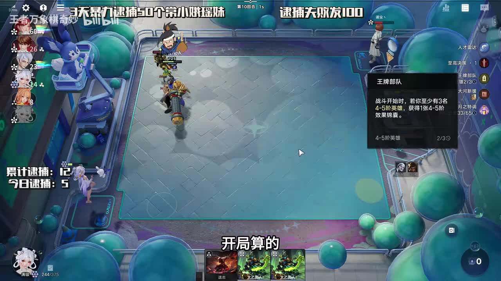

## 14:51–16:40 备传承，移到老虎可补救

- 事件 ID：BV1YweC68EuA:p1:e014
- 场景：实战
- 时机：随机移植
- 背景（分析推断）：老虎自身等级非关键
- 学习目标（分析推断）：为随机目标准备补救
- 模板：fallback-plan
- ASR 段落：[25, 27]

> 我留了个传承没毛病

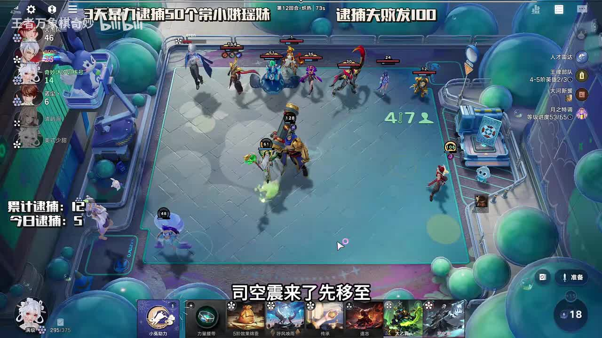

## 15:29–16:40 伸手前卖太乙防止偷一级

- 事件 ID：BV1YweC68EuA:p1:e015
- 场景：实战
- 时机：老虎偷级前
- 背景（分析推断）：短暂工具污染偷级来源
- 学习目标（分析推断）：触发前移除不合格目标
- 模板：resource-order
- ASR 段落：[26, 27]

> 老虎伸手之前把它卖了

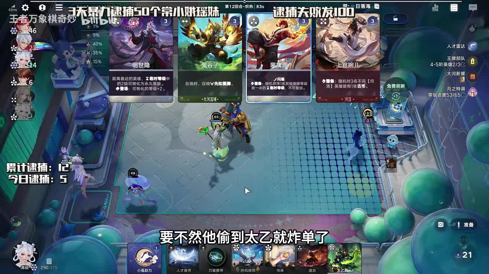

## 16:40–18:16 海月单顶挨打换命，太乙第二次机会

- 事件 ID：BV1YweC68EuA:p1:e016
- 场景：实战
- 时机：敌嬴政无名刀
- 背景（分析推断）：血量仍影响换命是否成功
- 学习目标（分析推断）：按敌方防守选承伤者
- 模板：position-cause
- ASR 段落：[28, 29, 30]

> 一定要让海月去挨打

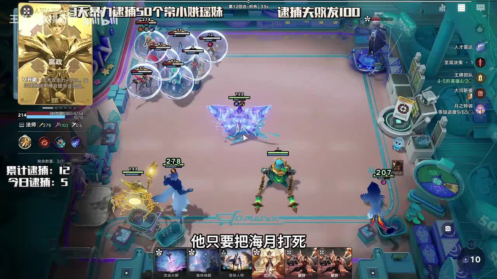

## 17:50–18:47 偷一级连带损害司空震临时等级

- 事件 ID：BV1YweC68EuA:p1:e017
- 场景：实战
- 时机：复盘太乙晚卖
- 背景（分析推断）：共享等级核心受损
- 学习目标（分析推断）：识别连带后果
- 模板：combat-review
- ASR 段落：[30, 31]

> 偷成一级了

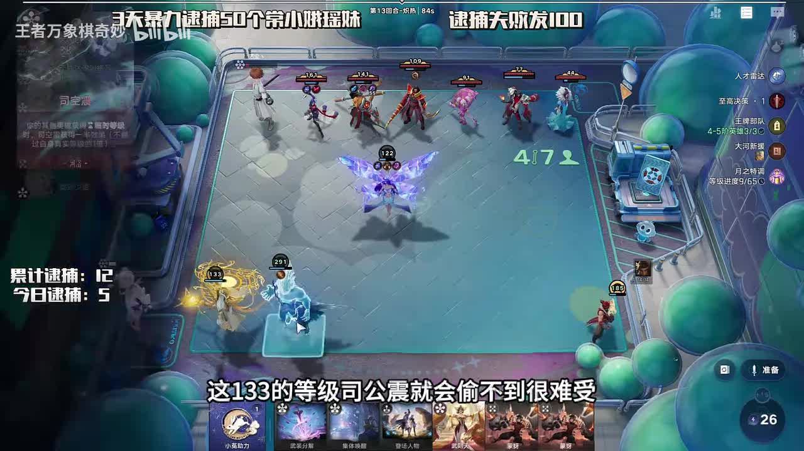

## 18:16–19:19 工具登场卖出触发姜子牙加级

- 事件 ID：BV1YweC68EuA:p1:e018
- 场景：实战
- 时机：核心成为唯一目标
- 背景（分析推断）：在场配置决定归属
- 学习目标（分析推断）：保持正确目标
- 模板：growth-combo
- ASR 段落：[31, 32]

> 四公镇加等级了

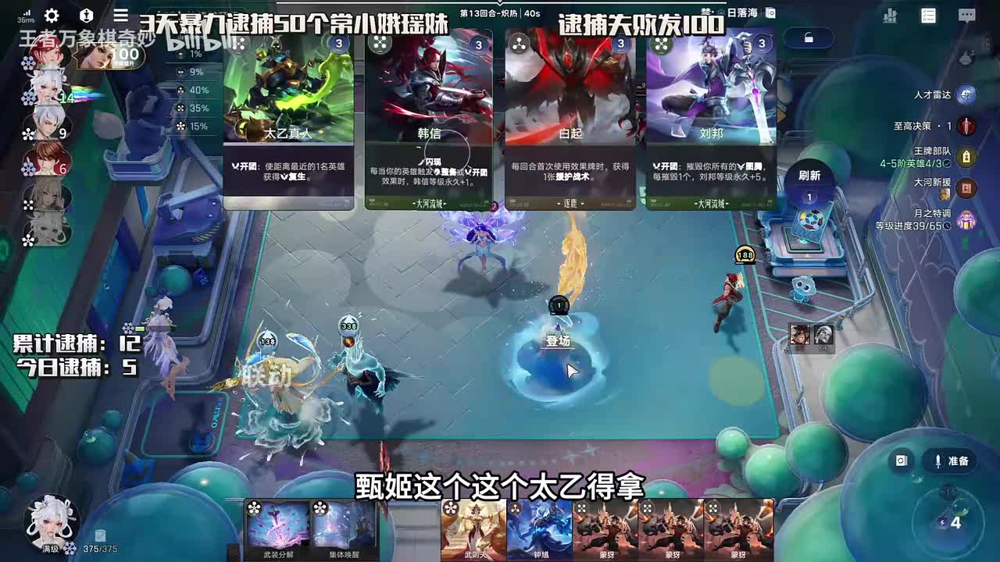

## 19:19–20:25 姜子牙承伤满蓝，保护司空震

- 事件 ID：BV1YweC68EuA:p1:e019
- 场景：实战
- 时机：猴子跳后排
- 背景（分析推断）：预测猴子跳入格子
- 学习目标（分析推断）：用站位启动辅助技能
- 模板：position-cause
- ASR 段落：[33, 34]

> 一挨打直接秒杀他

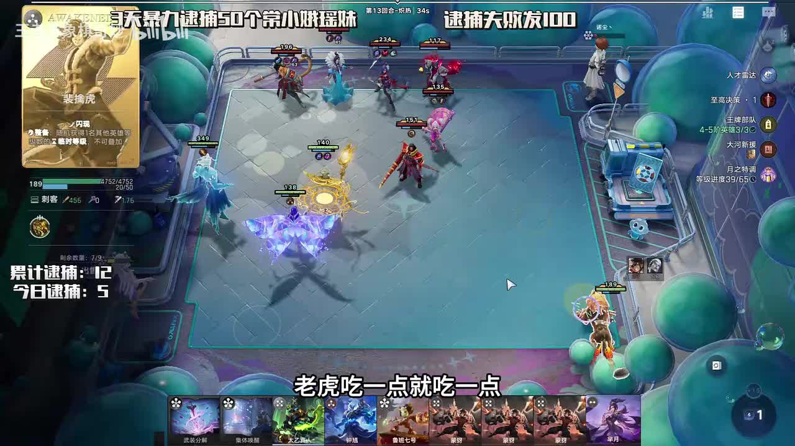

## 20:25–20:57 只留司空震阵营让其他牌加级

- 事件 ID：BV1YweC68EuA:p1:e020
- 场景：实战
- 时机：循环异阵营牌
- 背景（分析推断）：要求单一正确目标
- 学习目标（分析推断）：掌握在场条件
- 模板：growth-combo
- ASR 段落：[35]

> 我们在场的阵营就一个死红阵

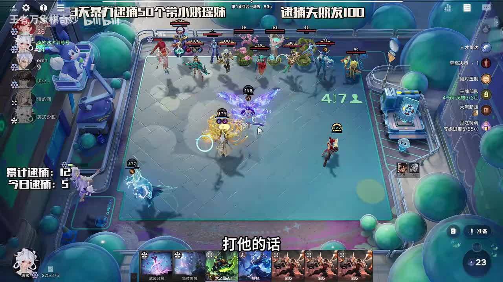

## 20:57–22:08 暂留同名牌卡共享牌库，敌死则停止

- 事件 ID：BV1YweC68EuA:p1:e021
- 场景：实战
- 时机：敌依赖蒙犽
- 背景（分析推断）：需牌稀缺且敌尚在
- 学习目标（分析推断）：随对手状态解除限制
- 模板：counter-target
- ASR 段落：[36, 37]

> 我们牌库是共享的

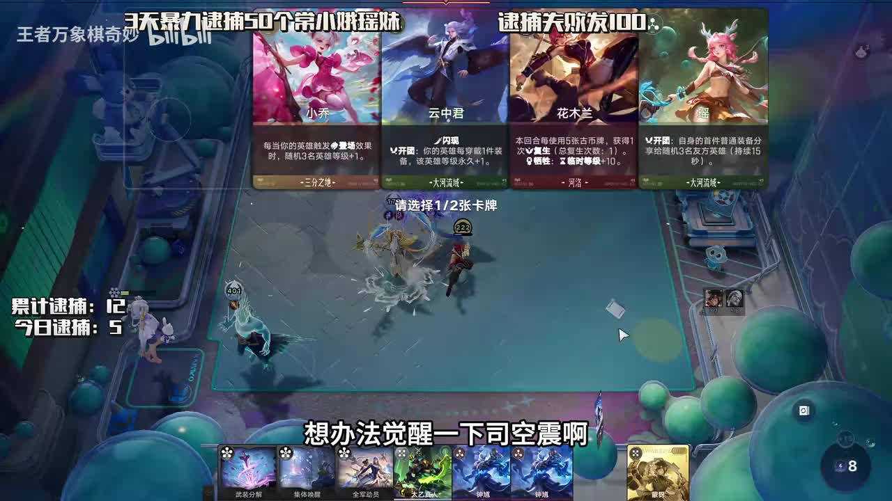

## 21:29–22:08 补复活甲增加换命机会

- 事件 ID：BV1YweC68EuA:p1:e022
- 场景：实战
- 时机：换命没秒杀
- 背景（分析推断）：不能把预期当结果
- 学习目标（分析推断）：观察后补保障
- 模板：combat-review
- ASR 段落：[37]

> 我应该上个佛甲的

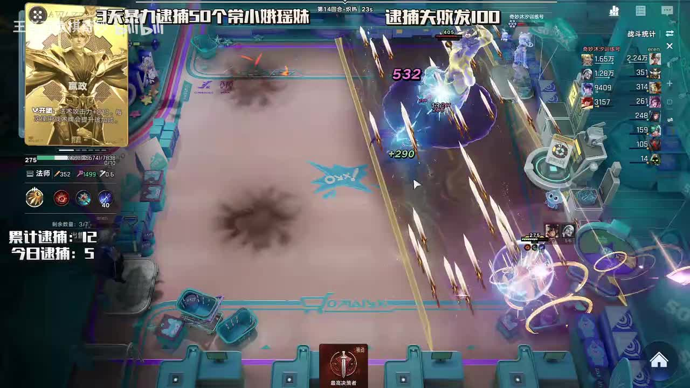

## 22:08–22:41 改蔡文姬配成长组件

- 事件 ID：BV1YweC68EuA:p1:e023
- 场景：实战
- 时机：缺露娜想倒转
- 背景（分析推断）：传统组件缺失
- 学习目标（分析推断）：给有条件替代
- 模板：fallback-plan
- ASR 段落：[38]

> 就没有露娜的话就没法玩导转

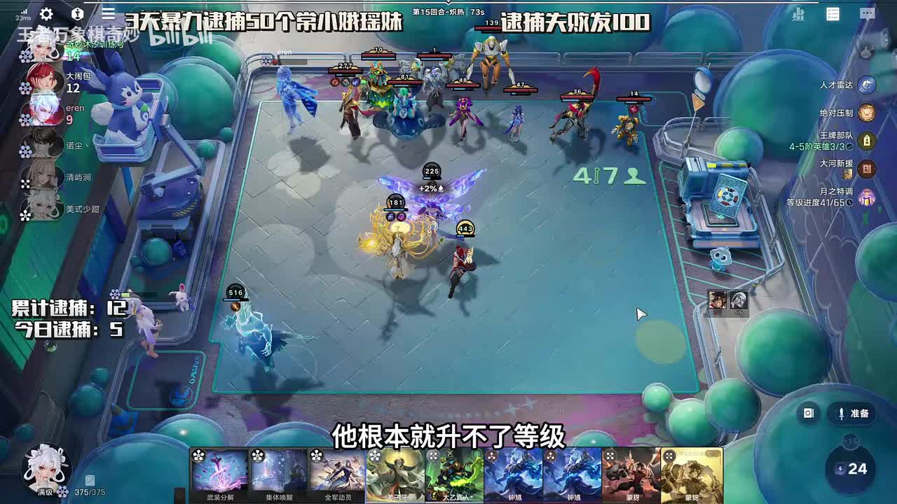

## 22:41–23:16 先三个登场再唤醒

- 事件 ID：BV1YweC68EuA:p1:e024
- 场景：实战
- 时机：集体唤醒前
- 背景（分析推断）：批量目标要备齐
- 学习目标（分析推断）：检查奖励前置条件
- 模板：resource-order
- ASR 段落：[39]

> 细节上三个登场

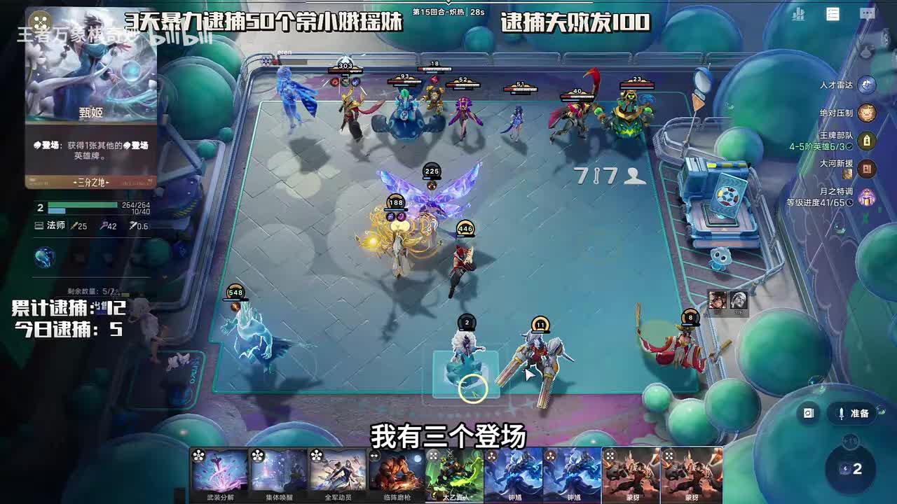

## 23:41–25:31 先保装备，确认苍穹冰刀无用后拆

- 事件 ID：BV1YweC68EuA:p1:e025
- 场景：实战
- 时机：拆装备换觉醒
- 背景（分析推断）：威胁与999门槛改变价值
- 学习目标（分析推断）：重新评价装备机会成本
- 模板：equipment-role
- ASR 段落：[41, 42, 43]

> 苍穹没有用了

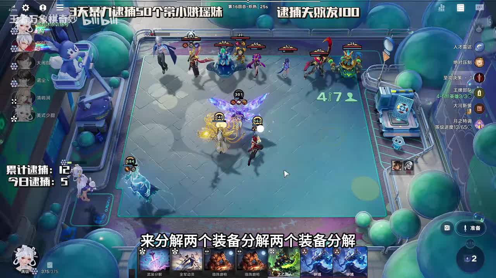

## 24:58–26:03 御灵之纱护盾支持承伤

- 事件 ID：BV1YweC68EuA:p1:e026
- 场景：实战
- 时机：999核心前排
- 背景（分析推断）：已有高等级护盾
- 学习目标（分析推断）：限定站位耐久条件
- 模板：combat-review
- ASR 段落：[43, 44]

> 一万五的护盾

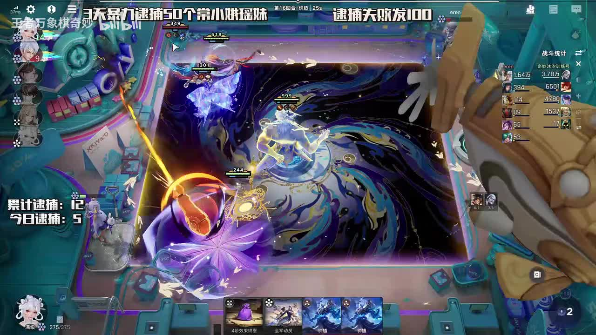

## 待核实与局限

- 原始ASR不修正；同音名称需画面补证。
- 卡池共享词条数值属视频版本，未核对当前版本。
- 保留错误与当场修正，排除闲聊。
