# 安琪拉自爆流东皇碾压白歌倒转，满血吃鸡

来源：https://www.bilibili.com/video/BV1tZad6XEWD/?p=1

分析状态：completed

完整文字稿：../../../raw/BV1tZad6XEWD_p1.md

## 00:00–01:06 经济不足不强玩马超，自爆需炸伤转等级的关键改装。

- 事件 ID：BV1tZad6XEWD:p1:e001
- 场景：实战
- 时机：安琪拉开局选路线时
- 背景（分析推断）：讲者先说明贫穷棋手适合挂机或逐鹿，老板要求尝试自爆。
- 学习目标（分析推断）：判断路线启动门槛。
- 模板：opening-plan
- ASR 段落：[1, 2]

> 马槽得很有钱才能玩

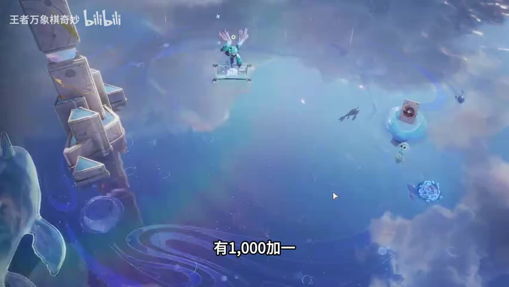

## 01:09–02:59 尽量给后排，不盲放牛魔。

- 事件 ID：BV1tZad6XEWD:p1:e002
- 场景：实战
- 时机：给眼分配单位时
- 背景（分析推断）：讲者发现原给牛魔不理想后解释后排原则。
- 学习目标（分析推断）：用触发载体位置兑现技能。
- 模板：position-binding
- ASR 段落：[3, 4]

> 这个眼尽量给后排

## 02:59–04:22 地雷伤害累计到门槛转为全体等级，是自爆成长发动机。

- 事件 ID：BV1tZad6XEWD:p1:e003
- 场景：实战
- 时机：解释一千加一时
- 背景（分析推断）：该改装尚未到来，不能把当前爆炸当成已成长。
- 学习目标（分析推断）：区分伤害和成长转换。
- 模板：mechanic-model
- ASR 段落：[5, 6]

> 你的这个地雷炸人家一千血,全体加一级

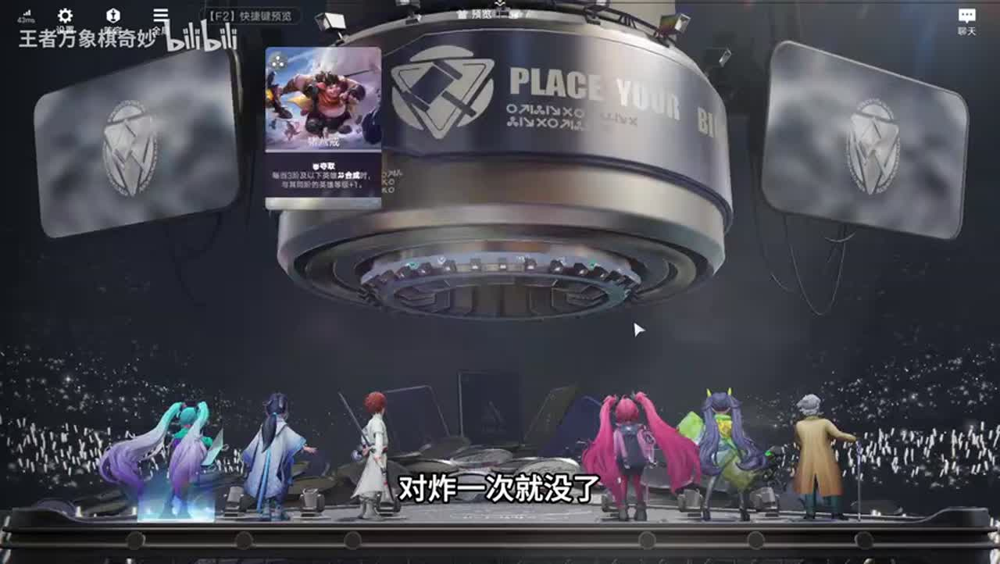

## 03:45–05:27 有人才济济使上五级较快，才选高费牌触发方向。

- 事件 ID：BV1tZad6XEWD:p1:e004
- 场景：实战
- 时机：在顿悟条件间选时
- 背景（分析推断）：否则升级慢可选另一触发条件。
- 学习目标（分析推断）：按实际升级速度选择可完成任务。
- 模板：talent-fit
- ASR 段落：[6, 7, 8]

> 我们有人才济济升五级升的很快

## 05:27–06:12 后期强的选项此刻未必有效，当前需要稳血则选即时收益。

- 事件 ID：BV1tZad6XEWD:p1:e005
- 场景：实战
- 时机：镜像迷离与光辉盛开二选时
- 背景（分析推断）：讲者不愿当前让一个天赋。
- 学习目标（分析推断）：比较收益时间而非固定强弱。
- 模板：talent-fit
- ASR 段落：[9]

> 现在拿镜像迷离等于让一个天赋

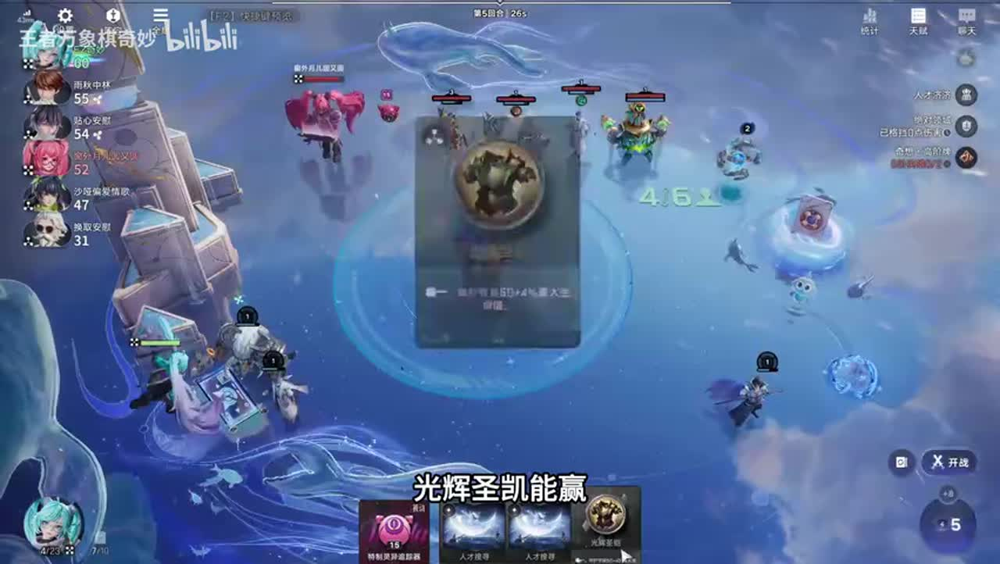

## 06:12–06:43 固定50回血在低攻击阶段很强，后期再看百分比收益。

- 事件 ID：BV1tZad6XEWD:p1:e006
- 场景：实战
- 时机：解释前期回血时
- 背景（分析推断）：用24攻击与50回血比较，此局数值条件需保留。
- 学习目标（分析推断）：理解固定值与百分比的阶段差异。
- 模板：mechanic-model
- ASR 段落：[10]

> 前期这个固定50点贼牛逼

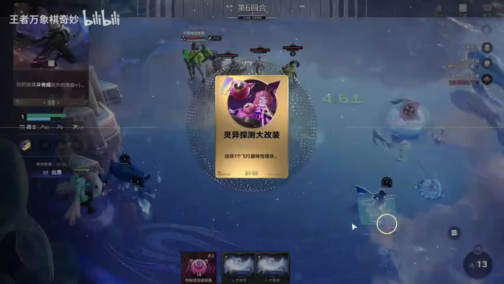

## 06:43–07:57 接受友军也被炸，选择能牺牲的图腾载体。

- 事件 ID：BV1tZad6XEWD:p1:e007
- 场景：实战
- 时机：自爆会炸友军时
- 背景（分析推断）：伤害不分队伍，阵容需要相应支撑。
- 学习目标（分析推断）：评估机制副作用和补偿。
- 模板：module-fit
- ASR 段落：[11, 12]

> 他谁都炸

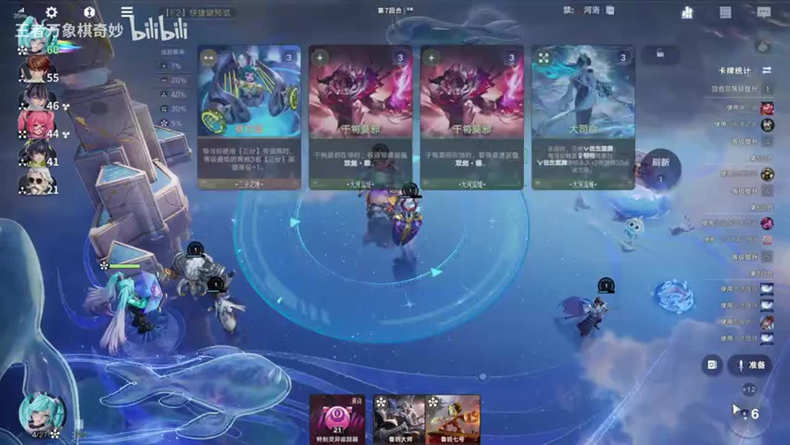

## 07:57–09:48 大河三图腾可提供自爆载体，东皇承担主要战斗。

- 事件 ID：BV1tZad6XEWD:p1:e008
- 场景：实战
- 时机：围绕东皇找图腾时
- 背景（分析推断）：此时成长改装未到，后续语音修正现在炸柱子无收益。
- 学习目标（分析推断）：将组合计划与当前生效状态区分。
- 模板：growth-combo
- ASR 段落：[13, 14, 15]

> 大和有三根柱子可以炸

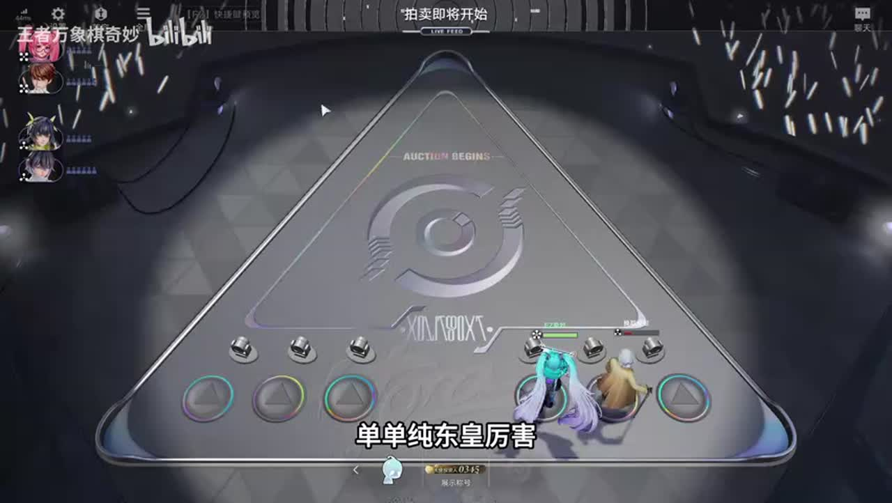

## 10:26–12:05 当前炸柱子没用且会炸死山鬼，先把柱子放远。

- 事件 ID：BV1tZad6XEWD:p1:e009
- 场景：实战
- 时机：尚无炸伤转等级时
- 背景（分析推断）：讲者修正此前计划，明确还未拿到转换改装。
- 学习目标（分析推断）：检查实际发动条件后调整站位。
- 模板：combat-review
- ASR 段落：[17, 18, 19]

> 现在炸柱子没有用。

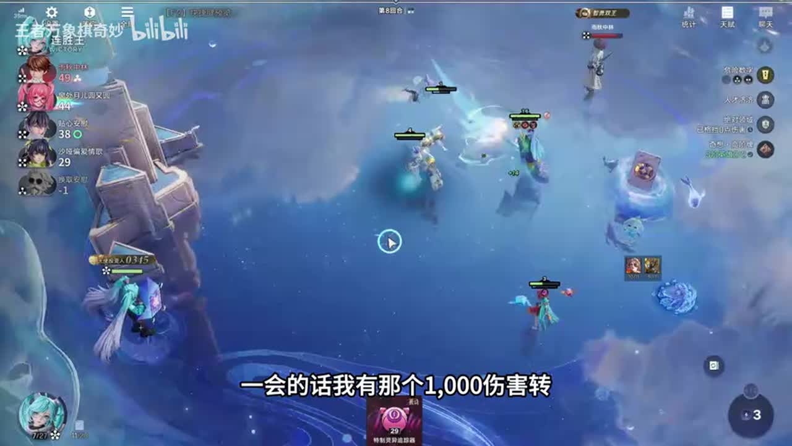

## 12:07–13:19 查看自爆沉默与临时等级文本，拿到定向毁灭才有等级循环。

- 事件 ID：BV1tZad6XEWD:p1:e010
- 场景：实战
- 时机：升到关键改装时
- 背景（分析推断）：经济无其他用途时升级，本轮终于得到所需改装。
- 学习目标（分析推断）：识别升级收益与体系启动点。
- 模板：level-transition
- ASR 段落：[20, 21]

> 终于来了丁香毁灭

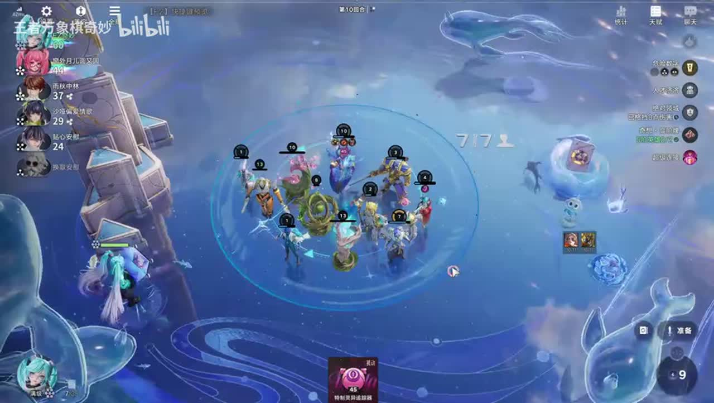

## 13:19–14:42 远程第二排，近战最后排向前走进入爆炸范围。

- 事件 ID：BV1tZad6XEWD:p1:e011
- 场景：实战
- 时机：改装到位后安排自爆时
- 背景（分析推断）：此时友军伤害能转成长，站位目标发生变化。
- 学习目标（分析推断）：用移动路径控制爆炸受益对象。
- 模板：position-cause
- ASR 段落：[22, 23]

> 近战占最后一排他会往前走

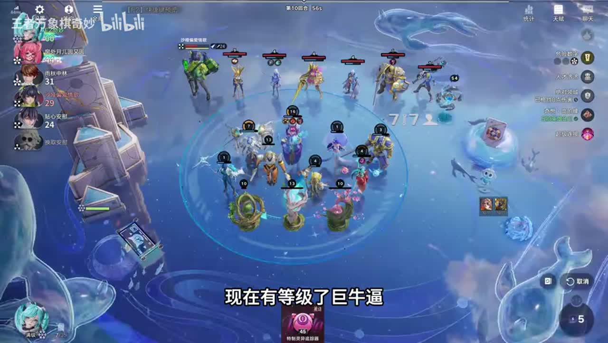

## 13:58–14:42 买三张即使不打仍能得能量，评估收益不能只看出牌。

- 事件 ID：BV1tZad6XEWD:p1:e012
- 场景：实战
- 时机：解释危险数字价值时
- 背景（分析推断）：讲者反驳此前天赋白选的说法。
- 学习目标（分析推断）：区分购买触发与使用触发。
- 模板：economy-budget
- ASR 段落：[23]

> 就算不打,它也给你一能量

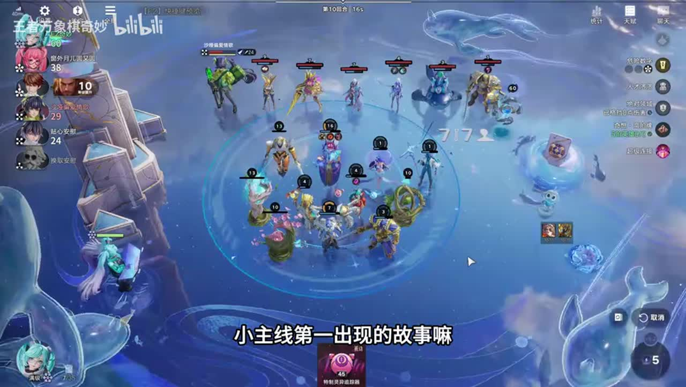

## 14:42–15:16 将7000伤害对应全体7级，检查循环已兑现。

- 事件 ID：BV1tZad6XEWD:p1:e013
- 场景：实战
- 时机：实测爆炸后
- 背景（分析推断）：是讲者对本轮实际结果的说明，数值待画面核实。
- 学习目标（分析推断）：用反馈验证成长发动机。
- 模板：growth-combo
- ASR 段落：[24]

> 全体加7级

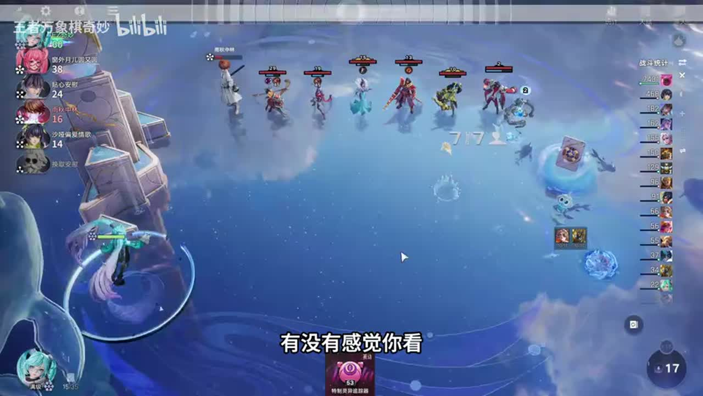

## 15:16–16:36 保留项羽给图腾升级，再给东皇等级；移除低边际海月。

- 事件 ID：BV1tZad6XEWD:p1:e014
- 场景：实战
- 时机：人口不足考虑海月时
- 背景（分析推断）：主目标已确定养东皇，额外输出不一定优先。
- 学习目标（分析推断）：保留成长链关键功能位。
- 模板：late-transition
- ASR 段落：[25, 26]

> 项羽能给朱子加等级朱子能给东皇加等级

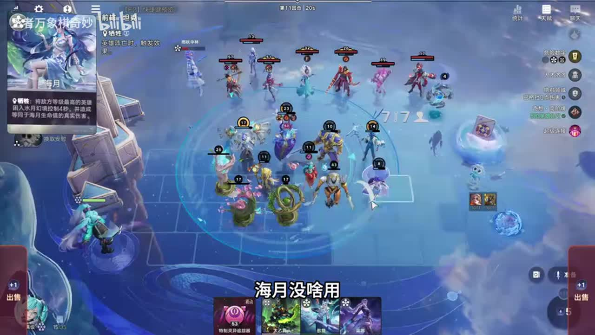

## 16:36–17:14 识别大量伤害来自友军，不误归因为对敌输出。

- 事件 ID：BV1tZad6XEWD:p1:e015
- 场景：实战
- 时机：爆炸伤害高于敌方总血时
- 背景（分析推断）：讲者观察13000伤害而敌方血量不够。
- 学习目标（分析推断）：区分伤害来源和战斗效率。
- 模板：combat-review
- ASR 段落：[27]

> 这炸的全是队友

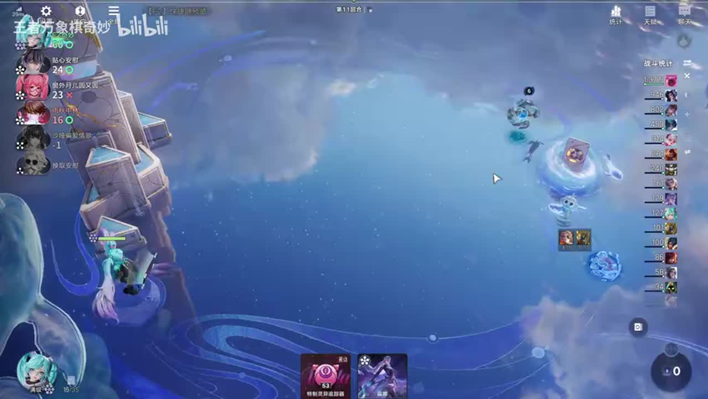

## 17:15–17:50 项羽提高图腾等级，东皇按图腾等级取临时等级。

- 事件 ID：BV1tZad6XEWD:p1:e016
- 场景：实战
- 时机：再次解释保留项羽时
- 背景（分析推断）：回答单位为何不卖，独立于此前转型讲解。
- 学习目标（分析推断）：建立支撑到主核的因果链。
- 模板：mechanic-model
- ASR 段落：[28]

> 他们有联东的。

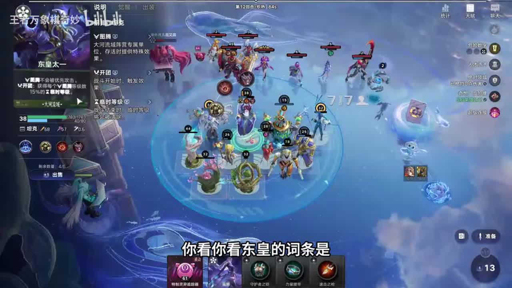

## 17:51–19:05 地雷提供早期战力，高血友军与成长相互增强。

- 事件 ID：BV1tZad6XEWD:p1:e017
- 场景：实战
- 时机：解释自爆前期过渡时
- 背景（分析推断）：本局早期没掉血，不能据此保证所有对局无损。
- 学习目标（分析推断）：理解过渡与后期成长如何衔接。
- 模板：opening-plan
- ASR 段落：[29, 30]

> 等级越高炸得越疼

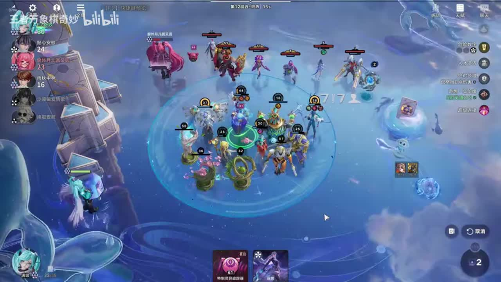

## 19:05–20:50 先拿定向毁灭，再点耍赖皮；反序可能一直拿不到发动机。

- 事件 ID：BV1tZad6XEWD:p1:e018
- 场景：实战
- 时机：复盘改装选择顺序时
- 背景（分析推断）：講者展示技能查看入口并修正先前选择。
- 学习目标（分析推断）：避免先投入不完整组合的不可逆风险。
- 模板：resource-order
- ASR 段落：[31, 32, 33]

> 先先拿定向是很重要的

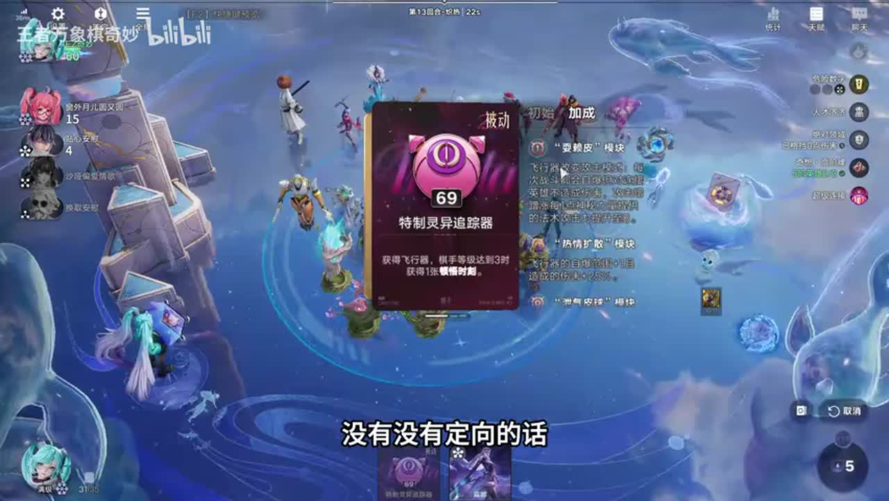

## 20:53–21:27 东皇觉醒仍是关键战力缺口，不只依赖爆炸成长。

- 事件 ID：BV1tZad6XEWD:p1:e019
- 场景：实战
- 时机：敌方倒转高等级时
- 背景（分析推断）：讲者面对300级对手解释下一步。
- 学习目标（分析推断）：识别当前成型之外的战斗门槛。
- 模板：counter-target
- ASR 段落：[34]

> 东黄只要觉醒就能炸得动

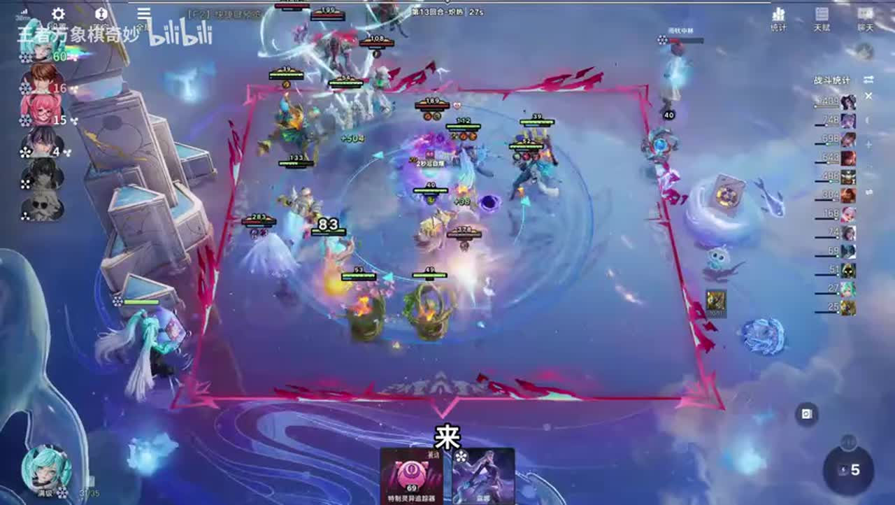

## 21:32–22:41 用买牌触发收益继续寻找缺的一张，验证天赋功能。

- 事件 ID：BV1tZad6XEWD:p1:e020
- 场景：实战
- 时机：危险数字助找东皇时
- 背景（分析推断）：不是固定买二费公式，依赖当轮计数。
- 学习目标（分析推断）：用已确认购买条件安排补牌。
- 模板：economy-budget
- ASR 段落：[35, 36]

> 买个二他再给我发个洞房

## 22:41–23:14 留住露娜减少对方关键牌获得。

- 事件 ID：BV1tZad6XEWD:p1:e021
- 场景：实战
- 时机：对手需要露娜时
- 背景（分析推断）：这一建议以观察到对手倒转需求为前提。
- 学习目标（分析推断）：把牌库竞争纳入对策。
- 模板：auction-choice
- ASR 段落：[37]

> 这个露娜不能交出去了

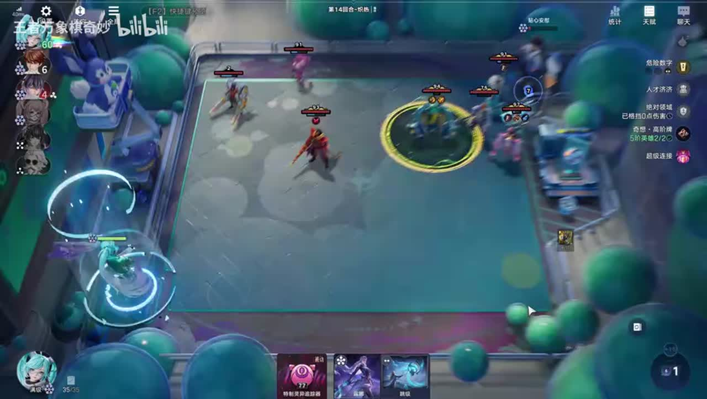

## 23:54–25:01 把蛋分到爆炸范围提供额外载体；是否被山鬼先吃需核实。

- 事件 ID：BV1tZad6XEWD:p1:e022
- 场景：实战
- 时机：增加额外蛋单位时
- 背景（分析推断）：讲者先预测爆炸，结尾发现蛋被山鬼吃掉。
- 学习目标（分析推断）：对新增组件检查触发顺序冲突。
- 模板：growth-combo
- ASR 段落：[39, 40]

> 这两个蛋分到这个旁边

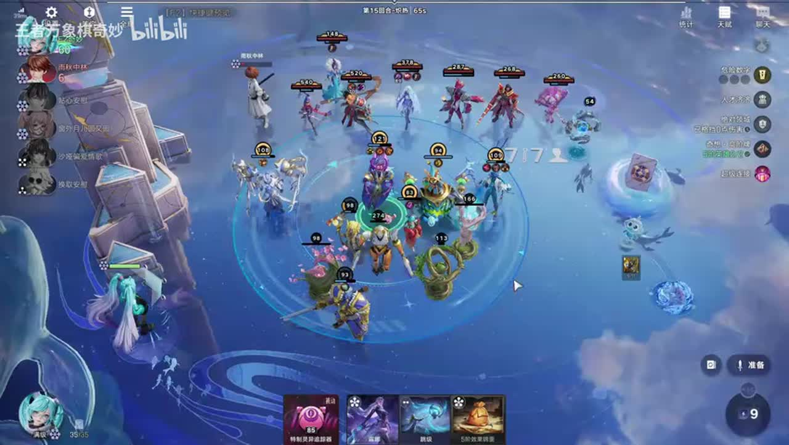

## 25:02–26:11 胜负依赖东皇能否咬住关键露娜，临时等级不能替代控制命中。

- 事件 ID：BV1tZad6XEWD:p1:e023
- 场景：实战
- 时机：最终对战露娜体系时
- 背景（分析推断）：讲者明确咬不住打不过；本局最终咬住获胜。
- 学习目标（分析推断）：围绕关键目标判断胜负条件。
- 模板：counter-target
- ASR 段落：[41, 42]

> 咬不住露娜就打不过

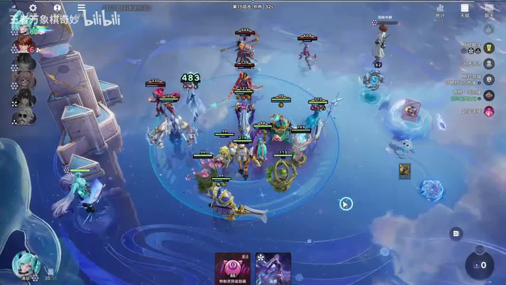

## 待核实与局限

- 原始ASR术语和数值可能有误；未经画面确认者不作为精确机制结论。
