# 小妲己养嬴政全局教学，小技巧养出3个2000法强的大哥

来源：https://www.bilibili.com/video/BV1Wwec68E7u/?p=1

分析状态：completed

完整文字稿：../../../raw/BV1Wwec68E7u_p1.md

## 00:35–01:05 有用的牌以购买触发奖励与临时刷新，少把钱耗在主动刷新

- 事件 ID：BV1Wwec68E7u:p1:e001
- 场景：实战
- 时机：介绍妲己购物技能
- 背景（分析推断）：购买次数是技能收益触发条件，不是无条件所有牌都买
- 学习目标（分析推断）：比较买牌与刷新对循环的不同收益
- 模板：economy-budget
- ASR 段落：[2]

> 买下来才会出发这个怦然心动

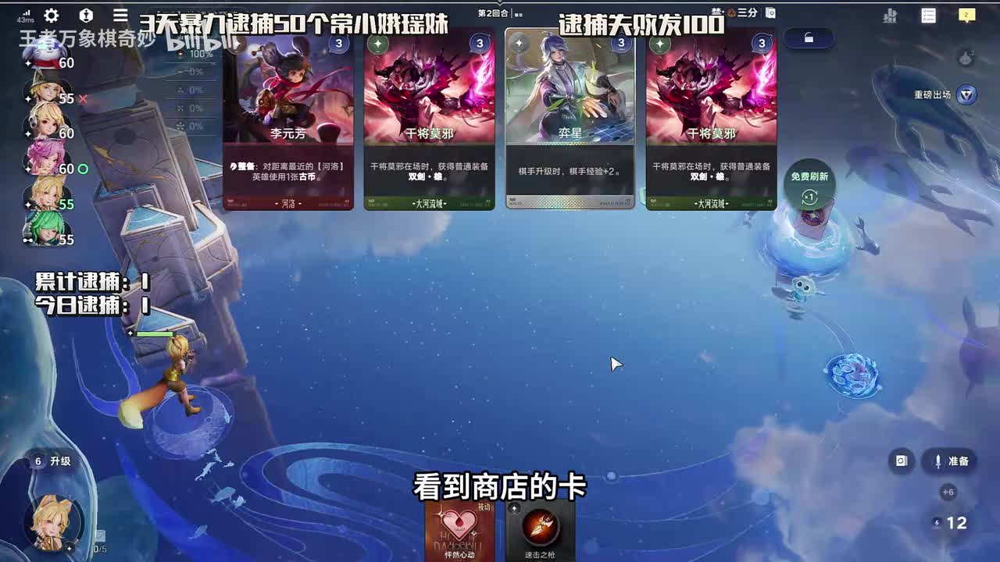

## 02:18–04:06 先等天赋结构，看到复印机和对手阵容后确定嬴政并觉醒芈月

- 事件 ID：BV1Wwec68E7u:p1:e002
- 场景：实战
- 时机：先未定阵容再看到天赋
- 背景（分析推断）：金银算盘可能走独苗，本局最后选择逐鹿路线；不是开局必须锁死
- 学习目标（分析推断）：用天赋与对手约束确定路线
- 模板：opening-plan
- ASR 段落：[5, 6, 7]

> 我们这把已经确定阵容了

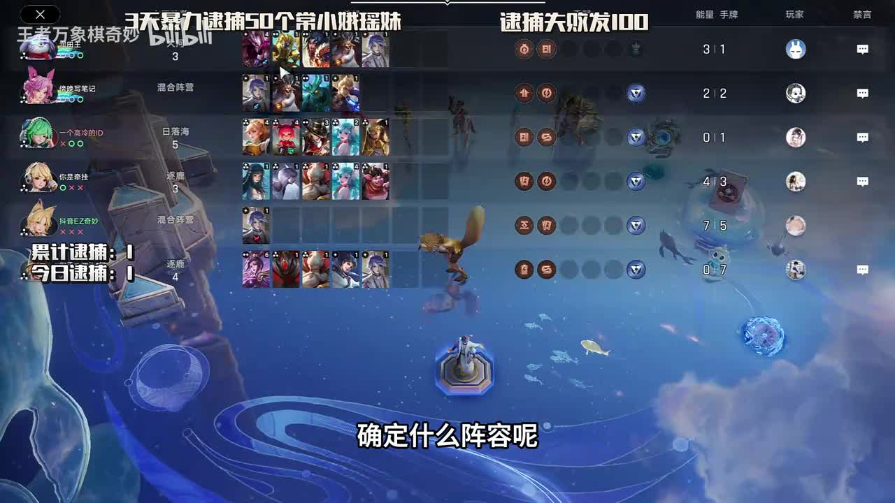

## 04:06–05:09 同阵营出牌奖励支持买牌循环，当前未凑足时不能声称已兑现

- 事件 ID：BV1Wwec68E7u:p1:e003
- 场景：实战
- 时机：同路人天赋出现
- 背景（分析推断）：血量与资源仍限制循环，无限钱为夸张说法
- 学习目标（分析推断）：核查奖励条件是否满足
- 模板：talent-fit
- ASR 段落：[8, 9]

> 这个同路人是上四个人

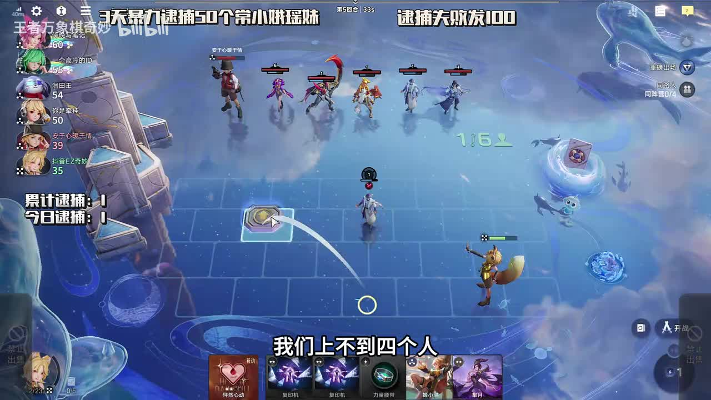

## 06:07–06:42 此时先补攻速启动而非仅追求后期法穿

- 事件 ID：BV1Wwec68E7u:p1:e004
- 场景：实战
- 时机：当前无法启动输出
- 背景（分析推断）：当前施法启动尚未满足，即时需求优先于理论上限
- 学习目标（分析推断）：比较启动与伤害装备的边际价值
- 模板：equipment-role
- ASR 段落：[12]

> 我现在没有启动

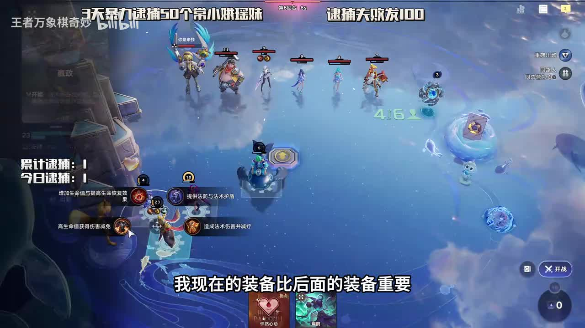

## 07:46–09:29 核对花费与是否实际打出同阵营牌，未上芈月导致奖励未兑现

- 事件 ID：BV1Wwec68E7u:p1:e005
- 场景：实战
- 时机：买牌却没钱后复盘
- 背景（分析推断）：讲者复盘买两张耗六块，只打一个同路人；不把抱怨本身计教学
- 学习目标（分析推断）：从经济异常查漏触发的条件
- 模板：combat-review
- ASR 段落：[15, 16, 17]

> 这个敏玥我没有上

## 08:56–09:29 合成获得战术卡，加速成长并增加白起援护护盾

- 事件 ID：BV1Wwec68E7u:p1:e006
- 场景：实战
- 时机：决定是否买鲁班七号
- 背景（分析推断）：本局不养鲁班作为核心，仍有工具用途
- 学习目标（分析推断）：按资源链而非核心身份评估工具
- 模板：growth-combo
- ASR 段落：[17]

> 他打合成他会给战术卡

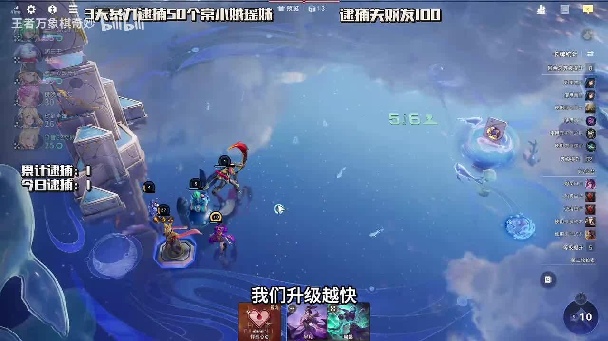

## 09:29–10:03 先觉醒提高效果牌触发后的成长

- 事件 ID：BV1Wwec68E7u:p1:e007
- 场景：实战
- 时机：芈月觉醒资源到来
- 背景（分析推断）：芈月是逐鹿成长工具，觉醒影响循环效率
- 学习目标（分析推断）：识别工具觉醒优先级
- 模板：resource-order
- ASR 段落：[18]

> 觉醒之后他打那个效果卡升级更快

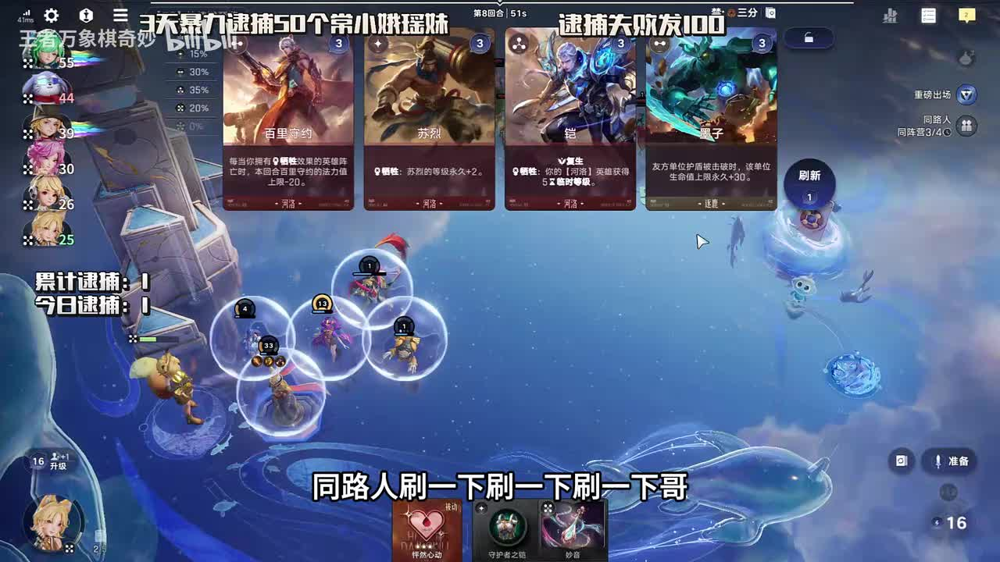

## 10:31–11:32 对刺客时将嬴政转到另一侧，否则前排跳后排干扰

- 事件 ID：BV1Wwec68E7u:p1:e008
- 场景：实战
- 时机：安排弹簧跳跃对象
- 背景（分析推断）：不固定由核心跳，取决于对手接敌结构
- 学习目标（分析推断）：按威胁决定位移对象
- 模板：position-cause
- ASR 段落：[20, 21]

> 对面是刺客的话我就把嬴政跳过去

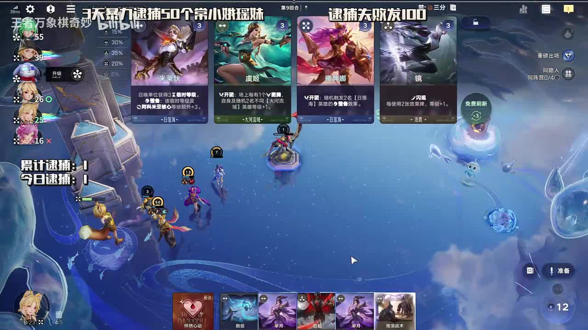

## 11:32–12:03 真免控与间歇解控不同，后者技能仍可能打断

- 事件 ID：BV1Wwec68E7u:p1:e009
- 场景：实战
- 时机：受到控制而选装备
- 背景（分析推断）：长施法需要免疫控制，不等同装备名称含解控即可
- 学习目标（分析推断）：区分免控与解除控制
- 模板：equipment-cause
- ASR 段落：[22]

> 他技能还是会被打断

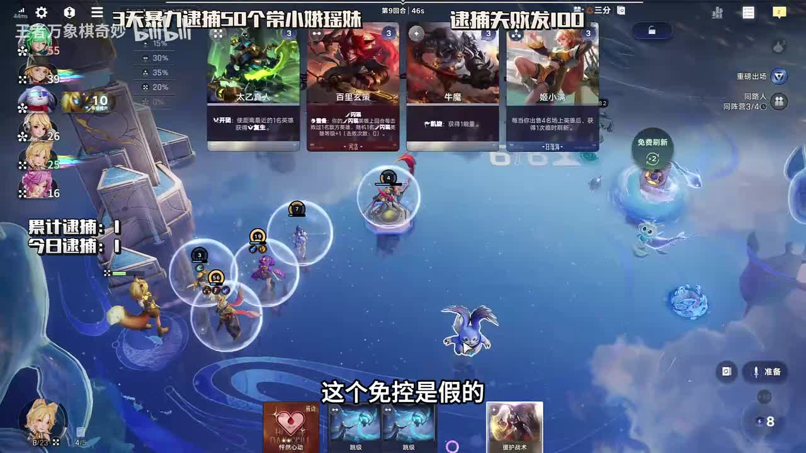

## 12:32–13:10 效果牌仍触发芈月，给装备最多逐鹿单位加等级

- 事件 ID：BV1Wwec68E7u:p1:e010
- 场景：实战
- 时机：看似用不着的效果卡是否打
- 背景（分析推断）：嬴政装备最多，技能收益对象受配装分布影响
- 学习目标（分析推断）：识别卡自身效果与额外触发收益
- 模板：growth-combo
- ASR 段落：[24]

> 它算效果卡

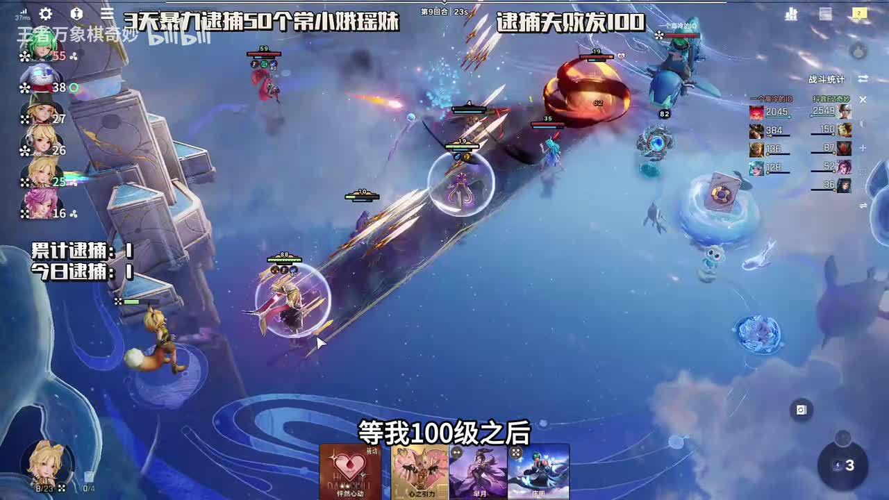

## 15:11–15:42 补免控避免核心施法被打断

- 事件 ID：BV1Wwec68E7u:p1:e011
- 场景：实战
- 时机：获得免控装备来源
- 背景（分析推断）：当前控制威胁存在，装备需要解决具体失败原因
- 学习目标（分析推断）：将装备选择接到输出稳定性
- 模板：equipment-role
- ASR 段落：[29]

> 要不然技能被打断就坏菜了

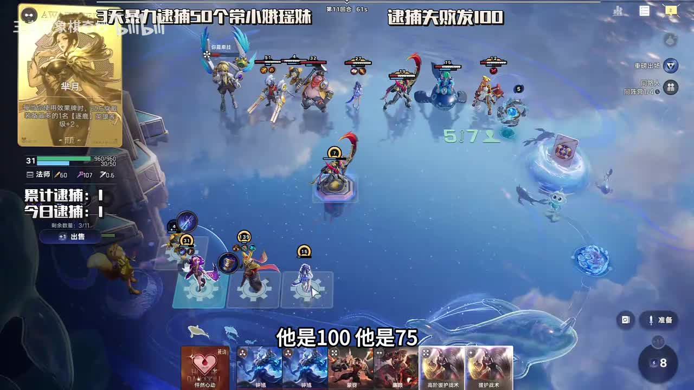

## 15:42–16:14 保留干将自带装作为后续资源来源

- 事件 ID：BV1Wwec68E7u:p1:e012
- 场景：实战
- 时机：留干将等待装备重构分解
- 背景（分析推断）：工具不是终局成员，等待对应效果出现再兑现
- 学习目标（分析推断）：提前准备资源而不浪费手牌功能
- 模板：resource-order
- ASR 段落：[30]

> 可以分解干将的装备

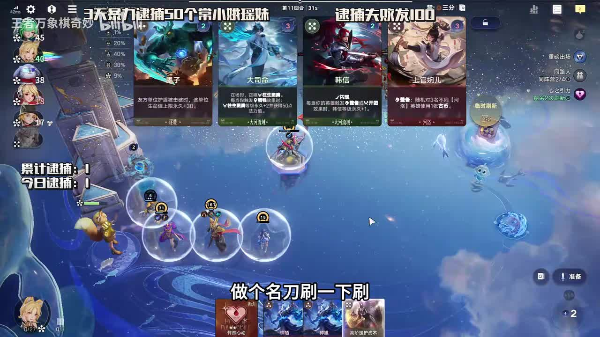

## 16:15–16:55 位移有偷后排收益，也可能增加技能转向时间

- 事件 ID：BV1Wwec68E7u:p1:e013
- 场景：实战
- 时机：嬴政弹到后排后的表现
- 背景（分析推断）：两种影响并存，单次位移有效不等于总是更好
- 学习目标（分析推断）：观察位移的副作用与收益
- 模板：combat-review
- ASR 段落：[31]

> 他好像技能要大转弯啊

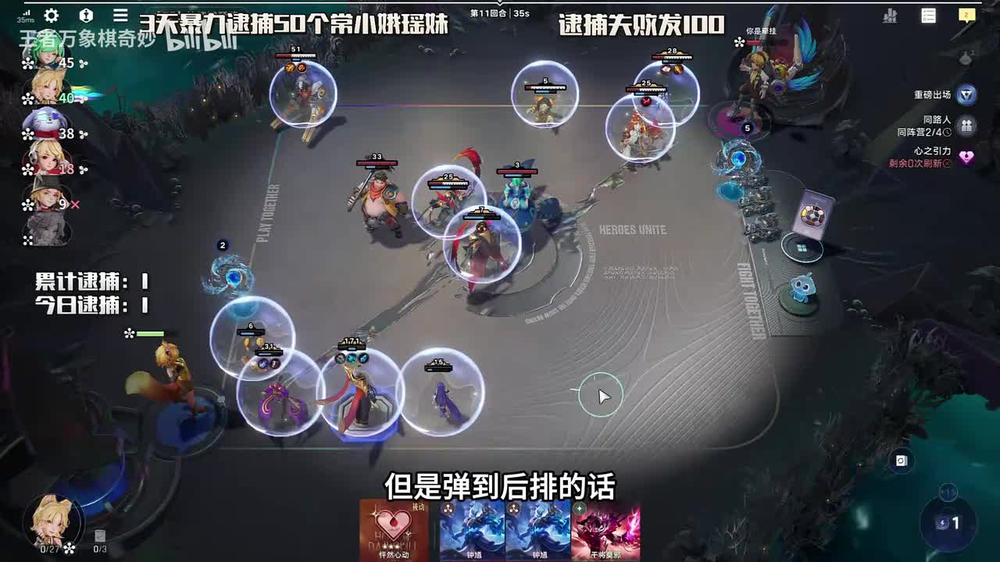

## 17:01–18:03 先留钱，呼风唤雨等六级双倍效果再开

- 事件 ID：BV1Wwec68E7u:p1:e014
- 场景：实战
- 时机：六级费用高但当前能赢
- 背景（分析推断）：当前战力足以维持，升级后增加资源兑现收益
- 学习目标（分析推断）：结合当前强度和升级收益判断时机
- 模板：level-transition
- ASR 段落：[32, 33]

> 能打过他的话,我就先

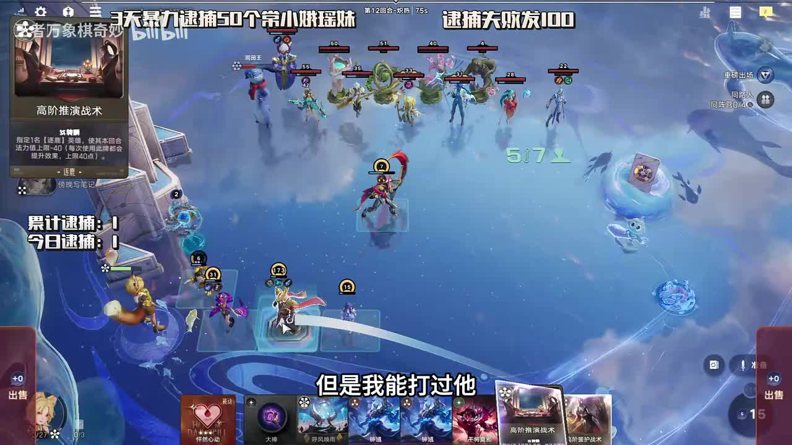

## 18:03–19:03 观察敌方站位，把白起弹到人群中心嘲讽，给嬴政输出窗口

- 事件 ID：BV1Wwec68E7u:p1:e015
- 场景：实战
- 时机：白起跳到多人后排
- 背景（分析推断）：白起周围一格嘲讽，落点价值依敌阵分布
- 学习目标（分析推断）：用技能范围推导位移落点
- 模板：position-cause
- ASR 段落：[34, 35]

> 弹到他们五个人正中间

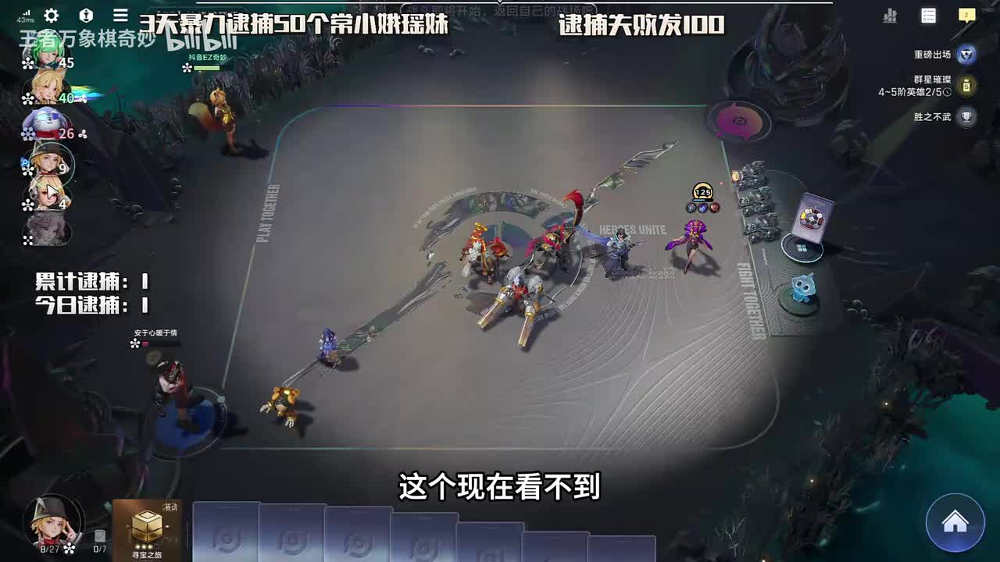

## 18:34–19:42 本轮暂缓效果，升级后先用高价值效果占用首个双倍

- 事件 ID：BV1Wwec68E7u:p1:e016
- 场景：实战
- 时机：即将升六开双倍
- 背景（分析推断）：技能首个使用效果获得双倍，其他卡先用会消耗机会
- 学习目标（分析推断）：保护一次性倍增机会
- 模板：resource-order
- ASR 段落：[35, 36]

> 升完级先开乌风关羽

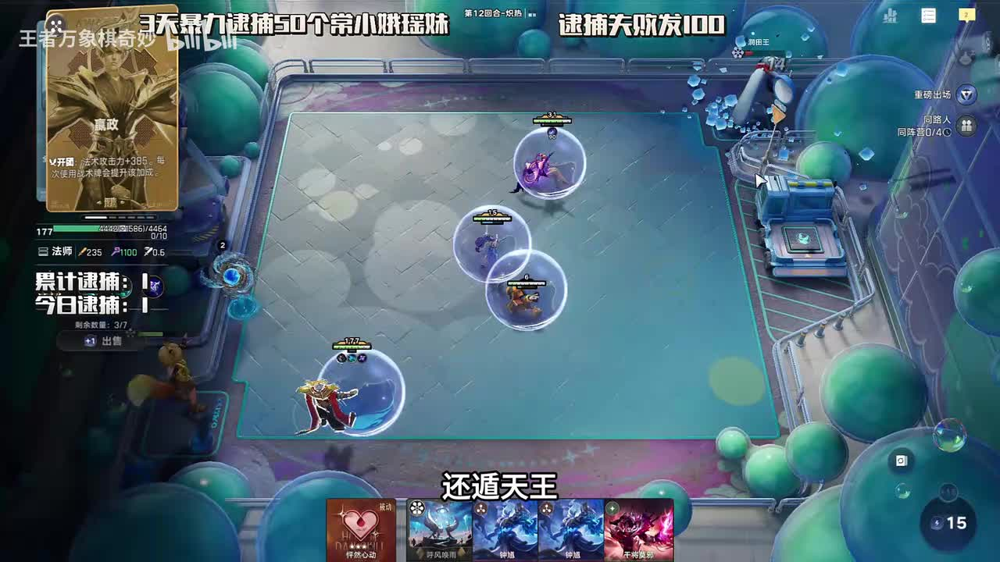

## 20:46–21:22 先开团加法强，再吸取形成多个高法强输出

- 事件 ID：BV1Wwec68E7u:p1:e017
- 场景：实战
- 时机：开团与偷法强结算
- 背景（分析推断）：开战结算先后决定被复制数值，具体装备名称待证据
- 学习目标（分析推断）：理解临时加成与复制顺序
- 模板：growth-combo
- ASR 段落：[39]

> 然后再吸一口

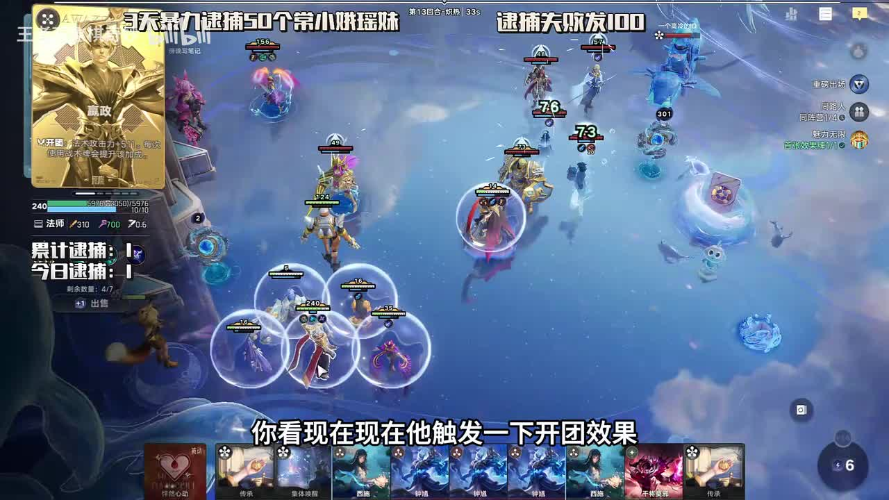

## 21:22–21:53 缩蓝提高嬴政与西施施法频率，低等级不等同低技能伤害

- 事件 ID：BV1Wwec68E7u:p1:e018
- 场景：实战
- 时机：推演战术与多核输出
- 背景（分析推断）：法强来源与英雄等级可以分开提高
- 学习目标（分析推断）：比较等级、法强与施法频率
- 模板：equipment-cause
- ASR 段落：[40]

> 嬴政一给,直接蓝条就变成死了

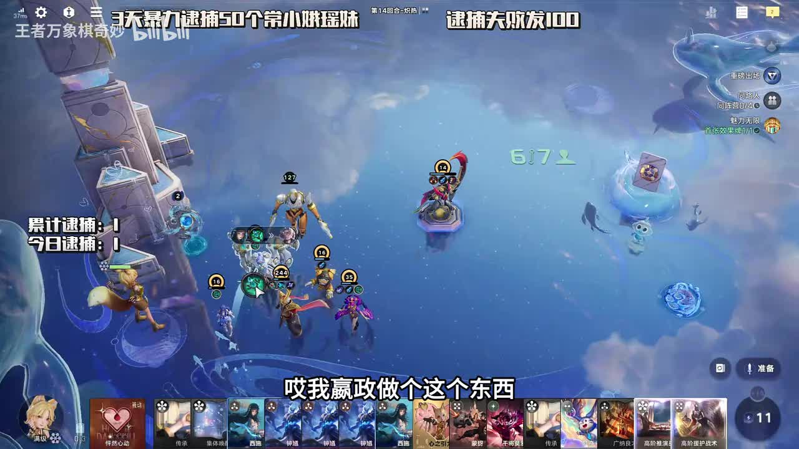

## 21:53–22:22 上干将再重构其自带装备

- 事件 ID：BV1Wwec68E7u:p1:e019
- 场景：实战
- 时机：重构出现且干将已预留
- 背景（分析推断）：此前保留工具在资源窗口到来时兑现，操作有明确缘由
- 学习目标（分析推断）：把准备动作与后续收益连接
- 模板：resource-order
- ASR 段落：[41]

> 干将自带一个装备

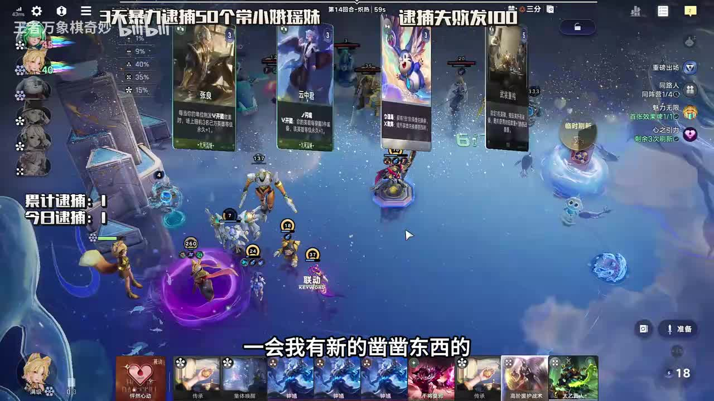

## 22:22–23:55 本轮分解，宝箱留到下一轮作为首个双倍效果

- 事件 ID：BV1Wwec68E7u:p1:e020
- 场景：实战
- 时机：分解后宝箱首个双倍
- 背景（分析推断）：奖励顺序比立即开箱更重要，不给每张卡都宣称双倍
- 学习目标（分析推断）：规划跨回合一次性资源收益
- 模板：resource-order
- ASR 段落：[42, 43, 44]

> 第一个使用的,是双倍效果

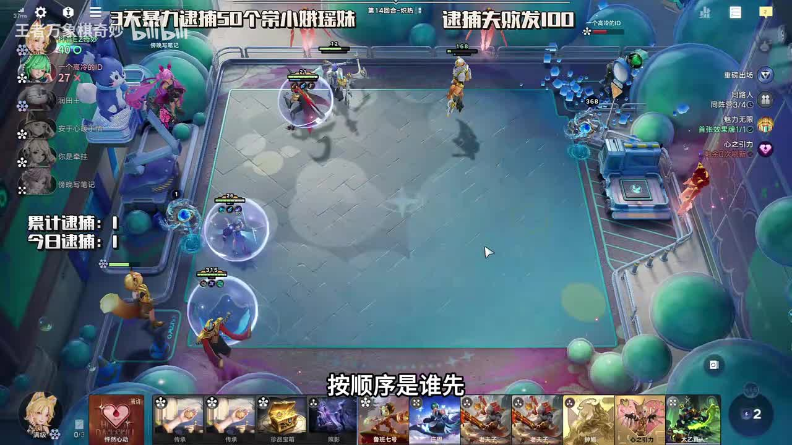

## 23:55–25:27 测试后发现不能无限互偷，改让嬴政居中供两侧吸取

- 事件 ID：BV1Wwec68E7u:p1:e021
- 场景：实战
- 时机：测试法强能否循环互偷
- 背景（分析推断）：假设被实际试验否定，保留纠正而非把猜想写机制
- 学习目标（分析推断）：用反馈检验假设并调整站位
- 模板：combat-review
- ASR 段落：[45, 47]

> 不能一直这样偷

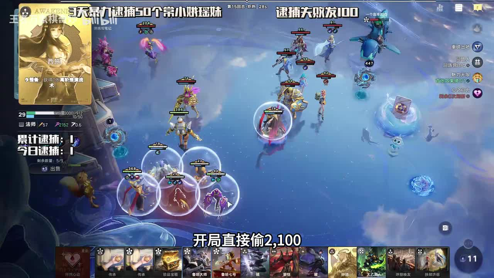

## 25:58–26:29 最后阶段补钟馗，而非长期保留全套成长工具

- 事件 ID：BV1Wwec68E7u:p1:e022
- 场景：实战
- 时机：最后回合或遇到强敌
- 背景（分析推断）：讲者只说明补强时机，未给出详细机制不补造
- 学习目标（分析推断）：识别终局工具与战力目标切换
- 模板：late-transition
- ASR 段落：[49]

> 或者遇到打不过的人

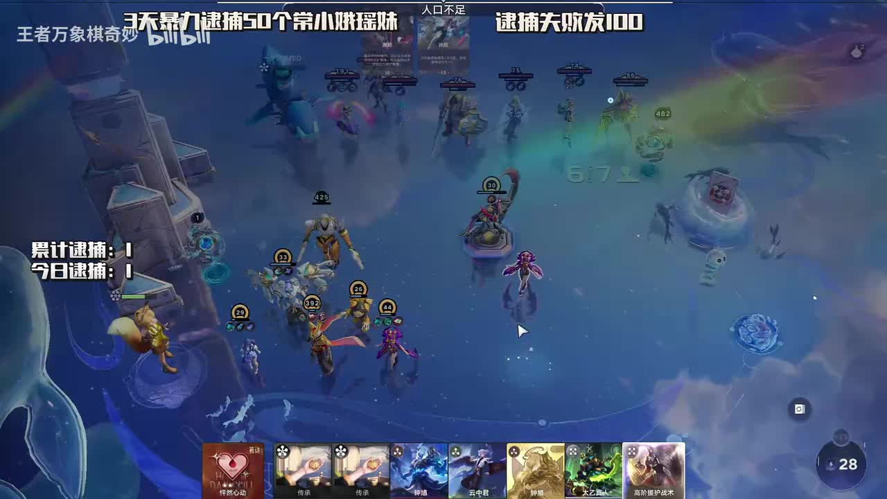

## 待核实与局限

- 本次不修正ASR，效果名称与同音英雄保留原话，四蓝等数值由截图能确认时另记。
- 第48段长重复卖牌及大量聊天、喊口号、无解释买卖均不计教学。
- 无限钱、无敌等夸张词不作为事实或学习效果验证。
- 法强互偷在本局测试后被讲者否定，不能只截早先猜想冒充机制。
