# 小妲己同路人+群英蒙恬召唤流，烧脑玩力竭了

来源：https://www.bilibili.com/video/BV1xiaE6VEHP/?p=1

分析状态：completed

完整文字稿：../../../raw/BV1xiaE6VEHP_p1.md

## 00:00–01:20 妲己有出牌经济才能养姜子牙；其他棋手可换雅典娜触发米莱迪。

- 事件 ID：BV1xiaE6VEHP:p1:e001
- 场景：前置讲解
- 时机：回顾姜子牙山鬼路线时
- 背景（分析推断）：前局路线不能忽略棋手经济差异。
- 学习目标（分析推断）：迁移策略时保留资源条件。
- 模板：opening-plan
- ASR 段落：[1, 2]

> 用雅典娜触发米莱迪

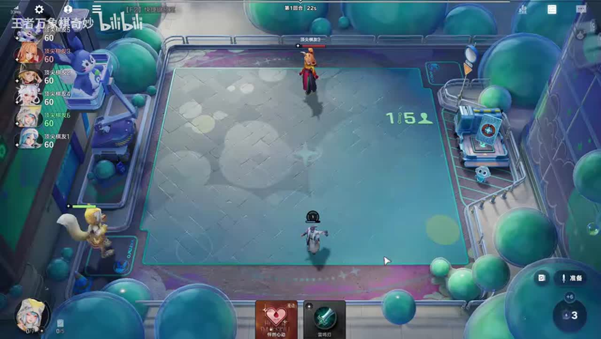

## 01:20–01:54 钟馗降等级有次数与首次生效限制，不能靠无限复活无限降。

- 事件 ID：BV1xiaE6VEHP:p1:e002
- 场景：实战
- 时机：解释钟馗复活限制时
- 背景（分析推断）：讲者纠正复活次数等于触发次数的误解。
- 学习目标（分析推断）：区分死亡、复活和有效触发条件。
- 模板：mechanic-model
- ASR 段落：[3]

> 中规最多降三次

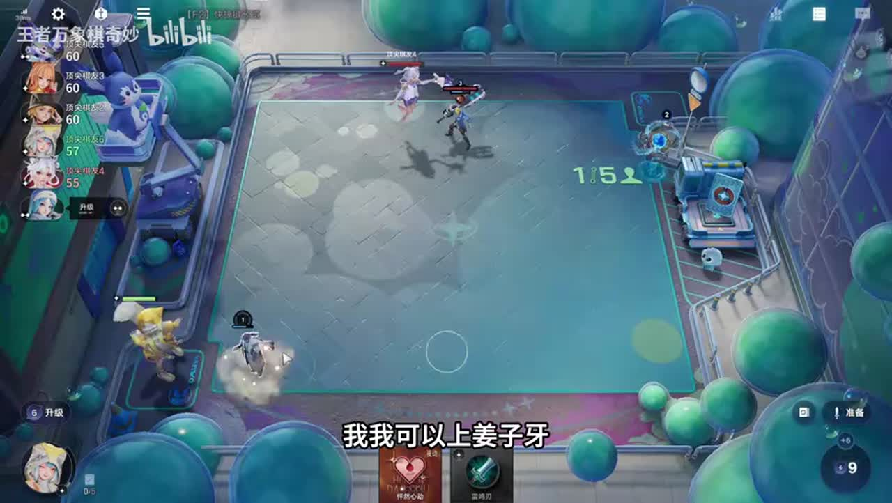

## 01:20–02:28 看妲己首个大招买牌门槛，前期无法赢则不选战斗触发，拿整装待发。

- 事件 ID：BV1xiaE6VEHP:p1:e003
- 场景：实战
- 时机：前期贫穷空城选天赋时
- 背景（分析推断）：前期买牌次数多，后期门槛下降才宽裕。
- 学习目标（分析推断）：根据启动曲线选择可兑现天赋。
- 模板：talent-fit
- ASR 段落：[3, 4]

> 前期巨穷前期是打不过人的

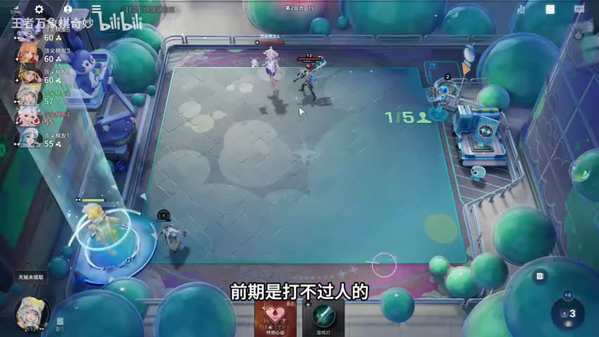

## 02:28–03:04 有赢律跟全体决策节奏，无赢律直接按本局升级。

- 事件 ID：BV1xiaE6VEHP:p1:e004
- 场景：实战
- 时机：升级前检查赢律时
- 背景（分析推断）：此局没有赢律，讲者明确观察步骤。
- 学习目标（分析推断）：把对手棋手信息纳入升级决策。
- 模板：level-transition
- ASR 段落：[5]

> 升级之前要看有没有盈率

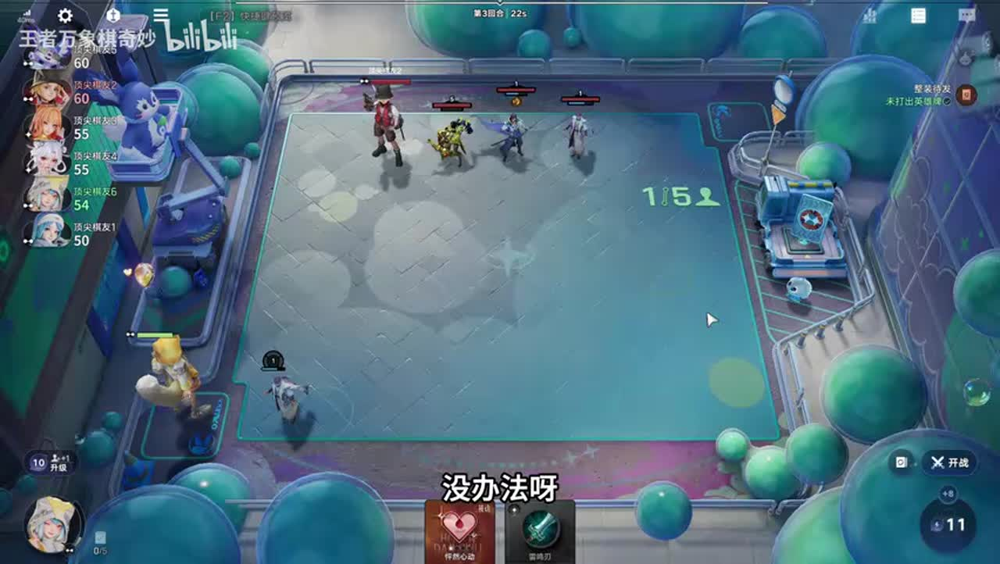

## 03:04–04:16 将每四张返一张与妲己买牌大招连接，形成持续资源链。

- 事件 ID：BV1xiaE6VEHP:p1:e005
- 场景：实战
- 时机：同路人出现时
- 背景（分析推断）：讲者比作额外玉环，强度限于大量出牌条件。
- 学习目标（分析推断）：识别经济与出牌返还的协同。
- 模板：talent-fit
- ASR 段落：[6, 7]

> 他打四张卡给一个

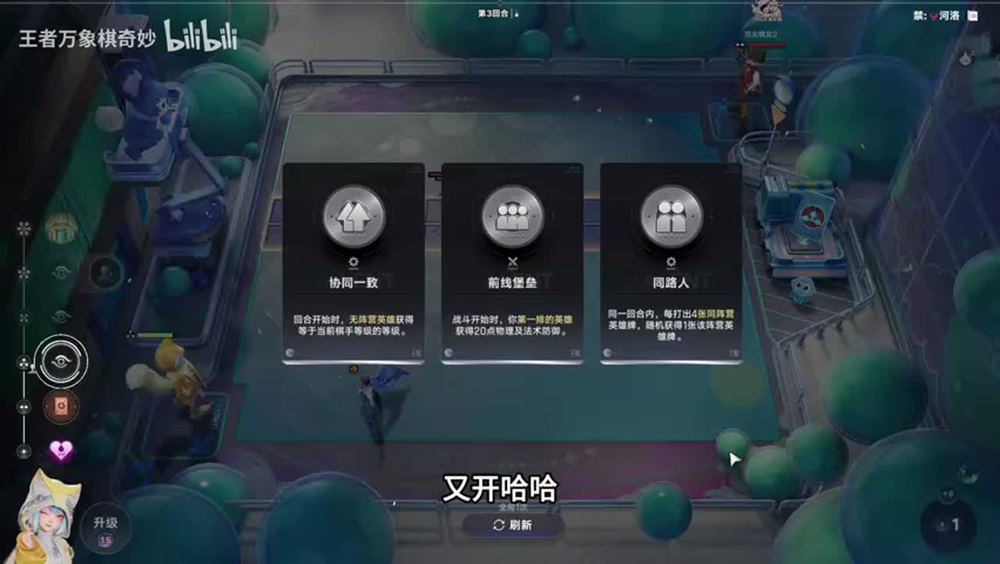

## 03:35–04:16 两块划算三块不买，按循环成本定买牌门槛。

- 事件 ID：BV1xiaE6VEHP:p1:e006
- 场景：实战
- 时机：购买蒙犽等牌时
- 背景（分析推断）：同一张牌是否值得买由价格改变。
- 学习目标（分析推断）：控制循环的净成本。
- 模板：economy-budget
- ASR 段落：[7]

> 三块钱买不划算

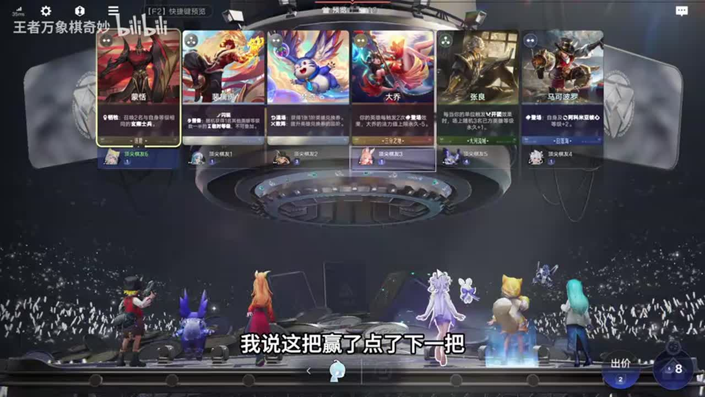

## 04:16–05:41 需要实战练习和失败复盘，不能把观看或一局胜利当作掌握。

- 事件 ID：BV1xiaE6VEHP:p1:e007
- 场景：前置讲解
- 时机：解释学习复杂路线时
- 背景（分析推断）：讲者谈自己多次失败后学会；夸张胜率与观看次数不视为验证。
- 学习目标（分析推断）：认识练习反馈的作用。
- 模板：mechanic-model
- ASR 段落：[8, 9]

> 都是练出来的。

## 05:42–06:19 买便宜牌触发妲己效果卡与大招，不能只刷新不买。

- 事件 ID：BV1xiaE6VEHP:p1:e008
- 场景：实战
- 时机：空城积累经济时
- 背景（分析推断）：一费牌虽弱仍推进循环门槛。
- 学习目标（分析推断）：把买牌行为与资源反馈联系。
- 模板：growth-combo
- ASR 段落：[10]

> 打击买四张卡出发给你个效果卡

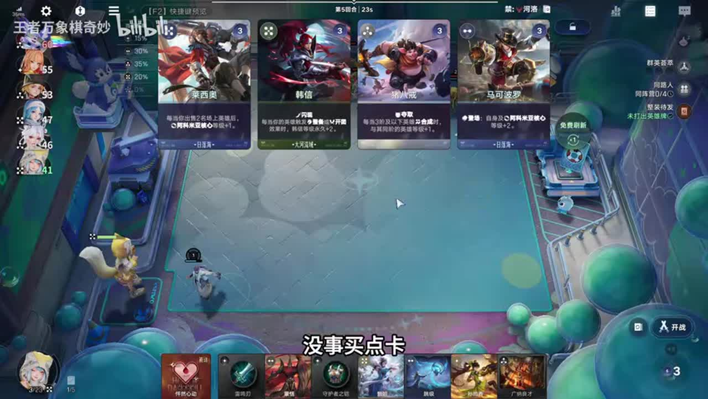

## 06:19–06:54 待同时满足同路人、群英与整装待发再启动。

- 事件 ID：BV1xiaE6VEHP:p1:e009
- 场景：实战
- 时机：解释为何暂不上人时
- 背景（分析推断）：过早上场损失多种收益。
- 学习目标（分析推断）：检查多个触发条件是否一起准备好。
- 模板：resource-order
- ASR 段落：[11]

> 上人吃不了整装带发

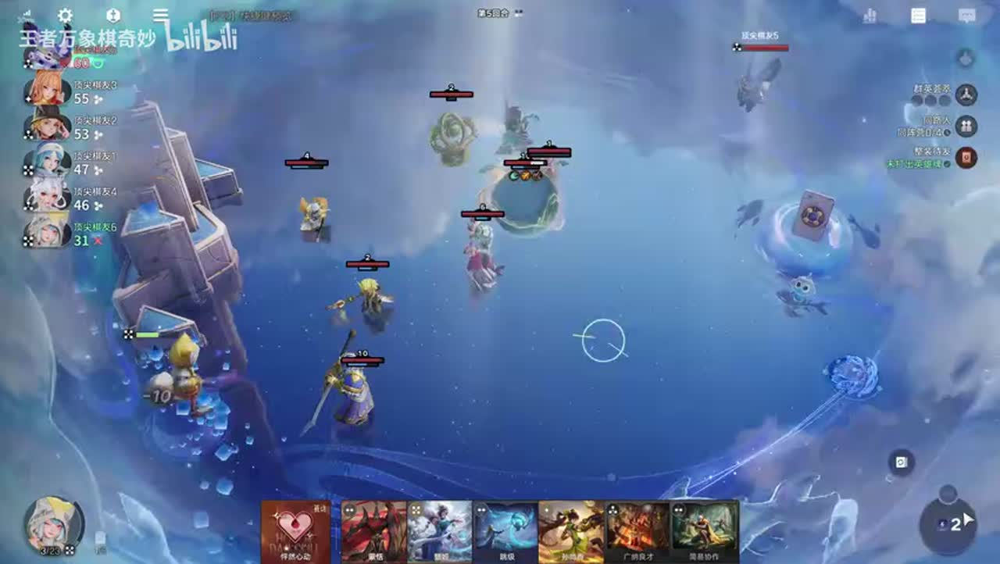

## 06:55–08:13 按不同费用牌组织群英与同路人，装备集中给蒙恬。

- 事件 ID：BV1xiaE6VEHP:p1:e010
- 场景：实战
- 时机：蒙恬组件齐后开始启动时
- 背景（分析推断）：由空城转为正式阵容，开始处理出牌顺序。
- 学习目标（分析推断）：将准备状态转换为执行清单。
- 模板：resource-order
- ASR 段落：[12, 13]

> 蒙田排齐了可以上了

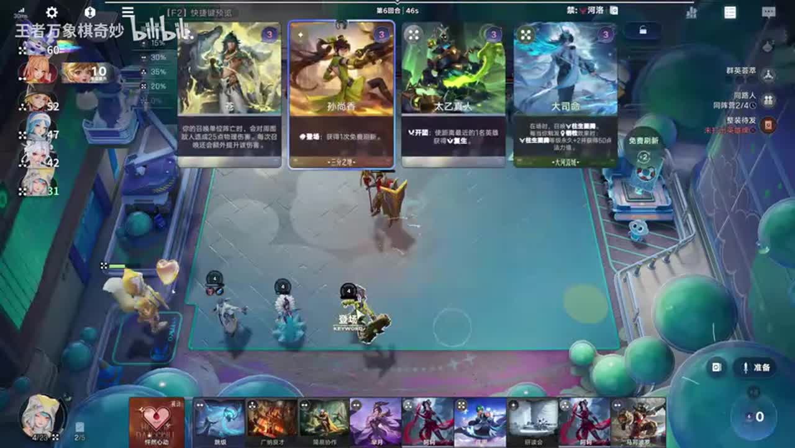

## 08:53–09:31 按不同牌的要求细排出牌顺序，避免浪费群体升级。

- 事件 ID：BV1xiaE6VEHP:p1:e011
- 场景：实战
- 时机：解释群英计数时
- 背景（分析推断）：讲者按3、4、2等费用计数；具体牌条件以界面为准待核。
- 学习目标（分析推断）：理解多类出牌触发。
- 模板：mechanic-model
- ASR 段落：[15]

> 你打三张不同的牌全体升级

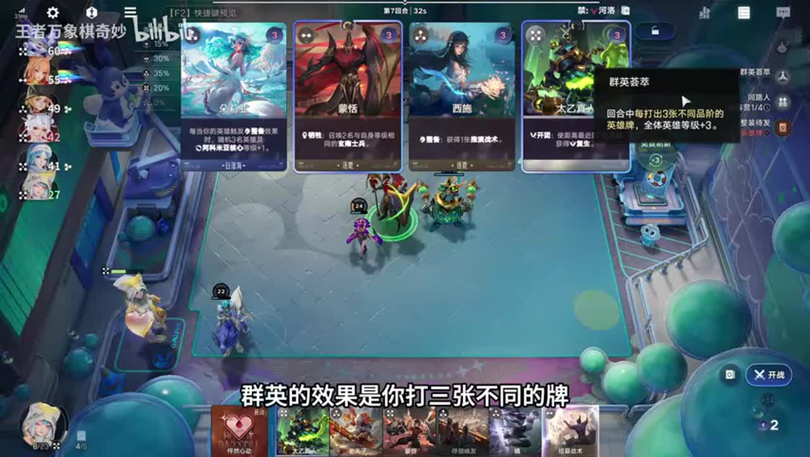

## 09:33–10:45 蒙恬召唤、芈月升级、西施减蓝、苍提供小兵死亡爆炸。

- 事件 ID：BV1xiaE6VEHP:p1:e012
- 场景：实战
- 时机：解释蒙恬炸兵组件时
- 背景（分析推断）：各单位承担不同功能；米莱迪有位才挂。
- 学习目标（分析推断）：用功能分工理解阵容。
- 模板：module-fit
- ASR 段落：[16, 17]

> 狼狗的效果是小兵死了会爆炸

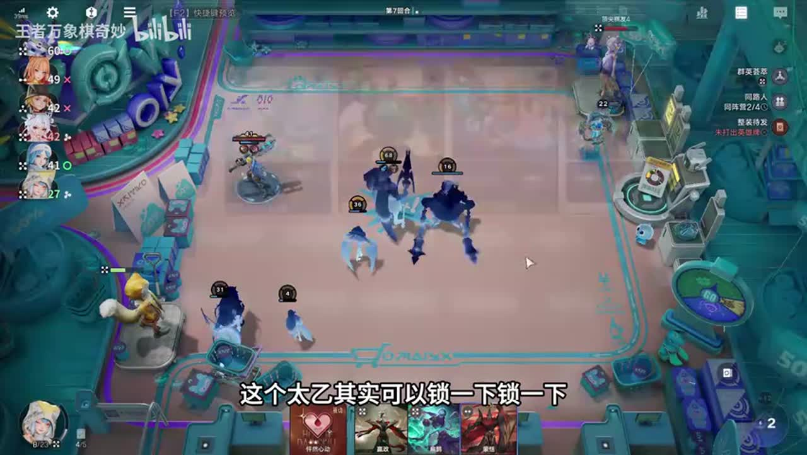

## 10:47–11:21 把可打两次的二费牌安排在合适顺序，利用觉醒后的再次出牌。

- 事件 ID：BV1xiaE6VEHP:p1:e013
- 场景：实战
- 时机：二费牌能觉醒时
- 背景（分析推断）：一张牌既能触发费用计数又能再利用。
- 学习目标（分析推断）：减少顺序造成的触发浪费。
- 模板：resource-order
- ASR 段落：[18]

> 这个二能打两次的

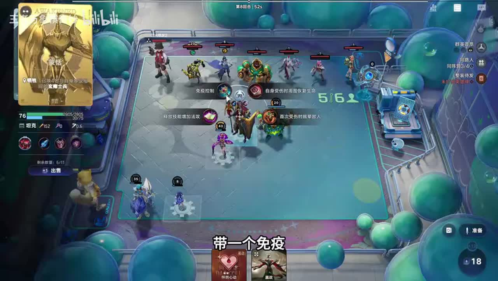

## 11:21–12:25 在低价窗口多买逐鹿牌，推动下一轮大招与多重触发。

- 事件 ID：BV1xiaE6VEHP:p1:e014
- 场景：实战
- 时机：进入廉价大招商店时
- 背景（分析推断）：当前仍有6块，按价格与阵营选择。
- 学习目标（分析推断）：计算循环里的购买价值。
- 模板：economy-budget
- ASR 段落：[19, 20]

> 我们买的越多,大招打的越快。

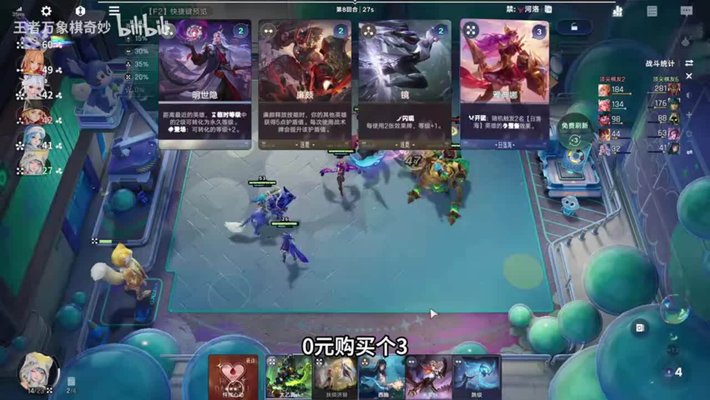

## 12:25–14:46 复现已有可用价值，追更好结果可能更差；讲者后悔贪婪。

- 事件 ID：BV1xiaE6VEHP:p1:e015
- 场景：实战
- 时机：放弃复现去刷新后
- 背景（分析推断）：这是选择后的反馈，不能只保留初始高评价。
- 学习目标（分析推断）：比较确定收益和重抽风险。
- 模板：combat-review
- ASR 段落：[21, 22, 24]

> 贪婪没贪好

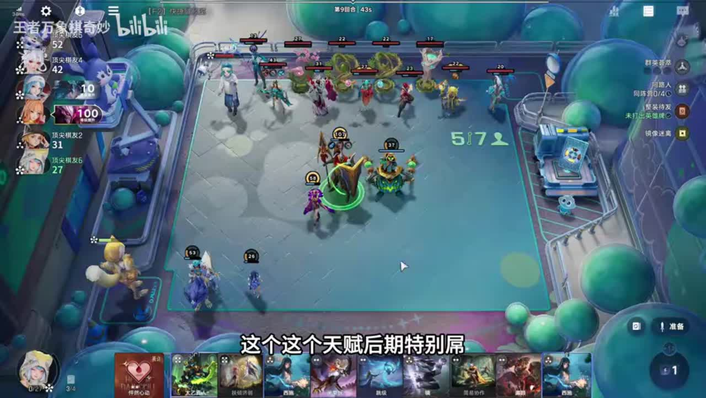

## 14:46–15:54 逐项检查群英、同路人与姜子牙，不靠记忆报一串操作。

- 事件 ID：BV1xiaE6VEHP:p1:e016
- 场景：实战
- 时机：同时处理多条计数时
- 背景（分析推断）：讲者出牌烧脑，缺某类牌影响触发。
- 学习目标（分析推断）：用可见进度降低认知负担。
- 模板：resource-order
- ASR 段落：[25, 26]

> 还要触发一下姜子牙的效果

## 15:54–17:07 保命单位优先确认，不能为继续成长漏掉应对东皇的复活。

- 事件 ID：BV1xiaE6VEHP:p1:e017
- 场景：实战
- 时机：忙于计数漏上太乙时
- 背景（分析推断）：太乙未上导致被咬输一轮，讲者认为两条命可赢属于预测。
- 学习目标（分析推断）：开战前检查关键战斗功能。
- 模板：combat-review
- ASR 段落：[27, 28]

> 这太一没有上

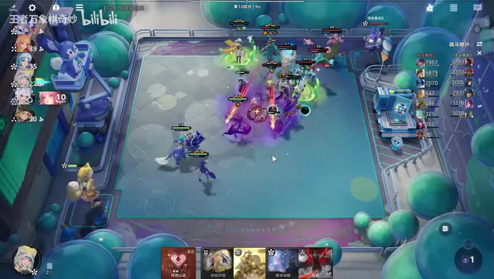

## 17:42–18:59 合成已兑现就卖，下轮换新老夫子再触发。

- 事件 ID：BV1xiaE6VEHP:p1:e018
- 场景：实战
- 时机：老夫子合成后
- 背景（分析推断）：工具的当前功能消耗后不再占位。
- 学习目标（分析推断）：区分可循环购买和无效持有。
- 模板：resource-order
- ASR 段落：[30, 31]

> 打了合成直接卖了

## 18:59–20:09 群英是全体升级，人越多覆盖收益越大；六级大招效果双倍。

- 事件 ID：BV1xiaE6VEHP:p1:e019
- 场景：实战
- 时机：争取更多人口时
- 背景（分析推断）：人口与技能等级都放大已有循环。
- 学习目标（分析推断）：按受益覆盖衡量升级。
- 模板：level-transition
- ASR 段落：[32, 33]

> 群鹰人口越多越好

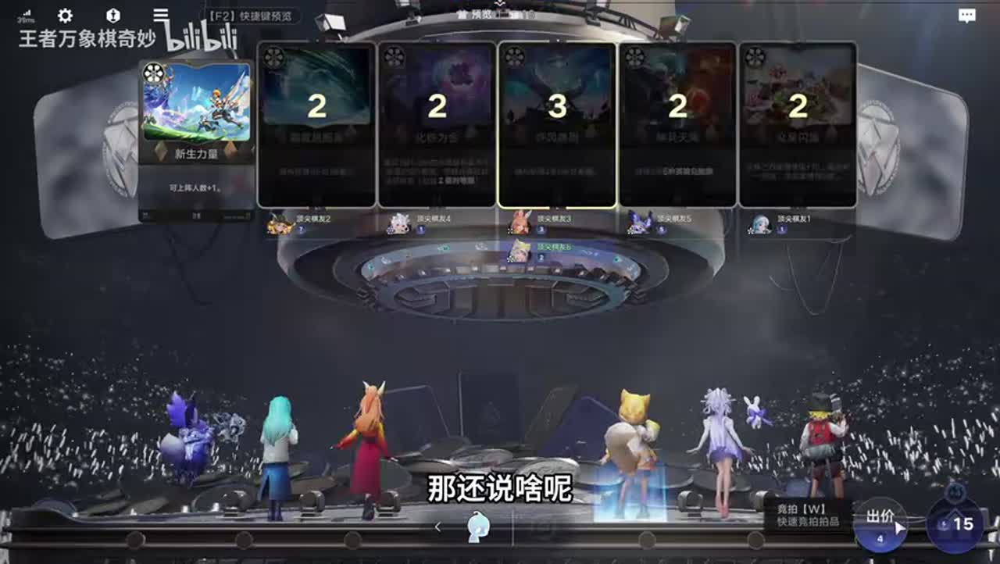

## 20:09–21:29 比较鲁班战术牌多次触发和程咬金固定两次，再随卡量考虑小乔。

- 事件 ID：BV1xiaE6VEHP:p1:e020
- 场景：实战
- 时机：新增工具位时
- 背景（分析推断）：支撑选择取决于有效触发次数，不是固定排名。
- 学习目标（分析推断）：计算工具的边际成长收益。
- 模板：module-fit
- ASR 段落：[34, 35]

> 不止触发两次的。

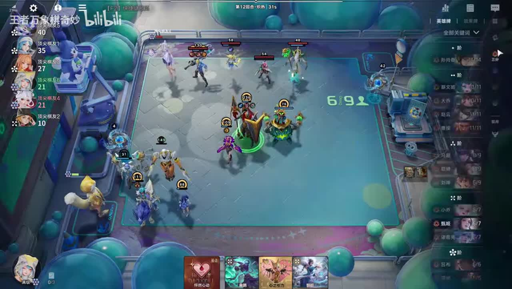

## 21:32–23:09 已经养了鲁班就保留，不为晚来的原定替代重做体系。

- 事件 ID：BV1xiaE6VEHP:p1:e021
- 场景：实战
- 时机：小乔迟到时
- 背景（分析推断）：已有支撑成长完成，切换成本增加。
- 学习目标（分析推断）：按时点判断迟来配件价值。
- 模板：fallback-plan
- ASR 段落：[36, 38]

> 他都养了这么久了,不要小桥了

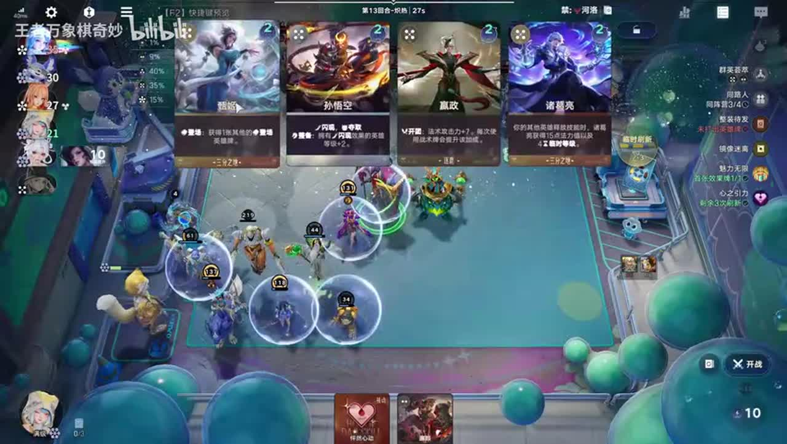

## 23:09–24:27 低蓝耗蒙恬需要回蓝装备，装备缺口解释其战斗位置。

- 事件 ID：BV1xiaE6VEHP:p1:e022
- 场景：实战
- 时机：蒙恬减蓝后缺圣杯时
- 背景（分析推断）：讲者已经给减蓝，但圣杯未到。
- 学习目标（分析推断）：区分减蓝与回蓝功能。
- 模板：equipment-role
- ASR 段落：[39, 40]

> 十篮蒙田带圣杯很屌的。

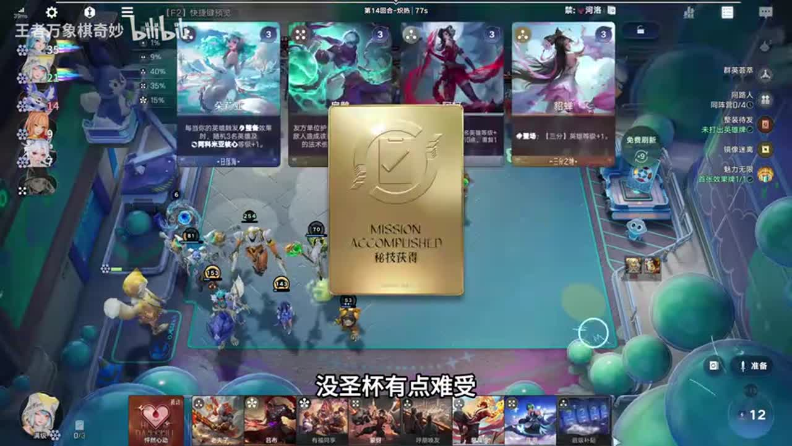

## 25:14–26:31 山鬼吃单位会阻止死亡爆炸，二者不能照搬同时叠加。

- 事件 ID：BV1xiaE6VEHP:p1:e023
- 场景：实战
- 时机：考虑同时上山鬼和苍时
- 背景（分析推断）：召唤与牺牲看似协同，实际触发相冲突。
- 学习目标（分析推断）：发现组件之间的机制冲突。
- 模板：module-fit
- ASR 段落：[42, 43]

> 山鬼直接给单位全吃了。

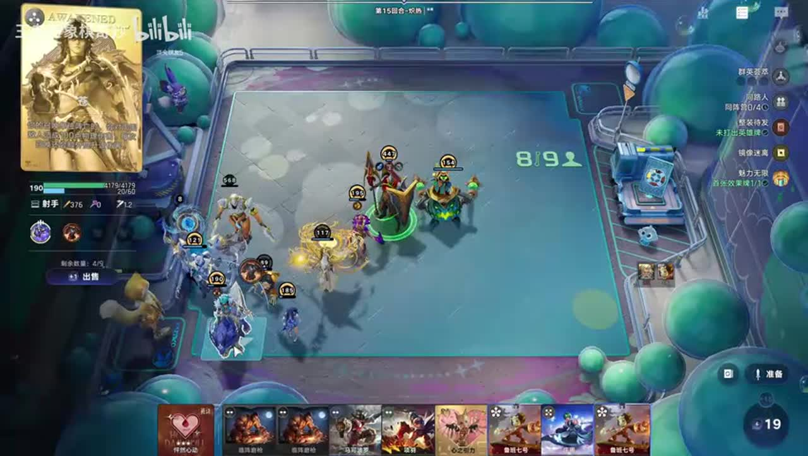

## 27:52–29:07 常规会难打，但此局群体等级高且多名输出，可分散单核风险。

- 事件 ID：BV1xiaE6VEHP:p1:e024
- 场景：实战
- 时机：对手东皇可咬蒙恬时
- 背景（分析推断）：讲者指出不是只有蒙恬承担输出。
- 学习目标（分析推断）：按实际输出结构评估控制威胁。
- 模板：counter-target
- ASR 段落：[46, 47]

> 我们全员都是C

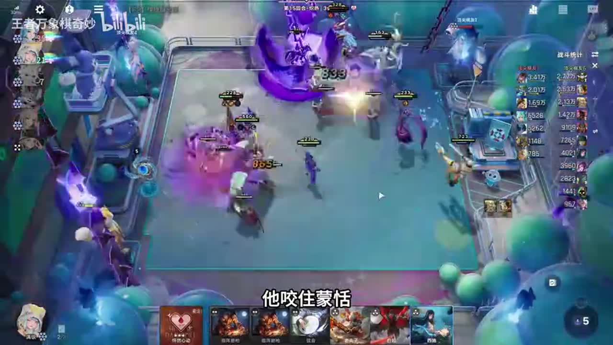

## 29:07–30:52 蒙恬转后排，靠回蓝持续召小兵，减少东皇接触。

- 事件 ID：BV1xiaE6VEHP:p1:e025
- 场景：实战
- 时机：圣杯终于到来时
- 背景（分析推断）：没有相应控制时后排收益更好；看似坦克实为召唤施法位。
- 学习目标（分析推断）：让装备与敌方控制共同决定站位。
- 模板：position-cause
- ASR 段落：[48, 49, 50, 51]

> 他其实是个召唤法师

## 待核实与局限

- 原始ASR术语和数值可能有误；未经画面确认者不作为精确机制结论。
