# 小妲己玩逐鹿天赋全烂不来牌？直接转山鬼。差点999

来源：https://www.bilibili.com/video/BV1xiaE6VEKv/?p=1

分析状态：completed

完整文字稿：../../../raw/BV1xiaE6VEKv_p1.md

## 00:39–01:47 对方只有一人可上一个减少损血，两人以上则本局选择空城。

- 事件 ID：BV1xiaE6VEKv:p1:e001
- 场景：实战
- 时机：空城过渡时
- 背景（分析推断）：讲者按本局入血规则比较3与5血，非所有模式通则。
- 学习目标（分析推断）：用敌方人数衡量过渡成本。
- 模板：opening-plan
- ASR 段落：[2, 3]

> 你如果不上人,他是入你五滴血

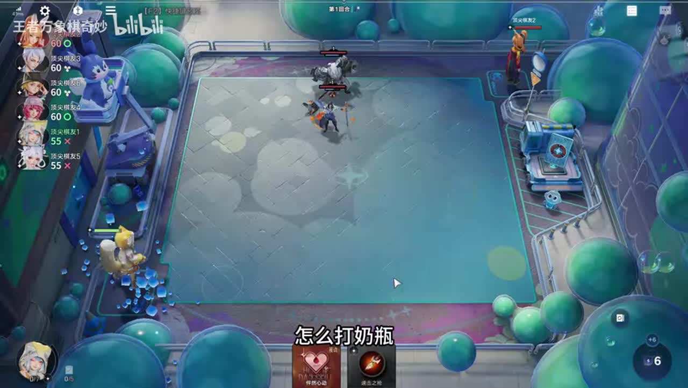

## 01:48–03:45 观察赢律升级与全体决策，跟随其节奏而非固定升级表。

- 事件 ID：BV1xiaE6VEKv:p1:e002
- 场景：实战
- 时机：同局有赢律时
- 背景（分析推断）：赢律的决策影响全体，此局特邀与技能条件重要。
- 学习目标（分析推断）：识别外部局势对升级时机的影响。
- 模板：level-transition
- ASR 段落：[4, 5, 6]

> 嬴政能开一个全体生效的决策

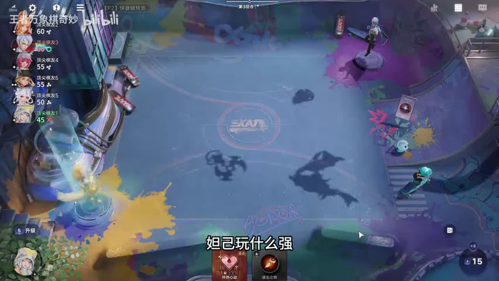

## 02:58–03:45 金算盘或极充足经济才考虑高费倒转，一般逐鹿嬴政。

- 事件 ID：BV1xiaE6VEKv:p1:e003
- 场景：实战
- 时机：确定妲己路线时
- 背景（分析推断）：讲者根据经济门槛解释棋手可用路线。
- 学习目标（分析推断）：先判断能否承担路线成本。
- 模板：opening-plan
- ASR 段落：[6]

> 稍微穷一点都玩不了

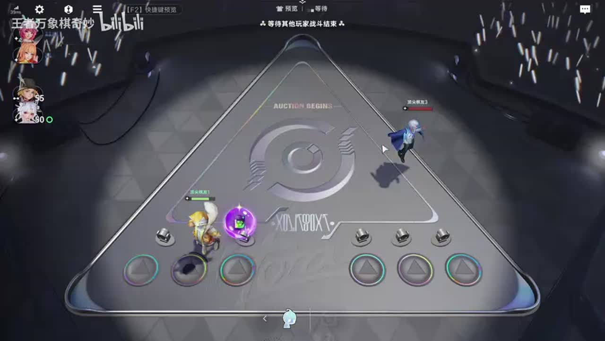

## 04:28–06:29 无法击败对手时不急点，累计从点选后才开始。

- 事件 ID：BV1xiaE6VEKv:p1:e004
- 场景：实战
- 时机：无战力时选抢攻类天赋
- 背景（分析推断）：讲者前期空城且担心五回合窗口无法达标。
- 学习目标（分析推断）：在启动前检查任务达成能力。
- 模板：talent-fit
- ASR 段落：[8, 9, 10]

> 这个是你点了之后,才,才算的。

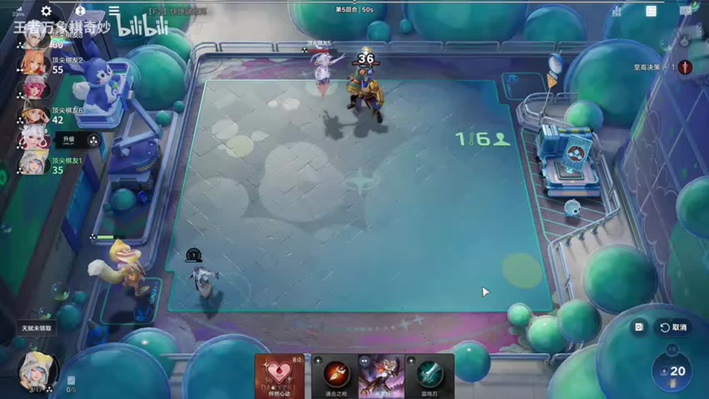

## 06:36–09:20 停止强玩逐鹿，转牺牲召唤山鬼。

- 事件 ID：BV1xiaE6VEKv:p1:e005
- 场景：实战
- 时机：逐鹿缺芈月且天赋不给钱时
- 背景（分析推断）：原路线没有成长发动机和经济，嬴政也无法救场。
- 学习目标（分析推断）：以启动失败为转型信号。
- 模板：fallback-plan
- ASR 段落：[11, 12, 13]

> 这把真玩不了足路

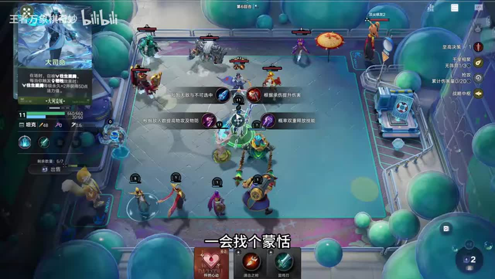

## 07:34–10:03 找蒙恬、鬼谷子等牺牲功能，蒙恬自身等级不必高。

- 事件 ID：BV1xiaE6VEKv:p1:e006
- 场景：实战
- 时机：转山鬼找牺牲时
- 背景（分析推断）：所需的是死亡与小兵触发，不是蒙恬输出。
- 学习目标（分析推断）：按功能挑选转型配件。
- 模板：module-fit
- ASR 段落：[12, 13, 14]

> 蒙天等级无所谓啊

## 10:03–12:14 转而养鬼谷子、少司缘与相关图腾等级。

- 事件 ID：BV1xiaE6VEKv:p1:e007
- 场景：实战
- 时机：拿到灵机升华时
- 背景（分析推断）：新天赋改变山鬼成长链与工具优先级。
- 学习目标（分析推断）：让新选项改变培养对象。
- 模板：talent-fit
- ASR 段落：[15, 16, 17]

> 得把他俩这个图腾给养起来

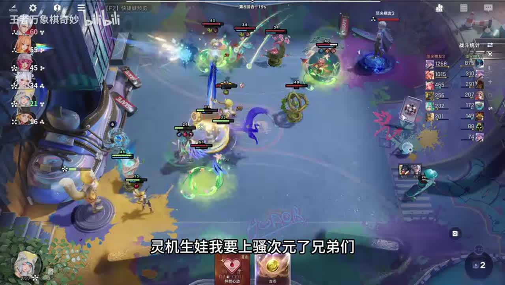

## 12:14–13:02 三根图腾需高等级，鲁班大师能吸收多人等级。

- 事件 ID：BV1xiaE6VEKv:p1:e008
- 场景：实战
- 时机：解释三根柱子成长时
- 背景（分析推断）：围绕灵机升华建立多目标成长，而不是只养山鬼。
- 学习目标（分析推断）：理解链式成长节点。
- 模板：growth-combo
- ASR 段落：[18]

> 这三根柱子等级都得高

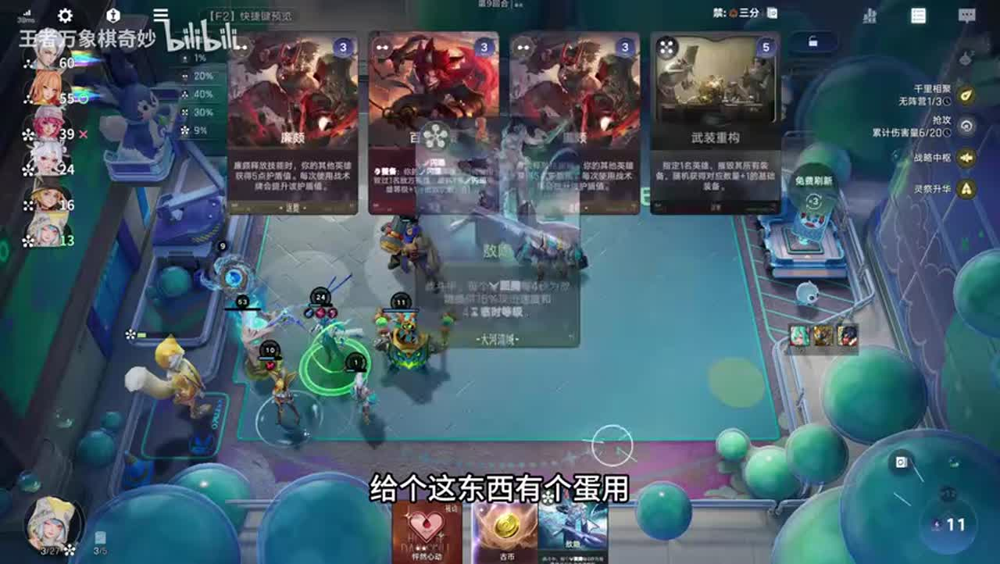

## 13:06–14:32 检查剩余累计伤害与窗口，必要时本轮完成。

- 事件 ID：BV1xiaE6VEKv:p1:e009
- 场景：实战
- 时机：抢攻任务临近结束时
- 背景（分析推断）：讲者还差两点，下一轮成败会影响奖励。
- 学习目标（分析推断）：在资源失效前确认任务进度。
- 模板：resource-order
- ASR 段落：[19, 20]

> 还差两点,这轮得打够

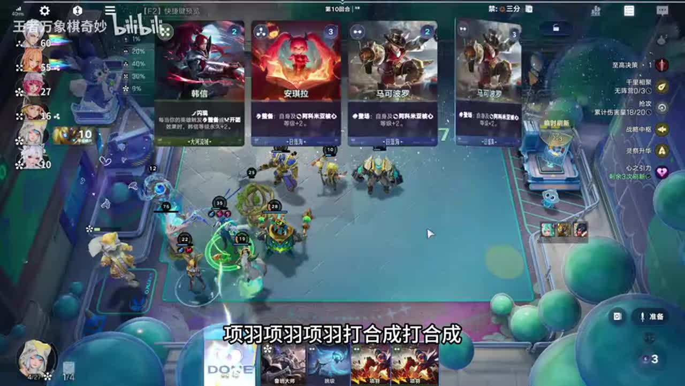

## 14:34–15:49 姜子牙同时给多名单位升级，与大量出牌结合。

- 事件 ID：BV1xiaE6VEKv:p1:e010
- 场景：实战
- 时机：姜子牙上场后
- 背景（分析推断）：山鬼、机器人等同时受益，需要保留成长工具位。
- 学习目标（分析推断）：理解群体成长效率。
- 模板：growth-combo
- ASR 段落：[21, 22]

> 江子牙能同时给三个人升级

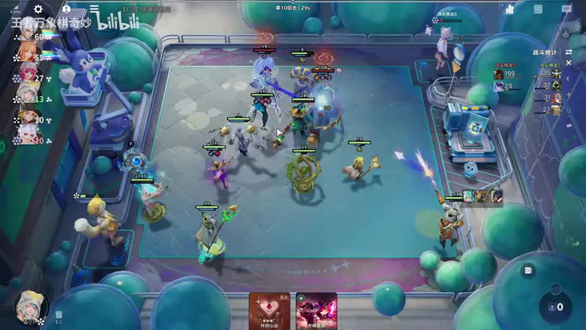

## 15:15–15:49 蒙恬提供牺牲虽有用，位置不足时仍可移除。

- 事件 ID：BV1xiaE6VEKv:p1:e011
- 场景：实战
- 时机：场上位置不够时
- 背景（分析推断）：功能有价值不代表任何阶段都必须占位。
- 学习目标（分析推断）：比较边际收益与人口成本。
- 模板：late-transition
- ASR 段落：[22]

> 位置不够了就不要蒙田了

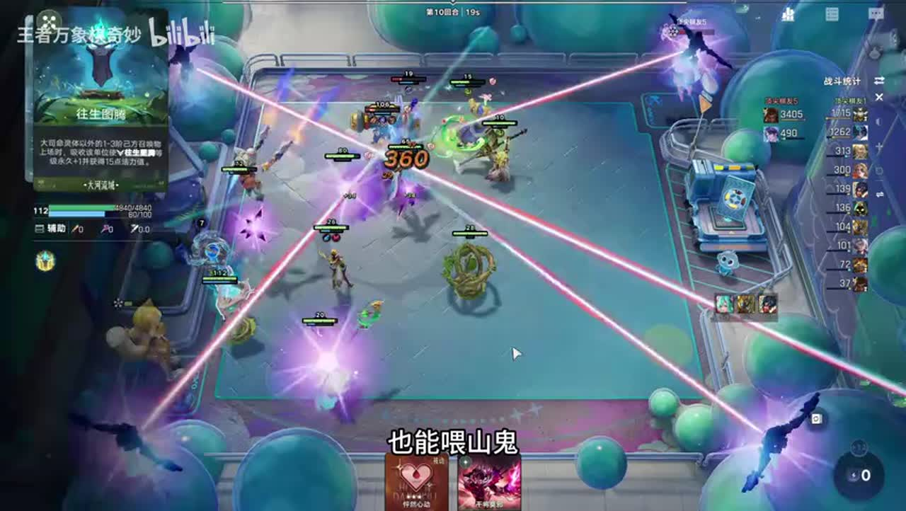

## 17:20–18:01 装备给能持有的单位，山鬼自身不能直接带。

- 事件 ID：BV1xiaE6VEKv:p1:e012
- 场景：实战
- 时机：山鬼路线做装备时
- 背景（分析推断）：讲者尝试肉装、圣杯等，具体名称有疑词。
- 学习目标（分析推断）：分清召唤单位与装备载体。
- 模板：equipment-role
- ASR 段落：[25]

> 山鬼怎么带装备?

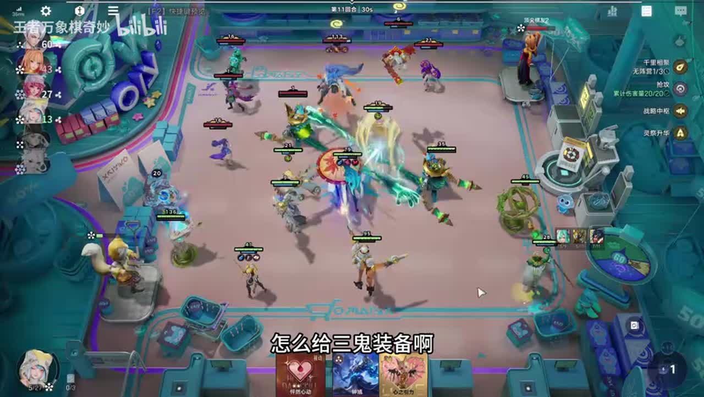

## 16:30–18:01 把敌方控向中间，降低飞到后排的风险。

- 事件 ID：BV1xiaE6VEKv:p1:e013
- 场景：实战
- 时机：面对阿离伞位移时
- 背景（分析推断）：伞按人数最多位置飞，调整集中方向影响接敌。
- 学习目标（分析推断）：用敌方目标规则保护后排。
- 模板：position-cause
- ASR 段落：[24, 25]

> 空到这个中间,他就不会飞后排了。

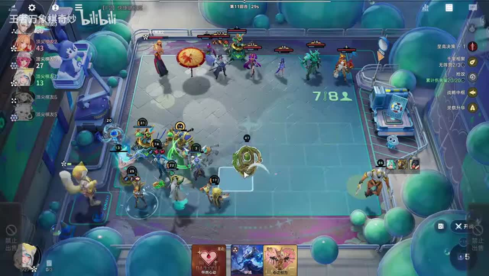

## 18:02–18:48 识别对手钢气护体等防御，考虑增加人口补功能。

- 事件 ID：BV1xiaE6VEKv:p1:e014
- 场景：实战
- 时机：高等级仍打不动时
- 背景（分析推断）：讲者被对手强度惊到，说明等级不能替代机制检查。
- 学习目标（分析推断）：复盘耐久机制与功能缺口。
- 模板：combat-review
- ASR 段落：[26]

> 钢器呼提有点猛啊

## 18:52–19:36 先升六级利用双倍神兵天降，目标鲁班大师觉醒。

- 事件 ID：BV1xiaE6VEKv:p1:e015
- 场景：实战
- 时机：拿神兵天降觉醒工具时
- 背景（分析推断）：升级直接影响资源收益，需先后顺序。
- 学习目标（分析推断）：按倍率窗口组织升级与兑换。
- 模板：level-transition
- ASR 段落：[27]

> 上6之后双倍神兵天降

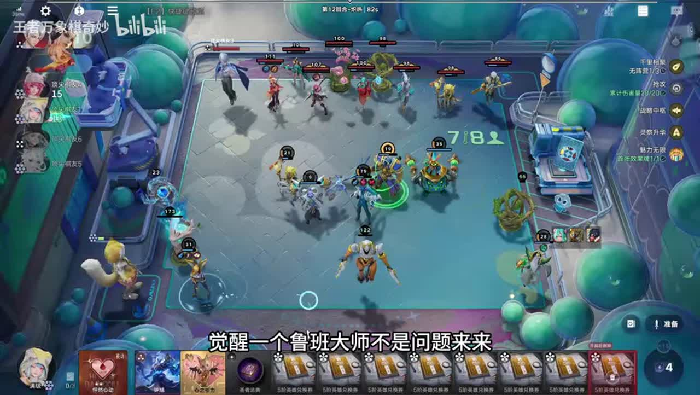

## 20:15–21:01 用露娜、雅典娜触发后再卖，别先卖成长发动机。

- 事件 ID：BV1xiaE6VEKv:p1:e016
- 场景：实战
- 时机：临时触发米莱迪时
- 背景（分析推断）：工具可能只留一轮，但应先兑现触发。
- 学习目标（分析推断）：掌握工具退场的顺序。
- 模板：resource-order
- ASR 段落：[29]

> 这个东西出发一轮,米莱迪直接给他卖了。

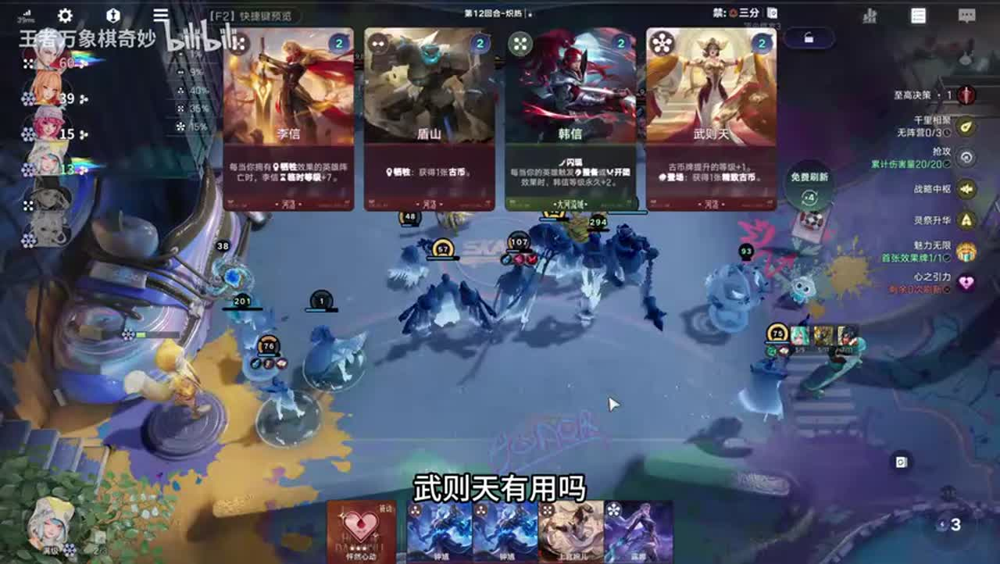

## 22:19–23:31 大司命继承召唤最高等级，米莱迪成长加机器人，灵机升华放大图腾死亡收益。

- 事件 ID：BV1xiaE6VEKv:p1:e017
- 场景：实战
- 时机：解释大司命与山鬼联动时
- 背景（分析推断）：多段等级继承组成链，具体数值以当时技能为限。
- 学习目标（分析推断）：能解释哪个节点死亡后提升谁。
- 模板：growth-combo
- ASR 段落：[32, 33]

> 山鬼和机器人都能吃米莱迪

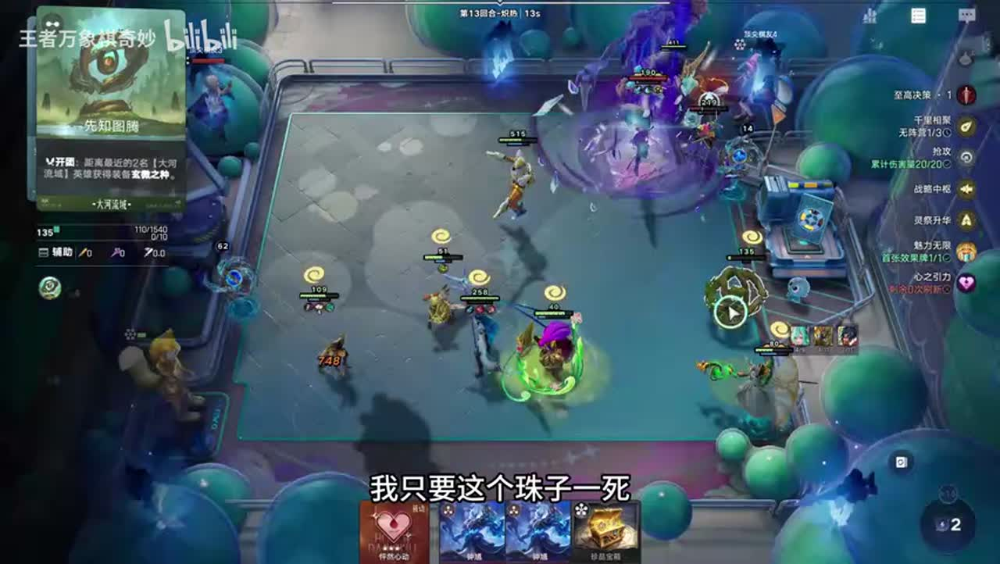

## 23:31–24:07 先检查本轮首次效果牌是否已消耗，避免误判双倍。

- 事件 ID：BV1xiaE6VEKv:p1:e018
- 场景：实战
- 时机：考虑首个效果双倍时
- 背景（分析推断）：讲者明确第一次已交，后续不能照搬双倍预期。
- 学习目标（分析推断）：操作前确认倍率状态。
- 模板：resource-order
- ASR 段落：[34]

> 第一个效果卡双倍已经交过了

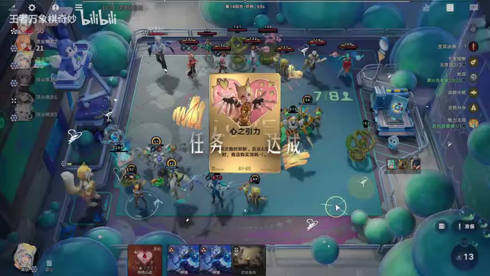

## 24:43–26:36 觉醒优先级转鬼谷子；将图腾放前排尽快死亡，而非继续养已低效整备。

- 事件 ID：BV1xiaE6VEKv:p1:e019
- 场景：实战
- 时机：后期米莱迪仍未觉醒时
- 背景（分析推断）：早期米莱迪更重要，后期每轮两级收益已小。
- 学习目标（分析推断）：让阶段目标决定工具优先级。
- 模板：late-transition
- ASR 段落：[36, 37, 38]

> 如果一开始的话是米莱迪觉醒更重要

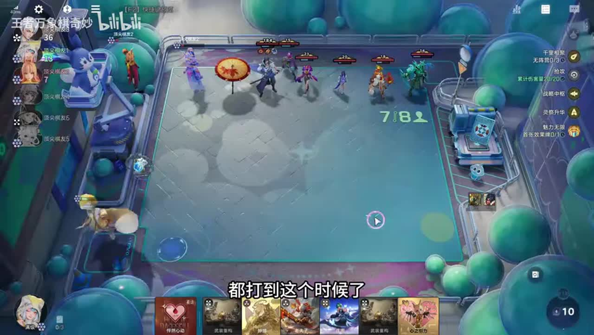

## 26:37–27:49 集中中间单位引导敌人飞中间，使图腾死亡兑现成长。

- 事件 ID：BV1xiaE6VEKv:p1:e020
- 场景：实战
- 时机：希望先知图腾被炸时
- 背景（分析推断）：死亡在此链中是收益，不能一律保护图腾。
- 学习目标（分析推断）：按机制决定哪些目标需要主动牺牲。
- 模板：position-cause
- ASR 段落：[39, 40]

> 他飞中间他把先知图腾给炸了

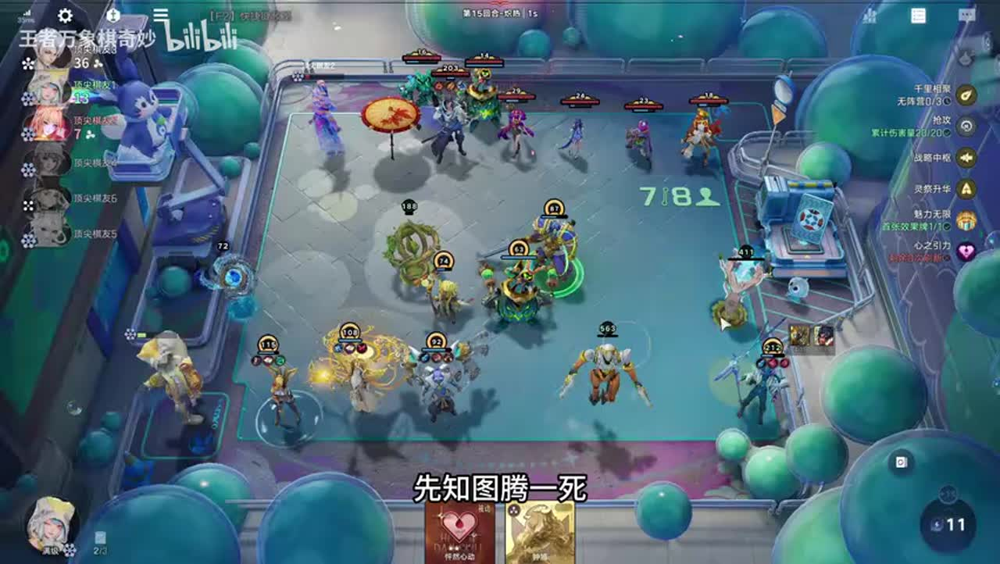

## 27:50–28:27 承认倍率资源没用好，后续重新检查目标和顺序。

- 事件 ID：BV1xiaE6VEKv:p1:e021
- 场景：实战
- 时机：首购双倍交错后
- 背景（分析推断）：讲者主动指出操作失误，不能省略只展示高等级。
- 学习目标（分析推断）：从错序反推操作检查点。
- 模板：combat-review
- ASR 段落：[41]

> 双倍交错了嘛没交好

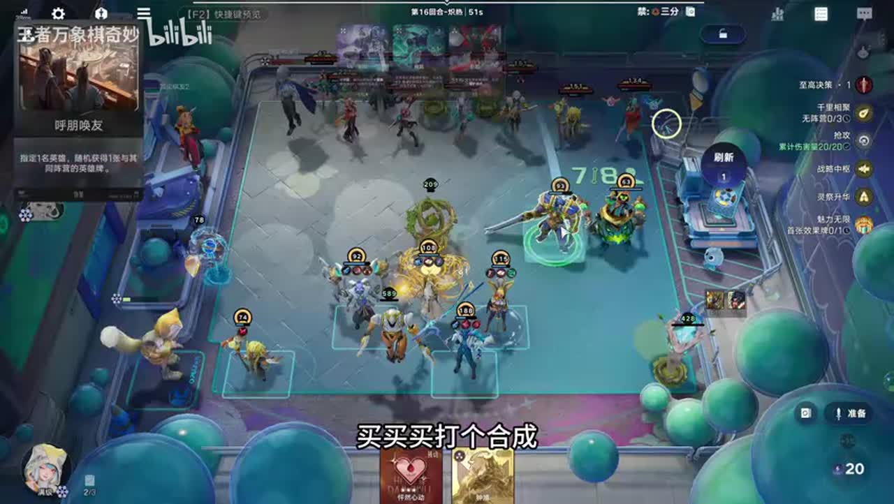

## 28:27–29:40 法强给姜子牙更有用，不把装备属性盲给不受益单位。

- 事件 ID：BV1xiaE6VEKv:p1:e022
- 场景：实战
- 时机：洗法强时
- 背景（分析推断）：讲者发现原目标法强没用，重评属性收益。
- 学习目标（分析推断）：按技能收益匹配装备属性。
- 模板：equipment-cause
- ASR 段落：[42, 43]

> 应该给姜子牙带的

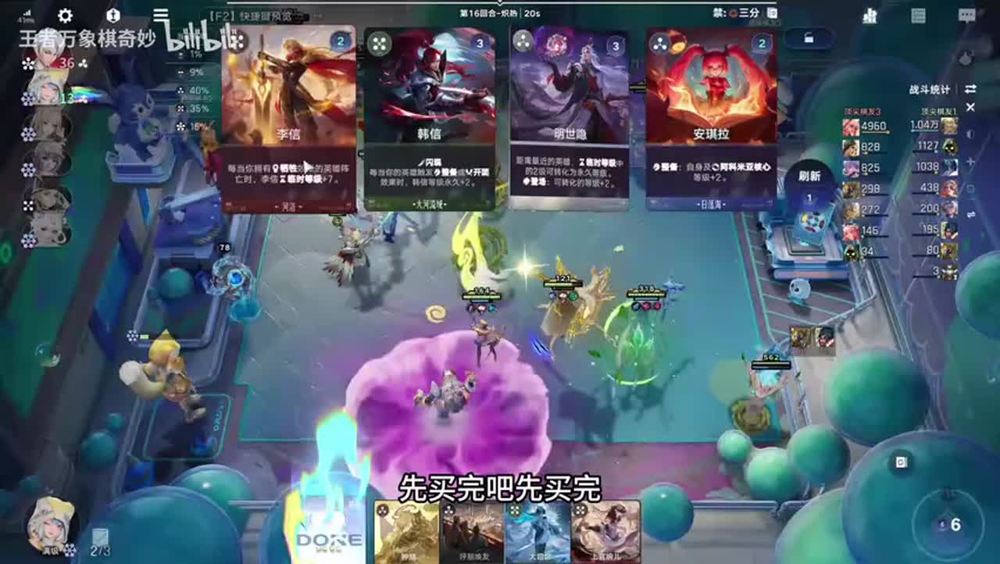

## 29:40–30:17 图腾死亡先提高最高等级大河，再通过大司命等级让山鬼吃多段收益。

- 事件 ID：BV1xiaE6VEKv:p1:e023
- 场景：实战
- 时机：再次解释灵机升华时
- 背景（分析推断）：末局解释机制，和初次选天赋不同时间独立记录。
- 学习目标（分析推断）：建立可迁移的因果链。
- 模板：mechanic-model
- ASR 段落：[44]

> 山鬼吃一口灵机生花等级,再吃一口大师命等级

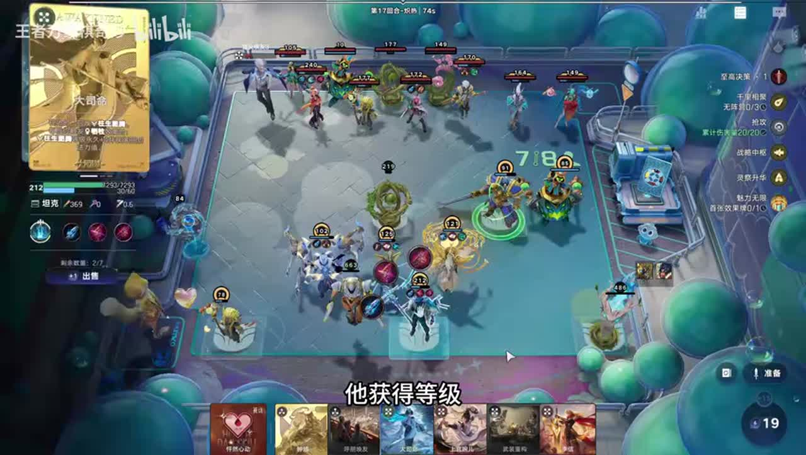

## 30:20–31:27 购买不在场阵营同时触发姜子牙，并通过无阵营牌触发另一成长。

- 事件 ID：BV1xiaE6VEKv:p1:e024
- 场景：实战
- 时机：后期选购外阵营牌时
- 背景（分析推断）：一张出牌可接多条资源链。
- 学习目标（分析推断）：识别多重触发的低成本牌。
- 模板：growth-combo
- ASR 段落：[45, 46]

> 江子牙打不在场阵营的时候在场的阵营能升级

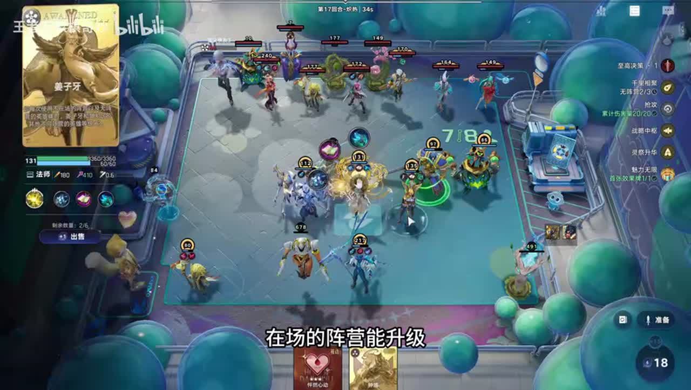

## 31:27–32:12 不把理论999写成实测；钟馗的降等级与牺牲功能按敌方强度决定是否补。

- 事件 ID：BV1xiaE6VEKv:p1:e025
- 场景：实战
- 时机：对手提前死亡山鬼未出时
- 背景（分析推断）：本局胜利但山鬼未完成预期召唤，标题差点999。
- 学习目标（分析推断）：区分理论上限和真实战斗结果。
- 模板：combat-review
- ASR 段落：[47]

> 我山鬼还没出来你都死了

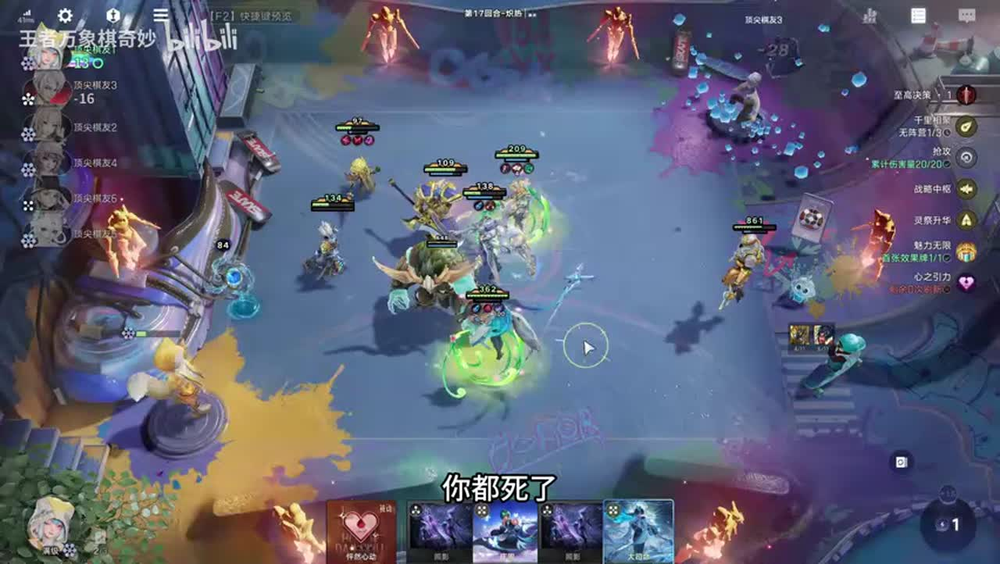

## 待核实与局限

- 原始ASR术语和数值可能有误；未经画面确认者不作为精确机制结论。
