# 廉颇是毒攻略？4500分游刃有余全局精讲细节拉满

来源：https://www.bilibili.com/video/BV1X5e669EBe/?p=1

分析状态：completed

完整文字稿：../../../raw/BV1X5e669EBe_p1.md

## 00:39–01:42 每回合十张牌触发主角上限，前期保留资金到三级找廉颇

- 事件 ID：BV1X5e669EBe:p1:e001
- 场景：实战
- 时机：解释棋手技能与启动窗口
- 背景（分析推断）：前期卡量不足且需拍卖回城启动
- 学习目标（分析推断）：识别回合触发上限及分阶段任务
- 模板：mechanic-model
- ASR 段落：[2, 3]

> 至少打十张

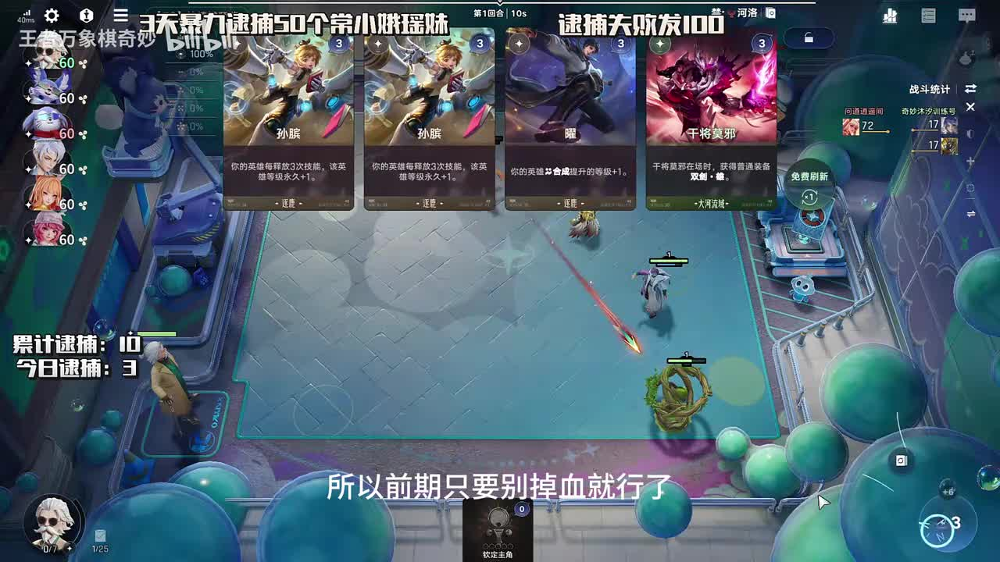

## 01:42–02:44 逐鹿刷新依赖经济，钱优先、其次血量

- 事件 ID：BV1X5e669EBe:p1:e002
- 场景：实战
- 时机：选择初期天赋
- 背景（分析推断）：候选天赋不能仅看战力或高阶牌
- 学习目标（分析推断）：按阵容瓶颈评价天赋
- 模板：talent-fit
- ASR 段落：[4, 5]

> 钱跟血都没有

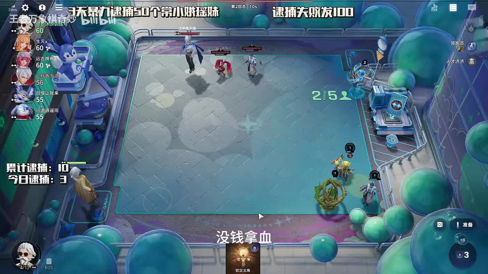

## 02:44–03:46 孟奇出售给券再开牌形成多次出牌，战败可变二阶券

- 事件 ID：BV1X5e669EBe:p1:e003
- 场景：实战
- 时机：准备每回合十张牌
- 背景（分析推断）：二阶池含廉颇芈月等关键卡
- 学习目标（分析推断）：计算工具牌的多次触发价值
- 模板：growth-combo
- ASR 段落：[6, 7]

> 兑换券里面开的还算一张

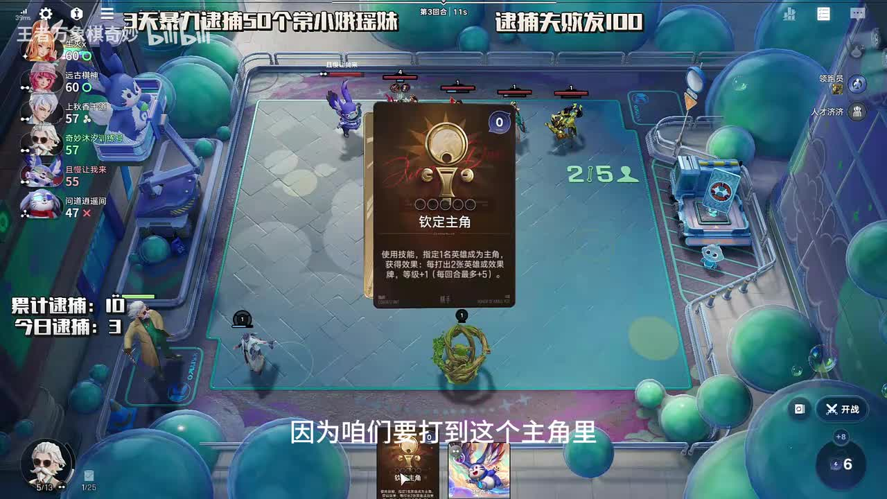

## 03:46–05:11 设置预算上限，比较一块与两块开价的追价风险

- 事件 ID：BV1X5e669EBe:p1:e004
- 场景：实战
- 时机：拍卖出现芈月
- 背景（分析推断）：需要芈月成长工具，尚未回城升级
- 学习目标（分析推断）：把收益与实际总价一起考虑
- 模板：auction-choice
- ASR 段落：[8, 9]

> 他顶就四块

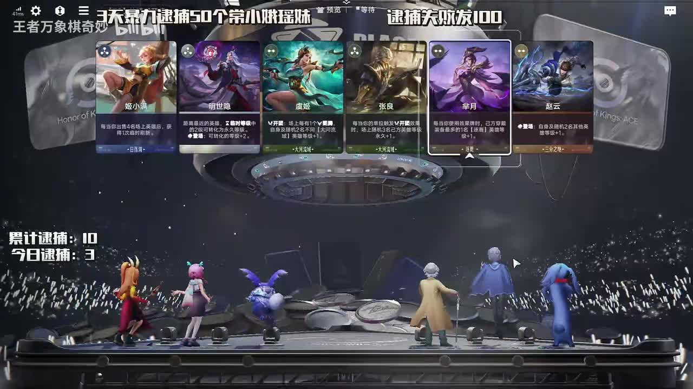

## 04:18–06:10 先主角、再上工具触发；人才搜寻留四级开

- 事件 ID：BV1X5e669EBe:p1:e005
- 场景：实战
- 时机：三级核心到位后准备出牌
- 背景（分析推断）：杂鱼不能无序买，触发次数与卡池共同决定顺序
- 学习目标（分析推断）：在正确目标与卡池下兑现资源
- 模板：resource-order
- ASR 段落：[9, 11]

> 人才搜寻四级开吧

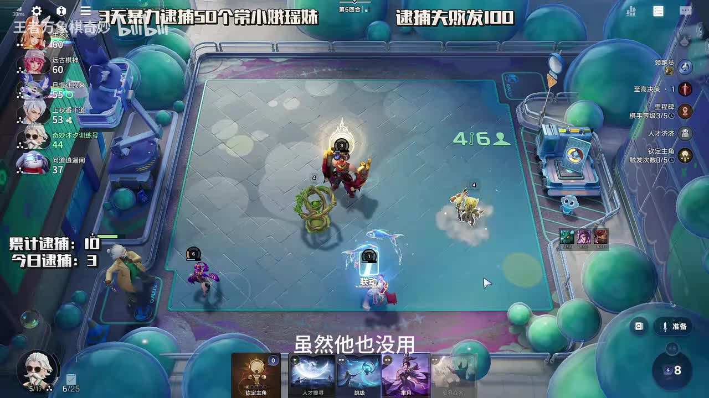

## 06:10–07:18 廉颇25级后额外升级，芈月觉醒比廉颇觉醒更重要

- 事件 ID：BV1X5e669EBe:p1:e006
- 场景：实战
- 时机：主角加级但成长尚慢
- 背景（分析推断）：廉颇是战斗核心但成长关键来自辅助词条
- 学习目标（分析推断）：区分主C身份与觉醒收益优先级
- 模板：growth-combo
- ASR 段落：[12, 13]

> 敏玥觉醒重要

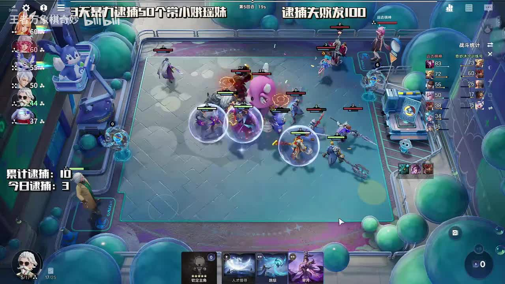

## 07:25–08:22 主角触发可继续触发额外升级，计数达到回合上限

- 事件 ID：BV1X5e669EBe:p1:e007
- 场景：实战
- 时机：风神一瞬出现
- 背景（分析推断）：一回合主角五级不是全部成长收益
- 学习目标（分析推断）：理解多机制叠加的触发链
- 模板：growth-combo
- ASR 段落：[14, 15]

> 实际上加的就不是五级了

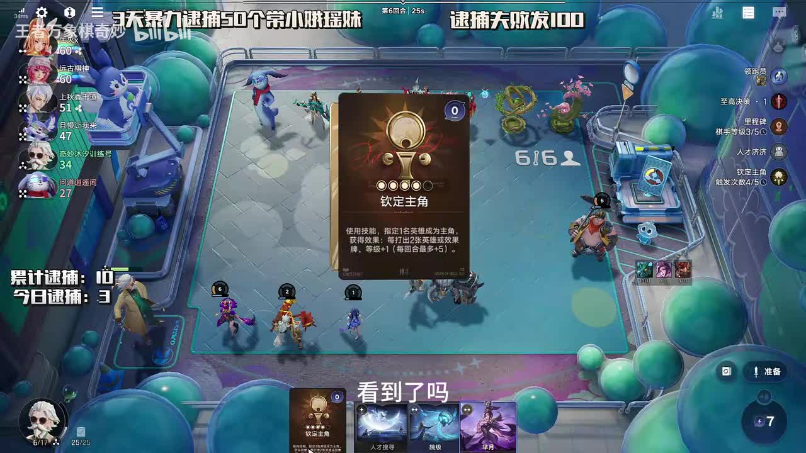

## 08:22–08:55 停止消耗并留卡给下轮

- 事件 ID：BV1X5e669EBe:p1:e008
- 场景：实战
- 时机：本回合触发已满
- 背景（分析推断）：前期每轮资金有限，当前再出牌无额外主角收益
- 学习目标（分析推断）：按回合上限分配卡量
- 模板：economy-budget
- ASR 段落：[16]

> 打满的话我们就不打了

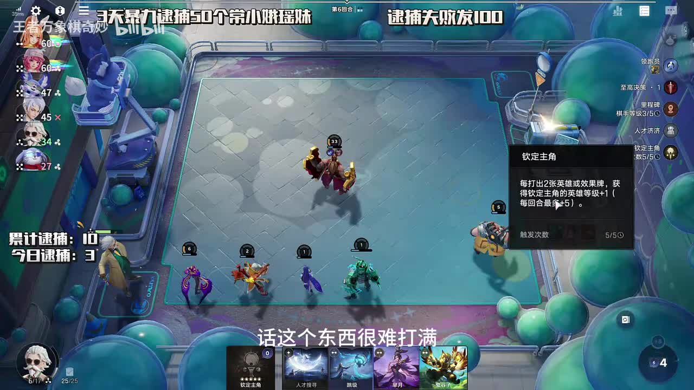

## 09:26–09:57 延后一轮省三元再升

- 事件 ID：BV1X5e669EBe:p1:e009
- 场景：实战
- 时机：本轮十元升级下轮七元
- 背景（分析推断）：本轮战斗与白起触发仍可利用
- 学习目标（分析推断）：比较即时升级与等待折扣
- 模板：level-transition
- ASR 段落：[18]

> 省三块钱

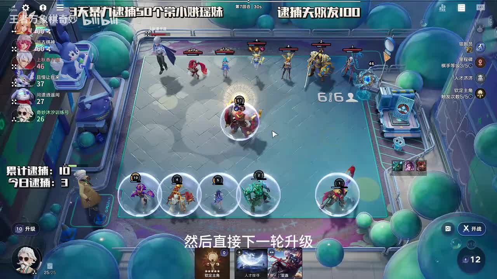

## 10:00–11:09 100级施法回血改变抗射手能力，太乙第二条命进一步兑现续航

- 事件 ID：BV1X5e669EBe:p1:e010
- 场景：实战
- 时机：廉颇接近100级且血量低
- 背景（分析推断）：此时仍缺回血门槛且对手艾琳
- 学习目标（分析推断）：识别战力跃迁阈值而非只看当前低血
- 模板：growth-combo
- ASR 段落：[19, 20]

> 每次放技能回10%的血量

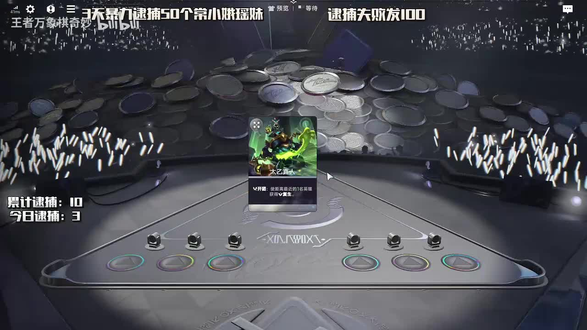

## 12:20–13:29 多名逐鹿在场随机加级难落廉颇；白起触发后出售可重复利用

- 事件 ID：BV1X5e669EBe:p1:e011
- 场景：实战
- 时机：考虑保留姜子牙
- 背景（分析推断）：单核养成与多逐鹿结构的随机目标不同
- 学习目标（分析推断）：按目标概率判断留场价值
- 模板：resource-order
- ASR 段落：[23, 24]

> 所以他很难给到脸婆

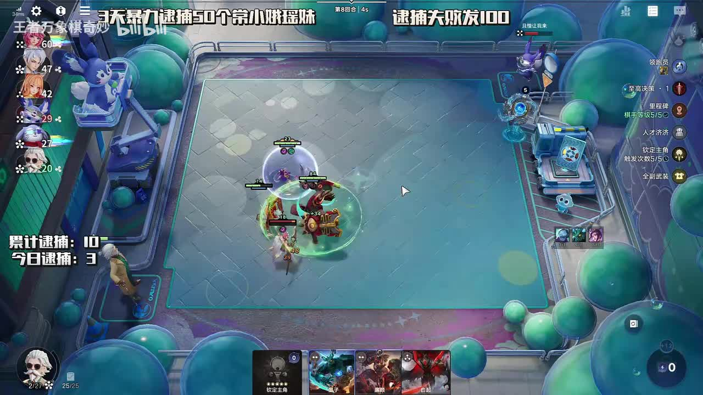

## 13:29–14:00 不一次打完，保留下轮十张额度

- 事件 ID：BV1X5e669EBe:p1:e012
- 场景：实战
- 时机：核心100级后手牌尚多
- 背景（分析推断）：本轮回合奖励已有上限
- 学习目标（分析推断）：跨回合安排持续成长资源
- 模板：economy-budget
- ASR 段落：[25]

> 下个回合不一定能打十张

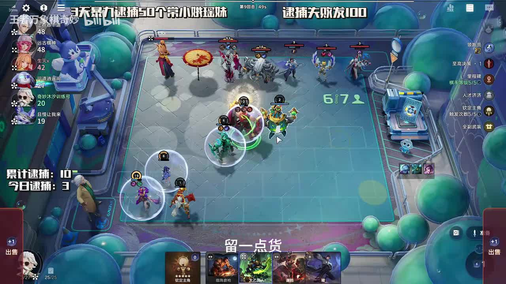

## 14:02–14:37 短蓝条让施法、叠盾、破盾成长更频繁

- 事件 ID：BV1X5e669EBe:p1:e013
- 场景：实战
- 时机：选择缩短蓝条工具
- 背景（分析推断）：需要持续施法而非一次高伤害
- 学习目标（分析推断）：把装备与成长触发频率相连
- 模板：equipment-role
- ASR 段落：[26]

> 他放技能快

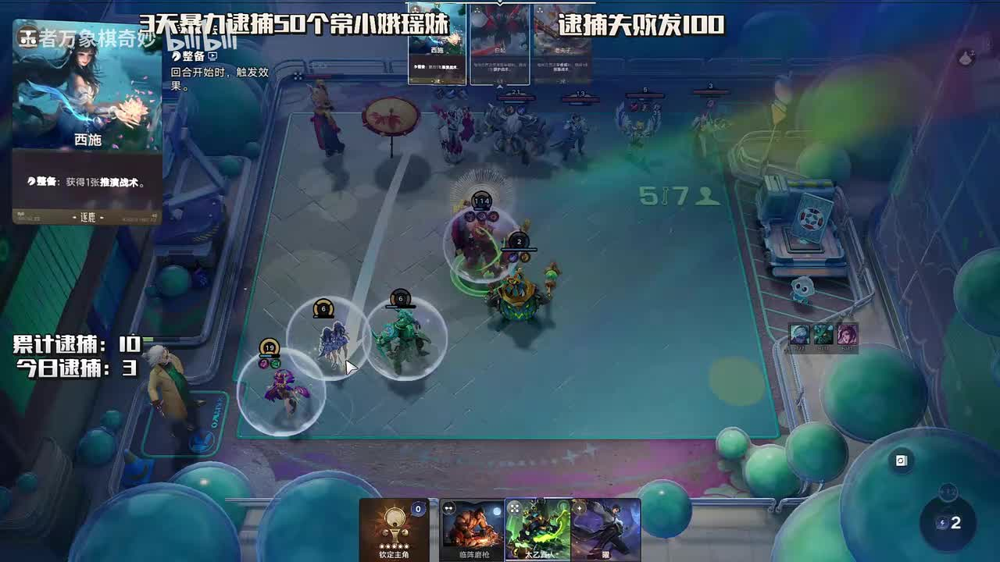

## 14:38–15:39 扁鹊将盾击破转为伤害，耐久不能替代伤害功能

- 事件 ID：BV1X5e669EBe:p1:e014
- 场景：实战
- 时机：能扛住但仍未找到扁鹊
- 背景（分析推断）：廉颇已有100级与盾但尚缺炸盾输出
- 学习目标（分析推断）：识别阵容缺失的功能组件
- 模板：fallback-plan
- ASR 段落：[27, 28]

> 炸10%的生命值的伤害

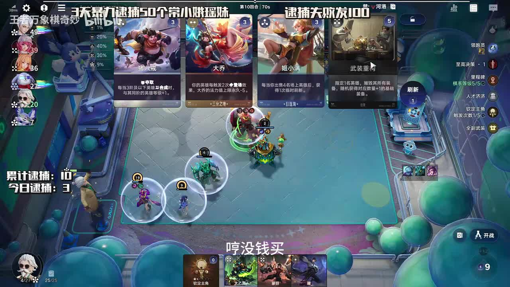

## 15:39–16:47 持续控制带苍穹，艾琳用反甲，按对手而非固定装

- 事件 ID：BV1X5e669EBe:p1:e015
- 场景：实战
- 时机：观察控制与艾琳威胁
- 背景（分析推断）：不同威胁分别限制施法和产生高频攻击
- 学习目标（分析推断）：将对手行为映射到装备功能
- 模板：counter-target
- ASR 段落：[29, 30]

> 两秒解一次

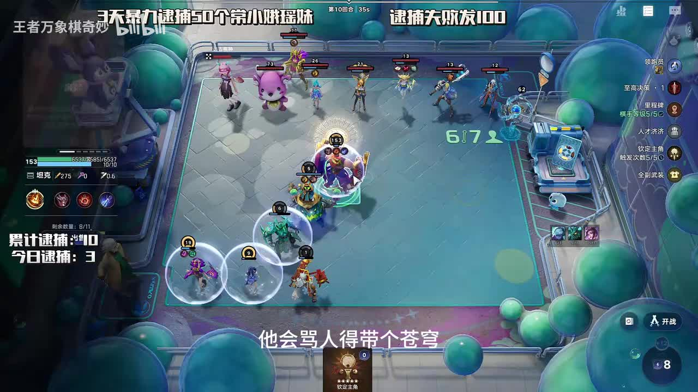

## 16:47–17:50 能回血但缺扁鹊导致伤害不足

- 事件 ID：BV1X5e669EBe:p1:e016
- 场景：实战
- 时机：战斗打成平局
- 背景（分析推断）：不是耐久或等级问题，战斗表现指出输出瓶颈
- 学习目标（分析推断）：从平局结果定位需要补的功能
- 模板：combat-review
- ASR 段落：[31, 32]

> 他的伤害全靠扁剧

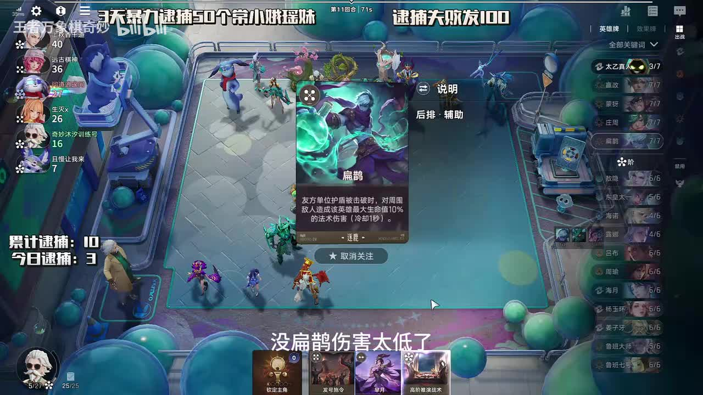

## 17:50–18:18 太乙等牌留下一轮，六级免控替换需求；扁鹊觉醒仍重要

- 事件 ID：BV1X5e669EBe:p1:e017
- 场景：实战
- 时机：主角已满且即将六级
- 背景（分析推断）：本轮出牌收益已经满且升级窗口临近
- 学习目标（分析推断）：保留资源并预判下一级收益
- 模板：resource-order
- ASR 段落：[33]

> 先不交

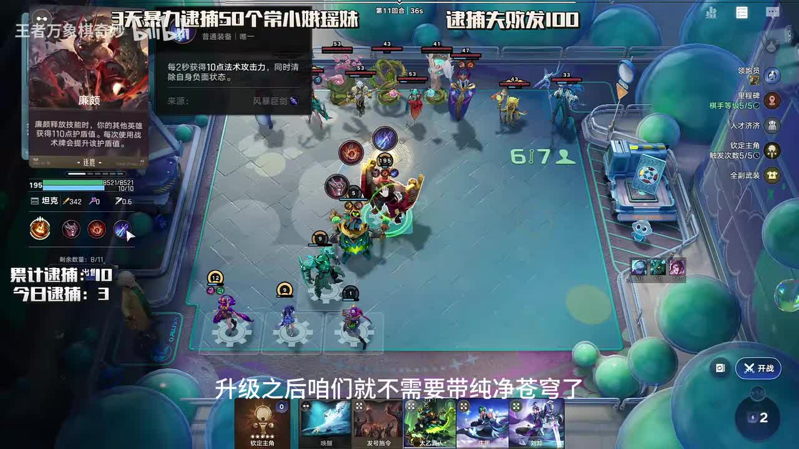

## 18:18–19:24 反甲使敌人攻击付出代价，结合己方高血量续航

- 事件 ID：BV1X5e669EBe:p1:e018
- 场景：实战
- 时机：面对东皇持续吸血
- 背景（分析推断）：对方血量较低但持续回血，单纯站着未必能赢
- 学习目标（分析推断）：理解反制的因果条件
- 模板：counter-target
- ASR 段落：[34, 35]

> 你得带个反甲啊

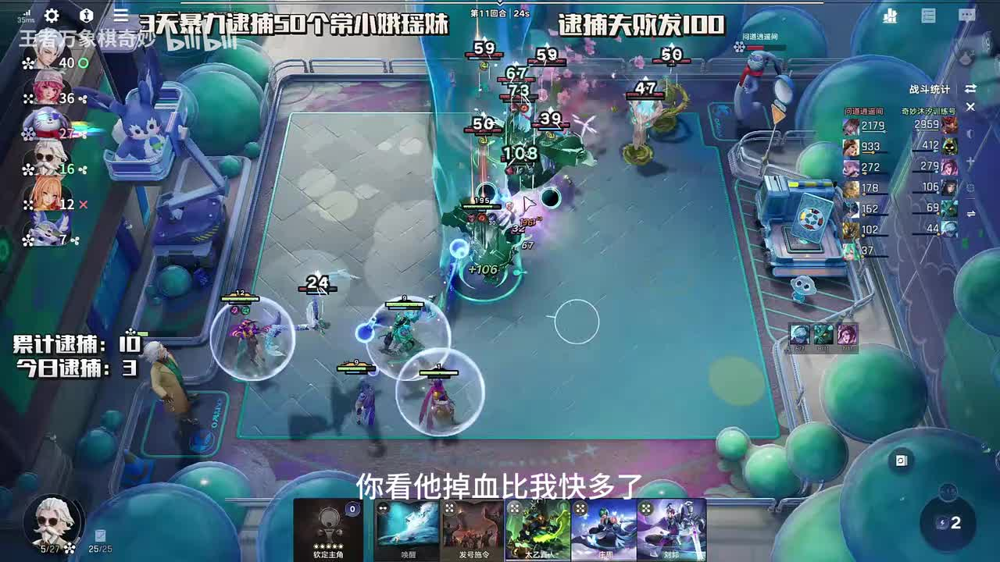

## 19:24–21:00 延后爆发，先打满主角再储备可购买资金

- 事件 ID：BV1X5e669EBe:p1:e019
- 场景：实战
- 时机：获得展翅腾飞但仅十二元
- 背景（分析推断）：刷新资源充足不等于能付购买成本
- 学习目标（分析推断）：区分刷新次数与购买资金两类瓶颈
- 模板：economy-budget
- ASR 段落：[36, 37, 38]

> 12块钱飞不动

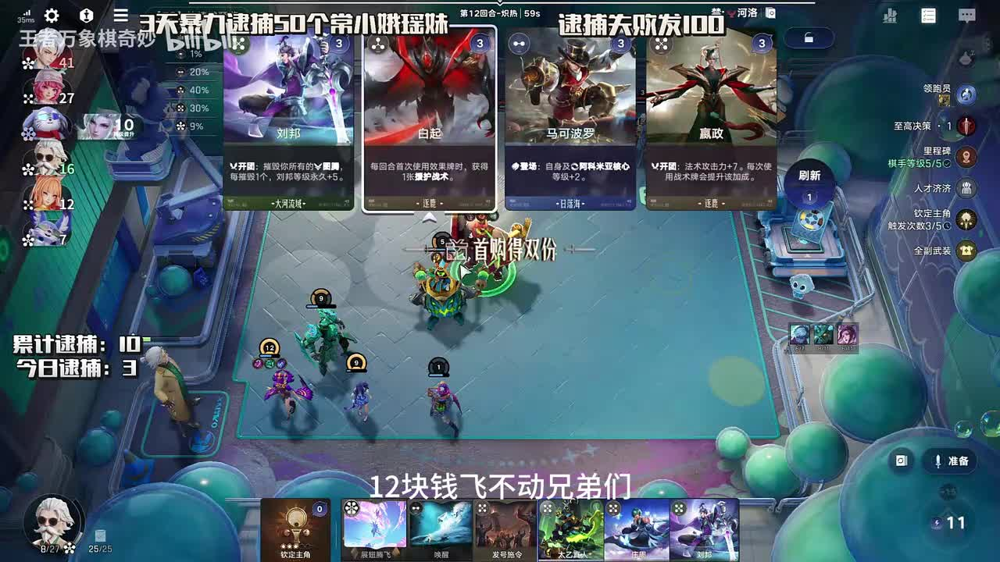

## 21:00–22:05 反甲配冰心，攻击触发控制；炸盾魔法伤害可吸血

- 事件 ID：BV1X5e669EBe:p1:e020
- 场景：实战
- 时机：后期高攻速艾琳压力
- 背景（分析推断）：艾琳频繁普攻，廉颇需要维持续航与接近
- 学习目标（分析推断）：选择针对实际伤害方式的防守功能
- 模板：counter-target
- ASR 段落：[39, 40]

> 他A五下就要被动一秒

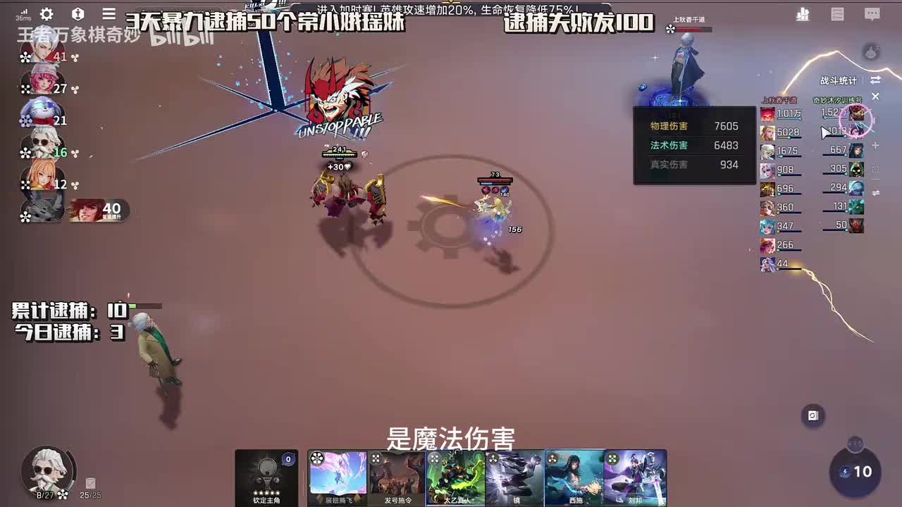

## 22:05–23:05 鲁班大师后期攒四张再上，前期继续成长工具

- 事件 ID：BV1X5e669EBe:p1:e021
- 场景：实战
- 时机：六级阵容格子紧张
- 背景（分析推断）：现有墨子等仍提供成长价值，不宜过早卖
- 学习目标（分析推断）：按剩余成长窗口安排终局组件
- 模板：late-transition
- ASR 段落：[41, 42]

> 后期攒四个

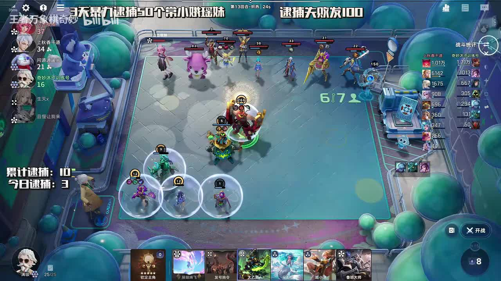

## 23:05–24:48 优先扁鹊觉醒，达成后停止搜扁鹊转蒙犽

- 事件 ID：BV1X5e669EBe:p1:e022
- 场景：实战
- 时机：展翅腾飞开启后集中刷新
- 背景（分析推断）：炸盾伤害缺口优先于追加一般等级
- 学习目标（分析推断）：用功能完成条件改变搜牌目标
- 模板：growth-combo
- ASR 段落：[43, 44, 45]

> 扁鹊觉醒伤害能翻倍

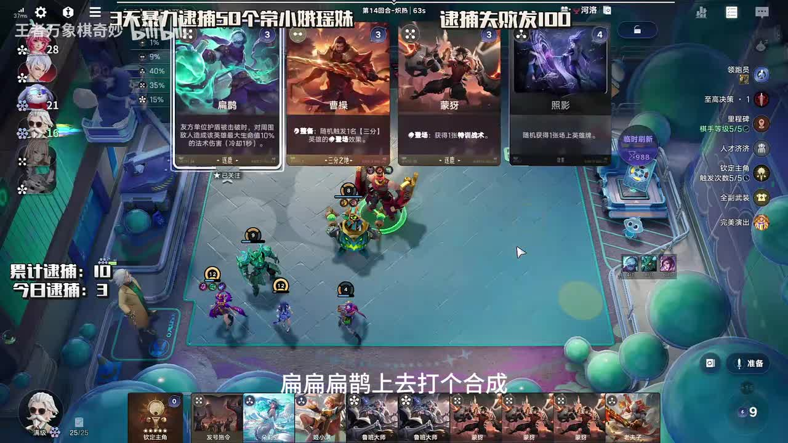

## 24:48–25:50 筛一排多个有效目标或唤醒搭目标

- 事件 ID：BV1X5e669EBe:p1:e023
- 场景：实战
- 时机：无限刷新却剩少量钱
- 背景（分析推断）：刷新免费而钱不足，不能照常每排购买
- 学习目标（分析推断）：识别资源结构变化后的购买策略
- 模板：economy-budget
- ASR 段落：[46, 47]

> 因为我的刷新是无限的,但是我又没有钱

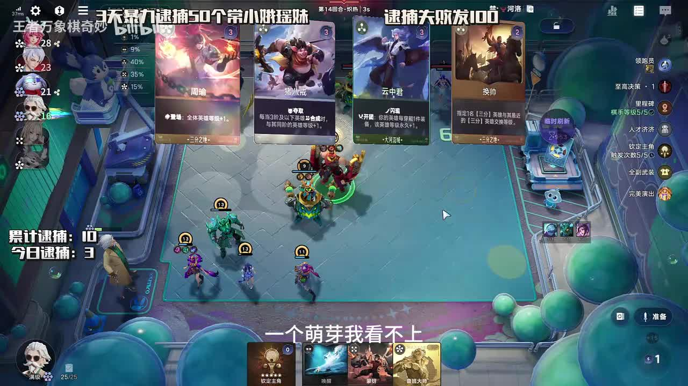

## 25:50–26:52 漏看装备导致不能回血，重新用苍穹处理

- 事件 ID：BV1X5e669EBe:p1:e024
- 场景：实战
- 时机：战斗发现铃铛阻止施法
- 背景（分析推断）：刷牌占注意力，原有六级免控不能覆盖此风险
- 学习目标（分析推断）：通过失败信号检查此前忽略的装备
- 模板：combat-review
- ASR 段落：[48, 49]

> 我刚没看装备

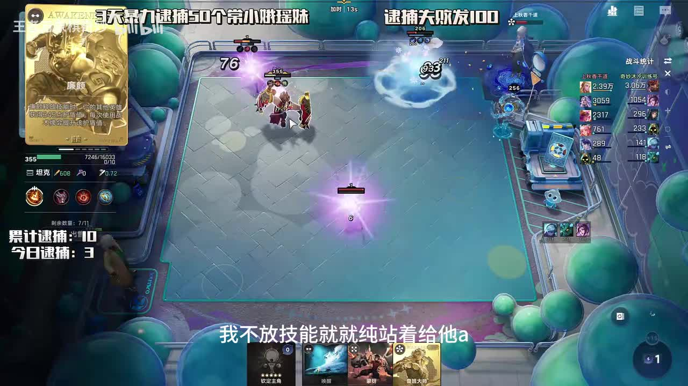

## 26:54–27:59 免控收益高于少量加血，特殊控制仍需警惕

- 事件 ID：BV1X5e669EBe:p1:e025
- 场景：实战
- 时机：终局血量充足仍受控制
- 背景（分析推断）：已经有较高血量，继续叠血未解决施法受限
- 学习目标（分析推断）：按当前瓶颈替换边际收益低的装备
- 模板：equipment-role
- ASR 段落：[50, 51]

> 免控的话比这个血更重要

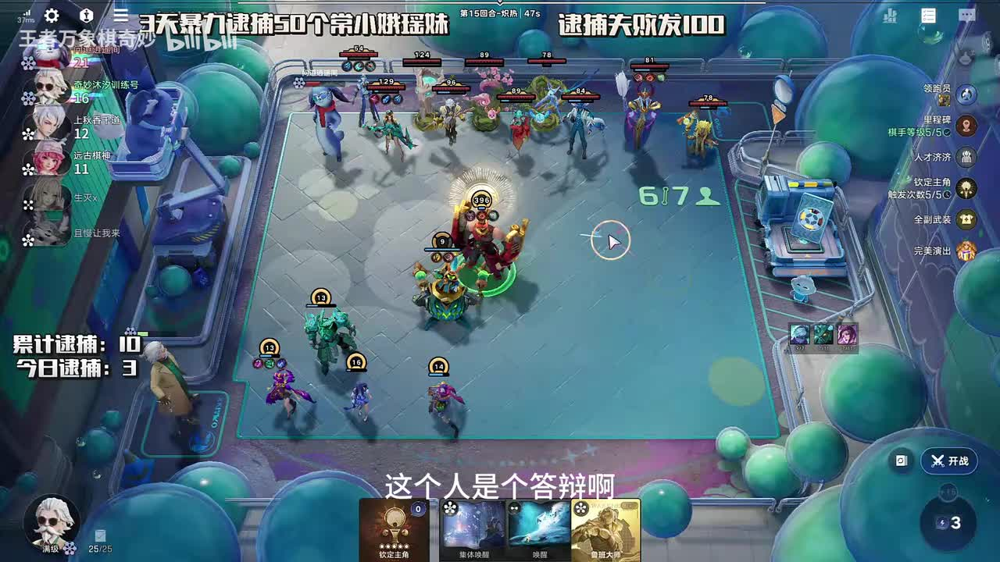

## 28:52–29:20 墨子永久收益已保留，卖工具换两蒙犽等终局成长

- 事件 ID：BV1X5e669EBe:p1:e026
- 场景：实战
- 时机：接近最后一轮
- 背景（分析推断）：剩余回合少，继续保留成长工具机会成本改变
- 学习目标（分析推断）：区分永久收益与必须留场的效果
- 模板：late-transition
- ASR 段落：[54]

> 他是永久加的啊

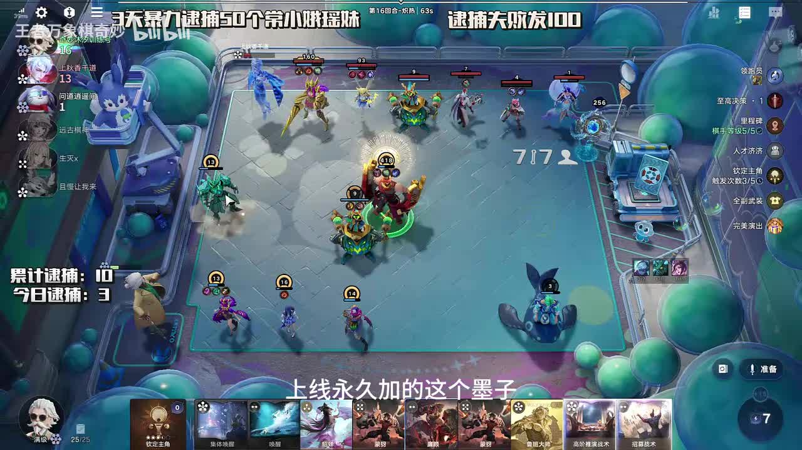

## 29:20–30:25 会电自己且必需反甲冰心苍穹，取消原计划

- 事件 ID：BV1X5e669EBe:p1:e027
- 场景：实战
- 时机：考虑驱雷与瑶组合后发现反作用
- 背景（分析推断）：对方铃铛与艾琳限制装备槽位
- 学习目标（分析推断）：检查组合副作用和装备机会成本
- 模板：combat-review
- ASR 段落：[55, 56]

> 驱雷会颠自己

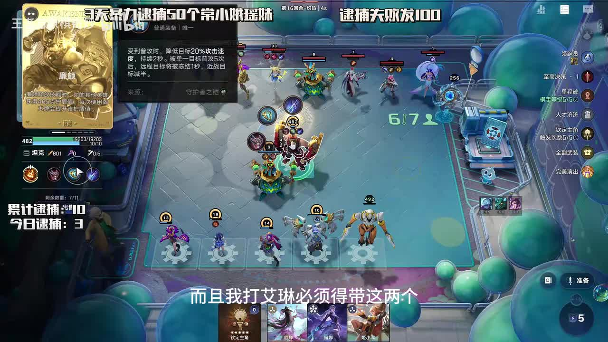

## 30:25–31:00 四张集中在最后一波形成高等级机器人

- 事件 ID：BV1X5e669EBe:p1:e028
- 场景：实战
- 时机：鲁班大师机器人终局上场
- 背景（分析推断）：前期格子被墨子成长占用，不舍过早卖
- 学习目标（分析推断）：根据格子和时机安排同名牌兑现
- 模板：late-transition
- ASR 段落：[57]

> 因为前期没有格子

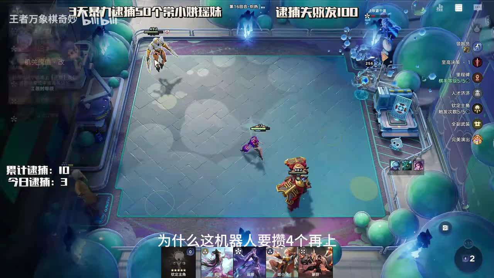

## 31:00–32:05 四张额外触发，并利用白起卖出获得效果卡

- 事件 ID：BV1X5e669EBe:p1:e029
- 场景：实战
- 时机：终局集中上蒙犽
- 背景（分析推断）：同名触发批次和出牌材料共同影响成长
- 学习目标（分析推断）：识别批量兑现门槛
- 模板：growth-combo
- ASR 段落：[58, 59]

> 第四个萌芽他会额外再出发一次的

## 32:43–33:21 磐石之心限制单体伤害比例；没有时不好打

- 事件 ID：BV1X5e669EBe:p1:e030
- 场景：实战
- 时机：复盘极高单次伤害猴子
- 背景（分析推断）：属于针对爆发对手的条件建议而非所有对手装备
- 学习目标（分析推断）：按伤害形态选择特殊防守装备
- 模板：counter-target
- ASR 段落：[61, 62]

> 单体伤害最多只能造成15血量

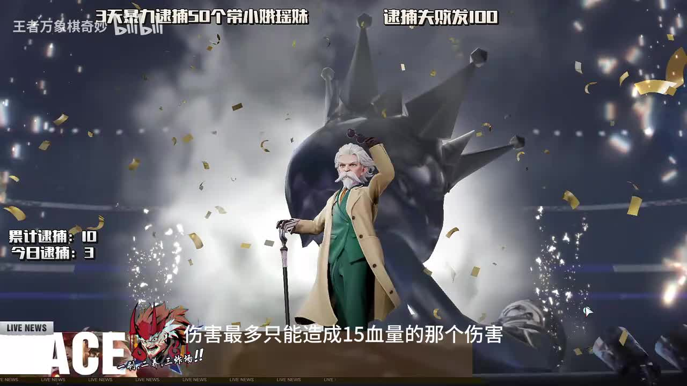

## 待核实与局限

- 原始ASR同音错词不修正，技能与英雄名称根据清晰画面另记。
- 末段猴子与特殊装备建议不是本局已验证胜负结论，数值待规则核实。
- 排除主播申辩、感谢礼物、闲聊与无理由操作。
