# 开门女警？开门守约！干将转500级守约（答辩）

来源：https://www.bilibili.com/video/BV1Xkhe6hEK7/?p=1

分析状态：completed

完整文字稿：../../../raw/BV1Xkhe6hEK7_p1.md

## 00:00–00:35 香香有同行且有小鹿时改选阿离路线

- 事件 ID：BV1Xkhe6hEK7:p1:e001
- 场景：前置讲解
- 时机：看同行与阵营后选路线
- 背景（分析推断）：开局比较可用阵容与外部竞争
- 学习目标（分析推断）：将同行和禁用阵营纳入选择
- 模板：opening-plan
- ASR 段落：[1]

> 香香外面已经有同行了

## 00:32–01:35 打开卡牌大河列表，展示从瑶到虞姬的六人并加公孙离

- 事件 ID：BV1Xkhe6hEK7:p1:e002
- 场景：前置讲解
- 时机：对大河香香阵容作场外讲解
- 背景（分析推断）：这是回应阵容问题的有效解释，与当前阿离实验路线分开
- 学习目标（分析推断）：学会借阵营卡牌列表查阵容组成
- 模板：mechanic-model
- ASR 段落：[2, 3]

> 点开这个卡牌,点开大和

## 01:37–03:15 干将留到二级合成以找移植，刷新奖励比经验更灵活

- 事件 ID：BV1Xkhe6hEK7:p1:e003
- 场景：实战
- 时机：两回合觉醒干将后留合成
- 背景（分析推断）：移植是后续转型必要组件，合成等级影响技能候选
- 学习目标（分析推断）：按需要的技能类别安排合成时点
- 模板：resource-order
- ASR 段落：[4, 5, 6]

> 这俩干将两级打合成

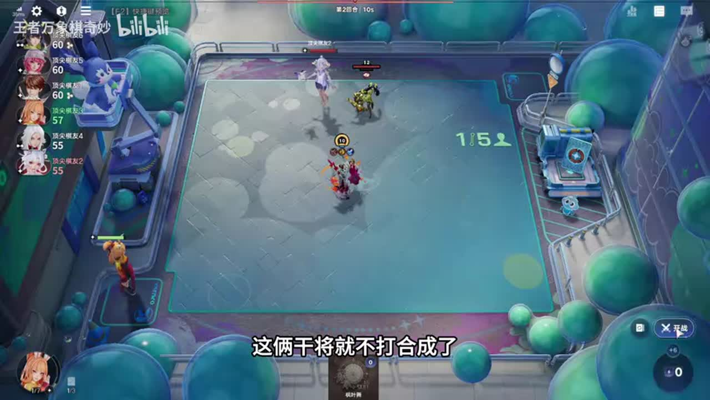

## 03:15–04:03 一级攒干将二级合，二级攒干将三级合，兼顾英雄与锦囊概率

- 事件 ID：BV1Xkhe6hEK7:p1:e004
- 场景：实战
- 时机：解释如何提高遗址获取机会
- 背景（分析推断）：不同等级的干将获取和目标技能概率相反变化
- 学习目标（分析推断）：同时计算单次概率与尝试次数
- 模板：economy-budget
- ASR 段落：[7, 8]

> 三级刷遗址的概率是最大的

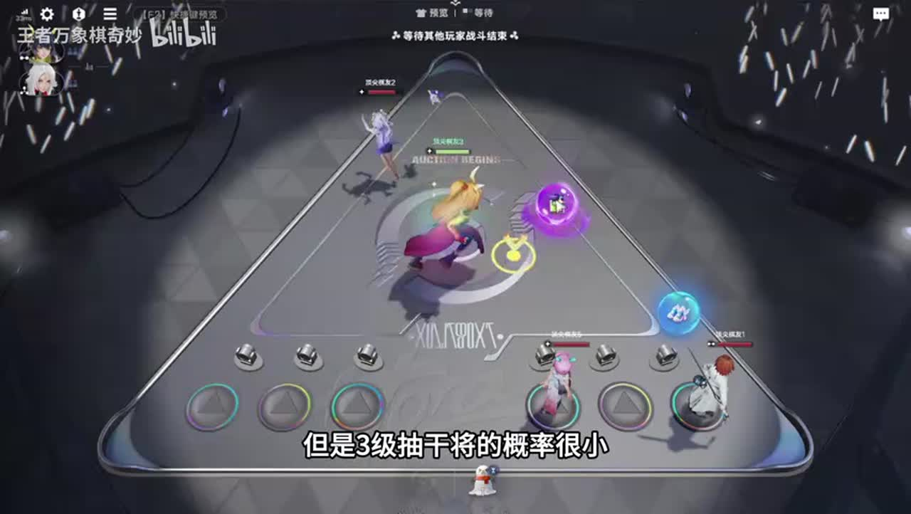

## 04:03–04:33 张良抽取概率低时优先拍卖张良，不一概按费低优先

- 事件 ID：BV1Xkhe6hEK7:p1:e005
- 场景：实战
- 时机：拍卖三费组件与低费替代
- 背景（分析推断）：讲者解释香香相关拍卖的机会成本
- 学习目标（分析推断）：按日常商店稀缺性判断拍卖价值
- 模板：auction-choice
- ASR 段落：[9]

> 张良优先级是最高的

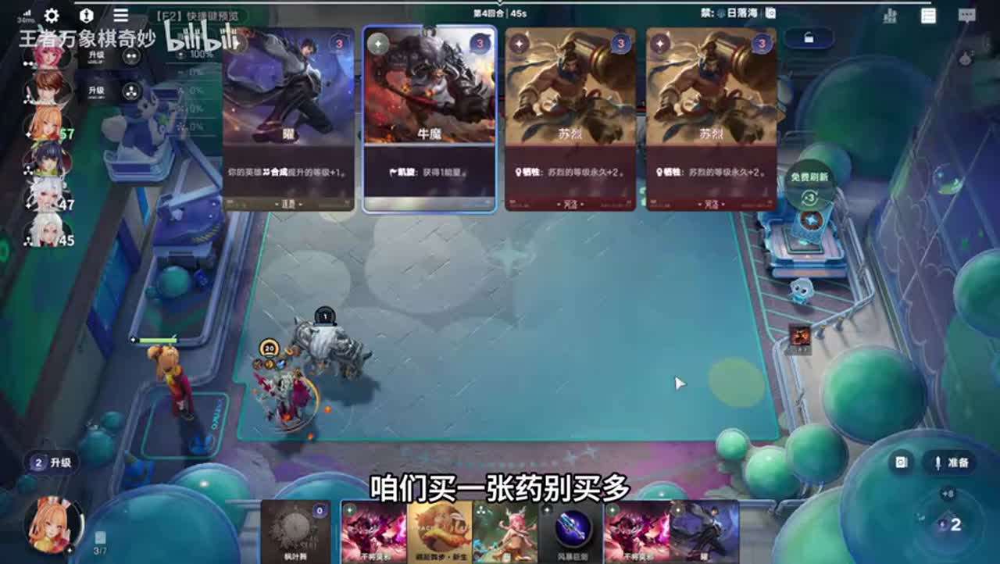

## 04:03–05:05 红叶染枫优先，关系到后续伞技能；瑶只买一张辅助

- 事件 ID：BV1Xkhe6hEK7:p1:e006
- 场景：实战
- 时机：选择阿离伞的前置技能
- 背景（分析推断）：不能只比较眼前增伤数字，选项有后续路径影响
- 学习目标（分析推断）：识别技能链的前置条件
- 模板：talent-fit
- ASR 段落：[9, 10]

> 你不点的话他下一个伞可能就不给你了

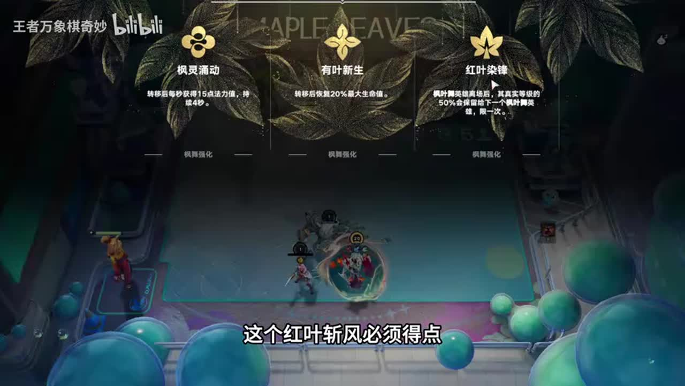

## 04:33–06:10 瑶配合成加等级，孙尚香觉醒返刷新后卖出

- 事件 ID：BV1Xkhe6hEK7:p1:e007
- 场景：实战
- 时机：补充瑶与孙尚香的资源收益
- 背景（分析推断）：本局需要成长和免费刷新，但已够刷新时可暂不追香香
- 学习目标（分析推断）：按缺口购买返资源组件
- 模板：growth-combo
- ASR 段落：[10, 11, 12]

> 她会给免费刷新,所以不亏

## 05:38–06:39 二级技能概率稍低但干将多、合成次数多，不必只看三级概率

- 事件 ID：BV1Xkhe6hEK7:p1:e008
- 场景：实战
- 时机：比较二级与三级合成效率
- 背景（分析推断）：讲者解释三级约三成技能概率与二级更多英雄获取
- 学习目标（分析推断）：比较单位经济的总体获取效率
- 模板：economy-budget
- ASR 段落：[12, 13]

> 两级虽然概率小但是合成多

## 11:27–11:58 保留守约并实验干将转守约，尚未验证强度

- 事件 ID：BV1Xkhe6hEK7:p1:e009
- 场景：实战
- 时机：提前说明尝试守约替代海月
- 背景（分析推断）：讲者明确未试过，需要在这局观察，而非已确认推荐
- 学习目标（分析推断）：区别探索方案与成熟公式
- 模板：fallback-plan
- ASR 段落：[23]

> 我也没试过咱们一会得具体试一下

## 07:10–07:42 每名玩家拿下遗址后不再给第二张，没拿可以继续出现

- 事件 ID：BV1Xkhe6hEK7:p1:e010
- 场景：实战
- 时机：澄清遗址重复出现条件
- 背景（分析推断）：观众混淆整局唯一与每人唯一
- 学习目标（分析推断）：准确理解限次获取条件
- 模板：mechanic-model
- ASR 段落：[15]

> 不是遗址只有一张,是一个人只有一张

## 07:42–08:14 不能忽略反伤，等级和血量优势可能影响能否承受

- 事件 ID：BV1Xkhe6hEK7:p1:e011
- 场景：实战
- 时机：守约面对反甲风险
- 背景（分析推断）：当前讨论尚未转成守约的防守风险
- 学习目标（分析推断）：转型前检查对手装备与自身容错
- 模板：counter-target
- ASR 段落：[16]

> 等级比他高你血量比他还厚

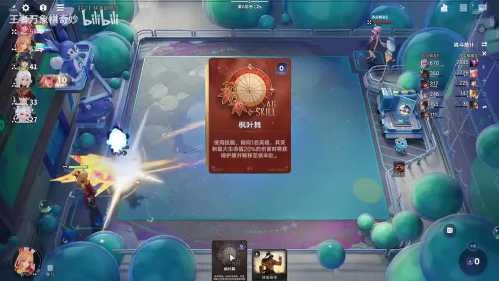

## 07:42–08:43 用干将击杀成长和阿离伞先储等级，避免直接养守约

- 事件 ID：BV1Xkhe6hEK7:p1:e012
- 场景：实战
- 时机：比较干将与守约的成长速度
- 背景（分析推断）：当前干将九十多级而守约个位数，击杀成长与伞、瑶等共同支持干将
- 学习目标（分析推断）：把成长载体与终局战斗载体分开
- 模板：growth-combo
- ASR 段落：[16, 17]

> 干将升级快

## 09:16–10:20 先用自带成长的干将储等级，守约或吕布不宜直接硬养

- 事件 ID：BV1Xkhe6hEK7:p1:e013
- 场景：实战
- 时机：解释先养干将再转守约
- 背景（分析推断）：战斗主核强不代表前期升级快，阿离经济也不足以硬搜镜
- 学习目标（分析推断）：把成长载体与终局战斗载体分开
- 模板：growth-combo
- ASR 段落：[19, 20]

> 因为吕布的词条不给加等级

## 10:54–11:27 有双人羁绊或崛起等额外成长条件才考虑直接养

- 事件 ID：BV1Xkhe6hEK7:p1:e014
- 场景：实战
- 时机：直接养守约的例外条件
- 背景（分析推断）：正常使用干将成长更快，例外需额外加级来源
- 学习目标（分析推断）：为公式保留有条件的例外
- 模板：opening-plan
- ASR 段落：[22]

> 有崛起可以直接讲

## 11:58–13:04 二级干将多更容易合成，三级高技能概率不代表总收益更高

- 事件 ID：BV1Xkhe6hEK7:p1:e015
- 场景：实战
- 时机：再次解释二三级搜牌取舍
- 背景（分析推断）：仍没有遗址，讲者重新说明为什么留二级
- 学习目标（分析推断）：把缺牌等待建立在获取效率上
- 模板：economy-budget
- ASR 段落：[24, 25]

> 三级的合成太少了

## 13:04–15:38 在自动升三级前攒干将，到三级集中合成找遗址

- 事件 ID：BV1Xkhe6hEK7:p1:e016
- 场景：实战
- 时机：十回合遗址仍未到
- 背景（分析推断）：血量健康允许等待，但继续原样搜牌的效果不理想
- 学习目标（分析推断）：随阶段变化调整搜牌与留牌方式
- 模板：level-transition
- ASR 段落：[26, 27, 28, 29]

> 我手里攒十个八个干将

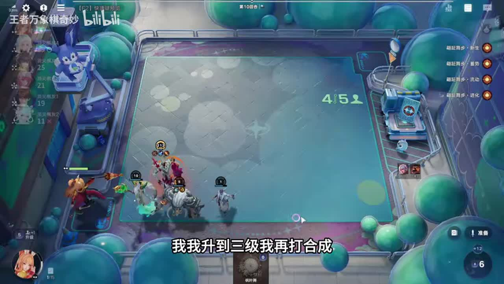

## 15:38–16:15 昂贵辅助可能抢击杀，资源宁可用于干将合成

- 事件 ID：BV1Xkhe6hEK7:p1:e017
- 场景：实战
- 时机：决定不追加瑶和孙膑
- 背景（分析推断）：干将依击杀成长，辅助额外两级不一定划算
- 学习目标（分析推断）：同时考虑购买成本与击杀分配
- 模板：economy-budget
- ASR 段落：[30]

> 药和孙斌容易K头

## 16:47–17:23 下一轮必须拿到移植，不能无限延迟转型

- 事件 ID：BV1Xkhe6hEK7:p1:e018
- 场景：实战
- 时机：预计后续每波掉大量血
- 背景（分析推断）：讲者估计后期十五二十血一波，健康窗口会很快消失
- 学习目标（分析推断）：把每轮预期失血作为决策截止条件
- 模板：level-transition
- ASR 段落：[32]

> 三波50血就走了

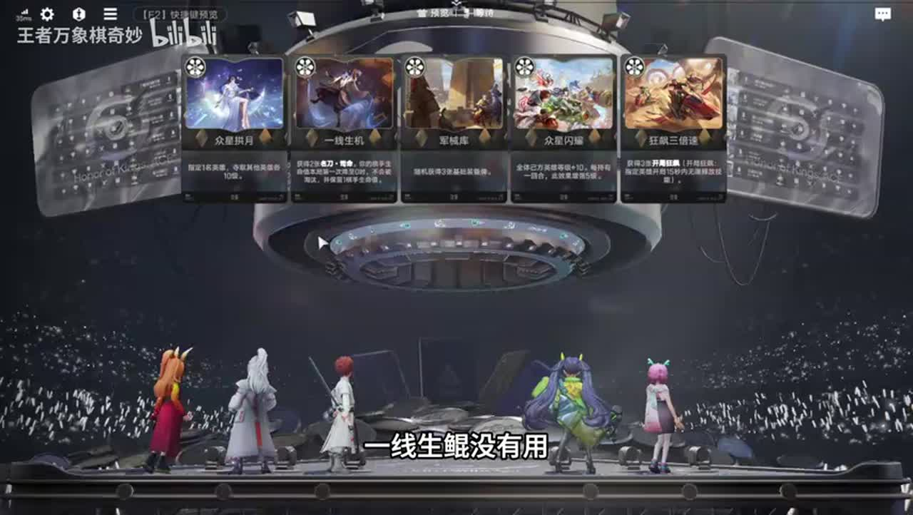

## 18:00–20:19 先补牺牲英雄使守约减蓝，不能只移植等级直接开打

- 事件 ID：BV1Xkhe6hEK7:p1:e019
- 场景：实战
- 时机：遗址到手后补守约启动组件
- 背景（分析推断）：守约未觉醒，讲者计算单个牺牲减二十与蓝条长度
- 学习目标（分析推断）：转型前补齐启动功能而不是只换高等级英雄
- 模板：module-fit
- ASR 段落：[34, 35, 36, 37]

> 只要一死他就给减蓝条

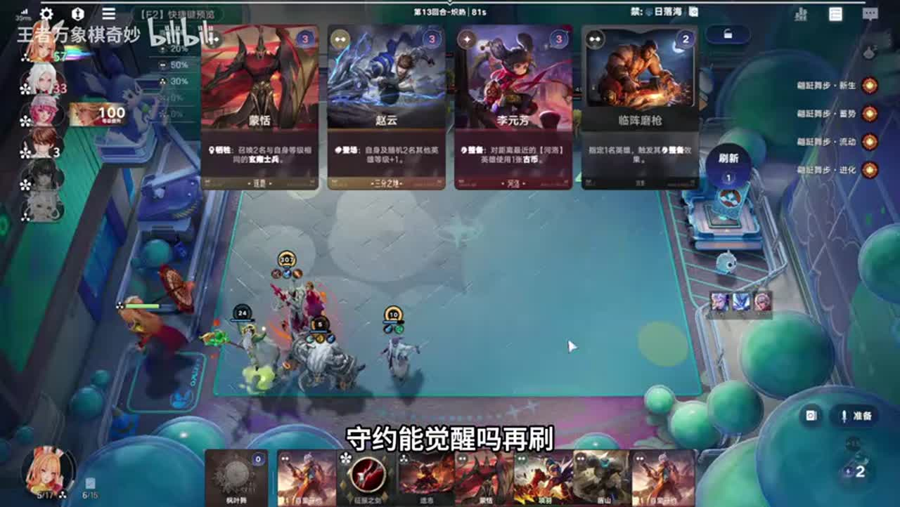

## 20:19–22:08 先给明刀、圣剑等再试战，结果不好就仍选海月

- 事件 ID：BV1Xkhe6hEK7:p1:e020
- 场景：实战
- 时机：真正转守约后观察效果
- 背景（分析推断）：这是替代主核实验，遭遇对方狂飙张良控制
- 学习目标（分析推断）：按功能与实战问题评估替代是否成立
- 模板：combat-review
- ASR 段落：[38, 39, 40]

> 如果效果不好的话我们以后还转海鱼

## 22:41–23:53 项羽不该带明刀，铠两条命更符合牺牲触发

- 事件 ID：BV1Xkhe6hEK7:p1:e021
- 场景：实战
- 时机：牺牲英雄不能拖延死亡
- 背景（分析推断）：守约需要队友死亡减蓝，防守装备可能阻碍功能
- 学习目标（分析推断）：让工具位装备与死亡触发职责一致
- 模板：equipment-cause
- ASR 段落：[42, 43]

> 香雨的明刀不该拿的

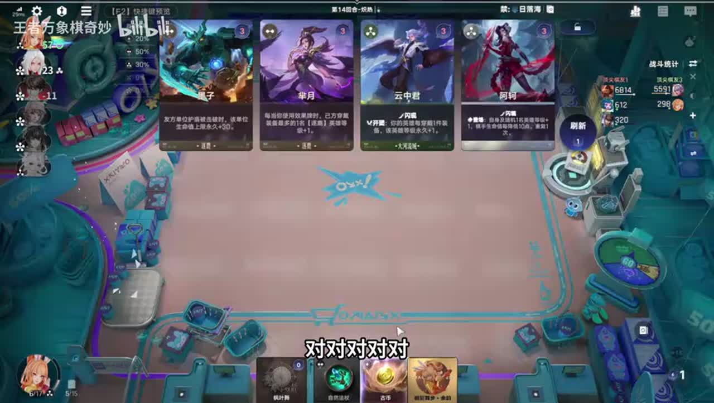

## 23:53–24:23 没有吸血刀时吸血选项价值更高，有装备时要比较边际收益

- 事件 ID：BV1Xkhe6hEK7:p1:e022
- 场景：实战
- 时机：已有吸血刀时评估吸血伞
- 背景（分析推断）：讲者按单枪伤害与恢复计算，随后选择实验而非定论
- 学习目标（分析推断）：区分已有功能与缺失功能的装备收益
- 模板：equipment-role
- ASR 段落：[44]

> 我有吸血刀,我就不点这个了

## 24:24–26:08 观察明刀保命但无法解除持续控制，转找机械头等解决

- 事件 ID：BV1Xkhe6hEK7:p1:e023
- 场景：实战
- 时机：变珠后主核持续被控
- 背景（分析推断）：变珠试验后守约难输出，讲者撤回先前乐观判断
- 学习目标（分析推断）：从不能输出的症状定位控制问题
- 模板：combat-review
- ASR 段落：[45, 46, 47]

> 我明明都飞走了还在晕我

## 25:35–26:08 考虑圣杯持续回蓝和支配者，但没有书本无法强做

- 事件 ID：BV1Xkhe6hEK7:p1:e024
- 场景：实战
- 时机：控制与回蓝同时成为瓶颈
- 背景（分析推断）：当前技能选吸血可能不匹配实际缺口，装备素材有限
- 学习目标（分析推断）：根据实际瓶颈和可用素材选择补救
- 模板：equipment-role
- ASR 段落：[47]

> 我全家装备加起来都抽不出来一本大书

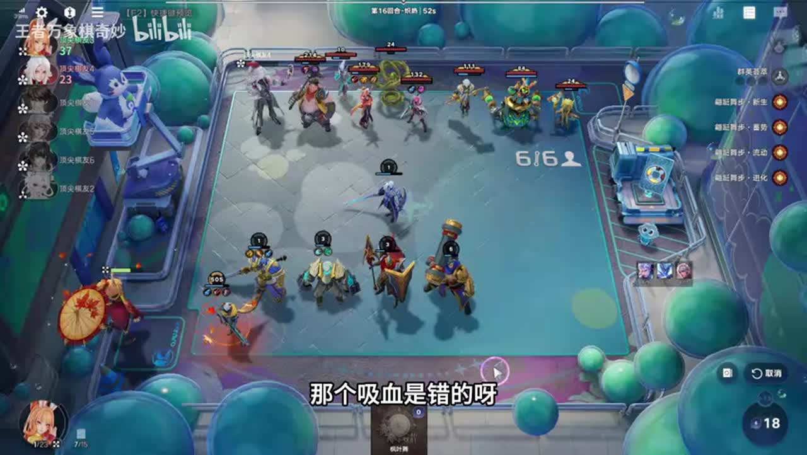

## 26:10–26:48 远程英雄的移动不能套用跳到人最多位置的理解

- 事件 ID：BV1Xkhe6hEK7:p1:e025
- 场景：实战
- 时机：澄清远程闪现落点
- 背景（分析推断）：解释主核位移与观众认知差异
- 学习目标（分析推断）：区分远近程位移机制
- 模板：mechanic-model
- ASR 段落：[48]

> 这是远程的

## 27:22–28:37 左侧打不过换右侧，免控到手后观察能否正常输出

- 事件 ID：BV1Xkhe6hEK7:p1:e026
- 场景：实战
- 时机：换边与免控后重新试战
- 背景（分析推断）：先前被连续控制，讲者用站位和装备做针对调整
- 学习目标（分析推断）：改变一个关键条件后观察输出恢复
- 模板：combat-review
- ASR 段落：[50, 51]

> 我现在不被控了

## 29:11–30:46 两侧站一排，中间空开，让守约先狙后排公孙离

- 事件 ID：BV1Xkhe6hEK7:p1:e027
- 场景：实战
- 时机：终局改开门站位绕过前排
- 背景（分析推断）：常规站位打猪与明刀浪费输出，终局改变路径
- 学习目标（分析推断）：围绕攻击目标设计站位并核对实际目标
- 模板：position-cause
- ASR 段落：[53, 54, 55]

> 直接狙他后排

## 30:17–31:19 本局守约需要额外吸血、免控和站位补救，讲者仍更推荐海月

- 事件 ID：BV1Xkhe6hEK7:p1:e028
- 场景：实战
- 时机：成功吃鸡后仍评价方案代价
- 背景（分析推断）：赢下本局不等于这个替代路线更稳或更省操作
- 学习目标（分析推断）：避免把单局胜利等同于方案优越
- 模板：combat-review
- ASR 段落：[55, 56]

> 守约好像确实不如那个谁厉害啊

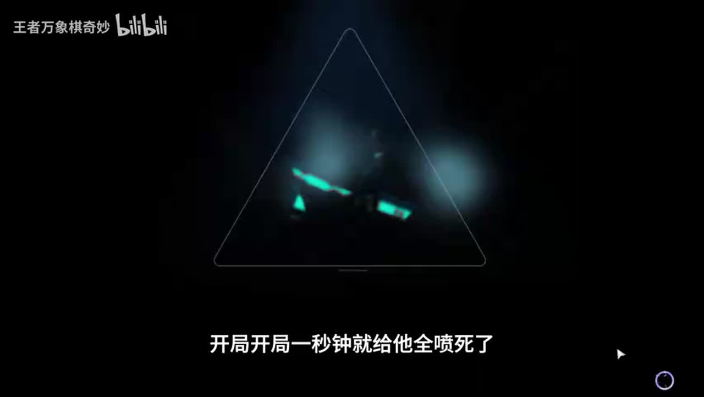

## 待核实与局限

- 不做ASR修正；红叶染枫等技能名称以画面确认，遗址与移植同音混杂不改原文。
- 二三级概率和遗址每人限制为讲者旧版说明，不保证当前机制。
- 干将转守约为明确未验证的实验路线，结论保留连续控制、回蓝、吸血与站位条件。
- 大河香香阵容的场外有效说明单列前置讲解，聊天与响应本身不计教学。
- 一段连串操作合并同一目标；断续再次解释二三级效率单独记录。
