# 很多人催的孙膑攻略（新手进阶版）

来源：https://www.bilibili.com/video/BV1hXac6BEZX/?p=1

分析状态：completed

完整文字稿：../../../raw/BV1hXac6BEZX_p1.md

## 00:00–00:36 禁河洛时比较孙膑马可，特邀额外天赋需适配本局环境，不硬玩

- 事件 ID：BV1hXac6BEZX:p1:e001
- 场景：实战
- 时机：禁用与特邀选择
- 背景（分析推断）：本局孙膑走三分倒转，三三得三带来高血且无同行，后期发动大小回环；禁用与特邀选择，具体条件依据所引前后文。
- 学习目标（分析推断）：选棋手前先检查环境
- 模板：opening-plan
- ASR 段落：[1]

> 前提是你的特邀得适合这一局的对局

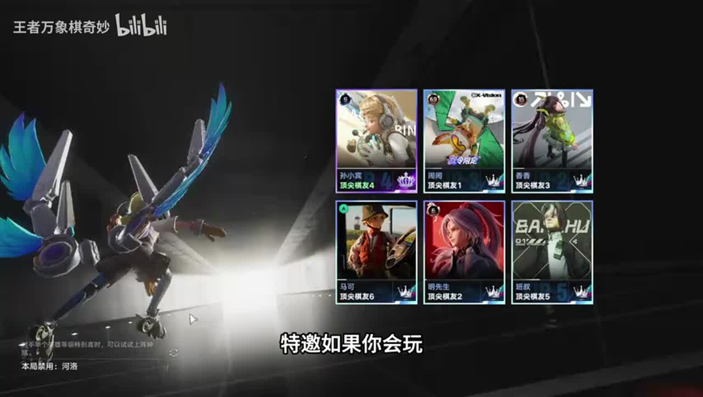

## 00:40–02:34 理想两张弈星未找到，孙尚香暂用，每回合打一张回一张积累

- 事件 ID：BV1hXac6BEZX:p1:e002
- 场景：实战
- 时机：弈星开局缺牌
- 背景（分析推断）：本局孙膑走三分倒转，三三得三带来高血且无同行，后期发动大小回环；弈星开局缺牌，具体条件依据所引前后文。
- 学习目标（分析推断）：缺理想开局也保留基础循环
- 模板：opening-plan
- ASR 段落：[2, 4]

> 一个回合只能丢一张卡

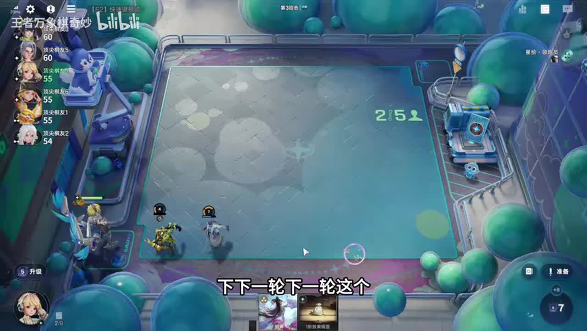

## 05:56–06:30 同一回合打八张才能发动，零散三四张不能替代

- 事件 ID：BV1hXac6BEZX:p1:e003
- 场景：实战
- 时机：小回环门槛
- 背景（分析推断）：本局孙膑走三分倒转，三三得三带来高血且无同行，后期发动大小回环；小回环门槛，具体条件依据所引前后文。
- 学习目标（分析推断）：理解单回合触发条件
- 模板：mechanic-model
- ASR 段落：[11]

> 你得一个回还打八张

## 03:38–05:23 未开枪先弈星觉醒升级，手牌锦囊足够便上场；三三得三保血，先苦后甜暂不能兑现

- 事件 ID：BV1hXac6BEZX:p1:e004
- 场景：实战
- 时机：三级启动保血
- 背景（分析推断）：本局孙膑走三分倒转，三三得三带来高血且无同行，后期发动大小回环；三级启动保血，具体条件依据所引前后文。
- 学习目标（分析推断）：按资源齐备与否调整连败
- 模板：level-transition
- ASR 段落：[7, 8, 9]

> 能开出来就直接上

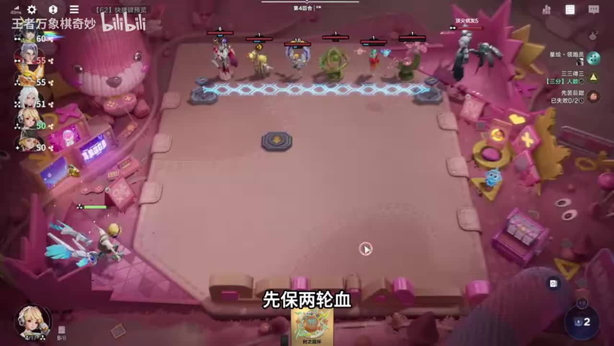

## 05:23–05:56 本回合闪现较亏但仍需一张触发下回合回溯，四级闪现再看阿轲猴子

- 事件 ID：BV1hXac6BEZX:p1:e005
- 场景：实战
- 时机：尚未用牌
- 背景（分析推断）：本局孙膑走三分倒转，三三得三带来高血且无同行，后期发动大小回环；尚未用牌，具体条件依据所引前后文。
- 学习目标（分析推断）：比较单牌和回合技能收益
- 模板：resource-order
- ASR 段落：[10]

> 你不用卡的话不行

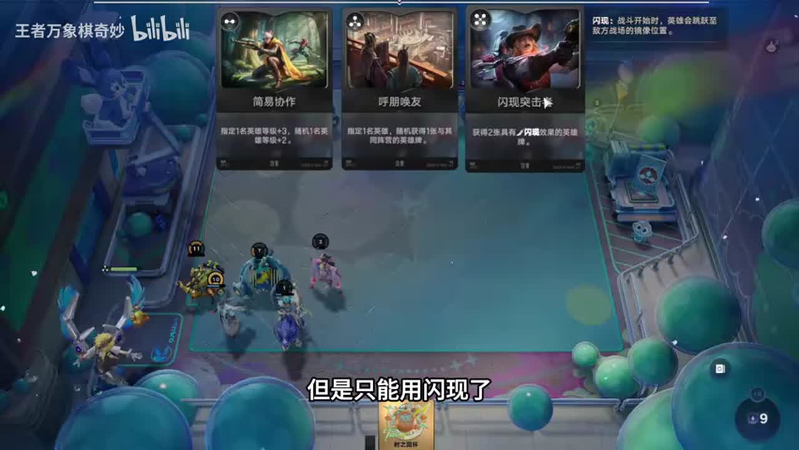

## 06:30–07:00 小乔甄姬曹操前期关键，阿轲卖血供等级；露娜要曹操与觉醒甄姬支撑

- 事件 ID：BV1hXac6BEZX:p1:e006
- 场景：实战
- 时机：关键组件职责
- 背景（分析推断）：本局孙膑走三分倒转，三三得三带来高血且无同行，后期发动大小回环；关键组件职责，具体条件依据所引前后文。
- 学习目标（分析推断）：先理解支撑条件再用核心
- 模板：opening-plan
- ASR 段落：[12]

> 前期得有曹操加觉醒真姬

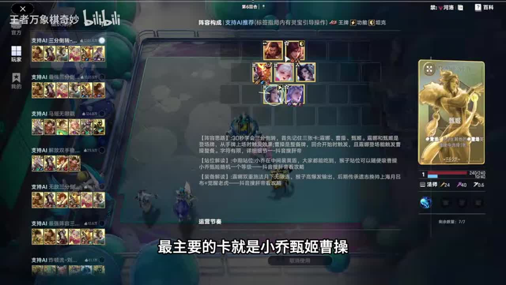

## 07:00–08:35 高血等理想八张，小乔曹操甄姬阿轲各两；低血现有牌立即用，返还需一回合

- 事件 ID：BV1hXac6BEZX:p1:e007
- 场景：实战
- 时机：血量决定回环时机
- 背景（分析推断）：本局孙膑走三分倒转，三三得三带来高血且无同行，后期发动大小回环；血量决定回环时机，具体条件依据所引前后文。
- 学习目标（分析推断）：用容错决定贪收益还是保命
- 模板：economy-budget
- ASR 段落：[13, 14, 15]

> 因为他回款回来要一个回合的

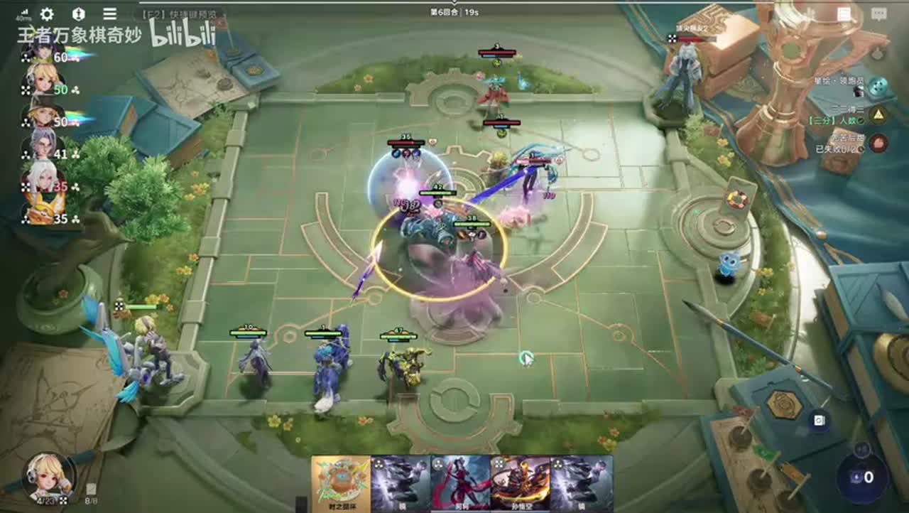

## 08:37–09:37 回溯前站指定位置吸蔡文姬或弈星等级，一能量回溯可替代三能量买牌

- 事件 ID：BV1hXac6BEZX:p1:e008
- 场景：实战
- 时机：猴子回溯前站位
- 背景（分析推断）：本局孙膑走三分倒转，三三得三带来高血且无同行，后期发动大小回环；猴子回溯前站位，具体条件依据所引前后文。
- 学习目标（分析推断）：将站位与技能目标绑定
- 模板：position-binding
- ASR 段落：[16, 17]

> 站到这里回溯能把蔡文基的等级给吸走

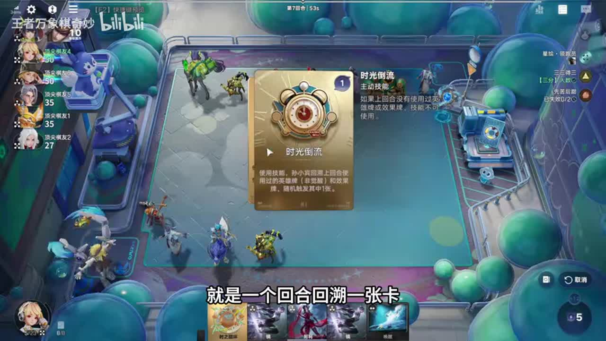

## 09:04–10:09 讲者估算三三得三保约30血，即使后期无用仍值；先苦后甜未触发损失另计

- 事件 ID：BV1hXac6BEZX:p1:e009
- 场景：实战
- 时机：早期天赋的已兑现价值
- 背景（分析推断）：本局孙膑走三分倒转，三三得三带来高血且无同行，后期发动大小回环；早期天赋的已兑现价值，具体条件依据所引前后文。
- 学习目标（分析推断）：按阶段已兑现收益评价
- 模板：combat-review
- ASR 段落：[17, 18]

> 就算他后期一点用没有他也值了

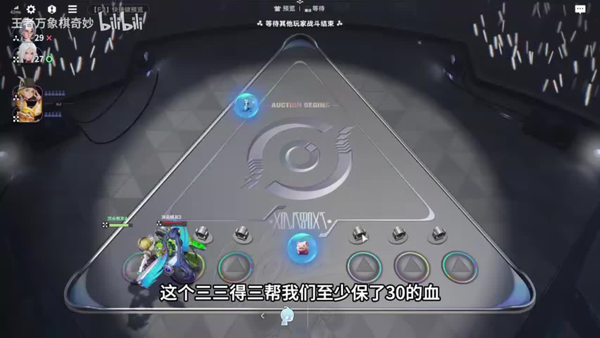

## 10:09–11:12 已有曹操有钱偏五级找四费与露娜，四级曹操概率更大；本局缺曹操仍升五是风险选择

- 事件 ID：BV1hXac6BEZX:p1:e010
- 场景：实战
- 时机：四级与五级找牌
- 背景（分析推断）：本局孙膑走三分倒转，三三得三带来高血且无同行，后期发动大小回环；四级与五级找牌，具体条件依据所引前后文。
- 学习目标（分析推断）：权衡低费概率与后续卡池
- 模板：level-transition
- ASR 段落：[19, 20]

> 但四级找曹操的概率大

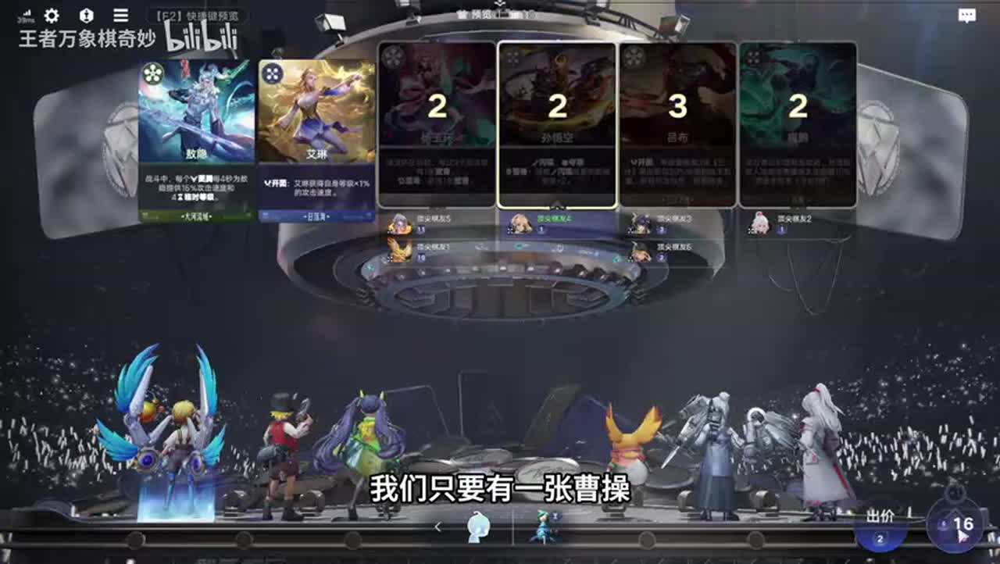

## 11:13–12:20 王牌部队可给集体唤醒但吕布不满足触发，暂上曹操维持三三得三

- 事件 ID：BV1hXac6BEZX:p1:e011
- 场景：实战
- 时机：上场与天赋门槛
- 背景（分析推断）：本局孙膑走三分倒转，三三得三带来高血且无同行，后期发动大小回环；上场与天赋门槛，具体条件依据所引前后文。
- 学习目标（分析推断）：先确认能触发再让位
- 模板：talent-fit
- ASR 段落：[21, 22]

> 如果能吃到的话我就上吕布了

## 12:20–13:24 常规七小八返九六级大十返仅参考；本局高血可把拍卖纳入大回环

- 事件 ID：BV1hXac6BEZX:p1:e012
- 场景：实战
- 时机：高血延迟回环
- 背景（分析推断）：本局孙膑走三分倒转，三三得三带来高血且无同行，后期发动大小回环；高血延迟回环，具体条件依据所引前后文。
- 学习目标（分析推断）：将回合表改成条件化窗口
- 模板：economy-budget
- ASR 段落：[23, 24]

> 我们血量很多我们可以贪婪

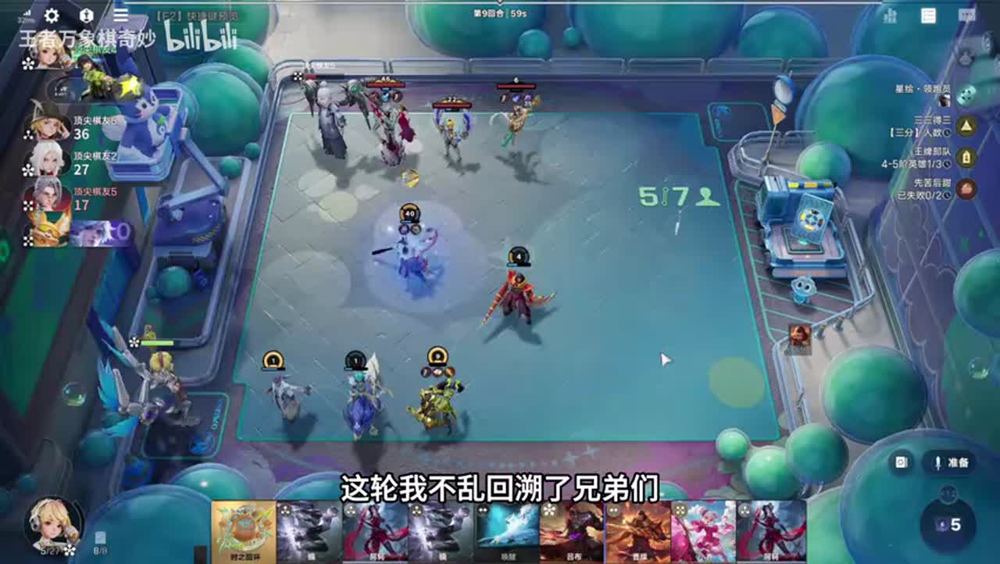

## 12:50–13:54 暂放单张回溯以触发较大收益，好牌留回环，传承太早改广大良才

- 事件 ID：BV1hXac6BEZX:p1:e013
- 场景：实战
- 时机：为了触发王牌部队改循环
- 背景（分析推断）：本局孙膑走三分倒转，三三得三带来高血且无同行，后期发动大小回环；为了触发王牌部队改循环，具体条件依据所引前后文。
- 学习目标（分析推断）：比较主次收益并留关键牌
- 模板：resource-order
- ASR 段落：[24, 25]

> 这些卡要打到回环里的

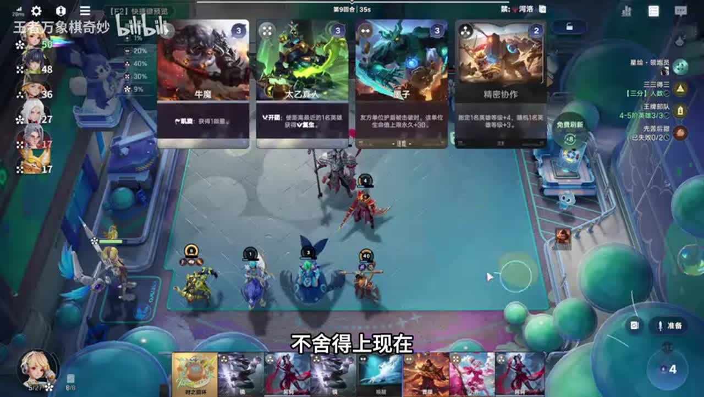

## 13:54–14:30 镜合成再卖得锦囊，传承晚点需要不急

- 事件 ID：BV1hXac6BEZX:p1:e014
- 场景：实战
- 时机：镜出售前合成
- 背景（分析推断）：本局孙膑走三分倒转，三三得三带来高血且无同行，后期发动大小回环；镜出售前合成，具体条件依据所引前后文。
- 学习目标（分析推断）：卖牌前检查合成奖励
- 模板：resource-order
- ASR 段落：[26]

> 镜是打合成再卖的

## 14:30–15:40 清杂鱼留核心好牌，手牌太多暂不拿换帅

- 事件 ID：BV1hXac6BEZX:p1:e015
- 场景：实战
- 时机：手牌容量压力
- 背景（分析推断）：本局孙膑走三分倒转，三三得三带来高血且无同行，后期发动大小回环；手牌容量压力，具体条件依据所引前后文。
- 学习目标（分析推断）：保留关键积累又避免容量阻塞
- 模板：resource-order
- ASR 段落：[27, 28]

> 手牌要满了

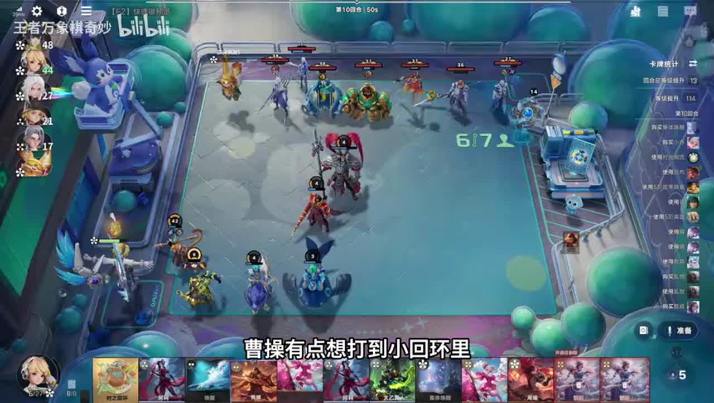

## 15:40–16:43 高血无同行可贪大小回环同开，低血有啥用啥，有同行应提前抢牌

- 事件 ID：BV1hXac6BEZX:p1:e016
- 场景：实战
- 时机：44血无同行继续等
- 背景（分析推断）：本局孙膑走三分倒转，三三得三带来高血且无同行，后期发动大小回环；44血无同行继续等，具体条件依据所引前后文。
- 学习目标（分析推断）：同时检查血量与竞争
- 模板：economy-budget
- ASR 段落：[29, 30]

> 我有同行的话也不能贪

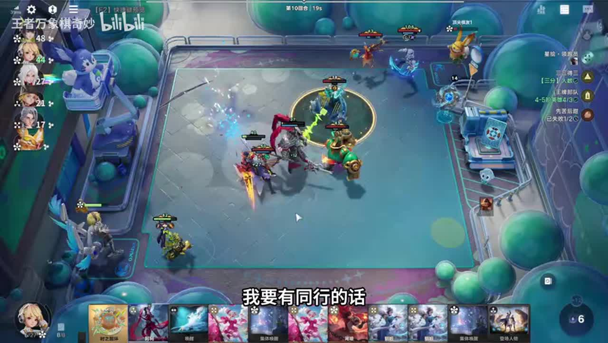

## 16:43–18:18 小回环先打支撑八张，回收后觉醒，小乔甄姬周瑜齐后大回环打露娜

- 事件 ID：BV1hXac6BEZX:p1:e017
- 场景：实战
- 时机：支撑先觉醒后倍增露娜
- 背景（分析推断）：本局孙膑走三分倒转，三三得三带来高血且无同行，后期发动大小回环；支撑先觉醒后倍增露娜，具体条件依据所引前后文。
- 学习目标（分析推断）：先完成支撑再倍增核心收益
- 模板：resource-order
- ASR 段落：[31, 32, 33]

> 一定要大回完去打露娜

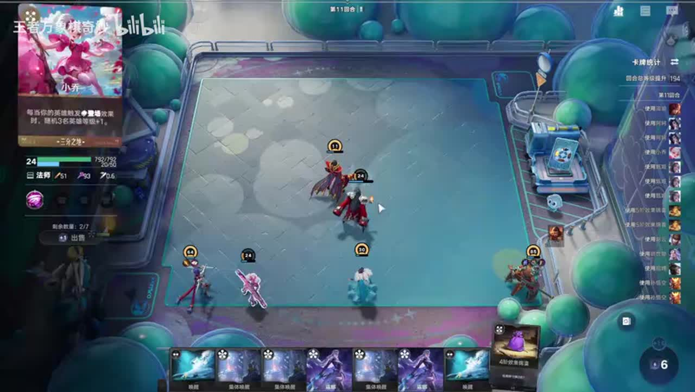

## 18:18–19:27 电表倒转比喻越花钱越多，本局高血容许亏一轮换后续资源

- 事件 ID：BV1hXac6BEZX:p1:e018
- 场景：实战
- 时机：倒转概念
- 背景（分析推断）：本局孙膑走三分倒转，三三得三带来高血且无同行，后期发动大小回环；倒转概念，具体条件依据所引前后文。
- 学习目标（分析推断）：理解术语与延迟收益条件
- 模板：mechanic-model
- ASR 段落：[34, 35]

> 你的这个钱会越花越多

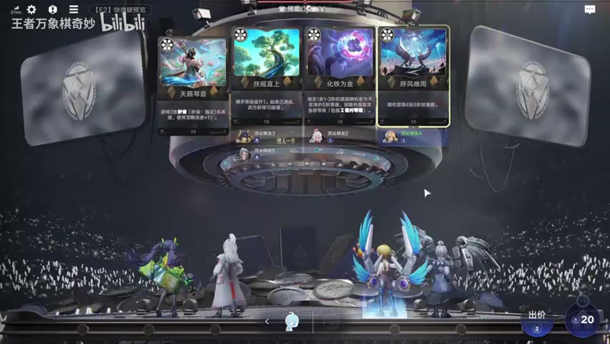

## 18:50–19:58 小乔最后打以免先回手导致后续登场吃不到效果

- 事件 ID：BV1hXac6BEZX:p1:e019
- 场景：实战
- 时机：小乔回收顺序
- 背景（分析推断）：本局孙膑走三分倒转，三三得三带来高血且无同行，后期发动大小回环；呼风唤雨与小乔排序，具体条件依据所引前后文。
- 学习目标（分析推断）：理解回手顺序影响后续登场收益
- 模板：resource-order
- ASR 段落：[35, 36]

> 排序很重要

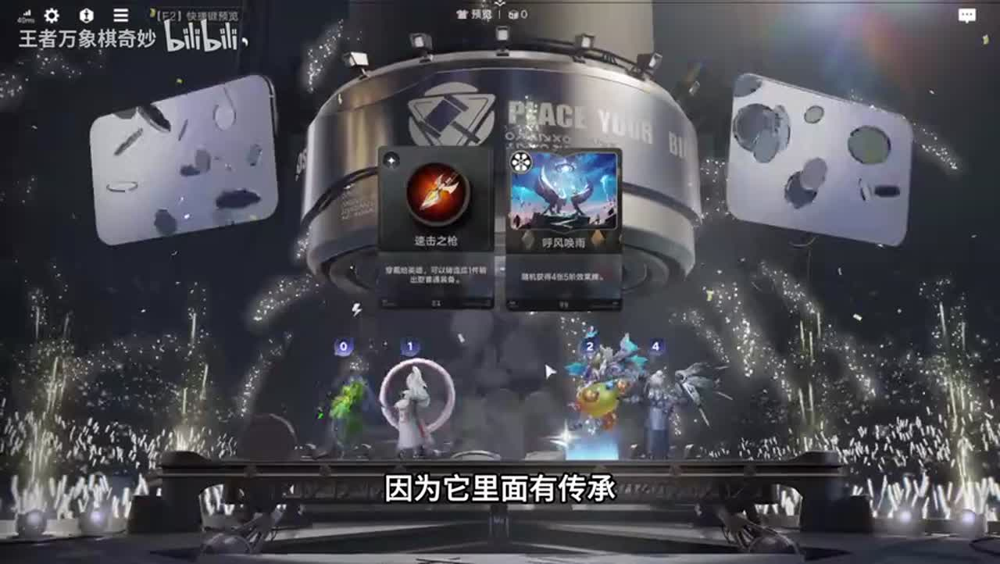

## 19:58–20:28 先一张露娜再所有唤醒，后补其他露娜；第二张太早会回手吞掉唤醒

- 事件 ID：BV1hXac6BEZX:p1:e020
- 场景：实战
- 时机：露娜与唤醒顺序
- 背景（分析推断）：本局孙膑走三分倒转，三三得三带来高血且无同行，后期发动大小回环；露娜与唤醒顺序，具体条件依据所引前后文。
- 学习目标（分析推断）：防止回手浪费稀有技能
- 模板：resource-order
- ASR 段落：[37]

> 记住先丢一张

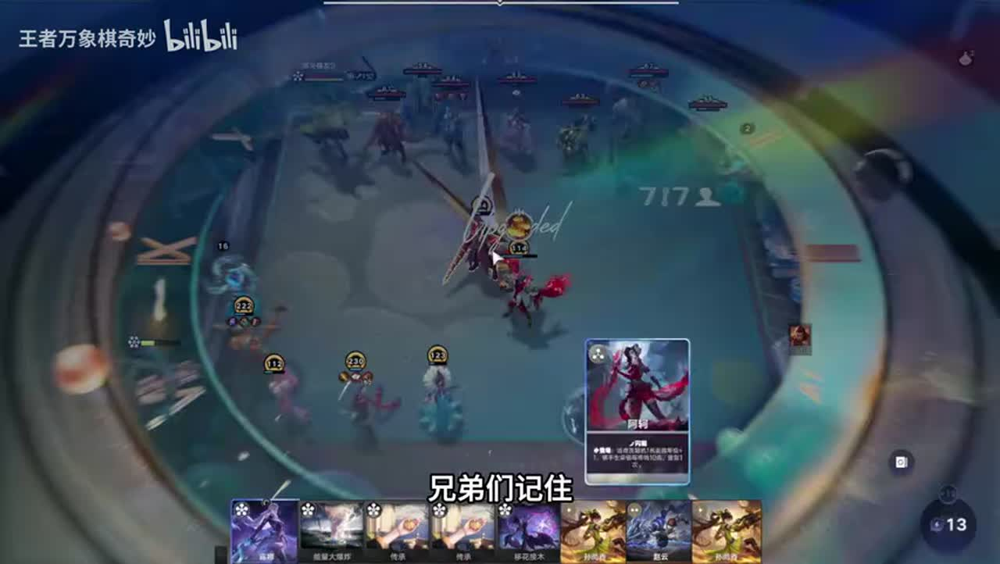

## 20:28–21:01 临阵磨枪触发曹操，等效露娜；十二次本轮次轮返还继续成长

- 事件 ID：BV1hXac6BEZX:p1:e021
- 场景：实战
- 时机：等效成长触发
- 背景（分析推断）：本局孙膑走三分倒转，三三得三带来高血且无同行，后期发动大小回环；等效成长触发，具体条件依据所引前后文。
- 学习目标（分析推断）：识别等效触发
- 模板：growth-combo
- ASR 段落：[38]

> 林真魔枪是触发这个曹操

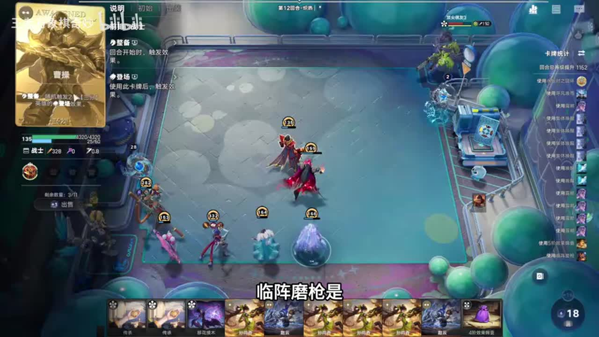

## 21:04–21:36 点开卡池查看所有卡零，解释暂时抽不到

- 事件 ID：BV1hXac6BEZX:p1:e022
- 场景：实战
- 时机：弹尽粮绝卡池诊断
- 背景（分析推断）：本局孙膑走三分倒转，三三得三带来高血且无同行，后期发动大小回环；弹尽粮绝卡池诊断，具体条件依据所引前后文。
- 学习目标（分析推断）：抽牌失败先检查卡池
- 模板：mechanic-model
- ASR 段落：[39]

> 就点一下这里就能看懂了

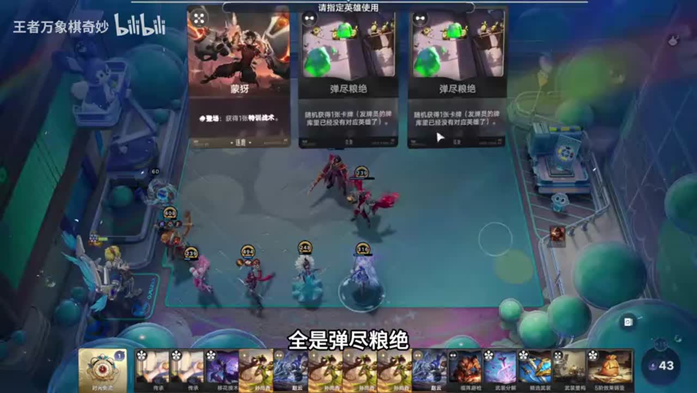

## 21:36–23:10 传承阿轲补装备，部分卡暂不打；待返还栏仍有一车卡

- 事件 ID：BV1hXac6BEZX:p1:e023
- 场景：实战
- 时机：卡池空时管理资源位置
- 背景（分析推断）：本局孙膑走三分倒转，三三得三带来高血且无同行，后期发动大小回环；卡池空时管理资源位置，具体条件依据所引前后文。
- 学习目标（分析推断）：区分手牌待返还与公共卡池
- 模板：resource-order
- ASR 段落：[40, 41, 42]

> 其实上面藏了一车的卡

## 23:10–24:16 分类后按类别逐个打，玉环也能用分类辨识阵营

- 事件 ID：BV1hXac6BEZX:p1:e024
- 场景：实战
- 时机：分类按钮降低操作负担
- 背景（分析推断）：本局孙膑走三分倒转，三三得三带来高血且无同行，后期发动大小回环；分类按钮降低操作负担，具体条件依据所引前后文。
- 学习目标（分析推断）：利用界面工具减少记忆成本
- 模板：mechanic-model
- ASR 段落：[43, 44]

> 它都给你分好类了

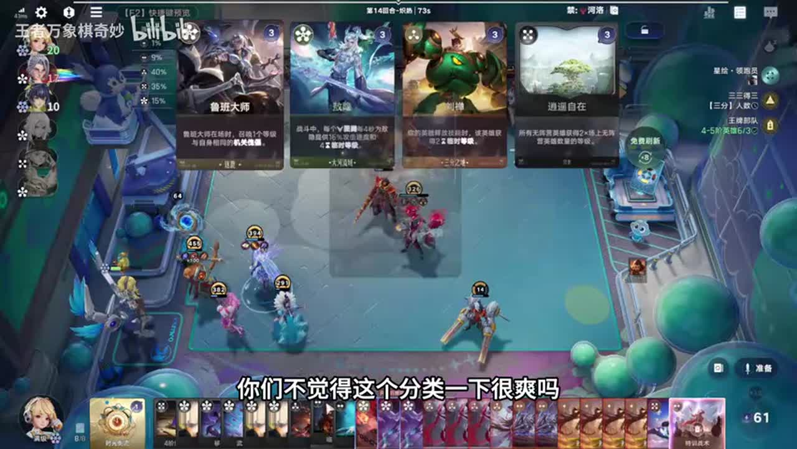

## 23:44–24:47 合成再卖得锦囊，讲者承认懒未每次凑四；区分教学规则与实际省略

- 事件 ID：BV1hXac6BEZX:p1:e025
- 场景：实战
- 时机：合成优于直接卖但讲者省略
- 背景（分析推断）：本局孙膑走三分倒转，三三得三带来高血且无同行，后期发动大小回环；合成优于直接卖但讲者省略，具体条件依据所引前后文。
- 学习目标（分析推断）：不照抄缺少收益的省略
- 模板：resource-order
- ASR 段落：[44, 45]

> 其实打四个比较好

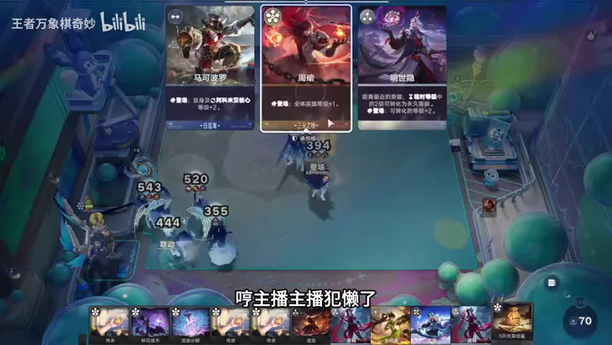

## 24:47–25:21 74能量找老虎玉环，露娜仍能触发老虎

- 事件 ID：BV1hXac6BEZX:p1:e026
- 场景：实战
- 时机：启动后改找最终核心
- 背景（分析推断）：本局孙膑走三分倒转，三三得三带来高血且无同行，后期发动大小回环；启动后改找最终核心，具体条件依据所引前后文。
- 学习目标（分析推断）：按剩余收益和最终战力调购牌
- 模板：late-transition
- ASR 段落：[46]

> 那个露娜能触发老虎的

## 25:21–25:45 为解释放慢花钱，终局剩83能量，示范速度不是完整执行上限

- 事件 ID：BV1hXac6BEZX:p1:e027
- 场景：实战
- 时机：讲解速度与实战执行
- 背景（分析推断）：本局孙膑走三分倒转，三三得三带来高血且无同行，后期发动大小回环；讲解速度与实战执行，具体条件依据所引前后文。
- 学习目标（分析推断）：理解讲解节奏与执行效率差别
- 模板：mechanic-model
- ASR 段落：[47]

> 尽量得讲清楚一点

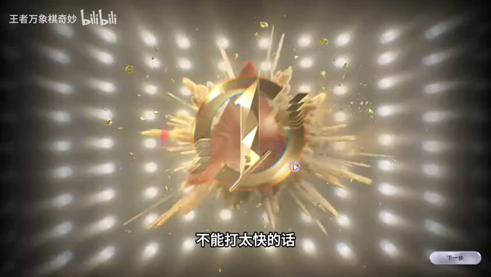

## 02:34–03:03 同一回合打八张才能发动，零散三四张不能替代

- 事件 ID：BV1hXac6BEZX:p1:e028
- 场景：实战
- 时机：小回环门槛
- 背景（分析推断）：本局孙膑走三分倒转，三三得三带来高血且无同行，后期发动大小回环；小回环门槛，具体条件依据所引前后文。
- 学习目标（分析推断）：理解单回合触发条件
- 模板：mechanic-model
- ASR 段落：[5]

> 你得一个回合打八张卡

## 18:50–19:27 呼风唤雨可能提供传承，计划纳入大回环

- 事件 ID：BV1hXac6BEZX:p1:e029
- 场景：实战
- 时机：呼风唤雨拍卖
- 背景（分析推断）：本局孙膑走三分倒转，三三得三带来高血且无同行，后期发动大小回环；呼风唤雨与小乔排序，具体条件依据所引前后文。
- 学习目标（分析推断）：把拍卖资源和返还技能的窗口关联
- 模板：auction-choice
- ASR 段落：[35]

> 它里面有传承

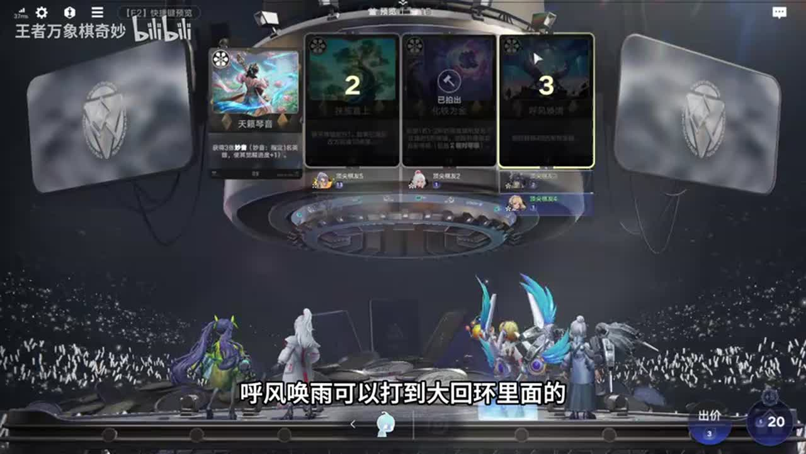

## 待核实与局限

- 不做ASR修正，原话同音词保留。
- 第3段疑似识别幻觉排除；聊天与喜好吐槽排除。
- 保约30血为讲者反事实估算，不是独立测量。
- 回环门槛与卡池规则按视频版本解释，未独立验证。
- 高血无同行贪收益偏离常规节奏，不作为新手固定回合表。
- 易上手是讲者表述，不证明学习效果。
