# 很多人想看的昭君大河，公式玩法，顶分局碾压吃鸡

来源：https://www.bilibili.com/video/BV14nei6NEoo/?p=1

分析状态：completed

完整文字稿：../../../raw/BV14nei6NEoo_p1.md

## 01:32–02:44 弈星升级、按对手判断预言胜负，再选大河过渡

- 事件 ID：BV14nei6NEoo:p1:e001
- 场景：实战
- 时机：前期升级
- 背景（分析推断）：当前阵容已能评估强弱
- 学习目标（分析推断）：按过渡与胜率使用资源
- 模板：opening-plan
- ASR 段落：[3, 4]

> 直接失败预言

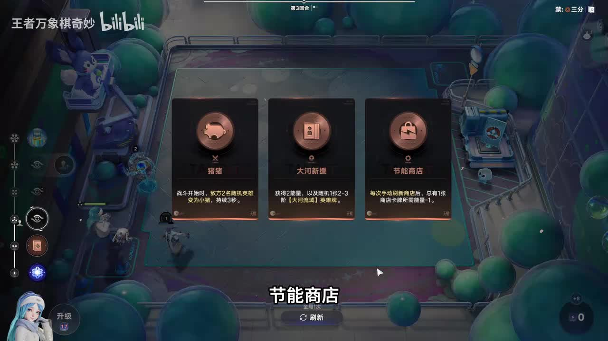

## 02:44–03:57 等右下角开战时再准备，保证预言窗口

- 事件 ID：BV14nei6NEoo:p1:e002
- 场景：实战
- 时机：预言准备前
- 背景（分析推断）：对手尚未完成整备可能升级
- 学习目标（分析推断）：检查结算时点
- 模板：resource-order
- ASR 段落：[5, 6]

> 要不然坏了菜了

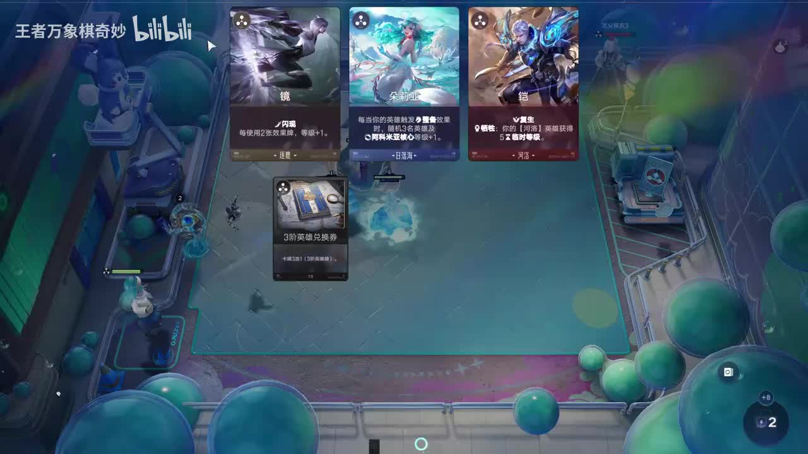

## 04:57–05:25 先看对手阵容确认其必需，非必需可能砸自己手

- 事件 ID：BV14nei6NEoo:p1:e003
- 场景：实战
- 时机：拍卖恶意追价风险
- 背景（分析推断）：老虎与陈小金属于特定路线需求
- 学习目标（分析推断）：理解追价成本和对手需求
- 模板：auction-choice
- ASR 段落：[9]

> 你得看一眼他的阵容

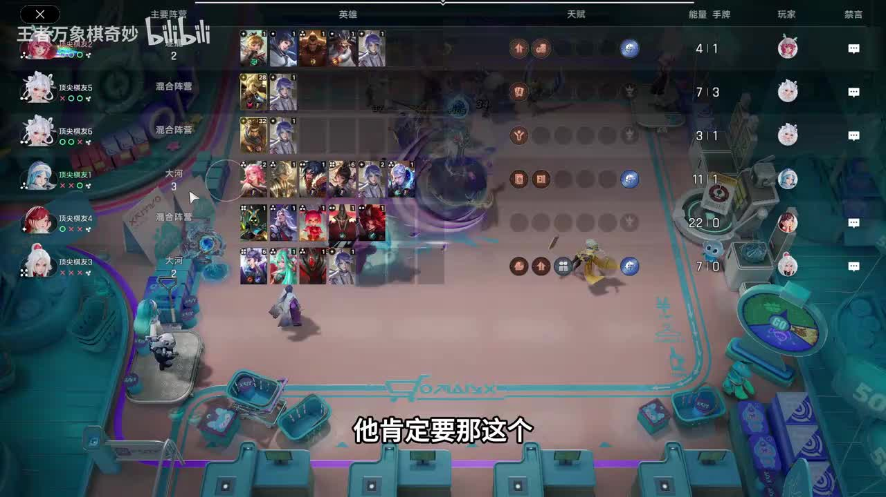

## 05:25–07:23 讲者给五三八一公式，随后解释同阵营高阶转化或同阶券

- 事件 ID：BV14nei6NEoo:p1:e004
- 场景：实战
- 时机：五回合棋手技能选项
- 背景（分析推断）：固定位置口诀依赖当时两个候选功能，不能跨版本推广
- 学习目标（分析推断）：把口诀背后的收益结构说明白
- 模板：mechanic-model
- ASR 段落：[10, 11, 12, 13]

> 这两种都能用

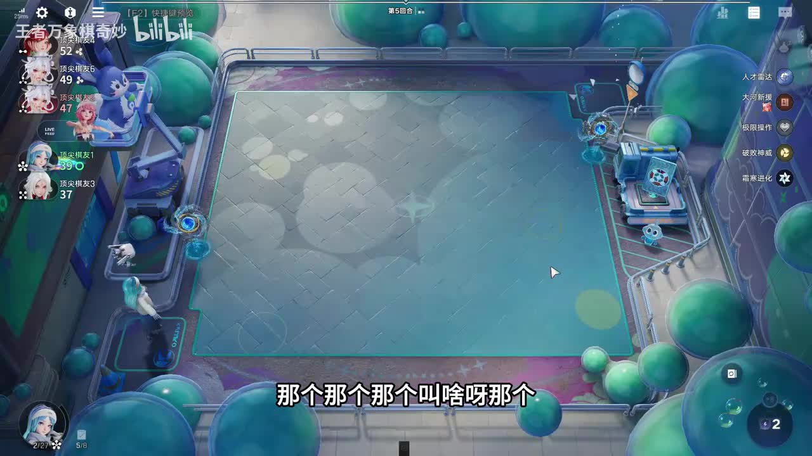

## 07:23–08:57 龙人与敖隐非开团，张良只在低阶开团多时重要，转高阶可动掉

- 事件 ID：BV14nei6NEoo:p1:e005
- 场景：实战
- 时机：大河阵容转高阶
- 背景（分析推断）：不应固定挂同一辅助
- 学习目标（分析推断）：按阵容标签变化替换工具
- 模板：module-fit
- ASR 段落：[14, 15, 16]

> 龙人和奥隐不是开团

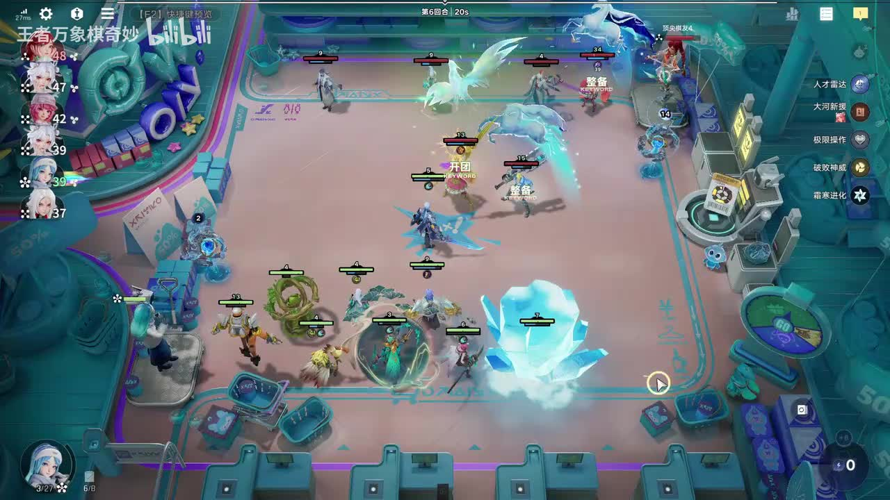

## 08:25–09:28 刘邦先过渡用，配破败神威输出

- 事件 ID：BV14nei6NEoo:p1:e006
- 场景：实战
- 时机：没变出理想核心
- 背景（分析推断）：临时替代需要后续清理
- 学习目标（分析推断）：缺牌时保证当前战力
- 模板：fallback-plan
- ASR 段落：[16, 17]

> 刘邦又能先用着呀

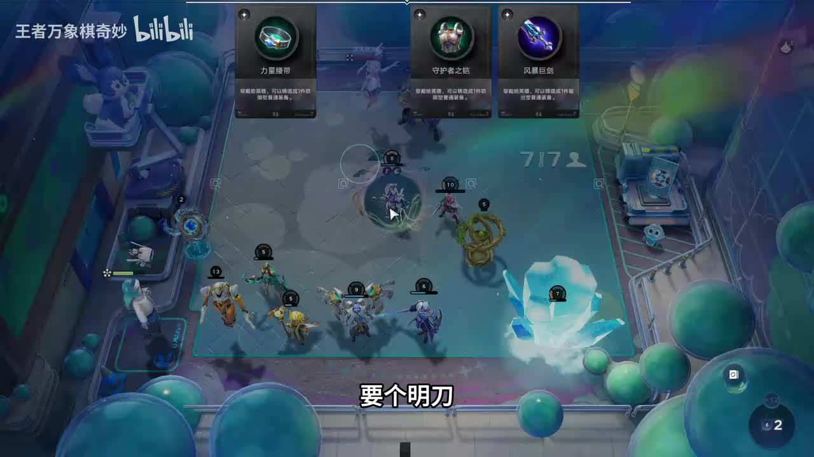

## 09:29–10:34 大河路线适配该天赋，与其他路线不同

- 事件 ID：BV14nei6NEoo:p1:e007
- 场景：实战
- 时机：观察破败神威伤害
- 背景（分析推断）：魔法伤害主要来自额外机制
- 学习目标（分析推断）：解释天赋阵容适配
- 模板：talent-fit
- ASR 段落：[18, 19]

> 全是魔法伤害

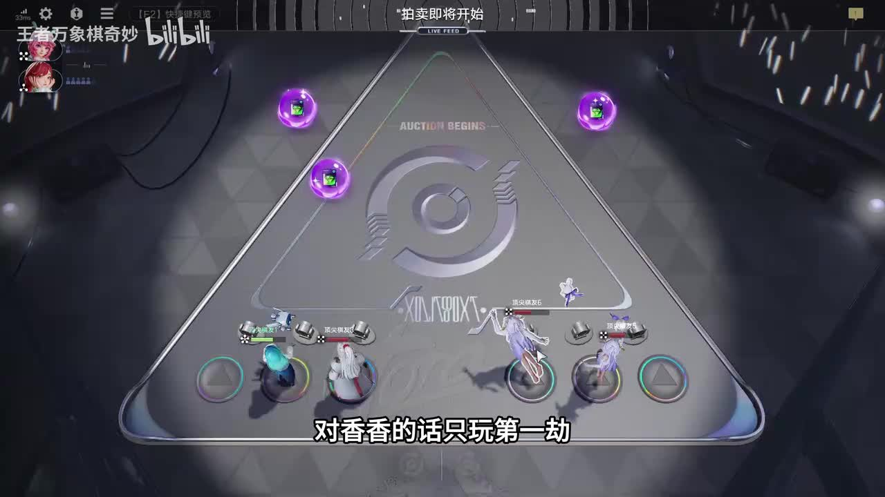

## 10:01–11:06 核心到来后不再死养刘邦

- 事件 ID：BV14nei6NEoo:p1:e008
- 场景：实战
- 时机：拍卖龙人与敖隐
- 背景（分析推断）：过渡任务已完成
- 学习目标（分析推断）：根据成型条件切换投入
- 模板：auction-choice
- ASR 段落：[19, 20]

> 谁让你养刘邦的

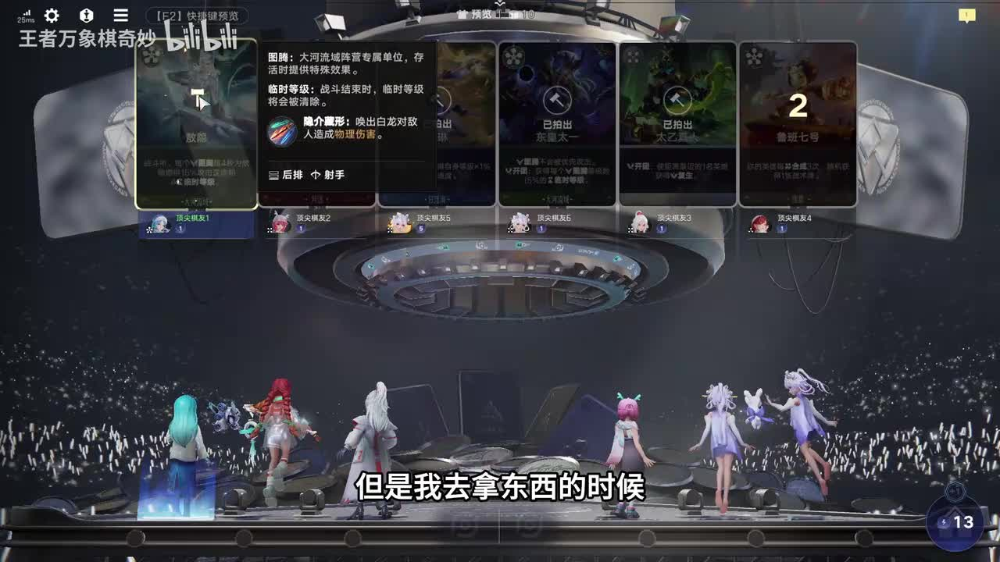

## 11:06–12:40 刘邦吃图腾破坏龙人攻速等级，应替换刘邦

- 事件 ID：BV14nei6NEoo:p1:e009
- 场景：实战
- 时机：龙人等级低
- 背景（分析推断）：模块互相冲突而非卡自身弱
- 学习目标（分析推断）：检查辅助副作用
- 模板：combat-review
- ASR 段落：[21, 22, 23]

> 龙人的词条是有一根柱子能加攻速加等级

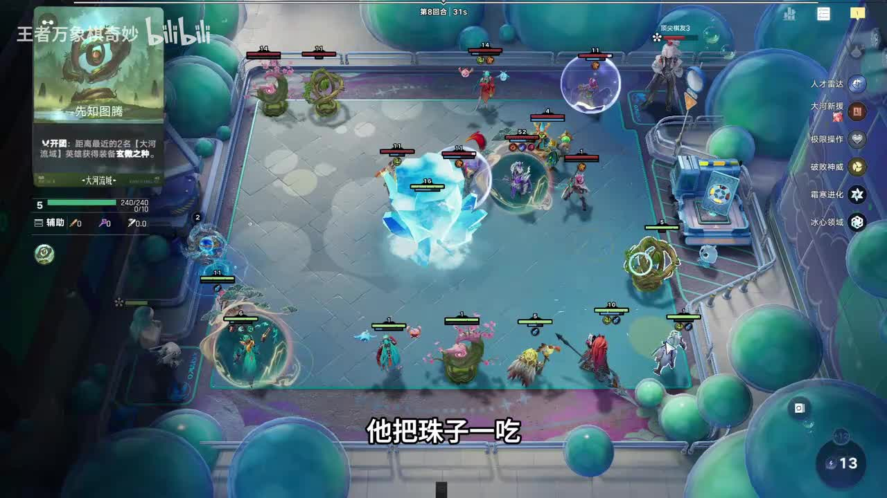

## 11:36–12:07 夺取之术应先用再卖，讲者发现漏用

- 事件 ID：BV14nei6NEoo:p1:e010
- 场景：实战
- 时机：工具下岗前
- 背景（分析推断）：可回收资源机会随卖出丢失
- 学习目标（分析推断）：卖出前核对未兑现奖励
- 模板：resource-order
- ASR 段落：[22]

> 我应该躲他一下再下岗的

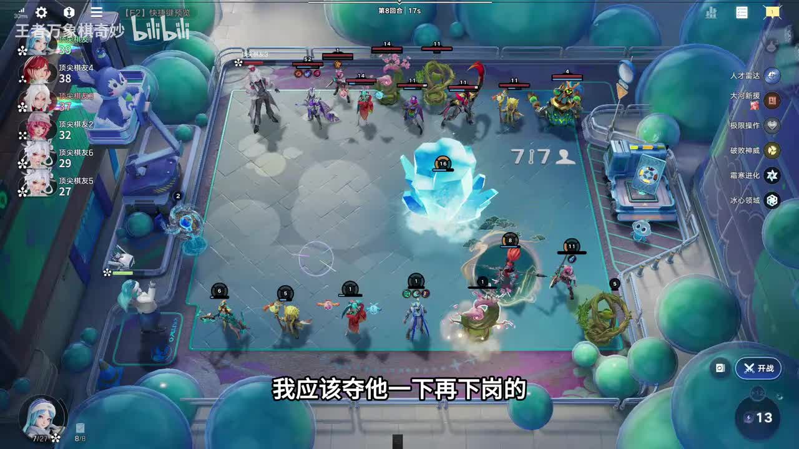

## 12:07–13:13 当前可用东皇咬，另一条高等级免控方案需成型

- 事件 ID：BV14nei6NEoo:p1:e011
- 场景：实战
- 时机：回答瑶控制反制
- 背景（分析推断）：是条件路线，不等于本局全车999
- 学习目标（分析推断）：按控制威胁给可执行选项
- 模板：counter-target
- ASR 段落：[23, 24]

> 拿着东方咬住他

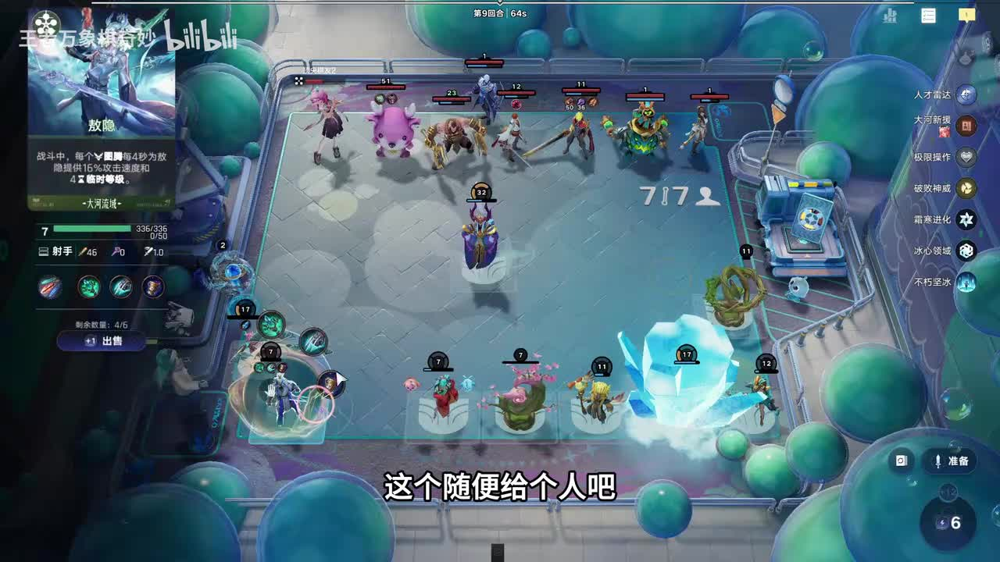

## 13:13–13:45 先觉醒再动成东皇或龙人

- 事件 ID：BV14nei6NEoo:p1:e012
- 场景：实战
- 时机：李信要变高阶
- 背景（分析推断）：可继承已成长低阶收益
- 学习目标（分析推断）：转化前保留成长收益
- 模板：growth-combo
- ASR 段落：[25]

> 李星先觉醒啊

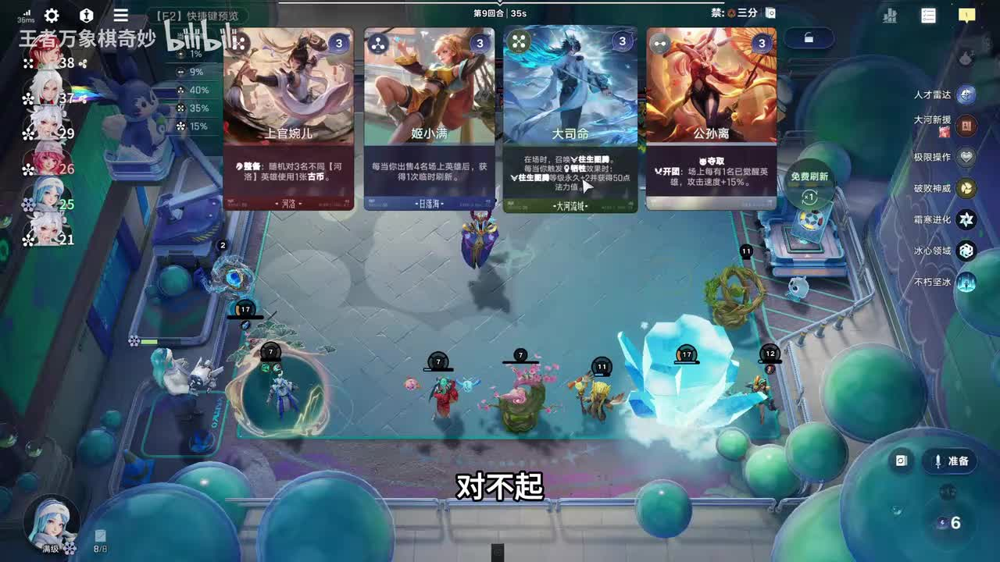

## 13:45–15:25 东皇敖隐配大司命少司缘鬼谷子三根柱子，余位灵活

- 事件 ID：BV14nei6NEoo:p1:e013
- 场景：实战
- 时机：龙人觉醒后组阵
- 背景（分析推断）：图腾提供战斗中持续成长
- 学习目标（分析推断）：按功能数量而非固定七牌表组队
- 模板：module-fit
- ASR 段落：[26, 27, 28]

> 三根柱子是谁

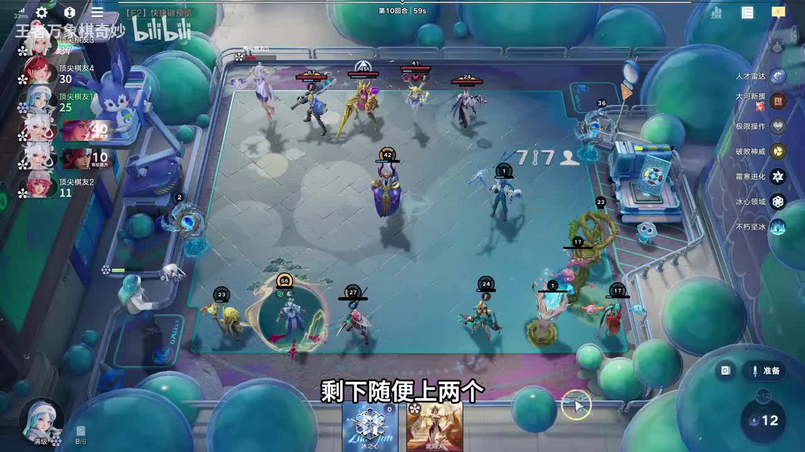

## 14:53–16:29 多图腾的攻速等级收益叠加，不只看开局等级

- 事件 ID：BV14nei6NEoo:p1:e014
- 场景：实战
- 时机：战斗中等级上涨
- 背景（分析推断）：敖隐开局低级但可战斗成长
- 学习目标（分析推断）：理解阵容战力成长时间
- 模板：growth-combo
- ASR 段落：[28, 30]

> 三根的话乘三

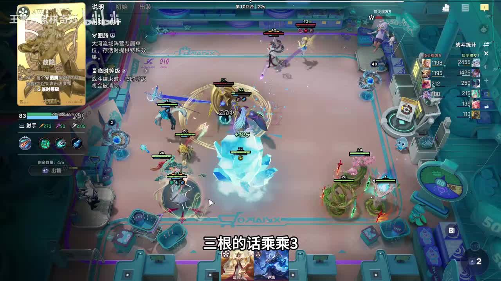

## 14:53–15:25 图腾靠旁边放，避免被艾琳一起扫掉

- 事件 ID：BV14nei6NEoo:p1:e015
- 场景：实战
- 时机：艾琳范围攻击威胁
- 背景（分析推断）：三图腾阵容刚成型
- 学习目标（分析推断）：保护成长机制而非只保护主C
- 模板：position-cause
- ASR 段落：[28]

> 她这个艾琳别一会儿给我的图腾给我刮掉了

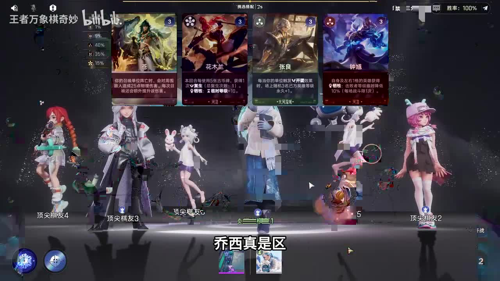

## 17:00–18:34 左右分散保护至少一根，不被单次范围全吃

- 事件 ID：BV14nei6NEoo:p1:e016
- 场景：实战
- 时机：保护图腾对AOE
- 背景（分析推断）：敌方攻击可能同时破坏多个关键图腾
- 学习目标（分析推断）：用分散站位保机制
- 模板：position-cause
- ASR 段落：[32, 33, 34]

> 给我的图腾全吃了

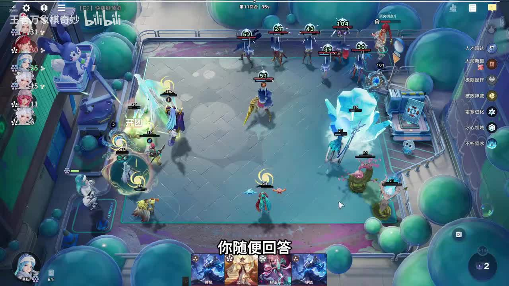

## 17:00–17:32 觉醒两侧影响对手降50%等级

- 事件 ID：BV14nei6NEoo:p1:e017
- 场景：实战
- 时机：决赛准备钟馗
- 背景（分析推断）：目标与位置影响能否覆盖
- 学习目标（分析推断）：按敌核心位置配置反制
- 模板：counter-target
- ASR 段落：[32]

> 能给对面降50%的等级

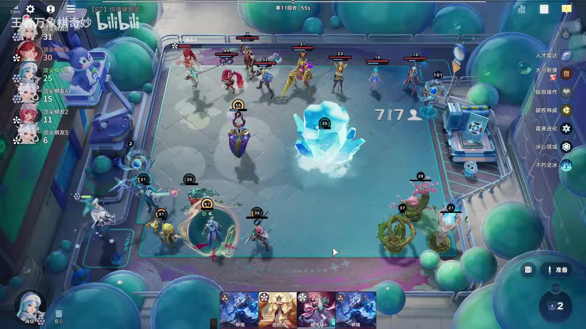

## 19:07–20:15 动成龙人敖隐继承低阶等级；木兰需五回合可变才考虑

- 事件 ID：BV14nei6NEoo:p1:e018
- 场景：实战
- 时机：转化已有等级韩信
- 背景（分析推断）：不同核心路线有时机门槛
- 学习目标（分析推断）：按既有成长与来牌选择路线
- 模板：late-transition
- ASR 段落：[36, 37]

> 他等级就给熬饮了

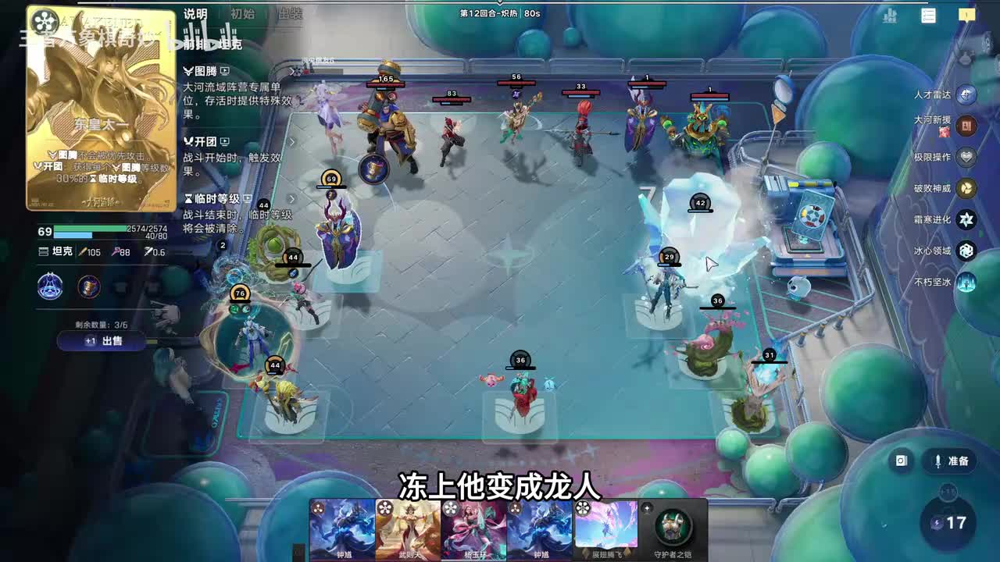

## 19:38–20:15 等下轮更多钱再飞

- 事件 ID：BV14nei6NEoo:p1:e019
- 场景：实战
- 时机：展翅腾飞当前穷
- 背景（分析推断）：刷新收益仍需购买资金
- 学习目标（分析推断）：储备爆发预算
- 模板：economy-budget
- ASR 段落：[37]

> 这一轮太穷了

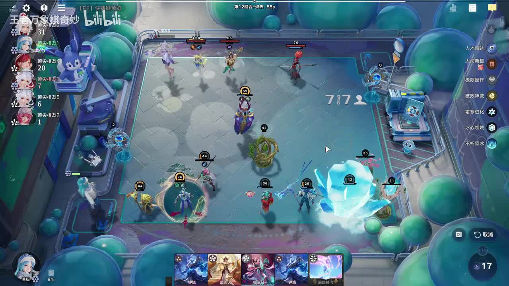

## 20:43–21:14 移动让鬼谷子先接，避免直挑龙人

- 事件 ID：BV14nei6NEoo:p1:e020
- 场景：实战
- 时机：韩信跳后排威胁
- 背景（分析推断）：讲者因闲聊险些漏换位
- 学习目标（分析推断）：保护核心并分配承伤
- 模板：position-cause
- ASR 段落：[39]

> 你先别挑龙人先挑鬼屋子

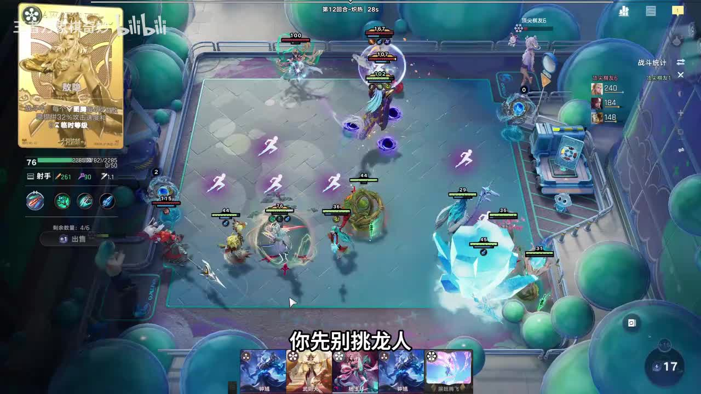

## 21:14–23:26 优先觉醒关键辅助与钟馗，韩信转化继续供核心等级

- 事件 ID：BV14nei6NEoo:p1:e021
- 场景：实战
- 时机：爆发搜牌
- 背景（分析推断）：并非亮牌全部买，需要目标完成判断
- 学习目标（分析推断）：按当前缺口刷新购买
- 模板：growth-combo
- ASR 段落：[40, 41, 42, 43]

> 我还缺一个金中回

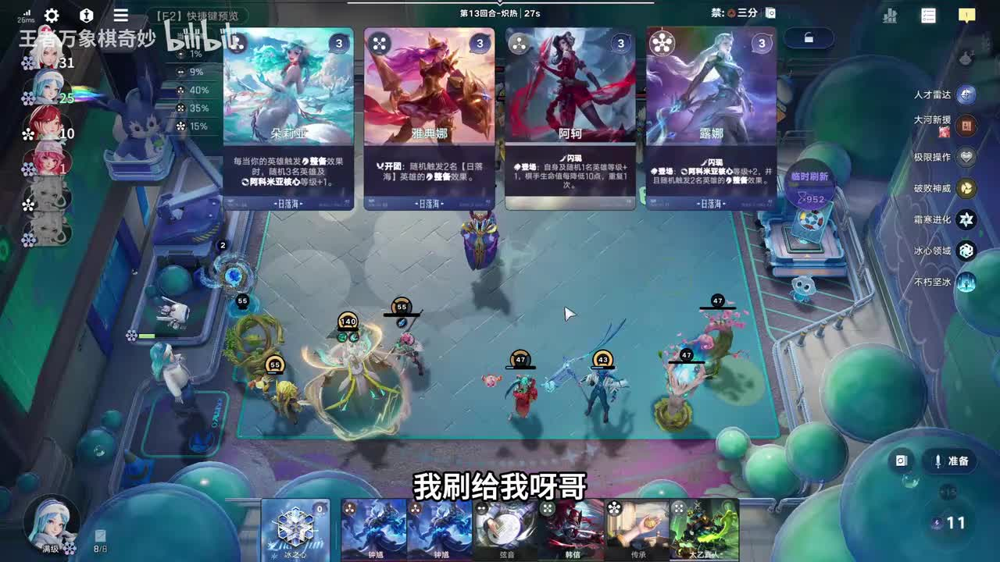

## 23:27–23:58 高攻速变猪连控限制敌核心

- 事件 ID：BV14nei6NEoo:p1:e022
- 场景：实战
- 时机：面对李信
- 背景（分析推断）：需要自身控制机制可持续且敌未有效解控
- 学习目标（分析推断）：将攻速与控制功能相连
- 模板：counter-target
- ASR 段落：[44]

> 他们打理性的时候一定要带变猪

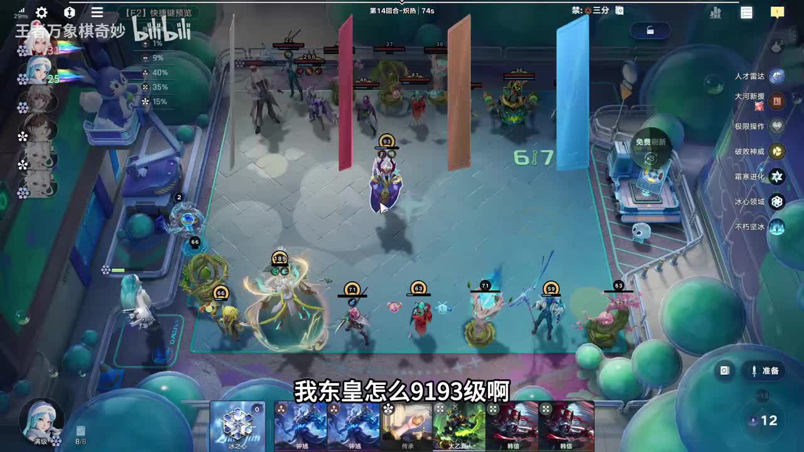

## 24:29–25:02 等转化完成后上觉醒钟馗降等级

- 事件 ID：BV14nei6NEoo:p1:e023
- 场景：实战
- 时机：终局太乙钟馗换位
- 背景（分析推断）：防错目标与反制时点重要
- 学习目标（分析推断）：先完成核心再上反制
- 模板：resource-order
- ASR 段落：[46]

> 他一会儿动完之后

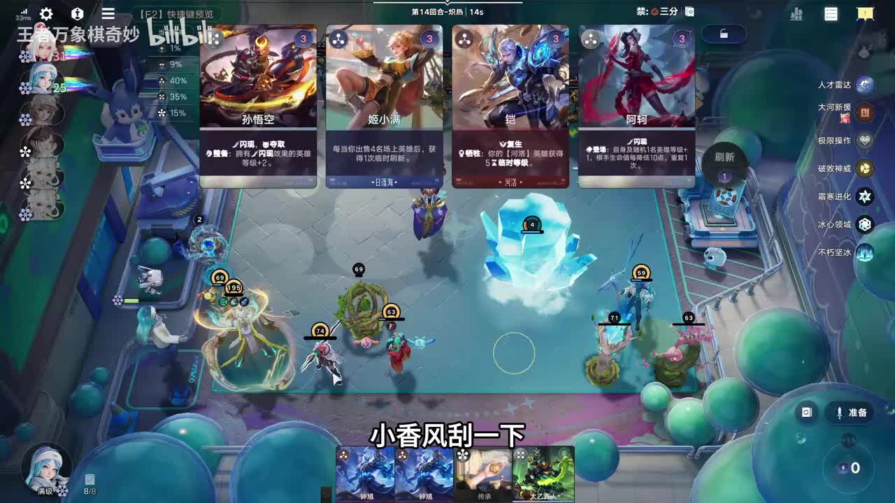

## 25:37–26:06 百级技能升级分享生命值双攻双抗攻速

- 事件 ID：BV14nei6NEoo:p1:e024
- 场景：实战
- 时机：瑶接近百级
- 背景（分析推断）：还差十级，门槛收益不同于平滑成长
- 学习目标（分析推断）：识别辅助技能阈值
- 模板：growth-combo
- ASR 段落：[48]

> 她会分享属性

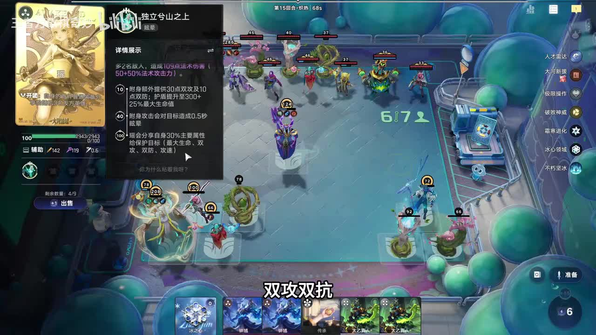

## 26:08–27:10 低阶已有等级转同阵营高阶汇入核心

- 事件 ID：BV14nei6NEoo:p1:e025
- 场景：实战
- 时机：复盘200级来源
- 背景（分析推断）：不是五阶牌仅靠同名一直养
- 学习目标（分析推断）：理解等级继承
- 模板：mechanic-model
- ASR 段落：[49, 50]

> 等级全是从低阶卡升上去的

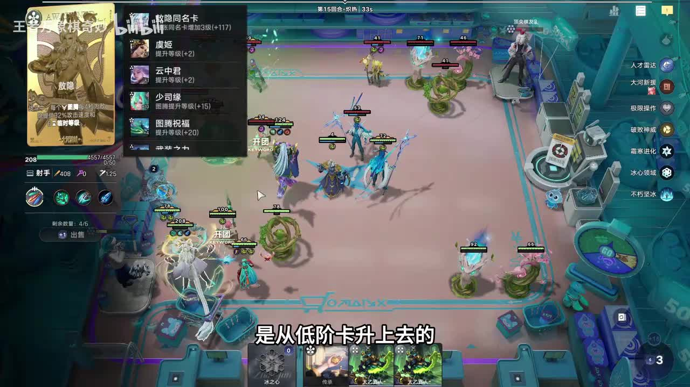

## 27:10–27:42 东皇明刀，敖隐法杖加明刀对应免死与连变猪

- 事件 ID：BV14nei6NEoo:p1:e026
- 场景：实战
- 时机：终局核心装备
- 背景（分析推断）：高攻速支持控制链
- 学习目标（分析推断）：用装备解释核心战斗职责
- 模板：equipment-role
- ASR 段落：[51]

> 一个是无限面珠

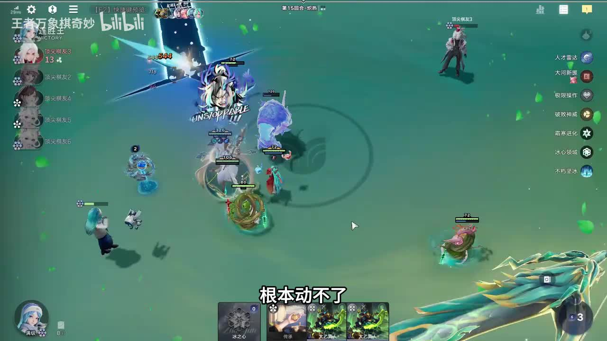

## 待核实与局限

- 不做ASR修正；龙人等俗称不猜正式英雄名。
- 五三八一为该视频选项安排，未保证当前版本固定序号。
- 跨棋手推荐与吐槽粉丝群闲聊排除，模板聚焦本局可追溯教学。
- 不断变猪等强描述保留对敌方解控限制，不据一局推必胜。
- 少数截图字幕与ASR当前句不完全一致；截图只佐证可见局势，具体机制与时点解释引用连续原始ASR，不从字幕猜测额外操作。
