# 新棋手阿离！公式干将转海月，轻松碾压全局精讲

来源：https://www.bilibili.com/video/BV1iRek6NExA/?p=1

分析状态：completed

完整文字稿：../../../raw/BV1iRek6NExA_p1.md

## 00:42–02:11 日落海阿离双干将，二回合觉醒后找辅助

- 事件 ID：BV1iRek6NExA:p1:e001
- 场景：实战
- 时机：开局过渡
- 背景（分析推断）：卡池限制上限，需成长与承伤
- 学习目标（分析推断）：起手条件
- 模板：opening-plan
- ASR 段落：[2, 3]

> 我们两回合干将要觉醒的

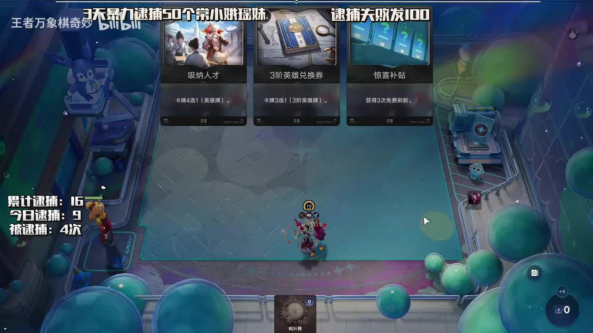

## 09:03–09:38 辅助前排退场，让带伞干将拿击杀

- 事件 ID：BV1iRek6NExA:p1:e002
- 场景：实战
- 时机：击杀成长
- 背景（分析推断）：辅助抢头损害成长
- 学习目标（分析推断）：分配击杀承伤
- 模板：position-cause
- ASR 段落：[14]

> 必须得让这个带伞的人能K到头

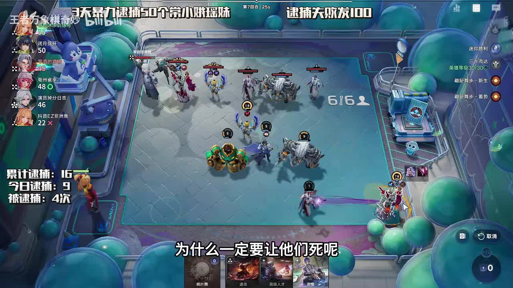

## 02:57–04:39 孙膑曜等合成补循环

- 事件 ID：BV1iRek6NExA:p1:e003
- 场景：实战
- 时机：干将牌稀缺
- 背景（分析推断）：成长卡池受限
- 学习目标（分析推断）：替代缺牌功能
- 模板：fallback-plan
- ASR 段落：[5, 6]

> 我不能指望干将打合成升级了

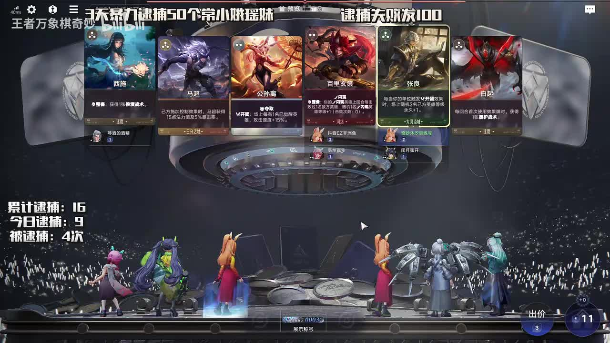

## 03:52–05:17 讲者强调红叶染枫与带伞击杀成长的适配

- 事件 ID：BV1iRek6NExA:p1:e004
- 场景：实战
- 时机：阿离天赋
- 背景（分析推断）：路线依赖伞击杀成长
- 学习目标（分析推断）：天赋适配路线
- 模板：talent-fit
- ASR 段落：[6, 7]

> 红叶染封一定要点

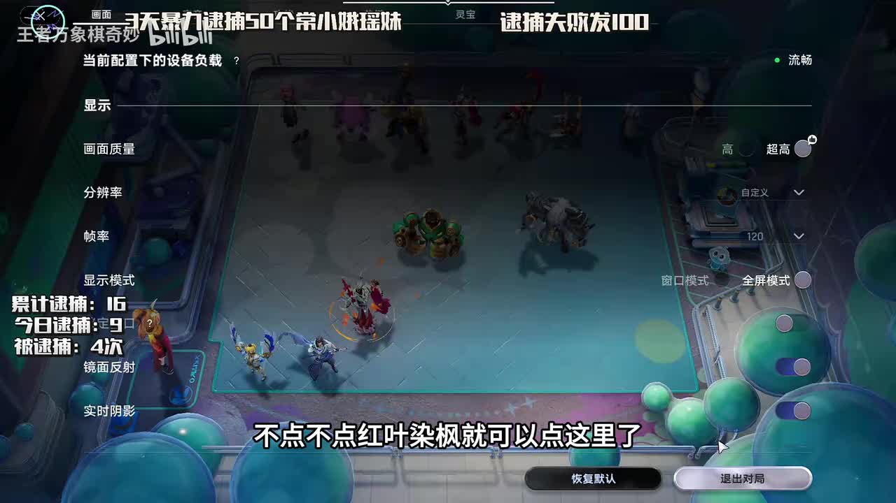

## 05:18–06:00 驱雷适用于当前干将

- 事件 ID：BV1iRek6NExA:p1:e005
- 场景：实战
- 时机：选驱雷
- 背景（分析推断）：非无条件万能
- 学习目标（分析推断）：按核心选择装
- 模板：equipment-role
- ASR 段落：[8]

> 驱灵法杖其实很厉害

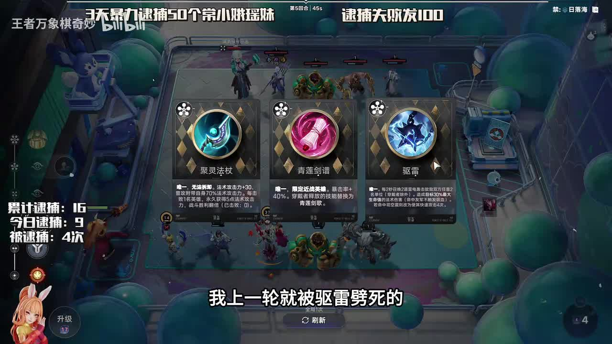

## 07:20–07:57 十蓝比十五蓝施法快，攻速配合

- 事件 ID：BV1iRek6NExA:p1:e006
- 场景：实战
- 时机：蓝条装备
- 背景（分析推断）：普攻启动技能
- 学习目标（分析推断）：比较施法频率
- 模板：equipment-cause
- ASR 段落：[11]

> 10篮A两下

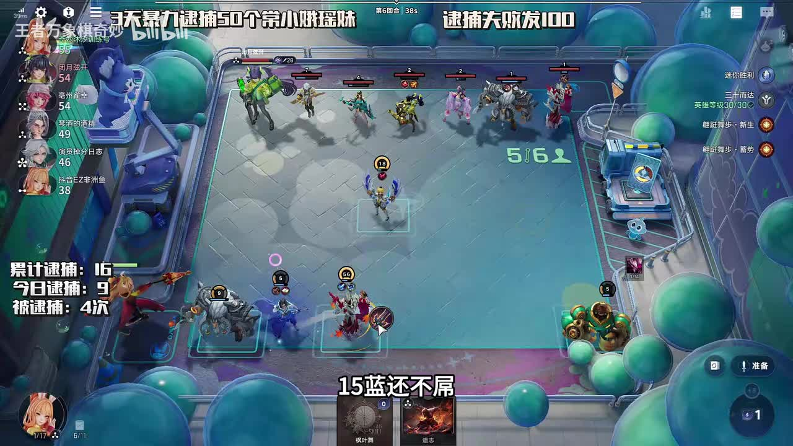

## 08:31–09:38 明世隐配刘禅，辅助尽快退场

- 事件 ID：BV1iRek6NExA:p1:e007
- 场景：实战
- 时机：自动成长
- 背景（分析推断）：缺合成需替代成长
- 学习目标（分析推断）：辅助循环和击杀归属
- 模板：growth-combo
- ASR 段落：[13, 14]

> 明师印得要

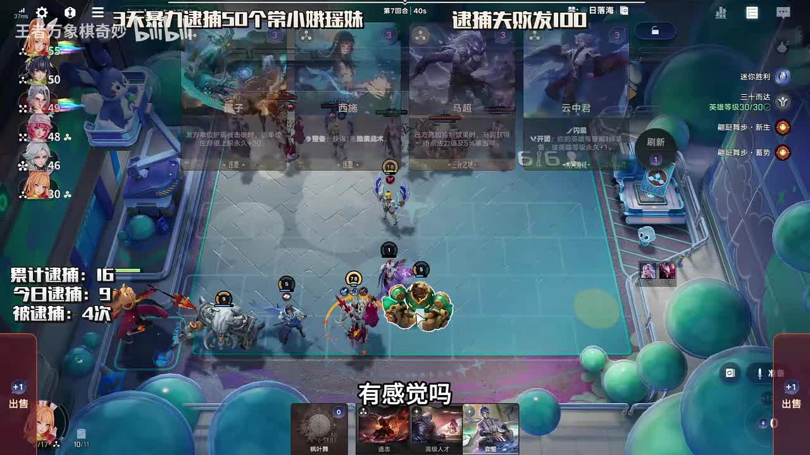

## 09:42–10:51 优先核心，无则太乙补一条命

- 事件 ID：BV1iRek6NExA:p1:e008
- 场景：实战
- 时机：拍卖无海月
- 背景（分析推断）：转型待牌
- 学习目标（分析推断）：功能拍卖优先级
- 模板：auction-choice
- ASR 段落：[15, 16]

> 太一等于一条命

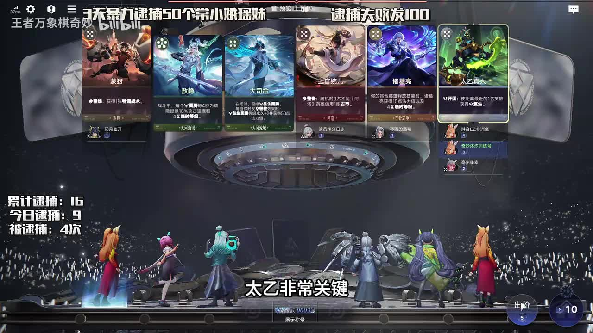

## 10:51–11:56 升五找海月明世隐

- 事件 ID：BV1iRek6NExA:p1:e009
- 场景：实战
- 时机：干将少
- 背景（分析推断）：过渡凭击杀继续长
- 学习目标（分析推断）：扩大目标卡池
- 模板：level-transition
- ASR 段落：[17, 18]

> 反正这个干将也找不到

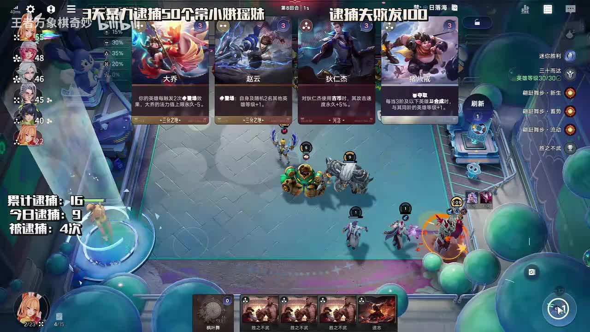

## 11:56–13:08 圣之步只交一份

- 事件 ID：BV1iRek6NExA:p1:e010
- 场景：实战
- 时机：弱对手
- 背景（分析推断）：敌有效战力少
- 学习目标（分析推断）：足够即止
- 模板：economy-budget
- ASR 段落：[19, 20]

> 叫多了,叫多了,不好

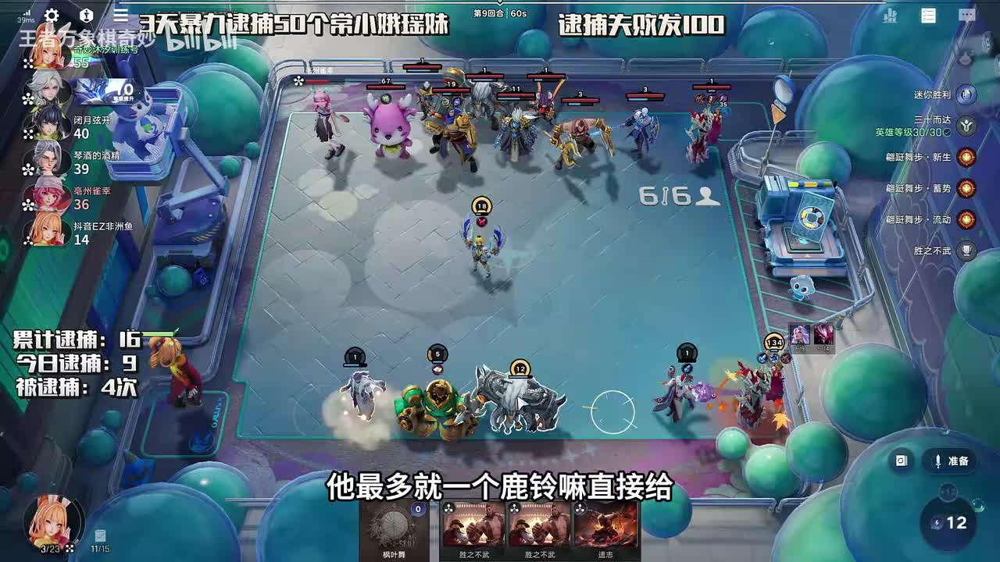

## 12:30–13:08 刘禅临时等级通过小明转永久

- 事件 ID：BV1iRek6NExA:p1:e011
- 场景：实战
- 时机：解释明世隐
- 背景（分析推断）：需两功能配合
- 学习目标（分析推断）：区分临时真实等级
- 模板：mechanic-model
- ASR 段落：[20]

> 他能把临时等级转化为真实等级

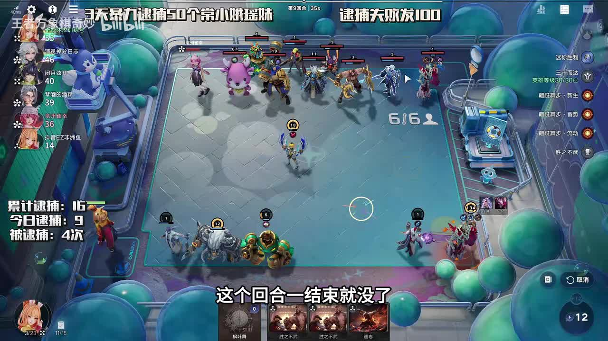

## 13:47–16:07 提出假设观察，无明确成功结论

- 事件 ID：BV1iRek6NExA:p1:e012
- 场景：实战
- 时机：疑友伤能加级
- 背景（分析推断）：敌方击杀描述与总数不一致
- 学习目标（分析推断）：验证而不猜机制
- 模板：combat-review
- ASR 段落：[22, 23, 24, 25]

> 咱们看一下,观察一下

## 15:34–16:41 卸磨杀驴留干将走前拆装

- 事件 ID：BV1iRek6NExA:p1:e013
- 场景：实战
- 时机：转型拆装
- 背景（分析推断）：后续讲者忘拆
- 学习目标（分析推断）：移除前回收
- 模板：resource-order
- ASR 段落：[25, 26]

> 走之前给他装备给他给他敲下来

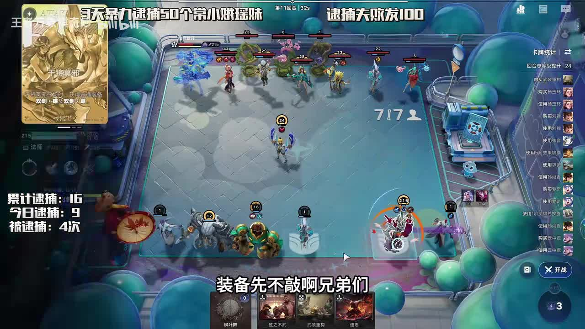

## 16:41–17:58 查对手成长特大弹头

- 事件 ID：BV1iRek6NExA:p1:e014
- 场景：实战
- 时机：突吃高伤
- 背景（分析推断）：敌强度跨回合改变
- 学习目标（分析推断）：更新威胁判断
- 模板：combat-review
- ASR 段落：[27, 28]

> 一枪打60%的血

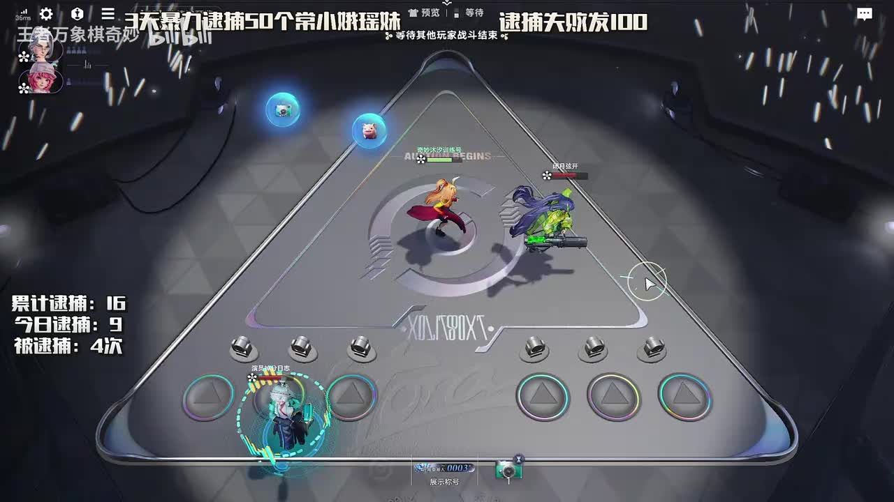

## 18:39–20:07 刘禅等先回手再遗址

- 事件 ID：BV1iRek6NExA:p1:e015
- 场景：实战
- 时机：遗址前
- 背景（分析推断）：海月未到，血量可等
- 学习目标（分析推断）：备目标退场工具
- 模板：resource-order
- ASR 段落：[30, 31]

> 回到手里然后再打这个椅子

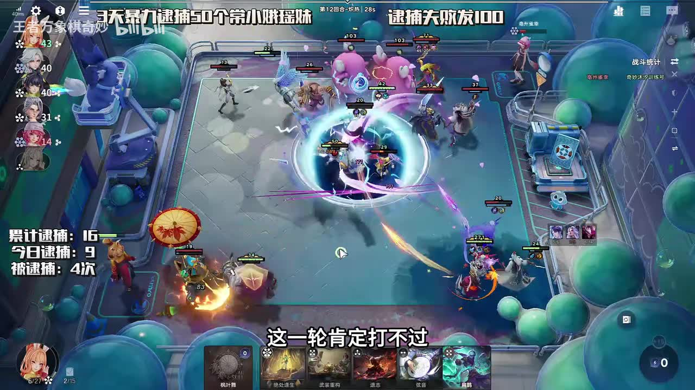

## 20:37–22:20 看吕布驱雷替代

- 事件 ID：BV1iRek6NExA:p1:e016
- 场景：实战
- 时机：海月不来
- 背景（分析推断）：血量高，吕布上天输出
- 学习目标（分析推断）：条件功能替代
- 模板：fallback-plan
- ASR 段落：[33, 34, 35]

> 实在不行我跑路吕布也行

## 23:12–23:52 已神装时额外小件收益小

- 事件 ID：BV1iRek6NExA:p1:e017
- 场景：实战
- 时机：忘拆装备
- 背景（分析推断）：错误已发生
- 学习目标（分析推断）：评估实际损失
- 模板：combat-review
- ASR 段落：[37]

> 我忘了敲了

## 24:31–25:05 回血衰减，免控更重要

- 事件 ID：BV1iRek6NExA:p1:e018
- 场景：实战
- 时机：海月防守
- 背景（分析推断）：回复评价不同
- 学习目标（分析推断）：比较有效防守
- 模板：equipment-role
- ASR 段落：[39]

> 生命恢复效果大幅度降低

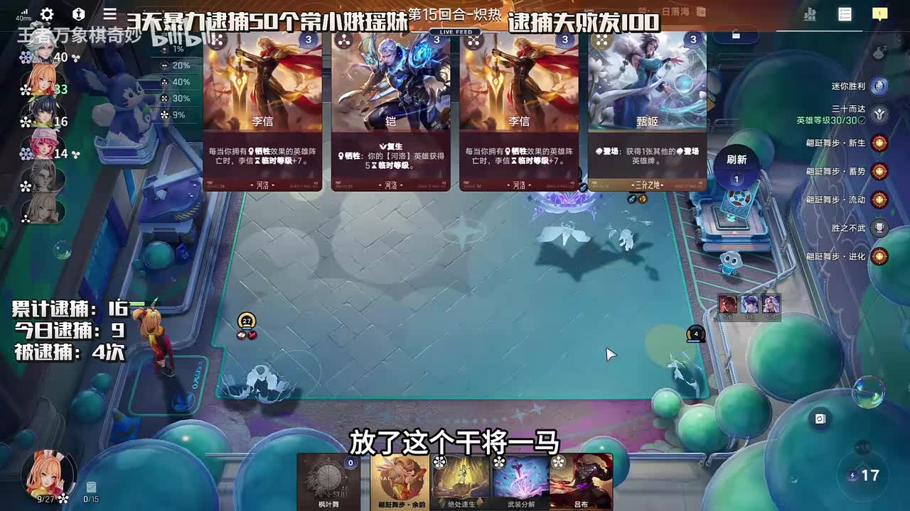

## 25:05–26:20 机械头免控使护盾价值改变，太乙第二命关键

- 事件 ID：BV1iRek6NExA:p1:e019
- 场景：实战
- 时机：机械头出现
- 背景（分析推断）：新信息改变排序
- 学习目标（分析推断）：重评选择
- 模板：equipment-role
- ASR 段落：[40, 41]

> 如果早知道我有借投的话,我就点护盾了

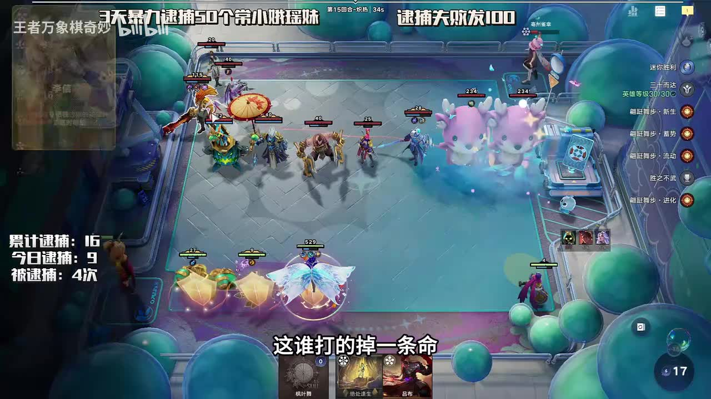

## 26:20–27:31 频繁施法配盾转血

- 事件 ID：BV1iRek6NExA:p1:e020
- 场景：实战
- 时机：确定免控
- 背景（分析推断）：需机械头覆盖风险
- 学习目标（分析推断）：组合前提
- 模板：growth-combo
- ASR 段落：[42, 43]

> 不会被控的话,我们3秒是真能丢好几个技能的

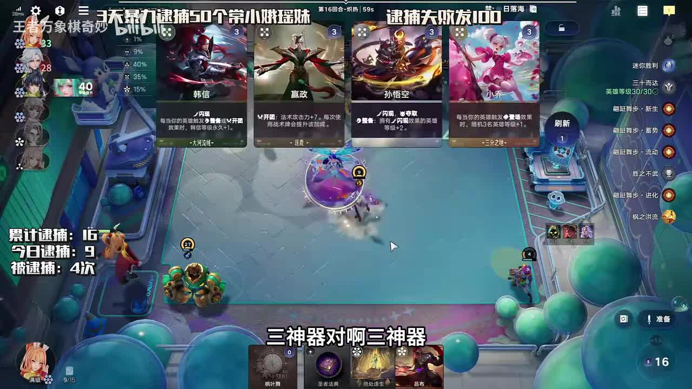

## 27:31–28:08 退吕布上太乙补续航

- 事件 ID：BV1iRek6NExA:p1:e021
- 场景：实战
- 时机：太乙来
- 背景（分析推断）：转型已成型
- 学习目标（分析推断）：终局换缺失功能
- 模板：late-transition
- ASR 段落：[44]

> 这个吕布滚蛋。上个太一

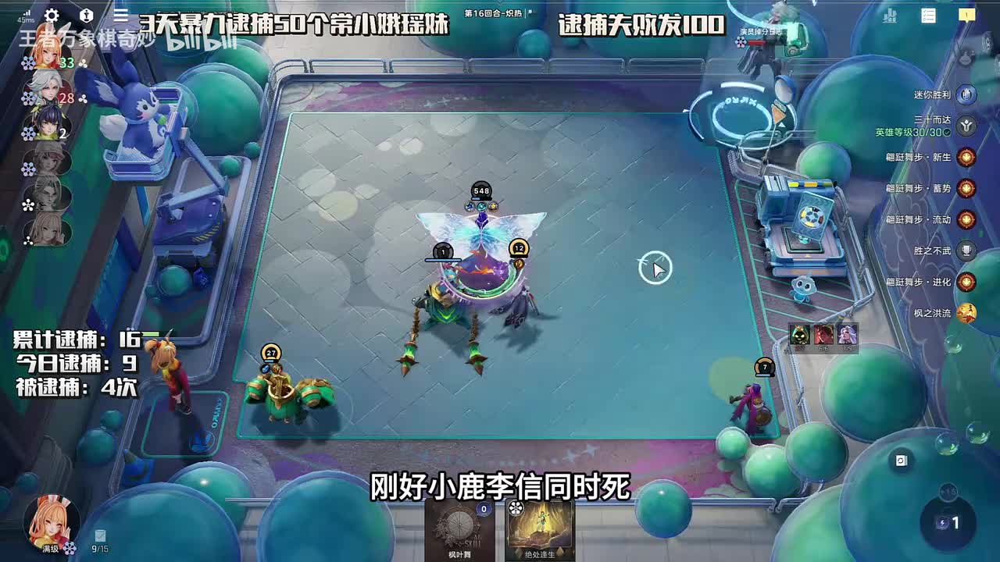

## 28:08–29:14 海月很快吃盾，持久盾不如控制

- 事件 ID：BV1iRek6NExA:p1:e022
- 场景：实战
- 时机：护盾或晕
- 背景（分析推断）：盾转血降低持续价值
- 学习目标（分析推断）：机制评价装备
- 模板：equipment-cause
- ASR 段落：[45, 46]

> 没必要无限

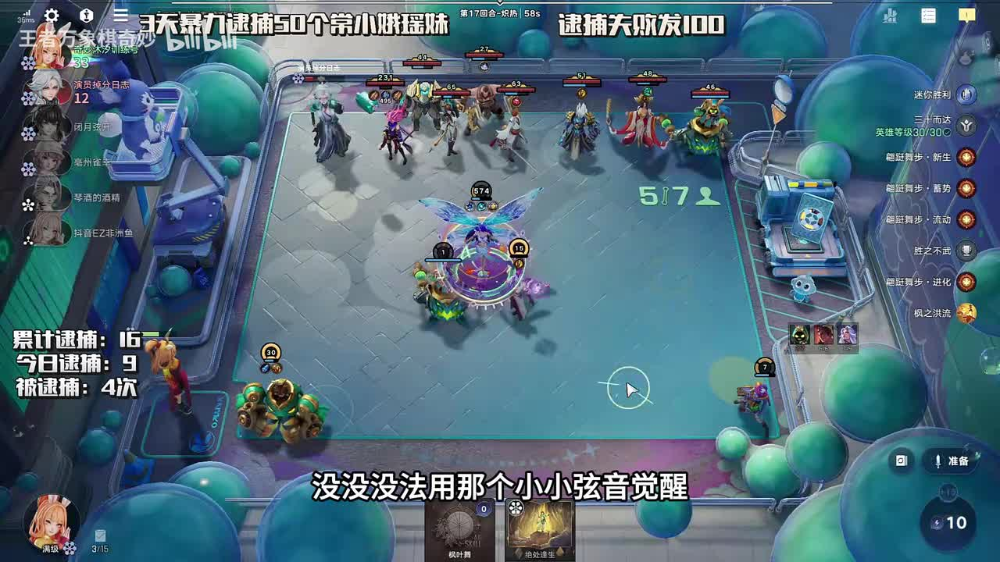

## 28:38–29:52 降等级，关注敌露娜多次复活

- 事件 ID：BV1iRek6NExA:p1:e023
- 场景：实战
- 时机：终局钟馗
- 背景（分析推断）：两命十命难度不同
- 学习目标（分析推断）：按敌复活反制
- 模板：counter-target
- ASR 段落：[46, 47]

> 他如果十条命的话就打不过了

## 待核实与局限

- 不修正ASR；驱雷友伤能否触发成长无明确实验结论。
- 数值及词条属视频版本，当前未核实。
- 多少钱都要是讲者强调，不推广无限预算。
