# 昭君也是公式棋手，公式化吃鸡流程

来源：https://www.bilibili.com/video/BV1wihk6qEHK/?p=1

分析状态：completed

完整文字稿：../../../raw/BV1wihk6qEHK_p1.md

## 01:00–02:06 冻苏烈白嫖等级，冻孙尚香白嫖刷新，优先有退场收益的英雄

- 事件 ID：BV1wihk6qEHK:p1:e001
- 场景：实战
- 时机：前期选择冻结目标
- 背景（分析推断）：昭君会冻走单位，冻谁决定能否额外得到资源
- 学习目标（分析推断）：让棋手被动与英雄退场机制联动
- 模板：growth-combo
- ASR 段落：[2, 3]

> 一个白嫖两级一个白嫖刷新

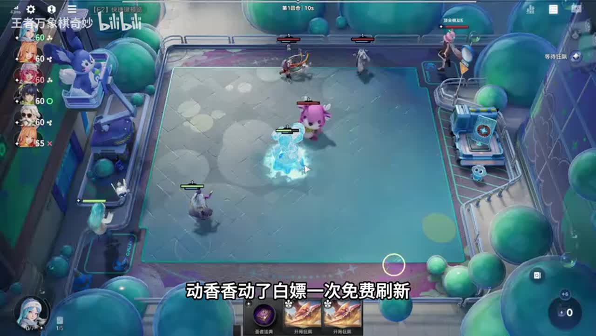

## 01:32–02:53 先苦后甜让早期输战转成资源，选择按预期胜负评估

- 事件 ID：BV1wihk6qEHK:p1:e002
- 场景：实战
- 时机：前期可能输时拿先苦后甜
- 背景（分析推断）：讲者拿天赋后担心自己反而赢，说明需要符合触发条件
- 学习目标（分析推断）：根据实际触发概率评价经济天赋
- 模板：talent-fit
- ASR 段落：[3, 4]

> 输了是先苦后甜

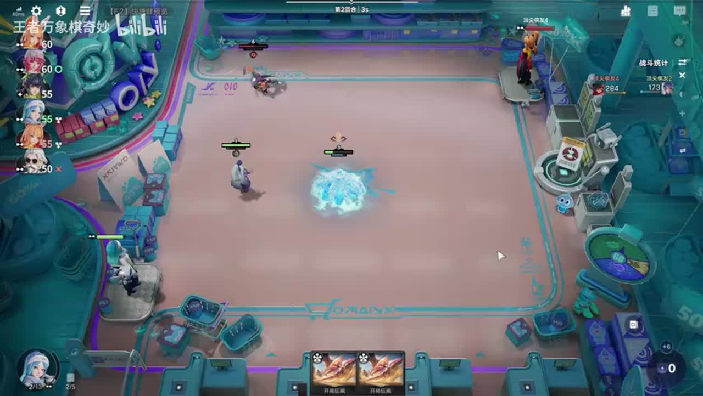

## 02:06–03:37 古币未赶上冻结，不能把极限手速收益视作可靠操作

- 事件 ID：BV1wihk6qEHK:p1:e003
- 场景：实战
- 时机：盾山冻结退场前尝试喂古币失败
- 背景（分析推断）：讲者多次指出手快也没给到盾山，理想额外两级没兑现
- 学习目标（分析推断）：识别时序不可稳定执行的贪收益操作
- 模板：combat-review
- ASR 段落：[4, 5]

> 手速再快也给不上

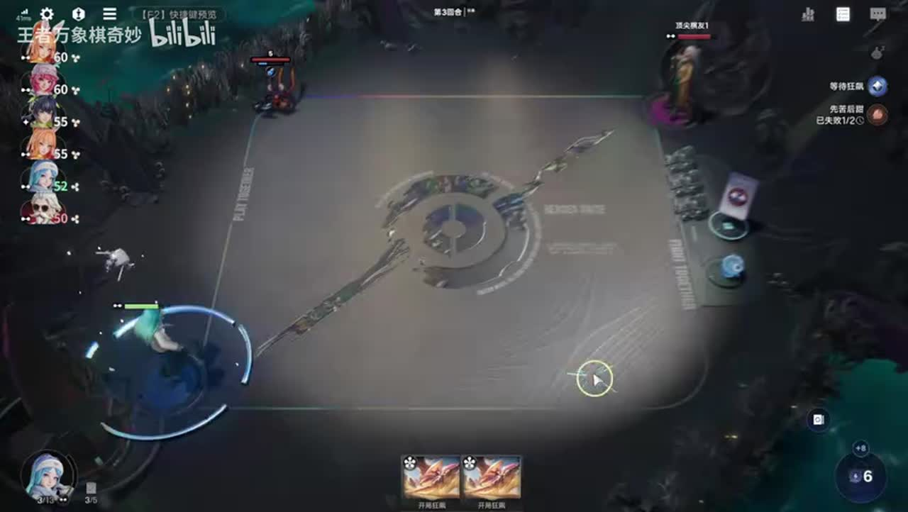

## 02:53–04:09 本局只抢绿色相关阵营组件，被抬价时换另一个绿色

- 事件 ID：BV1wihk6qEHK:p1:e004
- 场景：实战
- 时机：拍卖按阵营颜色拿组件
- 背景（分析推断）：昭君大河路线需要阵营组件，拍卖按当前需求而非单卡强度
- 学习目标（分析推断）：按阵容功能筛选拍卖候选
- 模板：auction-choice
- ASR 段落：[5, 6]

> 谁是绿的抢谁

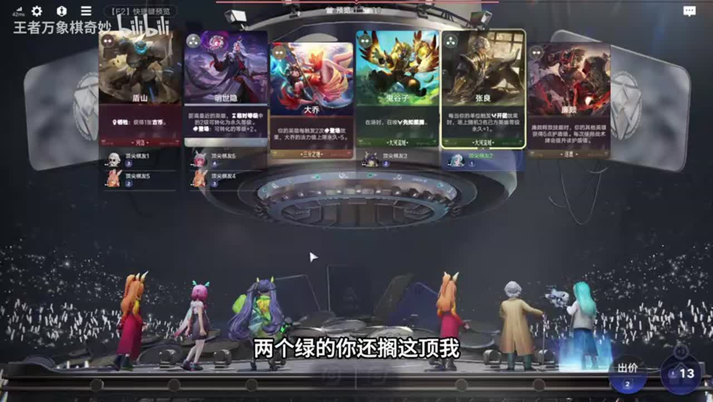

## 03:37–04:09 香香更需要张良开团加级，鬼谷子图腾适合龙人（讲者俗称）东皇等主核

- 事件 ID：BV1wihk6qEHK:p1:e005
- 场景：实战
- 时机：解释香香和本局需要不同组件
- 背景（分析推断）：讲者比较拍卖竞争者需求，不能把自己要的牌推给所有阵容
- 学习目标（分析推断）：按主核机制判断同阵营工具位价值
- 模板：module-fit
- ASR 段落：[6]

> 他要张良这个开团效果加等级是有用的

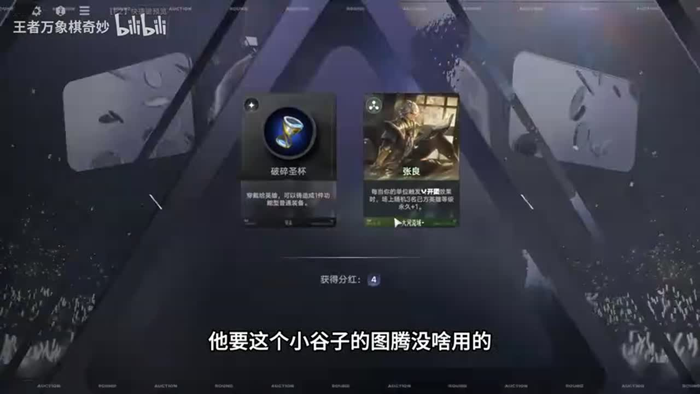

## 04:09–05:25 破败神威适合大河，人才搜寻与图腾路径使鬼谷子重要

- 事件 ID：BV1wihk6qEHK:p1:e006
- 场景：实战
- 时机：拿破败神威和人才搜寻后
- 背景（分析推断）：当前准备通过大河组件过渡并建立终局核心
- 学习目标（分析推断）：把天赋路径与缺失组件关联
- 模板：talent-fit
- ASR 段落：[7, 8]

> 我反而是要三根图腾的

## 05:25–08:00 虞姬能先锁血，阵容从前排承伤到后排输出逐步启动

- 事件 ID：BV1wihk6qEHK:p1:e007
- 场景：实战
- 时机：还没有最终龙人（讲者俗称）时先稳血
- 背景（分析推断）：核心尚未出现，讲者指出虞姬及破败神威让低等级单位也能过渡
- 学习目标（分析推断）：用阶段主核替代空等终局主核
- 模板：fallback-plan
- ASR 段落：[9, 10, 11, 12]

> 鱼简锁血老牛逼了

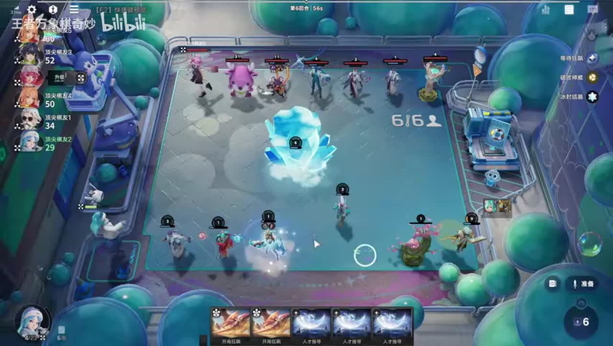

## 06:42–07:22 逐鹿、蒙恬等较好打，萌芽嬴政等要更警惕

- 事件 ID：BV1wihk6qEHK:p1:e008
- 场景：实战
- 时机：评价当前过渡阵容对手
- 背景（分析推断）：讲者按当前阵容讨论不同敌方输出特征，非普遍克制表
- 学习目标（分析推断）：在看到敌方主核后判断当前阵容风险
- 模板：counter-target
- ASR 段落：[11]

> 打萌芽和嬴政不好打

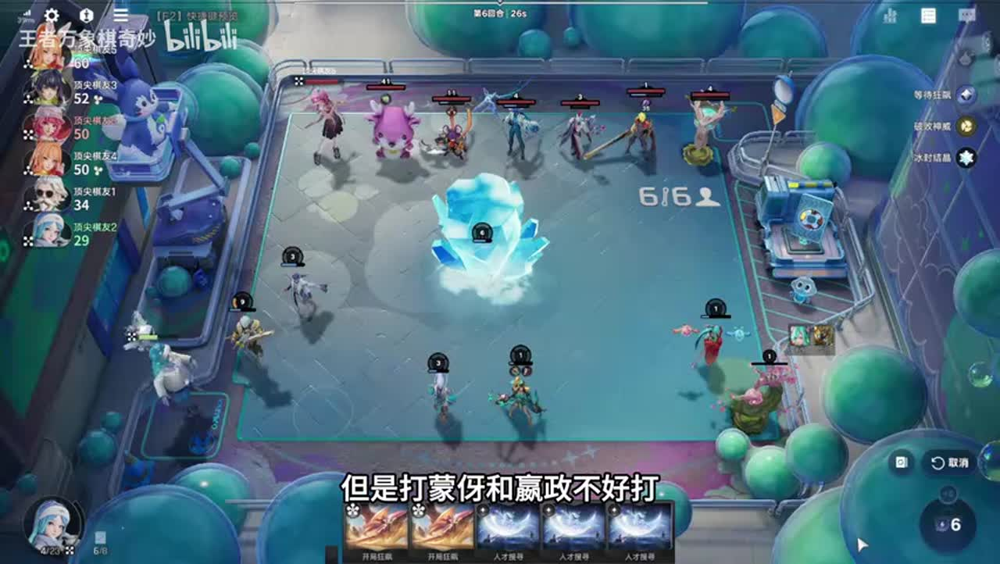

## 08:00–09:18 两侧工具位挡枪，龙人（讲者俗称）稳居中间减少被打

- 事件 ID：BV1wihk6qEHK:p1:e009
- 场景：实战
- 时机：龙人（讲者俗称）到场后布置挡枪
- 背景（分析推断）：新主核到手但仍脆弱，需要前排和两侧保护
- 学习目标（分析推断）：根据主核生存需要安排保护位
- 模板：position-cause
- ASR 段落：[13, 14]

> 我龙人就稳居中间

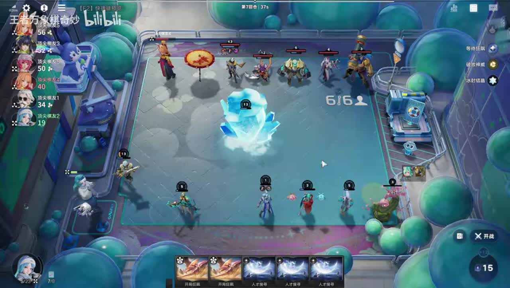

## 08:44–09:18 承认当轮狂飙仅保到少掉血，不把八回合刚启动当成完全成型

- 事件 ID：BV1wihk6qEHK:p1:e010
- 场景：实战
- 时机：交狂飙后只掉一血
- 背景（分析推断）：对手持续施压，昭君阵容才开始启动
- 学习目标（分析推断）：区分过渡生存与成型强度
- 模板：combat-review
- ASR 段落：[14]

> 昭君八回合的时候才刚刚启动

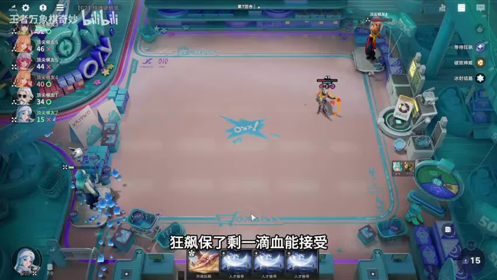

## 09:20–11:16 先用可用组件、合成与装备顶住，东皇到手后再补关键控制

- 事件 ID：BV1wihk6qEHK:p1:e011
- 场景：实战
- 时机：东皇迟迟未出
- 背景（分析推断）：核心抽不到并不妨碍继续寻找和维持过渡
- 学习目标（分析推断）：把阵容构建拆成可先执行的步骤
- 模板：fallback-plan
- ASR 段落：[15, 16, 17]

> 东黄没有来不着急

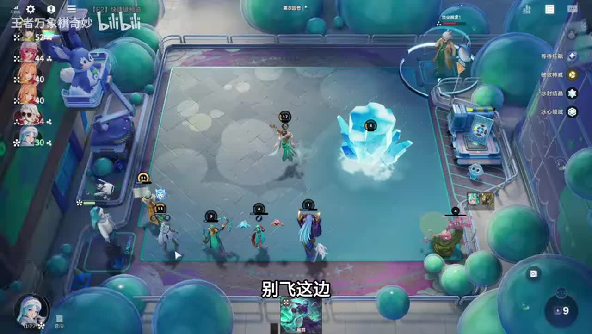

## 11:16–12:44 虞姬后期换鬼谷子，终局图腾组件优先于前期过渡英雄

- 事件 ID：BV1wihk6qEHK:p1:e012
- 场景：实战
- 时机：过渡虞姬准备替换
- 背景（分析推断）：龙人（讲者俗称）东皇已进入阵容，原过渡位不再是必要主核
- 学习目标（分析推断）：根据阶段目标替换功能位
- 模板：late-transition
- ASR 段落：[18, 19]

> 于姐一会儿要换鬼谷子的

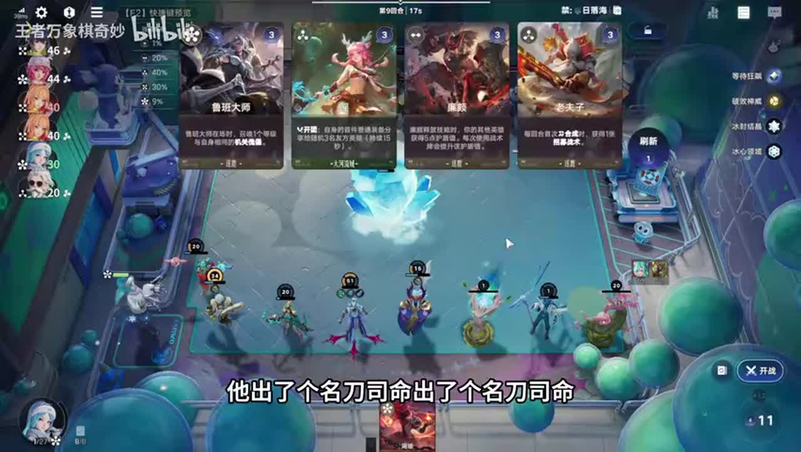

## 12:44–13:47 按棋手冻结机制每轮持续成长，当前不需要反复购入主核升级

- 事件 ID：BV1wihk6qEHK:p1:e013
- 场景：实战
- 时机：解释冰心领域的成长
- 背景（分析推断）：讲者说明阵容可挂机升级，资源更多用于功能和装备
- 学习目标（分析推断）：理解被动成长路径与操作需求
- 模板：mechanic-model
- ASR 段落：[20, 21]

> 这个玩意儿就一直动人

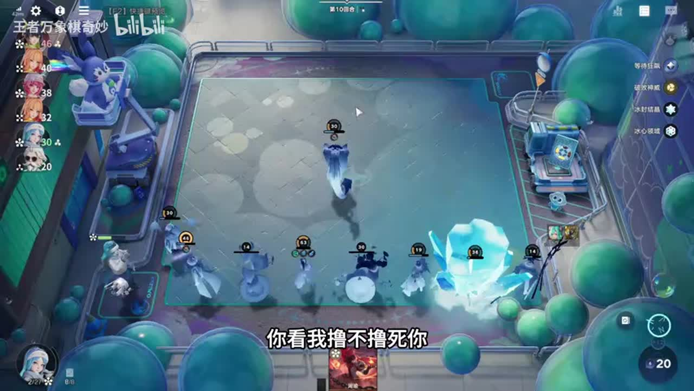

## 13:16–14:18 变换向上阶，不能寄望高费虞姬向低费鬼谷子变

- 事件 ID：BV1wihk6qEHK:p1:e014
- 场景：实战
- 时机：尝试将虞姬变鬼谷子后纠正
- 背景（分析推断）：讲者先说能变，随后立刻承认记错方向
- 学习目标（分析推断）：在实际机制限制出现时撤回错误方案
- 模板：combat-review
- ASR 段落：[21, 22]

> 是往上变的

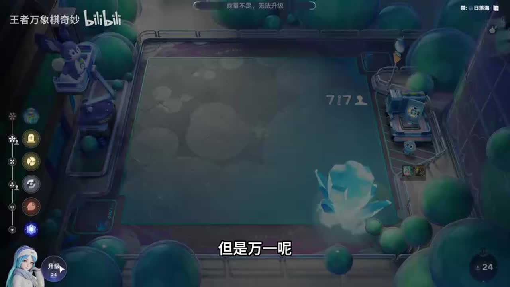

## 13:47–14:52 龙人（讲者俗称）配变猪与明刀，东皇配明刀；其他装备次要

- 事件 ID：BV1wihk6qEHK:p1:e015
- 场景：实战
- 时机：终局只抓两种关键装备
- 背景（分析推断）：明刀保障关键英雄输出或控制，变猪控制敌方核心
- 学习目标（分析推断）：按关键功能集中装备而不是平均分
- 模板：equipment-role
- ASR 段落：[22, 23]

> 只有俩装备重要

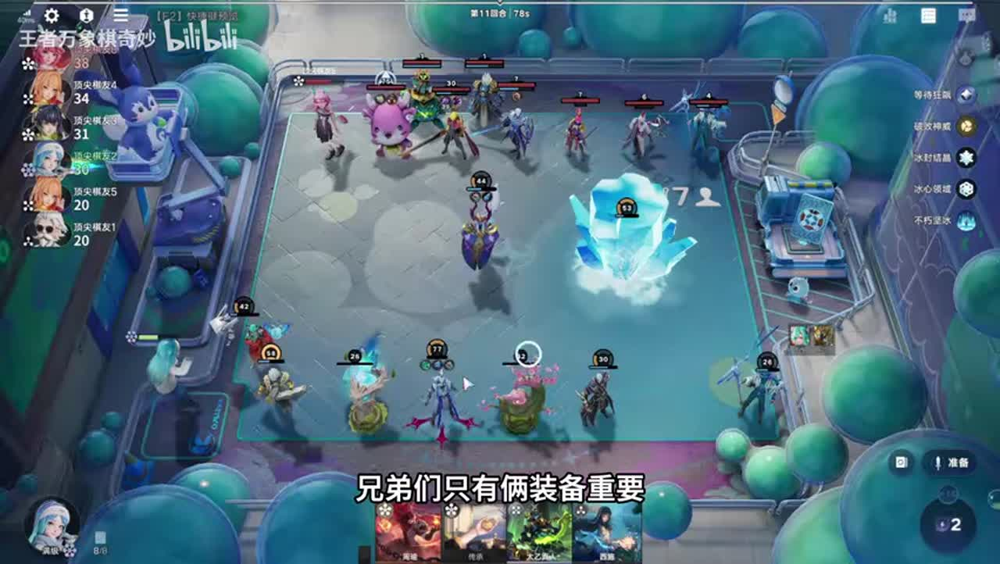

## 14:55–15:26 这套大河路线偏向对应变换或兑换效果，选项序号只属本局公式

- 事件 ID：BV1wihk6qEHK:p1:e016
- 场景：实战
- 时机：解释五回合三号与八回合一号选择
- 背景（分析推断）：讲者说明五回合三号存在两种效果，向同阶上变更好，兑换券未必给到目标
- 学习目标（分析推断）：理解固定公式背后的效果与不确定性
- 模板：talent-fit
- ASR 段落：[24]

> 这个是给那个兑换券不一定能给到

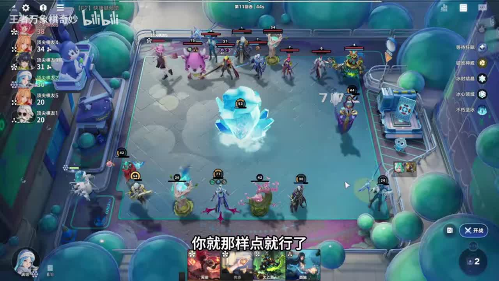

## 15:28–16:16 按原计划去拿展翅腾飞，不因生气抢狂飙

- 事件 ID：BV1wihk6qEHK:p1:e017
- 场景：实战
- 时机：连续被狂飙针对时克制反击消费
- 背景（分析推断）：讲者明确遭多次针对后仍不能为报复偏离核心觉醒目标
- 学习目标（分析推断）：保持拍卖目标与长期阵容一致
- 模板：auction-choice
- ASR 段落：[25]

> 受气我也不能抢这个狂飙

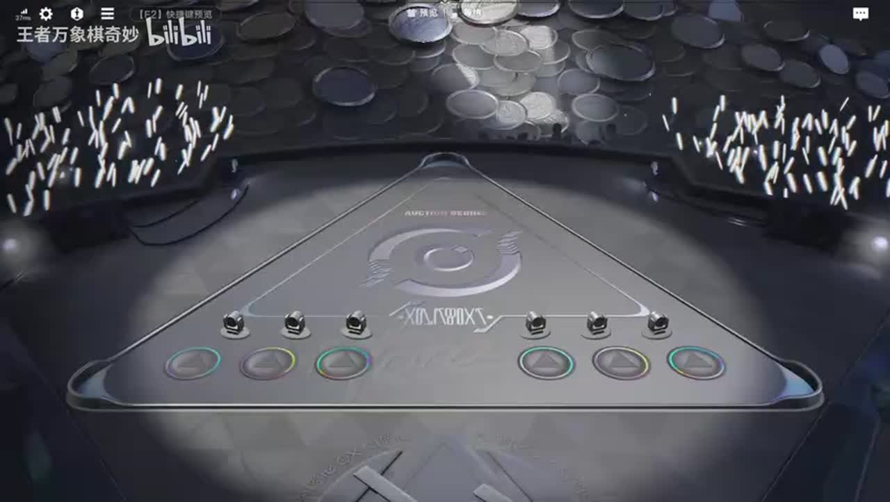

## 16:58–18:31 只买场上需要的组件，缺鬼谷子时先补它，龙人（讲者俗称）可由技能开出

- 事件 ID：BV1wihk6qEHK:p1:e018
- 场景：实战
- 时机：在鬼谷子和龙人（讲者俗称）之间决定搜牌优先级
- 背景（分析推断）：当前核心基本已有，图腾组件是更紧迫缺口
- 学习目标（分析推断）：按缺失功能而非大核知名度排列搜牌顺序
- 模板：module-fit
- ASR 段落：[27, 28]

> 鬼谷子更重要啊

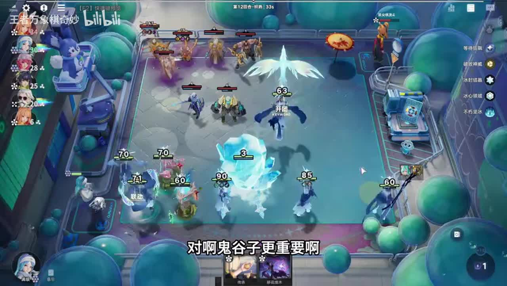

## 19:15–20:31 阵容缩拢并让司空震站内侧，用被勾后的落点避开攻击

- 事件 ID：BV1wihk6qEHK:p1:e019
- 场景：实战
- 时机：对手远程能摸到主核时
- 背景（分析推断）：已基本觉醒后减少冻结，转向终局站位；聚集可能与不同对手冲突
- 学习目标（分析推断）：按敌方攻击和位移路径调整站位
- 模板：position-cause
- ASR 段落：[30, 31]

> 站位的艺术

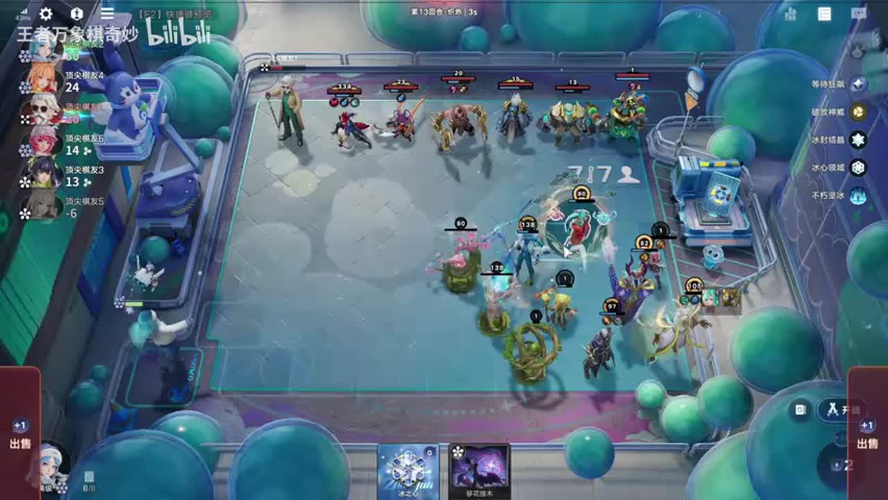

## 20:31–21:38 有大炮时不宜聚在一起，威胁消失再按剩余敌方布置

- 事件 ID：BV1wihk6qEHK:p1:e020
- 场景：实战
- 时机：聚集站位面对大炮的例外
- 背景（分析推断）：讲者明确说站一起齐不好，随后发现大炮已经死
- 学习目标（分析推断）：把站位方案限定到当前对手威胁
- 模板：counter-target
- ASR 段落：[32, 33]

> 三一起齐不太好

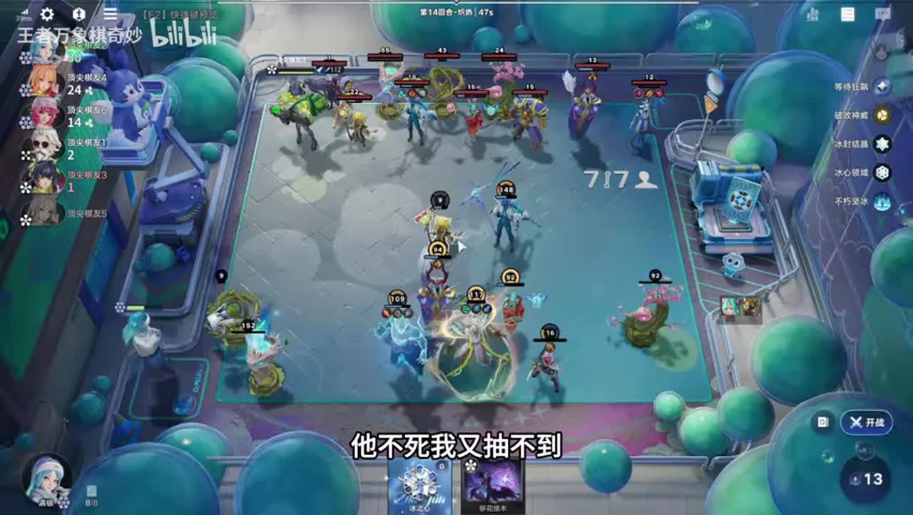

## 21:06–22:14 等战斗结束死亡后再搜鬼谷子，避免提前浪费刷新

- 事件 ID：BV1wihk6qEHK:p1:e021
- 场景：实战
- 时机：等持有鬼谷子的对手真正淘汰
- 背景（分析推断）：外部对手仍持有所需牌，讲者等其死透再刷新
- 学习目标（分析推断）：把卡池释放时点纳入搜牌效率
- 模板：resource-order
- ASR 段落：[33, 34]

> 结束了死透了,鬼谷子出来了

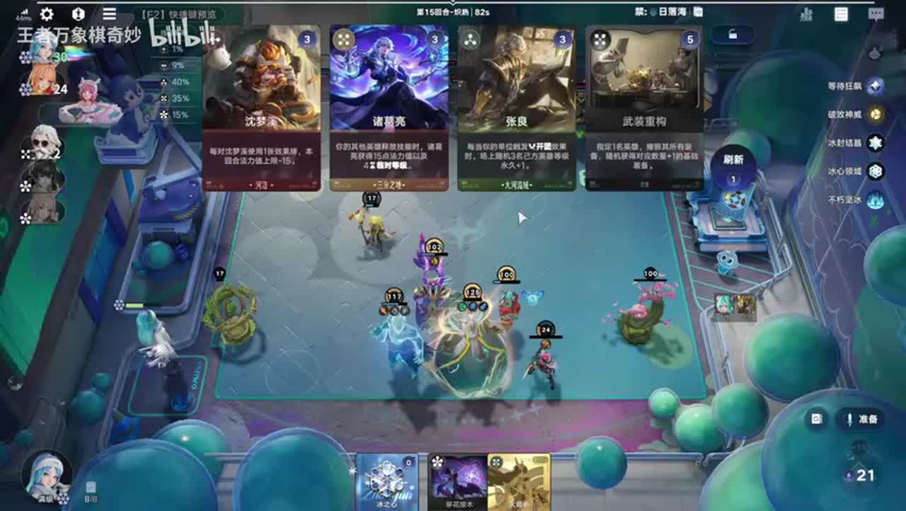

## 21:43–22:45 鬼谷子优先觉醒，瑶无所谓；面对当前对手面具可换冰刀变猪

- 事件 ID：BV1wihk6qEHK:p1:e022
- 场景：实战
- 时机：补鬼谷子觉醒并调整装备
- 背景（分析推断）：关键图腾组件到手后，升级和装备都转向终局功能
- 学习目标（分析推断）：按当前瓶颈重新分配觉醒与装备资源
- 模板：late-transition
- ASR 段落：[34, 35]

> 瑶妹觉不觉醒无所谓的

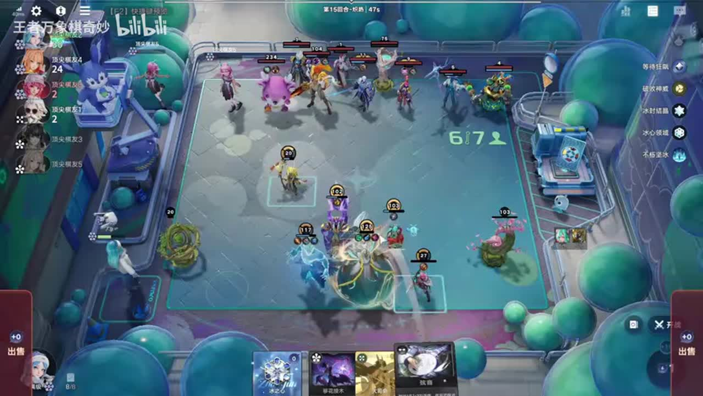

## 22:15–23:57 用变猪与冰刀轮流控制，让李信走不到主核面前

- 事件 ID：BV1wihk6qEHK:p1:e023
- 场景：实战
- 时机：面对高等级近战李信
- 背景（分析推断）：敌方高等级不代表可接近输出，当前主核具远程与连续控制
- 学习目标（分析推断）：按能否接近和输出判断战斗而非只比等级
- 模板：counter-target
- ASR 段落：[35, 36, 37]

> 变完猪冰刀接着动

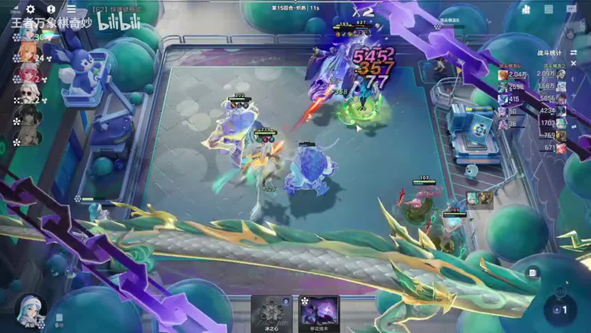

## 22:46–23:25 打守约时瑶带明刀，打当前对手则未必重要

- 事件 ID：BV1wihk6qEHK:p1:e024
- 场景：实战
- 时机：瑶的明刀按敌方目标决定
- 背景（分析推断）：关键防守装备对不同敌方伤害形态的价值变化
- 学习目标（分析推断）：避免把某件装备固定给同一英雄
- 模板：equipment-role
- ASR 段落：[36]

> 打那个守约的话,瑶妹带个明刀的

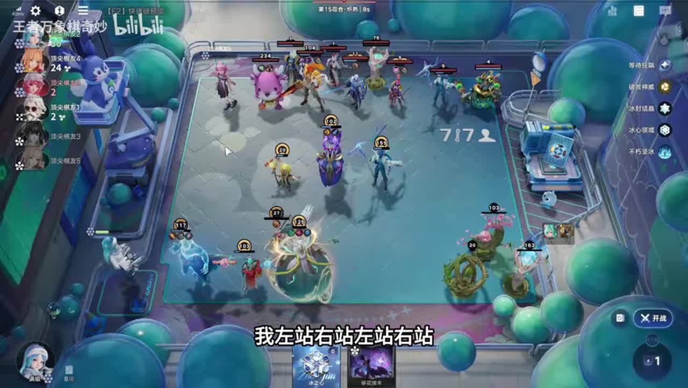

## 25:04–26:43 先承认分错，修正明刀相关分配并重新做白盾与变猪

- 事件 ID：BV1wihk6qEHK:p1:e025
- 场景：实战
- 时机：发现装备分配错误后修正
- 背景（分析推断）：本轮差点出问题，不能因先前觉得稳赢就忽略装备错误
- 学习目标（分析推断）：用险情反馈复核装备分配
- 模板：combat-review
- ASR 段落：[40, 41, 42]

> 小失误了

## 26:44–27:35 东皇触发明刀后短暂无敌，提供第二次控制或生存窗口

- 事件 ID：BV1wihk6qEHK:p1:e026
- 场景：实战
- 时机：终局再次解释东皇明刀价值
- 背景（分析推断）：敌方守约打东皇很痛，保住控制链关键人物重要
- 学习目标（分析推断）：将装备无敌窗口与技能持续效果联系起来
- 模板：equipment-cause
- ASR 段落：[43, 44]

> 东皇带明刀的话等于两条命

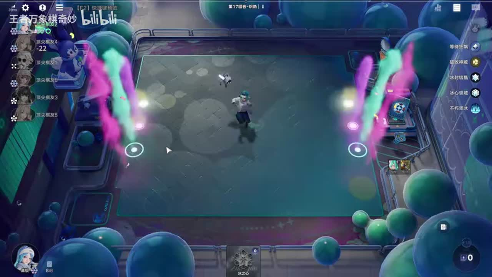

## 待核实与局限

- 不做ASR修正；龙人俗称保留，现有知识候选为敖隐，但本次所引截图未展开正式名牌，需核实后映射。
- 大量狂飙抱怨、礼物感谢与第27段重复鬼字符排除，仍保留有明确取舍的教学。
- 五八回合选项序号属于视频条件与版本，不能做当前通用按钮指引。
- 讲者向下变鬼谷子的错误随后撤回，保留纠正链不采用错误规则。
- 变猪加冰刀持续控制需敌方解控与射程条件；不据一局推出999必败。
- 末尾技能机制讲解随视频结束截断，仅记录明确说出的明刀无敌收益。
