# 昭君也能木兰？教你波波10次复活，露娜冻露娜

来源：https://www.bilibili.com/video/BV14Jh46AEpR/?p=1

分析状态：completed

完整文字稿：../../../raw/BV14Jh46AEpR_p1.md

## 00:00–02:07 本局禁三分，仍可能面对河洛木兰等体系；讲者另比较禁日落海移除露娜后昭君与嬴政的环境

- 事件 ID：BV14Jh46AEpR:p1:e001
- 场景：实战
- 时机：确定禁用阵营后的棋手路线
- 背景（分析推断）：赛前界面明确本局禁三分；讲者讨论不同禁用阵营对核心支撑牌及同行竞争的影响，禁日落海是比较情境。
- 学习目标（分析推断）：选棋手前先检查敌我常用体系依赖的阵营
- 模板：opening-plan
- ASR 段落：[1, 2, 4]

> 没有露娜没有复活

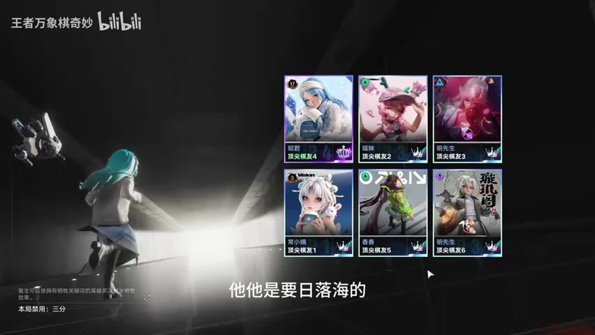

## 01:07–01:37 优先孙尚香或苏烈利用阵亡成长；明显打不过时及时准备

- 事件 ID：BV14Jh46AEpR:p1:e002
- 场景：实战
- 时机：前期临时上场保节奏
- 背景（分析推断）：本局昭君尝试由冻结转换成木兰，并以司空震过渡及副核；前期临时上场保节奏，具体条件依据所引前后文。
- 学习目标（分析推断）：理解过渡棋子的成长职责而非只追最终阵容
- 模板：opening-plan
- ASR 段落：[3]

> 孙尚香苏联死了加两级

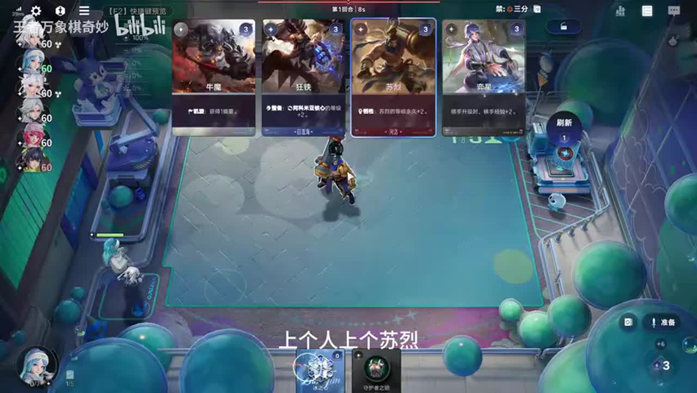

## 02:07–02:39 本局没有嬴政直接升级；有嬴政时保留另一节奏

- 事件 ID：BV14Jh46AEpR:p1:e003
- 场景：实战
- 时机：缺少嬴政开局时升级
- 背景（分析推断）：本局昭君尝试由冻结转换成木兰，并以司空震过渡及副核；缺少嬴政开局时升级，具体条件依据所引前后文。
- 学习目标（分析推断）：把开局核心牌作为升级条件
- 模板：level-transition
- ASR 段落：[5]

> 有影证就不升级了

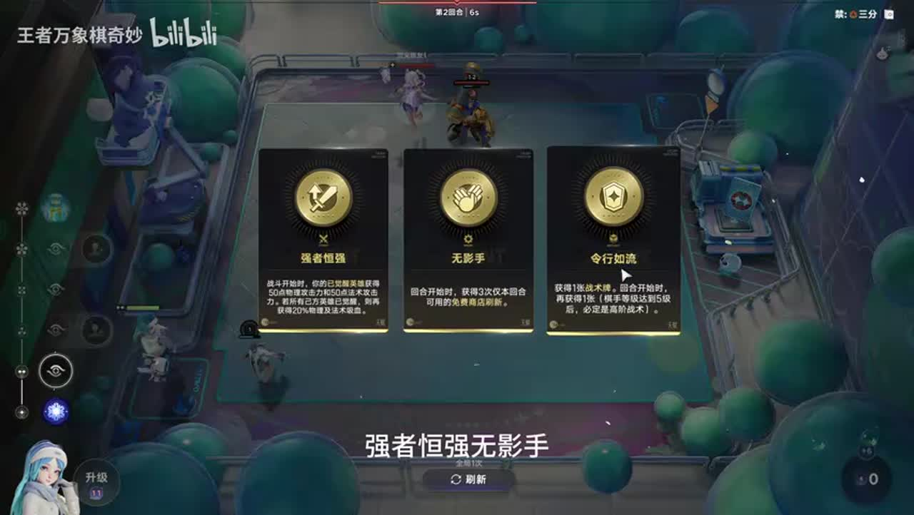

## 02:44–03:59 木兰路线要求早期变出核心，或通过其他获取路径及时到手

- 事件 ID：BV14Jh46AEpR:p1:e004
- 场景：实战
- 时机：昭君转木兰前检查出现时间
- 背景（分析推断）：本局昭君尝试由冻结转换成木兰，并以司空震过渡及副核；昭君转木兰前检查出现时间，具体条件依据所引前后文。
- 学习目标（分析推断）：认识成型速度的边界，避免晚到核心仍硬追
- 模板：opening-plan
- ASR 段落：[6, 7]

> 他得开局就得编出来个花木兰才能玩

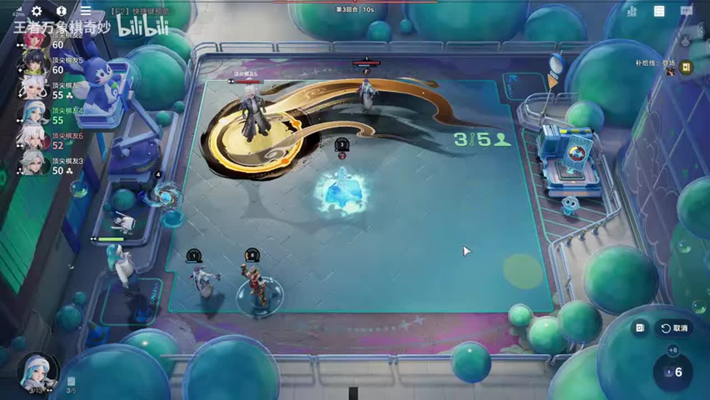

## 03:19–03:59 冻结目标下回合变高一阶，当前三阶用于说明四阶结果

- 事件 ID：BV14Jh46AEpR:p1:e005
- 场景：实战
- 时机：玩家询问冻结技能
- 背景（分析推断）：本局昭君尝试由冻结转换成木兰，并以司空震过渡及副核；玩家询问冻结技能，具体条件依据所引前后文。
- 学习目标（分析推断）：把技能的延迟收益与阶数联系起来
- 模板：mechanic-model
- ASR 段落：[7]

> 下个回合回来,这就变成四阶了

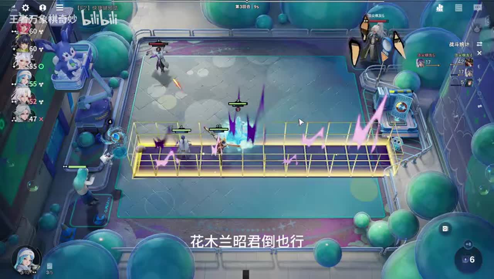

## 03:59–04:38 本局由环境观察选择独门木兰，并留河洛棋子可能匹配天赋

- 事件 ID：BV14Jh46AEpR:p1:e006
- 场景：实战
- 时机：观察对手已走大河且自己无同行
- 背景（分析推断）：本局昭君尝试由冻结转换成木兰，并以司空震过渡及副核；观察对手已走大河且自己无同行，具体条件依据所引前后文。
- 学习目标（分析推断）：用竞争情况与天赋入口调整方向
- 模板：fallback-plan
- ASR 段落：[8]

> 我们没有同行了,我们是独门

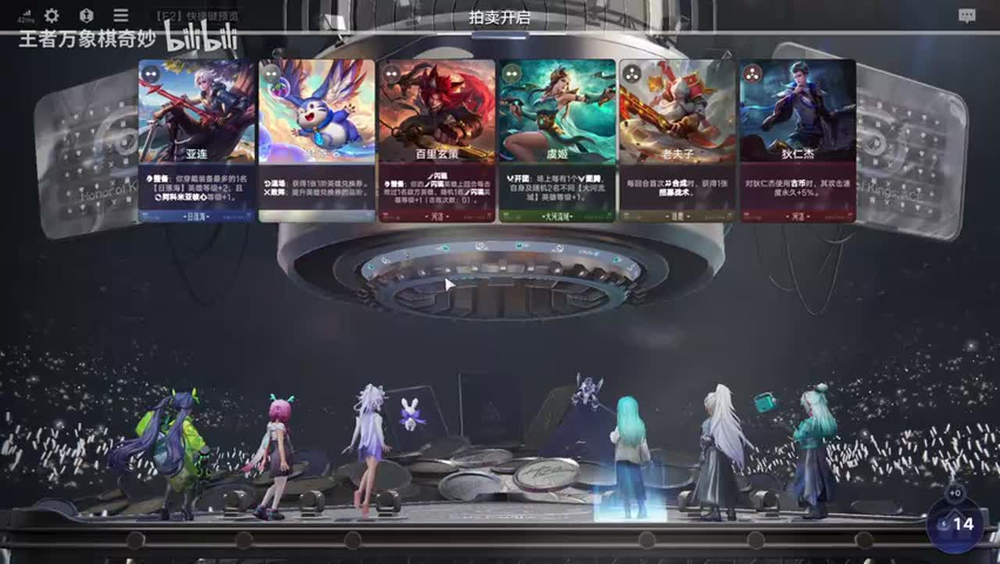

## 04:38–06:22 讲者选择同阵营向上变，以李白尝试获取木兰；旧选法受削弱

- 事件 ID：BV14Jh46AEpR:p1:e007
- 场景：实战
- 时机：五回合强化选择
- 背景（分析推断）：本局昭君尝试由冻结转换成木兰，并以司空震过渡及副核；五回合强化选择，具体条件依据所引前后文。
- 学习目标（分析推断）：关注实际强化文字和版本条件，而非记编号
- 模板：version-change
- ASR 段落：[9, 10, 11]

> 同阵营往上变

## 05:48–07:46 拿王牌认证并由觉醒阿轲临时保血，变来司空震也先使用

- 事件 ID：BV14Jh46AEpR:p1:e008
- 场景：实战
- 时机：核心转换结果不理想时稳血
- 背景（分析推断）：本局昭君尝试由冻结转换成木兰，并以司空震过渡及副核；核心转换结果不理想时稳血，具体条件依据所引前后文。
- 学习目标（分析推断）：保留当下有效战力等待木兰，不为目标丢战力
- 模板：module-fit
- ASR 段落：[11, 13]

> 不想要也得先用着

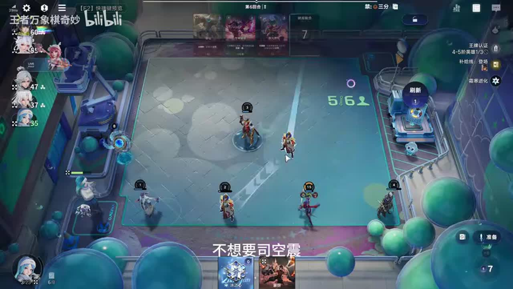

## 07:50–08:23 五阶仍可继续变，可能重复或变木兰武则天，司空震亦可成长

- 事件 ID：BV14Jh46AEpR:p1:e009
- 场景：实战
- 时机：已有五阶司空震还能冻结吗
- 背景（分析推断）：本局昭君尝试由冻结转换成木兰，并以司空震过渡及副核；已有五阶司空震还能冻结吗，具体条件依据所引前后文。
- 学习目标（分析推断）：区分阶数上限与随机变换，不把每次冻结当作定向获取
- 模板：mechanic-model
- ASR 段落：[14]

> 他有可能一直变一个的

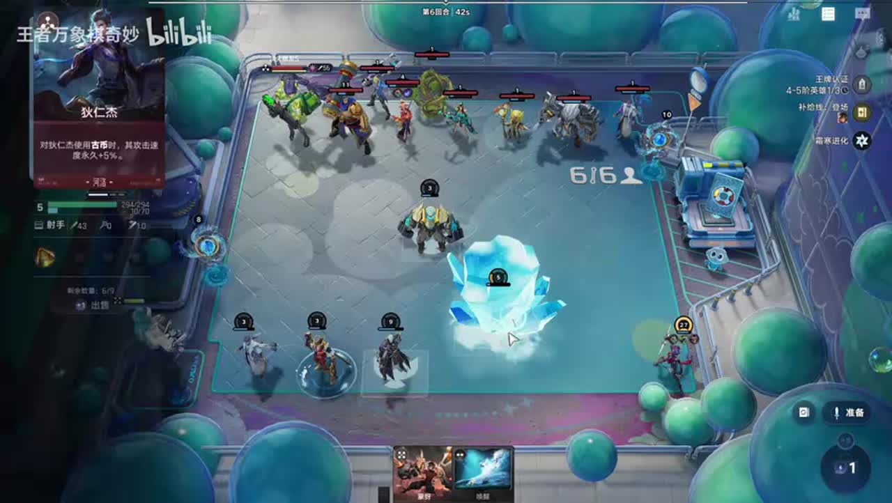

## 08:23–09:31 无阵营随机变，不能理解成固定无阵营内循环

- 事件 ID：BV14Jh46AEpR:p1:e010
- 场景：实战
- 时机：无阵营阿轲转换与同阵营规则
- 背景（分析推断）：本局昭君尝试由冻结转换成木兰，并以司空震过渡及副核；无阵营阿轲转换与同阵营规则，具体条件依据所引前后文。
- 学习目标（分析推断）：正确预期变换范围
- 模板：mechanic-model
- ASR 段落：[15, 16]

> 无阵营是变不了无阵营的

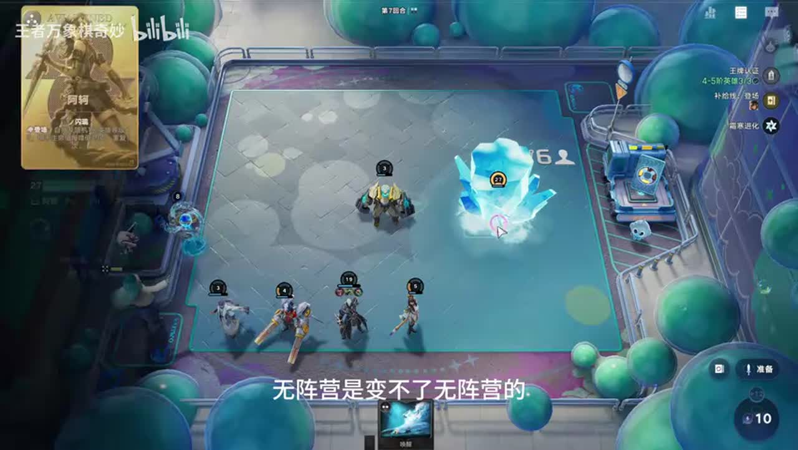

## 09:31–11:28 依赖木兰与露娜组件，讲者将拍卖视为缺卡补齐窗口，并比较群星点兵与血量

- 事件 ID：BV14Jh46AEpR:p1:e011
- 场景：实战
- 时机：拍卖补唯一关键木兰
- 背景（分析推断）：本局昭君尝试由冻结转换成木兰，并以司空震过渡及副核；拍卖补唯一关键木兰，具体条件依据所引前后文。
- 学习目标（分析推断）：在成型窗口判断关键牌价值而非平均分配预算
- 模板：auction-choice
- ASR 段落：[17, 18, 19]

> 我们只要找一张木兰就吃了

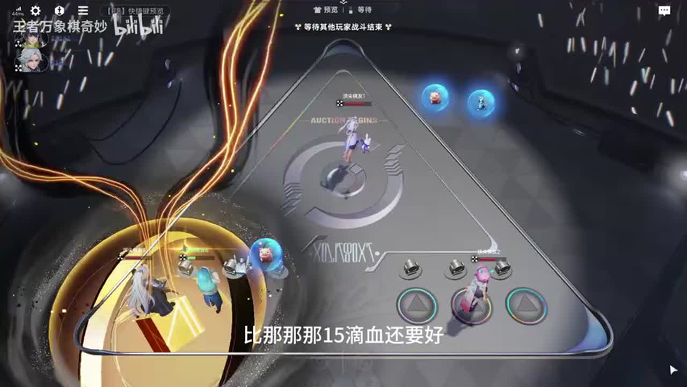

## 11:57–12:30 深度冻结选一，继续冻结李信并调整场上单位

- 事件 ID：BV14Jh46AEpR:p1:e012
- 场景：实战
- 时机：冻结强化再次选择
- 背景（分析推断）：本局昭君尝试由冻结转换成木兰，并以司空震过渡及副核；冻结强化再次选择，具体条件依据所引前后文。
- 学习目标（分析推断）：用强化改变持续成长路径；编号结论只按本片保留
- 模板：talent-fit
- ASR 段落：[21]

> 深度冻结,选一

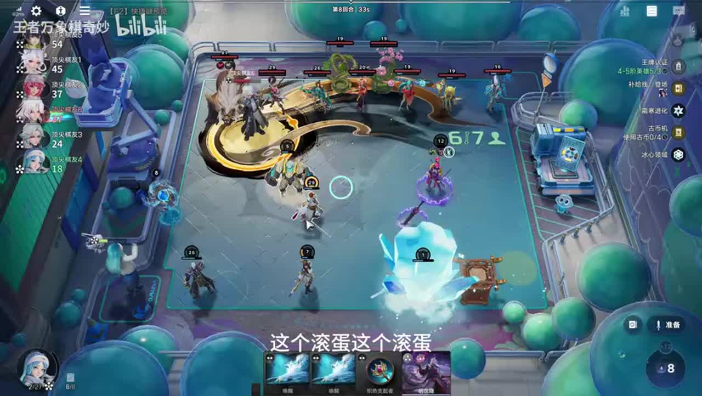

## 12:30–14:15 先补古币机资源，缺程咬金时希望等组件再开集体唤醒

- 事件 ID：BV14Jh46AEpR:p1:e013
- 场景：实战
- 时机：古币机忘喂且准备集体唤醒
- 背景（分析推断）：本局昭君尝试由冻结转换成木兰，并以司空震过渡及副核；古币机忘喂且准备集体唤醒，具体条件依据所引前后文。
- 学习目标（分析推断）：把资源发动顺序与收益覆盖人数关联
- 模板：resource-order
- ASR 段落：[22, 23, 24]

> 成药精交集体唤醒很舒服的

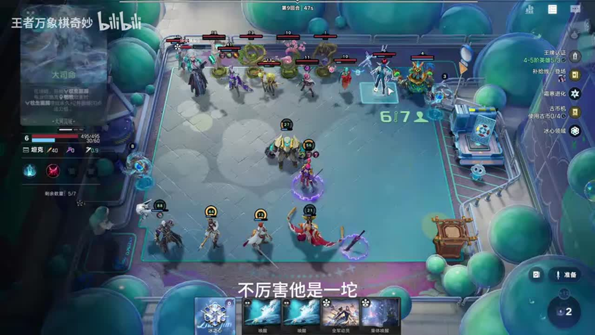

## 14:59–15:48 讲者认为需两回合发育再应对，露娜登场补齐后仍评估当前压力

- 事件 ID：BV14Jh46AEpR:p1:e014
- 场景：实战
- 时机：面对暂时更强的熊体系
- 背景（分析推断）：本局昭君尝试由冻结转换成木兰，并以司空震过渡及副核；面对暂时更强的熊体系，具体条件依据所引前后文。
- 学习目标（分析推断）：区分现在打不过与后续可追上的对手
- 模板：counter-target
- ASR 段落：[26]

> 你等我发育两个回合

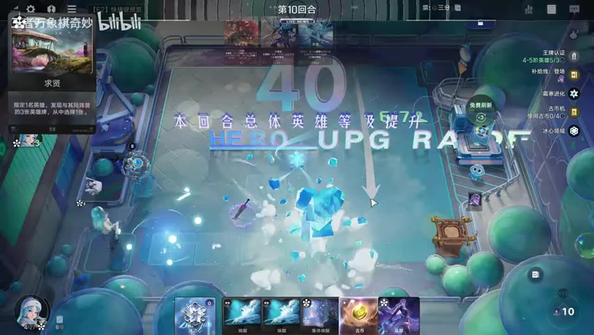

## 16:28–17:13 当前阵容需要唤醒资源，讲者优先此项并实际继续获取唤醒

- 事件 ID：BV14Jh46AEpR:p1:e015
- 场景：实战
- 时机：天赋选择补给线登场
- 背景（分析推断）：本局昭君尝试由冻结转换成木兰，并以司空震过渡及副核；天赋选择补给线登场，具体条件依据所引前后文。
- 学习目标（分析推断）：按资源缺口选天赋，保留本局成型条件
- 模板：talent-fit
- ASR 段落：[28]

> 补给线登场

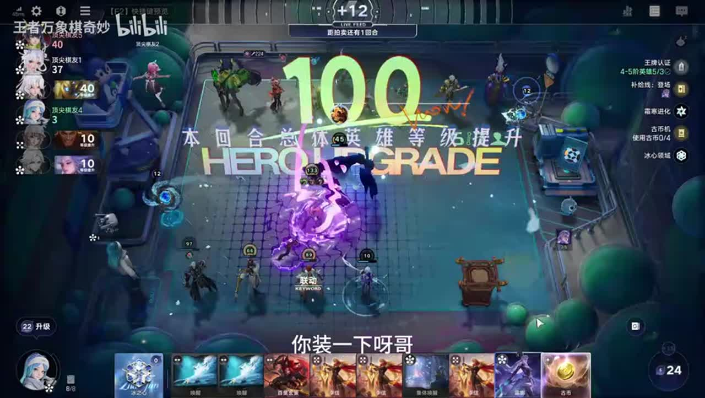

## 22:45–23:54 古币喂养、昭君回合成长及同阵营冻结变换都能加等级，木兰司空震形成双核

- 事件 ID：BV14Jh46AEpR:p1:e016
- 场景：实战
- 时机：解释司空震为何持续升级
- 背景（分析推断）：本局昭君尝试由冻结转换成木兰，并以司空震过渡及副核；解释司空震为何持续升级，具体条件依据所引前后文。
- 学习目标（分析推断）：理解多来源成长以及保留副核的价值
- 模板：growth-combo
- ASR 段落：[38, 39]

> 每个回合开始都能升级

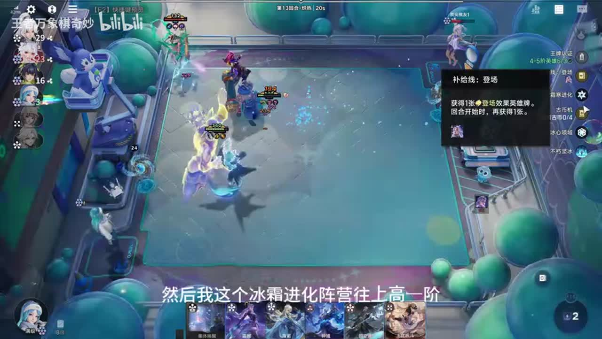

## 19:02–19:41 先发现人口能补场上容量，再看到一线生机复活相关备选

- 事件 ID：BV14Jh46AEpR:p1:e017
- 场景：实战
- 时机：拍卖人口与一线生机
- 背景（分析推断）：本局昭君尝试由冻结转换成木兰，并以司空震过渡及副核；拍卖人口与一线生机，具体条件依据所引前后文。
- 学习目标（分析推断）：比较不同短板，避免只追初始拍卖目标
- 模板：auction-choice
- ASR 段落：[32]

> 我们贼缺人口

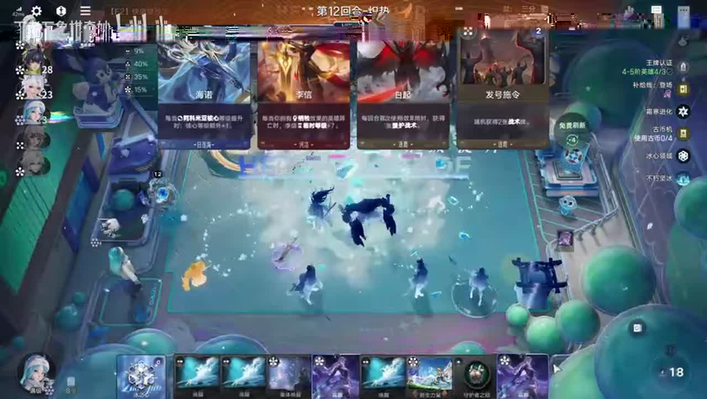

## 19:42–21:01 从五次增加七次仍担忧，回看应抢一线生机；这是风险判断而非通用次数

- 事件 ID：BV14Jh46AEpR:p1:e018
- 场景：实战
- 时机：对高等级熊担忧复活不够
- 背景（分析推断）：本局昭君尝试由冻结转换成木兰，并以司空震过渡及副核；对高等级熊担忧复活不够，具体条件依据所引前后文。
- 学习目标（分析推断）：按对手强度和其他救场能力设复活预算
- 模板：economy-budget
- ASR 段落：[33, 34]

> 我没交一线生机我现在很害怕

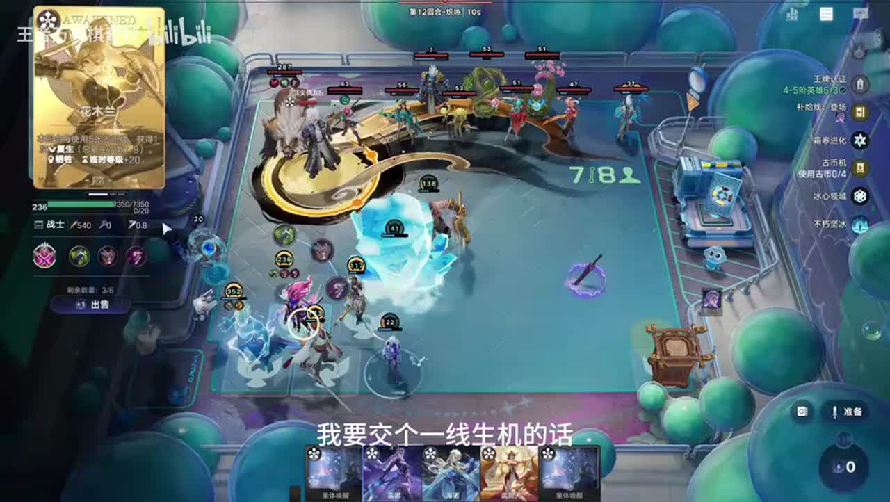

## 21:01–21:42 复盘认为额外唤醒用多，修正上一轮保守预算

- 事件 ID：BV14Jh46AEpR:p1:e019
- 场景：实战
- 时机：战后发现实际仅打掉三次
- 背景（分析推断）：本局昭君尝试由冻结转换成木兰，并以司空震过渡及副核；战后发现实际仅打掉三次，具体条件依据所引前后文。
- 学习目标（分析推断）：用真实消耗反馈减少资源浪费
- 模板：combat-review
- ASR 段落：[35]

> 打了三次那有点交多了

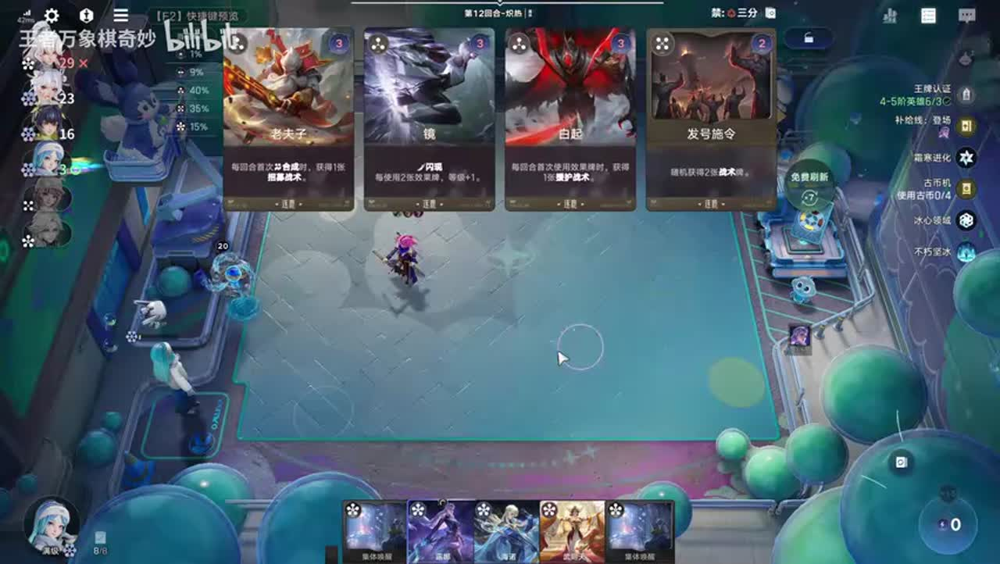

## 21:42–22:16 讲者希望决赛再上钟馗，先保留并养着

- 事件 ID：BV14Jh46AEpR:p1:e020
- 场景：实战
- 时机：钟馗暂缓上场
- 背景（分析推断）：本局昭君尝试由冻结转换成木兰，并以司空震过渡及副核；钟馗暂缓上场，具体条件依据所引前后文。
- 学习目标（分析推断）：把功能位切换放到具体对手与最终阶段
- 模板：position-cause
- ASR 段落：[36]

> 决赛再上吧

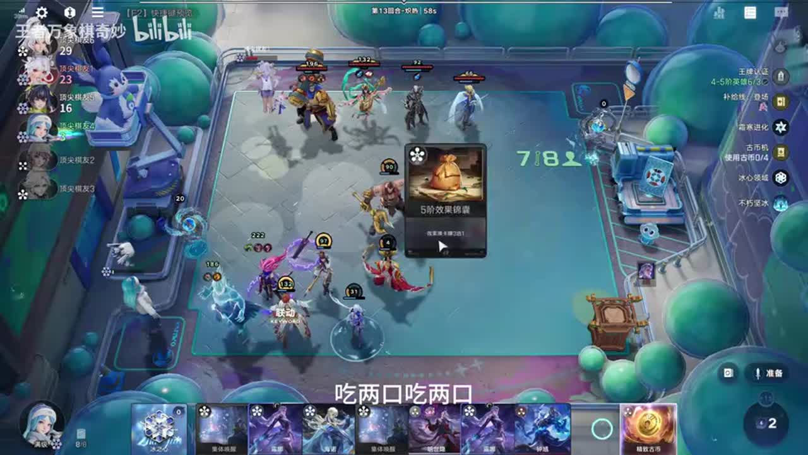

## 22:17–22:45 先对指定对象动手再集体唤醒，从四次到六次后停，锁木兰继续变另目标

- 事件 ID：BV14Jh46AEpR:p1:e021
- 场景：实战
- 时机：唤醒与冻结的先后
- 背景（分析推断）：本局昭君尝试由冻结转换成木兰，并以司空震过渡及副核；唤醒与冻结的先后，具体条件依据所引前后文。
- 学习目标（分析推断）：意识到用牌顺序和目标保留影响成长收益
- 模板：resource-order
- ASR 段落：[37]

> 这个先动手交个集体唤醒

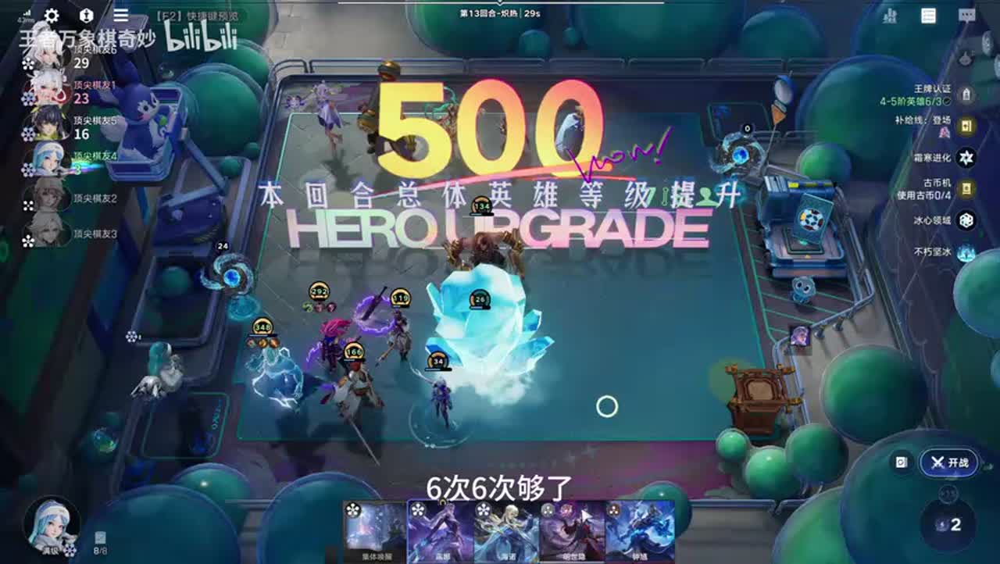

## 23:15–25:05 购买海诺减少另一转换候选，提出牌库无海诺时冻结继续产露娜；觉醒只占一张需继续检查

- 事件 ID：BV14Jh46AEpR:p1:e022
- 场景：实战
- 时机：尝试露娜冻露娜循环
- 背景（分析推断）：本局昭君尝试由冻结转换成木兰，并以司空震过渡及副核；尝试露娜冻露娜循环，具体条件依据所引前后文。
- 学习目标（分析推断）：把随机转换与牌库竞争联系，区分推测与已见结果
- 模板：growth-combo
- ASR 段落：[39, 40, 41]

> 只要排骨里没有海诺

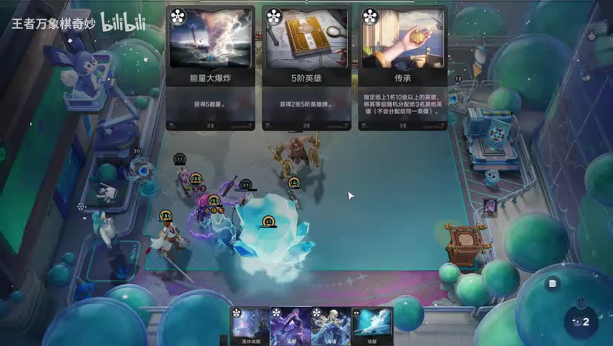

## 25:09–27:05 讲者观察露娜变金露娜，卡数释放；对手持有海诺若淘汰可能改变循环条件

- 事件 ID：BV14Jh46AEpR:p1:e023
- 场景：实战
- 时机：验证露娜循环并监控海诺持有者
- 背景（分析推断）：本局昭君尝试由冻结转换成木兰，并以司空震过渡及副核；验证露娜循环并监控海诺持有者，具体条件依据所引前后文。
- 学习目标（分析推断）：观察机制实际反馈与对手淘汰的资源变化
- 模板：combat-review
- ASR 段落：[42, 43, 44]

> 我不能让这个海诺死了

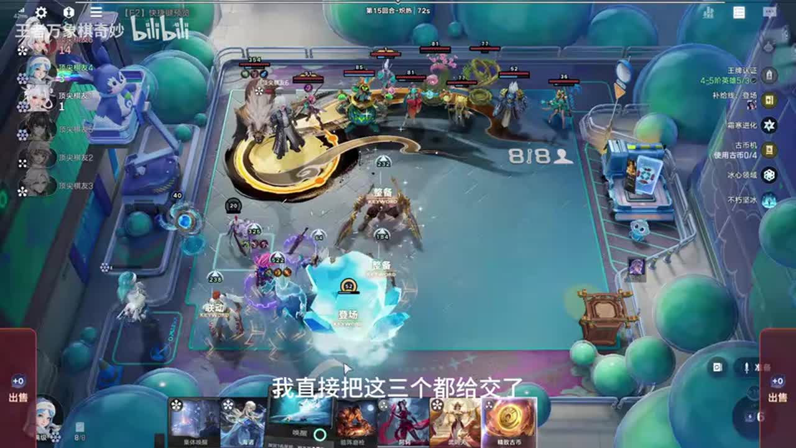

## 27:05–27:40 讲者认为银色王牌认证较易提供临阵磨枪或登场，支撑当前体系；概率未独立验证

- 事件 ID：BV14Jh46AEpR:p1:e024
- 场景：实战
- 时机：回顾王牌认证供给唤醒的作用
- 背景（分析推断）：本局昭君尝试由冻结转换成木兰，并以司空震过渡及副核；回顾王牌认证供给唤醒的作用，具体条件依据所引前后文。
- 学习目标（分析推断）：按可供应的资源而非仅天赋品质评估适配
- 模板：talent-fit
- ASR 段落：[45]

> 他很容易开唤醒的

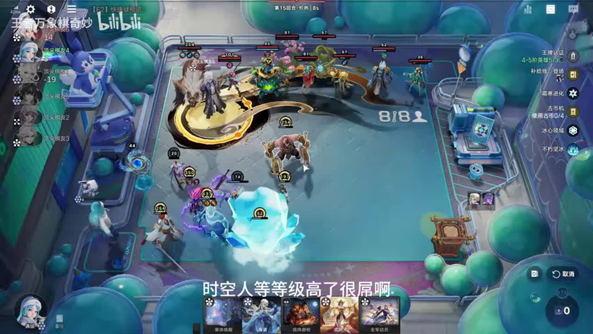

## 18:27–19:01 昭君能持续给司空震加等级，当前缺装备需补装备，木兰与司空震分担输出

- 事件 ID：BV14Jh46AEpR:p1:e025
- 场景：实战
- 时机：核心木兰之外保留司空震双核
- 背景（分析推断）：本局昭君尝试由冻结转换成木兰，并以司空震过渡及副核；解释司空震为何持续升级，具体条件依据所引前后文。
- 学习目标（分析推断）：识别副核成长与装备缺口，而非核心到齐后删掉有效战力
- 模板：growth-combo
- ASR 段落：[31]

> 我们是双C啊,我们不是单C

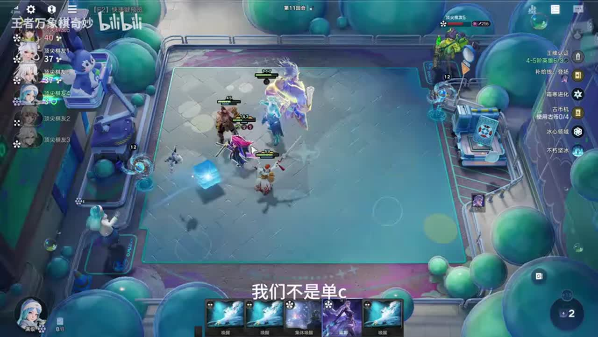

## 待核实与局限

- 不进行ASR修正；同音词保留原始证据。
- 第25段长串重复识别异常，不据此创建教学。
- 五回合第三选项、深度冻结第一选项仅为讲者当时版本，实际优先读取强化文字。
- 第6段谁等级高谁强缺少边界，不泛化为通用克制结论。
- 露娜冻露娜、海诺牌库占用及觉醒卡计数为讲者解释及当局观察，未独立验证全部条件。
- 王牌认证概率与颜色价值仅为讲者经验，不作为测得概率。
