# 昭君毒攻略把把老6？接近万分局游龙，公式玩法吃鸡

来源：https://www.bilibili.com/video/BV1Tcaw6AE8a/?p=1

分析状态：completed

完整文字稿：../../../raw/BV1Tcaw6AE8a_p1.md

## 00:21–00:57 讲者认为马可只能风险较高地赌低费再转吕布，本局采用昭君大河

- 事件 ID：BV1Tcaw6AE8a:p1:e001
- 场景：实战
- 时机：禁日落海后的棋手选择
- 背景（分析推断）：本局禁日落海，昭君走大河，前中期长期缺图腾、后期面对高等级嬴政与司空震威胁；禁日落海后的棋手选择。具体条件依据所引前后文。
- 学习目标（分析推断）：开局确认核心成长链是否还可用
- 模板：opening-plan
- ASR 段落：[1]

> 马可不太好玩

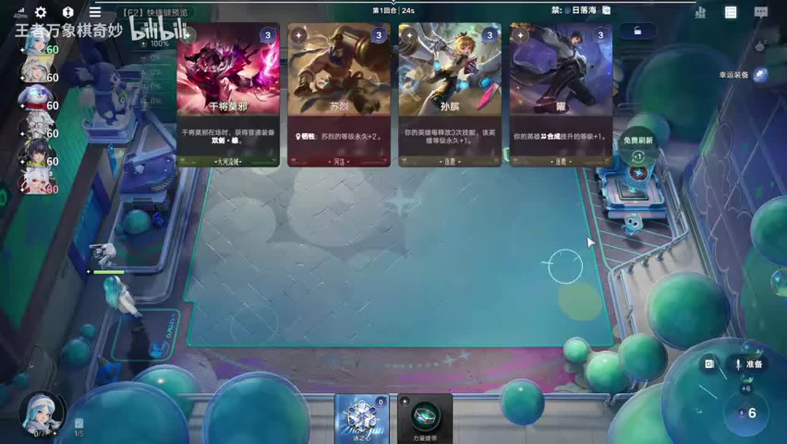

## 01:34–03:14 大司命少司缘鬼谷子提供图腾，配两张高费核心；未变出龙人时用虞姬张良过渡，与香香共享部分牌

- 事件 ID：BV1Tcaw6AE8a:p1:e002
- 场景：实战
- 时机：大河公式与过渡
- 背景（分析推断）：本局禁日落海，昭君走大河，前中期长期缺图腾、后期面对高等级嬴政与司空震威胁；大河公式与过渡。具体条件依据所引前后文。
- 学习目标（分析推断）：分清固定功能骨架、过渡单位和同行竞争
- 模板：opening-plan
- ASR 段落：[3, 4, 5]

> 前期的话可以用这个于姐加张良打工

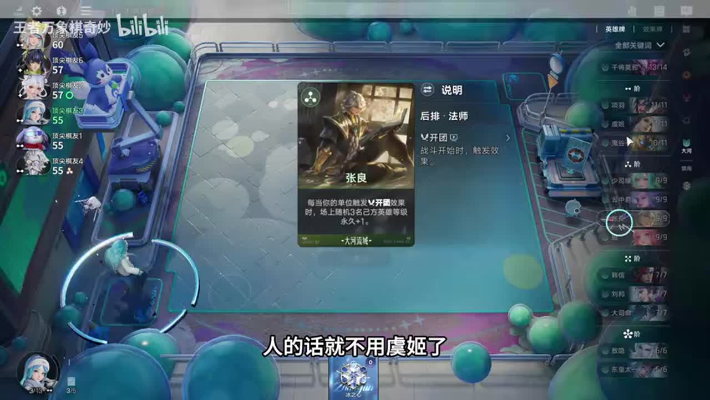

## 02:36–03:47 仍应冻结一人积累后续收益，拍卖买到的虞姬张良通常是当前保血单位不宜再冻结

- 事件 ID：BV1Tcaw6AE8a:p1:e003
- 场景：实战
- 时机：前期主动冻结会损失战力吗
- 背景（分析推断）：本局禁日落海，昭君走大河，前中期长期缺图腾、后期面对高等级嬴政与司空震威胁；前期主动冻结会损失战力吗。具体条件依据所引前后文。
- 学习目标（分析推断）：理解延迟成长与即战力的冲突并安排目标
- 模板：resource-order
- ASR 段落：[5, 6]

> 你抢的那个人是没办法动的

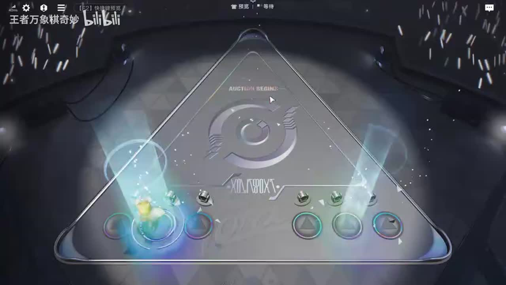

## 03:47–04:17 反甲暂时不适配，选冰心并考虑鸡爪给虞姬前期保血；想刷鬼谷子可小刷

- 事件 ID：BV1Tcaw6AE8a:p1:e004
- 场景：实战
- 时机：装备无法使用时选择
- 背景（分析推断）：本局禁日落海，昭君走大河，前中期长期缺图腾、后期面对高等级嬴政与司空震威胁；装备无法使用时选择。具体条件依据所引前后文。
- 学习目标（分析推断）：按当前过渡英雄而非最终阵容分装备
- 模板：equipment-role
- ASR 段落：[7]

> 目前这个反甲用不了

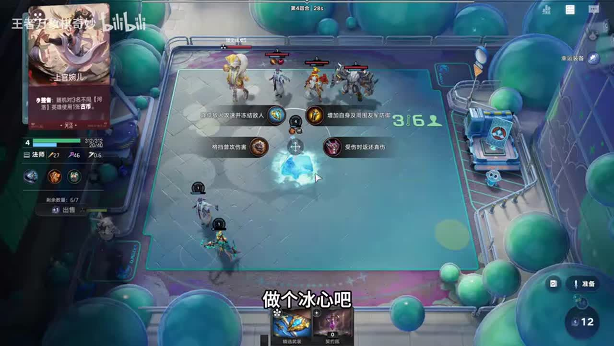

## 04:18–05:23 多上赵云希望换三张牌，但虞姬先死、弈星躲后；下次弈星移前排

- 事件 ID：BV1Tcaw6AE8a:p1:e005
- 场景：实战
- 时机：为契约瓶额外花钱却失败
- 背景（分析推断）：本局禁日落海，昭君走大河，前中期长期缺图腾、后期面对高等级嬴政与司空震威胁；为契约瓶额外花钱却失败。具体条件依据所引前后文。
- 学习目标（分析推断）：识别投入目标未兑现的战斗原因
- 模板：combat-review
- ASR 段落：[8, 9]

> 下回把这个一星都第一排

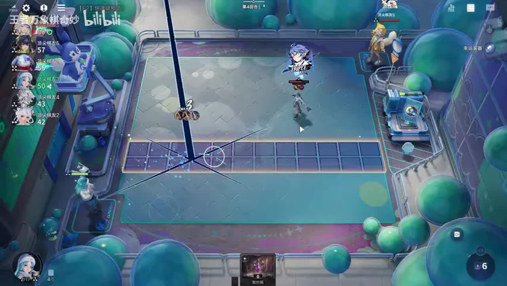

## 04:53–05:56 强化选兑换券，五费三选一尝试补龙人；第三编号不是可迁移规则

- 事件 ID：BV1Tcaw6AE8a:p1:e006
- 场景：实战
- 时机：冻结没有变出大河核心
- 背景（分析推断）：本局禁日落海，昭君走大河，前中期长期缺图腾、后期面对高等级嬴政与司空震威胁；冻结没有变出大河核心。具体条件依据所引前后文。
- 学习目标（分析推断）：以缺卡情况评价定向补牌能力
- 模板：talent-fit
- ASR 段落：[9, 10]

> 因为他没有动出来大和

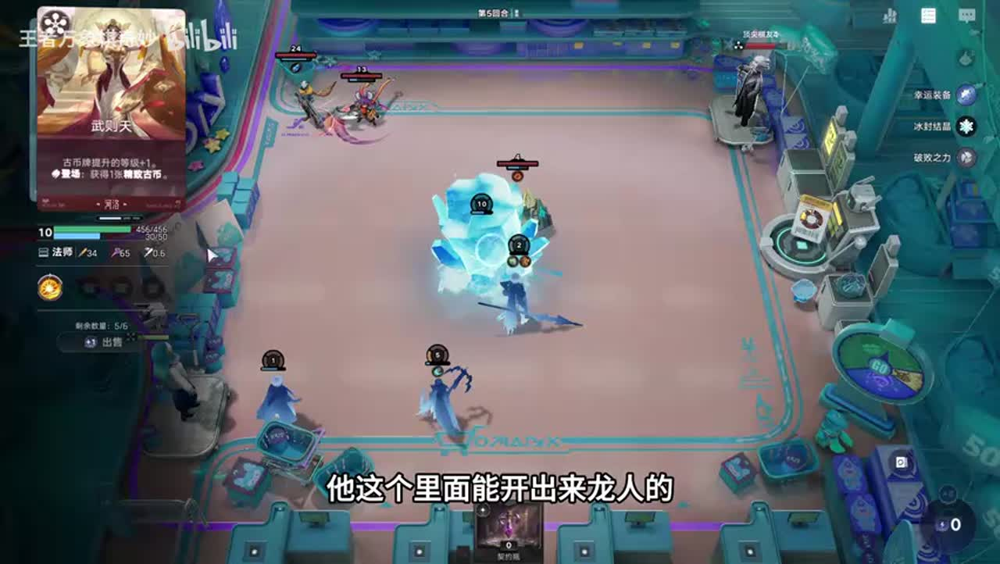

## 05:56–07:09 无足够图腾时一级龙人收益不如预期，先张良过渡、山鬼挡伤害并调整龙人站位

- 事件 ID：BV1Tcaw6AE8a:p1:e007
- 场景：实战
- 时机：龙人到手却缺图腾
- 背景（分析推断）：本局禁日落海，昭君走大河，前中期长期缺图腾、后期面对高等级嬴政与司空震威胁；龙人到手却缺图腾。具体条件依据所引前后文。
- 学习目标（分析推断）：核心到手不等于成型，补齐发动支撑
- 模板：growth-combo
- ASR 段落：[11, 12]

> 没柱子的龙人

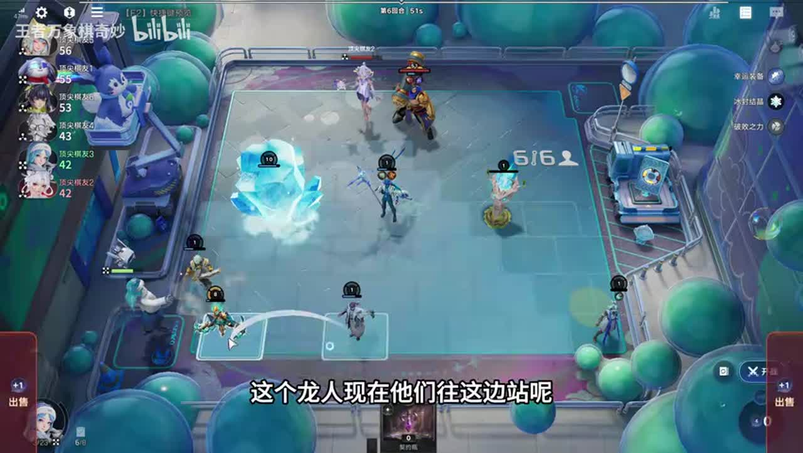

## 07:40–08:54 讲者对比当前与五级鬼谷子抽取概率，单图腾成长慢

- 事件 ID：BV1Tcaw6AE8a:p1:e008
- 场景：实战
- 时机：缺鬼谷子又将升五级
- 背景（分析推断）：本局禁日落海，昭君走大河，前中期长期缺图腾、后期面对高等级嬴政与司空震威胁；缺鬼谷子又将升五级。具体条件依据所引前后文。
- 学习目标（分析推断）：升级前考虑关键低费获取窗口
- 模板：level-transition
- ASR 段落：[14, 15]

> 概率会变小

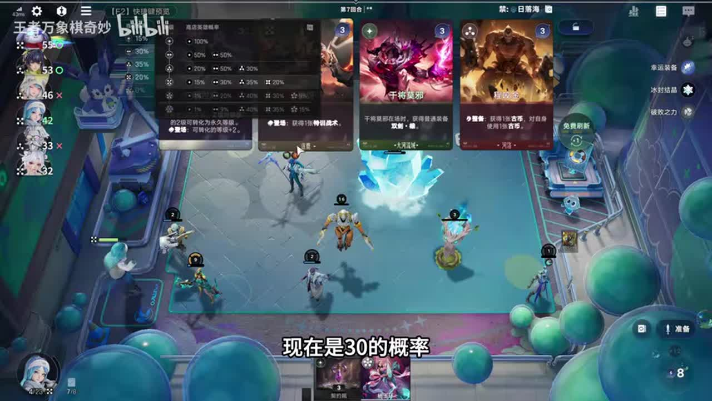

## 08:54–09:24 龙人出现瞬间本可开瓶，未开且对手嬴政到手，本轮输了后重攒

- 事件 ID：BV1Tcaw6AE8a:p1:e009
- 场景：实战
- 时机：发现契约瓶应更早开启
- 背景（分析推断）：本局禁日落海，昭君走大河，前中期长期缺图腾、后期面对高等级嬴政与司空震威胁；发现契约瓶应更早开启。具体条件依据所引前后文。
- 学习目标（分析推断）：根据战力窗口而非固定回合兑现积累
- 模板：combat-review
- ASR 段落：[16]

> 我应该把这个七月平开掉的

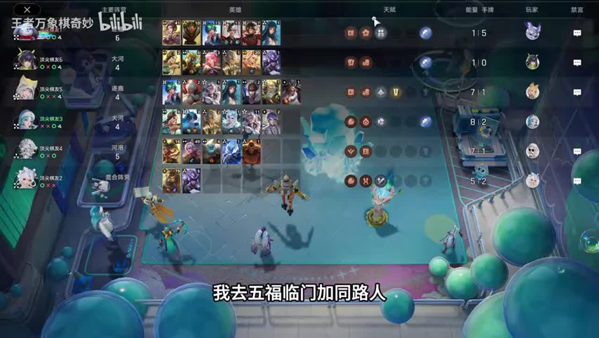

## 10:02–11:37 神明庇佑可用但图腾不足，转守护灵希望赢一轮兑现契约瓶，并给龙人装备用

- 事件 ID：BV1Tcaw6AE8a:p1:e010
- 场景：实战
- 时机：图腾少时选保血天赋
- 背景（分析推断）：本局禁日落海，昭君走大河，前中期长期缺图腾、后期面对高等级嬴政与司空震威胁；图腾少时选保血天赋。具体条件依据所引前后文。
- 学习目标（分析推断）：结合发动条件与短期胜利目标选天赋
- 模板：talent-fit
- ASR 段落：[18, 19, 20]

> 但我图腾不够多

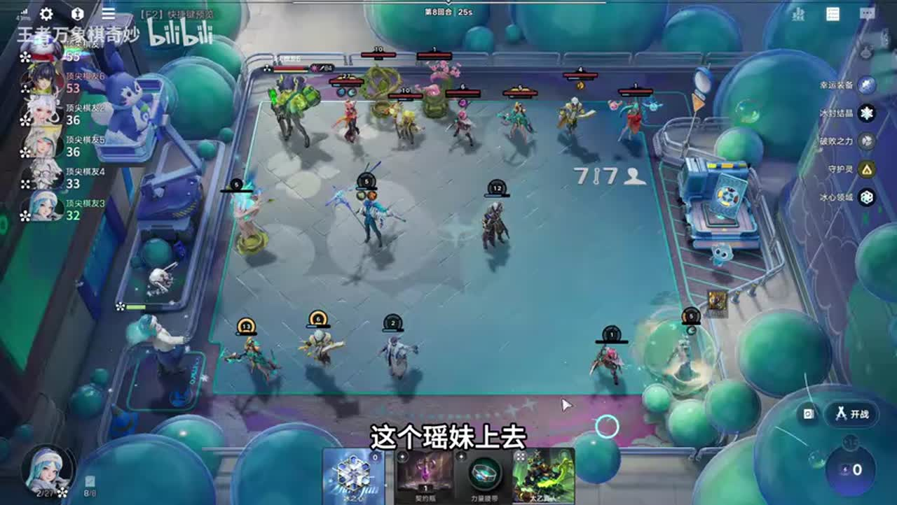

## 12:28–13:51 讲者说明姻缘图腾攻击达到次数全体成长，当前只有一根图腾升级慢

- 事件 ID：BV1Tcaw6AE8a:p1:e011
- 场景：实战
- 时机：解释少司缘为何是关键图腾
- 背景（分析推断）：本局禁日落海，昭君走大河，前中期长期缺图腾、后期面对高等级嬴政与司空震威胁；解释少司缘为何是关键图腾。具体条件依据所引前后文。
- 学习目标（分析推断）：认识缺少支撑组件如何限制核心
- 模板：mechanic-model
- ASR 段落：[22, 23]

> 全体加等级的

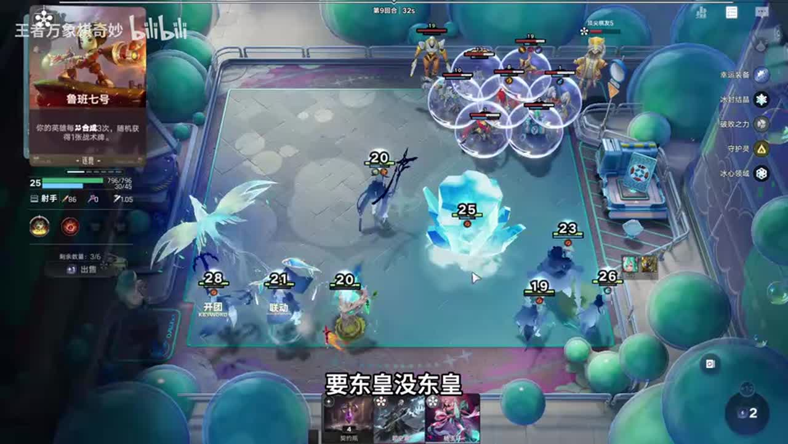

## 13:51–14:24 已用低级免费刷新但仍缺牌，仍升级并开契约瓶补能量，结果补到图腾

- 事件 ID：BV1Tcaw6AE8a:p1:e012
- 场景：实战
- 时机：低级免费刷新没找到图腾
- 背景（分析推断）：本局禁日落海，昭君走大河，前中期长期缺图腾、后期面对高等级嬴政与司空震威胁；低级免费刷新没找到图腾。具体条件依据所引前后文。
- 学习目标（分析推断）：给搜牌投入设限，失败后推进下一阶段
- 模板：level-transition
- ASR 段落：[24]

> 没找到也得升级

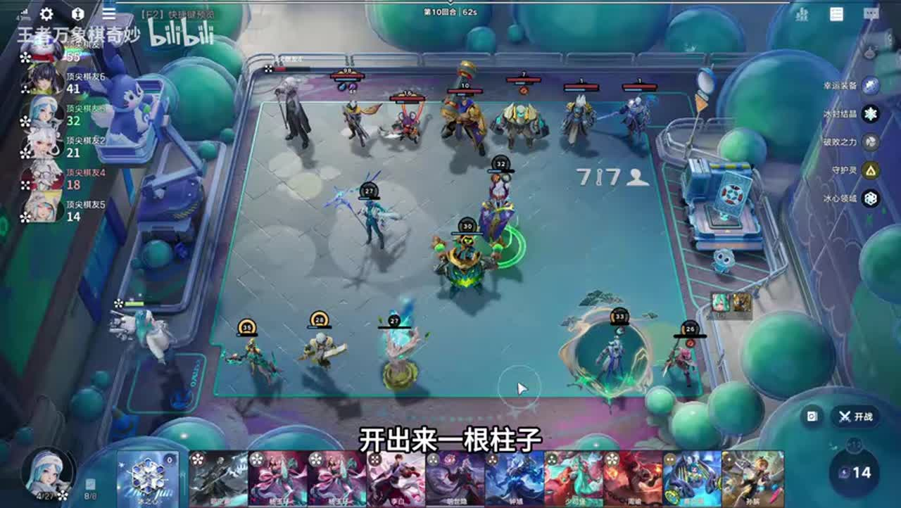

## 14:25–14:59 已有更好组件后让虞姬冻结到五费，认为张良此时更有用

- 事件 ID：BV1Tcaw6AE8a:p1:e013
- 场景：实战
- 时机：过渡虞姬收益下降
- 背景（分析推断）：本局禁日落海，昭君走大河，前中期长期缺图腾、后期面对高等级嬴政与司空震威胁；过渡虞姬收益下降。具体条件依据所引前后文。
- 学习目标（分析推断）：按阶段替换过渡位，避免因已经养高而继续保留
- 模板：late-transition
- ASR 段落：[25]

> 现在张良比于姐有用点

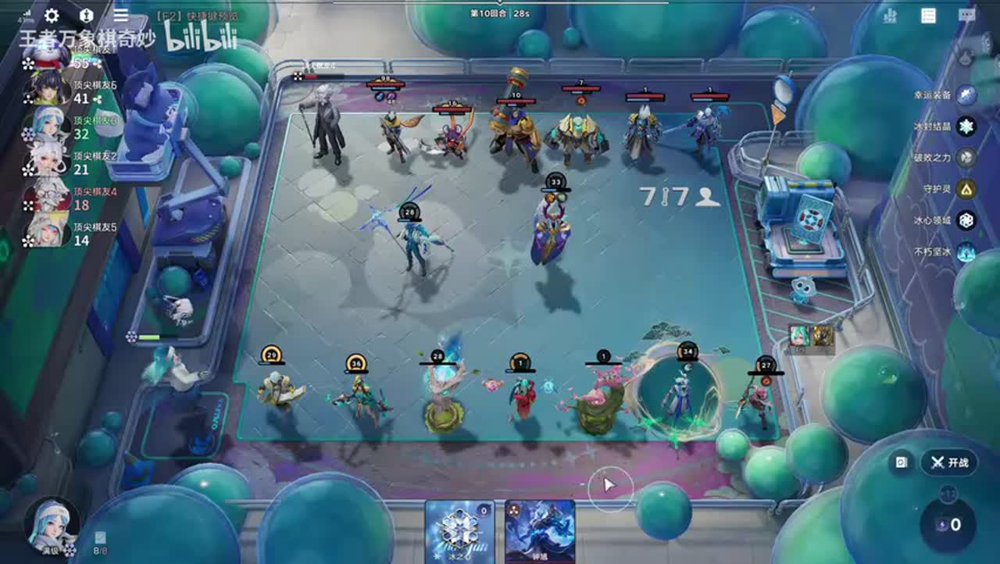

## 15:00–15:36 外围放两个单位吸引狙击，避免大哥被直接打死

- 事件 ID：BV1Tcaw6AE8a:p1:e014
- 场景：实战
- 时机：对手狙击最远目标
- 背景（分析推断）：本局禁日落海，昭君走大河，前中期长期缺图腾、后期面对高等级嬴政与司空震威胁；对手狙击最远目标。具体条件依据所引前后文。
- 学习目标（分析推断）：依据选敌规则安排保护位
- 模板：position-cause
- ASR 段落：[26]

> 她这是居最远的人

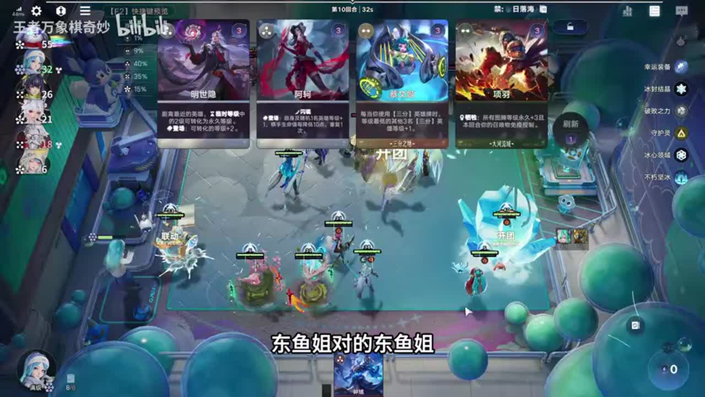

## 16:44–18:35 当前能赢但晚期可能打不过，面具圣剑司空震可清大河，优先关注其成长并寻求淘汰

- 事件 ID：BV1Tcaw6AE8a:p1:e015
- 场景：实战
- 时机：嫦娥司空震构成后续威胁
- 背景（分析推断）：本局禁日落海，昭君走大河，前中期长期缺图腾、后期面对高等级嬴政与司空震威胁；嫦娥司空震构成后续威胁。具体条件依据所引前后文。
- 学习目标（分析推断）：区分当前弱敌与将来克制威胁
- 模板：counter-target
- ASR 段落：[29, 30, 31]

> 一个雷霆大批就全崩死了

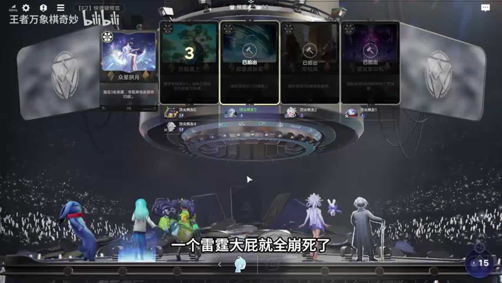

## 18:35–20:13 买入对方所需卡，认为未觉醒没等级时还能处理；只是本局竞争策略

- 事件 ID：BV1Tcaw6AE8a:p1:e016
- 场景：实战
- 时机：敌方司空震尚未觉醒
- 背景（分析推断）：本局禁日落海，昭君走大河，前中期长期缺图腾、后期面对高等级嬴政与司空震威胁；敌方司空震尚未觉醒。具体条件依据所引前后文。
- 学习目标（分析推断）：把自身补强与限制对手关键卡比较
- 模板：auction-choice
- ASR 段落：[32, 34]

> 司空镇没觉醒帮她买几张

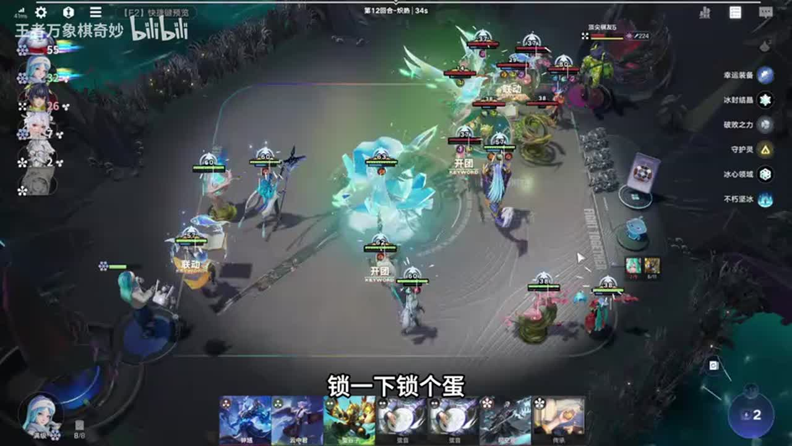

## 19:39–20:51 讲者观察龙人未死，解释其边打成长且回血，不怕反甲的说法需条件

- 事件 ID：BV1Tcaw6AE8a:p1:e017
- 场景：实战
- 时机：龙人扛住关键伤害
- 背景（分析推断）：本局禁日落海，昭君走大河，前中期长期缺图腾、后期面对高等级嬴政与司空震威胁；龙人扛住关键伤害。具体条件依据所引前后文。
- 学习目标（分析推断）：从存活与成长反馈理解装备和防御需求
- 模板：combat-review
- ASR 段落：[34, 35]

> 他打人的时候会回血

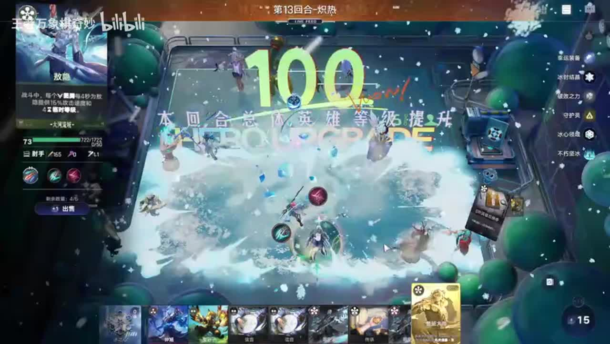

## 20:13–21:21 上两个鬼谷子觉醒并让瑶妹分仙之图腾，其百分比回血支撑高血单位

- 事件 ID：BV1Tcaw6AE8a:p1:e018
- 场景：实战
- 时机：图腾组件补齐后替换张良
- 背景（分析推断）：本局禁日落海，昭君走大河，前中期长期缺图腾、后期面对高等级嬴政与司空震威胁；图腾组件补齐后替换张良。具体条件依据所引前后文。
- 学习目标（分析推断）：成型后替换过渡位并利用装备共享
- 模板：late-transition
- ASR 段落：[35, 36]

> 而且是百分比回血

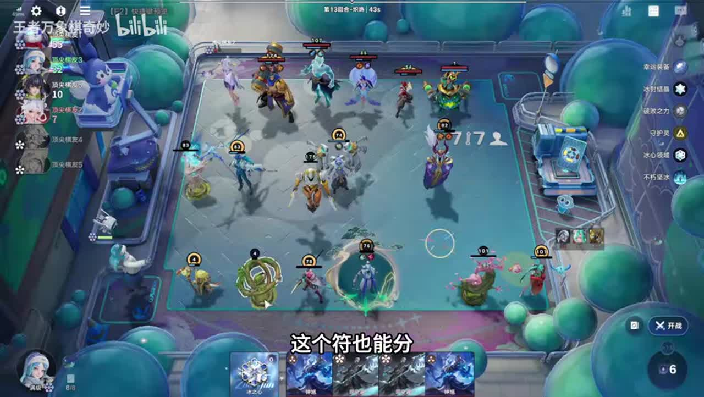

## 21:21–22:30 冻结机器人仍留收益，调整站位阻挡老虎，战中希望东皇或支撑替核心承受抱摔

- 事件 ID：BV1Tcaw6AE8a:p1:e019
- 场景：实战
- 时机：老虎切入与冻结目标选择
- 背景（分析推断）：本局禁日落海，昭君走大河，前中期长期缺图腾、后期面对高等级嬴政与司空震威胁；老虎切入与冻结目标选择。具体条件依据所引前后文。
- 学习目标（分析推断）：理解冻结残留效果与针对切入的保护
- 模板：position-cause
- ASR 段落：[37, 38]

> 老虎其实可以站位一下的

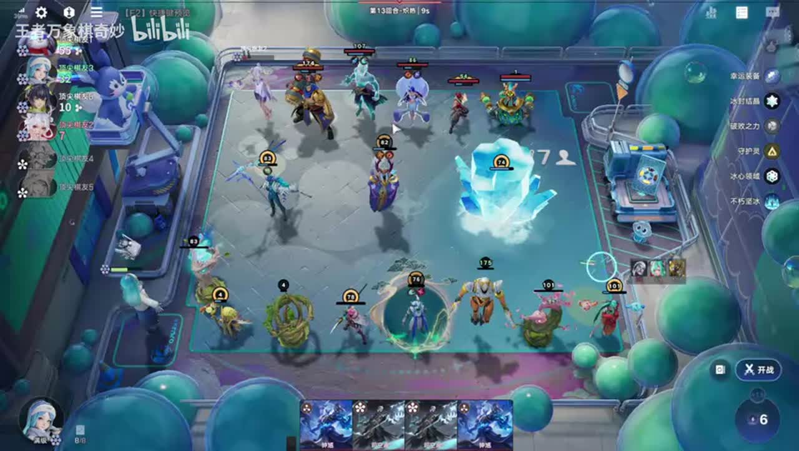

## 22:31–24:09 只传承可替换木兰，保留有用组件，上金钟馗并选变猪、移花接木强化山鬼

- 事件 ID：BV1Tcaw6AE8a:p1:e020
- 场景：实战
- 时机：决赛补功能位与装备
- 背景（分析推断）：本局禁日落海，昭君走大河，前中期长期缺图腾、后期面对高等级嬴政与司空震威胁；决赛补功能位与装备。具体条件依据所引前后文。
- 学习目标（分析推断）：依据敌方核心补功能位，避免传走必要支撑
- 模板：late-transition
- ASR 段落：[39, 40, 41]

> 这几个都是有用的

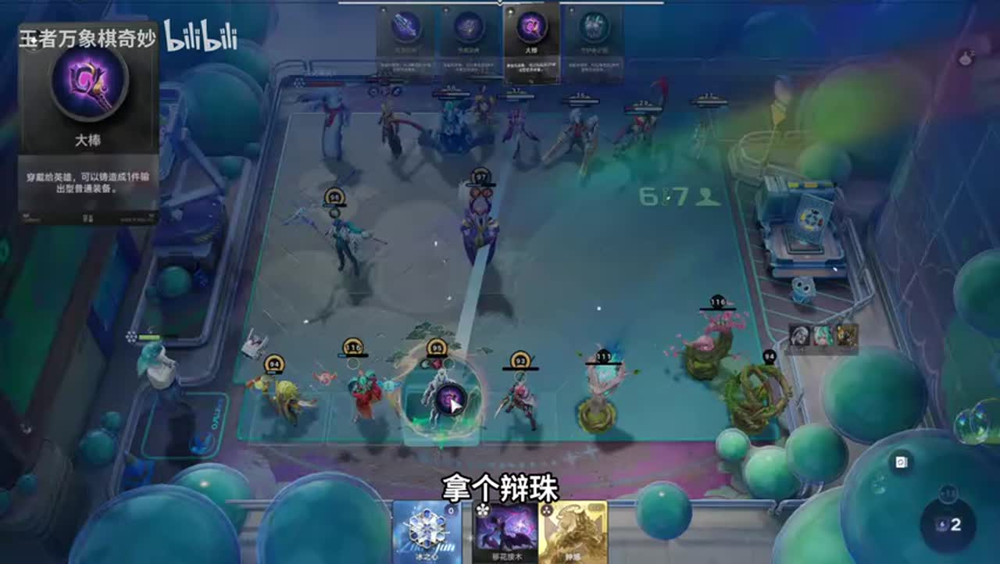

## 23:33–24:40 讲者认为反甲好用、日炎等可敲；山鬼受移花接木增级，明刀希望提高支撑存活

- 事件 ID：BV1Tcaw6AE8a:p1:e021
- 场景：实战
- 时机：反甲与明刀用于决赛防护
- 背景（分析推断）：本局禁日落海，昭君走大河，前中期长期缺图腾、后期面对高等级嬴政与司空震威胁；反甲与明刀用于决赛防护。具体条件依据所引前后文。
- 学习目标（分析推断）：把装备选择绑定承伤任务及等级条件
- 模板：equipment-role
- ASR 段落：[41, 42]

> 山鬼等级很高

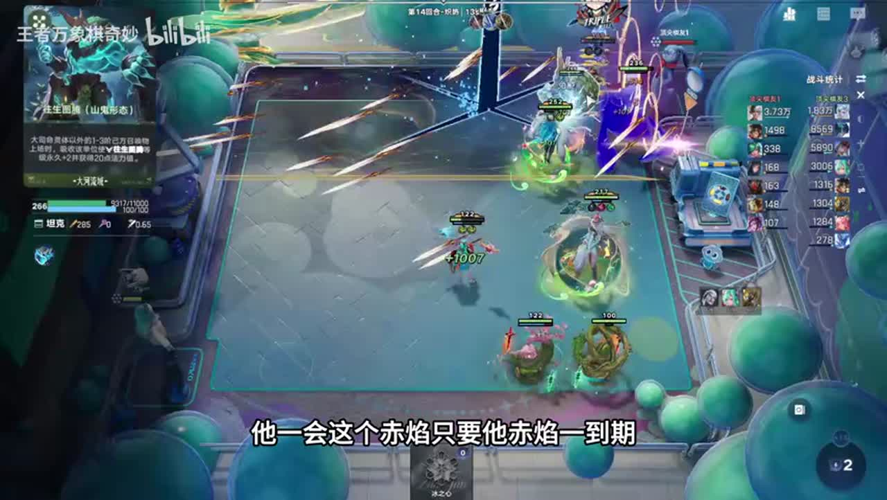

## 24:40–25:53 讲者解释人口可容纳关键功能，觉醒东皇偷等级比例更高；数值来自本片未实测

- 事件 ID：BV1Tcaw6AE8a:p1:e022
- 场景：实战
- 时机：缺人口与东皇未觉醒
- 背景（分析推断）：本局禁日落海，昭君走大河，前中期长期缺图腾、后期面对高等级嬴政与司空震威胁；缺人口与东皇未觉醒。具体条件依据所引前后文。
- 学习目标（分析推断）：评价人口与觉醒对体系收益的约束
- 模板：module-fit
- ASR 段落：[43, 44]

> 昭君很缺人口

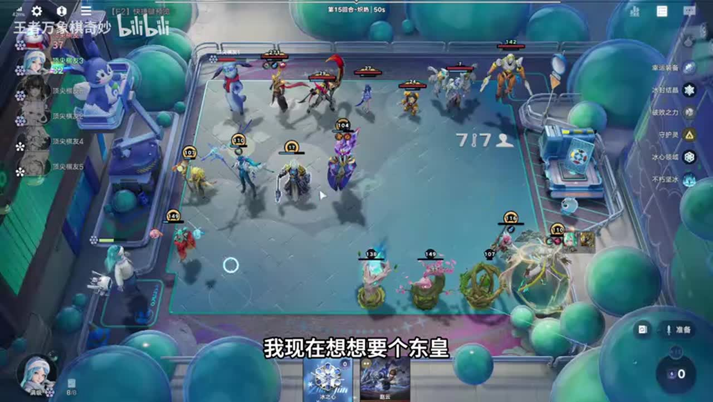

## 25:53–26:27 钟馗将敌方等级大幅降低，讲者观察超过15秒后控制；东皇没分明刀存活较差

- 事件 ID：BV1Tcaw6AE8a:p1:e023
- 场景：实战
- 时机：观察钟馗降级及长战斗控制
- 背景（分析推断）：本局禁日落海，昭君走大河，前中期长期缺图腾、后期面对高等级嬴政与司空震威胁；观察钟馗降级及长战斗控制。具体条件依据所引前后文。
- 学习目标（分析推断）：用战斗反馈核对功能位是否完成任务
- 模板：combat-review
- ASR 段落：[45]

> 一降降了一半

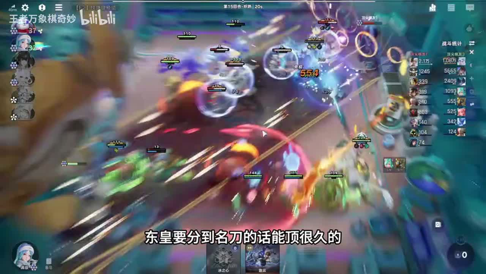

## 26:27–26:57 鸡爪换人，补多人普攻清杂鱼；合成希望出移花接木继续强化

- 事件 ID：BV1Tcaw6AE8a:p1:e024
- 场景：实战
- 时机：残局清杂鱼与合成收益
- 背景（分析推断）：本局禁日落海，昭君走大河，前中期长期缺图腾、后期面对高等级嬴政与司空震威胁；残局清杂鱼与合成收益。具体条件依据所引前后文。
- 学习目标（分析推断）：按残局短板调装备并寻找资源发动口
- 模板：equipment-role
- ASR 段落：[46]

> 把他杂鱼清一清

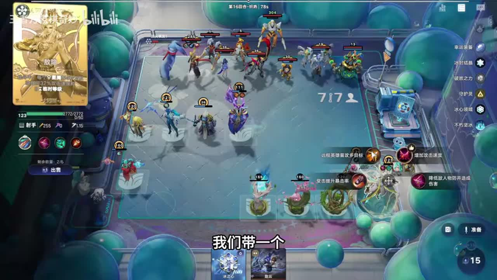

## 26:57–28:25 龙人东皇三图腾是骨架，余两人可按需要补海月瑶妹太乙钟馗司空震，瑶妹还能分装备

- 事件 ID：BV1Tcaw6AE8a:p1:e025
- 场景：实战
- 时机：总结固定骨架与自由功能位
- 背景（分析推断）：本局禁日落海，昭君走大河，前中期长期缺图腾、后期面对高等级嬴政与司空震威胁；总结固定骨架与自由功能位。具体条件依据所引前后文。
- 学习目标（分析推断）：掌握功能框架后按局势填位而非逐格抄阵容
- 模板：opening-plan
- ASR 段落：[47, 48]

> 剩下俩人随便上

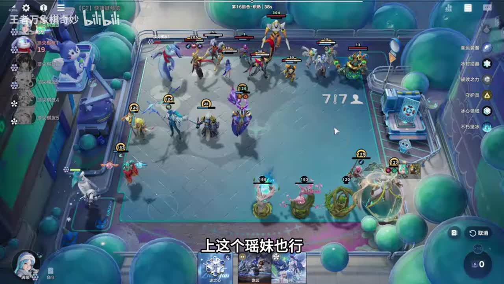

## 28:25–28:54 讲者认为旧强度被削，建议等加强；仅记录当时版本观点

- 事件 ID：BV1Tcaw6AE8a:p1:e026
- 场景：实战
- 时机：玩家询问弈星是否可用
- 背景（分析推断）：本局禁日落海，昭君走大河，前中期长期缺图腾、后期面对高等级嬴政与司空震威胁；玩家询问弈星是否可用。具体条件依据所引前后文。
- 学习目标（分析推断）：使用攻略前核对版本而非长期照搬
- 模板：version-change
- ASR 段落：[49]

> 后来被打断腿了

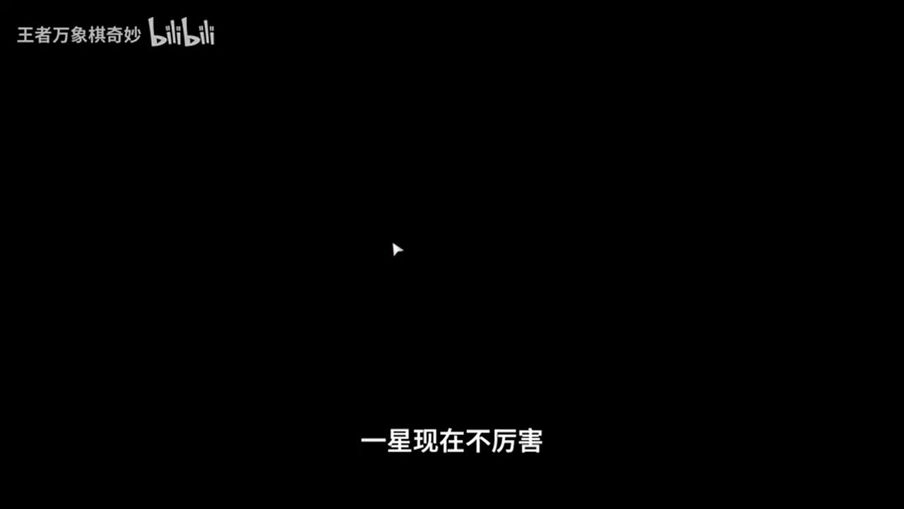

## 待核实与局限

- 不进行ASR修正；龙人等俗称不从模糊画面强行定名。
- 开头0至21秒无识别文本，不补写语音；后半直播卡顿调整与聊天排除。
- 鬼谷子概率、东皇偷级百分比和15秒控制等是讲者当时版本解释，未独立测量。
- 无脑第三与第一选择仅保留实际技能效果，编号不是通用规则。
- 当前能提前淘汰对手及竞争买牌的效果是本局判断，不证明普遍获胜或学习效果。
