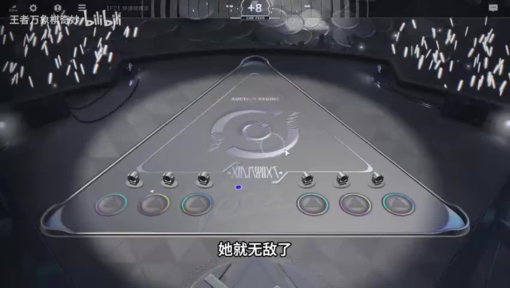
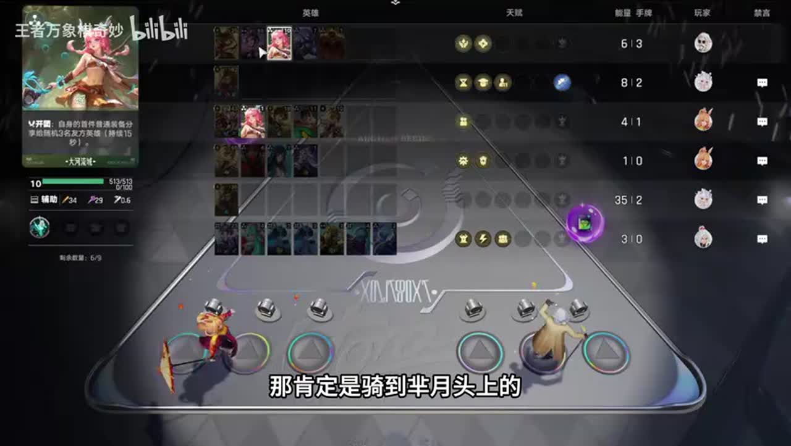
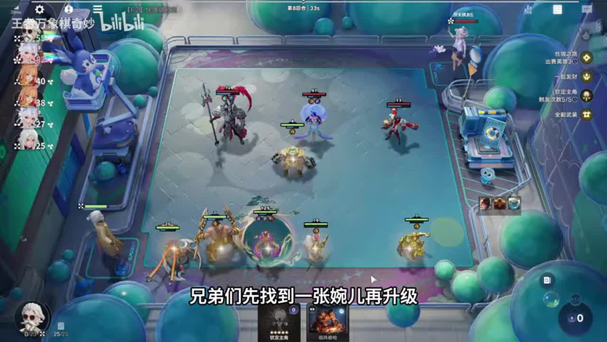

# 看到必点！一起发财天赋！养出4000法强芈月，降维打击

来源：https://www.bilibili.com/video/BV13Xac6BEvN/?p=1

分析状态：completed

完整文字稿：../../../raw/BV13Xac6BEvN_p1.md

## 00:01–00:35 瑶妹鸟人程咬金玄策支撑开团韩信，玄策使刺客杀人额外成长

- 事件 ID：BV13Xac6BEvN:p1:e001
- 场景：实战
- 时机：开团韩信构想
- 背景（分析推断）：本局姜子牙获得一起发财与封神一瞬，由韩信构想改养芈月，河洛提供古币、瑶妹共享属性；开团韩信构想，具体条件依据所引前后文。
- 学习目标（分析推断）：先理解阵容提供的功能
- 模板：opening-plan
- ASR 段落：[1]

> 刺客杀人能额外加等级的

## 00:40–02:18 原打算养韩信，发现一起发财给其他阵营随机英雄成长，转芈月并各阵营精选对象

- 事件 ID：BV13Xac6BEvN:p1:e002
- 场景：实战
- 时机：一起发财出现后改变核心
- 背景（分析推断）：本局姜子牙获得一起发财与封神一瞬，由韩信构想改养芈月，河洛提供古币、瑶妹共享属性；一起发财出现后改变核心，具体条件依据所引前后文。
- 学习目标（分析推断）：根据天赋改变核心而非固守原计划
- 模板：fallback-plan
- ASR 段落：[2, 3, 4]

> 韩星附带养吧

## 01:41–02:52 芈月在准备出发瞬间上场吃一起发财与李元芳古币，再配效果卡

- 事件 ID：BV13Xac6BEvN:p1:e003
- 场景：实战
- 时机：回合开始成长触发瞬间
- 背景（分析推断）：本局姜子牙获得一起发财与封神一瞬，由韩信构想改养芈月，河洛提供古币、瑶妹共享属性；回合开始成长触发瞬间，具体条件依据所引前后文。
- 学习目标（分析推断）：把自动触发窗口与上场时机联系
- 模板：resource-order
- ASR 段落：[4, 5]

> 准备出发的一瞬间芈月丢上去

## 02:19–03:25 芈月奴仆偷双抗前期慢，瑶妹100级共享属性提供启动双抗

- 事件 ID：BV13Xac6BEvN:p1:e004
- 场景：实战
- 时机：单芈月为何配瑶妹
- 背景（分析推断）：本局姜子牙获得一起发财与封神一瞬，由韩信构想改养芈月，河洛提供古币、瑶妹共享属性；单芈月为何配瑶妹，具体条件依据所引前后文。
- 学习目标（分析推断）：理解核心短板及辅助弥补条件
- 模板：growth-combo
- ASR 段落：[5, 6]

> 这个瑶妹一百击之后骑到她头上

## 03:26–04:38 两张牌暂不上因主角已满，25级后封神一瞬额外成长

- 事件 ID：BV13Xac6BEvN:p1:e005
- 场景：实战
- 时机：主角效果达到当回合上限
- 背景（分析推断）：本局姜子牙获得一起发财与封神一瞬，由韩信构想改养芈月，河洛提供古币、瑶妹共享属性；主角效果达到当回合上限，具体条件依据所引前后文。
- 学习目标（分析推断）：满收益后留资源，并关注发动等级门槛
- 模板：resource-order
- ASR 段落：[7, 8]

> 因为我们的主角打满了

## 04:38–05:49 学霸及河洛牺牲等条件不能满足，固定加三的登场不按想象触发一起发财，转丝绸之路

- 事件 ID：BV13Xac6BEvN:p1:e006
- 场景：实战
- 时机：筛除不能发动的天赋
- 背景（分析推断）：本局姜子牙获得一起发财与封神一瞬，由韩信构想改养芈月，河洛提供古币、瑶妹共享属性；筛除不能发动的天赋，具体条件依据所引前后文。
- 学习目标（分析推断）：先核对触发兼容性
- 模板：talent-fit
- ASR 段落：[9, 10]

> 他这是固定加三啊

## 05:50–07:36 没程咬金盾山时卖古币发动丝绸之路找河洛支撑并打满主角；找到后才喂古币

- 事件 ID：BV13Xac6BEvN:p1:e007
- 场景：实战
- 时机：古币卖掉还是喂给核心
- 背景（分析推断）：本局姜子牙获得一起发财与封神一瞬，由韩信构想改养芈月，河洛提供古币、瑶妹共享属性；古币卖掉还是喂给核心，具体条件依据所引前后文。
- 学习目标（分析推断）：资源用途随短板变化，不无脑永远卖或喂
- 模板：economy-budget
- ASR 段落：[11, 12, 13]

> 我什么时候给我一个成小金

## 06:59–08:09 先打满封神一瞬主角，再找到程咬金盾山后找婉儿；程咬金到后准备升四找盾山

- 事件 ID：BV13Xac6BEvN:p1:e008
- 场景：实战
- 时机：婉儿更多古币为何暂不找
- 背景（分析推断）：本局姜子牙获得一起发财与封神一瞬，由韩信构想改养芈月，河洛提供古币、瑶妹共享属性；婉儿更多古币为何暂不找，具体条件依据所引前后文。
- 学习目标（分析推断）：按成长链先后补支撑
- 模板：resource-order
- ASR 段落：[13, 14]

> 先把成了金与顿酸先找到

## 08:46–09:14 瑶妹只能骑一人，其他核心缺其支撑，不如集中芈月及古币供给

- 事件 ID：BV13Xac6BEvN:p1:e009
- 场景：实战
- 时机：是否同时养多个大哥
- 背景（分析推断）：本局姜子牙获得一起发财与封神一瞬，由韩信构想改养芈月，河洛提供古币、瑶妹共享属性；是否同时养多个大哥，具体条件依据所引前后文。
- 学习目标（分析推断）：把辅助容量当资源约束
- 模板：module-fit
- ASR 段落：[16]

> 我们的瑶妹只能骑到一个人头上

## 09:14–09:50 一起发财逐鹿随机一名，再上西施会分走芈月成长；无露娜仍有其他成长来源

- 事件 ID：BV13Xac6BEvN:p1:e010
- 场景：实战
- 时机：是否再上西施
- 背景（分析推断）：本局姜子牙获得一起发财与封神一瞬，由韩信构想改养芈月，河洛提供古币、瑶妹共享属性；是否再上西施，具体条件依据所引前后文。
- 学习目标（分析推断）：控制随机受益目标数量
- 模板：position-binding
- ASR 段落：[17]

> 所以一个阵容只能上一个

## 10:26–12:02 讲者选择全副武装战斗增减伤，先找一张婉儿再升级，并承认误卖逐鹿效果卡

- 事件 ID：BV13Xac6BEvN:p1:e011
- 场景：实战
- 时机：全副武装对比古币机
- 背景（分析推断）：本局姜子牙获得一起发财与封神一瞬，由韩信构想改养芈月，河洛提供古币、瑶妹共享属性；全副武装对比古币机，具体条件依据所引前后文。
- 学习目标（分析推断）：兼顾成长资源与不可替代战斗收益
- 模板：talent-fit
- ASR 段落：[19, 20, 21]

> 先找到一张婉儿再升级

## 12:02–12:34 婉儿到手古币不再卖，主角已满；芈月未觉醒效果24对比48，优先找觉醒

- 事件 ID：BV13Xac6BEvN:p1:e012
- 场景：实战
- 时机：芈月未觉醒损失成长
- 背景（分析推断）：本局姜子牙获得一起发财与封神一瞬，由韩信构想改养芈月，河洛提供古币、瑶妹共享属性；芈月未觉醒损失成长，具体条件依据所引前后文。
- 学习目标（分析推断）：确认核心升级门槛是否已兑现
- 模板：combat-review
- ASR 段落：[22]

> 我们敏玥没觉醒啊

## 13:41–15:50 需六河洛容纳觉醒婉儿六古币，多找外阵营单目标；若婉儿无法觉醒暂继续卖古币

- 事件 ID：BV13Xac6BEvN:p1:e013
- 场景：实战
- 时机：婉儿未觉醒供给不够
- 背景（分析推断）：本局姜子牙获得一起发财与封神一瞬，由韩信构想改养芈月，河洛提供古币、瑶妹共享属性；婉儿未觉醒供给不够，具体条件依据所引前后文。
- 学习目标（分析推断）：按产出覆盖人数与觉醒状态选资源用途
- 模板：economy-budget
- ASR 段落：[25, 26, 27, 28]

> 我要是不上六个河洛的话

## 15:50–17:00 当前更需武则天古币和觉醒婉儿，李白可替换；一起发财是快成长前提

- 事件 ID：BV13Xac6BEvN:p1:e014
- 场景：实战
- 时机：李白无用时补古币供给
- 背景（分析推断）：本局姜子牙获得一起发财与封神一瞬，由韩信构想改养芈月，河洛提供古币、瑶妹共享属性；李白无用时补古币供给，具体条件依据所引前后文。
- 学习目标（分析推断）：找当前瓶颈对应支撑，不套通用强牌
- 模板：growth-combo
- ASR 段落：[29, 30]

> 没有一起发财的话

## 16:24–17:32 选人口后回看妙音可直接觉醒婉儿解除瓶颈、提前升级；人口仍可用

- 事件 ID：BV13Xac6BEvN:p1:e015
- 场景：实战
- 时机：人口与妙音选择复盘
- 背景（分析推断）：本局姜子牙获得一起发财与封神一瞬，由韩信构想改养芈月，河洛提供古币、瑶妹共享属性；人口与妙音选择复盘，具体条件依据所引前后文。
- 学习目标（分析推断）：比较容量收益与立即补齐关键觉醒
- 模板：auction-choice
- ASR 段落：[30, 31]

> 我应该拿妙音呢

## 17:33–18:38 本地河洛额外成长不是本局目标，大古币可卖；婉儿觉醒后重新检查六河洛上场

- 事件 ID：BV13Xac6BEvN:p1:e016
- 场景：实战
- 时机：大古币卖掉与婉儿觉醒
- 背景（分析推断）：本局姜子牙获得一起发财与封神一瞬，由韩信构想改养芈月，河洛提供古币、瑶妹共享属性；大古币卖掉与婉儿觉醒，具体条件依据所引前后文。
- 学习目标（分析推断）：产出改变后调整站场和资源用法
- 模板：resource-order
- ASR 段落：[32, 33]

> 给六个人鼓劈

## 18:38–20:58 喂古币本身给芈月效果，另使非河洛外地人成长；需要此特殊天赋，不复制无天赋阵容

- 事件 ID：BV13Xac6BEvN:p1:e017
- 场景：实战
- 时机：解释一起发财体系门槛
- 背景（分析推断）：本局姜子牙获得一起发财与封神一瞬，由韩信构想改养芈月，河洛提供古币、瑶妹共享属性；解释一起发财体系门槛，具体条件依据所引前后文。
- 学习目标（分析推断）：识别打法的必要前提
- 模板：mechanic-model
- ASR 段落：[34, 35, 36, 37]

> 这个阵容必须得有这个天赋才能玩

## 21:33–22:37 玉环补迟来的觉醒，鲁班大师借最高逐鹿等级召机器人，觉醒可提高继承；瑶妹100共享属性

- 事件 ID：BV13Xac6BEvN:p1:e018
- 场景：实战
- 时机：玉环觉醒芈月和鲁班大师副核
- 背景（分析推断）：本局姜子牙获得一起发财与封神一瞬，由韩信构想改养芈月，河洛提供古币、瑶妹共享属性；玉环觉醒芈月和鲁班大师副核，具体条件依据所引前后文。
- 学习目标（分析推断）：利用已有高等级派生成战力并补核心觉醒
- 模板：growth-combo
- ASR 段落：[39, 40]

> 她如果觉醒的话

## 22:37–24:13 东皇咬住导致拖时间，已有法术吸血免控时再找魔女，而非重复补同类能力

- 事件 ID：BV13Xac6BEvN:p1:e019
- 场景：实战
- 时机：活着却被拖到时间结束
- 背景（分析推断）：本局姜子牙获得一起发财与封神一瞬，由韩信构想改养芈月，河洛提供古币、瑶妹共享属性；活着却被拖到时间结束，具体条件依据所引前后文。
- 学习目标（分析推断）：区分生存不足与无法结束战斗
- 模板：combat-review
- ASR 段落：[41, 42, 43]

> 时间到了给我拖死了

## 24:46–25:50 本局无露娜，古币自身效果与一起发财成长仍能运行；露娜只是可进一步提升供给

- 事件 ID：BV13Xac6BEvN:p1:e020
- 场景：实战
- 时机：缺露娜仍靠古币循环
- 背景（分析推断）：本局姜子牙获得一起发财与封神一瞬，由韩信构想改养芈月，河洛提供古币、瑶妹共享属性；缺露娜仍靠古币循环，具体条件依据所引前后文。
- 学习目标（分析推断）：区分必要前提和加速组件
- 模板：fallback-plan
- ASR 段落：[45, 46]

> 这把还没有露娜的

## 26:52–27:44 基础属性、开场共享和大书百分比让芈月战中法强继续提升，小蝙蝠偷双抗；变猪理由尚未讲完

- 事件 ID：BV13Xac6BEvN:p1:e021
- 场景：实战
- 时机：终局大书继续放大法强
- 背景（分析推断）：本局姜子牙获得一起发财与封神一瞬，由韩信构想改养芈月，河洛提供古币、瑶妹共享属性；终局大书继续放大法强，具体条件依据所引前后文。
- 学习目标（分析推断）：分清静态面板与战斗属性放大
- 模板：equipment-role
- ASR 段落：[49, 50]

> 大叔再加20%

## 待核实与局限

- 不做ASR修正，封神一瞬等同音原话保留。
- 第3段短词与后文联合理解，不单独统计；夸张999与自嘲赌约排除。
- 一起发财逐阵营随机目标、古币发动条件与瑶妹共享按讲者版本说明，未独立测量。
- 第36段单回合300级讲者自身不确定，不当精确成长数据。
- 结尾变猪法杖原因未讲完，不补写未出现论证。
