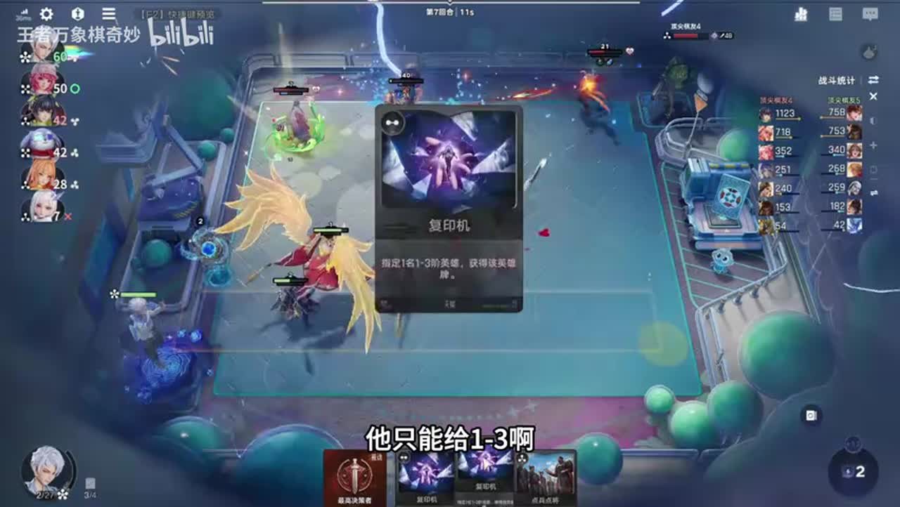
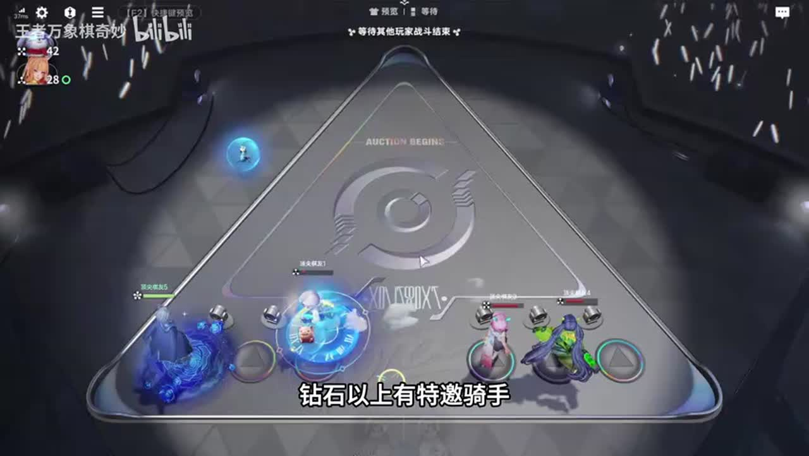
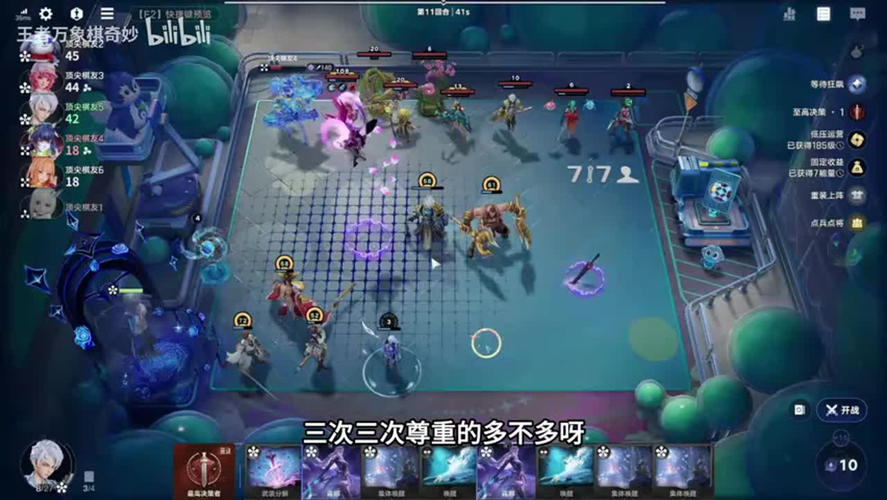
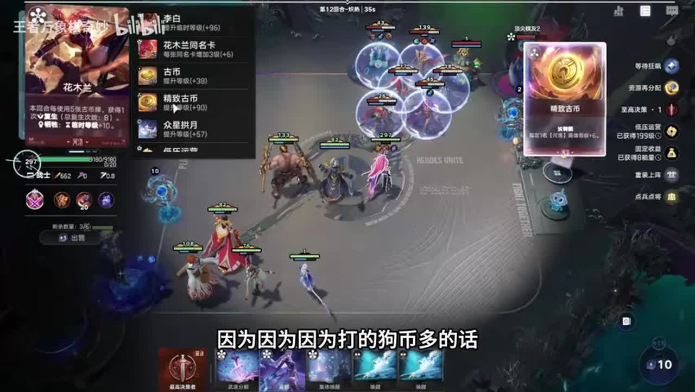
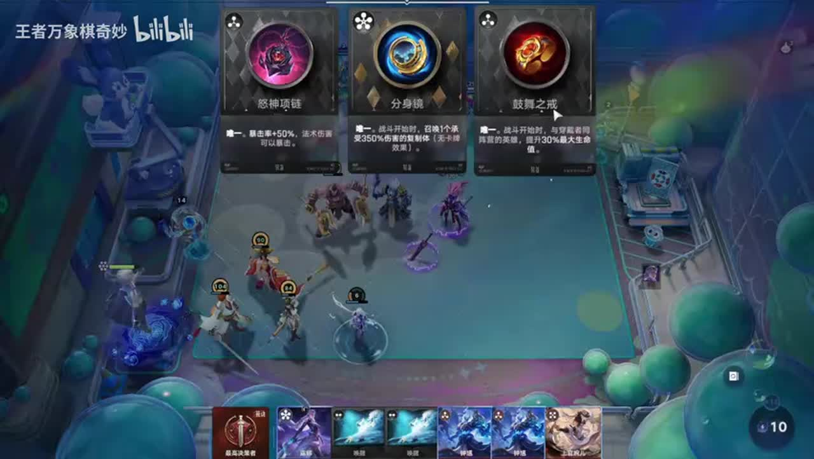
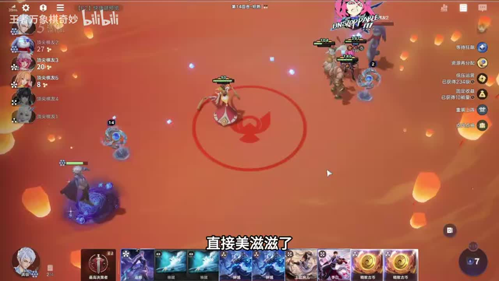

# 赢律公式玩法，公式阵容，公式吃鸡

来源：https://www.bilibili.com/video/BV1Avhk6MEgP/?p=1

分析状态：completed

完整文字稿：../../../raw/BV1Avhk6MEgP_p1.md

## 01:34–03:17 有低压运营优先，缺时考虑风险对冲；低压路线更需要保胜

- 事件 ID：BV1Avhk6MEgP:p1:e001
- 场景：实战
- 时机：赢律开局选择经济与战斗路径
- 背景（分析推断）：本局特邀含狂飙，前期胜负决定低压等级收益
- 学习目标（分析推断）：按所选路径调整保血和资源目标
- 模板：talent-fit
- ASR 段落：[3, 4, 5]

> 低压运营不能输

## 02:42–04:01 狂飙给弈星，施法前后摇短比苏烈更能发挥连续技能

- 事件 ID：BV1Avhk6MEgP:p1:e002
- 场景：实战
- 时机：给狂飙选施法频率高的英雄
- 背景（分析推断）：狂飙限时技能收益取决于英雄动作速度
- 学习目标（分析推断）：按技能频率匹配临时增强
- 模板：module-fit
- ASR 段落：[5, 6]

> 狂飙他这个前后摇快

## 03:17–04:33 先上马可，装备先做能赢当前战斗的攻速，不急升级

- 事件 ID：BV1Avhk6MEgP:p1:e003
- 场景：实战
- 时机：前期选拍卖战力和装备
- 背景（分析推断）：低压保胜需要即时战力，而非只存经济等终局
- 学习目标（分析推断）：让前期装备优先服务生存与连胜
- 模板：equipment-role
- ASR 段落：[6, 7]

> 只做前期能赢的

## 04:02–05:17 检查对手等级与经济，再比较管理进修给其他人的收益

- 事件 ID：BV1Avhk6MEgP:p1:e004
- 场景：实战
- 时机：是否开启管理进修要看全场
- 背景（分析推断）：讲者先拒绝让别人起飞，发现别人全升级后重新评估
- 学习目标（分析推断）：评估共享天赋对全场的相对收益
- 模板：talent-fit
- ASR 段落：[7, 8]

> 管理进修一开别人起飞了

## 05:17–07:01 上更多能存活英雄，孟奇赔钱少；六人存活带来六能量

- 事件 ID：BV1Avhk6MEgP:p1:e005
- 场景：实战
- 时机：分红与上场存活数联动
- 背景（分析推断）：当前阵容能保住大量单位，分红收益超过单次升级型经济
- 学习目标（分析推断）：按触发条件组织经济收益
- 模板：economy-budget
- ASR 段落：[9, 10, 11]

> 我存活六个

## 06:28–08:57 全军列阵与点兵点将找木兰、婉儿、程咬金、武则天，来牌不足时承认没成

- 事件 ID：BV1Avhk6MEgP:p1:e006
- 场景：实战
- 时机：准备一键构建花木兰阵容
- 背景（分析推断）：理想操作链有明确目标，但本轮几个关键英雄都未到
- 学习目标（分析推断）：区分阵容框架与真实成型条件
- 模板：opening-plan
- ASR 段落：[11, 12, 13, 14]

> 来的不好

## 07:44–08:26 比较李白用币加等级与其他英雄收益

- 事件 ID：BV1Avhk6MEgP:p1:e007
- 场景：实战
- 时机：古币给李白的成长优势
- 背景（分析推断）：有限古币能投到更高成长效率的目标
- 学习目标（分析推断）：按单位资源成长收益分配技能
- 模板：growth-combo
- ASR 段落：[13]

> 李白一个币加16级

## 15:01–15:37 铜色小版本只能复制低费，银色大版本才可复制露娜

- 事件 ID：BV1Avhk6MEgP:p1:e008
- 场景：实战
- 时机：小复印坤不能复制露娜
- 背景（分析推断）：观众建议复制露娜，讲者指出当前手中的版本受费阶限制
- 学习目标（分析推断）：核对技能版本和目标合法性
- 模板：mechanic-model
- ASR 段落：[25]

> 这个是童的,赢的那个是可以复印露娜的

## 08:26–09:35 本局把拍卖钱用到零去抢木兰

- 事件 ID：BV1Avhk6MEgP:p1:e009
- 场景：实战
- 时机：关键花木兰迟到时拍卖投入
- 背景（分析推断）：已有大量经济且终局核心缺失，讲者优先核心而非均衡分配
- 学习目标（分析推断）：按关键组件缺口决定拍卖预算
- 模板：auction-choice
- ASR 段落：[14, 15]

> 拍卖直接把钱抢到零

## 08:57–09:35 特邀三选一提供额外技能，本局选择狂飙

- 事件 ID：BV1Avhk6MEgP:p1:e010
- 场景：实战
- 时机：说明本局狂飙来自特邀
- 背景（分析推断）：这一效果不是所有赢律对局天然都有
- 学习目标（分析推断）：辨别特殊模式前提与常规棋手技能
- 模板：mechanic-model
- ASR 段落：[15]

> 这把的特邀技能是狂飙

## 10:10–11:24 找到露娜、花木兰、婉儿时再开双倍，未找到就保留

- 事件 ID：BV1Avhk6MEgP:p1:e011
- 场景：实战
- 时机：双倍决策留到关键牌到手
- 背景（分析推断）：当前核心组件仍不齐，提前开会放大无关收益
- 学习目标（分析推断）：把倍增技能留给关键目标
- 模板：resource-order
- ASR 段落：[17, 18]

> 没找到卡就不开

## 11:24–13:44 等外部经济耗尽再用至高决策提高独享机会，但对手能卖手牌补钱

- 事件 ID：BV1Avhk6MEgP:p1:e012
- 场景：实战
- 时机：共享机会前等对手花钱
- 背景（分析推断）：讲者观察他人余额到零，仍有人卖牌参与，说明零余额不是绝对保证
- 学习目标（分析推断）：把外部购买能力纳入共享资源时机
- 模板：economy-budget
- ASR 段落：[19, 20, 21, 22]

> 他把手里的牌卖光了

## 13:48–15:01 露娜是关键组件，继续点她并补河洛觉醒功能

- 事件 ID：BV1Avhk6MEgP:p1:e013
- 场景：实战
- 时机：点兵点将与集体唤醒选露娜
- 背景（分析推断）：核心木兰已到，成长和复活需要支持组件
- 学习目标（分析推断）：按主核机制明确配套英雄
- 模板：growth-combo
- ASR 段落：[23, 24]

> 露娜很关键

## 15:37–16:43 按敌方强度用足够次数唤醒，不因看见多张就全用

- 事件 ID：BV1Avhk6MEgP:p1:e014
- 场景：实战
- 时机：多次唤醒要匹配对手压力
- 背景（分析推断）：讲者从五次偏多到三次一百级足够，多条命有资源成本
- 学习目标（分析推断）：按敌方威胁预算复活次数
- 模板：economy-budget
- ASR 段落：[26, 27]

> 三次一百级

## 17:24–17:58 缺复活来源时不建议硬玩木兰，通常只剩少数命

- 事件 ID：BV1Avhk6MEgP:p1:e015
- 场景：实战
- 时机：禁日落海时木兰玩法的限制
- 背景（分析推断）：询问无日落海能否玩，讲者区分能玩与推荐
- 学习目标（分析推断）：把阵营限制纳入终局阵容选择
- 模板：opening-plan
- ASR 段落：[29]

> 没有复活,就两条命

## 17:58–18:31 花木兰缺等级，高级少数命可能比低级很多命更有价值

- 事件 ID：BV1Avhk6MEgP:p1:e016
- 场景：实战
- 时机：等级与复活次数取舍
- 背景（分析推断）：当前需要更高成长而非盲目堆复活次数
- 学习目标（分析推断）：比较每条命的战力与命数
- 模板：economy-budget
- ASR 段落：[30]

> 高等级两三条命比低等级的七八条命都厉害

## 17:58–19:36 六级吃席随敌方死亡获取能量、血与特殊装备，太晚升级会漏收益

- 事件 ID：BV1Avhk6MEgP:p1:e017
- 场景：实战
- 时机：有人淘汰后立即升六开席
- 背景（分析推断）：已经死一人，讲者承认升级晚了并说明奖励内容
- 学习目标（分析推断）：按外部淘汰触发调整等级截止时间
- 模板：level-transition
- ASR 段落：[30, 31, 32]

> 只要有人一死就赶紧开鞋

## 18:59–20:09 多用古币和武则天成长，再满足八张使用条件

- 事件 ID：BV1Avhk6MEgP:p1:e018
- 场景：实战
- 时机：资源再分配前打八张卡
- 背景（分析推断）：看似对单个对手过量复活，实际目标还有永久成长和资源再分配
- 学习目标（分析推断）：把一次操作的战斗与经济双重目标说清
- 模板：growth-combo
- ASR 段落：[32, 33]

> 我想打这个资源再分配

## 20:09–21:52 保留集体唤醒机会，等待吃席后看奖励再决定

- 事件 ID：BV1Avhk6MEgP:p1:e019
- 场景：实战
- 时机：下一份淘汰奖励前暂缓用牌
- 背景（分析推断）：仍有四十多秒可等新装备或技能，不必过早锁定操作
- 学习目标（分析推断）：在整备窗口内等待关键新信息
- 模板：resource-order
- ASR 段落：[34, 35, 36]

> 马上咱们准备开席了

## 21:53–24:10 希望返回集体唤醒，打够八张后停止继续污染用牌历史

- 事件 ID：BV1Avhk6MEgP:p1:e020
- 场景：实战
- 时机：资源返回不如预期时少打其他牌
- 背景（分析推断）：讲者多次实际拿回古币而非理想唤醒，不能把愿望当保证
- 学习目标（分析推断）：用返回结果检查技能时序并保留不确定性
- 模板：combat-review
- ASR 段落：[37, 38, 40]

> 打够巴掌不打了

## 23:35–24:53 分身不能继承复活，但对手嬴政可继承法强，多一个扫射体有价值

- 事件 ID：BV1Avhk6MEgP:p1:e021
- 场景：实战
- 时机：评估分身镜复制内容
- 背景（分析推断）：同一复制装备对不同主核保留的属性不同
- 学习目标（分析推断）：按可继承属性评价复制装备
- 模板：mechanic-model
- ASR 段落：[40, 41]

> 分身能不能继承复活

## 25:30–26:54 对手一门双子轮增强威胁，额外一次复活救场，后续需要多准备

- 事件 ID：BV1Avhk6MEgP:p1:e022
- 场景：实战
- 时机：李信连续压起身后验证复活预算
- 背景（分析推断）：讲者原以为六次够，战斗后承认少一次可能打不过
- 学习目标（分析推断）：从实战压力修正复活次数预算
- 模板：combat-review
- ASR 段落：[43, 44]

> 不多交一次还打不过

## 27:26–27:57 已有足够复活，不强求磐石，想做无尽提升每次攻击伤害

- 事件 ID：BV1Avhk6MEgP:p1:e023
- 场景：实战
- 时机：面对海月时优先输出而非承伤装备
- 背景（分析推断）：多命主核对海月需要尽快击杀，缺输出是主要瓶颈
- 学习目标（分析推断）：按现有容错与对手调整装备优先级
- 模板：counter-target
- ASR 段落：[46]

> 复活支柱够多,盘石无所谓的,需要输出

## 27:57–28:37 传承未必到程咬金，失败会亏，不为高上限冒无必要风险

- 事件 ID：BV1Avhk6MEgP:p1:e024
- 场景：实战
- 时机：拒绝不稳定的传承移植999
- 背景（分析推断）：已经有可获胜的木兰阵容，随机转移不保证目标
- 学习目标（分析推断）：比较理论上限与成功概率和失败成本
- 模板：economy-budget
- ASR 段落：[47]

> 不传到就是亏了

## 待核实与局限

- 不做ASR修正；棋手按社媒标题赢律保留，技能同音错写原话不改。
- 特邀提供狂飙，本局经济和前期战力不能当作所有普通赢律对局固有能力。
- 第2、16段重复或低信息内容、聊天与抱怨排除；第27段至尊梗不是教学效果。
- 复活数与等级优劣为讲者当局评价，不用胜率或学习效果包装。
- 资源再分配希望返唤醒但多次返古币，机制准确条件仍待核实；不输出稳定返唤醒承诺。
- 吃席机械头等奖励描述为讲者版本经验，未验证当前概率。
