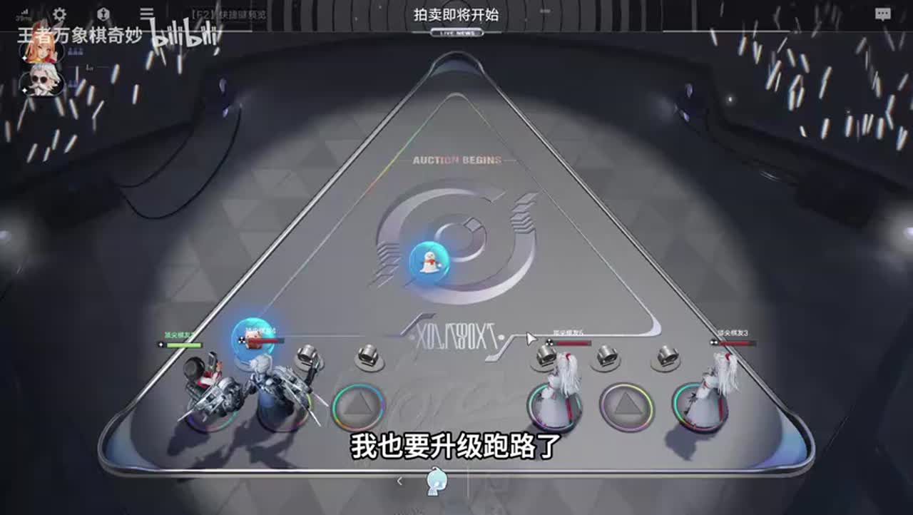
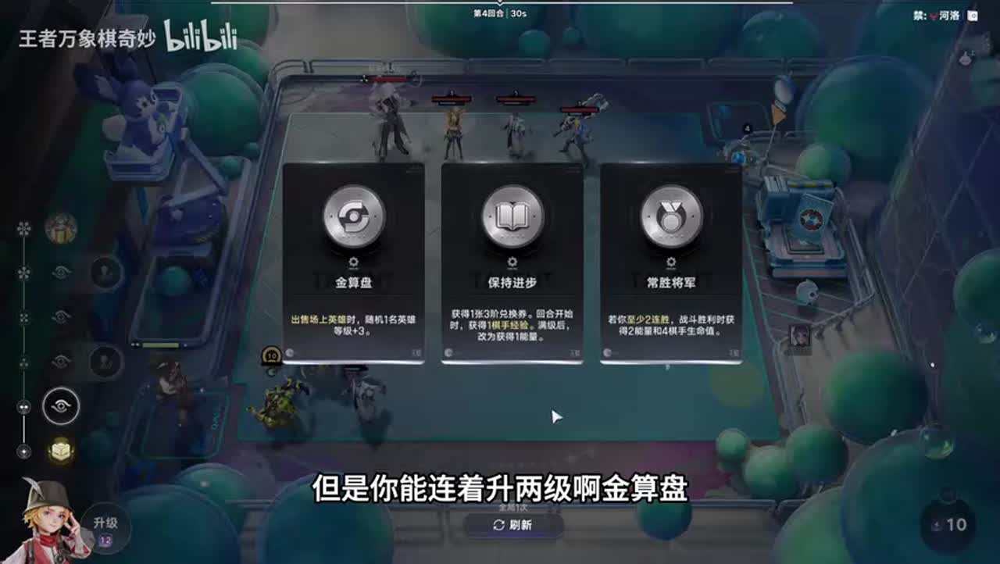
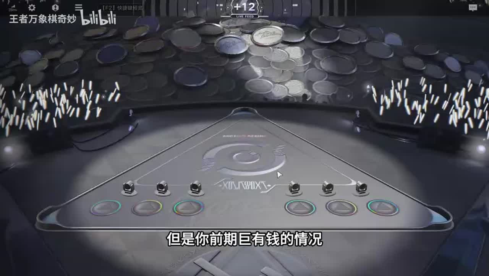

# 辛辛苦苦养个900级吕布踩弹簧了！我超威！

来源：https://www.bilibili.com/video/BV1jNhQ6SEuy/?p=1

分析状态：completed

完整文字稿：../../../raw/BV1jNhQ6SEuy_p1.md

## 02:23–03:41 弹簧移出场外忽略高等级与复活，敌人踩陷阱给螺丝可升级；与十秒处决机制分开理解

- 事件 ID：BV1jNhQ6SEuy:p1:e001
- 场景：实战
- 时机：面对三级弹簧先识别威胁
- 背景（分析推断）：本局马可算盘与乐善好施走三分射，误点重点照顾后转吕布，终局面对三级弹簧并出现诱饵失败；面对三级弹簧先识别威胁。
- 学习目标（分析推断）：区别移出场外、正常伤害与复活救场
- 模板：mechanic-model
- ASR 段落：[5, 6]

> 他螺丝多的话

## 00:33–01:46 能赢做鸡爪争胜，明显打不过才空城末位，避免中间名次亏收益；后站希望少掉血

- 事件 ID：BV1jNhQ6SEuy:p1:e002
- 场景：实战
- 时机：马可前期争第一或末位
- 背景（分析推断）：本局马可算盘与乐善好施走三分射，误点重点照顾后转吕布，终局面对三级弹簧并出现诱饵失败；马可前期争第一或末位。
- 学习目标（分析推断）：按胜算选择经济目标与减损
- 模板：economy-budget
- ASR 段落：[2, 3]

> 真赢不了的话就空城当老六

## 01:11–02:23 快速普攻回蓝，攻击力高则兼伤害；打韩信可选高等级免控或控制风筝射手

- 事件 ID：BV1jNhQ6SEuy:p1:e003
- 场景：实战
- 时机：鸡爪为什么法师也可用
- 背景（分析推断）：本局马可算盘与乐善好施走三分射，误点重点照顾后转吕布，终局面对三级弹簧并出现诱饵失败；鸡爪为什么法师也可用。
- 学习目标（分析推断）：按回蓝与控制功能选装备
- 模板：equipment-cause
- ASR 段落：[3, 4]

> 因为他能回篮

## 03:41–04:13 弈星三能量虽单升售卖不回本，连升两次加级累计有收益

- 事件 ID：BV1jNhQ6SEuy:p1:e004
- 场景：实战
- 时机：先找弈星再连续升级
- 背景（分析推断）：本局马可算盘与乐善好施走三分射，误点重点照顾后转吕布，终局面对三级弹簧并出现诱饵失败；先找弈星再连续升级。
- 学习目标（分析推断）：计算连续触发总收益而非一次返还
- 模板：level-transition
- ASR 段落：[7]

> 但是你能连着升两级啊

## 03:41–04:49 算盘养多人，乐善好施叠登场等级，据此选三分射并关注推荐

- 事件 ID：BV1jNhQ6SEuy:p1:e005
- 场景：实战
- 时机：算盘与乐善好施定三分路线
- 背景（分析推断）：本局马可算盘与乐善好施走三分射，误点重点照顾后转吕布，终局面对三级弹簧并出现诱饵失败；算盘与乐善好施定三分路线。
- 学习目标（分析推断）：从天赋相容性确定路线
- 模板：talent-fit
- ASR 段落：[7, 8]

> 我们的天赋是三分啊

## 05:57–07:15 确定路线后选三分射推荐，老夫子孟奇循环买卖；推荐需判断少数不适配攻略

- 事件 ID：BV1jNhQ6SEuy:p1:e006
- 场景：实战
- 时机：定阵后使用推荐筛卡
- 背景（分析推断）：本局马可算盘与乐善好施走三分射，误点重点照顾后转吕布，终局面对三级弹簧并出现诱饵失败；定阵后使用推荐筛卡。
- 学习目标（分析推断）：用界面辅助识牌但保留判断
- 模板：mechanic-model
- ASR 段落：[11, 12]

> 咱们定阵之后可以在这里选

## 07:17–09:41 阿离路线先稳血等拍卖升本找支撑；支撑觉醒后可升五以姜子牙替代，但经济差会危险

- 事件 ID：BV1jNhQ6SEuy:p1:e007
- 场景：实战
- 时机：阿离缺牌与升级选择
- 背景（分析推断）：本局马可算盘与乐善好施走三分射，误点重点照顾后转吕布，终局面对三级弹簧并出现诱饵失败；阿离缺牌与升级选择。
- 学习目标（分析推断）：替代目标要连同经济代价解释
- 模板：fallback-plan
- ASR 段落：[13, 14, 15, 16]

> 把阿离的位置换成姜子牙就行了

## 07:50–08:29 可等小乔甄姬后复制，讲者实际不等是个人偏好，不把省略当最佳顺序

- 事件 ID：BV1jNhQ6SEuy:p1:e008
- 场景：实战
- 时机：宝石镜早用还是等支撑
- 背景（分析推断）：本局马可算盘与乐善好施走三分射，误点重点照顾后转吕布，终局面对三级弹簧并出现诱饵失败；宝石镜早用还是等支撑。
- 学习目标（分析推断）：辨别教学建议和示范省略
- 模板：resource-order
- ASR 段落：[14]

> 等那种小乔或者真鸡来了直接复制

## 09:07–10:13 未觉醒且不富先三张场上卡；特别有钱才能早宝藏，否则小红小绿导致断经济

- 事件 ID：BV1jNhQ6SEuy:p1:e009
- 场景：实战
- 时机：三选一场上三卡或升级宝藏
- 背景（分析推断）：本局马可算盘与乐善好施走三分射，误点重点照顾后转吕布，终局面对三级弹簧并出现诱饵失败；三选一场上三卡或升级宝藏。
- 学习目标（分析推断）：把即时觉醒需求与高级收益预算绑定
- 模板：economy-budget
- ASR 段落：[16, 17]

> 把场上的卡觉醒的差不多

## 10:13–10:44 试图在曹操挥刀前上甄姬吃成长，但格子满未成功，点兵点将适配三分

- 事件 ID：BV1jNhQ6SEuy:p1:e010
- 场景：实战
- 时机：甄姬上场赶曹操整备窗口
- 背景（分析推断）：本局马可算盘与乐善好施走三分射，误点重点照顾后转吕布，终局面对三级弹簧并出现诱饵失败；甄姬上场赶曹操整备窗口。
- 学习目标（分析推断）：自动技能时点还受人口容量约束
- 模板：resource-order
- ASR 段落：[18]

> 我还得卖一个才能上

## 10:44–11:50 从商店买公孙离上场时吸周围英雄等级；李白另需免控吸血不要泛化

- 事件 ID：BV1jNhQ6SEuy:p1:e011
- 场景：实战
- 时机：阿离夺取升级怎么操作
- 背景（分析推断）：本局马可算盘与乐善好施走三分射，误点重点照顾后转吕布，终局面对三级弹簧并出现诱饵失败；阿离夺取升级怎么操作。
- 学习目标（分析推断）：把上场时机、邻接站位与夺取收益关联
- 模板：position-binding
- ASR 段落：[19, 20]

> 夺取周围人十点等级

## 14:23–15:00 对手人数多且远程，分裂适配；露娜留一保底，宝石镜复制露娜

- 事件 ID：BV1jNhQ6SEuy:p1:e012
- 场景：实战
- 时机：对手多远程单位用分裂
- 背景（分析推断）：本局马可算盘与乐善好施走三分射，误点重点照顾后转吕布，终局面对三级弹簧并出现诱饵失败；对手多远程单位用分裂。
- 学习目标（分析推断）：按敌方结构选装备并给关键资源留余量
- 模板：counter-target
- ASR 段落：[25]

> 因为他的人多而且他都远程

## 15:01–16:40 算盘乐善好施适合三分，老夫子逐个上卖四次，而合成会少触发；初升五未启动可输

- 事件 ID：BV1jNhQ6SEuy:p1:e013
- 场景：实战
- 时机：循环供给卡逐个上卖
- 背景（分析推断）：本局马可算盘与乐善好施走三分射，误点重点照顾后转吕布，终局面对三级弹簧并出现诱饵失败；循环供给卡逐个上卖。
- 学习目标（分析推断）：区分单次登场收益与合成奖励取舍
- 模板：resource-order
- ASR 段落：[26, 27, 28]

> 我们四个老夫子能出发四次

## 17:48–18:27 讲者改成W，默认F，鼠标悬停后快速购买使用竞拍

- 事件 ID：BV1jNhQ6SEuy:p1:e014
- 场景：实战
- 时机：快速操作热键
- 背景（分析推断）：本局马可算盘与乐善好施走三分射，误点重点照顾后转吕布，终局面对三级弹簧并出现诱饵失败；快速操作热键。
- 学习目标（分析推断）：用设置降低操作负担，避免抄自定义键位
- 模板：mechanic-model
- ASR 段落：[31]

> 他默认是F

## 18:27–19:07 宝藏次数帮助六级大招，后期少选三张场上卡，早期则先觉醒

- 事件 ID：BV1jNhQ6SEuy:p1:e015
- 场景：实战
- 时机：后期改拿两个宝藏
- 背景（分析推断）：本局马可算盘与乐善好施走三分射，误点重点照顾后转吕布，终局面对三级弹簧并出现诱饵失败；后期改拿两个宝藏。
- 学习目标（分析推断）：区分阶段收益目标
- 模板：economy-budget
- ASR 段落：[32]

> 两个宝藏的话他刷六级的大招刷的快

## 19:07–20:16 临死可换帅周瑜借等级稳血，但周瑜不给钱，能打赢先留孙尚香免费刷新

- 事件 ID：BV1jNhQ6SEuy:p1:e016
- 场景：实战
- 时机：血量危险时周瑜替香香
- 背景（分析推断）：本局马可算盘与乐善好施走三分射，误点重点照顾后转吕布，终局面对三级弹簧并出现诱饵失败；血量危险时周瑜替香香。
- 学习目标（分析推断）：战斗与经济功能替换保留生存条件
- 模板：late-transition
- ASR 段落：[33, 34]

> 我们现在能打过人我们就先不换

## 20:16–21:27 分类可集中手牌但别误点准备；小乔未觉醒只给三人，六人阵容亏一半登场收益

- 事件 ID：BV1jNhQ6SEuy:p1:e017
- 场景：实战
- 时机：手牌分类与小乔觉醒缺口
- 背景（分析推断）：本局马可算盘与乐善好施走三分射，误点重点照顾后转吕布，终局面对三级弹簧并出现诱饵失败；手牌分类与小乔觉醒缺口。
- 学习目标（分析推断）：使用界面工具并检查发动覆盖人数
- 模板：mechanic-model
- ASR 段落：[35, 36]

> 他觉醒给全部人家等级

## 23:11–23:46 孟奇一个一个卖并留一露娜，避免合成减少资源收益

- 事件 ID：BV1jNhQ6SEuy:p1:e018
- 场景：实战
- 时机：孟奇逐个出售不合成
- 背景（分析推断）：本局马可算盘与乐善好施走三分射，误点重点照顾后转吕布，终局面对三级弹簧并出现诱饵失败；孟奇逐个出售不合成。
- 学习目标（分析推断）：按卡片提供的经济触发决定售卖粒度
- 模板：resource-order
- ASR 段落：[40]

> 孟奇千万别打合成啊

## 23:46–26:42 原应阳光普照却误重点照顾，敲装备转吕布并找周瑜五费重新满足目标；这是失误补救不是原路线必须转

- 事件 ID：BV1jNhQ6SEuy:p1:e019
- 场景：实战
- 时机：六级误点强化后的补救
- 背景（分析推断）：本局马可算盘与乐善好施走三分射，误点重点照顾后转吕布，终局面对三级弹簧并出现诱饵失败；六级误点强化后的补救。
- 学习目标（分析推断）：错误发生后重检查收益条件和替代方案
- 模板：combat-review
- ASR 段落：[41, 42, 43, 44]

> 我还有B计划

## 26:04–28:50 核心靠后，露娜太乙等先踩三级弹簧，吕布第一击曾受弹飞影响；诱饵不一定按期望走

- 事件 ID：BV1jNhQ6SEuy:p1:e020
- 场景：实战
- 时机：弹簧位置已见后尝试诱饵
- 背景（分析推断）：本局马可算盘与乐善好施走三分射，误点重点照顾后转吕布，终局面对三级弹簧并出现诱饵失败；弹簧位置已见后尝试诱饵。
- 学习目标（分析推断）：区分看见陷阱与执行成功，预留位置变化风险
- 模板：position-cause
- ASR 段落：[44, 45, 46, 47]

> 找个人去把三级弹簧吃了

## 28:50–30:16 核心可能吃不到重点照顾，找五费近战填位，海月远程诱饵不靠谱，吕布藏第二排

- 事件 ID：BV1jNhQ6SEuy:p1:e021
- 场景：实战
- 时机：重点照顾条件与近战保护
- 背景（分析推断）：本局马可算盘与乐善好施走三分射，误点重点照顾后转吕布，终局面对三级弹簧并出现诱饵失败；重点照顾条件与近战保护。
- 学习目标（分析推断）：改变上场名单后重新检查天赋目标与接敌
- 模板：module-fit
- ASR 段落：[48, 49]

> 我吕布吃不到终点照顾了

## 30:18–31:55 太乙未按计划先踩，吕布没发挥，少存活单位导致平局掉血；原阿离远程本可绕开威胁

- 事件 ID：BV1jNhQ6SEuy:p1:e022
- 场景：实战
- 时机：诱饵失败与不必要转型复盘
- 背景（分析推断）：本局马可算盘与乐善好施走三分射，误点重点照顾后转吕布，终局面对三级弹簧并出现诱饵失败；诱饵失败与不必要转型复盘。
- 学习目标（分析推断）：从失败辨别无必要转型与路径不确定性
- 模板：combat-review
- ASR 段落：[50, 51, 52]

> 我没事转个吕布干嘛呀

## 00:00–00:33 三级弹簧把目标移出场外，不看等级复活；踩陷阱给螺丝，达到层数可升级陷阱

- 事件 ID：BV1jNhQ6SEuy:p1:e023
- 场景：前置讲解
- 时机：前置介绍三级弹簧与升级
- 背景（分析推断）：视频开头说明弹簧机制，随后本局马可实际遇到该对手。
- 学习目标（分析推断）：先建立陷阱机制模型再判断对策
- 模板：mechanic-model
- ASR 段落：[1]

> 三级弹簧的效果是把人移出场外

## 待核实与局限

- 不做ASR修正，同音原话保留。
- 第39段长串重复识别异常排除；闲聊抱怨与无意义操作不统计。
- 弹簧移出场外与十秒处决分别记录，太乙复活并非抵挡弹簧的已验证保证。
- 三级弹簧诱饵实际失败，不将主播开始完全不怕的预测作为成功策略。
- 阿离改吕布源于误点天赋，不纳入必须转型公式。
- 甲方位点与移动路径只采用实际画面和讲者说明，不预测无法确定的改位。
